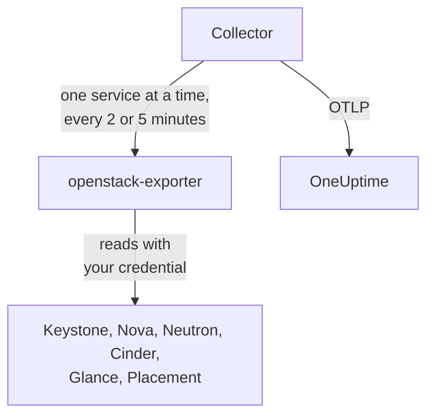

# OpenStack-agent

OneUptimes OpenStack-agent övervakar ett OpenStack-moln: dess tjänster och agenter, hypervisorer, instanser, nätverk, routrar, volymer, lagringspooler, avbilder och projekt, i varje region. Den läser molnets API:er med en autentiseringsuppgift som du väljer och skickar det den hittar till OneUptime, där molnet visas med sina regioner, hypervisorer och projekt. [OpenStack-monitorer](/docs/monitor/openstack-monitor) larmar om det som kommer in, och en [probe](/docs/telemetry/openstack-agentless) kan samla in från ett moln utan att något installeras.

:::cards
- [Probe eller agent?](/docs/telemetry/openstack-agentless#sond-eller-agent): Vilken du ska välja för ett moln som kan använda någondera.
- [Välj hur mycket den ser](#välj-hur-mycket-agenten-ser): OpenStack har ingen global skrivskyddad roll, så det finns tre nivåer.
- [Installera agenten](#installera-agenten): En autentiseringsuppgift, sedan installationsskriptet, Docker Compose eller helt utan Docker.
- [Vad den kostar ditt moln](#vad-det-kostar-ditt-moln): Vad varje inställning läser och hur du ändrar den.
- [Kapacitet](#kapacitet): Hur många fler av varje flavor som ryms och hur många dagar det är tills varje sak är full.
- [Utgifter](#utgifter): Vem som använder vad, vad det blir till dina priser eller som CloudKitty prissatte det, och vad som kan återtas.
- [Statussidor och att informera projekt](#statussidor-och-att-informera-projekt): En sida per region i ett enda steg, och att bara informera de projekt som ett fel når.
- [Tjänstloggar](#tjänstloggar): Tolkade, med en begäran följd över tjänsterna.
- [Livscykelhändelser](#livscykelhändelser): Instansåtgärder i flödet och i diagram, från notiser eller en probe.
- [Vem gjorde vad](#vem-gjorde-vad): Granskningsspår till Säkerhetshändelser.
- [Spåra en begäran](#spåra-begäranden-genom-kontrollplanet): En signerad begäran, följd över kontrollplanet.
- [Kontrollera det utifrån](#kontrollera-molnet-utifrån): Om någon faktiskt kan starta en instans, från en probe utanför molnet.
- [Utan internet](#utan-internet): Agentens fyra avbilder och hur du kopierar dem till ett eget register.
- [Per driftsättningsverktyg](/docs/telemetry/openstack-deployment-tools): Kolla-Ansible, OpenStack-Ansible, OpenStack-Helm, Atmosphere, Sunbeam, Red Hat och Mirantis.
- [Felsökning](#felsökning): Ett diagnostikskript och de vanliga problemen.
:::

## Så fungerar det

Agenten består av två fastlåsta uppströmsprogram och deras konfiguration, på en och samma maskin: [openstack-exporter](https://github.com/openstack-exporter/openstack-exporter) läser molnets API:er och gör om dem till `openstack_*`-serier, och en OpenTelemetry Collector frågar den om en OpenStack-tjänst i taget, märker varje serie med det moln och den region den kom från och skickar dem till OneUptime. Ingenting körs på dina kontrollernoder eller beräkningsnoder, om du inte lägger till den valfria [loggprofilen](#tjänstloggar), som läser deras loggar.



Molnet registrerar sig självt med sina första data, under det namn som agenten sätter på varje mätvärde som `openstack.cloud.name`. En agent övervakar ett moln: en Keystone, med en eller flera regioner.

## Innan du börjar

- Docker Engine 20.10 eller senare med Docker Compose v2-insticksmodulen, eller, för att köra utan Docker, en Linux-maskin (x86_64 eller arm64) med systemd 235 eller senare, glibc 2.34 eller senare (RHEL 9, Ubuntu 22.04, Debian 12) och root.
- En väg från den maskinen till Keystone och till varje tjänsts publika slutpunkt.
- Kommandoraden `openstack`, som någon som kan skapa autentiseringsuppgiften nedan.
- En inmatningsnyckel. Skapa en under **Projektinställningar → Telemetri och APM → Intagningsnycklar** och kopiera dess värde.
- Utgående HTTPS från den maskinen till din OneUptime-URL.

### Var du ska köra agenten

Kör agenten utanför molnet den övervakar: en liten VM på separat hårdvara, en hanteringsvärd, ett annat moln. En agent inne i ett moln som har fallerat tystnar tillsammans med det, och tystnad ser ut som ett friskt moln som slutat rapportera.

## Välj hur mycket agenten ser

OpenStack har ingen global skrivskyddad roll, och det är det svåraste med att övervaka det:

- `reader` är begränsad till ett projekt överallt utom i Keystone och Ironic.
- Hypervisorer, tjänster, agenter, pooler och Placement kräver som standard admin.
- En policyåsidosättning kan inte öppna listor över alla projekt i Neutron eller Cinder, som begränsar dem via admin-kontext i sin egen kod.
- Cinders tjänster och lagringspooler svarar med `403` till alla utom en admin, från Cinders egen kod, efter att policyn redan har släppt igenom. Ingen åsidosättning öppnar heller dessa.
- Neutron och Cinder svarar en vanlig reader med `200` och bara den readerns eget projekt. Det ser ut som att det fungerade, men det gjorde det inte.
- Där Cinder har `enforce_new_defaults` avstängt, vilket är Cinders eget standardvärde, kan vilken roll som helst på ett projekt skapa det projektets volymer, även `reader` och `oneuptime_monitoring`. På Epoxy, Flamingo och Gazpacho skapade både en vanlig reader och rollen på ett riktigt projekt en volym (`202`). På Hibiscus nekades båda (`403`), eftersom DevStack bara slår på `enforce_new_defaults` där. En skrivskyddad roll på ett riktigt projekt är inte skrivskyddad.

Så det finns tre nivåer, och var och en kostar något. Börja med den första om du kan.

| Nivå | Vad den kräver | Vad den ser | Vad som uteblir |
| --- | --- | --- | --- |
| **1. Full vy** | En applikationsautentiseringsuppgift på ett konto med `admin` på ett eget projekt, begränsad med åtkomstregler till läsning, med `service_type` satt på varje tjänst | Varje läsning som agenten gör, samt `cinder-volume`- och `cinder-scheduler`-status och lagringspooler, som bara den här nivån ser | Keystones användare och grupper, avsiktligt. Den kan inte skriva: varje skrivning besvarades med `401` |
| **2. Endast infrastruktur** | Rollerna `oneuptime_monitoring` och `reader` på ett eget projekt som inte innehåller något och har noll kvot, samt de policyåsidosättningar som agenten levererar | Alla Keystones projekt, domäner, tjänster och slutpunkter, hela Nova inklusive varje projekts servrar, hela Placement samt Neutrons agenter och IP-tillgänglighet | Neutrons nätverk, subnät, routrar, flytande IP-adresser och portar, och Cinders volymer och ögonblicksbilder, är bara det egna projektets, så på ett tomt projekt bara de delade och externa. Ingen `cinder-volume`- eller `cinder-scheduler`-status och inga lagringspooler. Den kan inte skriva: varje skrivning besvarades med `403`, eller `409` och `413` från kvoten |
| **3. Projektvy** | Vanlig `reader` på ett riktigt projekt, för ett team som övervakar sin egen del av ett moln som någon annan driver | Det projektets volymer, nätverk och routrar, från Cinder och Neutron | All infrastruktur: inga hypervisorer, tjänster, agenter, pooler eller kapacitet. Genom agenten inga instanser heller, eftersom exporterns läsning över alla projekt nekas. Och på många moln kan `reader` skriva där |

Mallarna **Block Storage Service Down**, **Storage Pool Warning** och **Storage Pool Critical** kräver nivå 1. **Compute Service Down**, **Network Agent Down** och mallarna för Placement och hypervisorer kräver nivå 1 eller 2, och ingenting på nivå 3 läser en instans.

### Vad varje nivå läser

Det här är vad fem riktiga moln svarade, på Epoxy, Flamingo, Gazpacho (OVN och OVS) och Hibiscus. Varje cell är skriven utifrån de inspelningarna.

| Läsning | Nivå 1: Full vy | Nivå 2: Endast infrastruktur | Nivå 3: Projektvy |
| --- | --- | --- | --- |
| Keystone: projekt | alla | alla | nekad |
| Keystone: domäner | alla | alla | nekad |
| Keystone: regioner | alla | det alla ser | det alla ser |
| Keystone: tjänster | alla | alla | nekad |
| Keystone: slutpunkter | alla | alla | nekad |
| Nova: servrar, alla projekt | alla | alla | nekad |
| Nova: tjänster | alla | alla | nekad |
| Nova: hypervisorer | alla | alla | nekad |
| Nova: aggregat | alla | alla | nekad |
| Nova: tillgänglighetszoner, detalj | alla | alla | nekad |
| Nova: flavors | alla | det alla ser | det alla ser |
| Nova: användning per projekt | alla | alla | nekad |
| Placement: resursleverantörer | alla | alla | nekad |
| Neutron: agenter | alla | alla | ingenting |
| Neutron: nätverk | alla | bara eget projekt | bara eget projekt |
| Neutron: subnät | alla | bara eget projekt | bara eget projekt |
| Neutron: routrar | alla | bara eget projekt | bara eget projekt |
| Neutron: flytande IP-adresser | alla | bara eget projekt | bara eget projekt |
| Neutron: IP-tillgänglighet | alla | alla | ingenting |
| Neutron: säkerhetsgrupper | alla | 409, väntat | bara eget projekt |
| Neutron: portar | alla | bara eget projekt | bara eget projekt |
| Neutron: kvoter | alla | nekad | nekad |
| Cinder: volymer, alla projekt | alla | bara eget projekt | bara eget projekt |
| Cinder: tjänster | alla | nekad | nekad |
| Cinder: pooler | alla | nekad | nekad |
| Cinder: ögonblicksbilder, alla projekt | alla | bara eget projekt | bara eget projekt |
| Cinder: säkerhetskopior, alla projekt | alla | inga registrerade | inga registrerade |
| Cinder: volymtyper | alla | det alla ser | det alla ser |
| Glance: avbilder | alla | det alla ser | det alla ser |

- **alla**: samma rader som en admin såg.
- **bara eget projekt**: det projektets rader, och allt som är delat eller externt. På ett projekt som inte innehåller något är det bara de delade och externa.
- **nekad**: en `401` eller en `403`.
- **det alla ser**: varje autentiseringsuppgift såg varje rad, på moln som bara har publika flavors, volymtyper och avbilder. En privat i ett annat projekt kräver nivå 1.
- **ingenting**: en `200` utan rader, på ett projekt som också har nätverk. Det ser ut som att det fungerade, men det gjorde det inte.
- **inga registrerade**: en `200` utan rader där en admin inte heller såg några, så det fanns inget att skilja på.
- **409, väntat**: Neutron försöker skapa projektets standardsäkerhetsgrupp när det listar dem, och noll kvot tillåter inte det, så det svarar `409 Quota exceeded`. Det är ofarligt och inget som behöver åtgärdas.

Octavia, Ironic, Heat, Magnum, Manila, Designate, Barbican, Swift, Trove och Gnocchi finns inte med här eftersom de molnen inte kör dem. [Diagnostikskriptet](#felsökning) frågar även dem, där ett moln har dem, och det läser varje sökväg med din riktiga autentiseringsuppgift och säger vad den kan se.

Vad agentens exporter fick med varje, i serier per tjänst. Antalen följer det ett moln håller när det tillfrågas, så jämför dem med varandra och inte med dina egna:

| Exportertjänst | Admin | Nivå 1: Full vy | Nivå 2: Endast infrastruktur | Nivå 3: Projektvy |
| --- | --- | --- | --- | --- |
| identity | 14 | 13 | 13 | 4 |
| compute | 33 | 33 | 33 | 15 |
| placement | 25 | 25 | 25 | 1 |
| network | 36 till 40 | 36 till 40 | 24 till 26 | 14 |
| volume | 33 | 33 till 41 | 23 | 29 till 37 |
| image | 4 | 4 | 4 | 4 |

## Installera agenten

Varje OneUptime serverar agentens installationsskript och filer för sin egen version: kommandona nedan laddar ned dem från `https://oneuptime.com`, så på en egenvärdad OneUptime ersätter du den med din URL. Installationsskriptet sparas först som `install.sh`, så att du kan läsa det innan du kör det.

:::steps
### Skapa autentiseringsuppgiften

Välj den nivå du valde. Var och en skapar en applikationsautentiseringsuppgift, som skriver ut ett `id` och en `secret`: hemligheten visas bara en gång. Ge den ett utgångsdatum och aldrig `--unrestricted`, som skulle låta den skapa fler autentiseringsuppgifter.

:::tabs
@tab Level 1: Full view
Som admin, skapa ett projekt och ett konto åt agenten:

```bash
openstack project create --domain default oneuptime-monitoring
openstack user create --domain default --password-prompt oneuptime-monitoring
openstack role add --project oneuptime-monitoring --user oneuptime-monitoring admin
```

Skapa sedan autentiseringsuppgiften, inloggad som det kontot på det projektet. Reglerna är de exakta `GET`-sökvägar som agenten använder, anpassade till ditt moln:

```bash
curl -fsSLO https://oneuptime.com/install/openstack-agent/access/application-credential-access-rules.json
curl -fsSLO https://oneuptime.com/install/openstack-agent/access/access-rules-for-cloud.py
openstack catalog list -f json | python3 access-rules-for-cloud.py \
  application-credential-access-rules.json > access-rules-for-this-cloud.json
openstack application credential create oneuptime-agent \
  --role admin \
  --access-rules "$(cat access-rules-for-this-cloud.json)" \
  --expiration 2027-11-01T00:00:00
```

En åtkomstregel matchas mot den sökväg som tjänsten ser. En tjänst bakom ett sökvägsprefix, som `https://cloud.example/compute/v2.1`, ser `/compute/v2.1/servers`, och nekar den medföljande regeln för `/v2.1/servers` med en `401`. `access-rules-for-cloud.py` lägger till varje regel igen under sin tjänsts prefix, läst från din katalog.

Två av exporterns läsningar kräver regler som är lätta att missa för hand. Den läser Octavias rot före allt annat, och bakom Apache ser en tjänst det som `/load-balancer//`, med två snedstreck. När det nekas svarar exportern med en tom `200`, så molnet ser ut som om det inte kör Octavia. Och den listar Swifts konto med ett avslutande snedstreck, som `/v1/*` inte matchar. När det nekas visar `openstack_object_store_up` `0`. De anpassade reglerna innehåller båda. En autentiseringsuppgifts regler kan inte ändras, så om din skapades från en äldre kopia av dem, skapa en ny.

Åtkomstregler kräver också att `service_type` sätts för keystonemiddleware på varje tjänst, och en omstart av den tjänsten. Utan det nekar tjänsten autentiseringsuppgiften med en `401`:

```ini title="nova.conf"
[keystone_authtoken]
service_type = compute
```

| Konfigurationsfil | `service_type` |
| --- | --- |
| `nova.conf` | `compute` |
| `neutron.conf` | `network` |
| `cinder.conf` | `block-storage`. Reglerna innehåller också `volume` och `volumev3`, för en Cinder som är konfigurerad så |
| `glance-api.conf` | `image` |
| `placement.conf` | `placement` |
| `octavia.conf` | `load-balancer` |
| `ironic.conf` | `baremetal` |
| `heat.conf` | `orchestration` |
| `magnum.conf` | `container-infra` |
| `manila.conf` | `sharev2`. Reglerna innehåller också `shared-file-system`, för en Manila som är konfigurerad så |
| `designate.conf` | `dns` |
| `barbican.conf` | `key-manager` |
| `trove.conf` | `database` |
| `gnocchi.conf` | `metric` |
| `cloudkitty.conf` | `rating` |
| `proxy-server.conf`, under `[filter:authtoken]` | `object-store`, och `include_service_catalog = True` bredvid. keystonemiddleware kontrollerar reglerna mot tokenets katalog, så med `False`, som DevStack sätter, svarar Swift autentiseringsuppgiften med `500` |

Bara de tjänster som ditt moln kör behöver en rad.

På de tjänster som ett moln kanske inte kör skiljer sig vad varje nivå fick på riktiga moln från tabellerna ovan på fyra sätt:

- **Ironic** svarar en projektautentiseringsuppgift, även en admins, med bara de noder som projektet äger, och nekar dess conductors. Bara systemomfång läser varje nod och conductors, och agentens autentiseringsuppgift ligger på ett projekt. För att läsa en nod med den, gör dess projekt till ägare: `openstack baremetal node set --owner`.
- **Swift** listar autentiseringsuppgiftens eget projekts containrar, och inga andra. Ett annat projekts konto svarar `403` om inte autentiseringsuppgiften har `ResellerAdmin`.
- **Barbican** svarar en autentiseringsuppgift bara om dess eget projekt, och nekar en vanlig reader. OneUptime läser ingen hemlighet.
- **Gnocchi** låter vilken roll som helst på ett projekt skapa ett mätvärde, så på ett moln som kör det kan nivå 2 och nivå 3 skriva där.

Keystone behöver ingenting. Med reglerna anpassade, `service_type` satt och API:erna omstartade svarade varje läsning `200` och varje skrivning `401`, på varje version vi har registrerat. Exportern får det en admin får, utom Keystones användare och grupper, avsiktligt. Det gäller även tjänsterna som ett moln kanske inte kör: registrerat på DevStack fick nivå 1 samma serier som en admins autentiseringsuppgift från var och en som exportern läser, och varje skrivning besvarades med `401`.

Om du inte vill göra den ändringen, skapa samma autentiseringsuppgift utan `--access-rules`: en vanlig applikationsautentiseringsuppgift för admin. Den fungerar och kan skriva, så diagnostikskriptet märker den som en sådan.
@tab Level 2: Infrastructure only
Som admin, skapa rollen, ett projekt som inte innehåller något och har noll kvot, och ett konto:

```bash
openstack role create oneuptime_monitoring
openstack project create --domain default --description "OneUptime monitoring: holds nothing" oneuptime-monitoring
openstack quota set --instances 0 --cores 0 --ram 0 --key-pairs 0 oneuptime-monitoring
openstack quota set --volumes 0 --gigabytes 0 --snapshots 0 --backups 0 --backup-gigabytes 0 oneuptime-monitoring
openstack quota set --networks 0 --subnets 0 --ports 0 --routers 0 --floating-ips 0 --secgroups 0 --secgroup-rules 0 oneuptime-monitoring
openstack user create --domain default --password-prompt oneuptime-monitoring
openstack role add --project oneuptime-monitoring --user oneuptime-monitoring oneuptime_monitoring
openstack role add --project oneuptime-monitoring --user oneuptime-monitoring reader
```

Projektet innehåller medvetet ingenting och har noll kvot. Där Cinder har `enforce_new_defaults` avstängt kan vilken roll som helst på ett projekt skapa det projektets volymer. Med ingenting att röra och ingen kvot att skapa något med finns det inget för den att skriva: på varje version vi har registrerat besvarades varje skrivning med `403`, eller `409` och `413` från kvoten.

Ladda ned policyåsidosättningarna och slå ihop varje fil, på varje kontrollernod, med den fil som anges av `[oslo_policy] policy_file` i den tjänstens konfiguration (`nova.conf`, `neutron.conf` och så vidare). Det är `/etc/nova/policy.yaml` och så vidare, om inte din driftsättning säger något annat: DevStack säger `policy.json`. Varje regel behåller tjänstens standard och lägger till rollen, och oslo.policy märker själv en ändrad fil, så ingen omstart behövs.

```bash
curl -fsSLO https://oneuptime.com/install/openstack-agent/access/policy/nova.yaml
curl -fsSLO https://oneuptime.com/install/openstack-agent/access/policy/neutron.yaml
curl -fsSLO https://oneuptime.com/install/openstack-agent/access/policy/keystone.yaml
curl -fsSLO https://oneuptime.com/install/openstack-agent/access/policy/placement.yaml
```

Det finns ingen fil för Cinder. Dess `os-services` och `scheduler-stats/get_pools` svarar rollen med `403 User does not have admin privileges`, på alla fem moln vi har registrerat. Det kommer från Cinders egen kod som kräver en admin-kontext, efter att policyn redan har släppt igenom, så ingen åsidosättning kan öppna dem.

**För att ta bort åsidosättningarna igen, töm filen (`{}`) och ta aldrig bort den.** På Flamingo (2025.2) och Epoxy (2025.1) ger oslo.policy fel vid varje kontroll när en policyfil den har läst försvinner, så den tjänsten misslyckas med varje begäran. När tjänsten är Keystone slutar den validera tokens och hela molnet svarar `503`. Om det redan har hänt, starta om tjänsten.

Skapa sedan autentiseringsuppgiften, inloggad som det kontot på det projektet:

```bash
openstack application credential create oneuptime-agent --expiration 2027-11-01T00:00:00
```

Att ge rollen på ett riktigt projekt för att se dess volymer och routrar låter också kontot skriva där, på ett moln där Cinder har `enforce_new_defaults` avstängt. Diagnostikskriptet varnar när autentiseringsuppgiftens projekt innehåller saker.
@tab Level 3: Project view
Ge ett konto den vanliga rollen `reader` på projektet och skapa sedan autentiseringsuppgiften, inloggad som det kontot på det projektet:

```bash
openstack role add --project my-team --user my-monitoring-account reader
openstack application credential create oneuptime-agent --expiration 2027-11-01T00:00:00
```

Agenten ser det projektets rader från Cinder och Neutron och ingen infrastruktur. Tre saker att veta innan du väljer detta:

- **Genom agenten visar den inga instanser alls.** Exportern ber Nova om alla projekts servrar, Nova nekar en vanlig reader, och den läsningen misslyckas helt. Bara en OneUptime-probe, som samlar in utan den här agenten, kan lista ett projekts instanser.
- **Den kanske kan skriva.** På ett moln där Cinder har `enforce_new_defaults` avstängt kan en vanlig `reader` också skapa volymer i sitt projekt. På Epoxy, Flamingo och Gazpacho gjorde den det (`202`), och på Hibiscus nekades det (`403`), eftersom DevStack bara slår på `enforce_new_defaults` där. Cinders eget standardvärde är avstängt.
- **Placement läses som att det inte svarar.** Varje anrop den gör nekas, och exportern rapporterar det på samma sätt som ett stoppat Placement: `openstack_placement_up 0`, på alla fem moln vi har registrerat. Sidorna kan se det utifrån vad mer som är stängt för den här autentiseringsuppgiften, och säger det. Mallen [Placement API Down](/docs/monitor/openstack-monitor#färdiga-larmmallar) kan inte det, så utelämna den på den här nivån.
:::

### Installera och starta agenten

:::tabs
@tab install.sh
Ladda ned installationsskriptet och kör det på den maskin som ska vara värd för agenten:

```bash
curl -fsSL https://oneuptime.com/install/openstack-agent -o install.sh
bash install.sh
```

Skriptet frågar efter din OneUptime-URL, inmatningsnyckeln, ett stabilt namn på molnet, Keystones autentiserings-URL, regionnamnen, applikationsautentiseringsuppgiften (ett användarnamn och lösenord om du säger nej till den) och en privat CA-fil om molnet har en egen certifikatutfärdare. Inget hemligt skrivs ut eller hamnar på en kommandorad. Det kontrollerar autentiseringsuppgiften mot Keystone innan det skriver eller startar något, installerar i `/opt/oneuptime-openstack-agent`, eller i `oneuptime-openstack-agent` i din hemkatalog om du saknar rättigheter på `/opt` (det behöver bara gruppen `docker`), skriver `.env` och `clouds.yaml` med läget `0600` och startar agenten med Docker Compose. Varje svar fungerar också som en miljövariabel, och om du kör skriptet igen återanvänder det dem i stället för att fråga igen, vilket är hur du [uppgraderar agenten](#uppgradera-agenten).
@tab Docker Compose
Ladda ned `docker-compose.yml` och `otel-collector-config.yaml` från din OneUptime till en ny mapp:

```bash
mkdir oneuptime-openstack-agent && cd oneuptime-openstack-agent
curl -fsSLO https://oneuptime.com/install/openstack-agent/docker-compose.yml
curl -fsSLO https://oneuptime.com/install/openstack-agent/otel-collector-config.yaml
```

Skapa en `clouds.yaml` bredvid dem, med en post per region, **uppkallad efter regionen**, eftersom exporterns serier inte säger vilken region de kommer från och collectorn sätter postens namn på dem som `openstack.region.name`:

```yaml title="clouds.yaml"
clouds:
  RegionOne:
    region_name: RegionOne
    identity_api_version: 3
    auth_type: v3applicationcredential
    auth:
      auth_url: https://keystone.example.com:5000/v3
      application_credential_id: your-credential-id
      application_credential_secret: your-credential-secret
```

Sedan en `.env`-fil:

```bash title=".env"
ONEUPTIME_URL=YOUR_ONEUPTIME_URL
ONEUPTIME_TELEMETRY_INGESTION_KEY=YOUR_TELEMETRY_INGESTION_TOKEN
OPENSTACK_CLOUD_NAME=my-cloud
OPENSTACK_EXPORTER_CLOUDS=[RegionOne,RegionTwo]
COMPOSE_PROFILES=openstack-exporter,openstack-ai-agent
```

`OPENSTACK_EXPORTER_CLOUDS` listar varje region, inom hakparenteser, och `COMPOSE_PROFILES` startar den medföljande exportern och [AI-agenten](#ai-agent). Båda filerna innehåller hemligheter. Exportern körs som uid 65532 och måste vara det enda kontot som kan läsa `clouds.yaml`. Starta agenten:

```bash
chmod 600 .env
sudo chown 65532:65532 clouds.yaml
sudo chmod 600 clouds.yaml
docker compose up -d
```
@tab Without Docker
På Linux (x86_64 eller arm64) med systemd 235 eller senare och glibc 2.34 eller senare kör installationsskriptet uppströmsversionerna av samma två program som systemd-tjänster. RHEL 8 och dess släktingar har en äldre glibc, som exporterns version inte kan köras på: skriptet säger det och ändrar ingenting, så använd Docker där.

```bash
curl -fsSL https://oneuptime.com/install/openstack-agent -o install.sh
sudo bash install.sh --without-docker
```

Samma frågor, samma kontroll mot Keystone och samma filer. Varje versionsarkiv hålls mot en sha256 som är fastlåst i `install.sh`, och en nedladdning som inte stämmer stoppar installationen innan något ändras. Collectorn körs som en engångsanvändare utan privilegier som aldrig ser OpenStack-autentiseringsuppgiften, och exportern som systemanvändaren `oneuptime-openstack`, det enda kontot som kan läsa `clouds.yaml`, och lyssnar enbart på `127.0.0.1:9180`.

Kör en agent per moln: om du flyttar från en Docker-installation, kör `docker compose down` först, annars kommer varje mätvärde två gånger.
:::

Kör du redan openstack-exporter med `--multi-cloud`? Peka agenten på den, så startas den medföljande aldrig: `OPENSTACK_EXPORTER_ADDRESS=10.0.0.5:9180 bash install.sh`, eller lämna `COMPOSE_PROFILES` utanför `.env` och sätt `OPENSTACK_EXPORTER_ADDRESS` där. Dess `clouds.yaml` behöver en post uppkallad efter varje region, och den bör stänga av det som den medföljande stänger av: se [Vad den kostar ditt moln](#vad-det-kostar-ditt-moln). Använd en adress som agentens container kan nå: `localhost` är containern själv.

Kolla-Ansibles exporter körs utan `--multi-cloud`, så den har ingen `/probe`, och den är fastlåst till en version som säger mindre. [Använd den exporter du redan kör](/docs/telemetry/openstack-deployment-tools#använd-den-exporter-du-redan-kör) förklarar hur du läser den, och exakt vad sidorna går utan. [OpenStack per driftsättningsverktyg](/docs/telemetry/openstack-deployment-tools) har resten av varje verktygs steg.

### Kontrollera att agenten körs

```bash
cd /opt/oneuptime-openstack-agent    # or the folder the script said it installed to
docker compose ps
docker logs oneuptime-openstack-agent
```

`docker compose ps` listar collectorn (`oneuptime-openstack-agent`), den medföljande exportern (`oneuptime-openstack-exporter`) och [AI-agenten](#ai-agent) (`oneuptime-openstack-ai-agent`). Collectorns loggar bör visa den här raden när den har startat:

```text
Everything is ready. Begin running and processing data.
```

Utan Docker, fråga `systemctl status oneuptime-openstack-agent oneuptime-openstack-exporter` och `journalctl -u oneuptime-openstack-agent`.

### Hitta molnet i OneUptime

Öppna **Produkter → Infrastruktur → OpenStack**. Molnet visas under sitt `OPENSTACK_CLOUD_NAME` efter sin första insamling, inom några minuter. Compute, network, volume och Placement läses var 2:a minut, identity och images var 5:e.
:::

Molnets **Översikt** visar om dess data når OneUptime, vad som kräver uppmärksamhet först och hur varje tjänst mår:


**Hypervisorer** visar vad Nova och Placement har utlovat på varje beräkningsvärd:


**Instanser** listar varje instans med dess status med Novas egna ord, dess projekt, flavor och hypervisor:


## Miljövariabler

Installationsskriptet skriver dessa till `/opt/oneuptime-openstack-agent/.env`; en Docker Compose-installation läser dem från `.env` bredvid `docker-compose.yml`. Efter att du ändrat en, kör `docker compose up -d` i den mappen, eller `sudo systemctl restart oneuptime-openstack-agent` utan Docker. Enbart `clouds.yaml` innehåller autentiseringsuppgiften.

| Variabel | Obligatorisk | Beskrivning |
| --- | --- | --- |
| `ONEUPTIME_URL` | Ja | Din OneUptime-URL, till exempel `https://oneuptime.com` eller din egenvärdade instans. |
| `ONEUPTIME_TELEMETRY_INGESTION_KEY` | Ja | Inmatningsnyckeln från **Projektinställningar → Telemetri och APM → Intagningsnycklar**. |
| `OPENSTACK_CLOUD_NAME` | Ja | Molnets namn i OneUptime, satt på varje mätvärde som resursattributet `openstack.cloud.name`. Håll det stabilt: om du ändrar det registreras ett nytt moln. Standardvärdet är `openstack`. |
| `OPENSTACK_AUTH_URL` | Medföljande exporter | Ett svar till installationsskriptet: Keystones autentiserings-URL. `/v3` läggs till om det saknas. |
| `OPENSTACK_EXPORTER_CLOUDS` | Ja | Regionerna, inom hakparenteser, till exempel `[RegionOne,RegionTwo]`, var och en namnet på en post i `clouds.yaml`. Standardvärdet är `[RegionOne]`. |
| `OPENSTACK_EXPORTER_ADDRESS` | Nej | `host:port`, utan schema, för din egen exporter. Utelämna den för den medföljande. |
| `OPENSTACK_CA_FILE` | Nej | En PEM-fil med certifikatutfärdaren för ett moln som har en egen. Installationsskriptet behåller en kopia som `ca.pem` bredvid `clouds.yaml`. |
| `OPENSTACK_EXPORTER_USER` | Nej | `uid:gid` som exporterns container körs som, vilken måste äga `clouds.yaml`. Standardvärdet är `65532:65532`. |
| `COMPOSE_PROFILES` | Medföljande exporter | `openstack-exporter` startar den medföljande exportern och `openstack-ai-agent` [AI-agenten](#ai-agent). |
| `OPENSTACK_LIBVIRT_EXPORTER_TARGETS` | Nej | Beräkningsnoderna att läsa [verklig användning](#verklig-användning) från via `prometheus-libvirt-exporter`, inom hakparenteser, till exempel `[compute-01:9177,compute-02:9177]`. Standardvärdet är inga. |
| `OPENSTACK_CEILOMETER_EXPORTER_TARGETS` | Nej | Samma via Ceilometers egen exporter, till exempel `[compute-01:9101]`. Standardvärdet är inga. |
| `OPENSTACK_SINGLE_CLOUD_EXPORTER_TARGETS` | Nej | En exporter som redan körs utan `--multi-cloud`, till exempel Kolla-Ansibles: `[10.0.0.254:9198]`. Se [Använd den exporter du redan kör](/docs/telemetry/openstack-deployment-tools#använd-den-exporter-du-redan-kör). |
| `OPENSTACK_RABBITMQ_TARGETS` | Nej | RabbitMQs Prometheus-plugin på varje nod, för [vad molnet vilar på](#vad-molnet-vilar-på): `[10.0.0.11:15692,10.0.0.12:15692]`. Standardvärdet är inga. |
| `OPENSTACK_MARIADB_TARGETS` | Nej | mysqld_exporter bredvid varje MariaDB-nod, vanligtvis på `9104`. Standardvärdet är inga. |
| `OPENSTACK_MEMCACHED_TARGETS` | Nej | memcached_exporter bredvid varje Memcached, vanligtvis på `9150`. Standardvärdet är inga. |
| `OPENSTACK_HAPROXY_TARGETS` | Nej | HAProxys egen Prometheus-exporter. Standardvärdet är inga. |
| `OPENSTACK_NETWORK_EXPORTER_TARGETS` | Nej | openstack-network-exporter på varje nod, för OVN och Open vSwitch, vanligtvis på `1981`. Standardvärdet är inga. |
| `OPENSTACK_LIBVIRT_HEALTH_TARGETS` | Nej | prometheus-libvirt-exporter på varje beräkningsnod, vanligtvis på `9177`, för om libvirt svarar och ingenting per instans. Standardvärdet är inga. |
| `OPENSTACK_CONTROL_PLANE_REGION` | Nej | Regionen för ett mål ovan som inte anger sin egen. Ett mål kan göra det: `RegionTwo@10.1.0.11:15692`. Standardvärdet är den första regionen. |
| `OPENSTACK_AGENT_SERVICES` | Nej | Vilka tjänster den här agenten läser, för [att dela ett moln mellan agenter](/docs/telemetry/openstack-very-large-clouds#dela-ett-moln-mellan-insamlare), till exempel `compute\|placement`. Standardvärdet är alla. |
| `OPENSTACK_AGENT_MEMORY_LIMIT_MIB` | Nej | Hur mycket collectorn får hålla i minnet. Ett mycket stort molns insamling tar mer än standardvärdet `512`. |
| `OPENSTACK_DATABASE_EXPORTER_TARGETS` | Nej | `openstack_database_exporter`, för [databasvägen](/docs/telemetry/openstack-very-large-clouds#databasvägen): `[openstack-database-exporter:9180]`. Standardvärdet är inga. Databasvägens övriga inställningar listas där. |

Installationsskriptet läser också autentiseringsuppgiften från miljön, för att hoppa över sina frågor: `OPENSTACK_APPLICATION_CREDENTIAL_ID` och `OPENSTACK_APPLICATION_CREDENTIAL_SECRET`, eller `OPENSTACK_USERNAME`, `OPENSTACK_PASSWORD`, `OPENSTACK_PROJECT_NAME`, `OPENSTACK_USER_DOMAIN_NAME` och `OPENSTACK_PROJECT_DOMAIN_NAME`. De har egna namn i stället för de `OS_*` som en openrc-fil sätter, så en admins källinläsa openrc blir aldrig agentens autentiseringsuppgift utan att någon tillfrågas. En applikationsautentiseringsuppgift är bättre än ett användarnamn och lösenord: den kan begränsas till läsning och kan gå ut.

## Vad molnet vilar på

De flesta OpenStack-avbrott börjar under det: en RabbitMQ som försvunnit, Galera utan kvorum, en OVN-databas utan ledare. Agenten kan läsa de exportrar som dessa redan har, varje minut, och den är avstängd tills du anger dem. Inget här skriver till något av dem, och bara några få serier av varje sparas.

Ange var och en i agentens `.env`, varje medlem i ett kluster, och kör sedan `docker compose up -d`:

```bash
OPENSTACK_RABBITMQ_TARGETS=[10.0.0.11:15692,10.0.0.12:15692,10.0.0.13:15692]
OPENSTACK_MARIADB_TARGETS=[10.0.0.11:9104,10.0.0.12:9104,10.0.0.13:9104]
OPENSTACK_MEMCACHED_TARGETS=[10.0.0.11:9150,10.0.0.12:9150]
OPENSTACK_HAPROXY_TARGETS=[10.0.0.11:9101,10.0.0.12:9101]
OPENSTACK_NETWORK_EXPORTER_TARGETS=[10.0.0.21:1981,10.0.0.22:1981,RegionTwo@10.1.0.21:1981]
OPENSTACK_LIBVIRT_HEALTH_TARGETS=[10.0.0.21:9177,10.0.0.22:9177]
OPENSTACK_CONTROL_PLANE_REGION=RegionOne
```

Ett mål kan ange vilken region det finns i, som det sista i den listan gör. Ett som inte gör det finns i `OPENSTACK_CONTROL_PLANE_REGION`. På Kolla-Ansible, vars Prometheus redan känner till alla, skriver `control-plane-targets.py` ut de här raderna åt dig, och [OpenStack per driftsättningsverktyg](/docs/telemetry/openstack-deployment-tools) säger var varje exporter finns på de andra.

Vad var och en läser, och vad agenten behöver av den:

| Inställning | Läser | Aktivera den med |
| --- | --- | --- |
| `OPENSTACK_RABBITMQ_TARGETS` | RabbitMQs eget plugin, `/metrics` och varje kö från `/metrics/detailed` | `rabbitmq-plugins enable rabbitmq_prometheus` på varje nod |
| `OPENSTACK_MARIADB_TARGETS` | mysqld_exporter bredvid varje nod. Dess standardvärden rapporterar redan Galera | Ingenting utöver exportern |
| `OPENSTACK_MEMCACHED_TARGETS` | memcached_exporter bredvid varje Memcached | Ingenting utöver exportern |
| `OPENSTACK_HAPROXY_TARGETS` | HAProxys egen exporter | `http-request use-service prometheus-exporter` på en egen `frontend` |
| `OPENSTACK_NETWORK_EXPORTER_TARGETS` | openstack-network-exporter på varje maskin med Open vSwitch eller OVN:s databaser | Dess standardinsamlare. En maskin rapporterar det den kör |
| `OPENSTACK_LIBVIRT_HEALTH_TARGETS` | prometheus-libvirt-exporter på varje beräkningsnod, och bara om libvirt svarar | Ingenting utöver exportern |

Sedan har molnets kort **Kontrollplan** en rad för varje, och en sida per beroende med en rad per maskin. **Bevakas inte** på det kortet betyder att du inte har angett det: det visas aldrig som friskt. Problem där går till molnets **Kräver uppmärksamhet**. Molnets sida **Rekommendationer** erbjuder [larmmallarna](/docs/monitor/openstack-monitor#vad-molnet-vilar-på), och `troubleshoot.sh` kontrollerar att varje mål svarar och är det du sa att det är.

För mer av en RabbitMQ eller en databas än vad ett molns hälsa behöver läser produkterna [Köer](/docs/telemetry/queues) och [Databaser](/docs/telemetry/databases) dem via sina egna agenter, vilket är mer data än detta och på sina egna villkor. Sidorna för kontrollplanet länkar till dem. Att installera dem är separat, eftersom de produkterna läser de agenternas serier och inte dessa.

Två saker att veta om openstack-network-exporter 0.3.0, versionen som dessa registrerades med:

- **Den ansluter till Open vSwitchs databas en gång.** Efter att Open vSwitch startat om förblir `ovs_build_info`, dess bryggor, dess gränssnitt och alla ovn-controllers serier borta tills exportern också startas om, medan Open vSwitchs egna serier kommer tillbaka direkt. **Exporter Lost Open vSwitch's Database** säger när det har hänt.
- **Den läser en OVN-databas klusterstatus på en maskin.** Det är Southbound där en maskin har båda uttagen, som Kolla-Ansibles har. Så Northbounds ledare visas bara där en maskin saknar Southbound att läsa.

## Vad agenten samlar in

Collectorn skapar ett scrape-jobb per OpenStack-tjänst, via exporterns `/probe?cloud=<region>&include_services=<service>`, så att en felande Nova bara lämnar Novas serier saknade:

| Scrape-jobb | Var | Timeout | Serier |
| --- | --- | --- | --- |
| `oneuptime-openstack-compute` | 2 minuter | 110 s | `openstack_nova_agent_state`, `openstack_nova_running_vms`, `openstack_nova_vcpus_used`, `openstack_nova_memory_used_bytes`, `openstack_nova_local_storage_used_bytes`, `openstack_nova_total_vms`, `openstack_nova_server_status`, `openstack_nova_flavors`, `openstack_nova_availability_zones` |
| `oneuptime-openstack-network` | 2 minuter | 110 s | `openstack_neutron_agent_state`, `openstack_neutron_networks`, `openstack_neutron_subnets`, `openstack_neutron_routers`, `openstack_neutron_router`, `openstack_neutron_l3_agent_of_router`, `openstack_neutron_floating_ips`, `openstack_neutron_security_groups`, `openstack_neutron_network_ip_availabilities_total`, `openstack_neutron_network_ip_availabilities_used` |
| `oneuptime-openstack-volume` | 2 minuter | 110 s | `openstack_cinder_agent_state`, `openstack_cinder_volumes`, `openstack_cinder_volume_gb`, `openstack_cinder_snapshots`, `openstack_cinder_pool_capacity_free_gb`, `openstack_cinder_pool_capacity_total_gb` |
| `oneuptime-openstack-placement` | 2 minuter | 110 s | `openstack_placement_resource_total`, `openstack_placement_resource_usage`, `openstack_placement_resource_allocation_ratio`, `openstack_placement_resource_reserved` |
| `oneuptime-openstack-identity` | 5 minuter | 120 s | `openstack_identity_projects`, `openstack_identity_project_info`, `openstack_identity_domains`, `openstack_identity_regions` |
| `oneuptime-openstack-image` | 5 minuter | 120 s | `openstack_glance_images`, `openstack_glance_image_bytes`, `openstack_glance_image_created_at` |
| `oneuptime-openstack-load-balancer` | 5 minuter | 120 s | `openstack_loadbalancer_total_loadbalancers`, `openstack_loadbalancer_loadbalancer_status`, `openstack_loadbalancer_total_amphorae`, `openstack_loadbalancer_amphora_status`, `openstack_loadbalancer_total_pools`, `openstack_loadbalancer_pool_status` |
| `oneuptime-openstack-baremetal` | 5 minuter | 120 s | `openstack_ironic_node`, `openstack_ironic_node_updated_at`, `openstack_ironic_node_provision_updated_at` |
| `oneuptime-openstack-orchestration` | 5 minuter | 120 s | `openstack_heat_stack_status`, `openstack_heat_stack_status_counter` |
| `oneuptime-openstack-container-infra` | 5 minuter | 120 s | `openstack_container_infra_total_clusters`, `openstack_container_infra_cluster_masters`, `openstack_container_infra_cluster_nodes`, `openstack_container_infra_cluster_status` |
| `oneuptime-openstack-sharev2` | 5 minuter | 120 s | `openstack_sharev2_shares_counter`, `openstack_sharev2_share_gb`, `openstack_sharev2_share_status`, `openstack_sharev2_share_status_counter` |
| `oneuptime-openstack-dns` | 5 minuter | 120 s | `openstack_designate_zones`, `openstack_designate_zone_status`, `openstack_designate_recordsets`, `openstack_designate_recordsets_status` |
| `oneuptime-openstack-object-store` | 5 minuter | 120 s | `openstack_object_store_objects`, `openstack_object_store_bytes` |
| `oneuptime-openstack-database` | 5 minuter | 120 s | `openstack_trove_total_instances`, `openstack_trove_instance_status`, `openstack_trove_instance_volume_size_gb`, `openstack_trove_instance_volume_used_gb` |
| `oneuptime-openstack-gnocchi` | 5 minuter | 120 s | `openstack_gnocchi_status_metricd_processors`, `openstack_gnocchi_status_metric_having_measures_to_process`, `openstack_gnocchi_status_measures_to_process` |

De sista nio är tjänster som ett moln kanske inte kör. När exportern tillfrågas om en som inte finns i dess katalog loggar den in på Keystone, loggar en rad (`No suitable endpoint could be found in the service catalog`) och svarar med ingenting, och det molnet visar inga spår av tjänsten. Det är en inloggning var 5:e minut per tjänst och region, vilket är varför alla dessa är 5 minuter. För att bara fråga efter de tjänster du kör, sätt `OPENSTACK_AGENT_SERVICES`, till exempel `identity|compute|placement|network|volume|image`.

Varje tjänst rapporterar också `openstack_<service>_up`, till exempel `openstack_nova_up`. [OpenStack-monitorn](/docs/monitor/openstack-monitor#insamlade-mätvärden) listar varje serie med vad den betyder. Varje serie bär:

| Attribut | Vad det säger |
| --- | --- |
| `openstack.cloud.name` | Molnets namn, ett resursattribut |
| `oneuptime.agent.version` | Versionen av agentens filer, ett resursattribut: den collectorversion de låser fast, med sista numret höjt varje gång filerna ändras på den collectorn |
| `openstack.region.name` | Regionen, från namnet på posten i `clouds.yaml`, på varje datapunkt |
| `openstack_service` | Jobbets OpenStack-tjänst (`compute`, `network`, ...), på varje datapunkt |

Monitorfilter matchar på likhet, så behåll processorn `transform/openstack-identity` om du anpassar konfigurationen, och de två borttagningarna av `service.name` och `service.instance.id` i processorn `resource`: utan borttagningarna registreras datan som en fantomtjänst i stället för att nå molnet.

## Vad det kostar ditt moln

Övervakning får aldrig vara det som tar ner ett moln, så standardvärdena är försiktiga. Varje scrape loggar in på Keystone igen och gör riktiga API-anrop. [Mycket stora OpenStack-moln](/docs/telemetry/openstack-very-large-clouds) har vad det blir, i förfrågningar per minut och gigabyte per dag, vid varje storlek.

| Inställning | Standard | Att slå på eller ändra den ger dig | Vad den kostar |
| --- | --- | --- | --- |
| Projektkvoter | Av | Hur mycket av varje kvot ett projekt har använt, på dess sida och under **Kräver uppmärksamhet**, samt larmet Project Quota Nearly Reached | Fyra API-anrop per projekt, per region, en gång i timmen (Nova ett, Cinder två, Neutron ett), från en egen exporter |
| Långsamma mätvärden | Av | Novas egna kvotlistor och användning per server | Ett anrop per projekt per scrape, så det växer med antalet projekt |
| Serier per port | Av | `openstack_neutron_port`, `openstack_neutron_ports`, `openstack_neutron_ports_no_ips`, `openstack_neutron_ports_lb_not_active` | En lista över varje port utan avgränsning. På ett stort moln kan det [mätta Neutron och orsaka kaskadfel](https://github.com/openstack-exporter/openstack-exporter/issues/540), så lämna det avstängt om du inte vet att ditt portantal är litet |
| Tjänster ett moln kanske inte kör | På | Lastbalanserare, bare metal, stackar, kluster, delningar, DNS, objektlagring, databaser och Gnocchi, där molnet har dem | Ett moln utan en betalar en inloggning var 5:e minut. Designate kostar ett anrop per zon per scrape, så det växer med antalet zoner |
| Scrape-intervall | 2 och 5 minuter | Färskare data, eller mindre belastning | Dubbelt så ofta är dubbelt så många API-anrop. Håll varje `scrape_timeout` under sitt `scrape_interval`, så att en långsam scrape aldrig staplas på den före |

**Projektkvoter:** kör `install.sh` igen med `OPENSTACK_COLLECT_QUOTAS=true`. På en Docker Compose-installation lägger du till `openstack-quotas` i `COMPOSE_PROFILES` i `.env` och sätter `OPENSTACK_QUOTA_CLOUDS` till det som `OPENSTACK_EXPORTER_CLOUDS` anger. Endera startar en andra exporter, `openstack-quota-exporter`, som inte läser något annat, och collectorn frågar den en gång i timmen efter `openstack_nova_limits_*`, `openstack_neutron_quota_*`, `openstack_cinder_limits_*` och `openstack_cinder_volume_type_quota_gigabytes`. De ändras långsamt, och en exporter läser samma saker oavsett vilket jobb som frågar, så att läsa dem mer sällan kräver en egen exporter. Din egen exporter har inget sådant: agenten läser vad den säger, vid varje scrape.

**Långsamma mätvärden:** ta bort raden `--disable-metric` för det du vill ha, från exporterns `command` i `docker-compose.yml`, eller från `ExecStart` i `oneuptime-openstack-exporter.service` utan Docker. Kostnaden är ett anrop per projekt per scrape.

| Ta bort | För att samla in |
| --- | --- |
| `--disable-metric=nova-quota_cores` | `openstack_nova_quota_*` |
| `--disable-metric=nova-server_local_gb` | `openstack_nova_server_local_gb`, användning per server. Den här är en enda användningsrapport som går igenom varje server i stället för ett anrop per projekt, och den är ändå långsam på ett stort moln |

De tre raderna som lämnar projektkvoter utanför den här exportern (`--disable-metric=nova-limits_vcpus_max`, `--disable-metric=neutron-quota_network`, `--disable-metric=cinder-limits_volume_max_gb`) ligger kvar. Tar du bort dem läses de också varannan minut.

Varje flagga anger den serie som läser resten av sin rad, vilket är varför en rad stänger av dem alla. Använd inte exporterns egen `--disable-slow-metrics` i stället: den tar också `openstack_glance_image_*`, avbildslistan som sidan Avbilder läser med ett anrop. Neutrons lista över kvoter är bara en admins på varje nivå utom nivå 1, så `openstack_neutron_quota_*` kräver den nivån.

**Serier per port:** ta bort de fyra raderna `--disable-metric=neutron-port*`, på samma ställe.

**Intervall:** ändra `scrape_interval` och `scrape_timeout` under ett jobb i `otel-collector-config.yaml`.

Kör sedan `docker compose up -d --force-recreate`, eller `sudo systemctl daemon-reload` och starta om båda tjänsterna utan Docker. En uppgradering ersätter de här filerna och behåller din kopia som `<file>.bak.<timestamp>`, så gör din ändring igen efteråt.

Tre rader till ligger kvar, eftersom du inte kommer att sakna dem. `--disable-metric=neutron-subnets_total` utelämnar många serier som säger det adresspoolerna redan säger (`openstack_neutron_subnets_total`, `openstack_neutron_subnets_used`, `openstack_neutron_subnets_free`). `--disable-metric=nova-security_groups` utelämnar en läsning av en väg som Nova inte längre har, vilket bara skulle fylla exporterns logg. `--disable-metric=gnocchi-total_metrics` utelämnar en läsning av varje mätvärde i Gnocchi, sida för sida, för ett enda antal (`openstack_gnocchi_total_metrics`): en Gnocchi kan hålla miljontals.

För att läsa interna slutpunkter i stället för publika, lägg till `--endpoint-type=internal` på samma ställe.

Tre öppna uppströmsärenden formar allt detta, och projektet har också [bett om underhållare](https://github.com/openstack-exporter/openstack-exporter/issues/443):

- [Ärende 660](https://github.com/openstack-exporter/openstack-exporter/issues/660): en felande tjänst tömmer en hel scrape. Därför finns det ett scrape-jobb per tjänst. Slå inte ihop dem.
- [Ärende 540](https://github.com/openstack-exporter/openstack-exporter/issues/540): en portlista utan avgränsning kan mätta Neutron. Därför är serierna per port avstängda, och diagnostikskriptet ber om en liten sida med portar.
- [Ärende 244](https://github.com/openstack-exporter/openstack-exporter/issues/244): scrapes får timeout på större moln. Därför är intervallen minuter i stället för sekunder, var och en med en timeout under sig. Om `openstack_*_up` saknas för en tjänst på ett stort moln, höj det jobbets intervall och timeout före allt annat.

## Bare metal

Om ditt moln kör Ironic får det en sektion **Bare metal** med varje nod som Ironic visar för autentiseringsuppgiften: var den befinner sig i Ironics tillståndsmaskin, dess ström, om någon har satt den i underhåll och varför, dess resursklass och när Ironic senast såg den röra sig. Ett moln utan Ironic har ingen sådan sektion, inget larm om det och ingen rad på någon sida.

En nod är inte en hypervisor, även om Nova och Placement båda listar den som en under dess UUID, så den räknas inte som en plats att köra en virtuell maskin. Hur många noder av varje resursklass som skulle kunna ta emot en instans finns på sidan Bare metal, för de noder som Ironic visar för den här autentiseringsuppgiften, och på sidan [Kapacitet](#kapacitet), för varje nod som Placement håller.

Vad som kräver att någon agerar, på samma rader som [larmmallarna](/docs/monitor/openstack-monitor#färdiga-larmmallar):

| Läser | Betyder |
| --- | --- |
| Ett felat tillstånd, som `clean failed` eller `deploy failed`, eller `error` | Det förblir felat tills någon agerar: Ironic försöker inte om något av dessa och sätter inte alltid noden i underhåll |
| Samma övergående tillstånd, som `wait call-back`, i 2 timmar | Ironic ger som standard upp väntan efter 30 minuter, så något annat håller kvar det. En lång diskrensning kan ärligt talat ta så här lång tid: sidan läser Ironics egen tid, som en rensnings hjärtslag håller i rörelse, och ett larm läser bara ordet |
| I underhåll i 7 dagar | Planerat fram till dess, som en tjänst någon har inaktiverat, så ingenting säger att det kräver uppmärksamhet före det |
| `active` med strömmen av | Det som körs på den har stoppats. Om dess ägare stoppade instansen på den säger nodens sida att det är planerat. Ett larm läser en serie och kan inte avgöra det |

### Vad den inte kan se

Var och en av dessa registrerades på en riktig DevStack, och varje sida säger det där det spelar roll:

- **Ironic visar ett projekt bara de noder det äger.** Placement svarar alla, så där det håller en nod som Ironic inte listade säger sidan att listan inte är hela molnets. Enligt Ironics standardpolicy läser bara en autentiseringsuppgift med systemomfång varje nod, eller en vars roll har `baremetal:node:list_all`.
- **Exportern bär inte varför en nod felade.** Den har en underhållsorsak och inget `last_error`, och Ironic kan ändå tömma `last_error` inom ungefär en minut, med noden fortfarande felad: det gjorde det för en felad rensning och lämnade en felad driftsättnings. Så titta direkt med `openstack baremetal node show <node> -c last_error`, eller i conductorns logg. En [probe](/docs/telemetry/openstack-agentless) läser `last_error` och behåller det senaste den såg.
- **Exportern har inga conductors.** Bara en probe läser dem, och Ironic nekar ett projekts autentiseringsuppgift listan om inte dess policy säger något annat (`baremetal:conductor:get`).
- **Ett stoppat Ironic läses likadant som inget Ironic.** På en fråga om ett som är stoppat svarar exportern med en tom 200, som den gör för ett moln som aldrig haft det. Så en sida säger bara att den inte har hört från Ironic, och att noderna är som de senast lästes. Den säger aldrig nere. Två veckor efter att resten av molnet senast rapporterade utan det försvinner de raderna, och de kommer tillbaka om det gör det.

## Kapacitet

"Får vi plats med det här?" är den fråga en OpenStack-operatör får oftast, och Novas lediga antal svarar inte på den: allokeringsförhållanden, reservationer och fragmentering spelar alla roll, så ett moln kan ha tusentals lediga vCPU:er och inget utrymme för en stor instans. Ett moln har sidan **Kapacitet** som visar hur många fler av varje flavor som ryms, och vad som är knappt, det som tar slut först överst. Den läser en sammanfattning, uträknad varannan minut, så det den laddar växer inte med antalet värdar. **Exportera CSV** på dess flavortabell laddar ned allt på sidan.

Allt på den är allokering: vad som har utlovats, inte vad som är upptaget. En overksam instans håller allt av det.

**Vad kapacitet är.** För varje resursleverantör och resursklass är kapaciteten `(total - reserved) x allocation_ratio`, och allokerat är det som Placement har utlovat. Det summeras per zon, aggregat, region och moln. En värd vars `nova-compute` ligger nere fortsätter rapportera sina senaste siffror, och en inaktiverad tar inte emot något nytt, så ingen av dem räknas som utrymme. Det de håller finns kvar, och en prognos räknar med det.

**Bare metal.** En nod tar en instans helt, så ett moln med Ironic får en egen tabell, per resursklass: hur många noder, hur många som kan ta en instans, hur många som används och hur många som hålls tillbaka, eftersom Novas Ironic-drivrutin inte kan använda dem just nu. Det här är Placements egna siffror, så de gäller hela molnet även där Ironic bara visar ett projekt det som det äger, och de ingår inte i vCPU:erna och minnet ovan. En probe läser vilken klass en flavor ber om och räknar den mot dessa. Agentens exporter säger det inte, så på agenten räknas en bare metal-flavor som sina vCPU:er, sitt minne och sin disk, på värdar.

**Hur många fler som ryms.** Varje flavor räknas värd för värd, eftersom en instans behöver allt den ber om på en värd. Bredvid antalet står vad det skulle vara om allt ledigt fanns på en värd, vilket är hur ett fullt moln skiljs från ett fragmenterat. En flavor som ingen värd skulle kunna hålla ens tom säger **För stor för varje värd**, och ingenting larmar någonsin om den. Antalen gäller en instans som startats från en avbild: en som startats från en volym ber inte om någon rotdisk.

Sidan säger var varje antal kom från:

| | Genom en probe | Genom agenten |
| --- | --- | --- |
| **Räknat från** | `GET /allocation_candidates`, vilket är det Novas schemaläggare frågar, som [StackHPC:s os-capacity](https://github.com/stackhpc/os-capacity) gör. Inventarier fylls i tills en flavors tur kommer | De Placement-serier som exportern redan skickar: `openstack_placement_resource_{total,reserved,allocation_ratio,usage}` |
| **Ser egenskaper och kapslade leverantörer** | Ja. En flavors extra specs efterfrågas också, så `trait:` och `resources:` räknas | Nej: exporterns flavorserie har inga extra specs, så en flavor som behöver en egenskap räknar varje värd, och sidan säger det |
| **En värds `max_unit`** | Placements eget | Antas vara värdens total, vilket är vad Nova sätter |

En probe frågar försiktigt, eftersom detta är den enda läsning som får Placement att arbeta. Den frågar om en flavorform i taget, så flavors som ber om samma sak är en fråga, och högst 4 per insamling, i omgångar, oavsett hur många flavors det finns. Så ett moln med 40 flavors som samlas in varannan minut kostar 2 anrop i minuten och går ett varv på 20 minuter. Varje svar är begränsat till 1 000 värdar, vilket är Novas eget `max_placement_results`: en starts arbete. Ett antal från ett så långt svar är ett golv, och sidan säger **Minst**. Den frågar ingenting vid sin första insamling, ingenting när Placement har varit långsamt under den insamlingen, och på en timme ingenting efter att en autentiseringsuppgift nekats, eftersom antalet från inventarierna finns där ändå. En applikationsautentiseringsuppgift eller rollen `oneuptime_monitoring` kräver att `/allocation_candidates` tillåts: det finns i `access/application-credential-access-rules.json` och `access/policy/placement.yaml`.

**Bredvid vad värdarna verkligen använder.** Där [verklig användning](#verklig-användning) når OneUptime ställer sidan det förhållande du satt bredvid vad värdarna verkligen använder vid sin topp under en dag, och det förhållande där de skulle nå den 90-procentsgräns som **Hypervisor CPU Saturated** och **Hypervisor Memory Pressure** drar. Det är en rak linje från en dag av en arbetsbelastning, så den säger hur långt ett förhållande skulle kunna flyttas, inte att du bör flytta det. Den säger ingenting förrän över hälften av en zons värdar rapporterar.

**När saker fylls.** Varje zons resursklasser, varje externt nätverks IPv4-adresser och varje lagringspool har en prognos: en rak linje genom det som allokerades under den senaste veckan, mot det som finns i dag. Ett nytt moln säger **Otillräcklig historik** tills det har en dag av den.

**Om en zon kan förlora en värd.** Det som är allokerat i zonen, även på en förlorad värd, mot vad dess andra värdar skulle kunna utlova med den största borta, som VMwares Host failure frågar efter för ett kluster. Den jämför mängder i stället för var varje instans skulle hamna, så en zon som klarar det har utrymme för en evakuering, inte ett löfte om att varje instans hittar en värd: flavortabellen visar vad som är fragmenterat. En zon med en värd har inget att säga, och det har inte heller en med en värd som någon har inaktiverat, eftersom det är planerat arbete.

**Allokeringar som ingen instans förklarar.** När Placement håller mer på en värd än vad dess instansers flavors summerar till, i över en halvtimme, namnger sidan värden. Det är vanligtvis en [föräldralös allokering](https://docs.openstack.org/nova/latest/admin/troubleshooting/orphaned-allocations.html), kvar efter en borttagning eller flytt som misslyckades halvvägs, och den äter tyst upp kapacitet. Den jämför vCPU:er och minne, eftersom en instans som startats från en volym inte håller något av sin flavors disk. Den säger ingenting om en värd där något är på väg att flyttas, eller en instans av en flavor som molnet inte längre listar. För att se vad de är, och för att ta bort dem när du har kontrollerat att var och en verkligen inte tillhör någon instans eller migrering:

```bash
nova-manage placement audit --verbose
nova-manage placement audit --verbose --delete
```

**Larm.** **Flavor Can No Longer Be Placed**, **Capacity Forecast Under 14 Days** och **Reserved Headroom Gone** läser serier som OneUptime skriver från samma sammanfattning. De finns i [monitorns mallar](/docs/monitor/openstack-monitor#färdiga-larmmallar) och på molnets sida **Rekommendationer**.

**Vad den kostar.** Ingenting på agenten. En probe lägger till anropen ovan. OneUptime skriver ungefär 2 serier för varje zons resursklass, externt nätverk och lagringspool, och en för varje flavor som folk kan be om, varannan minut, debiterade som vilket annat mätvärde som helst.

## Utgifter

Privata moln kostar fortfarande pengar, och den som driver ett får frågan vem som använder vad och vad som kan återtas. Ett molns sida **Utgifter** svarar på båda och fungerar helt utan konfiguration. Den visar användning och uppskattningar att planera med. OneUptime fakturerar ingen, och inget här är ett belopp som en hyresgäst är skyldig.

**Den här månaden mot förra** står överst, sedan vem som växer, sedan varje projekt, störst först, med **Exportera CSV**. Domänerna, och vad som användes på vilken flavor och volymtyp, finns under. Ett projekts egen sida har sin månad rad för rad och månaderna före.

### Hur användningen räknas ut

Var 15:e minut läser en worker vad varje projekt håller i molnets inventarie och lägger till det för tiden sedan den senaste läsningen: vCPU-timmar och minnestimmar per flavor, volym-GB-timmar per typ, timmar för flytande IP-adresser samt lagring av avbilder och ögonblicksbilder. Ingen serie per instans läses eller skrivs, så det kostar metrikarkivet och telemetrifakturan ingenting, och det fungerar likadant på ett moln i [sammanfattningsläge](/docs/telemetry/openstack-very-large-clouds#sammanfattningsläge).

Vad det betyder för siffrorna:

- **En storleksändring flyttar timmar från en flavor till den andra**, och en borttagning stoppar dem. En ändring räknas från den första läsning som visar den, så var och en kan vara fel med upp till 15 minuter. En instans som levde kortare tid än så kanske aldrig ses.
- **En del räknas tills inventariet släpper den,** vilket är upp till 15 minuter efter att den försvann. På ett stort moln som läses i omgångar tar en ändring lika lång tid som sin tur att komma fram.
- **En instans håller sin flavor från att den placeras tills den tas bort.** En som är avstängd räknas fortfarande, på en egen rad, eftersom Nova håller dess vCPU:er och minne reserverade på dess värd. En som aldrig nådde en värd räknas inte, och inte heller en som har skjutits undan från sin värd.
- **En volym eller ögonblicksbild i fel, eller som fortfarande skapas, räknas inte,** eftersom den inte har något utrymme bakom sig överlag.
- **Timmar som OneUptime inte läste gissas inte.** Ett glapp längre än en timme räknar sin sista timme, och sidan säger hur många timmar som inte räknades.
- **Agentens exporter rapporterar hur många ögonblicksbilder det finns, inte vilka,** så lagring av ögonblicksbilder räknas bara på ett moln [anslutet utan agent](/docs/telemetry/openstack-agentless).

### Priser

Priserna är dina och de är valfria. Utan dem visar sidan användning. Under **Priser**, ställ in en valuta och ett pris per timme för en vCPU, en GB minne, en GB volym, en flytande IP, en GB avbild och en GB ögonblicksbild. **Avancerad** har ett pris per instanstimme per flavor, vilket då är hela den flavorns pris, ett pris per volymtyp och en växel för att utelämna avstängda instanser. En månad är ungefär 730 timmar.

Ett pris på noll betyder inget pris, inte ett gratis moln. Det som saknar pris sägs sakna det, och ett projekt som använde något utan pris räknas på sidan, så en total av det som har pris utges aldrig för att vara allt. Dagens priser gäller för hela varje visad period, även förra månadens, så att en prisändring inte ser ut som att ett projekts användning ändras. Ett pris som ändras nu syns inom 15 minuter.

### CloudKitty

Om molnet kör [CloudKitty](https://github.com/openstack/cloudkitty) ersätter det den har prissatt beräkningen, projekt för projekt, och sidan säger vilket den använde. En probe frågar en gång i timmen, för den här månaden och förra, och den frågar `GET /v2/summary`, eller `GET /v1/report/summary` på en CloudKitty som är för gammal för det. Det är högst två förfrågningar per 1 000 projekt i timmen, plus en förfrågan om dess version varje gång den läses.

- **Bara en [probe](/docs/telemetry/openstack-agentless) kan läsa den.** Agentens exporter har inga serier för CloudKitty, så ett moln anslutet via en agent beräknar, och säger det.
- **Det den ser är det autentiseringsuppgiften får se.** CloudKittys egen policy visar en admins autentiseringsuppgift varje projekt, med åtkomstregler eller utan, och allt mindre bara dess eget. De projekt den inte prissätter fortsätter att räknas ut från dina priser.
- **En CloudKitty per region summeras.** Var och en läses i sin egen takt, och ett projekts siffra är det de prissatte tillsammans. En CloudKitty som katalogen listar för flera regioner tillfrågas en gång.
- **Dess siffror är den enda delen av detta som är telemetri.** De når OneUptime som `openstack_cloudkitty_rated`, en datapunkt per projekt och månad, en gång i timmen: 20 000 i timmen vid 10 000 projekt, vilket är nästan ingenting bredvid resten av ett moln i den storleken.
- **Den anger ingen valuta.** En taxa visas i din prislistas valuta om du har ställt in en, och som enbart ett tal om inte.
- **Om den slutar svara** står det varje projekt prissattes kvar där det var, och sidan säger när den senast lästes. **Rating API Down** larmar om det.
- **En riktig CloudKitty har svarat på detta,** på `stable/2026.1`, med InfluxDB bakom, som prissatte det Ceilometer skrev till Gnocchi. Det är den enda uppsättning den har lästs på. Utan någon regel aktiverad prissätter den varje projekt till `0`, och när inget är prissatt ännu svarar den utan rader. Hur som helst fortsätter de projekten att räknas ut från dina priser.

### Budgetar

En budget säger vad ett projekt, eller ett helt moln, får uppgå till på en månad, i valutan för dina priser. Som med [ett anslutet moln budgetar](/docs/telemetry/cloud-costs) ger den ett larm första gången i en månad som uppskattningen passerar varje andel av den (80 % och 100 % om du inte säger något annat), och ett när det som hålls nu skulle passera den innan månaden är slut. En ny månad börjar från noll, och förra månadens larm löses. En budget larmar bara: den stoppar ingenting. Utan priser eller CloudKitty finns inget att jämföra med, så den förblir tyst och dess rad säger att den inte har kontrollerats.

### Vad som kan återtas

Molnets sida **Rekommendationer** listar vad som lämnats oanvänt, vad var och en skulle frigöra och kommandot som listar det, en gång i timmen. OneUptime tar aldrig bort något, och var och en av dessa är en fråga till den som äger den.

| Vad | När den namnges | Vad den frigör | Kommandot som listar dem |
|---|---|---|---|
| Hypervisorer som skulle kunna tömmas | 20 % eller mindre av dess vCPU:er och minne är allokerat, allt på den ryms på de andra värdarna i dess zon och aggregat, och zonen skulle fortfarande kunna förlora en värd efteråt | Hela värden | `openstack hypervisor list --long` |
| Instanser som varit avstängda länge | Avstängd i 30 dagar | Deras vCPU:er, minne och lokala disk | `openstack server list --all-projects --status SHUTOFF --long` |
| Volymer kopplade till ingenting | Tillgänglig i 30 dagar, kopplad till ingenting, och inte en av Cinders egna `image-<id>`-volymer, som kommandot också listar | Deras lagring | `openstack volume list --all-projects --status available --long` |
| Gamla volymögonblicksbilder | Skapade för 90 dagar sedan. Endast probe | Deras lagring | `openstack volume snapshot list --all-projects --long` |
| Avbilder som inget startats från | Privat eller delad, 30 dagar gammal, inte skyddad, och ingen instans eller volym kom från den. Endast probe | Deras lagring | `openstack image list --long` |
| Flytande IP-adresser som ingen använder | Inte associerad i 7 dagar | En adress | `openstack floating ip list --status DOWN --long` |

Inget som används namnges någonsin. Hur länge något har varit så kommer från molnets egen klocka där en probe rapporterar en. Genom en agent är det hur länge OneUptime har sett det så, så den dag du ansluter ett moln är ingenting gammalt än. En regel som inte kan vara säker säger det i stället för att gissa: agenten kan inte säga vilken avbild en instans startades från, så en avbild som används skulle se oanvänd ut, och den kan inte lista ögonblicksbilder, så de två reglerna väntar på en probe. En värd namnges efter vad som är allokerat snarare än hur upptagen den är, den namnges aldrig i en zon med en förlorad eller inaktiverad värd, och värdar tas tommast först så att allt som namnges kan göras. Den kan inte se egenskaper eller något annat en instans behöver av en värd.

### Vid varje storlek

En läsning kostar lika mycket oavsett hur ofta instanser ändras, och vad den kostar växer med det som namnges här. Detta är testat på Postgres, med satserna räknade exakt och den största storlekens tid hållen inom en budget.

| Hypervisorer | Instanser | Projekt | Satser per läsning | Sparade rader | Vad sidan läser |
|---|---|---|---|---|---|
| 10 | 100 | 10 | 13 | 750 | En rad för molnet, en sida med projekt |
| 500 | 20 000 | 1 000 | 14 | 75 000 | En rad för molnet, en sida med projekt |
| 5 000 | 200 000 | 10 000 | 37 | 750 000 | En rad för molnet, en sida med projekt |

När ett moln har en förra månad läser en läsning även den, en sats per 2 000 projekt. Timreglerna läser fem listor med högst 5 000 rader, och går igenom varje instans rad en gång för att se vad som används.

Vid den största storleken läses vad varje projekt håller på under 5 sekunder, en hel läsning tar under 30, och raden som sidan läser håller sig under 2 MB. Sparade rader är en per projekt för var och en av 13 månader, och en per projekt för var och en av de senaste 62 dagarna. De beror inte på hur många instanser det finns, och inget av det räknas som telemetri.

## Verklig användning

Nova och Placement säger vad som är utlovat på en hypervisor, inte vad som är upptaget: en overksam instans håller alla sina vCPU:er. Så ingenting i OneUptime kallar de siffrorna användning. För att se vad som verkligen är upptaget, rikta agenten mot vilken av dessa ditt moln redan kör. OpenTelemetry Collector har ingen egen libvirt-mottagare.

| Källa | Var den körs | Slå på den |
| --- | --- | --- |
| [`prometheus-libvirt-exporter`](https://github.com/inovex/prometheus-libvirt-exporter) | Port 9177 på varje beräkningsnod. Kolla-Ansible kör den när Prometheus och KVM är på. | Sätt `OPENSTACK_LIBVIRT_EXPORTER_TARGETS=[compute-01:9177,compute-02:9177]` |
| Ceilometers egen exporter, från 2025.1 | Port 9101 på varje beräkningsnod, bredvid dess pollingagent. | I `ceilometer.conf`, under `[polling]`, sätt `enable_prometheus_exporter = true`, `prometheus_listen_addresses` till en adress som agenten kan nå, och `batch_size` högre än det största antalet instanser på en nod. Sätt sedan `OPENSTACK_CEILOMETER_EXPORTER_TARGETS=[compute-01:9101]` |

Efter att ha ändrat någon av dem, kör `docker compose up -d`. Varje exporter talar för en beräkningsnod, så ange varje nod du vill ha läst.

Ceilometer säger bara det som dess `polling.yaml` ber om, och filen den levereras med utelämnar en del av detta. Lägg till dessa mätare i den för hela bilden:

| Mätare | Utan den |
| --- | --- |
| `vcpus` | En instans CPU mäts mot vad dess flavor säger i stället. Epoxy har ingen sådan mätare. |
| `memory.resident` | Ingenting säger vad instanser håller på sin hypervisor, så ingen **Hypervisor Memory Pressure** |
| `disk.device.read.latency`, `disk.device.write.latency` | Ingen disklatens, så ingen **Instance Disk Latency High** |

OneUptime gör om båda till en uppsättning serier när de kommer in, bredvid originalen: `openstack.instance.*` för varje instans, per dess UUID, och `openstack.hypervisor.instances.*` för vad en hypervisors instanser summerar till. [OpenStack-monitorn](/docs/monitor/openstack-monitor#insamlade-mätvärden) listar dem. Så sidor och larm betyder samma sak oavsett vilken källa ett moln har:

| Vad den läser | libvirt | Ceilometer |
| --- | --- | --- |
| CPU som används | Hur mycket CPU-tid som gick, över tiden mellan två läsningar | Samma, från ett kumulativt tal i nanosekunder |
| CPU som väntar, det gästen kallar steal | `libvirt_domain_vcpu_delay_seconds_total` | `ceilometer_cpu_delay`, när en version har den. Ingen utgiven Ceilometer har den än, från Epoxy till Hibiscus, så dessa visar ingen läsning |
| Minne som används | Vad gästens balloon-drivrutin säger: tillgängligt minus användbart | `ceilometer_memory_usage`, vilket är samma summa. Utan en balloon-drivrutin har ingen av dem detta, och det utelämnas i stället för att gissas |
| Minne på hypervisorn | `libvirt_domain_memory_stats_rss_bytes` | `ceilometer_memory_resident`. Den håller mer än flavorns storlek, eftersom QEMU självt ingår i den |
| Disk och nätverk | Takter per disk och gränssnitt, och latens som tiden förfrågningar tog över hur många det fanns | Samma |

Ceilometers läsningar ändras bara en gång per pollingcykel, fem minuter som standard, oavsett hur ofta de läses. En takt räknas ut mellan de tidpunkter då en läsning ändrades, så den läser inte 0, 0, sedan fem gånger sanningen, och en läsning som inte ändrades tillför ingen data. Det första värdet som ses säger ingenting om när det pollades, så den första takten tar två pollningar. När en pollning har flyttat något om en instans läser det den lämnade som det var 0, och en läsning på en instans där ingenting rör sig läser 0 efter 11 minuter. En räknare som går bakåt har startat om, efter att en instans startat om eller flyttats, och räknar från noll. `libvirt_domain_info_memory_usage_bytes` läses inte som användning: det är ballongens storlek, som på en overksam instans är dess flavors minne.

En avstängd instans har ingen läsning från någon av källorna: libvirt rapporterar en CPU-tid på 0 och Ceilometer säger ingenting, och ingen av dem är en instans som inte gör något. En config drive är en CD-ROM, som libvirts exporter utelämnar och Ceilometer inte gör, så med Ceilometer visar en instans som har en en disk till, vanligtvis `hda`, som läser ingenting.

En instans sida visar CPU, minne, disk och nätverk bredvid sin flavors storlek, med deras diagram under **Användning**. En hypervisors sida visar vad dess instanser använder, mätt mot vad den har före något allokeringsförhållande, och namnger de mest upptagna bredvid vad var och en fick, med deras diagram under **Mätvärden**. Över en gräns säger den vilka instanser som är ansvariga och vilka som tvingas vänta. Utan en källa säger varje sida det, och vad som ska läggas till. Där OneUptimes [värdagent](/docs/telemetry/hosts) körs på en hypervisor läser dess sida den maskinens egen CPU, minne, disk och nätverk därifrån, vilket inkluderar värdens egna processer, så den kan vara över gränsen medan dess instanser inte är det.

Agentens felsökningsskript läser varje exporter du angav, säger hur många instanser den känner till och vilka mätare Ceilometer inte pollar, och vad var och en kostar dig.

Fyra [larmmallar](/docs/monitor/openstack-monitor#färdiga-larmmallar) läser dessa: **Hypervisor CPU Saturated**, **Hypervisor Memory Pressure**, **Instance CPU Saturated** och **Instance Disk Latency High**. Utan en källa förblir de tysta.

### Vad det kostar

Serier per instans multipliceras snabbt, så att behålla dem är ett val, under molnets **Inställningar**, i **Verklig användning per instans**:

| Val | Vad det behåller |
| --- | --- |
| Automatiskt, standardvärdet | Varje instans så länge molnet har 500 eller färre, och ingen därutöver |
| Varje instans | Varje instans, vid vilken storlek som helst |
| Bara de projekt och aggregat jag väljer | Instanserna i de projekten, och de på hypervisorerna i de aggregaten |
| Ingen | Ingen instans serier |

En instans som inte behålls förlorar också sina originalserier, så valet stoppar hela kostnaden, och den räknas fortfarande in i sin hypervisors totaler, som är fem serier per hypervisor oavsett vad du väljer. Agentens scrape-jobb behåller bara det OneUptime läser av varje exporter. Över 5 000 instanser avgör samma val också vem som behåller en [serie för sin status](/docs/telemetry/openstack-very-large-clouds#sammanfattningsläge).

Vad en instans kostar, med två vCPU:er, en disk och ett nätverksgränssnitt:

| Källa | Serier per instans | Rader per timme | Rader per månad, 100 instanser | Rader per månad, 1 000 instanser |
| --- | --- | --- | --- | --- |
| `prometheus-libvirt-exporter`, läst varje minut | 30 | 1,800 | 131,400,000 | 1,314,000,000 |
| Ceilometers exporter, läst varje minut och pollad var 5:e | 24 | 864 | 63,072,000 | 630,720,000 |

Varje ytterligare disk lägger till 12 serier till någon av dem, och varje ytterligare gränssnitt 4. Varje ytterligare vCPU lägger till 1 från libvirt. Agentens collector håller dessa i minnet på väg ut, så ett stort moln kan behöva mer än sina standard 512 MiB. Guidens kalkylator, under **OpenStack → Dokumentation**, sätter ett pris på dessa för ett moln av din storlek.

## Projekt och domäner

Ett moln håller många hyresgäster, så OneUptime håller reda på vems allt är.

- **Projekt** listar varje projekt med dess domän, vad det kör, vad som kräver uppmärksamhet i det och de incidenter och larm som är öppna på dess delar. Ett projekts sida säger samma sak i sin helhet och namnger varje värd under det som är nere.
- **Domäner** säger hur många projekt varje domän håller.
- **Varje lista över vad ett projekt äger** kan avgränsas till ett projekt, och till en domän på ett moln med fler än en. Båda går via ID, så att byta namn på ett projekt eller en domän bryter ingenting.

### Skicka ett projekts larm till dess team

På ett projekts sida, lägg till en regel under **Vem som får veta om detta** eller **Etiketter på det som öppnas om detta**. **Domäner** har samma två för en hel domän. Från och med då får varje larm och incident som når det projektet eller den domänen de ägarna eller etiketterna.

En regel här är en **Ägarregel för OpenStack-moln** eller **Etikettregel för OpenStack-moln** med projektets eller domänens ID på sig, så den visas också under molnets inställningar **Ägarregler** eller **Etikettregler**, där du kan skriva en för hand under **Ett projekt eller en domän**. En regel med någotdera ID lägger inte till något på själva molnet. Villkor på molnet gäller fortfarande, och en regel som skapats från **Domäner** namnger sitt moln, eftersom varje moln har en domän som heter `default`. Om du byter namn på det molnet, uppdatera regelns namnvillkor.

Ett larm eller en incident på en del av molnet når varje projekt som har något på den delen, hur många de än är. Bara en monitor kan säga vad den når, så en regel som denna når inte en incident som någon deklarerar för hand. Etiketter sätts på när larmet öppnas, och ägare strax efter.

Regler skrivna tidigare som ett par av larm- och incidentregler, som matchar ``OpenStack project `<id>` `` or ``OpenStack domain `<id>` `` i beskrivningen, fortsätter att fungera och listas också här. En beskrivning namnger högst 50 av de projekt den når, så ett sådant par slutar där. Ta bort det och lägg till regeln igen för att häva den gränsen.

### Kvoter

Med kvoter på visar ett projekts sida hur mycket av varje det har använt: instanser, kärnor, RAM, gigabyte volymer, nätverk, portar och flytande IP-adresser. Ett projekt på 90 % av en, eller över, visas under **Kräver uppmärksamhet**. En gräns på -1 betyder ingen gräns, så den är aldrig vid något. De läses en gång i timmen. En läsning som är mer än tre timmar gammal visas men bedöms inte längre, eftersom kvoter kan ha stängts av.

De är avstängda som standard på grund av vad de kostar: se [Vad den kostar ditt moln](#vad-det-kostar-ditt-moln). OpenStacks kvot för hur många volymer ett projekt får hålla visas inte, eftersom exportern bara läser dess gigabyte.

### Etiketter från Novas metadata

För att se en Nova-metadatanyckel som en etikett, lägg till `--nova.metadata-extra-labels=team` i exporterns kommando, med fler nycklar efter ett kommatecken. Ett projekts sida visar de värden dess instanser bär.

## Topologi och sprängradie

Ett molns sida **Topologi** ritar det region för region: tillgänglighetszoner, hypervisorer och instanserna på dem, lagringspooler och volymer, nätverk, routrar och flytande IP-adresser, samt API:erna och tjänsterna. Varje del färgas efter samma regler som **Kräver uppmärksamhet**, så en hypervisor vars `nova-compute` har stoppats är röd, med sina instanser under sig.

Över 5 000 delar läser kartan vad som har fallerat och vad det drar med sig i stället för allt, öppnas på de värdar som fallerat och säger vad den lämnade utanför. **Kräver uppmärksamhet** avgränsar den till allt annat. [Infrastruktur](/docs/telemetry/topology) ritar molnet bredvid dina värdar och kluster.

Med `nova-compute` stoppad på en värd blir värden röd med sina instanser under sig, och sidan räknar den öppna incidenten och det öppna larmet:


En dels sprängradie är vad den drar med sig, till antal och per projekt:

| När detta fallerar | Det når |
| --- | --- |
| En hypervisor, eller dess `nova-compute` | Dess instanser |
| En lagringspool | Dess volymer, och de instanser de är kopplade till |
| En L3-agent | De routrar som ingen annan agent kan ta över, och deras flytande IP-adresser |
| En regions API | Allt det API:et betjänar i regionen, i varje projekt |

En dels sida visar den. Ett larm eller en incident på delen säger den i sin beskrivning, till exempel "3 instanser i 2 projekt", med deras namn.

Exportern säger inte vilket nätverk en instans finns på, eller vilken pool som håller en volym, så ingetdera ritas för ett moln som agenten samlar in. Kartan säger det, och en lagringspools sprängradie säger att den inte kan avgöra det i stället för att svara ingen. En [probe](/docs/telemetry/openstack-agentless) säger båda. Kartan kopplar då en volym till sin pool, när Cinder behandlar dess autentiseringsuppgift som en admins, och en pools sprängradie räknar dess volymer och de instanser de är kopplade till. Den kopplar också en instans till varje nätverk den har en adress på. Nova namnger de nätverken bara med namn, och Neutron tillåter två med samma namn, så kartan letar efter ett i instansens projekt, sedan ett delat med det, sedan vilket som helst med det namnet, och ritar ingen koppling när två är lika sannolika. Det som fortfarande är okänt står kvar i kartans notis.

## Statussidor och att informera projekt

Många moln drivs åt andra. När en värd fallerar vill de informera exakt de projekt den påverkar, och publicera hur varje region mår. Allt här byggs av det OneUptime redan har, och allt det skapar förblir redigerbart där det alltid är. Öppna ett molns sida **Statussidor** för att börja.

### En statussida i ett enda steg

**Skapa statussida** visar först vad den kommer att skapa, monitor för monitor, och skapar ingenting förrän du säger till. Varje region är en grupp, och varje tjänst regionen kör är en rad: Compute, Networking, Block Storage, Images, Identity och Load Balancing, var och en stödd av de monitorer som säger om den fungerar. En tjänst som ditt moln inte kör har ingen rad.

En monitor som redan bevakar en rad används som den är, så ett fel öppnar fortfarande en incident. På ett moln med flera regioner kan en monitor du skapade för hela molnet inte vara en regions rad, eftersom ett fel någon annanstans skulle göra den röd. Den raden får en egen monitor, som bara säger hur raden läses, och din fortsätter att öppna incidenten.

Sidan är privat tills du säger något annat. Det är en vanlig statussida: dess grupper, rader och vem som kan läsa den finns alla på dess egna sidor.

**Skapa mål** skapar ett mål per rad, i [Service Level Objectives](/docs/slo/introduction): 99,9 % av de senaste 30 dagarna, från drifttiden för dess monitorer och, där en [kontroll utifrån](#kontrollera-molnet-utifrån) är på, den kontrollens monitor också. Kör det igen så lämnar det dem det redan skapat ifred.

### Vem en incident namnger

En incident på en del av molnet tar sin [sprängradie](#topologi-och-sprängradie) och lägger, genom [ägarregler på ett projekt](#skicka-ett-projekts-larm-till-dess-team), till de team som äger de berörda projekten. En fallerad hypervisor säger "42 instanser i 7 projekt", och namnger dem.

Allt det står under raden **I det här molnet** i incidentens beskrivning, och är alltid bara för ditt team. En statussida och dess prenumeranter läser beskrivningen ner till den raden, så en kunds namn når aldrig en annans sida.

### Att informera ett projekt

En **projektavisering** är en e-postadress eller en webhook som får veta när en del som påverkar det projektet har en incident eller planerat underhåll. Lägg till en på molnets sida **Statussidor** eller på ett projekts egen sida.

En avisering börjar avstängd. Att slå på den sker alltid från dess förhandsvisning, som visar vem den informerar, projektet den gäller och vad ett fel skulle säga. Ändra adressen och den är avstängd igen, eftersom det inte längre är den du såg.

Det som sägs handlar bara om det projektet: vad det håller på delen, med våra ord. En avisering säger aldrig en värds namn, vilket OpenStack självt håller dolt för ett projekt, och säger aldrig något om ett annat projekt. Varje ord från ditt moln behandlas som text, så ett projekt med ett konstigt namn gör ingenting i en e-postklient eller för det som läser en webhook, och ett e-postmeddelande läser inte in något utifrån.

| Rad | Vem som informeras |
| --- | --- |
| Tre projekt på en värd, ett påslaget | Det ena, med vad det håller där |
| Ett projekt med aviseringar av | Ingen, och incidentens flöde säger det |
| En del som når 500 projekt | Varje påslaget, utöver de 50 som en incidents beskrivning namnger |
| En instans utan projekt | Ingen. Den räknas i totalen, och förhandsvisningen säger det |
| Ett projekt som togs bort, med en instans kvar | Ingen, hur dess avisering än är inställd |
| En andra incident på en del som redan informerats om | Ingen, tills båda är över. Då informeras det en gång om att det är över |
| En avisering som stängdes av under minuten innan den gick ut | Ingen, och **Vad som skickades** säger varför |
| En värd som någon inaktiverat, utan underhållshändelse | Ingen. Det larmar ditt team, och det ett projekt kör där fortsätter |

Varje avisering går ut högst en gång. Om en worker stannar halvvägs genom utskicket skickas den aviseringen inte igen, och **Vad som skickades** säger att den kan ha gått eller inte. En webhook är en POST av JSON med ett `id` som inte ändras, och bara ett svar som säger att den inte togs emot (`429` eller en `5xx`) försöks igen.

### Ett projekts egen privata sida

**Skapa privat sida**, på ett projekts sida, skapar en privat statussida för de som använder det projektet: en rad för varje tjänst det använder, i varje region det finns i. En rad blir röd bara när ett fel når det projektet, och ett meddelande säger vad som hände, med samma ord som en avisering använder.

Ingen kan läsa den förrän du lägger till dem under dess **Privata användare**, och en session på ett projekts sida läser ingen annans. Sidan listar bara monitorer av sitt eget slag, som ingen incident någonsin ligger på, så ingenting om ett annat projekt kan läsas genom den, vare sig på sidan eller via dess API.

### Planerat arbete på en värd eller en zon

**Schemalägg underhåll**, på en hypervisors eller tillgänglighetszons sida, skapar en underhållshändelse för just den. Den visar först vem den skulle informera. När den skapas namnger dess flöde de projekt den når, och den som bett att få veta om de projekten informeras. Medan den pågår är det som värden eller värdarna i den zonen säger tyst, även på en statussidas rad, och varje annan del fortsätter larma.

En händelse länkad till molnet utan namngivna värdar eller zoner gäller hela molnet.

`openstack compute service set --disable` förväntas under en händelse på den värden, och hypervisorns sida säger det. Utanför en har ingen sagt varför, så mallen **Compute Service Disabled** larmar om det. Lägg till den monitorn om en värd som inaktiverats för hand är något du vill få veta om. Den larmar dig och informerar inget projekt, eftersom det ett projekt redan kör där fortsätter. En `nova-compute` som inaktiverade sig själv eftersom libvirt försvann är ett fel och en incident: **libvirt Service Down** säger det, och den här förblir tyst medan den är öppen.

## Ihopkopplat med resten av OneUptime

En incident stannar sällan i OpenStack. En pod är långsam eftersom dess nods instans ligger på en full hypervisor vars volymer ligger på en degraderad Ceph-pool. Var och en av dem rapporterar till OneUptime på egen hand, och det här är kopplingarna.

Ingen länk görs på en gissning. Ett namn som matchar två delar länkar till ingen av dem, från vilken ände du än läser det: en värd som heter `compute-01` bredvid två hypervisorer som heter `compute-01.east.example` och `compute-01.west.example` finns på ingen av dem, och en hypervisor som två värdar kan vara har ingen värd. Samma UUID i två moln, till exempel en återställd kopia, länkar till ingetdera, om inte ett av dem är arkiverat.

| Vad | Länkar till | Hur |
| --- | --- | --- |
| En [värd](/docs/telemetry/hosts) som kör OneUptimes agent på en beräkningsnod | Dess hypervisor | Via namn, där exakt en värd och en hypervisor matchar. Ett kort namn matchar ett fullständigt, och två fullständiga namn i olika domäner är två maskiner |
| En värd inuti en gäst | Dess instans | Dess `host.id` är instansens UUID, som collectorns resursdetektor `nova` rapporterar. Sätt den först, så att den vinner över `system`: `detectors: [nova, system, env]`. Låt `system` sköta `host.name` med `nova: { resource_attributes: { host.name: { enabled: false } } }`, annars ändras värdens namn till instansens |
| En Kubernetes-nod | Dess instans | Dess `spec.providerID`, `openstack:///<uuid>` eller `openstack://<region>/<uuid>`, som `openstack-cloud-controller-manager` sätter |
| En tjänst | Den instans eller hypervisor den körs på | Den värd som dess telemetri namnger, eller den Kubernetes-nod som dess poddar finns på |
| En Cinder-lagringspool | Dess Ceph-kluster | Se nedan |

Varje sida länkar till nästa: en värd, en Kubernetes-nod och en tjänst säger var de körs, en instans säger vad den också är, och [Infrastruktur](/docs/telemetry/topology) ritar en länkad värds tjänster under deras instans. En värds länk görs en gång och lämnas ifred. Den kontrolleras var femte minut tills den kan göras, och skrivs aldrig över. När fler än ett moln kan vara det, välj ett under **OpenStack-moln** på värdens inställningssida.

Sidorna för RabbitMQ och MariaDB under **Vad den vilar på** leder till [Köer](/docs/telemetry/queues) och [Databaser](/docs/telemetry/databases), som går djupare när deras egen agent läser dem.

När en hypervisor fallerar fortsätter dess sprängradie bortom molnet, och ett larms beskrivning och OneUptime AI läser samma svar: dess instanser, själva maskinen, de värdar och Kubernetes-noder dess instanser är, de kluster de finns i och tjänsterna på de värdarna och noderna. En undersökning som börjar vid en långsam tjänst kan gå ner till dess hypervisor.

### En lagringspool och Ceph

Vad varje källa säger om en pool avgör hur den länkas:

| Källa | Vad den säger | Vad som händer |
| --- | --- | --- |
| En [probe](/docs/telemetry/openstack-agentless) på nivån Full vy | Cinders RBD-drivrutin namnger Ceph-klustrets fsid och pool i `location_info` | Den länkas själv, när ett [Ceph-kluster](/docs/telemetry/ceph) här rapporterar det fsid. Ett Ceph-kluster rapporterar det bara med `ceph.cluster.fsid` satt i sin agents konfiguration |
| Agentens exporter | Poolens namn, dess backends namn och dess leverantör, som läser `Open Source` för både LVM och RBD | Ingenting säger att den finns på Ceph. En Ceph-pool med samma namn i exakt ett kluster erbjuds, för att någon ska bekräfta en gång på poolens sida, om inte en annan Cinder-pool också har det namnet. Utan en sådan matchning kan de välja ett kluster, eller säga att den inte finns på Ceph |

När den väl är länkad säger poolens sida hur dess kluster läses, och `HEALTH_WARN` eller `HEALTH_ERR` visas i molnets **Kräver uppmärksamhet**. Ett förslag som ingen bekräftat väcker ingenting. Ett svar som någon gett kan ändras på poolens sida. Bara autentiseringsuppgiften för Full vy kan se pooler alls: se [Välj hur mycket agenten ser](#välj-hur-mycket-agenten-ser).

## Heat och Magnum

Om ditt moln kör Heat eller Magnum visas de av sig själva: det finns inget att slå på. Ett moln som kör ingetdera visar inga spår av dem, ingen menypost, inget kort på **Tjänster** och inget larm att välja bland. Det som avgör är molnets eget svar, aldrig en inställning: agenten frågar efter vardera vid varje insamling, och en tjänst som Keystones katalog inte namnger svarar med ingenting.

Ett moln med Heat får **Stacks** under **Orkestrering**, och ett med Magnum får **Kubernetes-kluster**. Var och en listar varje stack eller kluster med dess status med tjänstens eget ord, och var och en har en sida. En stack eller ett kluster i ett felat tillstånd når **Kräver uppmärksamhet** med namn, och det gör också ett som fortfarande pågår efter två timmar, vilket är dubbelt så mycket som någon av tjänsterna ger ett av egen vilja. Magnum bygger ett kluster med en Heat-stack, så ett felat kluster och dess felade stack läses som en rad, med klustrets namn, och varje sida länkar till den andra.

### Vad varje sätt att samla in ser

Exportern säger mindre om de här tjänsterna än vad en läsning av deras API:er gör, och ingen av tjänsterna visar någon utom en admin hela molnet. Så varje sida säger vad ditt molns collector inte kan se.

| Vad | Agent, Full vy | Probe, Full vy | Allt mindre |
| --- | --- | --- | --- |
| Varje projekts stackar och deras status | Ja | Ja | Högst det egna projektets, utan projekt på dem, och inget fel säger det |
| Vems en stack är | Ja | Ja | Nej |
| Varför en stack felade | Nej. Kör `openstack stack failures list` | Ja | Nej |
| Varje projekts Kubernetes-kluster och deras status | Ja | Ja | Inga av ett annat projekts, och inget fel säger det |
| Vems ett kluster är | Från dess Heat-stack | Från Magnum | Nej |
| Varför ett kluster felade, dess mall och dess Kubernetes-version | Nej. Kör `openstack coe cluster show` | Ja | Nej |
| Heats motorer och Magnums conductors på **Tjänster** | Nej | Ja | Nej |
| Vilka instanser och volymer en stack äger | Nej | Ja | Högst det egna projektets |

Två fel läses annorlunda, och båda är vad ett riktigt moln gör:

- **En stoppad `heat-engine`** läses som **Orchestration API Down**, på vilken collector som helst. Heats API ber en motor om sina listor, så när ingen finns kvar kan det inte svara på dem, efter en minuts väntan på en RPC-timeout. En stack som en motor lämnade pågående kan förbli pågående efter att motorn kommit tillbaka, och läses som **Stack Stuck In Progress** när två timmar har gått.
- **En stoppad `magnum-conductor`** visas ingenstans på ett moln som agenten samlar in, eftersom Magnums API fortsätter svara utan en och exportern inte läser conductors. Dess kluster slutar bara röra sig. En probe med en autentiseringsuppgift för Full vy läser dem, vilket är det enda sättet att se detta, eller kör `openstack coe service list`.

Vilka instanser och volymer en stack äger finns på ytterligare en läsning av den stacken, som agentens exporter inte gör. På ett moln som en probe samlar in listar en stacks sida dem, och en instans eller volyms sida och larm namnger stacken. En autentiseringsuppgift för Full vy får svar om varje projekts stackar. Allt mindre nekas ett annat projekts, och en stacks sida säger när ingenting har läst den. På ett moln som agenten samlar in, kör `openstack stack resource list`.

### Ett kluster med Kubernetes-agenten på sig

Installera [Kubernetes-agenten](/docs/telemetry/kubernetes-agent) på ett kluster som Magnum byggt och de två länkas åt båda hållen, utan något att ställa in: Magnum-klustrets sida namnger Kubernetes-klustret, och Kubernetes-klustrets sida namnger Magnum-klustret och molnet det finns i. Varje nods sida säger redan vilken instans och hypervisor den är.

Det som gör det till en länk är att nodernas `spec.providerID` namnger instanser, och de instansernas namn är det som Magnums Heat-drivrutin ger servrarna i det klustrets stack: `<stack>-master-0`, `<stack>-node-0`. Så det kräver tre saker, och utan någon av dem finns ingen länk och inget fel:

- OpenStack-molnleverantören på klustret, som är det som sätter `spec.providerID`, och som Magnum slår på som standard.
- En autentiseringsuppgift som kan läsa Heat, eftersom stackens namn kommer därifrån.
- Ett kluster byggt med Heat-drivrutinen. En drivrutin som inte bygger någon Heat-stack har inget att koppla på.

En länk är aldrig en gissning. En agent installerad två gånger under två namn, eller ett kluster som håller servrar från två Magnum-kluster, länkar till ingetdera. En maskin du anslöt till klustret för hand, eller en nodgrupp med en egen stack, säger ingenting åt något håll.

En server i ett Magnum-kluster namnger sitt kluster på sin egen sida och i varje larm om den, och en hypervisors **Vad det drar med sig** namnger varje Magnum-kluster med en server på den.

Om en tjänst lämnar Keystones katalog försvinner dess rader ungefär 15 minuter efter att exportern börjar svara med ingenting om den, förutsatt att resten av molnet fortfarande svarar. En felad insamling, eller en Keystone som ingen kan logga in på, tar inte bort något. En incident som en monitor hade öppen på den förblir öppen tills någon löser den, eftersom tystnad aldrig stänger en incident.

## Manila

Om ditt moln kör Manila får ett moln **Shares** under **Lagring** av sig självt, och ett som inte gör det visar inga spår av det. Varje delning har sin status med Manilas eget ord, hur mycket utrymme den rymmer, sitt protokoll och vems den är, och en egen sida. En delning i ett feltillstånd når **Kräver uppmärksamhet** med namn, och det gör också en som fortfarande är på väg efter en timme: Manila har ingen egen timeout för en långsam backend, så en som hängt läses likadant som en som är långsam till dess. En delning som migreras eller säkerhetskopieras lämnas ifred, eftersom de varar så länge dess data tar att kopiera.

| Vad | Agent, Full vy | Probe, Full vy | Allt mindre |
| --- | --- | --- | --- |
| Varje projekts delningar och deras status | Ja | Ja | Högst det egna projektets, och övervakningsrollen inga, och inget fel säger det |
| Vilken backend som håller en delning, och om dess åtkomstregler gäller | Nej. Kör `openstack share show` | Ja | Nej |
| Varför en delning felade | Nej. Kör `openstack share message list` | Nej. Kör samma | Nej |
| Hur mycket av en delning som används | Nej: bara dess backend vet | Nej | Nej |
| `manila-share`, `manila-scheduler` och `manila-data` på **Tjänster** | Nej. Kör `openstack share service list` | Ja | Nej |

Manilas API fortsätter svara utan sina andra tjänster, så på ett moln som agenten samlar in visas en stoppad `manila-share` ingenstans: dess delningar slutar bara ändras, och **Share Stuck** är det som till slut säger det. En probe med en autentiseringsuppgift för Full vy läser dem, och **Manila Service Down** säger det då. Manila säger `stopped` för en tjänst som stängts ned rent, och `down` bara för en som dog, när dess hjärtslag har blivit gammalt.

Ett moln utan Manila kostar ingenting för det: exportern svarar med ingenting, och det ger ingen rad. Om Manila lämnar Keystones katalog försvinner dess rader ungefär 15 minuter efter att det börjar, som [Heats och Magnums gör](#heat-och-magnum).

## Octavia

Om ditt moln kör Octavia får ett moln **Lastbalanserare** under **Nätverk** av sig självt, och ett som inte gör det visar inga spår av det. Varje lastbalanserare har sin provisioneringsstatus och sin driftstatus med Octavias egna ord, sin leverantör (`amphora` eller `ovn`), sin virtuella IP och vems den är. Pooler och amphorae har egna sidor, och en amphora länkar till den instans den körs i.

En lastbalanserare i `ERROR`, en som fastnat i `PENDING_UPDATE` eller `PENDING_CREATE` i en timme, en pool där varje medlem misslyckas med sin hälsokontroll, en amphora i `ERROR`, ett aktiv-standby-par med två masters och en amphora vars certifikat har under 14 dagar kvar når alla **Kräver uppmärksamhet** med namn. En amphoras certifikat varar exakt 30 dagar från den dag den byggs (registrerat), och Octavias städning förnyar ett med 14 dagar kvar som standard, så en gräns vid 30 dagar skulle utlösas på varje amphora under hela dess liv.

| Vad | Agent, Full vy | Allt mindre |
| --- | --- | --- |
| Varje projekts lastbalanserare och pooler, med båda statusarna | Ja | Högst det egna projektets, och övervakningsrollen inga |
| Amphorae, deras roll, deras instans och deras certifikat | Ja | Nej: Octavia låter bara en admin lista dem |
| Lyssnare och medlemmar | Nej: exportern har inga serier för dem. En [probe](/docs/telemetry/openstack-agentless) läser dem | En probe: det egna projektets |
| Trafik: anslutningar, byte, förfrågningsfel | Nej: exportern har inga `stats_*`-serier, och Octavias API är den enda plats som säger det. En probe läser det och ritar takten mellan två läsningar | En probe: det egna projektets |
| Octavias egna workers på **Tjänster** | Nej: ingenting agenten läser listar dem | Nej |

En pool vars medlemmar alla misslyckas med sin hälsokontroll är `ERROR` i driftstatus medan den och dess lastbalanserare förblir `ACTIVE` i provisionering, registrerat, så en sida som bara läste provisionering skulle inte visa något fel. En lastbalanserare i provisionering `ERROR` läses som driftstatus `OFFLINE`. OVN-leverantören rapporterar 0 för varje trafikräknare, vilket inte är ett fel.

Ett stoppat Octavia-API ger exportern ett tomt svar i stället för `openstack_loadbalancer_up 0`, samma sak som ett moln utan Octavia. Så på ett moln som agenten samlar in förblir mallen Load Balancers API Down tyst och sidorna säger när Octavia senast hördes av. Om Octavia lämnar Keystones katalog försvinner dess rader efter mycket längre tid än Heats, eftersom ett tomt svar inte kan skilja en tjänst som lämnat från en som stoppats.

## Designate

Ett moln som kör Designate får **DNS-zoner** under **Nätverk** av sig självt, och ett som inte gör det visar inga spår av det. Varje zon har sin status med Designates eget ord, hur många recordsets den håller och vems den är, och en egen sida, som listar de av dess recordsets som inte är `ACTIVE`. Bara de har rader: en zon kan hålla hur många recordsets som helst, och frågan är vilka av dem som gick fel. En försvinner från listan när den läses som `ACTIVE` igen, vid inventariets nästa svep.

En zon i `ERROR` når **Kräver uppmärksamhet** med namn, och det gör också en som är `PENDING` efter en halvtimme. Designates worker ger upp av sig själv långt innan dess, så det som förblir `PENDING` har inget som arbetar på det. En zons egna `SOA` och `NS` läses som `ERROR` med den, så det sägs en gång, av zonen.

| Vad | Agent, Full vy | Probe, Full vy | Allt mindre |
| --- | --- | --- | --- |
| Varje projekts zoner och deras status | Ja | Ja | Ingenting: se nedan |
| Recordsets som inte är `ACTIVE` | Ja | Ja, av upp till 50 zoner per insamling | Nej |
| Hur många recordsets varje zon håller | Ja | Bara av en zon som inte är `ACTIVE` | Nej |
| Varför en zon felade | Nej: kontrollera `designate-worker`s logg | Nej | Nej |
| Designates tjänster | Nej. Kör `openstack dns service list` | Ja | Nej |

Två saker läses annorlunda än för varje annan tjänst här, båda registrerade:

- **Ett stoppat Designate-API säger ingenting alls.** Exportern läser dess versioner först, får inget svar och svarar med en tom `200`, precis som för ett moln utan Designate. Så ingenting från exportern kan skilja de två åt, och OneUptime låtsas inte kunna det. Ett moln som hade Designate läses som att det tystnat efter 20 minuter, på **Tjänster** och i **Kräver uppmärksamhet**. Dess rader försvinner efter två veckor av det, och kommer tillbaka om det gör det. Inget larm kan säga detta på ett moln som agenten samlar in. En probe läser Keystones katalog själv, så **DNS API Down** kan.
- **`openstack_designate_up` som läser 0 betyder en nekning.** Exportern ber om varje projekts zoner, vilket bara en admin får. Så en autentiseringsuppgift som aldrig har läst dem får veta det, i stället för att Designate är nere, och erbjuds inte Designates larm.

En stoppad `designate-worker` lämnar Designates API svarande och dess egen lista läsande `UP` en stund, eftersom den går efter ett hjärtslag. Ändringar tas emot och genomförs inte, och **DNS Zone Stuck Pending** är det som säger det.

## Trove

Ett moln som kör Trove får **Databaser** av sig självt, och ett som inte gör det visar inga spår av det. Varje databas har sin status med Troves eget ord, vad den kör, sin volym och vems den är, och en egen sida. En i ett feltillstånd når **Kräver uppmärksamhet** med namn, och det gör också en som fortfarande är på väg efter en timme, eller en över 85 % av sin volym.

| Vad | Agent, Full vy | Probe, Full vy | Allt mindre |
| --- | --- | --- | --- |
| Varje projekts databaser och deras status | Ja | Ja | Ingenting alls: se nedan |
| Hur full en körande databas volym är | Ja | Ja | Nej |
| Varför en databas felade, och vad den gjorde | Nej. Kör `openstack database instance show` | Ja | Nej |
| `trove-taskmanager` och `trove-conductor` | Nej: Trove har ingen lista över dem | Nej | Nej |

Exportern läser Troves mgmt-API, som bara en admin får använda. Trove nekar allt mindre, och exportern läser en nekning på samma sätt som ett stoppat Trove: `openstack_trove_up` läses som 0 och inget mer sägs. Så en autentiseringsuppgift som aldrig en enda gång har läst Trove får veta det, i stället för att Trove är nere, och erbjuds inte Troves larm. En probe läser samma lista och skiljer de två åt: Trove svarade, så dess API läses som uppe, och anslutningstestet säger att det nekades. När den väl har läst Trove läses en 0 som nere, vilket också är hur en autentiseringsuppgift som sedan dess förlorat sin åtkomst läses.

En stoppad `trove-taskmanager` visas ingenstans, eftersom Troves listor svarar utan den och den inte har någon lista över workers: det den arbetade med slutar bara röra sig, och **Database Instance Stuck** är det som säger det. Trove ger upp på en gäst av sig självt långt före den timmen.

Inget har registrerats av en databas som når `ACTIVE`, eftersom Nova nekade gästen vid varje testkörning, så hur full en volym läses har bara kontrollerats på påhittade tal. En instans som inte körs läses som 0 använt, och det läses som ingenting snarare än som tomt.

## Gnocchi

Ett moln som kör Gnocchi får sitt API på **Tjänster** av sig självt, och ett som inte gör det visar inga spår av det. Gnocchi har inga delar som någon öppnar en i taget, så det den säger hamnar på det API:ets egen sida: hur många mätningar och mätvärden som väntar, och hur många processorer det har.

Inga processorer når **Kräver uppmärksamhet**, och det gör också en eftersläpning över 10 000 mätningar. Gnocchis API fortsätter svara och ta emot mätningar med `gnocchi-metricd` stoppad, registrerat, så dess processorer är den enda plats som visar det. Ingenting går förlorat så länge det varar, men inget nyare kan läsas.

| Vad | Agent, Full vy | Probe, Full vy | Allt mindre |
| --- | --- | --- | --- |
| Om dess API svarar | Ja | Ja | Ingenting: se nedan |
| Hur många mätningar och mätvärden som väntar, och hur många processorer det har | Ja | Ja | Nej |

Exportern läser Gnocchis status, som bara en admin får använda. Gnocchi nekar allt mindre, och exportern läser en nekning på samma sätt som ett stoppat Gnocchi: `openstack_gnocchi_up` läses som 0. Så en autentiseringsuppgift som aldrig en enda gång har läst Gnocchi får veta det, i stället för att Gnocchi är nere, och erbjuds inte dess larm. En probe skiljer de två åt: Gnocchi svarade, så dess API läses som uppe, och anslutningstestet säger att det nekades.

**Gnocchi Backlog Growing** läser en linje genom de senaste två timmarna. En upptagen clouds eftersläpning läser aldrig 0, så en stor som sjunker är i sin ordning, och en som inte sjunker är det den säger. Våra testmoln nådde bara en eftersläpning på 10 mätningar, så dess linje har bara kontrollerats på påhittade tal.

## Swift

Ett moln som kör Swift får **Objektlagring** under **Lagring** av sig självt, och ett som inte gör det visar inga spår av det. Den listar containrarna i autentiseringsuppgiftens eget projekt, hur mycket var och en håller och hur många objekt, och var och en har en egen sida.

| Vad | Agent, Full vy | Probe, Full vy | Probe, med `ResellerAdmin` | Allt mindre |
| --- | --- | --- | --- | --- |
| Den här autentiseringsuppgiftens eget projekts containrar, och hur mycket var och en håller | Ja, utan projekt | Ja | Ja | Ingenting: se nedan |
| Om dess proxy svarar | Ja | Ja | Ja | Nej |
| Ett annat projekts containrar | Nej | Nej | Ja, upp till 200 projekt per insamling | Nej |
| En stoppad objekt-, container- eller kontoserver | Nej | Nej | Nej | Nej |

Swift håller varje projekts konto borta från alla andra projekts autentiseringsuppgifter, registrerat, så utan `ResellerAdmin` är den här listan aldrig hela molnets. Exportern frågar bara efter sitt eget konto i båda fallen. En probe vars autentiseringsuppgift har den rollen läser varje projekts i tur och ordning, en läsning per konto, och säger vems varje container är.

En autentiseringsuppgift som Swift nekar läser `openstack_object_store_up` 0, precis som en stoppad proxy. Så en autentiseringsuppgift som aldrig en enda gång har läst Swift får veta det, i stället för att Swift är nere, och erbjuds inte dess larm. En probe skiljer de två åt: Swift svarade, så dess API läses som uppe, och anslutningstestet säger att det nekades. En applikationsautentiseringsuppgift med åtkomstregler behöver också `include_service_catalog = True` i `proxy-server.conf`.

En stoppad objektserver ändrar ingenting av det exportern säger, registrerat: Swifts listor kommer från dess konto- och containerservrar, och dess proxy fortsätter svara. Bara det varje lagringsserver säger via sin egen `/recon` säger det, och den finns inte i Keystones katalog.

Så en probe läser den där du namnger dem: under **Vad den läser utöver standard** i kortet **Datainsamling**, lista varje lagringsservers `/recon`-port som `host:port`. Det tar 5 anrop per server vid varje insamling, och ingen autentiseringsuppgift skickas till dem. Du får då **Swift Storage Server Not Answering**, **Swift Rings Differ** och **Swift Replication Stale**, och vad de summerar till på Swifts egen sida. En inspelning hade bara en server att läsa, så ringar som skiljer sig har bara kontrollerats på påhittade tal. Det har också replikering som blivit inaktuell, vilken på ett testmoln blir klar med några minuters mellanrum.

**Object Container Growth Forecast** läser en linje genom den senaste veckan för varje container, och ser en vecka framåt. Swift säger ingenting här om hur mycket utrymme ett moln har, så dess linje på 1 TiB är en att få veta om snarare än en där något går sönder. Ändra den så att den passar ditt moln. Inget testmoln håller en veckas tillväxt, så den har bara kontrollerats på påhittade tal.

## Barbican

Exportern har ingen läsare för Barbican: att be den om `key-manager` ger en `400`, registrerat. Så ett moln som agenten samlar in visar inga spår av det, vare sig det kör det eller inte, och bara en [probe](/docs/telemetry/openstack-agentless) säger något.

En probe läser Barbican där Keystones katalog namnger det, och sätter det på **Tjänster**: om dess API svarar, och hur många hemligheter, beställningar och containrar den här autentiseringsuppgiftens eget projekt håller. Barbican svarar om ett projekt i taget, även en admin, så de är aldrig molnets. OneUptime läser ingen hemlighet: en lista säger bara att en finns, och den ber om den enda rad som krävs för att få totalen.

Barbican nekar en vanlig reader, och det läses som vad det är: dess API svarade, så det läses som uppe, och antalen säger ingenting.

## Tjänstloggar

Agenten ovan läser ett molns API:er utifrån. Varför en instans inte kunde byggas finns någon annanstans: i `nova-api`, `nova-conductor`, `nova-scheduler`, `nova-compute`, Neutron och Cinder, på flera maskiner. En valfri loggprofil skickar de raderna till OneUptime, tolkade, med en stackspårning som en post. Till skillnad från agenten körs den på molnets egna kontrollernoder och beräkningsnoder, och den bara läser.

:::cards
- [Installera loggprofilen](#installera-loggprofilen): Ett kommando per maskin, eller ett diagramvärde.
- [Följ en begäran](#följ-en-begäran): Från en instans sida till dess schemaläggarrad på två klick.
- [Logglarm](#logglarm): De fel som varje operatör känner igen på orden.
- [Vad den behåller och kostar](#vad-den-behåller-och-kostar): De filter den börjar med, och vad de sparar.
- [Hemligheter](#hemligheter-i-loggar): Vad som aldrig lagras, och hur det går till.
:::

### Installera loggprofilen

Var ett molns tjänster loggar beror på vad som driftsatte det:

| Driftsatt med | Var dess tjänster loggar | Vad som ska köras |
| --- | --- | --- |
| Kolla-Ansible | Filer i `/var/log/kolla`, i Docker-volymen `kolla_logs` | `install-logs.sh files` på varje nod. En container som kan läsa de filerna och ingenting annat |
| OpenStack-Ansible | Journalen, containrarnas vidarebefordrade till värden | `install-logs.sh journald` på varje värd. En systemd-tjänst i gruppen `systemd-journal` |
| DevStack | Journalen, under `devstack@*`-enheter | `install-logs.sh journald` |
| OpenStack-Helm, Atmosphere, Red Hats distribution | Poddar | [Kubernetes-agenten](/docs/telemetry/kubernetes-agent), med diagramvärdena nedan |

```bash
curl -fsSLO https://oneuptime.com/install/openstack-agent/install-logs.sh
sudo bash install-logs.sh
```

Utan argument tittar skriptet på maskinen och frågar om det inte kan avgöra det. Det frågar efter din OneUptime-URL, inmatningsnyckeln, molnets namn, som måste vara det namn molnet har i OneUptime, och den region den här maskinen betjänar. Varje svar fungerar också som en miljövariabel, så en körning över en hel flotta frågar ingenting: `ONEUPTIME_URL`, `ONEUPTIME_TELEMETRY_INGESTION_KEY`, `OPENSTACK_CLOUD_NAME`, `OPENSTACK_REGION_NAME`, `OPENSTACK_NODE_NAME` och `OPENSTACK_LOGS_PROFILE`. Att köra det igen är uppgraderingen, och behåller varje svar.

| Variabel | Vad den är till för |
| --- | --- |
| `OPENSTACK_REGION_NAME` | Den region den här maskinen betjänar, som molnets sida Loggar avgränsar efter. Standardvärdet är `RegionOne`. En maskin som konfigurerats före detta anger ingen region, så dess loggar visas bara under **Alla regioner** tills du kör skriptet igen |
| `OPENSTACK_NODE_NAME` | Den här maskinens namn, som en hypervisors och en tjänsts sidor läser loggar efter. Standardvärdet är maskinens eget |
| `OPENSTACK_LOGS_DIRECTORY` | Var Kolla-Ansibles loggar finns, om inte i dess vanliga Docker-volym |
| `OPENSTACK_LOGS_TIMEZONE` | Den zon oslo.log skriver sina tider i. Standardvärdet är `UTC` |
| `OPENSTACK_LOGS_UNITS` | Journalens enheter att läsa, inom hakparenteser. Standardvärdet är varje OpenStack-tjänsts |

Filprofilen läser OpenStacks tjänster efter namn, så RabbitMQ, MariaDB, HAProxy och libvirt i samma mapp lämnas ifred. En collector som startas om senare fortsätter från den rad den hade nått.

På ett kluster, namnge molnet i Kubernetes-agentens värden, med de namnrymder dess tjänster körs i. Poddar i de namnrymderna får då sina stackspårningar sammanfogade, och deras loggar hamnar under molnet såväl som klustret. Det kräver agentens DaemonSet-loggläge: loggläsaren som de begränsade förinställningarna använder läser inte det.

```yaml title="values.yaml"
logs:
  openStack:
    cloudName: my-cloud
    namespaces:
      - openstack
```

### Följ en begäran

Varje rad OneUptime läser har sin nivå, tjänst, maskin, begäran, användare, projekt och instans som attribut, hur tjänsten än konfigurerats: oslo.logs standardformat, DevStacks journalformat, `use_json` och `use_journal` läses alla som samma sak. Så:

- En instans flik **Loggar** visar det som namnger dess UUID, med början i de begäranden som raderna tillhör, de felade först. En hypervisors visar det som kom från den maskinen, och en tjänsts sitt eget.
- Varje rad som har ett begäran-ID säger **Följ begäran**, vilket öppnar den begäran på molnets sida Loggar: varje rad som håller dess ID eller dess globala ID, över varje tjänst, i tidsordning.

Tjänsterna kopplas ihop när den som anropar dem skickar ett globalt begäran-ID. Nova skickar ett till Neutron, Cinder och Glance, och något du skrivit kanske inte gör det. Så sidan säger vilka tjänster som kopplades ihop, och namnger de som skrev andra begäranden rader i samma ögonblick, som OneUptime inte kan avgöra om de deltog eller inte.

### Logglarm

Molnets sida **Rekommendationer** erbjuder dessa bredvid de andra [larmmallarna](/docs/monitor/openstack-monitor#vad-tjänsterna-säger):

| Larm | Utlöses av |
| --- | --- |
| **No Valid Host** | `No valid host was found` |
| **RabbitMQ Connection Lost** | `AMQP server on <host> is unreachable`, eller `MessagingTimeout` |
| **Database Connection Lost** | `DBConnectionError`, eller MySQL:s `Lost connection` och `Can't connect` |
| **Too Many Errors from a Service** | En tjänst på en maskin som skriver många `ERROR`-rader |
| **Token Validation Failing** | En tjänst som säger `Authorization failed for token`, eller Keystone `not a recognized Fernet token`: så ser en kontrollernod ut vars Fernet-nycklar skiljer sig från de andras |

### Vad den behåller och kostar

Ett moln skriver väldigt mycket som ingen läser. Första gången ett projekts OpenStack-loggar kommer in får det dessa som [släppfilter](/docs/telemetry/drop-filters-and-scrub-rules), där de kan räknas, ändras eller slås av. Avslagna förblir de avslagna, och det gör också ett du tar bort så länge något av de andra är kvar. Ta bort alla tre och nästa loggar tar tillbaka alla tre, så slå av det du inte vill ha.

| Filter | Vad det släpper | Vad det sparar | Vad det kostar dig |
| --- | --- | --- | --- |
| **OpenStack: DEBUG lines** | Varje `DEBUG`-rad. Det är där ett molns hemligheter har läckt | Med `debug = True`, det mesta av det ett moln skriver: 85 till 87 % av raderna och 70 till 76 % av byten på våra testmoln, över tre versioner. Ingenting med `debug = False` | Den detalj du slår på `debug` för att läsa. Slå av det här medan du felsöker en tjänst |
| **OpenStack: health checks** | En lastbalanserare som frågar varje API efter `/` eller `/healthcheck`: en rad med några sekunders mellanrum, per API, per kontrollernod | Vid en kontroll var 2:a sekund, 43,200 rader om dagen för varje API på varje kontrollernod. Vid de 220 till 490 byte som de här raderna var på våra testmoln är det 10 till 21 MB om dagen. Detta är aritmetik utifrån en rads storlek: våra testmoln har ingen lastbalanserare | Ingenting en människa läser. Samma rad från en människa ser likadan ut |
| **OpenStack: routine notifications** | `metrics.update`, och varje `*.exists` och `*.usage`. Se [Livscykelhändelser](#livscykelhändelser) | Inte mätt: våra inspelningar är för korta för att hålla många. Det växer med antalet instanser | Ingenting som säger att något ändrats. Slå av det här för att behålla varje notis |

Dessa filter matchar bara det OneUptime läste från ett moln loggar, så inget annat i ett projekt berörs.

### Hemligheter i loggar

OpenStacks felsökningsloggar har läckt tokens och lösenord, och en Fernet-token i en logg är en inloggning. Innan ett molns rad lagras, oavsett vilka regler ett projekt har ställt in, tar OneUptime bort Fernet-, JWS- och PKI-tokens utifrån deras form, värdet på allt som är namngivet som en hemlighet (`password`, `token`, `X-Auth-Token`, `adminPass` och liknande), lösenordet i en URL som en `transport_url`, och privata nycklar. En rad som är för lång för att behållas hel kapas först, och en hemlighet som kapningen föll inuti försvinner också. Ingenting slår av detta. Fyra [rensningsregler](/docs/telemetry/drop-filters-and-scrub-rules) täcker samma former på ett projekts andra loggar, till exempel en pods utan något namngivet moln. De är dina att ändra.

oslo.log maskerar en hel del själv, men inte allt: våra testmolns Cinder skrev `connection_info` i klartext, inklusive CHAP-lösenordet. OneUptime tar bort det också, men den som kan läsa tjänstens egen logg kan fortfarande läsa det där.

## Livscykelhändelser

"Vad ändrades precis före detta?" är den första frågan i varje incident, och OpenStack svarar genom sina notiser: instanser som migrerats, en hypervisor som inaktiverats, en volym som kopplats från. De går till en meddelandebuss som ingen läser, och att koppla en konsument till en RabbitMQ i produktion är en risk som operatörer med rätta avstår från. Så OneUptime ber inte om någon konsument. oslo.messagings `log`-drivrutin skriver varje notis som JSON, med lösenord maskerade, till tjänstens egen logg, och [loggprofilen](#installera-loggprofilen) för den vidare.

Var och en blir:

- En rad i delens **Feed**, och i molnets.
- En markering på delens diagram, och en misstänkt när OneUptime AI undersöker en incident på den.
- Den verkliga tid då en dels tillstånd ändrades, i stället för när nästa insamling märkte det.
- För det som felade, larmen **Instance Action Failed** och **Scheduling Failed**, var och ett med den orsak det anger.

### Slå på notiser

Varje tjänst tar samma inställning, och Nova en till, eftersom den som standard är `unversioned`:

```ini title="nova.conf"
[oslo_messaging_notifications]
driver = log

[notifications]
notification_format = versioned
```

Sätt `driver = log` i `neutron.conf`, `cinder.conf` och `glance-api.conf` också. Varje tjänst behöver en omstart för att läsa det, och vad det kräver beror på vad som driftsatte den:

| Driftsatt med | Var det läggs | Vad som startar om den |
| --- | --- | --- |
| Kolla-Ansible | `/etc/kolla/config/global.conf` för varje tjänst, och `/etc/kolla/config/nova.conf` för Novas egen | `kolla-ansible reconfigure -i <inventory> -t nova,neutron,cinder,glance` |
| OpenStack-Ansible | `nova_nova_conf_overrides`, `neutron_neutron_conf_overrides`, `cinder_cinder_conf_overrides` och `glance_glance_api_conf_overrides` i `user_variables.yml` | `openstack-ansible openstack.osa.nova`, och samma för varje tjänst. En äldre version kallar sina playbooks `os-nova-install.yml` |
| OpenStack-Helm | `conf.nova.oslo_messaging_notifications.driver` och `conf.nova.notifications.notification_format` i diagrammets värden, och samma för varje tjänsts diagram | `helm upgrade`, som startar om de poddar vars konfiguration ändrats |
| Red Hats distribution | `customServiceConfig` för varje tjänst i resursen `OpenStackControlPlane`. Detta är från Red Hats dokumentation: vi har inte kört det | Dess operatorer, när resursen ändras |
| DevStack | Varje tjänsts fil i `/etc`. `iniset` gör det | `sudo systemctl restart "devstack@n-*" "devstack@q-*" "devstack@c-*" "devstack@g-*"` |

Ett moln som skickar dessa till Ceilometer också kan ange två: `driver` kan sättas mer än en gång. Om den Ceilometern läser Novas äldre form, använd `notification_format = both`. OneUptime läser den versionshanterade av varje par, så ingenting visas två gånger.

Låt `notify_on_state_change` vara som den är. Den lägger bara till `instance.update`-rader, som är [steg på vägen](#vad-som-behålls), och Novas andra händelser säger redan när en dels tillstånd ändrades.

### Utan notiser

Ett moln vars konfiguration inte är din att ändra kan ändå ha misslyckade åtgärder. En [probe](/docs/telemetry/openstack-agentless) läser `os-instance-actions` för de instanser som ändrats sedan den senast tittade, och säger varje sak som den notis Nova skulle ha skickat, med den orsak Nova anger. Det kostar ett anrop per instans som ändrats, några få per insamling som mest, och ett tyst moln inga alls. Den förblir tyst när ett moln egna notiser kommer in, så ingenting sägs två gånger.

Nova behåller dessa bara per instans, och utan någon post tar en ändring inte upp något. En felad volymkoppling kan lämna sin instans som den var, så en probe kan inte se den. Notiser kan.

Nova kan också avskriva en byggning utan något på dess åtgärd: på våra testmoln lämnade en byggning som felade på sin beräkningsvärd åtgärden såsom fin och orsaken i instansens fel. Så den nyaste åtgärden för en instans i `ERROR` räknas som felad, med det felet som orsak.

### Vad som behålls

Tre nivåer av händelser, som [släppfiltret](#vad-den-behåller-och-kostar) läser dem:

| Nivå | Vad | Vart det går |
| --- | --- | --- |
| Rutin | `metrics.update`, `*.exists` och `*.usage`, som säger att inget hände | Släpps, en inställning från att behållas. Behållna är de loggar och går ingen annanstans |
| Spår | Steg på vägen: `*.start`, en port som uppdateras medan en instans startar, `instance.update` | Loggar, att följa en begäran med |
| Ändring | Något hände | Loggar, flödet, diagrammarkeringar och OneUptime AI |

## Vem gjorde vad

Säkerhetsteam behöver veta vem som ändrade vad i ett moln: rolltilldelningar, misslyckade inloggningar och adminåtgärder. OpenStack kan skriva allt det, och det går samma väg som allt ovan: till loggarna, utan buss. OneUptime läser det som en källa för [Säkerhetshändelser](/docs/telemetry/security-events).

Vilken du än slår på läser OneUptime den när **Hitta säkerhetshändelser i dina loggar** är på, under **Säkerhetshändelser → Anslutningar**. [Varje verktygs guide](/docs/telemetry/openstack-deployment-tools) säger var de här inställningarna hamnar på det.

### Slå på Keystones granskningsspår

```ini title="keystone.conf"
[DEFAULT]
notification_format = cadf
notification_opt_out = identity.authenticate.pending

[oslo_messaging_notifications]
driver = log
```

Ange `notification_opt_out` själv. Keystones dokumentation säger att varje inloggning utelämnas som standard. På Epoxy, Flamingo och Hibiscus skickar dess eget standardvärde misslyckade inloggningar och utelämnar de som lyckades: 24 felaktiga inloggningar skickade 24 notiser, oavsett om användaren fanns, och lyckade inloggningar skickade inga. Att ange enbart `pending` skickar en rad för varje inloggning, misslyckad eller inte. **OpenStack admin credential used from a new address** läser de som lyckades. För att bara skicka misslyckade inloggningar, lägg till `identity.authenticate.success`, och den detekteringen läser då det granskningsfiltret såg.

### Slå på granskningsfiltret

Keystones notiser täcker identitet. För vem som gjorde vad via Nova, Neutron, Cinder och Glance registrerar keystonemiddlewares granskningsfilter varje anrop. Det läggs i tjänstens paste-fil, med en kartfil från pyCADF, i `etc/pycadf` under den Python-miljö tjänsten körs i:

```ini title="api-paste.ini"
[filter:audit]
paste.filter_factory = keystonemiddleware.audit:filter_factory
audit_map_file = /path/to/venv/etc/pycadf/nova_api_audit_map.conf
```

```ini title="nova.conf"
[audit_middleware_notifications]
driver = log
```

I varje pipeline hamnar `audit` direkt efter `authtoken` och det kontextfilter som följer på det. Inte i slutet: Neutrons `extensions`-filter besvarar dess routrar och säkerhetsgrupper, och ett filter efter det ser dem aldrig.

Filtret skriver två rader för varje anrop, och de flesta anrop är läsningar. En läsning säger ingenting om den inte nekades, så OneUptime behåller det som ändrade något, och det som nekades, vilket är hur någon som sonderar ett moln ser ut. `ignore_req_list = GET, HEAD` i filtrets sektion utelämnar läsningar ur loggarna också, och nekade läsningar med dem.

### Vad som når Säkerhetshändelser

| Vad | Vem, vad och på vad |
| --- | --- |
| En inloggning, misslyckad eller inte | Vem, från vilken adress, mot Keystone |
| En roll tilldelad eller återtagen | Vem, vilken roll, till vem, på vilket projekt eller vilken domän |
| En ändring av Keystones poster | Vem, vilken ändring, och vilket projekt, vilken användare eller vilken applikationsautentiseringsuppgift |
| Ett anrop genom granskningsfiltret | Vem, vilken åtgärd, på vilken del, och om det nekades |
| En säkerhetsgrupp öppnad mot världen | Vem, vilken grupp, vilket projekt och den känsliga port den öppnade |
| En avbild gjord publik | Vem, vilken avbild, och vems den var |

Keystone skickar ingenting för en roll som ges på systemet, så ingenting här ser en. När en användare går med i en grupp säger det bara att gruppen ändrades, inte vem som gick med. En inloggning för en användare som inte finns namnger det som skrevs, vilket någon kan ha skrivit sitt lösenord i av misstag. För att hålla det utanför, lägg till en [rensningsregel](/docs/telemetry/drop-filters-and-scrub-rules) för `user_name` i de raderna.

Ett projekt och en del namnges från molnets inventarie där OneUptime känner till dem, så ett ärende läses `project payments` och `instance web-1` och inte deras ID:n. En dels projekt är det som dess rad säger, oavsett vilket projekt den token som rörde den var för. Keystones användare finns inte i inventariet, eftersom den åtkomst agenten ber om utelämnar dem med avsikt. En användare namnges när en av molnets händelser har sagt deras namn, och med ID tills dess. En roll namnges med ID, eftersom ingen händelse säger dess namn.

Molnets sida säger vad Säkerhetshändelser hittade om det, ett ärende namnger molnet, och varje dels sida har **Vem som ändrade detta**: vem som gjorde vad runt det ögonblick då dess tillstånd senast ändrades. Den läser granskningsspåret, och en notis egen aktör utan ett, och den finns inte där när ingetdera säger något.

Dessa sex [detekteringar](/docs/telemetry/security-events) kommer från regelbiblioteket:

| Detektering | Vad den säger |
| --- | --- |
| **OpenStack failed logins burst** | Tio eller fler misslyckade inloggningar från en adress på fem minuter |
| **OpenStack role granted on a protected project** | En roll given på `admin` eller `service`. Lägg till dina egna projekt i regelns lista. Den läser ett projekts namn, så den behöver molnets inventarie |
| **OpenStack admin credential used from a new address** | Kontot `admin` använt från en adress det inte har använt på trettio dagar: en inloggning, en ändring eller ett anrop genom granskningsfiltret. Bakom en lastbalanserare som inte för vidare klientens adress är varje adress lastbalanserarens |
| **OpenStack application credential created** | En skapades. Keystones notis läses likadant för en som är obegränsad, så den här utlöses på varje och säger det. `openstack application credential show` säger vilken det var |
| **OpenStack security group opened to the world** | `0.0.0.0/0`, `::/0` eller ingen adress alls, inkommande, på en känslig port eller varje port |
| **OpenStack public image published** | En avbild som setts publik för första gången på trettio dagar. En ändring av en redan känd förblir tyst, eftersom Glance säger vad en avbild är och inte vad den var. Så en som gjorts privat och publik igen inom de trettio dagarna sägs inte två gånger |

### Vad som aldrig lagras

En CADF-händelse kan innehålla det som inte bör sparas: dess initierares autentiseringsuppgift innehåller en del av en token, ett ogiltigt lösenords bilaga innehåller en del av dess hash, och en API-begäran kan innehålla vad som helst. OneUptime håller en lista över namngivna fält, och inget annat av en händelse, så det en ny version lägger till hålls utanför tills någon läser det och lägger till det. En begärans sökväg behåller ingen frågesträng. Begärans- och svarskroppar hålls utanför: granskningsfiltret skriver dem inte, och de skulle inte behållas om det gjorde det. Granskningsposter behåller [Säkerhetshändelser](/docs/telemetry/security-events) egen lagringstid, och en rad går genom ett projekts loggrensningsregler innan den läses.

## Spåra begäranden genom kontrollplanet

"Varför tar det fyra minuter att starta en instans?" korsar Nova, Neutron, Keystone och Glance, och loggar visar bara bitarna. Ett spår visar vart tiden gick. OpenStacks sätt att göra ett är [OSProfiler](https://docs.openstack.org/osprofiler/latest/), och OneUptime visar det den skickar i [Spår](/docs/telemetry/traces-explorer), kopplat till molnets delar och till dess loggar. På 2026.2 finns också [OpenStacks egen spårning](#openstacks-egen-spårning), som inte behöver något signerat.

Var tydlig med vad du slår på:

- **Det är avstängt tills du ber om det, och det gäller per begäran.** Ett span finns bara för en begäran [signerad med en HMAC-nyckel](https://docs.openstack.org/osprofiler/latest/user/integration.html) som dina tjänster håller. Utan något signerat skickas ingenting, så detta är aldrig ett flöde som alltid är på.
- **Dess [OTLP-drivrutin](https://github.com/openstack/osprofiler/blob/master/osprofiler/drivers/otlp.py) är markerad som experimentell** av OpenStack, så prova den först på ett moln som tål det.
- **Den kan bara posta vanlig HTTP**, vilket är varför en collector på varje maskin tar emot dess spans och vidarebefordrar dem till OneUptime över TLS.
- **Den kräver `opentelemetry-sdk` och `opentelemetry-exporter-otlp` i varje tjänst**, vilket inget driftsättningsverktygs avbilder innehåller.

> [!WARNING]
> Håll dig under version 1.44 av OpenTelemetrys SDK. Den versionen hänger en tjänst när den startar en underprocess ([dess bugg](https://github.com/open-telemetry/opentelemetry-python/issues/5789)). På vårt 2026.2-testmoln, vars fastlåsningar anger 1.44.0, lämnade den Neutrons API aldrig svarande, och cinder-volume slutade fungera. Kommandona här ber om mindre än 1.44, och det höll på samma moln: med 1.43.0 kom varje tjänst tillbaka med drivrutinen på, och Neutron finns i spåret. 2026.2:s begränsningsfil anger 1.44.0, så den nekar dem: lämna den utanför just den här installationen.

:::cards
- [Vad ett spår visar](#vad-ett-spår-visar): Vad som spåras, och vad som inte gör det, på ett standardmoln.
- [Slå på spår](#slå-på-spår): Collectorn, biblioteken och konfigurationen.
- [Spåra en begäran](#spåra-en-begäran): Kommandot för ditt moln, och var dess spår finns.
- [Vad spårning kostar](#vad-spårning-kostar): Vad som räknades, och vad ingen har mätt.
- [OpenStacks egen spårning](#openstacks-egen-spårning): Varje API-begäran utan att något signeras, på 2026.2.
:::

### Vad ett spår visar

Allt här lästes från det drivrutinen verkligen skickade för en signerad start på DevStack, på OpenStack 2025.2 och 2026.2, inte från dess dokumentation. En begäran är ett spår, vilka tjänster den än korsar, och dess spår-ID är det klienten skriver ut. Varje tjänst namnges som du känner den, och kopplas till sin sida. Ett spår är också knutet till det dess begäranden namngav: en start till den instans den gjorde, dess avbild och dess nätverk.

| Tjänst | På ett standardmoln | Vad du kan göra |
| --- | --- | --- |
| `nova-api`, `nova-compute`, `neutron-server`, `keystone`, `glance-api`, `cinder-api`, `cinder-scheduler` | I spåret | |
| Placement | Skickar ingenting. Det har en egen konfiguration utan `[profiler_otlp]`, så drivrutinen stoppas när den startar, med `no such option profiler_otlp` i dess logg | [En rad](#placement-en-rad) av dess kod. Med `trace_requests` på visar `nova-compute` sina egna anrop till Placement utan det |
| `nova-conductor`, `nova-scheduler` | På 2025.2 skickar de ingenting medan de kör mer än en worker: de skapar drivrutinen och förgrenar sedan på eventlet, och inget som en förgrenad worker skapade kom fram. På 2026.2 körs de på trådar och finns i spåret | På 2025.2, [en worker vardera](#novas-conductor-och-scheduler-en-worker-vardera) |
| `cinder-volume` | Skickar ingenting: den kör alltid varje backend i en förgrenad worker, även på 2026.2 | Inget att ställa in |
| Neutrons RPC-server | Skickar ingenting. Den säger aldrig att den startade OSProfiler, men Neutrons API gör det | Inget att ställa in |

Så på ett standardmoln med 2025.2 kommer ett span som en av dessa anropade fram med en förälder som aldrig gör det. `nova-compute`s `build_and_run_instance` anropas av `nova-conductor`, så allt `nova-compute` gjorde för en start ligger under ett span vars förälder saknas. Spåret är i övrigt helt, det står **Inte i det här spåret** ovanför vattenfallet, och de tjänsternas rader finns fortfarande i [loggarna för den begäran](#från-ett-spår-till-dess-loggar).

På 2026.2 kan ett spår också hålla det som inte är dess begärans, och sakna det som är. Novas workers där behåller en signerad begärans kontext på sina trådar, så `nova-compute`s del av att koppla en volym kom fram under starten före, mer än en minut efter den starten, och inte under kopplingen. En felad starts conductor-spans gjorde detsamma. Läs ett spårs tider såväl som dess tjänster.

### Slå på spår

Öppna ditt moln sida **Spår**. Den har de här stegen för det verktyg som driftsatte ditt moln, med dess sökvägar och variabler. Ingen av de verktygens guider har följts på en riktig driftsättning av det verktyget: det som har körts är samma konfiguration på DevStack, och varje guide säger det.

:::steps
#### Kör collectorn på varje maskin

På varje kontrollernod och beräkningsnod vars tjänster du vill ha spårade. Den lyssnar enbart på den här maskinen, tar bort det ett anrop fick, säger vilket moln och vilken maskin ett span kommer från och vidarebefordrar resten över TLS.

```bash
curl -fsSLO https://oneuptime.com/install/openstack-agent/install-traces.sh
sudo -E bash install-traces.sh
```

#### Ge varje tjänst biblioteken

I den miljö varje tjänst körs från. Utan dem säger en tjänst det i sin logg och fortsätter, ospårad. På 2026.2, lämna dess begränsningsfil utanför just den här installationen, eftersom den anger 1.44.0.

```bash
pip install 'opentelemetry-sdk<1.44' 'opentelemetry-exporter-otlp<1.44'
```

#### Slå på OSProfiler

Skapa en nyckel med `openssl rand -hex 32` och ge varje tjänst samma nyckel. Den som håller den kan få vilken begäran som helst spårad, så behandla den som du behandlar ett lösenord. Lämnar du `hmac_keys` osatt använder OSProfiler det bokstavliga värdet `SECRET_KEY`. Lägg till detta i `nova.conf`, `neutron.conf`, `cinder.conf`, `glance-api.conf` och `keystone.conf`, och starta om dem.

```ini
[profiler]
enabled = True
hmac_keys = <your key>
connection_string = otlp://127.0.0.1:4318
trace_sqlalchemy = False
```

#### Kontrollera att varje tjänst startade det

Varje tjänsts egen logg bör innehålla den här raden när den startar, och ingen `Could not initialize driver`:

```text
osprofiler is enabled with connection string: otlp://127.0.0.1:4318
```
:::

### Placement, en rad

Utan detta når en signerad begäran ändå Placement och fungerar, och Placements egen del av den finns inte i spåret. Med det korsar en start Placement, inklusive `allocation_candidates` och instansens allokeringar: detta kördes på 2025.2 och på 2026.2. Det är en ändring av OpenStacks kod på dina maskiner, så det är ditt att behålla över uppgraderingar. Kör det med Python i Placements miljö, lägg till samma `[profiler]`-sektion i `placement.conf` och starta om det:

```bash
sed -i '/profiler\.set_defaults(config)/a\        config.register_opts(profiler._OTLP_OPTS, group="profiler_otlp")' "$(python3 -c 'import placement.wsgi as module; print(module.__file__)')"
```

### Novas conductor och scheduler, en worker vardera

På 2026.2 körs dessa på trådar och skickar spans som de är, så detta är för 2025.2. Med en worker vardera körs de i den process som skapade drivrutinen. Det kördes på 2025.2: med Placements rad också hade en starts spår inget span som saknade sin förälder, från `nova-api` genom båda till `nova-compute`, och en felad schemaläggning visades som ett felat span, `No valid host was found`. En worker är också all kapacitet var och en av de processerna då har, så detta är för ett testmoln, eller en lugn timme av undersökning, och inte för ett upptaget moln att köra på.

```ini title="nova.conf"
[conductor]
workers = 1

[scheduler]
workers = 1
```

OpenStack-Helms Nova-diagram sätter redan båda till 1 och skalar med poddar.

### Spåra en begäran


**Spåra en begäran**, på ditt molns sida **Spår**, har kommandona för det här molnet. De ber om din nyckel utan att skriva ut den, vilket håller den borta från ditt skals historik och maskinens processlista:

```bash
read -rs OS_PROFILE && export OS_PROFILE
openstack server list
openstack server create --wait --flavor <flavor> --image <image> --network <network> oneuptime-trace-test
openstack server delete --wait oneuptime-trace-test
unset OS_PROFILE
```

`openstack --os-profile <key> server create ...` gör detsamma, med nyckeln i din historik. Varje kommando skriver ut `Trace ID: ...`, oavsett om något spårades, så klistra in det på sidan för att öppna det spåret. Ge det några sekunder, eftersom spans skickas i omgångar. På 2025.2 kan ett API:s spans vänta på den workerns nästa begäran: 15 sekunder efter en signerad `server list` hade `nova-api`s inte kommit fram på vårt testmoln, och de kom med nästa begäran.

En signerad `server list` korsar `nova-api`, `keystone`, `neutron-server` och `glance-api`. En signerad start lägger till `nova-compute`, knuten till den instans den gjorde. Om dessa finns där fungerar det.

| Vad du ser | Vad det betyder |
| --- | --- |
| Ingen `Trace ID`-rad | Klienten saknar OSProfiler och ignorerar din nyckel utan den. `pip install osprofiler` där du kör `openstack` |
| Ett `Trace ID`, och inget spår | En felaktig nyckel är inget fel: begäran förblir bara ospårad. Kontrollera nyckeln, att tjänsten startades om, dess logg och att collectorn svarar på `curl -i -X POST http://127.0.0.1:4318/v1/traces` |
| Ett span som saknar sin förälder | Det anropades av en tjänst som inte skickar något. Se [Vad ett spår visar](#vad-ett-spår-visar) |
| En tjänst hänger sig eller svarar inte efter en omstart | `pip list \| grep opentelemetry-sdk` där den körs. Version 1.44 hänger den så snart den kör ett kommando. Installera under den, eller ta bort `[profiler]` från den tjänsten. `py-spy dump --pid <worker>` visar den fastnad i `TracerProvider._handle_fork`. Om den redan hade hängt sig, starta om igen efter att ha installerat under den: på vårt testmoln svarade den första omstarten fortfarande inte, eftersom Novas API väntade på Neutrons hängda workers, och nästa gjorde det. Det som hängde sig kan också stanna kvar efter en omstart, så döda det som finns kvar |

Dina spår finns på molnets sida **Spår**, en instans, en volyms och ett nätverks finns på dess flik **Spår**, och en tjänsts och ett API:s på deras. En instans som en begäran skapade hittas via de begäranden som namngav den: en starts egen `POST` kan inte namnge den, men det som följer kan.

### Kontrollplanet

Molnets sida **Spår** ritar kontrollplanet från dina nyaste spår: vilken tjänst som anropade vilken, hur ofta och hur lång tid det tog. Det är vad de begäranden korsade och inte mer, så en tjänst som ingen spårad begäran nådde finns inte på den, och ett anrop från en tjänst som inte skickar något ritas inte.

### Från ett spår till dess loggar

Inget span håller ett begäran-ID, och ingen loggrad håller ett spårs, eftersom OSProfiler och oslo.log inte känner varandra. Med [loggprofilen](#tjänstloggar) på hittar kortet ovanför ett spår dess begäranden utifrån det de två har gemensamt, och säger hur säker var och en är:

| Det säger | Vilket betyder |
| --- | --- |
| Dess rader namnger en instans som det här spåret berörde | Lika bra som ett ID: på en riktig start ger detta det begäran-ID som Novas egna instansåtgärder ger |
| Ett API loggade samma anrop i samma ögonblick | Säkert, om inte någon annan gjorde samma anrop i det ögonblicket |
| Bara samma tjänster i samma ögonblick | På ett lugnt moln är det begäran, och på ett upptaget kanske det inte är det |

Var och en öppnar [den begäran](#följ-en-begäran), över varje tjänst, vilket inkluderar de som inte skickar några spans.

### Vad spårning kostar

Med enbart OSProfiler ingenting förrän en begäran signeras. Med OSProfiler på och ingenting signerat kostar en begäran en misslyckad kontroll av en header. OpenStack [anger ingen siffra](https://docs.openstack.org/osprofiler/latest/user/integration.html) för vad en signerad kostar, och det gör inte vi heller, eftersom ingen har mätt det. En signerad begäran gör mer arbete i varje tjänst den korsar, skickar varje span över HTTP från var och en av dem och bär din nyckel över meddelandebussen i sin kontext. Signera det du undersöker, inte trafik.

Det som har räknats är vad en signerad start skickar, på en maskins DevStack:

| Inställningar | På 2025.2: spans, och vad collectorn skickar vidare | På 2026.2: spans, och vad collectorn skickar vidare |
| --- | --- | --- |
| Standardvärdena ovan | Omkring 100, 50 KB | Omkring 180, 80 KB |
| `trace_requests = True` | Omkring 150, 90 KB | Omkring 320, 170 KB |
| `trace_sqlalchemy = True` | Omkring 900, 1 MB | Omkring 1 000, 1 MB |

På 2026.2 skickar `nova-conductor` också, och senare arbete hamnar i spåret, så av de 180 hade omkring 130 kommit fram 15 sekunder efter starten.

Med collectorn stoppad fungerade en signerad start ändå och dess spans gick förlorade, så spårning kom inte i vägen för begäran.

På 2026.2 snurrade `cinder-volume`, som fortfarande körs på eventlet, ibland en hel kärna efter en omstart, mest med OSProfilers drivrutin på och en gång med den av. En ny omstart rättade till det. Vi vet inte varför, så titta där först om en maskin går varm.

### Vad ett span håller

OSProfilers drivrutin kopierar det ett spårat anrop fick in i sitt span, utskrivet som Python skulle skriva ut det: en instans adminlösenord och användardata, och en volyms anslutningsinformation. Collectorn tar bort `args`, `kwargs`, `result` och `db.params` innan de lämnar maskinen, och OneUptime tar bort dem vid ankomst för ett span som kom någon annan väg. Ingenting slår av det. En sats från `trace_sqlalchemy` behålls med sina platshållare, och dess värden gör det inte.

Din nyckel finns i ingetdera. Den färdas mellan en tjänsts egna delar, i varje meddelandes kontext på din meddelandebuss, så länge en signerad begäran varar.

### Spår enligt schema

Med enbart OSProfiler finns ett spår bara när en begäran signeras, så ingenting här spårar ett moln på egen hand. [Livscykelkontrollen](#livscykelkontrollen) signerar sina egna skrivningar när den får nyckeln, varje steg i ett eget spår, så en långsam start som den ser har ett spår. Nyckeln är det enda ställe där OneUptime håller en: krypterad, skrivbar men inte läsbar, och enbart för den kontrollen.

### OpenStacks egen spårning

På 2026.2 spårar oslo.messaging 18.3.1 och oslo.middleware 8.2.0 varje API-begäran utan att något signeras. Tidigare utgåvor har dem inte. Behåll [stegen ovan](#slå-på-spår): OSProfilers drivrutin är det som ger varje tjänst en spårare att skicka genom, och utan den misslyckas oslo.messaging vid varje anrop med `has no attribute 'trace_exporter'`.

Lägg till detta i varje tjänsts konfiguration, bredvid `[profiler]`:

```ini
[oslo_messaging_tracing]
tracing_enabled = True
```

Lägg till detta i `nova.conf`, `neutron.conf`, `cinder.conf` och `glance-api.conf`, med `service_name` satt till det API:ets eget namn och `otlp_endpoint` till den collector som `connection_string` anger:

```ini
[oslo_middleware_tracing]
enabled = True
otlp_endpoint = http://127.0.0.1:4318
service_name = nova-api
```

Lägg till detta filter i varje av dessa API:ers paste-fil, och `otel_tracing` i varje pipeline, precis före `osprofiler`. Starta sedan om dem:

```ini
[filter:otel_tracing]
paste.filter_factory = oslo_middleware:TracingMiddleware.factory
```

Ett spår följer nu en begäran över RPC: en start är ett enda spår från `nova-api` via `nova-conductor` och `nova-scheduler` till `nova-compute`, och de spansen håller det begäran-ID som dess loggar håller, så dess [loggar](#från-ett-spår-till-dess-loggar) kräver ingen gissning. Det korsar inte ett HTTP-anrop, så Nova som frågar Neutron är ett eget spår. `keystone` och Placement har ingen pipeline att lägga filtret i, `cinder-volume` skickar heller ingenting här, och sidan **Spår** säger vilket av de två ett moln skickar.

För att föra ett spår över HTTP-anrop, lägg till en rad i keystoneauth där varje tjänst körs. Det är en ändring av OpenStacks kod på dina maskiner, så du behåller den själv över uppgraderingar:

```bash
sed -i '/headers\.update(osprofiler_web\.get_trace_id_headers())/a\        if "opentelemetry.propagate" in sys.modules: sys.modules["opentelemetry.propagate"].inject(headers)' "$(python3 -c 'import keystoneauth1.session as module; print(module.__file__)')"
```

En starts spår korsar då även Neutron och Glance, för det `nova-api` frågar dem om. `nova-compute` bygger en instans på en egen tråd, som startar nya spår under samma begäran-ID, så det den frågar Neutron om hamnar utanför startens spår.

Vad det kostade på en maskins DevStack, med en compute-nod och en läsare. Det är inget belastat moln, och tre API:er svarade inte långsammare så långt vi kunde skilja från brus:

| Läst 40 gånger, eller uppmätt | Av | På |
| --- | --- | --- |
| `GET /servers`, hälften besvarades inom | 48 ms | 32 ms |
| `GET /v2.0/networks`, hälften besvarades inom | 16 ms | 18 ms |
| `GET /v2/images`, hälften besvarades inom | 5 ms | 8 ms |
| CPU under två lugna minuter, alla tjänster tillsammans | 3,0 s | 3,9 s |

En start gör omkring 220 spans, och collectorn skickar vidare omkring 110 av dem, omkring 75 KB. En tom minut gör omkring 33, och den skickar vidare omkring 2, eftersom den släpper `nova-compute` som ber sin conductor läsa eller spara ett objekt om inte något misslyckades. Det är de flesta av en starts RPC-spans och nästan alla i ett overksamt moln. Ta bort `filter/nova-object-calls` ur collectorns pipeline för att behålla dem.

Detta kördes på DevStack på 2026.2, från en riktig start till en körande OneUptime, och ingen annanstans.

## Kontrollera molnet utifrån

Varje tjänst kan rapportera frisk medan ingen kan starta en instans, så det sannaste testet är att göra det användare gör, därifrån de är. En probe gör det utanför molnet, eftersom en kontroll inne i ett fallerat moln inte säger något. Kör dessa på [en egen probe](/docs/probe/custom-probe), någonstans som når molnets publika slutpunkter på samma sätt som dina användare. På OneUptime Cloud får delade prober aldrig OpenStack-autentiseringsuppgifter.

Båda finns på molnets sida **Kontroller**. [OpenStack-monitorns mallar](/docs/monitor/openstack-monitor#kontroller-utifrån) gör om det de hittar till incidenter.

### API-kontroller

Varje minut som standard, och skrivskyddade. Keystone utfärdar en token, varje tjänst i katalogen svarar på en autentiserad läsning av en rad, och varje slutpunkts certifikat läses för när det går ut. Det som katalogen namnger är det som frågas, så det finns ingen lista att underhålla.

Ett moln som en probe redan samlar in behöver ett klick: **Slå på API-kontroller** använder samma probe, adress och autentiseringsuppgift. Ett moln som agenten samlar in har inget av det på en probe, så den ber om det. Vilken autentiseringsuppgift som helst som kan logga in duger, eftersom en tjänst som nekar den ändå har svarat.

Det kostar en inloggning och en liten läsning per tjänst per region, varje minut, utan omförsök. En autentiseringsuppgift som Keystone nekar tillfrågas igen senare i stället för varje minut, eftersom att upprepa en är det som låser ett konto.

### Livscykelkontrollen

Var 30:e minut som standard, och bara om du väljer det. I ett projekt den har för sig själv, med en egen autentiseringsuppgift, skapar den en server, väntar på `ACTIVE`, kopplar valfritt en flytande IP och pingar den, skapar och kopplar valfritt en volym och tar sedan bort allt. Varje stegs varaktighet är en serie, och en felad körning namnger sitt steg och det fel Nova eller Cinder gav.

:::warning
Den här kontrollen skriver till ditt moln. Allt nedan är det som håller det till ett projekt, och det kontrolleras före varje körning.
:::

Skapa projektet, med utrymme för tre körningar samtidigt, eftersom det en körning som dog lämnade efter sig räknas mot kvoten tills städaren tar bort det:

```bash
openstack project create --domain default --description "OneUptime lifecycle check" oneuptime-checks
openstack quota set --instances 3 --cores 3 --ram 2048 --volumes 3 --gigabytes 3 \
  --floating-ips 3 --secgroups 6 --secgroup-rules 20 --ports 8 oneuptime-checks
openstack user create --domain default --password-prompt oneuptime-check
openstack role add --project oneuptime-checks --user oneuptime-check member
```

Ge projektet ett nätverk att starta på, som den användaren på det projektet. Routern behövs bara för delen med flytande IP:

```bash
openstack network create oneuptime-check-net
openstack subnet create --network oneuptime-check-net --subnet-range 192.168.250.0/24 oneuptime-check-subnet
openstack router create oneuptime-check-router
openstack router set --external-gateway public oneuptime-check-router
openstack router add subnet oneuptime-check-router oneuptime-check-subnet
```

Skapa sedan dess autentiseringsuppgift, fortfarande som den användaren:

```bash
openstack application credential create --role member oneuptime-check
```

På sidan **Kontroller**, välj **Slå på livscykelkontrollen**, namnge projektet och klistra in autentiseringsuppgiftens ID och hemlighet. Lämna flavor, avbild och nätverk tomma så väljer varje körning dem: den lilla testavbilden om det finns en, den minsta flavor som passar den och projektets enda nätverk. Om den inte kan avgöra vilken du menar säger den det i stället för att gissa.

#### Vad den skapar

Allt har ett namn av exakt den här formen, i kontrollens projekt, och inget annat skapas någonsin:

```text
oneuptime-check-<key>-<when>-<random>-<part>
```

`<key>` är tolv hexadecimala tecken av en hash av den här kontrollen, så två kontroller som delar ett projekt rör aldrig varandras. `<when>` är när körningen startade, i UTC. `<part>` säger vad det är:

| Del | Vad det är | När |
| --- | --- | --- |
| `server` | En server, av den minsta flavor som passar | Varje körning |
| `sg` | En säkerhetsgrupp som släpper in ICMP från var som helst | Med delen för flytande IP |
| `fip` | En flytande IP. En flytande IP har inget namn, så detta är dess beskrivning | Med delen för flytande IP |
| `volume` | En volym, 1 GiB om du inte säger något annat | Med volymdelen |

Nova skapar också serverns port, och tar bort den med servern.

#### Vad den får röra

Den tar bort det en körning just skapade, och det städaren hittar. Städaren tar bara bort något om allt detta gäller, och inget som bara liknar det gör det:

- Dess namn är exakt formen ovan, för den här kontrollens nyckel, och för vad det är: `oneuptime-check-web`, en kopia som heter `...-server-old` eller en volym med en servers namn lämnas alla ifred.
- Den namnger inget annat projekt.
- Den är äldre än två intervall, både enligt vad dess namn säger och vad tjänsten säger. En körning som fortfarande pågår är yngre än ett.
- För en volym är den kopplad till ingenting som den här kontrollen inte gjorde.

Varje körning börjar med städaren, så det en krasch lämnade efter sig är borta inom två intervall och en körning. Till dess hoppar en körning över sig själv om något som är uppkallat efter kontrollen är yngre än en körning kan ta, eftersom en körning kan pågå fortfarande, och en körning startar aldrig medan en annan pågår.

#### Vad den vägrar

Före varje körning, och igen före varje skrivning, vägrar den fortsätta med en autentiseringsuppgift som kan nå längre än det projekt den fick. En vägrad körning skriver ingenting, och sidan säger varför.

- Dess token är inte avgränsad till ett projekt, eller är avgränsad till ett annat. Efter den första körningen är projektets ID fastlåst, så ett nytt projekt med samma namn vägras också.
- Någon av dess roller har `admin` eller `service` i sitt namn, eller Keystone kallar detta sitt adminprojekt.
- Det är en applikationsautentiseringsuppgift skapad med `--unrestricted`, som skulle kunna skapa fler autentiseringsuppgifter.
- Den kan läsa det bara en admin kan: varje projekt, varje hypervisor eller varje nätverksagent. En roll kan heta vad som helst, så detta frågas utöver namnen.

En applikationsautentiseringsuppgift är bättre än ett lösenord här, eftersom den inte kan avgränsas till något annat projekt.

#### Spåra en långsam start

Spara din [OSProfiler](#spåra-begäranden-genom-kontrollplanet)-nyckel på sidan **Kontroller** så signeras varje stegs skrivningar, varje steg i ett eget spår, så en långsam start har ett spår som håller starten och inget annat. Väntetiderna signeras inte, eftersom en signerad begäran gör mer arbete i varje tjänst den korsar. Nyckeln är krypterad och skrivbar men inte läsbar, som autentiseringsuppgiften: den går till den här proben och in i varje signatur, och kommer inte tillbaka från någonstans.

#### Att slå av den

Slå av kontrollen och inga fler körningar startar. Tills inget uppkallat efter den finns kvar kör proben städaren ensam, vilket är varför autentiseringsuppgiften behålls så länge. Sedan glömmer OneUptime autentiseringsuppgiften och nyckeln, och du kan ta bort projektet. Att ta bort molnet i OneUptime glömmer dem på en gång och städar inte upp något, så slå av kontrollen först och vänta tills sidan slutar säga att den städar upp. Om autentiseringsuppgiften är borta först, hitta det som finns kvar via namn:

```bash
openstack server list --name '^oneuptime-check-'
openstack volume list --name 'oneuptime-check-'
```

## AI-agent

Agentens `docker-compose.yml` kör också **OpenStack AI-agent**, `oneuptime-openstack-ai-agent` (avbild `oneuptime/resource-ai-agent:release`). Medan OneUptime AI undersöker en incident eller ett larm på det här molnet kör den skrivskyddade `openstack`-kommandon genom den — `openstack compute service list --host compute-01`, `openstack server list --all-projects --limit 50 --host compute-01`, `openstack server event list ID`, `openstack network agent list`, `openstack volume service list` — och redovisar vad den körde. Det finns ingen `openstack`-binär i agenten och inget skal: varje kommando blir en `GET` till den tjänst som besvarar det, med agentens egen autentiseringsuppgift. Agenten registrerar sig med samma `OPENSTACK_CLOUD_NAME` som collectorn rapporterar, så den betjänar det här molnet.

- **AI-undersökningar är på som standard.** När agenten väl har anslutit undersöker OneUptime AI incidenter och larm på det här molnet med den, och molnets **Översikt** visar agentens status. För att sluta, sätt `ONEUPTIME_AI_INVESTIGATION=false` där agenten körs. **AI → AI-agent** har agentens status, **Testa anslutningen**, **Återställ agenten** och installationsanvisningarna, **AI → Insikter** vad den har gjort, och **AI → Loggar** de kommandon den körde.
- **Den läser, tills du säger något annat.** Åtgärder är avstängda tills du väljer dem två gånger, och använder en egen autentiseringsuppgift: se [Åtgärder](#åtgärder). Keystones användare, autentiseringsuppgifter och rolltilldelningar, konsoler, det en gäst skrev ut och Barbicans hemligheter är förbjudna för den, att läsa eller ändra.
- **Autentiseringsuppgiften är den hårda gränsen.** Den använder autentiseringsuppgiften i `clouds.yaml` som exportern läser, så den ser det den nivå du valde i [Välj hur mycket agenten ser](#välj-hur-mycket-agenten-ser) låter den se. Om du skapade den autentiseringsuppgiften med åtkomstregler, skapa en ny från de aktuella [reglerna](https://oneuptime.com/install/openstack-agent/access/application-credential-access-rules.json): de fick några `GET`-sökvägar till för agenten (en instans åtgärder, ett nätverk, subnät, en router, flytande IP, port eller avbild), och de gamla fungerar fortfarande för allt annat. För att använda en egen autentiseringsuppgift, sätt `ONEUPTIME_AI_OPENSTACK_APPLICATION_CREDENTIAL_ID`, `ONEUPTIME_AI_OPENSTACK_APPLICATION_CREDENTIAL_SECRET` och `OPENSTACK_AUTH_URL`, och `OPENSTACK_AI_CLOUDS_FILE=/dev/null` om det inte finns någon `clouds.yaml` bredvid agenten, som med din egen exporter.
- **Hemligheter hålls utanför.** En instans `user_data`, dess adminlösenord, en avbilds `direct_url` och en volyms `provider_auth`, samt de generiska hemligheter som varje AI-agent maskerar, tas bort ur utdata innan den når modellen eller en logg.
- `install.sh` startar den med den exporter det levererar (Compose-profilen `openstack-ai-agent`). Med din egen exporter finns det ingen `clouds.yaml` bredvid den, så den behöver en egen autentiseringsuppgift och startar när du lägger till den profilen i `COMPOSE_PROFILES` i `.env`. `install.sh --without-docker` kör den inte: använd Docker-installationen om du vill att OneUptime AI ska läsa det här molnet.
- Den körs som ägaren av `clouds.yaml` utan några capabilities och med ett skrivskyddat rotfilsystem. Ta bort tjänsten `oneuptime-openstack-ai-agent` från `docker-compose.yml` om du inte använder OneUptime AI. En ny körning av `install.sh` lägger tillbaka den och behåller din redigerade fil som `docker-compose.yml.bak.<timestamp>`, så ta bort den igen efter en [uppgradering](#uppgradera-agenten).

Vad den får köra och hur du felsöker den: [Infrastruktur-AI-agenter](/docs/ai/infrastructure-ai-agents#openstack-moln). OneUptime AI:s undersökningar läser också det här molnets Kräver uppmärksamhet, sprängradie, tjänstloggar och livscykelhändelser, där du har slagit på dem.

### Åtgärder

OneUptime AI kan göra tio ändringar på ett moln, och bara tio. Den tar aldrig bort något och rör aldrig Keystone, kvoter eller säkerhetsgrupper.

| Nivå | Ändringen |
| --- | --- |
| Säker | `openstack server start SERVER-ID`, `openstack server reboot --soft SERVER-ID`, `openstack compute service set --enable HOST nova-compute`, `openstack network agent set --enable AGENT-ID` |
| Riskfylldare | `openstack server reboot --hard SERVER-ID`, `openstack server migrate SERVER-ID [--host HOST]`, `openstack server migrate live SERVER-ID [--host HOST]`, `openstack compute service set --disable --disable-reason "REASON" HOST nova-compute`, `openstack network agent set --disable AGENT-ID` |
| Frågar alltid en människa | `openstack server evacuate SERVER-ID... [--host HOST]`, i varje läge, vad tillåtelselistan än säger. Antalet instanser en evakuering får röra utan att fråga är noll: Nova tar bara en när värden är nere, så varje evakuering som kan köras gäller en död hypervisor |
| Nekad, vem som än godkänner den | Allt som tar bort (`server delete`, `volume delete`, `project delete`...), allt i Keystone, kvoter, säkerhetsgrupper, `--state` och `--down`, och varje kommando som inte finns i den här tabellen |

Varje ändring har en stavning, i den ordningen: en annan flaggordning, en förkortning eller en flagga som den riktiga klienten också tar nekas. Så det en människa godkänner, det en tillåtelselista namnger och det som körs är samma ord. En kall `server migrate` lämnar instansen i `VERIFY_RESIZE` tills en människa bekräftar, vilket OneUptime AI aldrig gör.

**Åtgärder är avstängda tills du väljer dem två gånger.** På agenten, `ONEUPTIME_AI_ALLOW_WRITES=true` och en autentiseringsuppgift för ändringar. På molnet, **Vad AI får göra** annat än Av, eller `ONEUPTIME_AI_FIXES` på agenten. En första anslutning lämnar dem avstängda, till skillnad från de andra slagen av resurs.

**Innan en människa godkänner en ändring** läser agenten vad den rör, och kortet säger hur många instanser och projekt, och vilka. En evakueringskort säger också vilket tillstånd värden är i, och vad mer den håller som planen inte namnger. En evakuering som agenten inte kan läsa i sin helhet föreslås inte. Varje åtgärd är en ändringshändelse i flödet för varje del den rörde, och i molnets, med vem som godkände.

**Var en ändring får landa.** Båda inställningarna tar `project:ID`, `host:NAME` och `instance:ID`, avgränsade med kommatecken, där var och en får innehålla en `*`. Ett projekt och en instans går via sina ID:n, eftersom ett namn kan återanvändas: en post som namnger en på något annat sätt håller agenten skrivskyddad tills den rättas.

- `ONEUPTIME_AI_PROTECTED_TARGETS` är det som aldrig rörs. Den vinner över varje annan inställning, ett skrivmål som namnger samma sak och en människas godkännande inräknat. Lägg den instans som den här agenten körs på här, om den körs på det här molnet.
- `ONEUPTIME_AI_WRITE_TARGETS` begränsar var ändringar kan landa. En flytt som inte namnger någon `--host` nekas när en värd finns listad i någon av dem: schemaläggaren kunde placera den var som helst.

Agenten läser vilket projekt och vilken värd en instans finns i strax innan den ändrar den, med sin läsautentiseringsuppgift. Det den inte kan läsa ändrar den inte.

#### Autentiseringsuppgiften för ändringar

Ändringar använder en egen autentiseringsuppgift, och aldrig den agenten läser med: agenten vägrar köra med samma på båda ställena.

Nova lämnar bara ett annat projekts instans till en admin-kontext, i sin egen kod efter att policyn har släppt igenom, så ingen snävare roll kan starta om en instans i någon annans projekt. Så den här autentiseringsuppgiftens roll är `admin`, och det som begränsar den är allt runt den rollen:

1. **Ett eget konto, på ett tomt projekt utan kvot.** Det finns inget att röra där, och ingen kvot att skapa något med.

   ```bash
   openstack role create oneuptime_remediation
   openstack project create --domain default --description "OneUptime fixes: holds nothing" oneuptime-remediation
   openstack quota set --instances 0 --cores 0 --ram 0 --key-pairs 0 oneuptime-remediation
   openstack quota set --volumes 0 --gigabytes 0 --snapshots 0 --backups 0 --backup-gigabytes 0 oneuptime-remediation
   openstack quota set --networks 0 --subnets 0 --ports 0 --routers 0 --floating-ips 0 --secgroups 0 --secgroup-rules 0 oneuptime-remediation
   openstack user create --domain default --password-prompt oneuptime-remediation
   openstack role add --project oneuptime-remediation --user oneuptime-remediation admin
   openstack role add --project oneuptime-remediation --user oneuptime-remediation oneuptime_remediation
   ```

2. **Åtkomstregler: fyra sökvägar, och inget annat.** Inloggad som det kontot på det projektet, anpassade till ditt moln:

   ```bash
   curl -fsSLO https://oneuptime.com/install/openstack-agent/access/write-application-credential-access-rules.json
   curl -fsSLO https://oneuptime.com/install/openstack-agent/access/access-rules-for-cloud.py
   openstack catalog list -f json | python3 access-rules-for-cloud.py \
     write-application-credential-access-rules.json > write-access-rules-for-this-cloud.json
   openstack application credential create oneuptime-agent-fixes \
     --role admin --role oneuptime_remediation \
     --access-rules "$(cat write-access-rules-for-this-cloud.json)" \
     --expiration 2027-11-01T00:00:00
   ```

   Åtkomstregler kräver att `service_type` sätts för keystonemiddleware på Nova (`compute`) och Neutron (`network`), och en omstart av vardera.

3. **En policyfil, för det åtkomstregler inte kan se.** `POST /servers/{id}/action` är en sökväg för en start och en tvingad borttagning. `https://oneuptime.com/install/openstack-agent/access/policy/write-nova.yaml` tar från rollen `oneuptime_remediation` varje åtgärd på den sökvägen som agenten aldrig gör, och lämnar allas andras standardvärden som de är. En stulen autentiseringsuppgift startar, startar om, flyttar och evakuerar då, och inget annat.

Lägg sedan dess ID och hemlighet i agentens `.env`, och kör `docker compose up -d`:

```bash
ONEUPTIME_AI_ALLOW_WRITES=true
ONEUPTIME_AI_OPENSTACK_WRITE_APPLICATION_CREDENTIAL_ID=...
ONEUPTIME_AI_OPENSTACK_WRITE_APPLICATION_CREDENTIAL_SECRET=...
```

Var varje sätt att driftsätta ett moln håller de två inställningarna. Bara den första raden har körts, på en riktig DevStack, där den här autentiseringsuppgiften återaktiverade en riktig `nova-compute` och Nova tog emot evakueringen av en död värds instanser, och allt annat den försökte nekades: läsningar och andra tjänster med en 401, och andra åtgärder på en server med en 403. De övriga säger vad varje verktygs egen dokumentation säger, och har inte följts på en riktig driftsättning:

| Driftsättning | `service_type` | Policyfilen |
| --- | --- | --- |
| För hand, paket eller DevStack | `[keystone_authtoken] service_type` i `/etc/nova/nova.conf` och `/etc/neutron/neutron.conf`, starta sedan om deras API:er | Slå ihop med `/etc/nova/policy.yaml` |
| Kolla-Ansible | Samma sektion i `/etc/kolla/config/nova.conf` och `/etc/kolla/config/neutron.conf`, sedan `kolla-ansible reconfigure -t nova,neutron` | `/etc/kolla/config/nova/policy.yaml`, med samma `reconfigure` |
| OpenStack-Ansible | `nova_nova_conf_overrides` och `neutron_neutron_conf_overrides` i `user_variables.yml`, kör sedan varje tjänsts playbook | `nova_policy_overrides` i `user_variables.yml` |
| OpenStack-Helm | `conf.nova.keystone_authtoken.service_type` och `conf.neutron.keystone_authtoken.service_type` i varje diagrams värden, sedan `helm upgrade` | `conf.policy` i Novas värden |
| Atmosphere | Samma värden, via `openstack_helm_nova_values` och `openstack_helm_neutron_values` | `conf.policy`, via `openstack_helm_nova_values` |
| Canonical Sunbeam | Erbjuds inte av charmarna, så åtkomstregler gör det inte heller: detta är den vanliga autentiseringsuppgiften nedan | Erbjuds inte av charmarna |
| Red Hat OpenStack on OpenShift | `customServiceConfig` i Novas och Neutrons API-mallar i `OpenStackControlPlane` | `defaultConfigOverwrite` i Novas API-mall, som `policy.yaml` |
| Mirantis MOSK | `services`-värden för Nova och Neutron i `OpenStackDeployment` | `features.policies` i `OpenStackDeployment` |

Ett moln där du inte gör någon av dessa ändringar kan ändå använda en applikationsautentiseringsuppgift på det kontot utan `--access-rules`. Den fungerar, och den kan göra allt en admin kan, med inget annat än agentens egen policy mellan den och det. Tänk på det när du bestämmer vem som får läsa agentens `.env`.

### Körböcker för de vanliga felen

Molnets sida **AI-agent** erbjuder en körbok för vart och ett av dessa, att lägga till och göra till ditt teams egen: vad som ska kontrolleras, med läsningen att kontrollera det med, och vilken åtgärd den kan leda till och vilken nivå den åtgärden har. Var och en är en rad manuella steg, för en människa att bocka av. Inget i en körs av sig självt, eftersom en ändring av molnet går genom en åtgärd och dess policy.

| Fel | Åtgärden det kan leda till |
| --- | --- |
| Compute-tjänst nere | Säker: aktivera den. Riskfylldare: inaktivera den. Frågar alltid en människa: evakuera det den höll |
| Instans fastnad | Säker: starta den, eller starta om den mjukt. Riskfylldare: starta om den hårt, eller flytta den |
| Volym fastnad | För hand: inget här ändrar en volym, och att återställa dess tillstånd är för en människa som har läst loggarna |
| Router utan agent | Säker: aktivera agenten. Riskfylldare: inaktivera den |
| RabbitMQ-partition | För hand, på maskinerna: RabbitMQ ligger under OpenStack, och inget kommando OneUptime AI har når det |
| Galera förlorade kvorum | För hand, på maskinerna, från noden med högst `wsrep_last_committed` |

### Åtgärder från ett arbetsflöde

Ett arbetsflöde kan starta från ett OpenStack-larm och föreslå en åtgärd: steget **Propose an OpenStack fix** tar larmet eller incidenten, och kommandot. Det går genom samma policy, samma skrivomfång och samma läsning av vad en ändring rör som en åtgärd OneUptime AI föreslår, det behöver ingen AI-modell, och en människa godkänner det på larmet. Ett arbetsflöde kan inte göra ändringen självt eller godkänna det det föreslår, vilket läge molnets åtgärder än har. Mallen **Propose taking a failing OpenStack compute service out of scheduling** är ett ställe att börja på.

## Kör som en systemd-tjänst

För att starta agenten med maskinen och starta om den när den felar, installera dess systemd-enhet. Den förutsätter att agenten finns i `/opt/oneuptime-openstack-agent`, där installationsskriptet lägger den. En installation utan Docker är redan en systemd-tjänst.

```bash
sudo curl -fsSL https://oneuptime.com/install/openstack-agent/systemd/oneuptime-openstack-agent.service -o /etc/systemd/system/oneuptime-openstack-agent.service
sudo systemctl daemon-reload
sudo systemctl enable --now oneuptime-openstack-agent
```

## Uppgradera agenten

Agenten rapporterar versionen av sina filer som sin **Agentversion**: den collectorversion de låser fast, med sista numret höjt varje gång filerna ändras på den collectorn. När den är äldre än den version som den här OneUptime-versionen låser fast visas ett varningstecken bredvid den. Välj det för att se de här kommandona.

Collectorns avbild är fastlåst i `docker-compose.yml` och dess konfiguration är en fil bredvid den, så att bara hämta flyttar inte agenten framåt. Kör `install.sh` igen, med `sudo` om du installerade utan Docker: det återanvänder varje värde i din befintliga `.env` och autentiseringsuppgiften i `clouds.yaml` (inget frågas igen), kontrollerar autentiseringsuppgiften mot Keystone, uppdaterar agentens filer (en fil du redigerat behålls som `<file>.bak.<timestamp>`), hämtar avbilderna och återskapar agenten så att collectorn läser sin nya konfiguration.

```bash
curl -fsSL https://oneuptime.com/install/openstack-agent -o install.sh
bash install.sh
```

Installerade du den med Docker Compose i stället? I agentens mapp, ladda ned båda filerna igen (och gör om varje ändring du gjort i dem), hämta sedan avbilderna och återskapa agenten:

```bash
curl -fsSLO https://oneuptime.com/install/openstack-agent/docker-compose.yml
curl -fsSLO https://oneuptime.com/install/openstack-agent/otel-collector-config.yaml
docker compose pull
docker compose up -d --force-recreate
```

För att ändra vad som finns i `clouds.yaml`, flytta filen åt sidan och kör skriptet igen, som bara frågar efter autentiseringsuppgiften. Eller exportera det som ändras, till exempel `OPENSTACK_EXPORTER_CLOUDS=RegionOne,RegionTwo` för att lägga till en region. Den gamla filen behålls som `clouds.yaml.bak.<timestamp>`, lika privat som den var. Den innehåller den gamla autentiseringsuppgiften, så ta bort den när agenten rapporterar med den nya. För att byta ut en autentiseringsuppgift, skapa den andra innan du tar bort den första, så att agenten aldrig står utan någon.

## Avinstallera agenten

```bash
cd /opt/oneuptime-openstack-agent
docker compose down
cd /
sudo rm -r /opt/oneuptime-openstack-agent
```

Om den installerades i din hemkatalog, använd `~/oneuptime-openstack-agent` i de här kommandona, utan `sudo`. Om du [kör den som en systemd-tjänst](#kör-som-en-systemd-tjänst), ta bort enheten först:

```bash
sudo systemctl disable --now oneuptime-openstack-agent
sudo rm -f /etc/systemd/system/oneuptime-openstack-agent.service
sudo systemctl daemon-reload
```

Utan Docker:

```bash
sudo systemctl disable --now oneuptime-openstack-agent oneuptime-openstack-exporter
sudo rm -f /etc/systemd/system/oneuptime-openstack-agent.service /etc/systemd/system/oneuptime-openstack-exporter.service
sudo systemctl daemon-reload
sudo rm -r /opt/oneuptime-openstack-agent
sudo userdel oneuptime-openstack
```

Ta sedan bort autentiseringsuppgiften: `openstack application credential delete oneuptime-agent`. Om du använde policyåsidosättningarna, ta bort dem ur varje tjänsts fil, eller töm filen (`{}`). Ta aldrig bort filen.

## Utan internet

En agent bakom ett luftgap behöver två saker utifrån: installationsskriptet och dess filer, som din egen OneUptime serverar, och de avbilder dess `docker-compose.yml` kör, som du kopierar till ett register på din sida. Agenten skickar bara till din OneUptime-URL och läser ditt moln.

Avbilderna är fastlåsta i `docker-compose.yml`, så det du speglar är exakt det agenten kör:

| Avbild | Var den kommer från | Vad den är till för |
| --- | --- | --- |
| `otel/opentelemetry-collector-contrib:0.161.0` | Docker Hub | Collectorn. Alltid, och profilerna för [loggar](#tjänstloggar) och [spår](#spåra-begäranden-genom-kontrollplanet) kör samma |
| `ghcr.io/openstack-exporter/openstack-exporter:2.0.0-alpha@sha256:2a864f41db28a1656a5034e8a17831fb37986e8856fd3f5361586a05f928950a` | GitHub Container Registry | Den medföljande exportern, och den som läser projektkvoter. Behövs inte om du [kör din egen exporter](#installera-och-starta-agenten) |
| `oneuptime/resource-ai-agent:release` | Docker Hub | [AI-agenten](#ai-agent). Behövs inte om du tar bort dess tjänst ur `docker-compose.yml`. Taggen `release` flyttar sig med varje OneUptime-version, så kopiera den igen när du uppgraderar |
| `ghcr.io/vexxhost/openstack-database-exporter:v1.2.0@sha256:cae2c794f14f84f697d802a60b866ce69a99ebcffade7dd5e6e0e46f44457508` | GitHub Container Registry | Bara [databasvägen](/docs/telemetry/openstack-very-large-clouds#databasvägen) |

De två som namnger en digest kopieras via digest, så en spegel som behåller digesten håller samma byte. På en maskin som når internet och ditt register behåller `crane copy` den (`skopeo copy --all --preserve-digests` gör det också). Eller spara dem till en fil med `docker save`, bär över den och kör `docker load` på agentens maskin.

```bash
crane copy otel/opentelemetry-collector-contrib:0.161.0 registry.example.com/otel/opentelemetry-collector-contrib:0.161.0
crane copy ghcr.io/openstack-exporter/openstack-exporter:2.0.0-alpha@sha256:2a864f41db28a1656a5034e8a17831fb37986e8856fd3f5361586a05f928950a registry.example.com/openstack-exporter/openstack-exporter:2.0.0-alpha
crane copy oneuptime/resource-ai-agent:release registry.example.com/oneuptime/resource-ai-agent:release
```

Kör sedan, på agentens maskin, [installationsskriptet](#installera-och-starta-agenten) som vanligt, från din egen OneUptime. Det försöker hämta avbilderna, säger det när det inte kan och startar med de maskinen har. Med ett register, ändra varje `image:` i `docker-compose.yml` till din kopia och kör `docker compose up -d`. `install.sh` ersätter `docker-compose.yml` varje gång det körs och behåller din redigerade som `docker-compose.yml.bak.<timestamp>`, så gör ändringen igen efter en [uppgradering](#uppgradera-agenten).

Använd inte `--without-docker` bakom ett gap. Det laddar ned collectorns och exporterns versionsarkiv från GitHub, utan möjlighet att ladda ned från en spegel i stället.

OneUptimes egna avbilder korsar gapet på ett annat sätt: [Installation i luftgapsmiljö](/docs/installation/air-gapped) täcker plattformens, och inte agentens. Agentens avbilder finns inte i det paketet.

## Felsökning

:::details Kör diagnostikskriptet först
Agenten levereras med ett skript, [`troubleshoot.sh`](https://oneuptime.com/install/openstack-agent/troubleshoot.sh), som kontrollerar hela kedjan på den nätverksväg agenten använder: containrarna eller tjänsterna, `clouds.yaml`, exportern, DNS, TLS, Keystone, varje tjänst i katalogen, molnets namn och om OneUptime accepterar inmatningsnyckeln. OneUptime nekar en felaktig nyckel med `401` (`422` för en inaktiverad nyckel eller en webbläsarnyckel), och collectorn släpper varje nekad omgång med en enda loggrad `Exporting failed` som är lätt att missa.

```bash
curl -fsSL https://oneuptime.com/install/openstack-agent/troubleshoot.sh -o troubleshoot.sh
sudo bash troubleshoot.sh    # add -d <dir> if you installed outside /opt/oneuptime-openstack-agent
```

Det läser varje sökväg agenten behöver med den riktiga autentiseringsuppgiften, en liten sida i taget, och rapporterar var och en som **reads everything**, **may be own project only**, **refused** eller **not deployed**, med vilka sidor och larm som går utan det och vad som ska göras. Sedan säger det vilken nivå svaren summerar till, varnar när autentiseringsuppgiftens eget projekt innehåller saker och slutar med en dom som namnger den troligaste orsaken.
:::

:::details Inget moln visas i OneUptime
1. Läs collectorns loggar: `docker logs oneuptime-openstack-agent`, eller `journalctl -u oneuptime-openstack-agent` utan Docker. En `401` vid export betyder en felaktig inmatningsnyckel; connection refused betyder en felaktig `ONEUPTIME_URL`.
2. Kontrollera att exportern svarar. Den medföljande exportern publicerar inte sin port på värden, så fråga inifrån dess nätverk: `docker run --rm --network container:oneuptime-openstack-exporter curlimages/curl -s "http://localhost:9180/probe?cloud=RegionOne&include_services=identity" | head` bör skriva ut `openstack_identity_*`-rader.
3. Ge det ett scrape-intervall: 2 minuter för compute, 5 för identity.
:::

:::details Exportern startar om hela tiden, eller säger att den inte kan läsa sin konfiguration
Exportern måste vara ägare till `clouds.yaml`. Dess avbild körs som uid 65532. Körd som root ger `install.sh` filen till den användaren; körd som någon annan kör det exportern som den användaren i stället, och säger det i `OPENSTACK_EXPORTER_USER`. Kör `install.sh` igen för att rätta till det, eller `sudo chown 65532:65532 clouds.yaml` när variabeln är osatt.
:::

:::details x509- eller TLS-fel från Keystone
Exporterns avbild litar på publika certifikatutfärdare, inte på din maskins. Ge den molnets egen: `OPENSTACK_CA_FILE=/path/to/ca.pem bash install.sh`.
:::

:::details Varje läsning svarar 401 med en autentiseringsuppgift med åtkomstregler
En tjänst bakom ett sökvägsprefix nekar de medföljande reglerna: anpassa dem till ditt moln med `access-rules-for-cloud.py`. Varje tjänst behöver också `service_type` satt för keystonemiddleware, och en omstart. Båda finns under [Skapa autentiseringsuppgiften](#installera-agenten), på nivå 1.
:::

:::details Hypervisorer eller tjänster är tomma
En autentiseringsuppgift på nivå 3 kan inte läsa dem, och det kan inte heller en roll utan policyåsidosättningarna. Använd nivå 1, eller nivå 2 med policyfilerna ihopslagna med den fil `[oslo_policy] policy_file` namnger. En fil som tjänsten inte läser ändrar ingenting: diagnostikskriptet säger vilka läsningar som nekades.
:::

:::details Cinders tjänster eller lagringspooler är tomma
Bara nivå 1 ser `cinder-volume`- och `cinder-scheduler`-status och lagringspooler. Cinders egen kod svarar allt annat med `403 User does not have admin privileges`, efter att policyn redan har släppt igenom, så ingen åsidosättning öppnar dem.
:::

:::details Säkerhetsgrupper svarar 409 Quota exceeded
Det är väntat på nivå 2, och ofarligt. Neutron försöker skapa ett projekts standardsäkerhetsgrupp när det listar dem, och ett projekt med noll kvot kan inte hålla en. Det finns inget att åtgärda.
:::

:::details Volymer och routrar visar bara ett projekt
Neutron och Cinder svarar alla utom en admin med en `200` och bara dess eget projekt, vilket ser ut som att det fungerade. Att se varje projekt kräver nivå 1. En roll på ett riktigt projekt visar det projektet, och på många moln låter den kontot skriva där.
:::

:::details Inga instanser på nivå 3
Exportern ber Nova om alla projekts servrar, Nova nekar en vanlig reader, och den läsningen misslyckas helt. Använd nivå 1 eller 2, eller en [probe](/docs/telemetry/openstack-agentless), som kan lista ett projekts instanser.
:::

:::details En tjänsts data saknas
Det är designen som fungerar: de andra fortsätter rapportera. Diagnostikskriptet säger om tjänsten svarar. Läs sedan exporterns logg: `docker logs oneuptime-openstack-exporter`, eller `journalctl -u oneuptime-openstack-exporter` utan Docker. En autentiseringsuppgift med åtkomstregler skapad från en äldre kopia av reglerna orsakar detta på Swift, och på Octavia bakom en sökväg, trots att skriptets egna läsningar klarar sig: skapa en ny.
:::

:::details Varje OpenStack-tjänst felar efter att en policyfil tagits bort
På Flamingo och Epoxy ger oslo.policy fel vid varje kontroll när en policyfil den har läst försvinner, och när tjänsten är Keystone svarar hela molnet `503`. Starta om tjänsten. För att ta bort åsidosättningar, töm filen (`{}`) och ta aldrig bort den.
:::

:::details Ett molns tjänstloggar kommer inte fram
Läs collectorns logg: `docker logs oneuptime-openstack-logs` för filprofilen, eller `journalctl -u oneuptime-openstack-logs` för journalens. En `401` betyder en felaktig inmatningsnyckel. Om rader kommer fram under inget moln är `OPENSTACK_CLOUD_NAME` inte det namn molnet har i OneUptime: kör `install-logs.sh` igen med rätt.
:::

:::details Rader kommer fram utan nivå, begäran eller tjänst
OneUptime läser oslo.logs egna format. Ett moln som ändrat `logging_context_format_string` eller `logging_default_format_string` skriver något annat, och de raderna behålls som de är, utan att något läses ur dem. Sätt tillbaka formatet, eller slå på `use_json`, som läses likadant oavsett vad formatet säger.
:::

:::details Flödet förblir tomt
Varje tjänst behöver `driver = log` och en omstart, och Nova även `notification_format = versioned`: se [Slå på notiser](#slå-på-notiser). För att kontrollera en tjänst, grep:a dess logg efter `oslo.messaging.notification`. Om det inte finns något, titta på `default_log_levels`: en nivå över `INFO` för `oslo.messaging` tystar de flesta av dem. Ett moln vars konfiguration inte är din att ändra kan använda en [probe](#utan-notiser).
:::

## Nästa steg

:::cards
- [OpenStack-monitor](/docs/monitor/openstack-monitor): Larma på tjänster, hypervisorer, instanser, nätverk och lagringspooler.
- [OpenStack utan agent](/docs/telemetry/openstack-agentless): Samla in ett moln från en probe, utan något att installera.
- [Värdens OpenTelemetry Collector](/docs/telemetry/host-otel-collector): Operativsystemnivåns vy över varje kontrollernod och hypervisor.
:::
