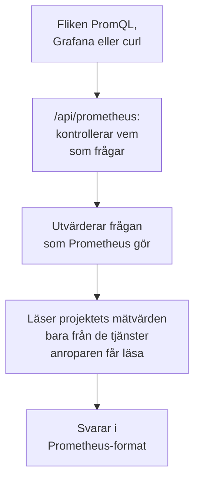

# Fråga efter mätvärden med PromQL

PromQL är frågespråket i Prometheus, och det som de flesta som visar mätvärden i diagram redan kan. OneUptime läser ditt projekts mätvärden med det: på fliken **PromQL** under Mätvärden, och via ett Prometheus-kompatibelt API som Grafana, eller vilket verktyg som helst med en Prometheus-datakälla, kan anslutas till.

:::cards
- [Skriv en fråga](#skriv-en-fråga): Kör PromQL på sidan Mätvärden och se en graf eller en tabell.
- [Så namnges mätvärden](#så-namnges-mätvärden): Hur namn och attribut från OpenTelemetry läses i PromQL.
- [Anslut Grafana](#anslut-grafana): Lägg till OneUptime som en Prometheus-datakälla.
- [Gränser](#gränser): Vad en fråga får läsa, och hur länge.
:::

## Så fungerar det

Fliken PromQL och Grafana ställer sina frågor till samma API. OneUptime kontrollerar att anroparen får läsa projektets mätvärden, läser bara de tjänster som anroparen får läsa och utvärderar frågan på samma sätt som Prometheus.



## Innan du börjar

- **Mätvärden som kommer in.** Skicka dem med [OpenTelemetry](/docs/telemetry/open-telemetry), eller från en agent som [OpenTelemetry Collector för värdar](/docs/telemetry/host-otel-collector).
- **En roll som får läsa mätvärden.** Project Owner, Project Admin, Project Member, Viewer, Telemetry Admin, Telemetry Member eller Telemetry Viewer, eller en anpassad roll med behörigheten Read Metrics. En roll som är begränsad till vissa tjänster läser bara deras mätvärden.
- **För Grafana eller ett skript: en API-nyckel för projektet** med en av de rollerna eller behörigheten Read Metrics. Se [Skapa en API-nyckel](/docs/api-reference/api-reference#skapa-en-api-nyckel). På OneUptime Cloud kräver API-nycklar planen **Growth**.

## Skriv en fråga

:::steps
### Öppna PromQL

Öppna **Mätvärden** och klicka på fliken **PromQL**.

### Skriv frågan

Skriv den i redigeraren, välj ett exempel under **Exempel**, eller börja från **Lägg till ett mätvärdesnamn**, som listar ditt projekts mätvärden med de namn som PromQL ger dem.

### Kör den

Klicka på **Kör fråga**, eller tryck på Ctrl+Enter (⌘+Enter på en Mac). **Graf** ritar frågan över tidsintervallet; **Tabell** visar varje series värde i slutet av intervallet.
:::

Några frågor att börja med:

```text title="PromQL"
# Requests per second, by service
sum by (job) (rate(http_requests_total[5m]))

# The 95th percentile of a latency histogram
histogram_quantile(0.95, sum by (le) (rate(http_server_request_duration_bucket[5m])))

# The five hosts using the most memory
topk(5, system_memory_usage)
```

Redigeraren visar vad som gick fel med en fråga som inte går att köra, och var: `rate(http_requests_total)` säger till exempel att funktionen behöver ett intervall som `[5m]`.

## Så namnges mätvärden

OneUptime lagrar mätvärden på OpenTelemetrys sätt. PromQL läser dem med de namn som Prometheus eget stöd för OpenTelemetry ger dem, så en fråga som är skriven för Prometheus fungerar även här:

| I OneUptime | I PromQL |
| --- | --- |
| En mätare `system.cpu.utilization` | `system_cpu_utilization` |
| En räknare `http.requests` | `http_requests`, eller `http_requests_total` |
| Ett histogram `http.server.request.duration` | `http_server_request_duration_bucket` (med `le`), `_count` och `_sum` |
| En summary `rpc.latency` | `rpc_latency` (med `quantile`), `_count` och `_sum` |
| Ett attribut `http.route` | Etiketten `http_route` |
| Ett resursattribut `service.name` | Etiketten `resource_service_name`, och `job` |
| Ett resursattribut `service.instance.id` | Etiketten `resource_service_instance_id`, och `instance` |

- **Punkter och bindestreck blir understreck** i namn på mätvärden och etiketter. Om du vill ange ett mätvärde eller en etikett exakt som namnet är lagrat sätter du det inom citattecken, som Prometheus 3 gör: `{"http.server.request.duration", "http.route"="/checkout"}`.
- **Deltaräknare summeras** från början av frågans tidsintervall, så `rate()` och `increase()` läser dem som vilken annan räknare som helst.
- **Exponentiella histogram** har `_count` och `_sum`, men inga buckets.

## Anslut Grafana

:::steps
### Skapa en API-nyckel

Öppna **Projektinställningar → Avancerad → API-nycklar** i OneUptime och klicka på **Skapa API-nyckel**. Ge nyckeln en roll som får läsa telemetri, eller behörigheten Read Metrics.

### Lägg till en Prometheus-datakälla

Öppna **Connections → Data sources → Add data source** i Grafana och välj **Prometheus**.

### Ange serverns URL

Ställ in **Prometheus server URL** på din OneUptime-adress följd av `/api/prometheus`. På OneUptime Cloud är det `https://oneuptime.com/api/prometheus`. Fliken **PromQL** visar adressen till din egen server, med en knapp för att kopiera den.

### Skicka API-nyckeln

Under **HTTP headers** lägger du till huvudet `Authorization` med värdet `Bearer` följt av ett mellanslag och din API-nyckel. Basic-autentisering fungerar också: valfritt användarnamn, med API-nyckeln som lösenord.

### Spara och testa

Klicka på **Save & test**. Grafana kör en fråga och meddelar att datakällan fungerar.
:::

Alla andra Prometheus-klienter fungerar på samma sätt. Med curl:

```bash title="Query OneUptime's Prometheus API"
curl -H "Authorization: Bearer $ONEUPTIME_API_KEY" \
  "https://oneuptime.com/api/prometheus/api/v1/query?query=up"
```

## API:t

API:t svarar på rutterna i Prometheus HTTP-API, med `GET` eller `POST`, under `/api/prometheus`:

| Rutt | Vad den svarar med |
| --- | --- |
| `/api/v1/query` | En fråga vid en tidpunkt (`time`, som standard nu). |
| `/api/v1/query_range` | En fråga vid varje `step` från `start` till `end`. |
| `/api/v1/series` | De serier som `match[]` väljer. |
| `/api/v1/labels` | Etikettnamn, för de serier som `match[]` väljer eller för alla mätvärden. |
| `/api/v1/label/<name>/values` | En etiketts värden. `__name__` listar namnen på mätvärdena. |
| `/api/v1/metadata` | Varje mätvärdes typ, hjälptext och enhet. |

Tider anges i Unix-sekunder eller RFC 3339, varaktigheter i sekunder eller som en varaktighet som `15s`, och svaren är i Prometheus-format. `/api/v1/status/buildinfo` svarar som en Prometheus 3-server; regler och larm är tomma, eftersom OneUptime larmar med [monitorer](/docs/monitor/metrics-monitor).

## Vad PromQL omfattar

- **Selektorer** med alla matchare (`=`, `!=`, `=~`, `!~`), intervall, `offset`, `@` (med `start()` och `end()`) och underfrågor.
- **Operatorer**: aritmetik, jämförelser (med `bool`), `and`, `or`, `unless`, och vektormatchning med `on`, `ignoring`, `group_left` och `group_right`.
- **Aggregeringar**: `sum`, `avg`, `min`, `max`, `count`, `group`, `stddev`, `stdvar`, `topk`, `bottomk`, `quantile` och `count_values`, med `by` eller `without`.
- **Funktioner**: `rate`, `irate`, `increase`, `delta`, `idelta`, `deriv`, `predict_linear`, `histogram_quantile`, alla `*_over_time`-funktioner, `changes`, `resets`, `absent`, `label_replace`, `label_join`, `sort`, `clamp`, `round`, de matematiska funktionerna och datumfunktionerna, med mera.

Prometheus funktioner för native histograms, som `histogram_count()`, finns inte: OneUptime lagrar histogram med buckets, och de läses av `histogram_quantile()` och serierna `_count` och `_sum`.

## Gränser

Varje fråga är begränsad, så att en instrumentpanel med många paneler inte kan överbelasta OneUptime:

| Gräns | Värde |
| --- | --- |
| Punkter i en serie i en intervallfråga | 11 000 |
| Sampel som en fråga får läsa och hålla | 5 000 000 |
| Datapunkter som en selektor får läsa | 1 000 000 |
| Tid som en läsning får ta | 30 sekunder |
| Tid som utvärderingen får ta | 30 sekunder |
| Hur långt bakåt en selektor letar efter en series senaste sampel | 5 minuter |
| En underfrågas steg, när frågan utelämnar det | 1 minut |

## Felsökning

:::details Grafana säger att datakällan inte fungerar
Kontrollera att URL:en slutar på `/api/prometheus` och att huvudet `Authorization` innehåller `Bearer`, ett mellanslag och API-nyckeln. En nyckel utan någon roll som får läsa mätvärden avvisas: ge den en under **Projektinställningar → Avancerad → API-nycklar**.
:::

:::details Ett mätvärde från utforskaren hittar ingenting
Dess PromQL-namn har understreck där det lagrade namnet har punkter, och ett histogram läses via `_bucket`, `_count` eller `_sum`. **Lägg till ett mätvärdesnamn** på fliken PromQL listar alla namn så som PromQL skriver dem.
:::

:::details "The query reads more than 1,000,000 metric points"
Frågan begär mer än en läsning får hålla. Lägg till etikettmatchare, korta tidsintervallet eller använd ett större steg.
:::

## Nästa steg

:::cards
- [Måttutforskare](/docs/telemetry/metrics-explorer): Visa mätvärden i diagram utan att skriva en fråga.
- [Metrikövervakning](/docs/monitor/metrics-monitor): Larma när ett mätvärde passerar en tröskel.
- [Externa datakällor](/docs/dashboards/data-sources): Visa en extern Prometheus i diagram på dina instrumentpaneler.
:::
