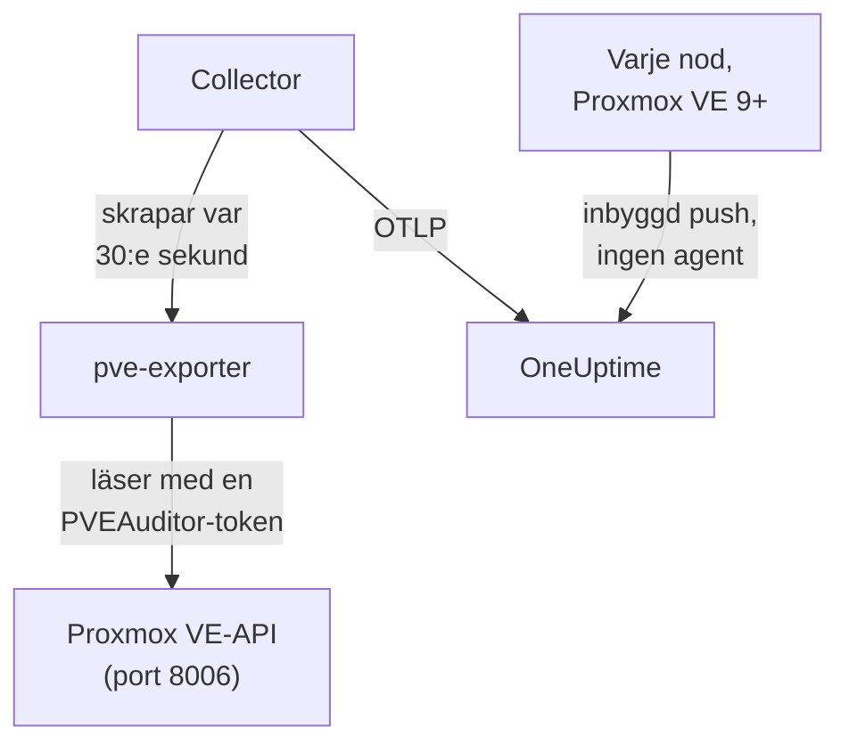

# Proxmox-agent

OneUptime Proxmox-agenten övervakar ett Proxmox VE-kluster: dess noder, QEMU-VM:ar, LXC-containrar, lagring, HA-tillstånd, säkerhetskopieringstäckning och replikering. Den läser klustret via Proxmox VE-API:t med en skrivskyddad token och skickar det den hittar till OneUptime, där klustret visas med sina noder, gäster och lagring. På Proxmox VE 9 och senare kan noderna också själva pusha sina mätvärden, utan att något behöver installeras. [Proxmox-monitorer](/docs/monitor/proxmox-monitor) larmar på det som kommer in.

:::cards
- [Välj hur du ansluter](#välj-hur-du-ansluter): Agenten, eller den inbyggda pushen i Proxmox VE 9.
- [Installera agenten](#installera-agenten): En API-token, sedan installationsskriptet eller Docker Compose.
- [Inbyggd push](#alternativ-utan-installation-inbyggd-opentelemetry-push-i-proxmox-ve-9): Proxmox VE 9 skickar sina mätvärden själv.
- [Felsökning](#felsökning): Ett diagnosskript, och de vanliga problemen.
:::

## Så fungerar det

Agenten är en uppsättning containrar som du kör med Docker Compose på en maskin: [prometheus-pve-exporter](https://github.com/prometheus-pve/prometheus-pve-exporter) läser Proxmox VE-API:t på port 8006, en OpenTelemetry Collector skrapar exportören var 30:e sekund och stämplar varje mätvärde med ditt klusters namn, och Proxmox-AI-agenten låter OneUptime AI läsa klustret medan den undersöker. Den inbyggda pushen i Proxmox VE 9 skickar i stället varje nods mätvärden direkt till OneUptime.



Klustret registrerar sig med sina första data, under det namn som agenten stämplar på varje mätvärde som `proxmox.cluster.name`.

## Välj hur du ansluter

| | Agenten | Inbyggd push |
| --- | --- | --- |
| Proxmox VE | Alla versioner som stöds | 9.0 eller senare |
| Att installera | Docker Compose på en maskin | Ingenting: en mätvärdesserver i Proxmox webbgränssnitt |
| Noder, gäster och lagring | Ja | Ja |
| HA-tillstånd, start vid uppstart, säkerhetskopieringstäckning och replikering | Ja | Nej |
| Proxmox-AI-agent | Ja | Nej |

Mallarna **HA Resource in Error State**, **Guest Down**, **Guest Not Backed Up** och **Replication Failing** behöver agenten. Använd det ena eller det andra för ett kluster: att köra båda rapporterar varje resurs två gånger.

## Innan du börjar

- Docker Engine 20.10 eller senare med insticksprogrammet Docker Compose v2, på en maskin som kan nå Proxmox VE-API:t på port 8006.
- Ett root-skal på valfri Proxmox VE-nod, eller Proxmox webbgränssnitt, för att skapa en API-token.
- En intagningsnyckel. Skapa en under **Projektinställningar → Telemetri och APM → Intagningsnycklar** och kopiera värdet.
- Utgående HTTPS från den maskinen till din OneUptime-URL.

### Var du kör agenten

Agenten frågar Proxmox VE-API:t över nätverket, så den behöver inte ligga på en klusternod, och det bör den inte heller: kör den på en maskin som överlever ett nodfel (en liten övervaknings-VM på separat hårdvara, en administrationsvärd), eller peka `PVE_HOST` mot en virtuell IP eller ett round-robin-DNS-namn i stället för en enskild nods adress. Om agentens API-mål är den nod som just dog, dör din övervakning med den. Det enda undantaget är den valfria journald-loggpipelinen, som måste köras på en Proxmox VE-nod (se [Skicka Proxmox-tjänstloggar](#valfritt-skicka-proxmox-tjänstloggar)).

## Installera agenten

:::steps
### Skapa en skrivskyddad API-token

Agenten läser klustret med en API-token som har rollen **PVEAuditor**, som kan läsa och inget annat.

:::tabs
@tab Shell
Som root på valfri Proxmox VE-nod:

```bash
pveum user add monitoring@pam
pveum acl modify / --roles PVEAuditor --users monitoring@pam
pveum user token add monitoring@pam oneuptime --privsep 1
pveum acl modify / --roles PVEAuditor --tokens 'monitoring@pam!oneuptime'
```

Det första kommandot misslyckas bara, ofarligt, om `monitoring@pam` redan finns: API-tokens har en egen hemlighet, så användaren behöver varken lösenord eller systemkonto. `pveum user token add` skriver ut tokenhemligheten en gång; token-ID:t är `monitoring@pam!oneuptime`.
@tab Proxmox web UI
1. Gå till *Datacenter → Permissions → API Tokens* och klicka på **Add**.
2. Välj (eller skapa) en användare, ge token ett ID som `oneuptime`, och låt **Privilege Separation** vara markerat.
3. Kopiera token-ID:t (`user@realm!tokenname`) och hemligheten: hemligheten visas bara en gång.
4. Under *Datacenter → Permissions* lägger du till rollen **PVEAuditor** på sökvägen `/` två gånger: en gång som **API Token Permission** för token, och en gång som **User Permission** för dess användare.
:::

Rollen läggs på användaren och inte bara på token eftersom en token med privilegieseparation bara får de behörigheter som dess användare också har. Den måste ligga på rotsökvägen `/`, eftersom exportören läser varje nod-, gäst- och lagringsobjekt: en snävare sökväg döljer resten av klustret och misslyckas med `401`/`403 Permission check failed (/, Sys.Audit)`.

### Installera och starta agenten

:::tabs
@tab install.sh
Ladda ned installationsskriptet och kör det på maskinen som ska vara värd för agenten:

```bash
curl -sSL https://raw.githubusercontent.com/OneUptime/oneuptime/master/agents/ProxmoxAgent/install.sh -o install.sh
bash install.sh
```

Skriptet frågar efter din OneUptime-URL, intagningsnyckeln, ett namn på klustret, Proxmox VE-API-värden, om den medföljande exportören ska köras, och token-ID och hemlighet — och om [AI-agenten](#ai-agent) får genomföra åtgärder, och i så fall efter en egen token för det och de gäster den aldrig får ändra. Det installerar till `/opt/oneuptime-proxmox-agent`, skriver en `.env`-fil med `0600` och startar agenten med Docker Compose. Om du kör skriptet igen återanvänder det allt i den `.env` i stället för att fråga igen, och det är så du [uppgraderar agenten](#uppgradera-agenten).
@tab Docker Compose
Ladda ned `docker-compose.yml` och `otel-collector-config.yaml` från [ProxmoxAgent-katalogen](https://github.com/OneUptime/oneuptime/tree/master/agents/ProxmoxAgent) till en ny mapp:

```bash
mkdir oneuptime-proxmox-agent && cd oneuptime-proxmox-agent
curl -fsSLO https://raw.githubusercontent.com/OneUptime/oneuptime/master/agents/ProxmoxAgent/docker-compose.yml
curl -fsSLO https://raw.githubusercontent.com/OneUptime/oneuptime/master/agents/ProxmoxAgent/otel-collector-config.yaml
```

Skapa en `.env`-fil bredvid dem. Den innehåller tokenhemligheten, så håll den privat med `chmod 600 .env`:

```bash title=".env"
ONEUPTIME_URL=YOUR_ONEUPTIME_URL
ONEUPTIME_TELEMETRY_INGESTION_KEY=YOUR_TELEMETRY_INGESTION_TOKEN
PROXMOX_CLUSTER_NAME=my-proxmox-cluster
PVE_HOST=192.168.1.10
PVE_API_TOKEN_ID=monitoring@pam!oneuptime
PVE_API_TOKEN_SECRET=your-token-secret
COMPOSE_PROFILES=pve-exporter
```

`COMPOSE_PROFILES=pve-exporter` startar också den medföljande exportören. Starta agenten:

```bash
docker compose up -d
```
:::

Kör du redan prometheus-pve-exporter? Svara **n** när skriptet frågar om den medföljande ska köras, eller ta bort `COMPOSE_PROFILES` från `.env`, och peka agenten mot din (`host:port`, utan schema, en adress som agentens container kan nå: `localhost` är själva containern). Behåll `PVE_API_TOKEN_ID` och `PVE_API_TOKEN_SECRET` om du använder [AI-agenten](#ai-agent), som anropar API:t med den token:

```bash
PVE_EXPORTER_URL=your-exporter-host:9221
```

### Kontrollera att agenten körs

```bash
docker compose ps
docker logs -f oneuptime-proxmox-agent
```

`docker compose ps` listar collectorn (`oneuptime-proxmox-agent`), den medföljande exportören (`oneuptime-pve-exporter`, om du inte använder din egen) och AI-agenten (`oneuptime-proxmox-ai-agent`). Collectorns loggar ska visa den här raden när den har startat:

```text
Everything is ready. Begin running and processing data.
```

### Hitta klustret i OneUptime

Öppna **Produkter → Infrastruktur → Proxmox → Alla kluster**. Klustret visas under sitt `PROXMOX_CLUSTER_NAME` ungefär en minut efter den första skrapningen, med sina noder, gäster och lagring.
:::

## Miljövariabler

Installationsskriptet skriver dessa till `/opt/oneuptime-proxmox-agent/.env`; en Docker Compose-installation läser dem från `.env` bredvid `docker-compose.yml`. När du har ändrat ett kör du `docker compose up -d` i den mappen.

| Variabel | Obligatorisk | Beskrivning |
| --- | --- | --- |
| `ONEUPTIME_URL` | Ja | Din OneUptime-URL, till exempel `https://oneuptime.com` eller din självhostade instans. Använd `http://` och dess port om instansen bara använder HTTP. |
| `ONEUPTIME_TELEMETRY_INGESTION_KEY` | Ja | Intagningsnyckeln från **Projektinställningar → Telemetri och APM → Intagningsnycklar**. |
| `PROXMOX_CLUSTER_NAME` | Ja | Klustrets namn i OneUptime, stämplat på varje mätvärde som resursattributet `proxmox.cluster.name`. Håll det stabilt: att ändra det senare registrerar ett andra kluster. Standard är `proxmox-cluster`. |
| `PVE_HOST` | Ja | Proxmox VE-API-värden (valfri nod i klustret) som exportören och AI-agenten frågar, till exempel `192.168.1.10`. |
| `PVE_EXPORTER_URL` | Nej | Adressen (`host:port`, utan schema) till prometheus-pve-exporter. Standard är den medföljande exportören, `pve-exporter:9221`. |
| `PVE_API_TOKEN_ID` | Medföljande exportör eller AI-agent | Det fullständiga ID:t för Proxmox-API-token, till exempel `monitoring@pam!oneuptime`. AI-agenten läser API:t med det om den inte har en egen token (`ONEUPTIME_AI_PVE_API_TOKEN_ID` / `ONEUPTIME_AI_PVE_API_TOKEN_SECRET`). |
| `PVE_API_TOKEN_SECRET` | Medföljande exportör eller AI-agent | Hemligheten för Proxmox-API-token. |
| `PVE_VERIFY_SSL` | Nej | Verifiera Proxmox-API:ts TLS-certifikat (exportören och AI-agenten). Standard är `false`, eftersom Proxmox levereras med självsignerade certifikat. |
| `COMPOSE_PROFILES` | Nej | Sätt till `pve-exporter` för att starta den medföljande exportörcontainern. |

## Vad agenten samlar in

Collectorn skrapar exportören var 30:e sekund med både dess kluster- och nodcollectors påslagna, vilket också täcker exportörens collectors `backup-info` (klusternivå) och `replication` (nodnivå), som är på som standard. Varje serie har en `id`-etikett som anger resursen: `node/<name>`, `qemu/<vmid>`, `lxc/<vmid>` eller `storage/<node>/<storage>`.

| Kategori | Mätvärden |
| --- | --- |
| Tillgänglighet | `pve_up`, `pve_uptime_seconds` |
| Nod | `pve_node_info`, `pve_cpu_usage_ratio`, `pve_cpu_usage_limit`, `pve_memory_usage_bytes`, `pve_memory_size_bytes` |
| Gäst (VM eller LXC) | `pve_guest_info`, och serier för CPU, minne och nätverk på ID:na `qemu/*` och `lxc/*` (`pve_network_receive_bytes`, `pve_network_transmit_bytes`) |
| Lagring | `pve_disk_usage_bytes`, `pve_disk_size_bytes`, `pve_storage_info` |
| HA | `pve_ha_state` |
| Säkerhetskopieringstäckning | `pve_not_backed_up_total` (de gäster som inget säkerhetskopieringsjobb täcker; en serie på klusternivå, utan `id`-etikett) och `pve_not_backed_up_info` (en serie per gäst utan täckning, med dess `id`). Täckt betyder att minst ett jobb väljer gästen: om säkerhetskopieringar har körts nyligen eller lyckats exponeras inte av exportören. |
| Replikering | `pve_replication_failed_syncs`, `pve_replication_duration_seconds`, `pve_replication_last_sync_timestamp_seconds`, `pve_replication_last_try_timestamp_seconds`, `pve_replication_next_sync_timestamp_seconds`, `pve_replication_info`, per jobb för lagringsreplikering. Deras `id`-etikett är jobb-ID:t (till exempel `100-0`), inte en resurs. |

Monitorkriterier och attributfilter matchar på likhet, inte på ett prefix, så collectorns processor `transform/pve-identity` delar också upp `id` i tre attribut. De inbyggda Proxmox-larmmallarna filtrerar på dem, så behåll processorn om du anpassar konfigurationen:

| Attribut | Värden | För `qemu/100` |
| --- | --- | --- |
| `pve.scope` | `node`, `guest`, `storage`, `cluster` (`qemu` och `lxc` är båda `guest`) | `guest` |
| `pve.type` | `node`, `qemu`, `lxc`, `storage` | `qemu` |
| `pve.id` | Allt efter det första `/` i `id` (`pve1`, `100`, `pve1/local`) | `100` |

Den ursprungliga `id`-etiketten behålls som den är.

## Valfritt — Skicka Proxmox-tjänstloggar

Som standard skickar agenten bara mätvärden, så klustrets sida **Loggar** förblir tom. Proxmox VE-tjänsterna loggar till systemd-journalen under åtta enheter: `pveproxy`, `pvedaemon`, `pve-firewall`, `pve-ha-crm`, `pve-ha-lrm`, `pvescheduler`, `pvestatd` och `qmeventd`. Den medföljande `otel-collector-config.yaml` har en bortkommenterad `journald`-receiver för exakt de enheterna, kopplad till en bortkommenterad `logs`-pipeline som stämplar `proxmox.cluster.name` så att loggarna hamnar på ditt kluster.

:::steps
### Kör agenten på en nod

Journalen är per värd, så en fjärragent kan inte läsa den. Det här är den enda konfiguration som går emot [Var du kör agenten](#var-du-kör-agenten): för att hålla mätvärdesagenten utanför klustret kör du i stället en andra collector, enbart för loggar, på noden (kopiera konfigurationen och ta sedan bort receivern `prometheus` och pipelinen `metrics`).

### Slå på receivern

Avkommentera receivern `journald` och pipelinen `logs` i `otel-collector-config.yaml`, och journalvolymerna i `docker-compose.yml`, så att containern kan läsa värdens journal:

```yaml
- /var/log/journal:/var/log/journal:ro
- /etc/machine-id:/etc/machine-id:ro
```

### Byt collectorns image

Standardimagen `otel/opentelemetry-collector-contrib` är byggd `FROM scratch`: den har ingen `journalctl`, som journald-receivern kör, och körs som en användare som inte kan läsa journalen. Bygg det här omslaget och peka `image:` i `docker-compose.yml` mot det:

```dockerfile title="Dockerfile"
FROM otel/opentelemetry-collector-contrib:0.161.0 AS otelcol
FROM debian:stable-slim
RUN apt-get update \
    && apt-get install -y --no-install-recommends systemd \
    && rm -rf /var/lib/apt/lists/*
COPY --from=otelcol /otelcol-contrib /otelcol-contrib
ENTRYPOINT ["/otelcol-contrib"]
CMD ["--config", "/etc/otelcol-contrib/config.yaml"]
```

Paketet `systemd` finns där bara för `journalctl`, och den här imagen körs som root, som är den som kan läsa journalen. Eller hoppa över Docker för loggarna och kör `.deb`-filen från `otelcol-contrib`-utgåvan på själva noden, där `journalctl` redan finns.
:::

Varje nod skickar bara sin egen journal: för tjänstloggar från varje nod kör du collectorn för enbart loggar på varje nod.

### Reservlösning utan egen image: filelog på /var/log/syslog

För att behålla standardimagen följer du syslog i stället. Installera rsyslog på noden (`apt install rsyslog`; Debian 12 och Proxmox VE 8 och senare levereras inte längre med det), montera katalogen `/var/log` i containern (`- /var/log:/var/log:ro`; katalogen, inte filen, så att loggrotation inte låser fast en inaktuell fil), och använd en `filelog`-receiver i stället för journald-receivern:

```yaml
receivers:
  filelog:
    include:
      - /var/log/syslog
    start_at: end
```

Du förlorar filtret per enhet (syslog innehåller allt, inte bara de åtta tjänsterna), och standardimagens användare måste kunna läsa filen. Koppla in den i samma bortkommenterade `logs`-pipeline (`receivers: [filelog]`).

## Alternativ utan installation: inbyggd OpenTelemetry-push i Proxmox VE 9+

Proxmox VE 9.0 och senare levereras med en OpenTelemetry-mätvärdesserver som pushar mätvärden för noder, gäster och lagring till valfri OTLP/HTTP-slutpunkt, utan agent eller exportör att installera. I Proxmox webbgränssnitt går du till *Datacenter → Metric Server → Add → OpenTelemetry* och fyller i:

| Fält | Värde |
| --- | --- |
| Server | Din OneUptime-värd, till exempel `oneuptime.com`, eller din självhostade värd |
| Port | `443` |
| Protocol | `https` |
| Path | `/otlp/v1/metrics` |
| Headers | `{"x-oneuptime-token": "YOUR_TELEMETRY_INGESTION_TOKEN"}` |

Lägg till den en gång: varje nod i klustret pushar sina egna mätvärden. OneUptime känner igen pushen och översätter den till samma `pve_*`-serier som agenten skickar, så:

- klustret registrerar sig under ditt Proxmox-klusters namn (en fristående nod under sitt nodnamn), och en `proxmox.cluster.name` som du sätter under *Resource Attributes* används i stället;
- sidorna för noder, gäster och lagring, översiktsdiagrammen, mätvärdeskatalogen och larmmallarna för CPU, minne och lagring fungerar som med agenten;
- de ursprungliga serierna `proxmox_node_*`, `proxmox_vm_*` och `proxmox_storage_*` finns kvar i [Metrics Explorer](/docs/monitor/metrics-monitor) för allt annat som Proxmox VE rapporterar (load average, swap, pressure stall, trafik per nätverkskort).

### När en nod slutar rapportera

Varje nod pushar bara sin egen status, så en nod som går ned kan inte säga det själv. De noder som fortfarande lever rapporterar det åt den:

- Ungefär 2 minuter efter sin senaste rapport visas noden som **Offline** på nodsidan. **Senast sedd** på nodens egen sida behåller tidpunkten för dess egen senaste rapport.
- Efter ungefär 5 minuter utlöses **Node Offline** för den. **Cluster Quorum at Risk** räknar den också som offline; eftersom den mallen behöver ett helt 5-minutersfönster med rapporter utlöses den ungefär 7–9 minuter efter att noden tystnade.
- Med nästa rapport är den **Online** igen och dess larm återställs.

Offline betyder här att noden slutade rapportera, inte nödvändigtvis att den är nere. En nod som är uppe men vars `pvestatd` har hängt sig eller dödats, vars klusterfilsystem (`pmxcfs`) är nere, eller vars nätverk till OneUptime är avbrutet rapporteras på samma sätt.

Det här kan inte täcka:

- En fristående värd, eller ett helt kluster som tystnar på en gång: det finns ingen kvar som kan rapportera det, så inget larm per nod utlöses. Klustret blir i stället **Frånkopplad**, som när agenten stannar.
- En nod som varit tyst i mer än 7 dagar rapporteras inte längre: dess larm löses och den försvinner från nodsidan. En självhostad OneUptime ändrar de 7 dagarna med `PVE_SILENT_NODE_RETENTION_HOURS`.
- En nod som du tar ut ur klustret ser likadan ut som en död. Använd **Remove Node** på dess sida: den försvinner och dess larm löses. Annars förblir den Offline i upp till 7 dagar.
- Nodens gäster och lagring: bara själva noden behålls som Offline. Dess VM:ar, containrar och lagring försvinner från sina sidor ungefär 15 minuter efter dess senaste rapport, och gäster som HA startar om på en annan nod kommer tillbaka under den noden.

Efter ett avbrott i OneUptimes intag rapporteras en nod som nyss tystnat först när någon av de andra har pushat igen i 2 minuter, så själva avbrottet larmar aldrig för varje nod. En nod som redan var Offline förblir Offline under ett kort avbrott och behåller sitt larm; efter ett avbrott på mer än 5 minuter rapporteras den igen när de andra har pushat i 2 minuter.

I [Metrics Explorer](/docs/monitor/metrics-monitor) är dessa rapporter punkterna `pve_up` = 0 med etiketten `oneuptime.proxmox.inferred` = `not-reporting`, så att du alltid kan skilja dem från det som en nod sa om sig själv.

### Vad den inbyggda pushen inte kan göra

Den inbyggda pushen skickar bara det som varje nod vet om sig själv, så en del av det som agenten samlar in har ingen inbyggd motsvarighet:

| Behöver agenten | Varför |
| --- | --- |
| HA-tillstånd | Pushas inte: mallen **HA Resource in Error State** behöver agenten. |
| Flaggan för start vid uppstart | Pushas inte: **Guest Down**, som bara larmar för gäster som är inställda på att starta vid uppstart, behöver agenten. |
| Säkerhetskopieringstäckning och replikering | Pushas inte: **Guest Not Backed Up** och **Replication Failing** behöver agenten. |

Om du behöver dem kör du agenten i stället och tar bort mätvärdesservern: att köra båda rapporterar varje resurs två gånger.

## Kör som en systemd-tjänst

För att starta agenten med maskinen och starta om den när den misslyckas installerar du dess systemd-enhet. Den förutsätter att agenten ligger i `/opt/oneuptime-proxmox-agent`, där installationsskriptet placerar den:

```bash
sudo cp systemd/oneuptime-proxmox-agent.service /etc/systemd/system/
sudo systemctl daemon-reload
sudo systemctl enable --now oneuptime-proxmox-agent
```

## Uppgradera agenten

Agenten rapporterar den collector-version som dess filer låser som sin **Agentversion**. När den är äldre än den version som den här OneUptime-utgåvan låser visas en varningssymbol bredvid den på klustrets **Översikt**. Välj den för att se de här kommandona. En agent som installerades innan dess filer rapporterade en version visar ingen förrän den har uppgraderats på det här sättet.

Collectorns image är låst i `docker-compose.yml` och dess konfiguration är en fil bredvid den, så att bara hämta images för inte agenten framåt. Kör `install.sh` igen: det återanvänder varje värde i din befintliga `.env` (inget frågas efter igen), förnyar `docker-compose.yml` och `otel-collector-config.yaml` (en fil som du har redigerat sparas som `<file>.bak.<timestamp>`), hämtar imagesen och återskapar agenten så att collectorn läser sin nya konfiguration.

```bash
curl -sSL https://raw.githubusercontent.com/OneUptime/oneuptime/master/agents/ProxmoxAgent/install.sh -o install.sh
bash install.sh
```

Installerade du den med Docker Compose i stället? I agentens mapp laddar du ned båda filerna igen (och gör om eventuella ändringar du hade gjort i dem), hämtar sedan imagesen och återskapar agenten:

```bash
curl -fsSLO https://raw.githubusercontent.com/OneUptime/oneuptime/master/agents/ProxmoxAgent/docker-compose.yml
curl -fsSLO https://raw.githubusercontent.com/OneUptime/oneuptime/master/agents/ProxmoxAgent/otel-collector-config.yaml
docker compose pull
docker compose up -d --force-recreate
```

## Avinstallera agenten

```bash
cd /opt/oneuptime-proxmox-agent
docker compose down
```

Ta sedan bort API-token under *Datacenter → Permissions → API Tokens* om du inte längre behöver den.

## AI-agent

Agentens `docker-compose.yml` kör också **Proxmox-AI-agenten**, `oneuptime-proxmox-ai-agent` (imagen `oneuptime/resource-ai-agent:release`). Medan OneUptime AI undersöker en incident eller ett larm på det här klustret kör den skrivskyddade `pvesh`-kommandon genom den — `pvesh get /cluster/status`, `pvesh get /nodes/pve1/qemu/101/status/current`, `pvesh get /nodes/pve1/tasks --errors 1 --limit 20` — och, bara om du tillåter det, genomför åtgärder som att starta eller starta om en gäst. Det finns ingen `pvesh`-binär i den: varje kommando blir exakt ett anrop till Proxmox VE-API:t på `PVE_HOST`, med en token från samma `.env`. Den registrerar sig som klustret med namnet `PROXMOX_CLUSTER_NAME`, precis som collectorn, och visas på klustrets sida **AI-agent** i OneUptime.

- **AI-undersökningar är på som standard.** När agenten väl ansluter undersöker OneUptime AI incidenter och larm på det här klustret med den, och klustrets **Översikt** visar agentens status. För att stoppa sätter du `ONEUPTIME_AI_INVESTIGATION=false` där agenten körs (**Ändra** under **Vad AI får göra** på AI-agentsidan visar hur), eller utelämnar agenten.
- API-token är den hårda gränsen. Undersökningar använder collectorns PVEAuditor-token (`PVE_API_TOKEN_ID` / `PVE_API_TOKEN_SECRET`), som kan läsa och inget annat; om du kör din egen exportör och inte har någon token i `.env` lägger du till en. Åtgärder behöver en egen token för AI-agenten som får slå på och av gäster (`VM.PowerMgmt`, till exempel rollen `PVEVMUser` på `/vms` eller på en pool), satt som `ONEUPTIME_AI_PVE_API_TOKEN_ID` / `ONEUPTIME_AI_PVE_API_TOKEN_SECRET`.
- Den är skrivskyddad om du inte sätter `ONEUPTIME_AI_ALLOW_WRITES=true`; `ONEUPTIME_AI_WRITE_TARGETS` (VMID:n som `100,101`, och `<node>/<service>` för nodtjänster) begränsar vad en åtgärd får röra. Om agenten körs i en gäst i det här klustret lägger du den gästens VMID i `ONEUPTIME_AI_PROTECTED_TARGETS`. `ONEUPTIME_AI_FIXES` i samma `.env` anger hur åtgärder körs — `ask-for-approval` (en person godkänner varje åtgärd), `automatic` eller `bypass-approval` — och AI-agentsidan visar det skrivskyddat ([Vad AI får göra, inställt av agenten](/docs/ai/infrastructure-ai-agents#what-ai-may-do-set-by-the-agent)).
- Precis som exportören verifierar den inte API:ts självsignerade certifikat om du inte sätter `PVE_VERIFY_SSL=true` eller pekar `PVE_CA_FILE` mot klustrets CA (`/etc/pve/pve-root-ca.pem`, monterad i containern).
- Den körs som UID 1000 utan capabilities och med ett skrivskyddat rotfilsystem, och läser aldrig `/access`, öppnar aldrig en konsol och ändrar aldrig konfiguration. Ta bort tjänsten `oneuptime-proxmox-ai-agent` från `docker-compose.yml` om du inte använder OneUptime AI.

Vad den får köra, hur åtgärder fungerar och hur du felsöker den: [Infrastructure AI Agents](/docs/ai/infrastructure-ai-agents#proxmox-clusters). Agentens README har de exakta `pveum`-kommandona för en token för åtgärder.

## Felsökning

:::details Kör diagnosskriptet först
Agenten levereras med ett skript, [`troubleshoot.sh`](https://github.com/OneUptime/oneuptime/blob/master/agents/ProxmoxAgent/troubleshoot.sh), som kontrollerar hela kedjan: containerkörtiden, exportörens skrapning, det klusternamn som stämplas på varje mätvärde, tokenens format, collectorns egna mätvärden, och om OneUptime godtar intagningsnyckeln. Den sista kontrollen är viktigast. OneUptime nekar en felaktig nyckel med `401` (`422` för en inaktiverad nyckel eller en webbläsarnyckel), och collectorn behandlar båda som permanenta: den släpper batchen och loggar ett enda `Exporting failed`-fel, som är lätt att missa medan containern förblir frisk. Skriptet frågar `GET <url>/otlp/v1/validate` inifrån agentens nätverk för ett direkt `200` (giltig) eller `401` (ogiltig), och faller tillbaka på `POST /fluentd/v1/logs` på äldre servrar.

```bash
curl -sSL https://raw.githubusercontent.com/OneUptime/oneuptime/master/agents/ProxmoxAgent/troubleshoot.sh -o troubleshoot.sh
bash troubleshoot.sh    # add -d <dir> if you installed outside /opt/oneuptime-proxmox-agent
```

Det avslutas med en bedömning som anger den mest sannolika orsaken.
:::

:::details Inget kluster visas i OneUptime
1. Läs collectorns loggar: `docker logs oneuptime-proxmox-agent`. En `401` vid export betyder en felaktig intagningsnyckel; en nekad anslutning betyder en felaktig `ONEUPTIME_URL`.
2. Kontrollera att exportören svarar. Den medföljande exportören publicerar inte sin port på värden, så fråga inifrån dess nätverk: `docker run --rm --network container:oneuptime-pve-exporter curlimages/curl -s "http://localhost:9221/pve?target=YOUR_PVE_HOST" | head` ska skriva ut `pve_*`-rader. För din egen exportör frågar du dess `host:9221` direkt.
3. Kontrollera att `PROXMOX_CLUSTER_NAME` är satt: klustret hittas via sitt resursattribut `proxmox.cluster.name`.
:::

:::details Exportören returnerar 401- eller 595-fel
API-token är fel eller saknar behörigheter. Kontrollera formatet på token-ID:t (`user@realm!tokenname`), hemligheten, och att rollen **PVEAuditor** ligger på sökvägen `/` för token och för dess användare. Exportörens egna loggar visar API:ts svar: `docker logs oneuptime-pve-exporter`.
:::

:::details Bara nodmätvärden, inga gästmätvärden
Gästserier (ID:na `qemu/*` och `lxc/*`) kommer från exportörens klustercollector, som den medföljande konfigurationen slår på med skrapparametern `cluster=1`. Om du har anpassat `otel-collector-config.yaml` lägger du tillbaka parametern `cluster: ["1"]`.
:::

:::details Mätvärdena hamnar under fel kluster
OneUptime registrerar ett Proxmox-kluster efter dess `proxmox.cluster.name`, som agenten tar från `PROXMOX_CLUSTER_NAME`. Att ändra det efter de första data skapar ett andra kluster i stället för att byta namn på det första.
:::

:::details Med inbyggd push visas en nod som Offline
Den slutade rapportera: en nod som är nere, en `pvestatd` som har hängt sig, en stoppad `pmxcfs` eller ett avbrutet nätverk till OneUptime ser likadana ut. Dess nästa rapport tar tillbaka den. Om du tog ut noden ur klustret använder du **Remove Node** på dess sida; annars förblir den Offline i upp till 7 dagar. Se [När en nod slutar rapportera](#när-en-nod-slutar-rapportera).
:::

:::details Med inbyggd push utlöses aldrig Guest Down-, HA- eller säkerhetskopieringslarm
Den inbyggda pushen skickar inte HA-tillstånd, start vid uppstart, säkerhetskopieringstäckning eller replikering. [Installera agenten](#installera-agenten) för dem, och ta bort mätvärdesservern: att köra båda rapporterar varje resurs två gånger.
:::

## Nästa steg

:::cards
- [Proxmox-övervakning](/docs/monitor/proxmox-monitor): Larma på noder, gäster, lagring, HA, säkerhetskopior och replikering.
- [Ceph-agent](/docs/telemetry/ceph): Övervaka Ceph-lagringen under ditt Proxmox-kluster.
- [Infrastructure AI Agents](/docs/ai/infrastructure-ai-agents): Vad Proxmox-AI-agenten får köra, och hur åtgärder fungerar.
- [OpenTelemetry-collector på värden](/docs/telemetry/host-otel-collector): Vyn på OS-nivå av varje nod.
:::
