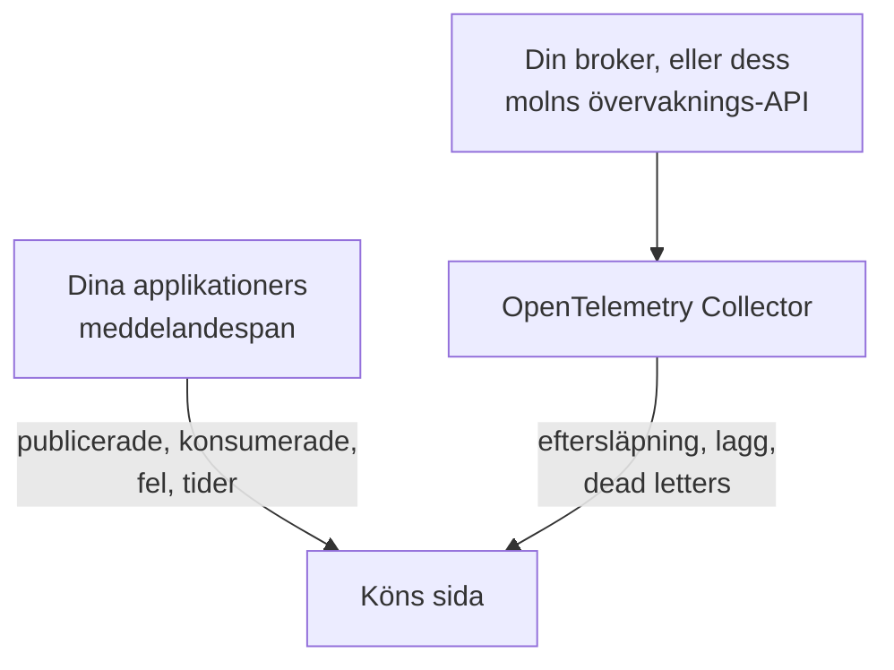

# Köer

**Queues** ger varje meddelandekö, varje topic och varje prenumeration som dina applikationer använder en egen sida: vilka tjänster som publicerar till den och vilka som konsumerar från den, hur många meddelanden som passerar, hur många som misslyckas och hur lång tid bearbetningen tar, dess spår och mätvärden och, så snart brokerns egna mätvärden når OneUptime, dess eftersläpning, konsumentlagg, dead letters och strypning. Köer har etiketter, ägare, etikett- och ägarregler och arkivering, precis som alla andra resurser. Öppna dem under **Produkter → Resurser → Köer**.

:::cards
- [Instrumentera applikationer](#instrumentera-applikationer): De meddelandespan som din OpenTelemetry-instrumentering redan skickar.
- [Brokerns hälsomätvärden](#brokerns-hälsomätvärden): Eftersläpning, lagg och dead letters från din broker, system för system.
- [Larm](#larm): Färdiga mallar, och fördröjda eller räknade mätvärden.
- [Felsökning](#felsökning): En kö som inte skapades, eller en brokerhälsa som förblir tom.
:::

## Så fungerar det

Det fungerar på samma sätt för alla brokrar (Apache Kafka, RabbitMQ, Apache ActiveMQ och andra JMS-brokrar, Amazon SQS och SNS, Google Cloud Pub/Sub, Azure Service Bus, Event Hubs och Event Grid, Apache Pulsar, Apache RocketMQ, NATS och BullMQ; se [Meddelandesystem som stöds](#meddelandesystem-som-stöds)) och för alla andra brokrar som dina span namnger i `messaging.system`. De flesta köer dyker upp av sig själva, från två källor:

| Källa | Vad den behöver från dig | Vad den lägger till på köns sida |
| --- | --- | --- |
| **Applikationsspår** | Instrumenterade applikationer (OpenTelemetry); se [Instrumentera applikationer](#instrumentera-applikationer) | Publicerade och konsumerade meddelanden, fel och bearbetningstid, tjänsterna på båda sidor och själva spåren |
| **Brokermätvärden** (en OpenTelemetry Collector) | Collector-receivern eller skrapningen för din broker; se [Brokerns hälsomätvärden](#brokerns-hälsomätvärden) | **Brokerhälsa**: eftersläpning, konsumentlagg, dead letters, det äldsta meddelandets ålder, strypning och brokerns egna meddelandehastigheter |



Spår berättar för OneUptime att en kö finns och hur applikationer använder den, men inte hur full den är. Det kommer från själva brokern eller från dess molnleverantörs övervaknings-API eller, för [BullMQ](#bullmq), som håller sina jobb i Redis och inte har någon broker att fråga, från en gauge som applikationen rapporterar.

Du kan också lägga till en kö manuellt: **Queues → Skapa Queue**, med dess meddelandesystem och destinationens namn och, för Azure Service Bus och Event Hubs, dess namespace. Formuläret frågar efter dem i sitt första steg, **Meddelandesystem**, och sedan efter ett valfritt namn och en beskrivning, med etiketter under **Fler fält** (**Köinformation**). Lämna namespacet tomt bara för en kö som dina applikationer når via en emulator eller ett anpassat domännamn: deras span namnger inget namespace, och Azure Monitors mätvärden når aldrig en sådan kö (se [Begränsningar](#begränsningar)).

## Kom igång

:::steps
### Skicka dina applikationers spår

Instrumentera applikationerna som publicerar och konsumerar, och skicka deras spår till OneUptime (se [Instrumentera applikationer](#instrumentera-applikationer)). Inget OneUptime-specifikt behövs: de meddelandespan som din instrumentering redan skapar namnger köerna.

### Skicka din brokers mätvärden

Hitta ditt meddelandesystem under [Brokerns hälsomätvärden](#brokerns-hälsomätvärden) och kör dess collectorkonfiguration med din intagningsnyckel. Fliken **Dokumentation** för varje kö har konfigurationen för den kön, klar att kopiera.

### Öppna kön

Öppna **Produkter → Resurser → Köer**. Upptäckten körs var 10:e minut: en kö dyker upp så snart minst 3 av dess span har kommit in inom 15 minuter, eller ett brokermätvärde har namngett den.
:::

## Meddelandesystem som stöds

OneUptime känner till meddelandesystemen nedan med namn. Det normaliserar det som instrumenteringar lägger i `messaging.system` till värdet i den andra kolumnen (det välkända OpenTelemetry-värdet där det finns ett) utan hänsyn till skiftläge, så `AmazonSQS`, `aws.sqs` och `aws_sqs` är ett system. `nats` och `bullmq` är inte välkända OpenTelemetry-värden: `nats` är det som Java-agentens NATS-instrumentering rapporterar, och `bullmq` är värdet du anger för BullMQ (se [BullMQ](#bullmq)).

Ett system som OneUptime inte känner till fungerar ändå: ett välformat värde (`ibmmq`, `solace`, `mqtt`: gemener, siffror, `.`, `_` och `-`, upp till 64 tecken) behålls som det kom, så att den brokerns köer upptäcks och visas under det namnet; bara brokerns egna mätvärden behöver ett system från den här tabellen. `spring_integration` ignoreras: Spring Integrations kanaler är metodanrop inom en process, inte en broker.

**Brokermätvärden** anger var ett systems hälsomätvärden kommer ifrån: en collector-contrib-receiver, en Prometheus-slutpunkt (`:port/path`, skrapad med collectorns `prometheus`-receiver), molnleverantörens övervaknings-API eller ett program utanför collectorn som skickar dem via OTLP. Varje system länkar nedan till sin konfiguration, och fliken **Dokumentation** för varje kö gör om det till en konfiguration för den kön.

| System | `messaging.system` | Accepteras också | Brokermätvärden |
| --- | --- | --- | --- |
| [Amazon SNS](#amazon-sns) | `aws.sns` | `aws_sns`, `amazonsns`, `sns` | receiver `aws_cloudwatch` eller `awsfirehose` (molnövervakning) |
| [Amazon SQS](#amazon-sqs) | `aws_sqs` | `aws.sqs`, `amazonsqs`, `sqs` | receiver `aws_cloudwatch` eller `awsfirehose` (molnövervakning) |
| [Apache ActiveMQ](#apache-activemq) | `activemq` | `artemis`, `activemq_artemis` | OpenTelemetry JMX Scraper (skickar via OTLP) |
| [Apache Kafka](#apache-kafka) | `kafka` | — | receiver `kafka_metrics` |
| [Apache Pulsar](#apache-pulsar) | `pulsar` | `apache_pulsar` | Prometheus (Pulsar-broker), `:8080/metrics/` |
| [Apache RocketMQ](#apache-rocketmq) | `rocketmq` | — | Prometheus (RocketMQ-broker), `:5557/metrics` |
| [Azure Event Grid](#azure-event-grid) | `eventgrid` | `azure_eventgrid`, `azure.eventgrid`, `microsoft.eventgrid` | receiver `azure_monitor` (molnövervakning) |
| [Azure Event Hubs](#azure-event-hubs) | `eventhubs` | `azure_eventhubs`, `azure.eventhubs`, `microsoft.eventhub` | receiver `azure_monitor` (molnövervakning) |
| [Azure Service Bus](#azure-service-bus) | `servicebus` | `azure_servicebus`, `azure.servicebus`, `microsoft.servicebus` | receiver `azure_monitor` (molnövervakning) |
| [BullMQ](#bullmq) | `bullmq` | — | Inget inbyggt |
| [Google Cloud Pub/Sub](#google-cloud-pubsub) | `gcp_pubsub` | `gcp.pubsub`, `pubsub`, `google_pubsub` | receiver `googlecloudmonitoring` (molnövervakning) |
| [JMS](#jms) | `jms` | — | Inget inbyggt |
| [NATS](#nats) | `nats` | `jetstream` | Prometheus (prometheus-nats-exporter), `:7777/metrics` |
| [RabbitMQ](#rabbitmq) | `rabbitmq` | — | receiver `rabbitmq` |

En kö är en destination i ett system. För **Azure Service Bus** och **Azure Event Hubs** ingår även dess namespace, eftersom två namespaces kan innehålla var sin kö som heter `orders`. **JMS** och **Apache ActiveMQ** delar sina köer: Java-applikationer når ActiveMQ via JMS-API:t, vars span säger `jms` oavsett broker, medan brokerns egna mätvärden bara kan säga `activemq`, så båda hamnar på en kö (se [Vad som gör två observationer till en kö](#vad-som-gör-två-observationer-till-en-kö)).

## Så upptäcks köer

Varje kö registrerar om det var spår, brokermätvärden eller en person som skapade den. Allt som senare namnger samma kö läggs till i den i stället för att skapa en ny (se [Vad som gör två observationer till en kö](#vad-som-gör-två-observationer-till-en-kö)).

### Från applikationsspår

Var 10:e minut sammanfattar OneUptime de span som dina applikationer skickade under de senaste 15 minuterna och som bär någon av nycklarna `messaging.system`, `messaging.destination.name`, `messaging.destination`, `message_bus.destination`, `az.namespace`, `azure.resource_provider.namespace`, `aws.sqs.queue.url`, `aws.queue_url` eller `aws.sns.topic.arn`. Alla span utom ett SERVER-span räknas: PRODUCER-, CONSUMER-, CLIENT- och INTERNAL-span, och span som en spårpipelines **Span Kind-ommappare** gav en annan typ (till exempel Unspecified) eller ingen; ett SERVER-span namnger aldrig en kö.

En brokers egna span är också SERVER-span. eBPF-tracern i [Kubernetes-agenten](/docs/telemetry/kubernetes-agent#hur-ebpf-spår-ser-ut) registrerar en Kafka-, MQTT- eller NATS-brokers sida av varje utbyte (ett meddelande den tar emot, ett meddelande den levererar) och skickar de flesta av dem som PRODUCER eller CONSUMER; OneUptime lagrar dem som SERVER, så att en broker inte står bland producenterna eller konsumenterna av de topics den transporterar. En MQTT-broker som skickar ett meddelande vidare till en prenumerant skriver samma PUBLISH som en klient, och tracern rapporterar båda likadant, så för MQTT- och NATS-publiceringar går OneUptime efter porten i anslutningens andra ände: från port 32768 och uppåt (där operativsystem väljer porten för en klient som ansluter; Linux standardintervall börjar där; Windows och macOS använder 49152–65535) är det en prenumerants, och spannet är brokerns. En applikation som publicerar till en MQTT- eller NATS-broker som själv lyssnar på en port från 32768 och uppåt, till exempel en slumpmässigt publicerad Docker-port, står därför inte som producent av sina topics, och ett topic som bara sådana applikationer använder kanske inte upptäcks alls från tracerns span. En prenumerant som ansluter till en broker från en port under 32768 (ett begränsat portintervall, eller en port som en NAT har skrivit om) har fortfarande brokern listad som producent av de topics som levereras till den.

Alla meddelandeattribut i OpenTelemetry är fortfarande markerade som under utveckling, så applikationer i ett projekt rapporterar samma saker under upp till fem generationer av namn. OneUptime läser dem alla, de nyaste först, och tolkar aldrig spannamn, vars format ändrades i de semantiska konventionerna 1.27 och som leverantörer väljer fritt:

- **Systemet**: `messaging.system`, normaliserat som i [Meddelandesystem som stöds](#meddelandesystem-som-stöds). Utan den nyckeln Azure-SDK:ernas `az.namespace` eller `azure.resource_provider.namespace` (`Microsoft.ServiceBus`, `Microsoft.EventHub`), Azure-SDK:ts äldre nyckel `component`, ett AWS-SDK-span (`rpc.system` = `aws-api`) som anropar SQS eller SNS (Java-agentens SNS-span bär inget `messaging.system`), eller en nyckel med en SQS-kö-URL eller ett SNS-topic-ARN.
- **Destinationen**: den första av nycklarna `messaging.destination.template`, `messaging.destination.name`, `messaging.source.template`, `messaging.source.name`, `messaging.destination` och `message_bus.destination` som spannet bär. Ett span utan någon av dem faller tillbaka på sitt systems egna nycklar: SQS-kö-URL:en (`aws.sqs.queue.url`, `aws.queue_url` eller en kö-URL i `messaging.url`, `server.address` eller `net.peer.name`), SNS-topic-ARN:et (`aws.sns.topic.arn`) och, för RabbitMQ, routingnyckeln (`messaging.rabbitmq.destination.routing_key` eller `messaging.rabbitmq.routing_key`), som är köns namn när ett meddelande går genom standard-exchangen.
- **Riktningen**: först `messaging.operation.type`, sedan spantypen (PRODUCER publicerar, CONSUMER konsumerar), sedan den äldre `messaging.operation`, sedan `messaging.operation.name` och, för SQS och SNS, AWS-SDK-operationen i `rpc.method` (`SendMessage`, `ReceiveMessage`, …). Typen går före de äldre nycklarna eftersom vissa instrumenteringar fyllde i dem fel: confluent-kafka för Python skrev `receive` på sina producentspan.

En kö **skapas** från spår så snart dess span i det 15-minutersfönster som en körning tittar på uppgår till minst 3 (`MESSAGE_QUEUE_MIN_SPANS`), så att ett engångsskript inte skapar en, och bara så länge projektet ligger under sin [budget för automatiskt skapande](#budgeten-för-automatiskt-skapande). Span som inte skapar en kö räknas ändå för en som finns.

Varje meddelandespan märks också med sin kö när det tas in, så att köns flik **Spår** visar varje span som namnger den, även span som skickades innan kön skapades.

### Från brokermätvärden

Ett brokermätvärde från listorna under [Brokerns hälsomätvärden](#brokerns-hälsomätvärden) namnger sin kö i brokerns eget attribut (Kafkas `topic`, RabbitMQ:s `rabbitmq.queue.name`, Azure Monitors dimension `EntityName`, CloudWatchs `QueueName`), och OneUptime kopplar det till den kön när det tas in. Brokermätvärden bär inget `messaging.system`: vart och ett känns igen på sitt namn (`kafka.consumer_group.lag_sum`) och, där två system delar ett namn (Azure Monitor namnger Service Bus och Event Hubs mätvärden likadant), på den resurstyp som datapunkten bär.

Nästa upptäcktskörning skapar kön om den inte finns ännu: ett brokermätvärde räcker, inom [budgeten för automatiskt skapande](#budgeten-för-automatiskt-skapande). Så en kö som ingen instrumenterad applikation rör dyker ändå upp så snart dess broker rapporterar den.

Molnövervaknings-API:er (CloudWatch, Azure Monitor och Cloud Monitoring) publicerar varje värde minuter efter den tidpunkt det mäter, och det lagras under den tidpunkten. Därför läser varje körning deras mätvärden från den senaste timmen i stället för från de senaste 15 minuterna som den läser span och andra mätvärden från: en datapunkt som kommer sent observerar ändå sin kö, eller skapar den.

### Från meddelandeklienters mätvärden

Instrumenterade klienter kan också rapportera mätvärden: OpenTelemetrys mätvärden för meddelandeklienter `messaging.client.sent.messages`, `messaging.client.consumed.messages`, `messaging.client.operation.duration` och `messaging.process.duration`, deras äldre namn `messaging.publish.duration`, `messaging.receive.duration`, `messaging.publish.messages`, `messaging.receive.messages`, `messaging.process.messages` och `messaging.client.published.messages`, samt Azure SDK för Javas `messaging.servicebus.messages.sent`, `messaging.servicebus.receiver.lag`, `messaging.servicebus.settlement.request.duration` och `messaging.servicebus.settlement.sequence_number`. Varje datapunkt namnger sitt system och sin destination på samma sätt som ett span (Azure SDK:ts Service Bus-mätvärden namnger inget system, så deras namn står i stället) och kopplas till den kön när den tas in, så att den visas på köns flik **Mätvärden**. Detsamma gäller alla egna mätvärden som bär `messaging.system` och `messaging.destination.name` på varje datapunkt (inte på resursen, där de inte läses), till exempel en gauge för ködjupet (se [BullMQ](#bullmq)).

Mätvärden från meddelandeklienter skapar aldrig en kö: det gör spår, brokermätvärden eller en person. Ett klientmätvärde som namnger en befintlig kö håller dess **Senast sedd** aktuellt, som dess span gör. Ett eget mätvärde gör ingetdera: det visas bara på köns flik **Mätvärden**.

### Vad som gör två observationer till en kö

En kös identitet är dess **system** och dess **destination**, jämförda utan hänsyn till skiftläge: `Orders` och `orders` är en kö, som visas under namnet som det först sågs. För Azure Service Bus och Event Hubs innehåller identiteten också **namespacet**:

- på ett span den första DNS-etiketten i värden som SDK:t anslöt till, från `server.address`, `net.peer.name`, `peer.address` eller `network.peer.address` i den ordningen, när värden är en namespace-värd: `<namespace>.servicebus.windows.net`, eller ett suveränt molns `.servicebus.usgovcloudapi.net`, `.servicebus.chinacloudapi.cn` eller `.servicebus.cloudapi.de`. Event Hubs delar Service Bus domän;
- på ett Azure Monitor-mätvärde `name` för det namespace det rapporterar om.

Inget annat ingår, så inget av detta delar någonsin en kö: brokerns adress (Kafka-klienter rapporterar sällan en, och ett Azure-namespace svarar på många), konsumentgruppen eller prenumerationen (ett topics konsumenter är inte separata köer), partitionen och en dead-letter-underkö. Av dessa behåller en kö bara brokerns adress, för visning.

**JMS och ActiveMQ är en familj.** Varje JMS-span säger `jms` oavsett vilken broker som finns bakom, och brokerns egna mätvärden ([OpenTelemetry JMX Scraper](#apache-activemq)) kan bara säga `activemq`, så OneUptime identifierar en ActiveMQ-kö via dess JMS-familj: span och brokermätvärden för `orders` hamnar på en kö. Den visas som JMS tills brokerns mätvärden kommer, och som Apache ActiveMQ därefter, aldrig tvärtom. En kö som du skapar manuellt som Apache ActiveMQ är samma kö.

### Så läses destinationsnamn

Instrumenteringar namnger en kö på många sätt, och OneUptime reducerar det de rapporterar till köns eget namn:

| System | Rapporteras som | Kö |
| --- | --- | --- |
| Amazon SQS | `https://sqs.us-east-1.amazonaws.com/123456789012/orders`, en kö-URL (Gos `otelaws` lägger den i `server.address`) | `orders` |
| Amazon SNS | `arn:aws:sns:us-east-1:123456789012:order-events`, ett topic-ARN | `order-events` |
| Google Cloud Pub/Sub | `projects/shop/topics/orders`, ett resursnamn | `orders` |
| Azure Service Bus | `orders/Subscriptions/billing`, entitetssökvägen för topicets prenumeration `billing` | `orders` |
| Azure Service Bus | `orders/$DeadLetterQueue`, entitetssökvägen för köns dead-letter-underkö | `orders` |
| Azure Event Hubs | `telemetry/ConsumerGroups/$Default/Partitions/3`, en mottagares entitetssökväg, för konsumentgruppen `$Default` | `telemetry` |
| Apache Pulsar | `orders-partition-3`, en partition av ett topic med kort namn | `persistent://public/default/orders` |
| Apache Pulsar | `acme/shop/orders`, ett topic utan sin domän | `persistent://acme/shop/orders` |
| JMS | `queue://orders`, med sitt prefix för destinationstypen | `orders` |
| RabbitMQ | `shop:new-order:orders`, exchange, routingnyckel och kö hos en konsument (semantiska konventioner 1.30 och senare) | `orders` |
| RabbitMQ | `amq.default`, standard-exchangen, med routingnyckeln `orders` | `orders` |
| RabbitMQ | `,orders`, aio-pikas `{exchange},{routing key}` via standard-exchangen | `orders` |
| RabbitMQ | `shop,new-order`, aio-pikas `{exchange},{routing key}` | `shop` |

En Pulsar-partition viks in i sitt topic, och ett namn utan domän kompletteras så som Pulsar själv kompletterar det (ett kort namn i namespacet `public/default`), så att Java-agentens namn möter brokrarnas fullständigt kvalificerade mätvärdesetiketter. Ett RabbitMQ-span namnger vanligtvis den exchange som ett meddelande gick genom, på både den publicerande och den konsumerande sidan; standard-exchangen (`amq.default`, `<default>` eller ett tomt namn) står för sin routingnyckel, som är köns namn. De semantiska konventionerna 1.30 sätter ihop exchange, routingnyckel och kö med `:` (Java-agentens opt-in-namn), och OneUptime tar kön från en konsuments sammansatta namn och exchangen från en publicerares. aio-pika sätter ihop exchange och routingnyckel med ett kommatecken på den publicerande sidan, och OneUptime delar det på samma sätt.

### Vad som ignoreras

OneUptime väljer hellre ingen kö: ett namn som hittas på per förfrågan eller per konsument skulle annars skapa en kö som ingen äger för varje meddelande. Dessa blir aldrig köer:

- **SERVER-span**, och span vars `messaging.system` är `spring_integration`.
- **Destinationer markerade som tillfälliga eller anonyma**: `messaging.destination.temporary`, `messaging.destination.anonymous`, `messaging.source.temporary` eller `messaging.source.anonymous` satt till `true`. Den äldre `messaging.temp_destination` går inte att lita på: Pythons instrumenteringar pika och aio-pika sätter den vid varje publicering.
- **Platshållare som instrumenteringar rapporterar i stället för ett namn**: `(temporary)`, `(anonymous)`, `<generated>`, `unknown` (en Kafka-batch över flera topics), `aws:sqs` (Java-agentens Lambda-SQS-händelser), Azure Monitors `-NamespaceOnlyMetric-` och ett värde som OneUptimes egen datarensning har ersatt helt (`[REDACTED]`).
- **Genererade destinationer och svarsdestinationer**: RabbitMQ:s servernamngivna köer i stil med `amq.gen-JzTY20BRgKO-HjmUJj0wLg`, Springs köer `spring.gen-…` och Spring Cloud Streams köer `<destination>.anonymous.<id>` för konsumenter utan grupp samt direct reply-to (`amq.rabbitmq.reply-to…`); tillfälliga JMS-destinationer (`temp-queue://…`, `temp-topic://…`) och TIBCO:s `$TMP$…`; ActiveMQ:s advisory-topics (`ActiveMQ.Advisory.…`); NATS-inkorgar (`_INBOX.…`) och JetStreams bekräftelsesubjects (`$JS.ACK.…`); Pulsars systemtopics (`__change_events`, `__transaction_…` och allt under ett segment `/__`); och en destination som inte är något annat än ett UUID.
- **SNS-textmeddelanden och mobil push**: ett telefonnummer (`+15555550123`, eller `phone_number:**` från botocore) eller ett plattformsslutpunkts-ARN (`arn:aws:sns:us-east-1:123456789012:endpoint/GCM/shop-app/1234`) är en enhet, inte ett topic.
- **Namn som inte kan vara en enda kö**: en lista över destinationer från en batch (`["orders","payments"]`), ett namn med ett kontrolltecken och ett namn på mer än 255 tecken.

**UUID:er görs om till mallar.** Varje UUID i en destination ersätts med `{uuid}`, så att namn per förfrågan som `reply-7f1c2a9e-4b1d-4c3e-9f1a-2b3c4d5e6f70` blir en kö, `reply-{uuid}`, i stället för en kö var.

### Budgeten för automatiskt skapande

Spår och brokermätvärden skapar bara köer av sig själva så länge projektet har färre än 500 aktiva, icke-arkiverade upptäckta köer (`MESSAGE_QUEUE_AUTO_CREATE_BUDGET`, se [Justering för självhosting](#justering-för-självhosting)). Köer som du skapar manuellt räknas aldrig och blockeras aldrig; arkiverade köer räknas inte, så [automatisk arkivering](#livscykel-och-arkivering) frigör budget; och köer som redan finns fortsätter att matchas och uppdateras.

### Livscykel och arkivering

- **Senast sedd** är när upptäckten senast såg kön, i spår, meddelandeklienters mätvärden eller brokermätvärden.
- **Arkivera för att avfärda.** Att ta bort en upptäckt kö tar bara bort den tills den ses igen: dess nästa observation tar tillbaka den som en ny kö. För att avfärda en för gott **arkiverar** du den. En arkiverad kö behåller sin identitet, så att allt som namnger den förblir kopplat till den arkiverade kön i stället för att skapa en ny.
- **Automatisk arkivering.** En upptäckt kö som inte har setts på 7 dagar (`MESSAGE_QUEUE_AUTO_ARCHIVE_DAYS`) arkiveras automatiskt, om inte en person har döpt om den, beskrivit den, gett den etiketter eller gett den ägare. Etiketter och ägare som etikett- eller ägarregler har kopplat på av sig själva räknas inte.
- **Återställning.** En automatiskt arkiverad kö återställs automatiskt när den ses igen. Köer som du har skapat manuellt, och köer som en person har arkiverat, arkiveras eller återställs aldrig av upptäckten. En kö som en person återställer förblir återställd i 30 dagar (eller arkivfönstret, om det är längre) även om ingenting ser den; från dess nästa observation gäller 7-dagarsregeln igen.

## Instrumentera applikationer

Köer kommer från de meddelandespan som din OpenTelemetry-instrumentering redan skapar; inget OneUptime-specifikt behövs. Skicka spåren till OneUptime som det beskrivs under [OpenTelemetry](/docs/telemetry/open-telemetry), och kontrollera sedan listan för ditt språk.

:::tabs
@tab Java
OpenTelemetrys Java-agent spårar Kafka-, RabbitMQ-, JMS- (ActiveMQ, Artemis, IBM MQ och alla andra JMS-brokrar), Amazon SQS- och SNS-, Pulsar-, RocketMQ- och NATS-klienter utan kodändringar. OneUptime läser både de attributnamn som den skickar som standard och de nyare som den skickar med `OTEL_SEMCONV_STABILITY_OPT_IN=messaging` (agent 2.31.0 och senare). JMS-span säger `jms` oavsett vilken broker som finns bakom dem (se [JMS](#jms)).

- **Azure Service Bus och Event Hubs**: Azure SDK för Java spårar sig själv, och Java-agenten kopplar den spårningen till OpenTelemetry.
- **Google Cloud Pub/Sub**: klienten spårar sig själv så snart dess builders `Publisher` och `Subscriber` får en OpenTelemetry-instans och spårningsbrytaren: `setOpenTelemetry(GlobalOpenTelemetry.get())` och `setEnableOpenTelemetryTracing(true)`. Ett av anropen ensamt spårar ingenting.
@tab .NET
- **Azure Service Bus och Event Hubs** (`Azure.Messaging.ServiceBus`, `Azure.Messaging.EventHubs`): deras OpenTelemetry-span är experimentella i Azure SDK. Slå på dem med miljövariabeln `AZURE_EXPERIMENTAL_ENABLE_ACTIVITY_SOURCE=true` (eller brytaren `Azure.Experimental.EnableActivitySource` nedan), och prenumerera på källorna `Azure.*`.
- **RabbitMQ.Client** 7 spårar sig själv: prenumerera på `RabbitMQ.Client.*`.
- **MassTransit** spårar sig själv: prenumerera på `MassTransit` (se [Begränsningar](#begränsningar) för vad dess span utelämnar).
- **Confluent.Kafka**: paketet `OpenTelemetry.Instrumentation.ConfluentKafka`.
- **Amazon SQS och SNS**: paketet `OpenTelemetry.Instrumentation.AWS`, med `.AddAWSInstrumentation(opt => opt.SemanticConventionVersion = SemanticConventionVersion.Latest)`. Dess standarduppsättning av attribut (`V1_28_0`) namnger en SQS-kö bara via dess URL (`aws.queue_url`, som OneUptime läser) och ett SNS-topic inte alls.

```csharp
// Before any Azure client is created; or set AZURE_EXPERIMENTAL_ENABLE_ACTIVITY_SOURCE=true.
AppContext.SetSwitch("Azure.Experimental.EnableActivitySource", true);

builder.Services.AddOpenTelemetry()
    .WithTracing(tracing => tracing
        .AddSource("Azure.*")
        .AddSource("RabbitMQ.Client.*")
        .AddSource("MassTransit")
        .AddOtlpExporter());
```
@tab Node.js
- `@opentelemetry/auto-instrumentations-node` spårar `amqplib` (RabbitMQ), `kafkajs` och AWS SDK (SQS och SNS).
- **Azure Service Bus och Event Hubs**: registrera `createAzureSdkInstrumentation()` från `@azure/opentelemetry-instrumentation-azure-sdk`.
- **Google Cloud Pub/Sub**: `new PubSub({ enableOpenTelemetryTracing: true })`.
- **BullMQ**: se [BullMQ](#bullmq); dess egen telemetri behöver två tillagda attribut.
@tab Python
- Kafka: `opentelemetry-instrumentation-kafka-python`, `opentelemetry-instrumentation-confluent-kafka` eller `opentelemetry-instrumentation-aiokafka`. RabbitMQ: `opentelemetry-instrumentation-pika` eller `opentelemetry-instrumentation-aio-pika`. SQS och SNS: `opentelemetry-instrumentation-botocore`, eller `opentelemetry-instrumentation-boto3sqs` för SQS. `opentelemetry-bootstrap -a install` väljer de som dina installerade bibliotek behöver.
- **Azure Service Bus och Event Hubs**: installera `azure-core-tracing-opentelemetry` och ange `settings.tracing_implementation = "opentelemetry"` (från `azure.core.settings`).
- **Google Cloud Pub/Sub**: `PublisherOptions(enable_open_telemetry_tracing=True)` och `SubscriberOptions(enable_open_telemetry_tracing=True)`.
- Celerys span bär inget `messaging.system` och namnger ingen broker, så de skapar inga köer.
@tab Go
- **Amazon SQS och SNS**: `otelaws` (`go.opentelemetry.io/contrib/instrumentation/github.com/aws/aws-sdk-go-v2/otelaws`), tillagt med `otelaws.AppendMiddlewares(&cfg.APIOptions)`. Dess SQS-span bär kö-URL:en i `server.address`, som OneUptime läser som kön.
- **Google Cloud Pub/Sub**: `pubsub.ClientConfig{EnableOpenTelemetryTracing: true}`.
- **Kafka** med `segmentio/kafka-go`: OpenTelemetrys automatiska instrumentering för Go (`go.opentelemetry.io/auto`, eBPF, på Linux) spårar dess producenter och konsumenter utan kodändringar.
- OpenTelemetrys Go-contrib-bibliotek har ingen instrumentering för Kafka, RabbitMQ eller NATS. För andra klienter använder du klientbibliotekets eget OpenTelemetry-stöd, eller anger `messaging.system`, `messaging.destination.name` och spantypen på spannen runt dina sändningar och hanterare.
:::

## Brokerns hälsomätvärden

En broker vet det som ingen applikation kan se: hur många meddelanden som väntar, hur långt efter varje konsumentgrupp ligger, vad som hamnade i en dead-letter-kö. Varje avsnitt nedan har collectorkonfigurationen för ett system: en komplett OpenTelemetry Collector-konfiguration som slutar med OTLP-exportören som skickar till OneUptime. Lägg en telemetri-intagningsnyckel (**Projektinställningar → Telemetri och APM → Intagningsnycklar**) i `x-oneuptime-token`, ersätt `https://oneuptime.com` med din egen värd om du självhostar, och kör den med `otel/opentelemetry-collector-contrib` 0.161.0 eller senare (varje konfiguration här är validerad mot 0.161.0). Nyare collectorer loggar att `otlphttp` är föråldrad till förmån för `otlp_http`; båda namnen är samma exportör. För att samla in flera system slår du ihop deras receivrar i en collector.

Avsnittet **Brokerhälsa** för varje kö visar de mätvärden som listas för dess system (en gauge som sitt värde, ett antal per period summerat per intervall, en räknare som takt per sekund) och kombinerar en kös serier så som varje mätvärde kräver (de redo och obekräftade meddelandena i en RabbitMQ-kö läggs ihop; den konsumentgrupp som ligger längst efter är laggen). Allt som collectorn skickar finns också i utforskaren **Mätvärden**. Så länge inget listat mätvärde har kommit in för en kö visar avsnittet var det systemets mätvärden kommer ifrån, med en länk till dess avsnitt här.

### Amazon SNS

Läs topicens CloudWatch-mätvärden med collectorns `aws_cloudwatch`-receiver, eller strömma dem genom en CloudWatch Metric Stream och Amazon Data Firehose till dess `awsfirehose`-receiver.

`aws_cloudwatch`-receivern frågar CloudWatchs API `GetMetricData`, ett namespace per receiver, så SNS får en egen instans bredvid den för [Amazon SQS](#amazon-sqs). Den använder AWS SDK:s standardautentiseringsuppgifter (miljö, delad profil eller instansroll), som behöver `cloudwatch:ListMetrics` och `cloudwatch:GetMetricData`:

```yaml
receivers:
  aws_cloudwatch/sns:
    region: us-east-1
    metrics:
      collection_interval: 5m
      period: 1m
      delay: 10m
      discovery:
        filters:
          namespace: AWS/SNS
        limit: 500

processors:
  batch: {}

exporters:
  otlphttp:
    endpoint: https://oneuptime.com/otlp
    headers:
      x-oneuptime-token: YOUR_TELEMETRY_INGESTION_TOKEN

service:
  pipelines:
    metrics:
      receivers: [aws_cloudwatch/sns]
      processors: [batch]
      exporters: [otlphttp]
```

Lämna `stats` oangivet, som för [Amazon SQS](#amazon-sqs). En Metric Stream bär SNS och SQS tillsammans: lägg till `AWS/SNS` i strömmens namespaces i konfigurationen för [Amazon SQS](#amazon-sqs).

Ett topic namnges likadant från båda sidor: span rapporterar dess ARN eller dess namn, och OneUptime behåller namnet efter ARN:ets sista `:`.

| Mätvärde | Visas som | Typ |
| --- | --- | --- |
| `amazonaws.com/aws/sns/numberofmessagespublished` (JSON-ström: `numberofmessagespublished`) | Messages published | Antal per period |
| `amazonaws.com/aws/sns/numberofnotificationsdelivered` (JSON-ström: `numberofnotificationsdelivered`) | Notifications delivered | Antal per period |
| `amazonaws.com/aws/sns/numberofnotificationsfailed` (JSON-ström: `numberofnotificationsfailed`) | Notifications failed | Antal per period |
| `amazonaws.com/aws/sns/numberofnotificationsredriventodlq` (JSON-ström: `numberofnotificationsredriventodlq`) | Redriven to dead-letter queue | Antal per period |

### Amazon SQS

Läs köernas CloudWatch-mätvärden med collectorns `aws_cloudwatch`-receiver, eller strömma dem genom en CloudWatch Metric Stream och Amazon Data Firehose till dess `awsfirehose`-receiver.

**Att fråga CloudWatch** kräver inget på AWS-sidan utöver autentiseringsuppgifter. Receivern använder AWS SDK:s standardautentiseringsuppgifter (miljö, delad profil eller instansroll), som behöver `cloudwatch:ListMetrics` och `cloudwatch:GetMetricData`:

```yaml
receivers:
  aws_cloudwatch/sqs:
    region: us-east-1
    metrics:
      collection_interval: 5m
      period: 1m
      delay: 10m
      discovery:
        filters:
          namespace: AWS/SQS
        # Metrics per scrape: about nine per queue. Must be set.
        limit: 500

processors:
  batch: {}

exporters:
  otlphttp:
    endpoint: https://oneuptime.com/otlp
    headers:
      x-oneuptime-token: YOUR_TELEMETRY_INGESTION_TOKEN

service:
  pipelines:
    metrics:
      receivers: [aws_cloudwatch/sqs]
      processors: [batch]
      exporters: [otlphttp]
```

- **Lämna `stats` oangivet.** Utan den nyckeln kommer varje mätvärde som en sammanfattning per period, vilket är det OneUptime läser; med den blir varje statistik en egen serie och diagrammen blandar dem.
- `discovery.limit` måste anges och begränsar de mätvärden som läses per skrapning: ungefär nio per kö. Varje mätvärde kostar fyra delfrågor mot `GetMetricData` per skrapning, som AWS debiterar.
- `delay` väntar på att CloudWatch publicerar en period (det tar några minuter), så med den här konfigurationen kommer en kös brokermätvärden 11 till 17 minuter sent: en monitor över dem behöver ett längre fönster (se **Fördröjda mätvärden** under [Larm](#larm)).
- En receiver läser en region och ett namespace: lägg till en instans per region.

**Strömning** skickar mätvärdena allteftersom CloudWatch publicerar dem. Skapa en CloudWatch Metric Stream för namespacen `AWS/SQS` (och `AWS/SNS`) med utdataformatet **OpenTelemetry 1.0**, som levererar till en Amazon Data Firehose-ström vars destination är en HTTP-slutpunkt: din collector, med en åtkomstnyckel. Firehose levererar bara till `https://` på port 443, så collectorn behöver ett certifikat och en offentlig port 443 (till exempel bakom en lastbalanserare):

```yaml
extensions:
  awscloudwatchmetricstreams_encoding:
    format: opentelemetry1.0

receivers:
  awsfirehose:
    # Firehose delivers to HTTPS on port 443 only: expose this port as 443,
    # for example behind a load balancer.
    endpoint: 0.0.0.0:4433
    encoding: awscloudwatchmetricstreams_encoding
    access_key: ${env:FIREHOSE_ACCESS_KEY}
    tls:
      cert_file: /etc/otelcol/tls/server.crt
      key_file: /etc/otelcol/tls/server.key

processors:
  batch: {}

exporters:
  otlphttp:
    endpoint: https://oneuptime.com/otlp
    headers:
      x-oneuptime-token: YOUR_TELEMETRY_INGESTION_TOKEN

service:
  extensions: [awscloudwatchmetricstreams_encoding]
  pipelines:
    metrics:
      receivers: [awsfirehose]
      processors: [batch]
      exporters: [otlphttp]
```

En ström i utdataformatet **JSON** (`format: json`) fungerar också: den skickar varje mätvärde under dess rena namn, och OneUptime skiljer SQS mätvärden från SNS genom den `service.name` som strömmen sätter (`SQS`, `SNS`).

En dead-letter-kö är en vanlig SQS-kö med egna mätvärden, så den är en egen kö i OneUptime. Köer namnges bara efter sitt namn, inte efter sitt konto eller sin region (se [Begränsningar](#begränsningar)).

| Mätvärde | Visas som | Typ |
| --- | --- | --- |
| `amazonaws.com/aws/sqs/approximatenumberofmessagesvisible` (JSON-ström: `approximatenumberofmessagesvisible`) | Messages visible | Gauge |
| `amazonaws.com/aws/sqs/approximateageofoldestmessage` (JSON-ström: `approximateageofoldestmessage`) | Oldest message age | Gauge |
| `amazonaws.com/aws/sqs/approximatenumberofmessagesnotvisible` (JSON-ström: `approximatenumberofmessagesnotvisible`) | Messages in flight | Gauge |
| `amazonaws.com/aws/sqs/numberofmessagessent` (JSON-ström: `numberofmessagessent`) | Messages sent | Antal per period |
| `amazonaws.com/aws/sqs/numberofmessagesreceived` (JSON-ström: `numberofmessagesreceived`) | Messages received | Antal per period |
| `amazonaws.com/aws/sqs/numberofmessagesdeleted` (JSON-ström: `numberofmessagesdeleted`) | Messages deleted | Antal per period |

### Apache ActiveMQ

Collectorn har ingen JMX-receiver, så kör OpenTelemetry JMX Scraper med `OTEL_JMX_TARGET_SYSTEM=activemq` bredvid en ActiveMQ Classic-broker; den skickar brokerns destinationsmätvärden via OTLP.

1. Låt brokern ta emot JMX-anslutningar. Med avbildningen `apache/activemq-classic` eller skriptet `bin/activemq` anger du `ACTIVEMQ_SUNJMX_START` innan du startar den. Det här exemplet stänger av autentiseringen: håll porten i ett privat nätverk, eller slå på `jmxremote.authenticate` med en lösenordsfil och ge scrapern `OTEL_JMX_USERNAME` och `OTEL_JMX_PASSWORD`.

```bash
ACTIVEMQ_SUNJMX_START="-Dcom.sun.management.jmxremote.port=1099 -Dcom.sun.management.jmxremote.rmi.port=1099 -Dcom.sun.management.jmxremote.authenticate=false -Dcom.sun.management.jmxremote.ssl=false -Djava.rmi.server.hostname=activemq"
```

2. Kör scrapern där den når den porten, med en Java-runtime. Den skickar direkt till OneUptime; för att i stället skicka den genom din egen collector pekar du `OTEL_EXPORTER_OTLP_ENDPOINT` mot collectorns OTLP-receiver.

```bash
curl -fsSLo opentelemetry-jmx-scraper.jar https://github.com/open-telemetry/opentelemetry-java-contrib/releases/latest/download/opentelemetry-jmx-scraper.jar

export OTEL_JMX_SERVICE_URL=service:jmx:rmi:///jndi/rmi://activemq:1099/jmxrmi
export OTEL_JMX_TARGET_SYSTEM=activemq
export OTEL_JMX_TARGET_SOURCE=instrumentation
export OTEL_METRIC_EXPORT_INTERVAL=30000
export OTEL_SERVICE_NAME=activemq-prod
export OTEL_EXPORTER_OTLP_PROTOCOL=http/protobuf
export OTEL_EXPORTER_OTLP_ENDPOINT=https://oneuptime.com/otlp
export OTEL_EXPORTER_OTLP_HEADERS=x-oneuptime-token=YOUR_TELEMETRY_INGESTION_TOKEN
java -jar opentelemetry-jmx-scraper.jar
```

`OTEL_JMX_TARGET_SOURCE=instrumentation` behåller de mätvärdesnamn som scrapern har använt sedan 1.53.0-alpha (`activemq.message.queue.size`, med destinationen i `messaging.destination.name`). OneUptime läser också äldre scrapers namn och namnen från `OTEL_JMX_TARGET_SOURCE=legacy` (`activemq.message.current`, med destinationen i `destination`).

Brokerns mätvärden ansluter till den kö som dess JMS-klienters span har skapat, och därefter visas kön som Apache ActiveMQ (se [Vad som gör två observationer till en kö](#vad-som-gör-två-observationer-till-en-kö)). Scrapern rapporterar varje destination: OneUptime ignorerar advisory-topics, medan dead-letter-köer (`ActiveMQ.DLQ`, eller `DLQ.<destination>` med en individuell dead-letter-strategi) är egna köer. ActiveMQ Artemis har andra MBeans, som de här reglerna inte läser: Artemis-köer kommer fortfarande från sina JMS-span, utan brokerhälsa.

| Mätvärde | Visas som | Typ |
| --- | --- | --- |
| `activemq.message.queue.size` | Queue size | Gauge |
| `activemq.message.current` | Queue size (legacy names) | Gauge |
| `activemq.message.enqueued` | Enqueued | Räknare, visad per sekund |
| `activemq.message.dequeued` | Dequeued | Räknare, visad per sekund |
| `activemq.message.expired` | Expired | Räknare, visad per sekund |
| `activemq.consumer.count` | Consumers | Gauge |
| `activemq.message.enqueue.average_duration` | Average time in queue | Gauge |
| `activemq.message.wait_time.avg` | Average time in queue (legacy names) | Gauge |

### Apache Kafka

Collectorns `kafka_metrics`-receiver läser konsumentgruppers lagg och partitioners offsets från brokrarna; aktivera dess scrapers `topics` och `consumers`.

```yaml
receivers:
  kafka_metrics:
    brokers: ["kafka-1:9092", "kafka-2:9092"]
    # topics: each partition's log-end offset; consumers: each group's
    # committed offsets and lag. brokers: the broker count.
    scrapers: [brokers, topics, consumers]
    collection_interval: 30s
    # auth:
    #   sasl:
    #     mechanism: SCRAM-SHA-512
    #     username: ${env:KAFKA_USERNAME}
    #     password: ${env:KAFKA_PASSWORD}
    # tls:
    #   ca_file: /etc/kafka/ca.pem

processors:
  batch: {}

exporters:
  otlphttp:
    endpoint: https://oneuptime.com/otlp
    headers:
      x-oneuptime-token: YOUR_TELEMETRY_INGESTION_TOKEN

service:
  pipelines:
    metrics:
      receivers: [kafka_metrics]
      processors: [batch]
      exporters: [otlphttp]
```

För ett kluster med SASL eller TLS avkommenterar du `auth` och `tls`. Receivern namnger varje topic i `topic`, och det är så mätvärdena hittar topicets kö. Den rapporterar en konsumentgrupps lagg och committade offsets bara för topics som gruppen har committat ett offset till, och hoppar över topics vars namn börjar med `_`, Kafkas interna (`topic_match` är som standard `^[^_].*$`).

| Mätvärde | Visas som | Typ |
| --- | --- | --- |
| `kafka.consumer_group.lag_sum` | Consumer lag | Gauge |
| `kafka.consumer_group.lag` | Partition lag | Gauge |
| `kafka.consumer_group.offset_sum` | Consumed | Räknare, visad per sekund |
| `kafka.partition.current_offset` | Produced | Räknare, visad per sekund |

### Apache Pulsar

Varje broker tillhandahåller sina topic- och prenumerationsmätvärden på sin webbtjänsts port; skrapa varje broker, eftersom en broker bara rapporterar de topics som den äger för tillfället.

```yaml
receivers:
  prometheus:
    config:
      scrape_configs:
        - job_name: pulsar-broker
          scrape_interval: 30s
          metrics_path: /metrics/
          # Every broker: each one reports only the topics it owns.
          static_configs:
            - targets: ["pulsar-broker-0:8080", "pulsar-broker-1:8080"]
          # Keeps the families the queue page charts; remove it to keep all.
          metric_relabel_configs:
            - source_labels: [__name__]
              regex: "pulsar_(msg_backlog|subscription_back_log|storage_backlog_age_seconds|in_messages_total|out_messages_total)"
              action: keep

processors:
  batch: {}

exporters:
  otlphttp:
    endpoint: https://oneuptime.com/otlp
    headers:
      x-oneuptime-token: YOUR_TELEMETRY_INGESTION_TOKEN

service:
  pipelines:
    metrics:
      receivers: [prometheus]
      processors: [batch]
      exporters: [otlphttp]
```

- Topic- och prenumerationsserier behöver `exposeTopicLevelMetricsInPrometheus=true` i `broker.conf`, vilket är standard.
- Pulsar etiketterar varje serie med topicets fullständiga namn (`persistent://public/default/orders`), och en partitions serier med partitionens (`persistent://public/default/orders-partition-3`): partitioner summeras till sitt topic.
- Eftersläpningen räknas i poster, och Pulsar räknar en batch med meddelanden som en post.
- Pulsar upprepar `pulsar_out_messages_total` per konsument när `exposeConsumerLevelMetricsInPrometheus=true`; de serierna per konsument hålls utanför diagrammen, så att inget meddelande räknas två gånger.
- `pulsar_storage_backlog_age_seconds` visar `-1` så länge brokern inte kan avgöra det.
- De inbyggda OpenTelemetry-mätvärdena i Pulsar 3.3 och senare (experimentella, avstängda som standard) använder andra namn, som inte visas i diagram.

| Mätvärde | Visas som | Typ |
| --- | --- | --- |
| `pulsar_msg_backlog` | Backlog | Gauge |
| `pulsar_subscription_back_log` | Subscription backlog | Gauge |
| `pulsar_storage_backlog_age_seconds` | Backlog age | Gauge |
| `pulsar_in_messages_total` | Messages in | Räknare, visad per sekund |
| `pulsar_out_messages_total` | Messages out | Räknare, visad per sekund |

### Apache RocketMQ

Ange `metricsExporterType=PROM` i brokerns `broker.conf` så att brokern tillhandahåller sina lagg- och genomströmningsmätvärden.

```text
metricsExporterType=PROM
metricsPromExporterPort=5557
metricsPromExporterHost=0.0.0.0
```

Skrapa sedan varje broker:

```yaml
receivers:
  prometheus:
    config:
      scrape_configs:
        - job_name: rocketmq-broker
          scrape_interval: 30s
          metrics_path: /metrics
          static_configs:
            - targets: ["rocketmq-broker-a:5557", "rocketmq-broker-b:5557"]

processors:
  batch: {}

exporters:
  otlphttp:
    endpoint: https://oneuptime.com/otlp
    headers:
      x-oneuptime-token: YOUR_TELEMETRY_INGESTION_TOKEN

service:
  pipelines:
    metrics:
      receivers: [prometheus]
      processors: [batch]
      exporters: [otlphttp]
```

Det här är RocketMQ 5:s inbyggda exportör. RocketMQ 4 har ingen; den separata `rocketmq-exporter` som den använder rapporterar andra mätvärdesnamn, som inte visas i diagram. En konsumentgrupps dead-letter-topic (`%DLQ%<group>`) är en egen kö.

| Mätvärde | Visas som | Typ |
| --- | --- | --- |
| `rocketmq_consumer_lag_messages` | Consumer lag | Gauge |
| `rocketmq_consumer_ready_messages` | Ready messages | Gauge |
| `rocketmq_send_to_dlq_messages_total` | Sent to dead-letter queue | Räknare, visad per sekund |
| `rocketmq_messages_in_total` | Messages in | Räknare, visad per sekund |

### Azure Event Grid

Azure Monitor har topicens leverans- och dead-letter-mätvärden, som collectorns `azure_monitor`-receiver läser; de visas ännu inte på en kösida, så utforska dem under Mätvärden.

Receivern loggar in via tillägget `azure_auth`. Ge tjänstens huvudnamn rollen **Monitoring Reader** på prenumerationen:

```yaml
extensions:
  azure_auth:
    service_principal:
      tenant_id: ${env:AZURE_TENANT_ID}
      client_id: ${env:AZURE_CLIENT_ID}
      client_secret: ${env:AZURE_CLIENT_SECRET}

receivers:
  azure_monitor/eventgrid:
    subscription_ids: ["${env:AZURE_SUBSCRIPTION_ID}"]
    auth:
      authenticator: azure_auth
    collection_interval: 60s
    services:
      - Microsoft.EventGrid/topics
      - Microsoft.EventGrid/systemTopics
      - Microsoft.EventGrid/domains
    maximum_number_of_records_per_resource: 1000

processors:
  batch: {}

exporters:
  otlphttp:
    endpoint: https://oneuptime.com/otlp
    headers:
      x-oneuptime-token: YOUR_TELEMETRY_INGESTION_TOKEN

service:
  extensions: [azure_auth]
  pipelines:
    metrics:
      receivers: [azure_monitor/eventgrid]
      processors: [batch]
      exporters: [otlphttp]
```

OneUptime visar inte Event Grids mätvärden på en kös sida: Azure Monitor rapporterar dem per Event Grid-resurs och händelseprenumeration, inte i en form som namnger någon av dina köer. De kommer in i utforskaren **Mätvärden**: `azure_publishsuccesscount_total`, `azure_deliverysuccesscount_total`, `azure_deadletteredcount_total` och resten. För Event Grid-namespaces lägger du till `Microsoft.EventGrid/namespaces` i `services`.

### Azure Event Hubs

Läs namespacets mätvärden från Azure Monitor med collectorns `azure_monitor`-receiver, som delar upp dem per event hub efter dimensionen EntityName.

Receivern loggar in via tillägget `azure_auth`. Ge tjänstens huvudnamn rollen **Monitoring Reader** på prenumerationen:

```yaml
extensions:
  azure_auth:
    service_principal:
      tenant_id: ${env:AZURE_TENANT_ID}
      client_id: ${env:AZURE_CLIENT_ID}
      client_secret: ${env:AZURE_CLIENT_SECRET}

receivers:
  azure_monitor/eventhubs:
    subscription_ids: ["${env:AZURE_SUBSCRIPTION_ID}"]
    auth:
      authenticator: azure_auth
    collection_interval: 60s
    services: [Microsoft.EventHub/namespaces]
    maximum_number_of_records_per_resource: 1000
    metrics:
      "Microsoft.EventHub/namespaces":
        IncomingMessages: [Total]
        OutgoingMessages: [Total]
        ServerErrors: [Total]
        UserErrors: [Total]
        QuotaExceededErrors: [Total]
        ThrottledRequests: [Total]

processors:
  batch: {}

exporters:
  otlphttp:
    endpoint: https://oneuptime.com/otlp
    headers:
      x-oneuptime-token: YOUR_TELEMETRY_INGESTION_TOKEN

service:
  extensions: [azure_auth]
  pipelines:
    metrics:
      receivers: [azure_monitor/eventhubs]
      processors: [batch]
      exporters: [otlphttp]
```

Mätvärdena hittar sin event hub via namespacet (`name`) och event hubben (`EntityName`); det namespace som span rapporterar som `<namespace>.servicebus.windows.net`. `maximum_number_of_records_per_resource` är hur många serier Azure returnerar per mätvärde och namespace, 10 om du inte höjer det: håll det över ditt antal event hubs, annars rapporteras inte resten. Låt `use_batch_api` vara avstängd, som den är som standard: batch-API:t har misslyckats för Event Hubs-namespaces sedan collector 0.155.0.

Azure Monitor har inget mätvärde för konsumentlagg för Event Hubs: dess `ConsumerLag` finns bara i applikationsmätvärdesloggarna för nivåerna Premium och Dedicated, som den här receivern inte läser.

| Mätvärde | Visas som | Typ |
| --- | --- | --- |
| `azure_incomingmessages_total` | Incoming messages | Antal per period |
| `azure_outgoingmessages_total` | Outgoing messages | Antal per period |
| `azure_servererrors_total` | Server errors | Antal per period |
| `azure_usererrors_total` | User errors | Antal per period |
| `azure_quotaexceedederrors_total` | Quota exceeded errors | Antal per period |
| `azure_throttledrequests_total` | Throttled requests | Antal per period |

### Azure Service Bus

Läs namespacets mätvärden från Azure Monitor med collectorns `azure_monitor`-receiver, som delar upp dem per kö och topic efter dimensionen EntityName.

Receivern loggar in via tillägget `azure_auth`. Ge tjänstens huvudnamn rollen **Monitoring Reader** på prenumerationen:

```yaml
extensions:
  azure_auth:
    service_principal:
      tenant_id: ${env:AZURE_TENANT_ID}
      client_id: ${env:AZURE_CLIENT_ID}
      client_secret: ${env:AZURE_CLIENT_SECRET}

receivers:
  azure_monitor/servicebus:
    subscription_ids: ["${env:AZURE_SUBSCRIPTION_ID}"]
    auth:
      authenticator: azure_auth
    collection_interval: 60s
    services: [Microsoft.ServiceBus/namespaces]
    # Series Azure returns per metric and namespace (default 10): keep it
    # above your number of queues and topics.
    maximum_number_of_records_per_resource: 1000
    metrics:
      "Microsoft.ServiceBus/namespaces":
        ActiveMessages: [Average]
        DeadletteredMessages: [Average]
        IncomingMessages: [Total]
        OutgoingMessages: [Total]
        CompleteMessage: [Total]
        AbandonMessage: [Total]
        ServerErrors: [Total]
        UserErrors: [Total]
        ThrottledRequests: [Total]

processors:
  batch: {}

exporters:
  otlphttp:
    endpoint: https://oneuptime.com/otlp
    headers:
      x-oneuptime-token: YOUR_TELEMETRY_INGESTION_TOKEN

service:
  extensions: [azure_auth]
  pipelines:
    metrics:
      receivers: [azure_monitor/servicebus]
      processors: [batch]
      exporters: [otlphttp]
```

- Mätvärdena hittar sin kö eller sitt topic via namespacet (`name`) och entiteten (`EntityName`); SDK:ernas span namnger samma namespace som `<namespace>.servicebus.windows.net`. Ett span på `orders/Subscriptions/billing` eller `orders/$DeadLetterQueue` hör till `orders`, precis som mätvärdena.
- `maximum_number_of_records_per_resource` är hur många serier Azure returnerar per mätvärde och namespace, 10 om du inte höjer det: håll det över ditt antal köer och topics (felmätvärdena delar dessutom upp varje entitet efter resultat), annars rapporteras inte resten.
- Azure Monitor delar inte upp efter topicprenumeration: ett topics räkningar täcker alla dess prenumerationer.
- Listan `metrics` samlar in exakt det som kösidan visar, vart och ett med den enda aggregering som den visar; lägg till ett mätvärde (`ScheduledMessages`, `Size`, …) för att samla in det också.
- Receivern listar dina namespaces en gång om dagen, så ett nytt namespace kan ta upp till 24 timmar att dyka upp.

| Mätvärde | Visas som | Typ |
| --- | --- | --- |
| `azure_activemessages_average` | Active messages | Gauge |
| `azure_deadletteredmessages_average` | Dead-lettered messages | Gauge |
| `azure_incomingmessages_total` | Incoming messages | Antal per period |
| `azure_outgoingmessages_total` | Outgoing messages | Antal per period |
| `azure_completemessage_total` | Completed messages | Antal per period |
| `azure_abandonmessage_total` | Abandoned messages | Antal per period |
| `azure_servererrors_total` | Server errors | Antal per period |
| `azure_usererrors_total` | User errors | Antal per period |
| `azure_throttledrequests_total` | Throttled requests | Antal per period |

### BullMQ

BullMQ håller sina jobb i Redis och har ingen broker att skrapa; rapportera ködjupet från applikationen som ett mätvärde som bär `messaging.system` och `messaging.destination.name`, så som OneUptimes egna workers gör med `queue.size`.

Med [eBPF-tracern i Kubernetes-agenten](/docs/telemetry/kubernetes-agent#hur-ebpf-spår-ser-ut) läser OneUptime också BullMQ-köer (BullMQ 5 och senare) utifrån de Redis-kommandon som BullMQ skickar, utan någon ändring i din applikation: att lägga till ett jobb visar tjänsten som producent av sin kö, och att slutföra ett jobb som konsument. Agenten släpper som standard databasanrop som görs utanför en förfrågan (`ebpf.dropUnlinkedDatabaseCalls`), och en worker som hanterar ett jobb är utanför en förfrågan, så en kö som hittas på det här sättet visar från start mest sina producenter; sätt `ebpf.dropUnlinkedDatabaseCalls=false` för att se även dess konsumenter.

BullMQ:s egen telemetri (dess alternativ `telemetry`, som paketet `bullmq-otel` implementerar) namnger kön i `bullmq.queue.name` och sätter inget `messaging.system`, så ensam skapar den ingen kö. En `transform`-processor i den collector som dina applikationer skickar till lägger till de två nycklar som OneUptime läser, på de span som lägger till och bearbetar jobb och på BullMQ:s egna mätvärden:

```yaml
receivers:
  otlp:
    protocols:
      grpc:
        endpoint: 0.0.0.0:4317
      http:
        endpoint: 0.0.0.0:4318

processors:
  # BullMQ names the queue in bullmq.queue.name and sets no
  # messaging.system: copy it into the keys OneUptime reads, on the spans
  # that publish (add) and process jobs, and on BullMQ's own metrics.
  transform/bullmq:
    error_mode: ignore
    trace_statements:
      - set(span.attributes["messaging.system"], "bullmq") where span.attributes["bullmq.queue.name"] != nil and span.attributes["messaging.system"] == nil and (span.kind == SPAN_KIND_PRODUCER or span.kind == SPAN_KIND_CONSUMER)
      - set(span.attributes["messaging.destination.name"], span.attributes["bullmq.queue.name"]) where span.attributes["messaging.system"] == "bullmq" and span.attributes["messaging.destination.name"] == nil
    metric_statements:
      - set(datapoint.attributes["messaging.system"], "bullmq") where datapoint.attributes["bullmq.queue.name"] != nil and datapoint.attributes["messaging.system"] == nil
      - set(datapoint.attributes["messaging.destination.name"], datapoint.attributes["bullmq.queue.name"]) where datapoint.attributes["messaging.system"] == "bullmq" and datapoint.attributes["messaging.destination.name"] == nil
  batch: {}

exporters:
  otlphttp:
    endpoint: https://oneuptime.com/otlp
    headers:
      x-oneuptime-token: YOUR_TELEMETRY_INGESTION_TOKEN

service:
  pipelines:
    traces:
      receivers: [otlp]
      processors: [transform/bullmq, batch]
      exporters: [otlphttp]
    metrics:
      receivers: [otlp]
      processors: [transform/bullmq, batch]
      exporters: [otlphttp]
```

Bara de PRODUCER-span som lägger till jobb och de CONSUMER-span som bearbetar dem märks: BullMQ:s interna span (hämta nästa jobb, förlänga lås) namnger också kön, men är inte meddelanden. För ködjupet observerar du jobbräkningarna i applikationen; en gauge som själv bär de två nycklarna behöver ingen transformation:

```ts
import { metrics } from "@opentelemetry/api";
import { Queue } from "bullmq";

const queue = new Queue("orders", { connection: { host: "redis" } });

metrics
  .getMeter("bullmq-queues")
  .createObservableGauge("queue.size", { unit: "{job}" })
  .addCallback(async (result) => {
    const counts = await queue.getJobCounts("waiting", "active", "delayed", "failed");
    for (const [state, count] of Object.entries(counts)) {
      result.observe(count, {
        "messaging.system": "bullmq",
        "messaging.destination.name": queue.name,
        state,
      });
    }
  });
```

Den visas på köns flik **Mätvärden**. OneUptime har inga egna BullMQ-mätvärden att visa under **Brokerhälsa**.

### Google Cloud Pub/Sub

Läs topicens och prenumerationernas mätvärden från Cloud Monitoring med collectorns `googlecloudmonitoring`-receiver, och lista varje mätvärdestyp under `metrics_list`.

Receivern loggar in med Application Default Credentials (`GOOGLE_APPLICATION_CREDENTIALS`, eller det tjänstkonto som collectorn körs som), som behöver rollen **Monitoring Viewer** på projektet:

```yaml
receivers:
  googlecloudmonitoring:
    project_id: my-gcp-project
    collection_interval: 2m
    # Only the metric types listed here are read.
    metrics_list:
      - metric_name: pubsub.googleapis.com/subscription/num_undelivered_messages
      - metric_name: pubsub.googleapis.com/subscription/oldest_unacked_message_age
      - metric_name: pubsub.googleapis.com/subscription/dead_letter_message_count
      - metric_name: pubsub.googleapis.com/subscription/ack_message_count
      - metric_name: pubsub.googleapis.com/topic/send_request_count

processors:
  batch: {}

exporters:
  otlphttp:
    endpoint: https://oneuptime.com/otlp
    headers:
      x-oneuptime-token: YOUR_TELEMETRY_INGESTION_TOKEN

service:
  pipelines:
    metrics:
      receivers: [googlecloudmonitoring]
      processors: [batch]
      exporters: [otlphttp]
```

- En mätvärdestyp som saknas i `metrics_list` läses aldrig, och listan läses när collectorn startar: starta om den efter en ändring.
- `collection_interval` är minst en minut. Cloud Monitoring publicerar Pub/Subs mätvärden två till fyra minuter sent.
- Prenumerationsmätvärden kopplas till prenumerationens kö (`subscription_id`), topicmätvärden till topicets (`topic_id`); det är också så klientbibliotekens span namnger dem (se [Begränsningar](#begränsningar)).

| Mätvärde | Visas som | Typ |
| --- | --- | --- |
| `pubsub.googleapis.com/subscription/num_undelivered_messages` | Undelivered messages | Gauge |
| `pubsub.googleapis.com/subscription/oldest_unacked_message_age` | Oldest unacked message age | Gauge |
| `pubsub.googleapis.com/subscription/dead_letter_message_count` | Dead-lettered messages | Antal per period |
| `pubsub.googleapis.com/subscription/ack_message_count` | Acknowledged messages | Antal per period |
| `pubsub.googleapis.com/topic/send_request_count` | Publish requests | Antal per period |

### JMS

JMS är ett API, och dess span namnger inte brokern bakom det; när brokern är Apache ActiveMQ kör du OpenTelemetry JMX Scraper mot den, och dess mätvärden ansluter till samma kö, som då visas som en ActiveMQ-kö, medan andra JMS-brokrar som IBM MQ inte har någon färdig väg för mätvärden.

JMS-applikationers köer dyker upp från deras span, oavsett broker: se [Apache ActiveMQ](#apache-activemq) för scrapern. För alla andra brokrar skickar du deras mätvärden med `messaging.system` satt till `jms` och `messaging.destination.name` satt till köns namn på varje datapunkt: då kopplas de till samma kö som spannen och visas på dess flik **Mätvärden**.

### NATS

Kör prometheus-nats-exporter med `-jsz=all` mot serverns övervakningsport. Dess JetStream-mätvärden gäller per ström och konsument, inte per subject, så de kopplas inte till köer på subject-nivå.

Slå på serverns övervakningsport med `-m 8222` (eller `http_port: 8222` i dess konfiguration), och kör sedan exportören:

```bash
prometheus-nats-exporter -varz -jsz=all http://nats:8222
```

Och skrapa den:

```yaml
receivers:
  prometheus:
    config:
      scrape_configs:
        - job_name: nats
          scrape_interval: 30s
          metrics_path: /metrics
          static_configs:
            - targets: ["nats-exporter:7777"]

processors:
  batch: {}

exporters:
  otlphttp:
    endpoint: https://oneuptime.com/otlp
    headers:
      x-oneuptime-token: YOUR_TELEMETRY_INGESTION_TOKEN

service:
  pipelines:
    metrics:
      receivers: [prometheus]
      processors: [batch]
      exporters: [otlphttp]
```

NATS-köer är subjects (`orders.created`), namngivna av Java-agentens span, och JetStreams strömmar och konsumenter motsvarar inte ett enda subject, så OneUptime visar inget av dem på en kös sida. De kommer in i utforskaren **Mätvärden**: `jetstream_consumer_num_pending`, `jetstream_consumer_num_ack_pending`, `jetstream_stream_total_messages` och resten.

### RabbitMQ

Collectorns `rabbitmq`-receiver läser varje kös djup, konsumenter och meddelandehastigheter från hanteringspluginets HTTP-API, som en användare med taggen `monitoring` och åtkomst till varje virtuell värd.

Aktivera hanteringspluginet och skapa den användaren. Taggen `monitoring` ensam visar ingen kö för den: hanterings-API:t visar för en användare bara köerna i de virtuella värdar som den har åtkomst till, så ge den åtkomst till varje virtuell värd som ska övervakas. Tomma mönster ger den åtkomsten utan någon rätt att konfigurera, publicera eller konsumera:

```bash
rabbitmq-plugins enable rabbitmq_management
rabbitmqctl add_user otel 'a-strong-password'
rabbitmqctl set_user_tags otel monitoring
# Once per virtual host to monitor; "/" is the default one.
rabbitmqctl set_permissions -p / otel "" "" ""
```

```yaml
receivers:
  rabbitmq:
    endpoint: http://rabbitmq:15672
    username: ${env:RABBITMQ_USERNAME}
    password: ${env:RABBITMQ_PASSWORD}
    collection_interval: 30s

processors:
  batch: {}

exporters:
  otlphttp:
    endpoint: https://oneuptime.com/otlp
    headers:
      x-oneuptime-token: YOUR_TELEMETRY_INGESTION_TOKEN

service:
  pipelines:
    metrics:
      receivers: [rabbitmq]
      processors: [batch]
      exporters: [otlphttp]
```

- Receivern rapporterar varje kö under dess RabbitMQ-namn. De flesta instrumenteringars span namnger i stället exchangen, på både publicerare och konsumenter, så de hamnar på en egen kö i OneUptime. Span namnger själva kön för meddelanden som skickas genom standard-exchangen, och på konsumenter som Java-agenten spårar med `OTEL_SEMCONV_STABILITY_OPT_IN=messaging` (se [Begränsningar](#begränsningar)).
- Utan åtkomst till en virtuell värd ser receivern ingen av dess köer: den skickar ingenting för dem och loggar inget fel.
- Räknarna för publicerade, levererade, bekräftade och kasserade meddelanden visas först när kön har haft den aktiviteten: tills dess skickar receivern ingenting, inte ens 0.

| Mätvärde | Visas som | Typ |
| --- | --- | --- |
| `rabbitmq.message.current` | Queue depth | Gauge |
| `rabbitmq.message.published` | Published | Räknare, visad per sekund |
| `rabbitmq.message.delivered` | Delivered | Räknare, visad per sekund |
| `rabbitmq.message.acknowledged` | Acknowledged | Räknare, visad per sekund |
| `rabbitmq.message.dropped` | Dropped | Räknare, visad per sekund |
| `rabbitmq.consumer.count` | Consumers | Gauge |

## Larm

Köer bevakas med **Mätvärden**-monitorer över sina brokermätvärden (se [Metrikövervakning](/docs/monitor/metrics-monitor)).

**Från köns sida.** Varje gauge och varje antal per period under **Brokerhälsa** har **Skapa monitor**: den öppnar en ny mätvärdesmonitor över det mätvärdet, filtrerad på exakt de attributvärden som namnger den här kön i det, med ett starttröskelvärde där mätvärdet mäter något med en uppenbart dålig riktning: eftersläpning, dead letters, konsumentlagg, det äldsta meddelandets ålder, strypning eller fel. Fyra av dem startar utan tröskelvärde, eftersom ett fast tröskelvärde på dem vilseleder: Kafkas partitionslagg (`kafka.consumer_group.lag`), som dess konsumentgrupps lagg redan täcker; ActiveMQ:s genomsnittliga tid i kön (`activemq.message.enqueue.average_duration`, `activemq.message.wait_time.avg`), ett genomsnitt sedan brokern startade som förblir högt långt efter ett stopp; och Pulsars eftersläpningsålder (`pulsar_storage_backlog_age_seconds`), som visar `-1` så länge brokern inte kan avgöra det. Räknare får ingen monitor: deras diagram visar en takt, och en monitor har ingen taktfunktion.

**Räknare.** RabbitMQ:s, Apache ActiveMQ:s och Apache RocketMQ:s räknare når collectorn som kumulativa summor, som en `cumulative_to_delta`-processor (`cumulativetodelta` i äldre collectorer) gör om till deltan som en monitor kan varna för. Konvertera en kopia under ett eget namn, aldrig själva räknaren: kösidan läser var och en av dessa räknare som en löpande summa och visar hur snabbt den växer, så en räknare som gjorts om till deltan visar nonsens under **Brokerhälsa** och på fliken **Mätvärden**: jämn trafik visas som 0 meddelanden per sekund. Apache Kafkas offsets (`kafka.consumer_group.offset_sum`, `kafka.partition.current_offset`) och Apache Pulsars `pulsar_in_messages_total` och `pulsar_out_messages_total` kommer som gauges, som `cumulative_to_delta` lämnar i fred: varna i stället för de systemens gauges för lagg och eftersläpning.

Konfigurationen för [RabbitMQ](#rabbitmq) med en kopia av `rabbitmq.message.published` att varna för:

```yaml
receivers:
  rabbitmq:
    endpoint: http://rabbitmq:15672
    username: ${env:RABBITMQ_USERNAME}
    password: ${env:RABBITMQ_PASSWORD}
    collection_interval: 30s

processors:
  # A copy of each counter to alert on, under a name of its own: the queue
  # page keeps charting the original.
  transform/alerting:
    error_mode: ignore
    metric_statements:
      - copy_metric(name="rabbitmq.message.published.delta") where metric.name == "rabbitmq.message.published"
  # Turns only the copies into deltas. `drop` keeps back each copy's first
  # point after a start, which would otherwise be the counter's whole total.
  cumulative_to_delta/alerting:
    initial_value: drop
    include:
      metrics:
        - rabbitmq.message.published.delta
      match_type: strict
  batch: {}

exporters:
  otlphttp:
    endpoint: https://oneuptime.com/otlp
    headers:
      x-oneuptime-token: YOUR_TELEMETRY_INGESTION_TOKEN

service:
  pipelines:
    metrics:
      receivers: [rabbitmq]
      processors: [transform/alerting, cumulative_to_delta/alerting, batch]
      exporters: [otlphttp]
```

Varje punkt i `rabbitmq.message.published.delta` är antalet meddelanden som publicerats sedan föregående skrapning, så en mätvärdesmonitor på den, filtrerad på `resource.rabbitmq.queue.name` och summerad över sitt fönster, räknar det som publicerades i det fönstret: under 1 under 15 minuter betyder att ingen publicerar. Efter varje start av collectorn har processorn inget tidigare värde att dra en kös första punkt från, och som standard skickar den punkten som den är: räknarens hela löpande summa, som om varje meddelande kön någonsin haft hade publicerats i en skrapning. `initial_value: drop` håller tillbaka den punkten, så att en kös kopia börjar med den andra skrapning som rapporterar dess räknare. Kopiera en annan räknare på samma sätt, med en `copy_metric`-sats och en `include`-post för varje. ActiveMQ:s JMX Scraper måste då skicka genom en sådan collector, till en `otlp`-receiver i stället för `rabbitmq`; RocketMQ:s räknare tar samma två processorer i pipelinen för dess `prometheus`-receiver.

**Manuellt** filtrerar du på det attribut som namnger kön i det mätvärdet; det är samma för varje kö i ett system:

| Varna när | Mätvärde | Filter | Aggregering |
| --- | --- | --- | --- |
| En Kafka-konsumentgrupp halkar efter | `kafka.consumer_group.lag_sum` | `topic` = `orders` | Max |
| En SQS-kös äldsta meddelande blir gammalt | `amazonaws.com/aws/sqs/approximateageofoldestmessage` | `Dimensions.QueueName` = `orders` | Max |
| Meddelanden når en dead-letter-kö i Service Bus | `azure_deadletteredmessages_average` | `name` = `shop-prod`, `metadata_entityname` = `orders` | Max |
| Eftersläpningen för en Pub/Sub-prenumeration växer | `pubsub.googleapis.com/subscription/num_undelivered_messages` | `resource.subscription_id` = `orders-billing` | Max |
| Ingen konsumerar en RabbitMQ-kö | `rabbitmq.consumer.count` | `resource.rabbitmq.queue.name` = `orders` | Min |

För att bevaka varje kö i ett system med en monitor grupperar du efter det attributet i stället för att filtrera på det: varje kö varnar då för sig (se [Larm per serie](/docs/monitor/metrics-monitor#larm-per-serie-group-by)). En RabbitMQ-kös djup (`rabbitmq.message.current`) kommer som två serier, `state` = `ready` och `state` = `unacknowledged`. Den monitor som **Skapa monitor** bygger lägger ihop dem så som kösidan gör: en fråga per tillstånd, `a_ready` och `a_unacknowledged`, och formeln `a_ready + a_unacknowledged`, vars alias `a` dess starttröskelvärde gäller för. En monitor som byggs manuellt bör göra detsamma, med sina kriterier på formeln.

**Fördröjda mätvärden.** Molnövervaknings-API:er publicerar sina värden minuter i efterhand: `aws_cloudwatch`-receiverns nyaste punkt är 11 till 17 minuter gammal med konfigurationen på den här sidan, och upp till 25 med receiverns standard-`period` på fem minuter; `googlecloudmonitoring`-receiverns är upp till 9. En monitor över mätvärden från SQS, SNS eller Pub/Sub behöver därför ett längre fönster än så, annars ser den inga data och utlöses aldrig; **Skapa monitor** startar de monitorerna med 30 och 15 minuter.

## Begränsningar

- **Destinationer med samma namn i två kluster eller konton är en kö.** Ett Kafka-topic, en RabbitMQ-kö eller en SQS-kö identifieras bara med sitt namn: span namnger sällan sitt kluster (Java-agenten, kafkajs och Confluents .NET-klient rapporterar ingen brokeradress), så ett kluster i identiteten skulle i stället dela upp varje topic efter instrumentering. Två kluster med ett topic som heter `orders`, eller två AWS-konton eller -regioner med en kö som heter `orders`, delar en kö i ett projekt. Azure Service Bus och Event Hubs är undantaget: deras namespace ingår i identiteten.
- **Kafka-klienter på Event Hubs är Kafka.** En Kafka-klient som är ansluten till Event Hubs Kafka-slutpunkt rapporterar `kafka`, så dess topic är en Kafka-kö, separat från event hubbens egen Azure Event Hubs-kö och dess Azure Monitor-mätvärden.
- **Service Bus-span utan namespace-värd identifieras separat.** Namespacet kommer från värden som SDK:t anslöt till. Span som skickas till Service Bus-emulatorn eller via ett anpassat domännamn namnger inget namespace, så deras kö är en annan än den kö som Azure Monitors mätvärden kopplas till.
- **RabbitMQ-span namnger oftast exchanges; brokerns mätvärden namnger köer.** De flesta instrumenteringar (Java-agenten som standard, amqplib för Node.js, pika och aio-pika för Python, RabbitMQ.Client för .NET) namnger den exchange som ett meddelande gick genom, på både den publicerande och den konsumerande sidan. Deras span hamnar på en kö som är uppkallad efter exchangen, och `rabbitmq`-receiverns mätvärden på själva kön. De två möts för meddelanden som skickas genom standard-exchangen, vars routingnyckel är köns namn, och för konsumenter som Java-agenten 2.31.0 eller senare spårar med `OTEL_SEMCONV_STABILITY_OPT_IN=messaging`, vars span namnger exchange, routingnyckel och kö (`shop:new-order:orders`), varifrån OneUptime tar kön. MassTransit namnger en exchange per meddelandetyp (`Namespace:Type`), som behålls hel, och dess mottagningsspan sätter inget `messaging.system`, så de skapar ingen kö och visas inte som dess konsumenter.
- **Pub/Sub-publicerare namnger topics; prenumeranter namnger prenumerationer.** Varje klientbibliotek från Google rapporterar topicet på den publicerande sidan och prenumerationen på den konsumerande sidan, så ett topic och var och en av dess prenumerationer är separata köer: publiceringsspan och topicmätvärden på den ena, konsumtionsspan och prenumerationsmätvärden på de andra.
- **Pulsars serier per konsument hålls utanför diagrammen**, så att meddelanden som levereras till en prenumeration inte räknas två gånger.
- **Azure Storage Queues har inga mätvärden per kö.** Azure Monitor rapporterar bara meddelandeantalet för ett helt lagringskonto, en gång i timmen, så de har ingen brokerhälsa.
- **RocketMQ:s retry- och systemtopics filtreras inte bort från brokermätvärdena.** Serier som RocketMQ markerar med `is_retry` eller `is_system` räknas som alla andra.

## Justering för självhosting

Självhostade installationer kan justera upptäckten med de här miljövariablerna på OneUptime-appen:

| Variabel | Standard | Vad den styr |
| --- | --- | --- |
| `MESSAGE_QUEUE_MIN_SPANS` | `3` | Span som en destination behöver inom det 15-minutersfönster som varje 10-minuterskörning tittar på innan spår skapar en kö för den |
| `MESSAGE_QUEUE_AUTO_CREATE_BUDGET` | `500` | Aktiva, icke-arkiverade upptäckta köer som ett projekt kan ha innan spår och brokermätvärden slutar skapa nya. Bara köer som skapats manuellt är undantagna; `0` stänger av automatiskt skapande |
| `MESSAGE_QUEUE_AUTO_ARCHIVE_DAYS` | `7` | Dagar utan observation innan en orörd upptäckt kö arkiveras (minst 1) |

## Felsökning

### En kö som mina applikationer använder skapades inte

- Dess span namnger inget meddelandesystem som OneUptime kan känna igen: Celerys span, BullMQ:s egen telemetri (se [BullMQ](#bullmq)) eller en hemmagjord klient. Lägg till `messaging.system` och `messaging.destination.name`, och ge spannen typen PRODUCER eller CONSUMER.
- Dess namn är ett av dem som OneUptime ignorerar (se [Vad som ignoreras](#vad-som-ignoreras)), eller så namnger bara SERVER-span den.
- Färre än 3 av dess span kom in under de senaste 15 minuterna, eller så har projektet nått sin [budget för automatiskt skapande](#budgeten-för-automatiskt-skapande).

När dess span faktiskt namnger den skapar du den manuellt med samma system och destination (**Queues → Skapa Queue**): dess flik **Spår** fylls i från de span som redan har lagrats.

### Brokerhälsan förblir tom

- Kontrollera collectorns logg. OneUptime avvisar en felaktig intagningsnyckel med `401` (`422` för en inaktiverad nyckel eller en webbläsarnyckel), och collectorn loggar `Exporting failed` för varje batch som den kastar.
- Mätvärdet namnger kön annorlunda än spannen. RabbitMQ-span namnger oftast exchangen, medan brokerns mätvärden beskriver köer; ett Pub/Sub-topic har topicmätvärdena och dess prenumerationer prenumerationsmätvärdena; span från Service Bus och Event Hubs utan namespace-värd hamnar på en annan kö än Azure Monitors mätvärden (se [Begränsningar](#begränsningar)).
- Receivern rapporterar den inte. Kafka rapporterar en konsumentgrupps lagg först när gruppen har committat ett offset; RabbitMQ rapporterar bara köerna i de virtuella värdar som dess användare har åtkomst till, och loggar inget fel för resten (se [RabbitMQ](#rabbitmq)); RabbitMQ:s räknare dyker upp vid den första aktiviteten; Azure Monitor returnerar 10 köer per mätvärde och namespace om inte `maximum_number_of_records_per_resource` höjs; Cloud Monitoring läser bara typerna i `metrics_list`.
- Den är fördröjd. `aws_cloudwatch` väntar `delay` (10 minuter) på att CloudWatch publicerar, så dess punkter kommer 11 till 17 minuter sent, och Pub/Subs mätvärden kommer minuter sent.
- Systemet har inga mätvärden i diagram: Azure Event Grid, NATS, andra JMS-brokrar än ActiveMQ och BullMQ (se deras avsnitt). Deras mätvärden finns i utforskaren **Mätvärden**.

### Två köer för en destination

- Två system namnger den: en Kafka-klient på Event Hubs Kafka-slutpunkt rapporterar `kafka`, Event Hubs-SDK:t `eventhubs`.
- En observation från Service Bus eller Event Hubs har inget namespace: emulatorn eller en anpassad domän.
- RabbitMQ-span namnger oftast exchangen, och brokerns mätvärden kön: två köer i OneUptime, om inte exchangen och kön har samma namn (se [Begränsningar](#begränsningar)).

Arkivera den du inte vill ha: en arkiverad kö förblir arkiverad, och det som namnger den skapar inte längre en ny.

### En ny kö för varje förfrågan

En destination som namnges per förfrågan eller per konsument och som OneUptime inte känner igen (ett numeriskt suffix, en hash) ger en kö per namn. UUID:er slås redan ihop (se [Vad som ignoreras](#vad-som-ignoreras)). Markera sådana destinationer med `messaging.destination.temporary=true` i din instrumentering, eller ge dem ett stabilt namn, och arkivera sedan de köer som redan har skapats.

## Nästa steg

:::cards
- [Metrikövervakning](/docs/monitor/metrics-monitor): Varna för en kös eftersläpning, lagg eller dead letters.
- [OpenTelemetry](/docs/telemetry/open-telemetry): Skicka dina applikationers spår, så att deras köer dyker upp.
- [Serverlösa funktioner](/docs/telemetry/serverless-functions#azure-functions): Azure Functions som utlöses av Service Bus eller Event Hubs.
:::
