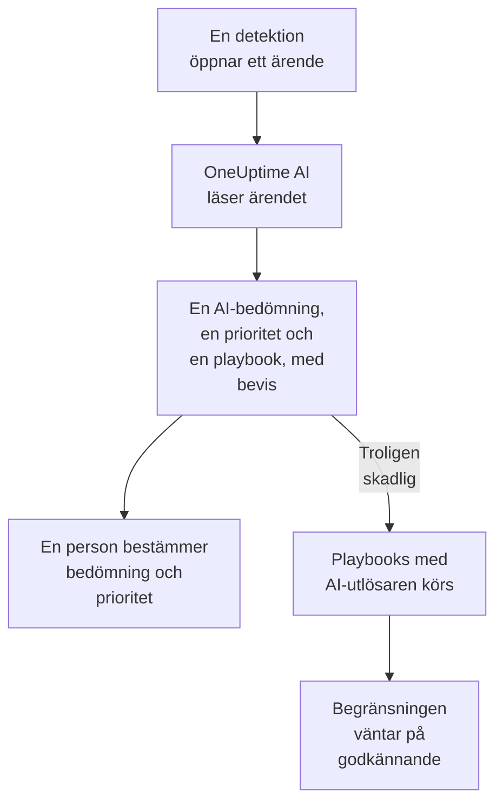

# OneUptime AI i säkerhet

OneUptime AI läser varje säkerhetsärende som en analytiker skulle göra: ärendets detektioner, händelser, entiteter och hotunderrättelser, och värdarna och personerna runt det. Den säger vad som hände och om det ser äkta ut, föreslår en prioritet och en playbook, och hänvisar till bevisen bakom varje påstående. Den ändrar ingenting på egen hand: en person bestämmer bedömningen och prioriteten och kör playbooken. Den skriver också utkast till detektionsregler utifrån en enda mening, och svarar i Ask AI på dina frågor om dina säkerhetsdata.

:::cards
- [Bedöm ett ärende](#bedöm-ett-ärende): Vad OneUptime AI läser, vad den drar för slutsats och vad den aldrig gör.
- [Bedöm nya ärenden automatiskt](#bedöm-nya-ärenden-automatiskt): Varje ärende som en detektion öppnar, bedömt så fort det öppnas.
- [Kör en playbook efter en AI-bedömning](#kör-en-playbook-efter-en-ai-bedömning): Agera på ett ärende som läses som Troligen skadlig.
- [Skriv ett utkast till en detektionsregel](#skriv-ett-utkast-till-en-detektionsregel): Beskriv vad som ska fångas, och läs Sigma-regeln.
- [Ask AI på säkerhetssidorna](#ask-ai-på-säkerhetssidorna): Frågor om ärenden och händelser, med vanliga ord.
:::

## Så fungerar det

En AI-bedömning läser bara. Den körs på projektets egen AI: **Aktivera AI**, projektets LLM-leverantör, dess AI-krediter och dess dagliga AI-gränser.

## Innan du börjar

- **Aktivera AI** påslaget, under **Projektinställningar → AI → AI Features**. Är det avslaget visar säkerhet ingenting från OneUptime AI, och ingenting körs.
- En LLM-leverantör som OneUptime AI kan använda, under **Projektinställningar → AI → LLM-leverantörer**. OneUptime Cloud tillhandahåller en.
- En roll som får arbeta med säkerhetsärenden, för att starta en AI-bedömning: Project Owner, Project Admin, Security Admin eller Security Member. Security Viewer läser varje AI-bedömning men kan inte starta någon. Se [Roller](/docs/permissions/reference#roller).

## Bedöm ett ärende

Öppna ett ärende: kortet **OneUptime AI** ligger högst upp på sidan.

| Kortet säger | Vad det betyder |
| --- | --- |
| **Inte bedömd ännu** | Ingen AI-bedömning har körts. **Bedöm med AI** startar en. |
| **Bedömer det här ärendet** | OneUptime AI läser ärendet. Varje kontroll visas medan den körs. |
| En AI-bedömning som **Troligen skadlig** | AI-bedömningen är klar. **Bedöm igen** läser ärendet på nytt. |
| **Bedömningen slutfördes inte** | Körningen stoppade. **Försök igen** startar en ny. |

En AI-bedömning läser:

- ärendet: titel, prioritet, status, entiteter och ATT&CK-koppling;
- dess detektioner, den senaste först, med en exempelhändelse för var och en;
- säkerhetshändelserna och hotunderrättelserna om ärendets användare, värdar och adresser;
- risken för ärendets användare, värdar och adresser, och vad som bidrog till den den här veckan;
- de värdar i OneUptime som ärendets värdar och adresser motsvarar, och vem som äger dem;
- incidenten som ärendet har deklarerat, dess anteckningar, dess skyddade entiteter och de playbooks som är påslagna.

Den kan också läsa resten av OneUptime som utredningen av en incident gör: loggar, traces, mätvärden, värdar och de skrivskyddade verktygen på projektets MCP-servrar.

### Vad den drar för slutsats

| AI-bedömning | Betyder | Föreslår att stänga som |
| --- | --- | --- |
| Troligen skadlig | Bevisen pekar på skadlig eller obehörig aktivitet | True Positive |
| Troligen ofarlig | Aktiviteten ser äkta men förväntad ut, som en administrativ uppgift eller en skanning som ditt team kör | Benign Positive |
| Troligen falskt positiv | Detektionen verkar ha feltolkat normal aktivitet | False Positive |
| Oklart | Bevisen räckte inte för att avgöra, och en person måste titta | Ingenting |

AI-bedömningen är OneUptime AI:s, aldrig ärendets bedömning: **Stäng ärende** börjar på den bedömning som den föreslår, och en person väljer. Under AI-bedömningen visar kortet:

- **Föreslagen prioritet**, med **Ange prioritet** när ärendet har en annan prioritet.
- **Föreslagen playbook**, med **Kör playbook**, som kör den i ditt namn, med varje godkännande som den behöver.
- Rapporten: vad som hände, hur säker AI-bedömningen är och vad som ska göras härnäst, varje påstående följt av en hänvisning som C1.
- **Evidence checked**: varje fråga som AI-bedömningen körde. En hänvisning öppnar sin fråga, och när du fäller ut en körs den igen med dina behörigheter, över den tid som AI-bedömningen läste.
- **Fråga om det här ärendet**, som öppnar Ask AI för ärendet.

Varje lista över ärenden visar AI-bedömningen bredvid varje ärendes titel och filtrerar på den med **AI-bedömning**.

### Vad den aldrig gör

En AI-bedömning ändrar ingenting i ärendet: varken status, prioritet, ansvarig, bedömning eller anteckningar. Den kör ingen playbook och isolerar ingen. En playbook som den föreslår körs när en person kör den, eller via utlösaren nedan.

### Text skriven för att styra en AI

Händelser, larm och värden för entiteter kommer utifrån projektet, och en angripare kan skriva dem. OneUptime AI läser alla som data, aldrig som instruktioner. När något i ett ärendes data låter som instruktioner till en AI säger kortet det först, en AI-bedömning Troligen ofarlig eller Troligen falskt positiv blir Oklart, och den AI-bedömningen startar ingen playbook.

## Bedöm nya ärenden automatiskt

Öppna **Produkter → Security Events → AI → Inställningar** och slå på **Bedöm nya ärenden**: då bedöms varje ärende som en detektion öppnar så fort det öppnas. Reglaget sparar så fort du slår om det. Project Owner och Project Admin kan ändra det.

Nya projekt startar med det påslaget; ett projekt som skapades tidigare har det avslaget tills någon slår på det. Ett ärende som har öppnats för hand, och ärendet från testattacken i **Skicka en testattack**, bedöms när någon klickar på **Bedöm med AI**.

## Kör en playbook efter en AI-bedömning

En playbook vars **Utlösare** är **Bedömd som troligen skadlig** körs en gång på ett ärende, när en AI-bedömning läser det som Troligen skadlig. **För ärenden med minst**, **Bara för detektioner från** och **Bara för de här detektionsreglerna** avgränsar den som för vilken utlösare som helst, och dess begränsningssteg väntar som alltid på godkännande. Den körs inte:

- efter en AI-bedömning som hittade text skriven för att styra en AI;
- en andra gång på samma ärende, hur ofta ärendet än bedöms;
- på testattackens ärende, om inte varje steg i playbooken stannar inom OneUptime.

En ny playbook erbjuds den här utlösaren bara medan projektets AI är påslagen.

## Skriv ett utkast till en detektionsregel

Klicka på sidan **Detektionsregler**, under fältet **Sigma-regel (YAML)**, på **Utkast med AI** och säg vad regeln ska fånga, till exempel tio misslyckade inloggningar från en IP-adress inom fem minuter. **Skriv regel** lägger in en Sigma-regel i fältet, kontrollerad på samma sätt som en sparad regel. Läs den, ändra den vid behov och spara den som vanligt: ingenting sparas förrän du gör det. Står det redan en regel i fältet heter knappen **Skriv om med AI**, och utkastet ersätter den regeln.

Ett utkast kräver en roll som får skapa detektionsregler.

## Ask AI på säkerhetssidorna

**Ask AI** vet vilken säkerhetssida du är på. På ett ärende läser den ärendet först och erbjuder frågor som **Är det på riktigt?**. På de andra sidorna under säkerhetshändelser söker en fråga med vanliga ord i dina säkerhetshändelser. Den kan också kontrollera värden mot dina hotunderrättelser, se hur aktiv en användare, en värd eller en adress har varit, och lista de playbooks som ett ärende kan gå till.

Ask AI kan lägga till en anteckning i ett ärende och köra en playbook på det, i ditt namn, och frågar före varje åtgärd. En playbook som den kör väntar på godkännande som alla andra.

När ett ärende deklarerar en incident läser även incidentens AI-utredning ärendet: vad som upptäcktes, om vem, och OneUptime AI:s bedömning av det.

## Kostnader och gränser

En AI-bedömning är arbete för OneUptime AI, precis som utredningen av en incident. På OneUptime Cloud betalas den med projektets AI-krediter, och den räknas in i projektets egna dagliga AI-gränser (**Dagliga gränser**, under **Projektinställningar → AI → AI Features**). De dagliga gränserna för incidenter och larm gäller inte. Ett ärende har en AI-bedömning åt gången, och AI-loggarna (**Projektinställningar → AI → AI-loggar**) listar dess anrop.

När projektet har slut på AI-krediter eller har nått en daglig AI-gräns bedöms inte nya ärenden: kortet säger varför, och **Bedöm med AI** fungerar igen så fort krediter har lagts till eller gränsen nollställs.

## Felsökning

:::details Ett nytt ärende bedömdes inte
Kontrollera att **Aktivera AI** är påslaget, och **Bedöm nya ärenden** under **Produkter → Security Events → AI → Inställningar**. Ett ärende som har öppnats för hand och testattackens ärende bedöms bara när någon ber om det. Öppna ärendet: när något hindrar en AI-bedömning säger kortet vad, och var det kan åtgärdas.
:::

:::details Kortet säger att projektet har slut på AI-krediter, eller har nått sin dagliga AI-gräns
En projektägare eller någon med Manage Billing kan lägga till krediter under **Projektinställningar → AI → AI-krediter**, eller höja eller ta bort gränsen under **Projektinställningar → AI → AI Features**. Klicka sedan på **Bedöm med AI** på ärendet.
:::

:::details Kortet säger att text i ärendet låter som instruktioner till en AI
Något i ärendets data, som ett händelsemeddelande eller ett användarnamn, skrevs för att styra en AI. OneUptime AI läste det som data och lämnade beslutet till dig: läs detektionerna och bevisen själv innan du stänger ärendet.
:::

:::details En playbook med AI-utlösaren kördes inte
Kontrollera att playbooken är påslagen, att AI-bedömningen läste ärendet som Troligen skadlig, och att dess inställningar **För ärenden med minst**, **Bara för detektioner från** och **Bara för de här detektionsreglerna** passar ärendet. Den körs en gång per ärende, och inte efter en AI-bedömning som hittade text skriven för att styra en AI.
:::

## Nästa steg

:::cards
- [Säkerhetsärenden och playbooks](/docs/telemetry/security-cases): Arbeta med ärenden, stäng dem med en bedömning och bygg playbooks.
- [AI SRE](/docs/ai/ai-sre): Hur OneUptime AI utreder incidenter och larm, och dess gränser.
- [Fråga AI](/docs/ai/ask-ai): Ställ frågor om ditt projekt med vanliga ord.
- [LLM-leverantörer](/docs/ai/llm-provider): Välj den modell som OneUptime AI använder.
:::
