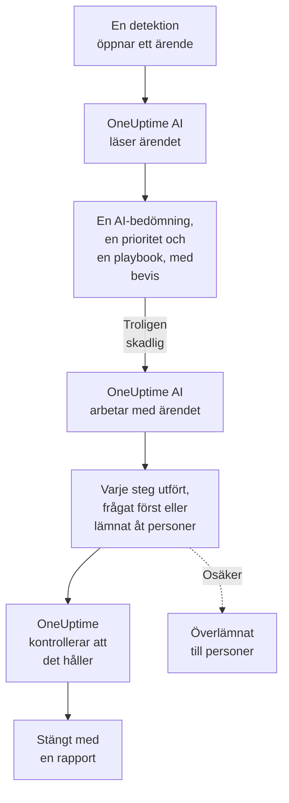

# OneUptime AI i säkerhet

OneUptime AI läser varje säkerhetsärende som en analytiker skulle göra: ärendets detektioner, händelser, entiteter och hotunderrättelser, och värdarna och personerna runt det. Den säger vad som hände och om det ser äkta ut, föreslår en prioritet och en playbook, och hänvisar till bevisen bakom varje påstående. När du tillåter det arbetar den sedan med ärendet från början till slut: den tar över ärendet, begränsar hotet, kontrollerar att det den gjorde håller, ser till att koden åtgärdas och stänger ärendet med en rapport. Den utför varje typ av steg på egen hand, frågar en person först eller lämnar det åt en person, som du ställer in det, och den utför varje steg genom samma playbook-motor som personer använder, så att varje steg finns på ärendets tidslinje som OneUptime AI:s och kan ångras. Den skriver också utkast till detektionsregler utifrån en enda mening, och svarar i Ask AI på dina frågor om dina säkerhetsdata.

:::cards
- [Bedöm ett ärende](#bedöm-ett-ärende): Vad OneUptime AI läser, vad den drar för slutsats och vad den aldrig gör.
- [Bedöm nya ärenden automatiskt](#bedöm-nya-ärenden-automatiskt): Varje ärende som en detektion öppnar, bedömt så fort det öppnas.
- [Arbeta med ett ärende från början till slut](#arbeta-med-ett-ärende-från-början-till-slut): Begränsa, kontrollera, åtgärda och stäng, med en person som godkänner det du väljer.
- [Vad OneUptime AI får göra i ett ärende](#vad-oneuptime-ai-får-göra-i-ett-ärende): Av, Fråga först eller På egen hand, för varje typ av steg.
- [När den lämnar över ett ärende till personer](#när-den-lämnar-över-ett-ärende-till-personer): Varför den slutar, och vem som får veta det.
- [Kör en playbook efter en AI-bedömning](#kör-en-playbook-efter-en-ai-bedömning): Agera på ett ärende som läses som Troligen skadlig.
- [Skriv ett utkast till en detektionsregel](#skriv-ett-utkast-till-en-detektionsregel): Beskriv vad som ska fångas, och läs Sigma-regeln.
- [Ask AI på säkerhetssidorna](#ask-ai-på-säkerhetssidorna): Frågor om ärenden och händelser, med vanliga ord.
:::

## Så fungerar det

En AI-bedömning läser bara. När OneUptime AI arbetar med ett ärende agerar den, inom det du tillåter, och lämnar över ärendet till personer så fort den är osäker. Båda körs på projektets egen AI: **Aktivera AI**, projektets LLM-leverantör, dess AI-krediter och dess dagliga AI-gränser.

## Innan du börjar

- **Aktivera AI** påslaget, under **Projektinställningar → AI → AI-funktioner**. Är det avslaget visar säkerhet ingenting från OneUptime AI, och ingenting körs.
- En LLM-leverantör som OneUptime AI kan använda, under **Projektinställningar → AI → LLM-leverantörer**. OneUptime Cloud tillhandahåller en.
- En roll som får arbeta med säkerhetsärenden, för att starta en AI-bedömning: Projektägare, Projektadministratör, Säkerhetsadministratör eller Säkerhetsmedlem. Säkerhetstittare läser varje AI-bedömning men kan inte starta någon. Se [Roller](/docs/permissions/reference#roller).

## Bedöm ett ärende

Öppna ett ärende: kortet **OneUptime AI** ligger högst upp på sidan.

| Kortet säger | Vad det betyder |
| --- | --- |
| **Inte bedömd ännu** | Ingen AI-bedömning har körts. **Bedöm med AI** startar en. |
| **Bedömer det här ärendet** | OneUptime AI läser ärendet. Varje kontroll visas medan den körs. |
| En AI-bedömning som **Troligen skadlig** | AI-bedömningen är klar. **Bedöm igen** läser ärendet på nytt. |
| **Bedömningen slutfördes inte** | Körningen stoppade. **Försök igen** startar en ny. |

En Säkerhetstittare ser samma kort: **Bedöm med AI** och **Försök igen** förblir nedtonade bredvid en rad som säger vem som kan starta en bedömning, och **Bedöm igen** och **Ange prioritet** erbjuds inte.

En AI-bedömning läser:

- ärendet: titel, prioritet, status, entiteter och ATT&CK-koppling;
- dess detektioner, den senaste först, med en exempelhändelse för var och en;
- säkerhetshändelserna och hotunderrättelserna om ärendets användare, värdar och adresser;
- risken för ärendets användare, värdar och adresser, och vad som bidrog till den den här veckan;
- de värdar i OneUptime som ärendets värdar och adresser motsvarar, och vem som äger dem;
- incidenten som ärendet har deklarerat, dess anteckningar, dess skyddade entiteter och de playbooks som är påslagna.

Den kan också läsa resten av OneUptime som utredningen av en incident gör: loggar, traces, mätvärden, värdar och de skrivskyddade verktygen på projektets MCP-servrar.

Alla som får se ärendet läser dess AI-bedömning, så en AI-bedömning läser bara det som alla får läsa. Ett team, en anpassad roll eller en API-nyckel som bara läser en typ av post utifrån ägare eller etikett räknas bara när API-nyckeln, eller någon i teamet, får läsa säkerhetsärenden eller granskningsloggen. En typ av post som ingen av dem bara läser utifrån ägare eller etikett läses i sin helhet; där några gör det utelämnas en värd, ett kluster, en tjänst eller en annan post som en ägare eller en etikett skiljer av, och den namnges eller räknas aldrig. Vem som får läsa säkerhetsärenden avgörs varje gång en AI-bedömning körs, så en AI-bedömning som skrevs innan någon fick den åtkomsten kan namnge poster som skiljts av från den personen. Ärendet läses alltid, och det gör också incidenten som ärendet har deklarerat, om den incidenten inte är privat. Privata incidenter och larm läses aldrig.

### Vad den drar för slutsats

| AI-bedömning | Betyder | Föreslår att stänga som |
| --- | --- | --- |
| Troligen skadlig | Bevisen pekar på skadlig eller obehörig aktivitet | True Positive |
| Troligen ofarlig | Aktiviteten ser äkta men förväntad ut, som en administrativ uppgift eller en skanning som ditt team kör | Benign Positive |
| Troligen falskt positiv | Detektionen verkar ha feltolkat normal aktivitet | False Positive |
| Oklart | Bevisen räckte inte för att avgöra, och en person måste titta | Ingenting |

AI-bedömningen är OneUptime AI:s, aldrig ärendets bedömning: **Stäng ärende** börjar på den bedömning som den föreslår, och en person väljer. Under AI-bedömningen visar kortet:

- **Föreslagen prioritet**, med **Ange prioritet** när ärendet har en annan prioritet.
- **Föreslagen playbook**, med **Kör playbook**, som kör den i ditt namn, med varje godkännande som den behöver. Medan den playbooken redan körs på ärendet står körningens status, till exempel **Väntar på godkännande**, i stället för **Kör playbook**: körningen finns under ärendets **Playbooks**, och en till skulle be om samma godkännande igen.
- Rapporten: vad som hände, hur säker AI-bedömningen är och vad som ska göras härnäst, varje påstående följt av en hänvisning som C1.
- **Kontrollerade bevis**: varje fråga som AI-bedömningen körde. En hänvisning öppnar sin fråga, och när du fäller ut en körs den igen med dina behörigheter, över den tid som AI-bedömningen läste.
- **Fråga om det här ärendet**, som öppnar Ask AI för ärendet.

Varje lista över ärenden visar AI-bedömningen bredvid varje ärendes titel och filtrerar på den med **AI-bedömning**.

### Vad den aldrig gör

En AI-bedömning ändrar ingenting i ärendet: varken status, prioritet, ansvarig, bedömning eller anteckningar. Den kör ingen playbook och isolerar ingen. En playbook som den föreslår körs när en person kör den, eller via utlösaren nedan. Att agera på ärendet är något OneUptime AI gör när den arbetar med det, och det är en egen inställning: se [Arbeta med ett ärende från början till slut](#arbeta-med-ett-ärende-från-början-till-slut).

### Text skriven för att styra en AI

Händelser, larm och värden för entiteter kommer utifrån projektet, och en angripare kan skriva dem. OneUptime AI läser alla som data, aldrig som instruktioner. När något i ett ärendes data låter som instruktioner till en AI säger kortet det först, en AI-bedömning Troligen ofarlig eller Troligen falskt positiv blir Oklart, den AI-bedömningen startar ingen playbook, och OneUptime AI arbetar inte med ärendet: den lämnar över det till personer.

## Bedöm nya ärenden automatiskt

Öppna **Produkter → Säkerhetshändelser → AI → Inställningar** och slå på **Bedöm nya ärenden**: då bedöms varje ärende som en detektion öppnar så fort det öppnas. Reglaget sparar så fort du slår om det. Projektägare och Projektadministratör kan ändra det.

Nya projekt startar med det påslaget; ett projekt som skapades tidigare har det avslaget tills någon slår på det. Ett ärende som har öppnats för hand, och ärendet från testattacken i **Skicka en testattack**, bedöms när någon klickar på **Bedöm med AI**.

## Arbeta med ett ärende från början till slut

Slå på **Arbeta med ärenden från början till slut** på samma sida: då tar OneUptime AI över varje ärende som dess AI-bedömning läser som Troligen skadlig och arbetar med det, inom det du tillåter under **Vad OneUptime AI får göra i ett ärende**. Nya projekt startar med det påslaget; ett projekt som skapades tidigare har det avslaget tills någon slår på det. Projektägare och Projektadministratör kan ändra det.

Medan det är påslaget kan en person också starta det på ett enskilt ärende: **Agera med AI**, på ärendets kort **OneUptime AI**, arbetar med ett ärende som AI-bedömningen från OneUptime AI läste som Troligen skadlig, Troligen ofarlig eller Troligen falskt positiv. Det erbjuds inte på ett ärende vars AI-bedömning var Oklart, vars data låter som instruktioner till en AI, eller som har din högsta prioritet: de ärendena är en persons. Det kräver en roll som får arbeta med säkerhetsärenden.

### Vad den gör

OneUptime AI arbetar sig igenom ärendets **Responsplan**, det mest brådskande först: **Bekräfta att det är verkligt**, **Begränsa det**, **Åtgärda det som gjorde det möjligt** och **Stäng ärendet**. Varje steg utförs, frågas om hos en person först eller lämnas åt en person, som raden i **Vad OneUptime AI får göra i ett ärende** för dess typ säger.

| Steg | Vad OneUptime AI gör |
| --- | --- |
| Ta över ärendet | Tar över det och höjer dess prioritet till den som AI-bedömningen föreslog. Den sänker aldrig en prioritet, och ett ärende som den höjer till din högsta prioritet går till personer |
| Uteslut en falsk positiv | Markerar steget som utfört bara när OneUptimes egna fakta inte lämnar något tvivel: adressen är inte en av dina och ingen har loggat in från den. Annars lämnar den steget åt en person |
| Blockera adressen | Blockerar den i 24 timmar via din [Blocklista](/docs/telemetry/security-cases#blocklista) och väntar sedan på OneUptimes kontroll av att blockeringen håller. När inget tillämpar din blocklista lämnar den steget åt en person |
| Stäng av användaren, begränsa värden | Kör steget i en av dina playbooks som gör det, via din identitetsleverantör eller EDR. Utan en sådan playbook lämnar den steget åt en person |
| Deklarera en incident | Frågar alltid först: en incident larmar personer |
| Flytta ärendet till Begränsad | När OneUptime har verifierat varje steg som begränsar hotet |
| Åtgärda rutten som en attack nådde | Låter ”Åtgärda med AI” öppna en pull request. En person slår ihop den. Den stänger ärendet när OneUptime verifierar åtgärden i produktion, frågar en person när åtgärden bara ser klar ut, och fortsätter arbeta med ärendet så länge åtgärden inte håller |
| Slå på MFA, granska kontots ändringar | Lämnas åt en person: ingen produkt talar om för OneUptime om de håller |
| Stäng ärendet | När alla andra steg är klara och ärendets detektion har varit tyst i 24 timmar, som True Positive, med en [avslutande rapport](#den-avslutande-rapporten) |

Ett steg som ärendets detektionsregel själv lägger till, och allt som OneUptime inte har något sätt att göra, som att blockera en domän i ditt DNS-filter, lämnas åt en person, med en förklaring.

Varje steg som OneUptime AI utför går genom playbook-motorn, som en körning av ett enda steg på ärendets sida **Playbooks** med **OneUptime AI** som utlösare. Därför väntar det på godkännande, låter skyddade entiteter vara, visas på ärendets tidslinje, sparas i granskningsloggen och kan ångras, precis som ett steg som vem som helst kör, och tidslinjen säger att det var OneUptime AI:s. Ett steg som den frågar om väntar på en persons godkännande, i ärendet, på dess sida **Playbooks** eller med ett tryck i Slack eller Microsoft Teams.

### Dess logg i ärendet

Under AI-bedömningen säger kortet **OneUptime AI** hur OneUptime AI arbetar med ärendet, under **Arbetet med ärendet**:

| Kortet säger | Vad det betyder |
| --- | --- |
| **OneUptime AI arbetar inte med det här ärendet** | **Agera med AI** tar över det. |
| **Arbetar med det här ärendet** | OneUptime AI arbetar sig igenom planen. **Ta över** stoppar den, och ärendet är ditt. |
| **Väntar på en person** | Den har bett någon att godkänna ett steg och fortsätter så fort någon svarar. |
| **Överlämnat till personer** | Den slutade och säger varför. |
| **Ärendet är stängt** | Den stängde ärendet, eller så gjorde en person det. Dess **Avslutande rapport** finns ovanför stegen. |

Under det finns varje steg som den utförde, frågade om eller lämnade, det senaste först, vart och ett med en förklaring: **Utfört på egen hand: dina inställningar tillåter det.**, **Dina inställningar låter detta vänta på en persons godkännande.**, **OneUptime har inget sätt att utföra det här steget, så en person gör det.** Ett steg som den frågade om har **Godkänn** och **Avböj**; ett steg som den utförde länkar till sin körning, där det kan ångras. Ett steg som OneUptime kontrollerar säger vad kontrollen hittade, och ett steg som den har utfört tidigare i ärenden från samma regel säger hur ofta det höll: ”Det höll i 14 av 15 liknande ärenden.”

### Ett ärende som den läser som ofarligt eller falskt positivt

**Agera med AI** på ett ärende som AI-bedömningen läste som Troligen ofarlig eller Troligen falskt positiv stänger det som Benign Positive eller False Positive, som **Stäng ärendet** tillåter. När det är stängt häver OneUptime AI de blockeringar som ärendet gjorde, som **Stäng ärendet** också tillåter, och erbjuder ärendets regel ett undantag för värdet som utlöste den. Undantaget väntar alltid på en person: **Godkänn** lägger till det, i ditt namn.

## Vad OneUptime AI får göra i ett ärende

Under **Vad OneUptime AI får göra i ett ärende**, på **Produkter → Säkerhetshändelser → AI → Inställningar**, har varje typ av steg sin egen rad, som sparas så fort du väljer:

- **Av**: OneUptime AI lämnar detta åt en person och anger det i ärendet.
- **Fråga först**: den frågar en person, med bevisen, och utför steget så fort någon godkänner.
- **På egen hand**: den gör det utan att fråga och anger det på ärendets tidslinje.

| Rad | Omfattar | Nya projekt startar på |
| --- | --- | --- |
| **Arbeta med ärendet** | Att ta över ärendet, höja dess prioritet, markera steg som utförda med deras bevis och flytta det till Begränsad | På egen hand |
| **Blockera adresser** | Att blockera ärendets adress vid kanten i 24 timmar | Fråga först |
| **Begränsa konton** | Att stänga av ärendets användare eller avsluta användarens sessioner | Fråga först |
| **Begränsa värdar** | Att begränsa eller isolera ärendets värd | Fråga först |
| **Åtgärda koden** | Att låta ”Åtgärda med AI” öppna en pull request för rutten som en attack nådde | På egen hand |
| **Stäng ärendet** | Att stänga ärendet med dess avslutande rapport, och häva ärendets blockeringar när det är stängt som ofarligt | Fråga först |

Inställningarna gäller medan **Arbeta med ärenden från början till slut** är påslaget, och kortet säger det medan det är avslaget. Projektägare och Projektadministratör kan ändra dem.

Att ställa in **Blockera adresser**, **Begränsa konton** eller **Begränsa värdar** på **På egen hand** kräver en Säkerhetsadministratörs befogenhet, som Projektägare och Projektadministratörer också har, och OneUptime sparar vem som gjorde det och när, som för ett playbook-steg vars godkännande är avstängt. **Blockera adresser** frågar först: **Bekräfta och slå på** är en Säkerhetsadministratörs bekräftelse, och raden säger sedan när den gavs. Tills en Säkerhetsadministratör bekräftar det frågar OneUptime AI innan den blockerar.

Oavsett vad raderna säger gör OneUptime AI följande:

- agerar aldrig på en skyddad användare, värd eller adress: den lämnar över ärendet till personer;
- utför högst 10 åtgärder på egen hand i timmen, sett över alla dina ärenden, och lämnar sedan över nästa ärende till personer;
- blockerar i högst 24 timmar;
- slår aldrig ihop kod: en person slår ihop varje pull request;
- frågar alltid innan den deklarerar en incident eller lägger till ett regelundantag;
- arbetar med ett ärende en körning i taget, och en server som startar om tappar aldrig en körning som agerar.

## När den lämnar över ett ärende till personer

OneUptime AI drar sig aldrig tillbaka i tysthet. Den lämnar över ärendet till personer och säger varför på kortet och tidslinjen, när:

- något i ärendets data låter som instruktioner till en AI;
- ärendet har din högsta prioritet;
- det som nästa steg agerar på är skyddat;
- den har agerat på egen hand så ofta som den får under en timme;
- AI är avstängd för projektet eller för säkerhetsärenden, det inte finns någon LLM-leverantör, eller projektet har slut på AI-krediter eller har nått sin dagliga AI-gräns;
- dess AI-bedömning inte kunde avgöra om ärendet är verkligt;
- ett steg som den utförde inte håller, ett steg som den startade inte slutfördes, eller en person avböjde eller ångrade ett steg som den utförde;
- den inte kan avgöra vad den ska göra härnäst, eller allt som återstår i ärendet måste göras av en person.

Personerna på ärendet får veta det direkt, eller, när ingen är på ärendet, de personer som aviseras om ärenden med dess prioritet: **OneUptime AI lämnade över ett säkerhetsärende till personer**, under **Användarinställningar → Aviseringsinställningar**. En aviseringsregel för arbetsytan för säkerhetsärenden postar det i sin Slack- eller Microsoft Teams-kanal under **Överlämnat till personer av OneUptime AI**. **Ta över** lämnar över ärendet utan att meddela någon, eftersom personen som tryckte på den har ärendet.

**Agera med AI** ber OneUptime AI att arbeta med ärendet igen, från där ärendet står.

## Den avslutande rapporten

När OneUptime AI stänger ett ärende, eller ber en person att göra det, skriver den en avslutande rapport utifrån det som ärendet innehåller, inte utifrån AI-bedömningens ord: vad som hände, påverkan, vad som gjordes, vad som åtgärdades och vad man ska hålla ögonen på. Rapporten är ärendets avslutande anteckning, den finns på tidslinjen, och kortet visar den under **Avslutande rapport**. Med **Stäng ärendet** på **Fråga först** väntar ärendet på att en person godkänner stängningen, med rapporten att läsa först.

## Så mäts den

**Produkter → Säkerhetshändelser → Översikt** visar hur OneUptime AI har arbetat med ärendena de senaste 30 dagarna, så fort den har arbetat med eller frågat om ett: **Löst av OneUptime AI**, av de ärenden som den arbetade med; **Tid till begränsning med AI** och **Tid till stängning med AI**, var och en bredvid tiden utan den; och **Begärda godkännanden**, hur snabbt personer svarade och hur många av dess steg som personer ångrade.

## Kör en playbook efter en AI-bedömning

En playbook vars **Utlösare** är **Bedömd som troligen skadlig** körs en gång på ett ärende, när en AI-bedömning läser det som Troligen skadlig. **För ärenden med minst**, **Bara för detektioner från** och **Bara för de här detektionsreglerna** avgränsar den som för vilken utlösare som helst, och dess begränsningssteg väntar som alltid på godkännande. Den körs inte:

- efter en AI-bedömning som hittade text skriven för att styra en AI;
- en andra gång på samma ärende, hur ofta ärendet än bedöms;
- på testattackens ärende, om inte varje steg i playbooken stannar inom OneUptime.

En ny playbook erbjuds den här utlösaren bara medan projektets AI är påslagen.

## Skriv ett utkast till en detektionsregel

Klicka på sidan **Detektionsregler**, under fältet **Sigma-regel (YAML)**, på **Utkast med AI** och säg vad regeln ska fånga, till exempel tio misslyckade inloggningar från en IP-adress inom fem minuter. **Skriv regel** lägger in en Sigma-regel i fältet, kontrollerad på samma sätt som en sparad regel. Läs den, ändra den vid behov och spara den som vanligt: ingenting sparas förrän du gör det. Står det redan en regel i fältet heter knappen **Skriv om med AI**, och utkastet ersätter den regeln.

Ett utkast kräver en roll som får skapa detektionsregler.

## Ask AI på säkerhetssidorna

**Fråga AI** vet vilken säkerhetssida du är på. På ett ärende läser den ärendet först och erbjuder frågor som **Är det på riktigt?**. På de andra sidorna under säkerhetshändelser söker en fråga med vanliga ord i dina säkerhetshändelser. Den kan också kontrollera värden mot dina hotunderrättelser, se hur aktiv en användare, en värd eller en adress har varit, och lista de playbooks som ett ärende kan gå till.

Ask AI kan lägga till en anteckning i ett ärende och köra en playbook på det, i ditt namn, och frågar före varje åtgärd. En playbook som den kör väntar på godkännande som alla andra.

När ett ärende deklarerar en incident läser även incidentens AI-utredning ärendet: vad som upptäcktes, om vem, och OneUptime AI:s bedömning av det.

## Kostnader och gränser

En AI-bedömning är arbete för OneUptime AI, precis som utredningen av en incident. På OneUptime Cloud betalas den med projektets AI-krediter, och den räknas in i projektets egna dagliga AI-gränser (**Dagliga gränser**, under **Projektinställningar → AI → AI-funktioner**). De dagliga gränserna för incidenter och larm gäller inte. Ett ärende har en AI-bedömning åt gången, och AI-loggarna (**Projektinställningar → AI → AI-loggar**) listar dess anrop.

När projektet har slut på AI-krediter eller har nått en daglig AI-gräns bedöms inte nya ärenden: kortet säger varför, och **Bedöm med AI** fungerar igen så fort krediter har lagts till eller gränsen nollställs. När OneUptime AI arbetar med ett ärende läser den ärendets egen plan och egna kontroller i stället för att fråga LLM:en, och den stannar vid samma gränser: den lämnar över ärendet till personer och säger varför.

## Felsökning

:::details Ett nytt ärende bedömdes inte
Kontrollera att **Aktivera AI** är påslaget, och **Bedöm nya ärenden** under **Produkter → Säkerhetshändelser → AI → Inställningar**. Ett ärende som har öppnats för hand och testattackens ärende bedöms bara när någon ber om det. Öppna ärendet: när något hindrar en AI-bedömning säger kortet vad, och var det kan åtgärdas.
:::

:::details OneUptime AI arbetade inte med ett ärende
Kontrollera att **Arbeta med ärenden från början till slut** är påslaget under **Produkter → Säkerhetshändelser → AI → Inställningar**. Den tar bara upp ett ärende på egen hand när AI-bedömningen läser det som Troligen skadlig. Öppna ärendet: under **Arbetet med ärendet** säger kortet varför den inte arbetar med det, och **Agera med AI** ber den att göra det.
:::

:::details Den frågar innan den blockerar, trots att Blockera adresser är På egen hand
**På egen hand** för **Blockera adresser** gäller först när en Säkerhetsadministratör har bekräftat det: raden säger när, eller att ingen har gjort det ännu. En adress som är skyddad, eller en av dina egna, blockeras aldrig: OneUptime AI lämnar över ärendet till personer. Så länge inget tillämpar din blocklista lämnar den steget åt en person.
:::

:::details Kortet säger att projektet har slut på AI-krediter, eller har nått sin dagliga AI-gräns
En Projektägare eller någon med Manage Billing kan lägga till krediter under **Projektinställningar → AI → AI-krediter**, eller höja eller ta bort gränsen under **Projektinställningar → AI → AI-funktioner**. Klicka sedan på **Bedöm med AI** på ärendet.
:::

:::details Kortet säger att text i ärendet låter som instruktioner till en AI
Något i ärendets data, som ett händelsemeddelande eller ett användarnamn, skrevs för att styra en AI. OneUptime AI läste det som data och lämnade beslutet till dig: läs detektionerna och bevisen själv innan du stänger ärendet.
:::

:::details En playbook med AI-utlösaren kördes inte
Kontrollera att playbooken är påslagen, att AI-bedömningen läste ärendet som Troligen skadlig, och att dess inställningar **För ärenden med minst**, **Bara för detektioner från** och **Bara för de här detektionsreglerna** passar ärendet. Den körs en gång per ärende, och inte efter en AI-bedömning som hittade text skriven för att styra en AI.
:::

## Nästa steg

:::cards
- [Säkerhetsärenden och playbooks](/docs/telemetry/security-cases): Arbeta med ärenden, stäng dem med en bedömning och bygg playbooks.
- [AI SRE](/docs/ai/ai-sre): Hur OneUptime AI utreder incidenter och larm, och dess gränser.
- [Fråga AI](/docs/ai/ask-ai): Ställ frågor om ditt projekt med vanliga ord.
- [LLM-leverantörer](/docs/ai/llm-provider): Välj den modell som OneUptime AI använder.
:::
