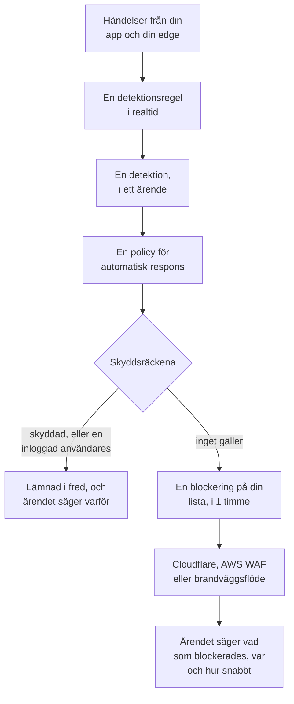

# Automatisk respons

Policyer för automatisk respons utmanar eller blockerar en angripande adress när detektionen görs, innan någon har bedömt ärendet: skannrar som söker igenom din app och bottar som provar lösenord efter lösenord avvisas inom några minuter efter sin första förfrågan. Varje projekt har tre färdiga policyer, var och en avstängd tills du slår på den, och var och en börjar med en veckas provperiod som bara registrerar vad den skulle ha gjort. Skyddsräcken gör en policy säker att låta vara på: den rör aldrig dina egna adresser eller en som dina inloggade användare använder, och den stoppar och larmar en person när en attack är större än den bör hantera ensam.

:::cards
- [Slå på en policy](#slå-på-en-policy): Först en veckas provperiod, sedan ett klick.
- [Skyddsräckena](#skyddsräckena): Vad en policy aldrig gör, och när den stoppar.
- [Tid till blockering](#tid-till-blockering): Hur snabbt varje policy blockerar, på sitt kort och i ärendet.
- [Din egen policy](#din-egen-policy): Reagera på de tekniker, regler eller den hotinformation du väljer.
:::

## Så fungerar det

En policy reagerar på en detektion när den registreras i sitt ärende, några sekunder efter att regeln utlöses. Dess blockering hamnar på din [blocklista](/docs/telemetry/security-cases#blocklista) på samma sätt som playbook-steget **Blockera adressen**, med policyns namn som den som skapade den: destinationerna som upprätthåller din blocklista håller den, den syns på ärendets tidslinje och i granskningsloggen, och den går ut av sig själv. Den behöver ingens godkännande: den som slog på policyn godkände dess blockeringar.

## Innan du börjar

- En destination som upprätthåller din blocklista: Cloudflare, AWS WAF, eller en brandvägg eller proxy som läser ett [blocklistflöde](/docs/telemetry/blocklist-feeds). Så länge inget upprätthåller den säger sidan det, och en policys blockeringar gäller ingenstans.
- Händelserna som en policys regler läser: din apps åtkomstloggar eller spår, eller händelserna från din edge, som Cloudflares brandväggshändelser, och dina inloggningar. Se [Säkerhetshändelser](/docs/telemetry/security-events).
- En roll som får slå på en policy: Säkerhetsadministratör, Projektadministratör eller Projektägare. Säkerhetsmedlem och Säkerhetstittare ser policyerna och vad de har gjort. Se [Roller](/docs/permissions/reference#roller).

## De färdiga policyerna

| Policy | Reagerar på | Gör | Första blockering |
| --- | --- | --- | --- |
| **Skannrar** | Webbskanningar och exploateringsförsök (ATT&CK T1595, T1190): försök till SQL-injektion, path traversal och Log4Shell, och många träffar på hanterade Cloudflare-regler från en adress, så länge alla förfrågningar från adressen avvisades | Utmaning | 1 timme |
| **Lösenordsgissning** | Brute force och lösenordssprejning (ATT&CK T1110): misslyckade inloggningar från en adress, och misslyckade inloggningar följda av en lyckad från samma adress | Blockera | 1 timme |
| **Kända skadliga adresser** | Alla detektioner om en adress som din [hotinformation](/docs/telemetry/threat-intelligence) listar | Blockera | 24 timmar |

Människor klarar en utmaning, skript och bottar gör det inte. Skannrar utmanar bara en adress så länge ingen av dess förfrågningar har nått din app: en adress vars förfrågningar kom igenom är ett ärende för en person.

När du slår på Skannrar eller Lösenordsgissning, i provperioden eller helt, körs reglerna från **Regelbibliotek** som policyn reagerar på i realtid, och de regler ditt projekt saknar läggs till: en realtidsregel utlöses sekunder efter att händelserna kommer, medan en schemalagd regel läser minuter efter. En regel som någon har stängt av förblir avstängd. Ett projekt kör högst 50 regler i realtid: därutöver stannar en regel på sitt schema, och policyns kort visar **Enligt ett schema** bredvid.

## Slå på en policy

:::steps
### Öppna Automatisk respons

Öppna **Produkter → Säkerhetshändelser → Playbooks → Automatisk respons**. Varje policy har sitt kort: vad den gör, en etikett som säger **Av**, **Provperiod**, **Provperiod klar** eller **På**, och sin brytare.

### Starta provperioden

Slå om policyns brytare. I 7 dagar registrerar den vad den skulle ha gjort och rör ingen trafik: ärendet säger "Trial run: the Scanners policy would have challenged 35.205.11.131 for 1 hour." Kortet räknar adresserna hittills, och vad dess skyddsräcken lät vara.

### Slå på den

När veckan är slut säger kortet vad policyn skulle ha gjort, till exempel "På 7 dagar skulle den ha utmanat 1 283 adresser. Ingen hade inloggade användare, och ingen var din. Slå på den?", och dina säkerhetsansvariga får samma sak via e-post. Klicka på **Slå på**: från och med då reagerar policyn.
:::

För att slå på en policy utan dess veckas provperiod öppnar du **Fler inställningar** på dess kort och klickar på **Slå på utan provperiod**. Dess skyddsräcken gäller fortfarande. Slå om brytaren igen för att stänga av en policy; påslagen igen efter en hel veckas provperiod reagerar den direkt.

## Skyddsräckena

- **Aldrig dina egna eller skyddade adresser.** Posterna i **Skyddade entiteter**, och allt som OneUptime skyddar av sig självt: dina värdar, molnresurser och sonder, de intervall som inte finns på internet, och den edge som står framför din app. Se [Blocklista](/docs/telemetry/security-cases#blocklista).
- **Aldrig en adress som en inloggad användare har använt de senaste 30 dagarna.** Ett kontors nätverk, en kunds proxy eller en persons hem: OneUptime letar efter adressen i din identitetsleverantörs inloggningar och i de förfrågningar som din app besvarade för en inloggad användare, de med ett användar-ID i sina spår eller loggar. En adress som den inte kan kontrollera, eftersom de händelserna inte kunde läsas eller eftersom dina scrub-regler döljer adresser på ett sätt som den inte kan matcha, lämnas åt en person.
- **Längre blockeringar för en adress som kommer tillbaka.** Den första blockeringen varar 1 timme, sedan 24 timmar, sedan 7 dagar för en adress som blockeras igen inom 30 dagar. Kända skadliga adresser börjar på 24 timmar.
- **Högst 50 automatiska blockeringar i timmen.** Därutöver slutar dina policyer blockera och larmar dina säkerhetsansvariga: en så stor attack behöver en person. Sidan säger det så länge det pågår.
- **Ångra vid tvivel.** När en inloggad användare syns från en adress som en policy har blockerat, häver policyn blockeringen och meddelar dina säkerhetsansvariga.

Dina säkerhetsansvariga är ditt projekts Säkerhetsadministratörer, eller dess Projektägare om det inte har några. Varje adress som ett skyddsräcke lät vara står i sitt ärende, med orsaken.

## Där en destination inte kan utmana

Cloudflare och AWS WAF utmanar. En brandvägg som läser ett blocklistflöde kan inte det, så där är en policys utmaning en blockering lika länge, och policyns kort och ärendet säger det, till exempel "FortiGate feed cannot challenge, so it blocks the address there for the same time." En utmaning som du själv gör blir aldrig en blockering.

## Tid till blockering

Tiden till blockering löper från adressens första förfrågan, den tidigaste händelsen i dess detektion, tills blockeringen gäller vid din edge. Varje policys kort visar dess 50:e och 95:e percentil dag för dag under de senaste 30 dagarna. Ett ärende som en automatisk respons har blockerat säger det under **Tid till begränsning** på dess **Översikt**, till exempel "Blockerad automatiskt 41s efter den första förfrågan", och dess tidslinje säger vad som blockerades, var och hur snabbt: "OneUptime challenged 35.205.11.131 at Cloudflare for 1 hour (Scanners policy), 41 seconds after its first request." Adressens steg i ärendets **Responsplan** är klart, med **Häv** bredvid.

## Din egen policy

Klicka på **Skapa policy** under de färdiga policyerna. En egen policy behöver ett **Namn** och det som den reagerar på:

| Fält | Vad det gör |
| --- | --- |
| **ATT&CK-tekniker** | Teknikerna som en detektion måste ha, separerade med kommatecken, som `T1110, T1190`. En teknik omfattar sina undertekniker. |
| **Åtgärd** | Under **Fler fält**: **Blockera** eller **Utmaning**. |
| **Första blockeringen varar** | Under **Fler fält**: 1 timme, 24 timmar eller 7 dagar. En adress som kommer tillbaka blockeras längre. |
| **Detektionsregler** | Under **Fler fält**: eller en detektion från en av de här reglerna. |
| **Bara adresser som din hotinformation listar** | Under **Fler fält**: reagerar bara på adresser som din hotinformation listar. Ensam reagerar den på alla detektioner om en sådan. |
| **Bara så länge alla förfrågningar avvisades** | Under **Fler fält**: reagerar bara så länge ingen av adressens förfrågningar har nått din app. |

En egen policy börjar avstängd, kör en veckas provperiod som en färdig och har samma skyddsräcken. **Redigera policy** och **Ta bort policy** finns på dess kort; om du tar bort den ligger dess blockeringar kvar på din blocklista tills de går ut.

## Felsökning

:::details En policy är på, men blockerade inte en adress
Titta på ärendets tidslinje: en policy som lät en adress vara säger varför, till exempel att en inloggad användare hade använt den. Kontrollera att en destination upprätthåller din blocklista, och att policyns regler visar **Realtid** på dess kort.
:::

:::details Sidan säger att timmens automatiska blockeringar är förbrukade
Dina policyer gjorde 50 automatiska blockeringar den senaste timmen och larmade dina säkerhetsansvariga. De fortsätter igen när timmens blockeringar blir äldre. Titta på attackens ärenden, och blockera ett intervall från **Blocklista** om det kommer från ett nätverk.
:::

## Nästa steg

:::cards
- [Säkerhetsärenden och playbooks](/docs/telemetry/security-cases): Arbeta med de ärenden som dina policyer reagerar på, och blockera för hand.
- [Blocklistflöden](/docs/telemetry/blocklist-feeds): Upprätthåll din blocklista i en brandvägg eller proxy.
- [Hotinformation](/docs/telemetry/threat-intelligence): Flödena som Kända skadliga adresser reagerar på.
:::
