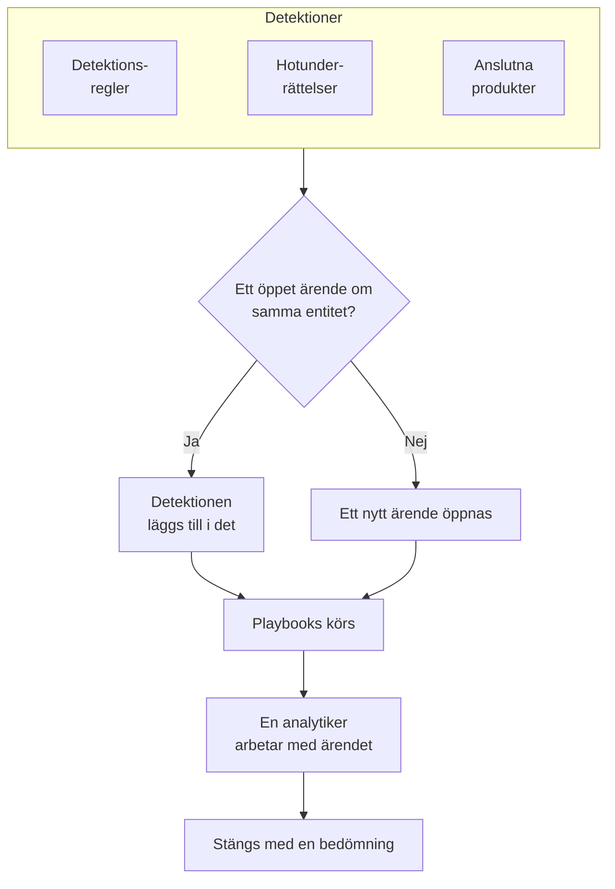

# Säkerhetsärenden och playbooks (SOAR)

Security Events gör det som dina detektionsregler, hotunderrättelser och anslutna säkerhetsprodukter hittar till ärenden: ett ärende för varje sak som är värd att titta närmare på, med alla detektioner om samma användare, värd eller adress samlade i det. Analytiker arbetar med ärendena i en kö, och playbooks reagerar på dem, av sig själva eller med ett klick.

:::cards
- [Var ärenden kommer ifrån](#var-ärenden-kommer-ifrån): Detektionsregler, hotunderrättelser, anslutna produkter och personer.
- [Arbeta med ett ärende](#arbeta-med-ett-ärende): Tilldela det, utred dess entiteter och stäng det med en bedömning.
- [Playbooks](#playbooks): Steg som körs på ett ärende, med godkännande där det spelar roll.
- [Översikten](#översikten): Vad som behöver någon just nu, och hur snabbt ärenden hanteras.
:::

## Så fungerar det

Öppna **Produkter → Security Events → Security Cases**. Kön öppnas på de öppna ärendena; **Assigned to Me**, **Unassigned**, **Stängd** och **Alla** är de andra vyerna.

## Innan du börjar

Ärenden och playbooks följer de tre Security-rollerna. Project Owner och Project Admin kan göra allt.

| Roll | Vad den kan göra |
| --- | --- |
| Security Admin | Allt, inklusive att ta bort ärenden och konfigurera playbooks |
| Security Member | Öppna, tilldela, ändra och stänga ärenden, skriva anteckningar, köra playbooks samt godkänna eller avvisa deras steg |
| Security Viewer | Läsa ärenden, detektioner, anteckningar, playbooks och deras körningar |

Var och en av dessa behörigheter kan också ges för sig, från att skapa ett ärende till att godkänna en playbooks steg; se [Behörighetsreferens](/docs/permissions/reference).

## Var ärenden kommer ifrån

| Källa | Öppnar ett ärende när | Stängs av med |
| --- | --- | --- |
| Detektionsregler | En regel träffar | **Open a Case on Match**, i regelns steg **Security Cases** |
| Hotunderrättelser | En händelse nämner en känd indikator | **Open a Case on Match**, i flödets steg **Security Cases** |
| Anslutna produkter | Ett larm från produkten själv importeras på eller över anslutningens tröskel | **Open Cases From** satt till **Aldrig**, i anslutningens steg **Polling** |
| Personer | Någon öppnar ett från **Security Cases**, eller med **Open Case** i en händelses panel | Går inte |

Alla källor är påslagna som standard. En anslutning öppnar ärenden för **High and above** om du inte väljer en annan nivå; larmen under den nivån importeras ändå som händelser.

### Så grupperas detektioner

En detektion handlar om en entitet: värdet som dess regel grupperar efter, till exempel IP-adressen för en brute force-regel, eller indikatorn som en träff i hotunderrättelserna nämner. En detektion utan entitet står för sig själv.

- När ett öppet ärende redan handlar om den entiteten läggs detektionen till i det. Ärendets entiteter och ATT&CK-mappning växer, och dess prioritet höjs till detektionens, aldrig nedåt.
- När inget öppet ärende gör det öppnas ett nytt ärende, uppkallat efter detektionen, med detektionens prioritet.
- En detektion som löser ut igen räknas upp på sin rad i stället för att lägga till en ny.

Ett ärendes prioritet kommer från detektionens allvarlighetsgrad:

| Allvarlighetsgrad | Prioritet |
| --- | --- |
| Critical eller Fatal | Critical |
| High | High |
| Medium, Unknown eller Other | Medium |
| Low | Low |
| Informational | Informational |

## Arbeta med ett ärende

Ett ärende går igenom fyra statusar. Det kan hoppa över en, till exempel när ett falsklarm stängs direkt från New, och det kan öppnas igen.

| Status | Betyder |
| --- | --- |
| New | Ingen har tittat på det ännu |
| Investigating | Någon håller på att reda ut vad som hände |
| Contained | Hotet kan inte längre göra skada; saneringen återstår |
| Closed | Klart, med en bedömning av vad det var |

Ärendets sida har allt som behövs för att arbeta med det:

- Överst: **Assign to Me**, **Run Playbook**, **Deklarera incident** och **Close Case**, statusstegen, och prioriteten i menyn bredvid dem.
- **Detections**: det som löste ut och öppnade ärendet eller lades till i det, hur ofta, och den senaste händelsen som träffade.
- **Entiteter**: användarna, värdarna och adresserna som ärendet handlar om, med deras aktivitet i alla dina säkerhetshändelser under de senaste 7 dagarna. Var och en öppnas i **Korrelera**.
- **MITRE ATT&CK**: taktikerna och teknikerna som dess detektioner mappas till, var och en länkad till sin sida på attack.mitre.org.
- **Playbook Runs**: vad varje playbook gjorde i ärendet, steg för steg, och stegen som väntar på godkännande.
- **Anteckningar** och **Tidslinje**: vad teamet skrev, och allt som hände, med vem som gjorde det.

För att arbeta med flera ärenden samtidigt markerar du dem i kön och använder **Assign to Me**, **Change Status** eller **Change Priority**.

### Stäng ett ärende

**Close Case** ber om en bedömning och en valfri avslutande anteckning:

| Bedömning | Betyder |
| --- | --- |
| True Positive | Skadlig eller obehörig aktivitet ägde verkligen rum |
| Benign Positive | Aktiviteten var verklig men väntad, till exempel ett penetrationstest eller en administrativ uppgift |
| False Positive | Detektionen var fel: regeln eller datan feltolkade normal aktivitet |
| Undetermined | Det fanns inte tillräckligt med information för att avgöra |

Bedömningarna räknas på översikten. En regel vars ärenden gång på gång stängs som False Positive är en regel som behöver finjusteras.

### Deklarera en incident

**Deklarera incident** öppnar en OneUptime-incident för ärendet, med den allvarlighetsgrad du väljer, och länkar dem åt båda hållen: incidentens beskrivning nämner ärendet, och ärendets rubrik länkar till incidenten. Därifrån tar jour, statussidor och postmortem över. Det kräver en roll som både kan arbeta med ärenden och skapa incidenter.

## Playbooks

En playbook är en lista med steg som körs på ett ärende. Skapa en under **Produkter → Security Events → Playbooks**, från en mall eller tom, och lägg till dess steg på dess sida.

### När en playbook körs

| Körs | När |
| --- | --- |
| Case Opened | En gång, när ett ärende öppnas |
| Detection Added | Varje gång en ny detektion läggs till i ett öppet ärende |
| Manual | Bara när någon kör den från ett ärende |

Alla aktiverade playbooks kan också köras manuellt, med **Run Playbook** på ett ärende. En playbook som körs av sig själv kan begränsas:

- **For Cases At Least**: bara ärenden med den här prioriteten eller högre.
- **Only For Detections From**: bara när detektionen bakom ärendet kom från den här källan.
- **Only For These Detection Rules**: bara när den kom från någon av de här reglerna.

En inaktiverad playbook körs varken av sig själv eller manuellt.

### Steg

| Kategori | Steg | Vad det gör |
| --- | --- | --- |
| Ärende | Assign the case | Ger ärendet till en person, ett team eller båda |
| Ärende | Set the priority | Höjer eller sänker ärendets prioritet |
| Ärende | Set the status | Flyttar ärendet till Investigating, Contained eller Closed, med den bedömning du väljer |
| Ärende | Add a note | Skriver en anteckning i ärendet, till exempel en checklista för analytikern |
| Ärende | Add labels | Märker ärendet med etiketter |
| Utredning | Check entities against threat intel | Slår upp varje entitet i dina hotunderrättelser och kan höja prioriteten vid en träff |
| Utredning | Look up entity activity | Räknar varje entitets säkerhetshändelser under ett fönster bakåt i tiden och antecknar resultatet i ärendet |
| Avisering | Email people | Mejlar användare och team en sammanfattning av ärendet, med en länk till det |
| Avisering | Post to Slack | Postar en sammanfattning av ärendet i en Slack-kanal |
| Avisering | Post to Microsoft Teams | Postar en sammanfattning av ärendet i en Microsoft Teams-kanal |
| Eskalering | Page on-call | Kör en jourpolicy |
| Eskalering | Declare an incident | Öppnar en OneUptime-incident som är länkad till ärendet |
| Begränsning | Suspend the user in Okta | Stänger av varje användare i ärendet i Okta |
| Begränsning | End the user's Okta sessions | Loggar ut varje användare i ärendet från Okta och återkallar deras tokens |
| Begränsning | Contain the host in CrowdStrike | Isolerar varje värd i ärendet från nätverket med CrowdStrike Falcon |
| Begränsning | Isolate the device in Microsoft Defender | Isolerar varje värd i ärendet med Microsoft Defender for Endpoint |
| Automatisering | Send a webhook | Postar ärendet som JSON till en URL |
| Automatisering | Run a workflow | Startar ett OneUptime-arbetsflöde med ärendet som indata |

En playbook har högst 25 steg. De körs i ordning, vart och ett när det föregående är klart. Varje steg har också de här inställningarna:

- **Needs Approval**: stoppar körningen före steget tills någon godkänner det i ärendet. Den är påslagen som standard för de fyra begränsningsstegen, som agerar utanför OneUptime.
- **Only If Threat Intel Matched**: hoppar över steget om inte ett tidigare steg **Check entities against threat intel** i körningen hittade en känd indikator.
- **Carry On If It Fails**: kör nästa steg även om det här misslyckas. Är den avstängd stoppar ett misslyckat steg körningen.

### Begränsning

Begränsningsstegen agerar via en [anslutning för säkerhetshändelser](/docs/telemetry/security-events#anslut-en-säkerhetsprodukt) till produkten, och den behöver mer än läsbehörighet:

| Steg | Anslutning | Behöver |
| --- | --- | --- |
| Suspend the user in Okta, End the user's Okta sessions | Okta System Log | En API-token som får hantera användare |
| Contain the host in CrowdStrike | CrowdStrike Falcon | En API-klient med skrivbehörighet i scopet Hosts |
| Isolate the device in Microsoft Defender | Microsoft Defender XDR | En app med behörigheten Machine.Isolate |

Ett begränsningssteg agerar på högst 10 av ärendets användare eller värdar. Det letar upp var och en i produkten efter namn och skriver i ärendet vad det gjorde med var och en: begränsad, redan begränsad, hittades inte eller nekades.

### Meddelanden

En anteckning, ett mejl, ett Slack-inlägg och ett Teams-inlägg kan använda ärendets värden:

| Platshållare | Blir |
| --- | --- |
| `{{case.number}}` | Ärendenumret, till exempel CASE-42 |
| `{{case.title}}` | Ärendets titel |
| `{{case.priority}}` | Critical, High, Medium, Low eller Informational |
| `{{case.status}}` | New, Investigating, Contained eller Closed |
| `{{case.assignee}}` | Vem ärendet är tilldelat |
| `{{case.url}}` | En länk till ärendet i OneUptime |
| `{{case.entities}}` | Användarna, värdarna och adresserna som ärendet handlar om |
| `{{case.detections}}` | Hur många detektioner ärendet innehåller |

Ett mejl eller ett inlägg utan eget meddelande skickar en sammanfattning av ärendet.

### Körningar och godkännanden

Varje körning listas, steg för steg, i sitt ärende och under **Produkter → Security Events → Playbook Runs**:

| Körningsstatus | Betyder |
| --- | --- |
| Queued | Väntar på en worker |
| Running | Kör sina steg |
| Waiting for Approval | Stoppad före ett steg som kräver godkännande |
| Succeeded | Varje steg kördes eller hoppades över |
| Failed | Ett steg misslyckades och körningen stoppades |
| Cancelled | Någon avbröt den eller avvisade ett steg |

Ett steg som väntar på godkännande visar **Approve** och **Reject** på körningen, med en valfri kommentar. Ett godkännande låter körningen fortsätta från det steget; ett avvisande avslutar den. Beslutet, vem som fattade det och kommentaren sparas på steget och på ärendets tidslinje. **Playbook Runs** öppnas på körningarna som väntar på godkännande, och dess menypost visar hur många de är.

En körning vars worker slutar höra av sig, till exempel efter en omstart, tas upp igen: en köad körning läggs i kö på nytt efter 2 minuter, och en körning som inte har hörts av på 30 minuter markeras som misslyckad.

## Översikten

**Produkter → Security Events → Översikt** är där produkten öppnas:

- De öppna ärenden som är tilldelade dig, de öppna ärenden som ingen har tagit sig an, och playbook-stegen som väntar på godkännande.
- **Mean Time to Acknowledge**, **Mean Time to Contain** och **Mean Time to Close**, över ärendena som öppnats under de senaste 30 dagarna: från att ett ärende öppnas till att någon tar sig an det (en person tilldelas, eller det flyttas ut ur New), till Contained och till Closed. Ett ärende som fortfarande väntar räknas inte in i något medelvärde.
- Ärendena som öppnats varje dag i 30 dagar, efter prioritet, och detektionerna som skapats varje dag i 14 dagar, efter källa.
- De öppna ärendena efter prioritet och efter status, bedömningarna från de senaste 30 dagarna, ATT&CK-taktikerna bakom ärendena, detektionerna som löste ut oftast, och entiteterna som nämns i flest fynd.

Ett projekt som ännu inte har några ärenden eller detektioner visar, ovanför detta, de tre stegen som konfigurerar det.

## Hitta hot

- **Entiteter** rangordnar användarna, värdarna, adresserna och hasharna som dina fynd nämner oftast, under det senaste dygnet, den senaste veckan eller månaden, och slår upp vilket värde som helst i 30 dagars händelser.
- **Rule Library** har färdiga detektionsregler för hot mot identiteter, slutpunkter, moln, nätverk, webb och Kubernetes. Var och en är en Sigma-regel skriven för fälten som varje ansluten källa normaliseras till. **Lägg till regel** skapar den som en egen detektionsregel, påslagen och med ärenden i stället för larm; ändra den under **Detection Rules** som vilken annan regel som helst.
- **ATT&CK Coverage** ritar MITRE ATT&CK-matrisen med teknikerna som dina aktiverade regler täcker upplysta, och ramar in de som en regel i biblioteket skulle täcka.

## Automatisera

- **Arbetsflöden**: ett ärende eller en anteckning kan starta ett arbetsflöde när det skapas, uppdateras eller tas bort. Ett steg **Run a workflow** startar ett arbetsflöde vars utlösare är en webhook.
- **API**: ärenden, anteckningar, detektioner, playbooks och körningar har samma REST API som resten av OneUptime, under `/security-case`, `/security-case-note`, `/security-detection`, `/security-playbook` och `/security-playbook-run`. Se [API-referens](/docs/api-reference/api-reference).
- AI-agenter: MCP-servern har verktyg för ärenden, anteckningar, detektioner och playbooks. Se [MCP-server](/docs/ai/mcp-server).

## Felsökning

:::details En regel träffar, men inget ärende öppnas
Kontrollera **Open a Case on Match** i regelns steg **Security Cases**. En detektion om en entitet som redan har ett öppet ärende läggs till i det ärendet i stället för att öppna ett nytt: leta efter den under **Detections** i det öppna ärendet.
:::

:::details En playbook kördes inte
Kontrollera att den är aktiverad, att dess inställning **Utlösare** passar (Case Opened körs en gång, när ett ärende öppnas), och att ärendet uppfyller dess inställningar **For Cases At Least**, **Only For Detections From** och **Only For These Detection Rules**. Ett ärende som öppnats manuellt har ingen detektion, så en playbook som är begränsad till en källa eller till regler körs inte på det.
:::

:::details Ett begränsningssteg misslyckades
Öppna körningen i ärendet: steget anger, för varje användare eller värd, om produkten nekade, inte hittade den eller inte gick att nå. Kontrollera att anslutningens autentiseringsuppgift får göra ändringen, och använd **Testa anslutningen** i dess rad.
:::

## Nästa steg

:::cards
- [Säkerhetshändelser](/docs/telemetry/security-events): Skicka händelser, skriv detektionsregler och anslut säkerhetsprodukter.
- [Hotunderrättelser](/docs/telemetry/threat-intelligence): Matcha dina händelser mot STIX/TAXII-flöden.
- [Behörighetsreferens](/docs/permissions/reference): Security-rollerna, och vad var och en kan göra.
:::
