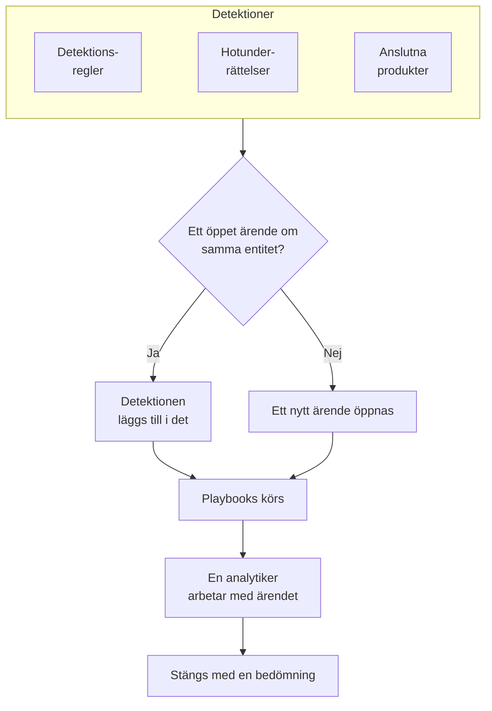

# Säkerhetsärenden och playbooks (SOAR)

Security Events gör det som dina detektionsregler, hotunderrättelser och anslutna säkerhetsprodukter hittar till ärenden: ett ärende för varje sak som är värd att titta närmare på, med alla detektioner om samma användare, värd eller adress samlade i det. Analytiker arbetar med ärendena i en kö, och playbooks reagerar på dem, av sig själva eller med ett klick.

:::cards
- [Var ärenden kommer ifrån](#var-ärenden-kommer-ifrån): Detektionsregler, hotunderrättelser, anslutna produkter, entitetsrisk och personer.
- [Arbeta med ett ärende](#arbeta-med-ett-ärende): Tilldela det, utred dess entiteter och stäng det med en bedömning.
- [Ärendeprioriteter och ärendestatusar](#ärendeprioriteter-och-ärendestatusar): Byt namn, färg och ordning på dem, och lägg till egna.
- [Svarsmål](#svarsmål): Hur snabbt ett ärende med varje prioritet måste tas om hand och begränsas.
- [Aviseringar](#aviseringar): Vem som får veta om ett nytt ärende, en tilldelning, ett svarsmål, en uppgift och ett steg som väntar på godkännande.
- [Playbooks](#playbooks): Steg som körs på ett ärende, med godkännande där det spelar roll.
- [Översikten](#översikten): Vad som behöver någon just nu, och hur snabbt ärenden hanteras.
:::

## Så fungerar det

Öppna **Produkter → Security Events → Säkerhetsärenden → Öppna ärenden** för kön. **Tilldelade mig**, **Ej tilldelad**, **Stängda ärenden** och **Alla ärenden** är egna sidor bredvid, och var och en listar de ärenden som namnet säger.

## Innan du börjar

Ärenden och playbooks följer de tre Security-rollerna. Project Owner och Project Admin kan göra allt.

| Roll | Vad den kan göra |
| --- | --- |
| Security Admin | Allt, inklusive att ta bort ärenden, ta bort bevis och konfigurera playbooks |
| Security Member | Öppna, tilldela, ändra och stänga ärenden, skriva anteckningar, arbeta med uppgifter, lägga till bevis, köra playbooks samt godkänna eller avvisa deras steg |
| Security Viewer | Läsa ärenden, detektioner, anteckningar, uppgifter, bevis, playbooks och deras körningar |

Var och en av dessa behörigheter kan också ges för sig, från att skapa ett ärende till att godkänna en playbooks steg; se [Behörighetsreferens](/docs/permissions/reference).

## Var ärenden kommer ifrån

| Källa | Öppnar ett ärende när | Stängs av med |
| --- | --- | --- |
| Detektionsregler | En regel träffar | **Öppna ett ärende vid matchning**, i regelns steg **Vid träff** |
| Hotunderrättelser | En händelse nämner en känd indikator | **Öppna ett ärende vid matchning**, i flödets steg **Vid träff** |
| Anslutna produkter | Ett larm från produkten själv importeras på eller över anslutningens tröskel | **Open Cases From** satt till **Aldrig**, i anslutningens steg **Hämtning** |
| Entitetsrisk | En användares, värds eller adress risk når projektets tröskel | **Riskärenden** under **Inställningar → Riskbedömning** |
| Personer | Någon öppnar ett från **Säkerhetsärenden**, eller med **Öppna ärende** i en händelses panel | Går inte |

Alla källor öppnar ärenden som standard, utom entitetsrisk i projekt som skapades innan den fanns: slå först på **Riskärenden** där ([Entitetsrisk](/docs/telemetry/security-entity-risk)). En anslutning öppnar ärenden för **Hög och högre** om du inte väljer en annan nivå; larmen under den nivån importeras ändå som händelser.

### Så grupperas detektioner

En detektion handlar om en entitet: värdet som dess regel grupperar efter, till exempel IP-adressen för en brute force-regel, eller indikatorn som en träff i hotunderrättelserna nämner. En detektion utan entitet står för sig själv.

- När ett öppet ärende redan handlar om den entiteten läggs detektionen till i det. Ärendets entiteter och ATT&CK-mappning växer, och dess prioritet höjs till detektionens, aldrig nedåt.
- När inget öppet ärende gör det öppnas ett nytt ärende, uppkallat efter detektionen, med detektionens prioritet.
- En detektion som löser ut igen räknas upp på sin rad i stället för att lägga till en ny.

Ett ärendes prioritet kommer från detektionens allvarlighetsgrad, som projektets inbyggda prioritet för den nivån, vad du än har döpt den till:

| Allvarlighetsgrad | Prioritet |
| --- | --- |
| Critical eller Fatal | Critical |
| High | High |
| Medium, Unknown eller Other | Medium |
| Low | Low |
| Informational | Informational |

## Arbeta med ett ärende

Ärendena i ett nytt projekt går igenom fyra statusar, som du kan byta namn på och lägga till fler av (se [Ärendeprioriteter och ärendestatusar](#ärendeprioriteter-och-ärendestatusar)). Ett ärende kan hoppa över en, till exempel när ett falsklarm stängs direkt från New, och det kan öppnas igen.

| Status | Betyder |
| --- | --- |
| New | Ingen har tittat på det ännu |
| Investigating | Någon håller på att reda ut vad som hände |
| Contained | Hotet kan inte längre göra skada; saneringen återstår |
| Closed | Klart, med en bedömning av vad det var |

Ett ärende har en egen sidomeny, som en incident har, och varje del av ärendet är en egen sida:

| Avsnitt i sidomenyn | Sidor |
| --- | --- |
| **Översikt** | **Översikt**, **Tidslinje** |
| **Utredning** | **Förlopp**, **Detektioner**, **Entiteter**, **Kopplade signaler**, **Bevis**, **Uppgifter**, **Playbooks** |
| **Anteckningar** | **Privata anteckningar** |
| **Avancerad** | **Granskningsloggar**, **Ta bort ärende**, hopfällda tills du klickar på **Avancerad** |

Varje sida behåller ärendets sidhuvud överst: nummer, prioritet, status och titel, **Tilldela mig**, **Kör playbook**, **Deklarera incident** och **Stäng ärende**, och i menyn ⋯ bredvid dem **Ange prioritet**, **Tilldela någon annan**, **Ändra status**, **Redigera ärende** och **Ta bort ärende**. Så kan ärendet hanteras från vilken av dess sidor som helst, och en länk till ärendet öppnar fortfarande dess **Översikt**. När ärendets prioritet har svarsmål visar huvudet också när nästa förfaller ([Svarsmål](#svarsmål)).

- **Översikt**: ärendets beskrivning, etiketter och statussteg, vem som har det och vad som öppnade det, och dess siffror: hur många detektioner det har, hur länge det har varit öppet, och hur lång tid det tog att kvittera och begränsa det. Under **Tid till bekräftelse** och **Tid till begränsning** står hur ärendet ligger till mot sina svarsmål.
- **OneUptime AI**, på **Översikt**: vad OneUptime AI fick ut av ärendet, den prioritet och playbook som den föreslår, och bevisen bakom. Se [OneUptime AI i säkerhet](/docs/telemetry/security-ai).
- **Påverkan**, på **Översikt**: vad ärendet sätter på spel: om OneUptime har sett dess poster nås från internet, vem som äger dem och vad som senast ändrades på dem. Fäll ut den för att se vad varje post anropar och vad som anropar den, de monitorer och statussidor som bevakar den, och de maskiner som ärendets adresser pratade med.
- **MITRE ATT&CK**, på **Översikt**: taktikerna och teknikerna som dess detektioner mappas till, var och en länkad till sin sida på attack.mitre.org.
- **Tidslinje**: allt som hände med ärendet, med vem som gjorde det.
- **Förlopp**: vad som hände, i ordning, i hela OneUptime: varje detektion och säkerhetshändelserna bakom den, hur långt deras förfrågningar kom, de undantag de kastade, ändringarna på de poster som ärendet nämner, de incidenter och larm som uppstod på dem, och vad teamet gjorde. En skanners många försök är en rad, och varje rad öppnar det den nämner, till exempel förfrågans trace eller undantaget.
- **Detektioner**: det som löste ut och öppnade ärendet eller lades till i det, hur ofta, och den senaste händelsen som träffade.
- **Entiteter**: användarna, värdarna och adresserna som ärendet handlar om, med deras aktivitet i alla dina säkerhetshändelser under de senaste 7 dagarna. Var och en öppnas i **Korrelera**.
- **Kopplade signaler**: de värdar, kluster, tjänster och medlemmar som ärendet nämner, som OneUptime känner dem, och vad som hände på var och en kring dess detekteringar: deras loggar, spår och mätvärden, vad som är öppet på dem och vad som ändrades. Se [Kopplade signaler](/docs/telemetry/security-connected-signals).
- **Bevis**: filerna och länkarna som sparas i ärendet, var och en med vem som lade till den och när. Med **Lägg till fil** laddar du upp en fil på upp till 10 MB, och SHA-256 för det som laddades upp sparas, så att den som laddar ner den senare kan kontrollera att det är det som sparades; med **Lägg till länk** pekar du på bevis som sparas någon annanstans. Bara en Security Admin kan ta bort bevis, och ärendets **Tidslinje** visar vad som lades till och togs bort.
- **Uppgifter**: vad som måste göras i ärendet, vem som gör det och om det är gjort. Lägg till en uppgift som en rad, ge den till någon och bocka av den när den är klar. Den som får uppgiften får veta det, om inte personen tog den själv, och menyn visar bredvid **Uppgifter** hur många uppgifter som är öppna.
- **Playbooks**: vad varje playbook gjorde i ärendet, steg för steg, och stegen som väntar på godkännande. Medan körningar väntar visar menyn hur många bredvid **Playbooks**.
- **Privata anteckningar**: vad teamet skrev om ärendet.
- **Granskningsloggar**: varje ändring av ärendet, och vem som gjorde den. Se [Granskningsloggar](/docs/configuration/audit-logs).
- **Ta bort ärende**: tar bort ärendet för gott, med dess detektioner, anteckningar, tidslinje och playbook-körningar. För att behålla det som dokumentation, stäng det i stället med en bedömning.

### Arbeta med ärenden från kön

Du behöver inte öppna ett ärende för att arbeta med det. I köns listor har menyn ⋯ på ett ärendes rad **Tilldela mig**, **Tilldela någon annan**, **Ändra status** och **Ändra prioritet**. För att arbeta med flera ärenden samtidigt markerar du dem och använder samma åtgärder under **Massåtgärder**: där står vilka ärenden som ändrades, vilka som lämnades som de var, och varför.

- För att ge ett ärende till någon annan använder du **Tilldela någon annan** och väljer en person eller ett team. Ett teams ärende väntar under **Ej tilldelad** tills någon i teamet tar det.
- En status som stänger ett ärende ber om en bedömning och en avslutande anteckning, som **Stäng ärende** gör.
- Ett stängt ärende tilldelas ingen. För att arbeta med det igen öppnar du det på nytt med **Ändra status**.

### Stäng ett ärende

**Stäng ärende** ber om en bedömning och en valfri avslutande anteckning:

| Bedömning | Betyder |
| --- | --- |
| True Positive | Skadlig eller obehörig aktivitet ägde verkligen rum |
| Benign Positive | Aktiviteten var verklig men väntad, till exempel ett penetrationstest eller en administrativ uppgift |
| False Positive | Detektionen var fel: regeln eller datan feltolkade normal aktivitet |
| Undetermined | Det fanns inte tillräckligt med information för att avgöra |

Bedömningarna räknas på översikten. En regel vars ärenden gång på gång stängs som False Positive är en regel som behöver finjusteras.

Så länge uppgifter i ärendet fortfarande är öppna säger dialogen **Stäng ärende** hur många.

Ett ärende som öppnats från Google SecOps-larm stänger dem också i Google SecOps, med utlåtandet och avslutningsanteckningen, när dess anslutning har **Stäng larm när deras ärende stängs** påslaget: se [Google SecOps](/docs/integrations/google-secops#stäng-larm-när-deras-ärende-stängs).

### Deklarera en incident

**Deklarera incident** öppnar en OneUptime-incident för ärendet, med den allvarlighetsgrad du väljer, och länkar dem åt båda hållen: incidentens beskrivning nämner ärendet, och ärendets rubrik länkar till incidenten. Därifrån tar jour, statussidor och postmortem över. Det kräver en roll som både kan arbeta med ärenden och skapa incidenter.

## Ärendeprioriteter och ärendestatusar

Varje projekt har sina egna ärendeprioriteter och ärendestatusar, under **Produkter → Security Events → Inställningar → Ärendeprioriteter** och **Ärendestatusar**. Byt namn och färg på dem, dra dem i en annan ordning och lägg till egna, till exempel en status "Triage" eller en prioritet "Nödläge" ovanför **Kritisk**. Ett nytt namn syns överallt på en gång: i kön, på ärendesidorna och översikten, i aviseringar, i Slack och Microsoft Teams och i playbook-meddelanden.

Några är inbyggda, eftersom OneUptime läser vad de betyder. De kan byta namn och färg men inte tas bort eller arkiveras, och de behåller sin ordning:

| Inbyggd | Vad OneUptime gör med den |
| --- | --- |
| Den nya statusen | Nya ärenden börjar i den |
| Den kvitterade statusen | När ett ärende når den sparas när det kvitterades, och **Öppna igen** flyttar tillbaka ett stängt ärende dit |
| Den begränsade statusen | När ett ärende når den sparas när det begränsades |
| Den stängda statusen | **Stäng ärende** flyttar ett ärende dit, med en bedömning |
| Prioriteterna Critical, High, Medium, Low och Informational | En detektion öppnar sitt ärende med prioriteten för sin allvarlighetsgrad, och ett ärende som någon öppnar börjar på Medium |

- Var en status står avgör vad ett ärende i den räknas som, som kolumnen **Räknas som** visar: från den kvitterade statusen och nedåt som kvitterat, från den begränsade statusen och nedåt som begränsat, från den stängda statusen och nedåt som stängt. En status du lägger till hamnar strax ovanför den stängda statusen, och när du flyttar ett ärende till en status som stänger det får du först ange en bedömning.
- En prioritets plats är hur brådskande den är, den mest brådskande först: **För ärenden med minst**, valen för aviseringar och reglerna för Slack och Microsoft Teams läser den här ordningen. En prioritet du lägger till hamnar sist, och kolumnen **Detekteringens allvarlighetsgrad** visar vilka detektioner som öppnar sina ärenden med varje inbyggd prioritet.

För att sluta använda en egen status eller prioritet använder du **Arkivera** på dess rad. Ingen kan välja den igen, och API:t, Terraform och MCP avvisar den, men ärendena som har den behåller den, och du kan fortfarande filtrera på den. Arkiverade värden listas i den hopfällda sektionen **Arkiverade ärendestatusar** eller **Arkiverade ärendeprioriteter** under tabellen, där **Avarkivera** tar tillbaka ett. **Ta bort** avvisas så länge ärenden har värdet eller en playbook körs från prioriteten.

## Svarsmål

Ett svarsmål är hur snabbt ett ärende måste hanteras: **Bekräfta inom**, hur länge ett nytt ärende får vänta på att någon tar det, och **Begränsa inom**, hur lång tid det får ta innan det är begränsat eller stängt. Varje ärendeprioritet har sina egna, under **Produkter → Security Events → Inställningar → Svarsmål**: med **Redigera** på en prioritets rad ställer du in dess två mål, i minuter, timmar eller dagar, upp till ett år, och ett tomt mål betyder inget mål. Ett nytt projekts prioriteter börjar med dessa:

| Prioritet | Bekräfta inom | Begränsa inom |
| --- | --- | --- |
| Critical | 15 minuter | 4 timmar |
| High | 1 timme | 1 dag |
| Medium | 12 timmar | 3 dagar |
| Low | 1 dag | 7 dagar |
| Informational | Inget mål | Inget mål |

Ett projekt som skapades före svarsmålen har inga förrän någon ställer in dem.

- Ett ärendes förfallotider sätts när det öppnas, utifrån prioritetens mål. Ett mål som ändras senare gäller de ärenden som öppnas därefter.
- Ett ärende är bekräftat så snart någon tar det: en person tilldelas, eller det flyttas till en status som räknas som bekräftad. Det är begränsat så snart det når en status som räknas som begränsad, eller stängs.
- När ett ärendes prioritet ändras förblir ett mål som det har nått eller missat som det var. En högre prioritet flyttar en förfallotid närmare: det nya målet räknas från ändringen, om inte den gamla förfallotiden kommer först. En lägre prioritet flyttar den senare, aldrig tidigare: det nya målet räknas från när ärendet öppnades. En prioritet utan mål behåller förfallotiden för ett höjt ärende och tar bort den för ett sänkt.
- Ett stängt ärende som öppnas igen innan det någonsin har begränsats får en ny förfallotid för begränsning, räknad från återöppningen.
- Under den sista femtedelen av ett mål håller ärendet på att missa det: de som är på ärendet får veta det, och får veta det igen när målet är missat. Se [Aviseringar](#aviseringar).

Här syns målen:

- Ärendets huvud nämner nästa mål och hur mycket tid som är kvar, eller hur länge det har varit försenat: grått medan det finns tid, bärnstensgult under den sista femtedelen, rött när det är missat.
- På ärendets **Översikt**, under **Tid till bekräftelse** och **Tid till begränsning**: hur ärendet ligger till mot varje mål, eller hur långt över det ärendet gick.
- I köns listor: raden under varje ärendes prioritet, och en kolumn **Förfaller** som du kan slå på och sortera efter. Listorna visar dem bara när någon av projektets prioriteter har ett mål.

## Aviseringar

OneUptime berättar för personer om fem saker som händer i ett ärende. Ingen behöver ställa in något: ett projekt som bara har klickat på **Slå på rekommenderat** får veta om sina ärenden med High och Critical via e-post och push.

| Avisering | Vem som får veta | Som standard |
| --- | --- | --- |
| Nytt säkerhetsärende | Alla som kan se projektets ärenden, när ett ärende öppnas med, eller stiger till, den prioritet de har valt eller högre | E-post och push, för ärenden med High och Critical |
| Säkerhetsärende tilldelat mig | Personen som ärendet är tilldelat, och medlemmarna i teamet som det är tilldelat | E-post och push |
| Playbook-steg väntar på mitt godkännande | De personer i ärendet som kan godkänna steget: personen som ärendet är tilldelat och medlemmarna i dess team. När ingen av dem kan godkänna, alla i projektet som kan | E-post och push |
| Svarsmål för säkerhetsärende | De som är på ärendet: personen som ärendet är tilldelat och medlemmarna i dess team. När ingen är på det, de som får veta om nya ärenden med dess prioritet | E-post och push |
| Uppgift i säkerhetsärende tilldelad mig | Personen som får en uppgift i ärendet, om inte personen tog den själv | E-post och push |

- Bara personer som kan se ärendet får veta om det: Project Owner, Project Admin och rollerna Security Admin, Security Member och Security Viewer. Den som har en roll som är begränsad till vissa etiketter får bara veta om ärenden med de etiketterna.
- Ingen får veta om det den själv har gjort: den som öppnar ett ärende manuellt, tilldelar det eller startar en körning aviseras inte om det.
- Varje person får bara veta om ett ärende en gång. Ett ärende som öppnas med Medium och senare stiger till Critical når dem som valde High eller Critical när det stiger, men inte igen dem som valde Medium, som fick veta om det när det öppnades.
- Testattacken från **Skicka en testattack** öppnar ett ärende som inte aviserar någon.
- Ett ärende med Critical och ett steg som väntar på godkännande skickas direkt och hålls aldrig kvar i en [e-postsammanfattning](/docs/emails/notification-rollup). Detsamma gäller ett svarsmål som håller på att missas eller har missats.
- Ärendets **Tidslinje** visar vem som fick veta, och när.

### Välj vad du får veta

Var och en väljer själv, under **Användarinställningar → Aviseringsinställningar → Säkerhet**: kanalerna för varje avisering (e-post, SMS, samtal, push, Telegram, Slack, Microsoft Teams eller webhook) och, under **Nytt säkerhetsärende**, från vilken prioritet de aviseras:

| Val | Aviserar om ärenden med |
| --- | --- |
| Endast Kritisk | Critical |
| Hög och högre | Critical och High (standard) |
| Medel och högre | Critical, High och Medium |
| Låg och högre | Alla prioriteter utom Informational |
| Alla ärenden | Alla prioriteter |

Valen följer projektets ärendeprioriteter, under deras egna namn: det här är ett nytt projekts val.

WhatsApp-meddelanden skickas inte för säkerhetsärenden. En push-avisering öppnar ärendet i appen OneUptime On-Call (1.7.0 eller senare), där du kan godkänna eller avvisa ett väntande playbook-steg, ta ärendet och stänga det. Dess länk öppnar ärendet i webbläsaren.

### Posta i kanaler i Slack och Microsoft Teams

För att posta i en kanal lägger du till en regel under **Produkter → Security Events → Arbetsyta → Slack** (eller **Microsoft Teams**). När inget av dem är anslutet är avsnittets enda post **Anslut Slack eller Teams**. En regel anger vilka kanaler den postar i (och, i Microsoft Teams, vilka chattar) och, om du vill, vilka ärenden den gäller:

| Villkor | Matchar på |
| --- | --- |
| Prioritet för säkerhetsärende | En av projektets ärendeprioriteter, till exempel Critical eller High |
| Titel på säkerhetsärende, Beskrivning av säkerhetsärende | Text som ärendets titel eller beskrivning innehåller, börjar med eller slutar med |
| Status för säkerhetsärende | En av projektets ärendestatusar, till exempel New eller Closed |
| Källa för säkerhetsärende | Detection Rule, Threat Intel, Connected Product, Entitetsrisk, Data Security eller Manual |
| Etiketter för säkerhetsärende | Ärendets etiketter |

Varje avisering utom en uppgifts postas i kanalerna för varje regel som ärendet matchar just då. En regel där **Prioritet för säkerhetsärende** innehåller någon av **Kritisk** och **Hög** postar ärenden med High och Critical när de öppnas, och ett ärende med Medium när det stiger till High. Ett säkerhetsärende får aldrig en egen kanal.

## Playbooks

En playbook är en lista med steg som körs på ett ärende. Skapa en under **Produkter → Security Events → Playbooks**, från en mall eller tom, och lägg till dess steg på dess sida. Ett projekt utan playbooks ser mallarna i stället för en tom lista; när det finns playbooks öppnar **Skapa från mall** vid listan dem, med **Tillagd** vid de som projektet redan har.

### När en playbook körs

| Körs | När |
| --- | --- |
| Case Opened | En gång, när ett ärende öppnas |
| Detection Added | Varje gång en ny detektion läggs till i ett öppet ärende |
| Bedömd som troligen skadlig | En gång, när OneUptime AI:s bedömning läser ärendet som Troligen skadlig |
| Manual | Bara när någon kör den från ett ärende |

Alla aktiverade playbooks kan också köras manuellt, med **Kör playbook** på ett ärende. En playbook som körs av sig själv kan begränsas:

- **För ärenden med minst**: bara ärenden med den här prioriteten eller högre.
- **Bara för detektioner från**: bara när detektionen bakom ärendet kom från den här källan.
- **Bara för de här detektionsreglerna**: bara när den kom från någon av de här reglerna.

En inaktiverad playbook körs varken av sig själv eller manuellt.

### Steg

| Kategori | Steg | Vad det gör |
| --- | --- | --- |
| Ärende | Assign the case | Ger ärendet till en person, ett team eller båda |
| Ärende | Set the priority | Höjer eller sänker ärendets prioritet |
| Ärende | Set the status | Flyttar ärendet till en annan av projektets statusar, med den bedömning du väljer när den statusen stänger det |
| Ärende | Add a note | Skriver en anteckning i ärendet, till exempel en checklista för analytikern |
| Ärende | Add labels | Märker ärendet med etiketter |
| Utredning | Check entities against threat intel | Slår upp varje entitet i dina hotunderrättelser och kan höja prioriteten vid en träff |
| Utredning | Look up entity activity | Räknar varje entitets säkerhetshändelser under ett fönster bakåt i tiden och antecknar resultatet i ärendet |
| Utredning | Preserve the evidence | Behåller sessionsinspelningarna av förfrågningarna bakom ärendet och antecknar deras spår och undantag i ärendet |
| Avisering | Email people | Mejlar användare och team en sammanfattning av ärendet, med en länk till det |
| Avisering | Notify data store owners | Mejlar ägarna till varje datalager som ärendet gäller, med en länk till ärendet |
| Avisering | Post to Slack | Postar en sammanfattning av ärendet i en Slack-kanal |
| Avisering | Post to Microsoft Teams | Postar en sammanfattning av ärendet i en Microsoft Teams-kanal |
| Avisering | Post a status page announcement | Publicerar ett meddelande du har skrivit på de statussidor du väljer |
| Eskalering | Page on-call | Kör en jourpolicy |
| Eskalering | Declare an incident | Öppnar en OneUptime-incident som är länkad till ärendet |
| Begränsning | Suspend the user in Okta | Stänger av användaren som ärendet handlar om i Okta |
| Begränsning | End the user's Okta sessions | Loggar ut användaren som ärendet handlar om från Okta och återkallar användarens tokens |
| Begränsning | Contain the host in CrowdStrike | Isolerar värden som ärendet handlar om från nätverket med CrowdStrike Falcon |
| Begränsning | Isolate the device in Microsoft Defender | Isolerar värden som ärendet handlar om med Microsoft Defender for Endpoint |
| Begränsning | Unsuspend the user in Okta | Återaktiverar användaren som ärendet handlar om i Okta |
| Begränsning | Lift containment in CrowdStrike | Häver CrowdStrike Falcons nätverksisolering av värden som ärendet handlar om |
| Begränsning | Release the device in Microsoft Defender | Frigör värden som ärendet handlar om från isoleringen i Microsoft Defender for Endpoint |
| Automatisering | Send a webhook | Postar ärendet som JSON till en URL |
| Automatisering | Run a workflow | Startar ett OneUptime-arbetsflöde med ärendet som indata |
| Automatisering | Run a runbook | Startar en av dina OneUptime-runbooks med ärendet som indata |
| Automatisering | Fix the code with AI | Ber OneUptime AI om en pull request som åtgärdar undantagen som ärendets förfrågningar orsakade |

En playbook har högst 25 steg. De körs i ordning, vart och ett när det föregående är klart. Varje steg har också de här inställningarna:

- **Kräver godkännande**: stoppar körningen före steget tills någon godkänner det i ärendet. För de fyra stegen som stänger ute någon är den alltid påslagen, om inte en Security Admin slår av den. **Run a runbook** och **Post a status page announcement** börjar med godkännande påslaget, eftersom det ena kör kommandon på era system och det andra vänder sig till era kunder; den som lägger till steget kan slå av det.
- **Bara vid träff i hotinformation**: hoppar över steget om inte ett tidigare steg **Kontrollera entiteter mot hotinformation** i körningen hittade en känd indikator.
- **Fortsätt om det misslyckas**: kör nästa steg även om det här misslyckas. Är den avstängd stoppar ett misslyckat steg körningen.

### Agera genom OneUptime

Fyra steg agerar genom resten av OneUptime i stället för genom en ansluten produkt:

- **Run a runbook** startar en av dina [runbooks](/docs/runbooks/index) med ärendet som indata, som ett Bash-steg läser som miljövariabler (se [Anropa webhooken](/docs/runbooks/triggers#anropa-webhooken)). `ONEUPTIME_INPUT_IP`, `ONEUPTIME_INPUT_USER` och `ONEUPTIME_INPUT_HOST` är adressen, användaren och värden som ärendet gäller, valda enligt samma regel som för ett begränsningssteg, och tomma när det inte gäller någon. `ONEUPTIME_INPUT_IPS`, `ONEUPTIME_INPUT_USERS` och `ONEUPTIME_INPUT_HOSTS` listar som JSON alla som ärendet nämner, och `ONEUPTIME_INPUT_CASE_NUMBER`, `ONEUPTIME_INPUT_CASE_TITLE` och `ONEUPTIME_INPUT_CASE_URL` anger vilket ärende det är. En skyddad användare eller värd finns aldrig bland dem. Runbookens körning visar att den startades av **Security playbook** för ärendet.
- **Preserve the evidence** behåller sessionsinspelningarna av förfrågningarna bakom ärendet längre än deras lagringstid och skriver en anteckning i ärendet som länkar till varje förfrågans spår, varje inspelning och varje undantag. Loggar och spår kan inte sparas längre än projektet sparar telemetri, så exportera det du behöver innan dess.
- **Post a status page announcement** publicerar det du skrev, som du skrev det, på de statussidor du väljer. Inget från ärendet läggs till. Deras prenumeranter meddelas bara när **Avisera prenumeranter** är påslaget.
- **Fix the code with AI** ber OneUptime AI om en pull request som åtgärdar varje undantag som ärendets förfrågningar orsakade, upp till tre. Steget kräver att OneUptime AI är påslaget, ett repository med koden som är anslutet via GitHub-appen och en runner. Utan dem hoppas steget över och säger vad som saknas.

### Begränsning

Begränsningsstegen agerar via en [anslutning för säkerhetshändelser](/docs/telemetry/security-events#anslut-en-säkerhetsprodukt) till produkten, och den behöver mer än läsbehörighet:

| Steg | Anslutning | Behöver |
| --- | --- | --- |
| Suspend the user in Okta, End the user's Okta sessions, Unsuspend the user in Okta | Okta System Log | En API-token som får hantera användare |
| Contain the host in CrowdStrike, Lift containment in CrowdStrike | CrowdStrike Falcon | En API-klient med skrivbehörighet i scopet Hosts |
| Isolate the device in Microsoft Defender, Release the device in Microsoft Defender | Microsoft Defender XDR | En app med behörigheten Machine.Isolate |

Ett begränsningssteg agerar bara på de användare eller värdar som ärendet handlar om, aldrig på alla som det nämner:

- Värdet som en detektion i ärendet grupperas efter, till exempel kontot som en regel för omöjliga resor grupperar efter, eller värden som ett larm från en ansluten produkt nämner.
- En användare eller värd i ärendet som dina hotunderrättelser känner till som en indikator.

Ett ärende som grupperas efter en adress, till exempel en brute force-attack mot ditt VPN, handlar om ingetdera: dess begränsningssteg hoppas över, och kontot som attacken prövade och gatewayen som den träffade lämnas i fred. Ett steg agerar på högst 10 användare eller värdar. Det letar upp var och en i produkten efter namn och skriver i körningen vad det gjorde med var och en: klart, redan klart, hittades inte, nekades eller skyddad.

#### Skyddade entiteter

**Skyddade entiteter**, under **Playbooks** i menyn, listar de användare och värdar som ingen playbook begränsar, till exempel konton för nödåtkomst, domänkontrollanter och VPN-gatewayer. Ett värde matchar oavsett skiftläge, och `*` står för en valfri följd av tecken: `svc-*` skyddar alla tjänstkonton. Ett steg rapporterar en skyddad användare eller värd som skyddad och lämnar den i fred. Listan sköts av användare med rollen Security Admin.

#### Godkännande

De fyra stegen som stänger ute någon väntar på godkännande. Bara en Security Admin kan slå av **Kräver godkännande** för ett av dem, och OneUptime registrerar vem som gjorde det. Godkännandet listar användarna eller värdarna som steget skulle agera på under **Agera på**, alla förbockade: avmarkera dem som steget ska lämna i fred. Skyddade finns inte med bland alternativen. Den som startade en körning kan inte godkänna dess steg: det gör någon annan, men den som startade körningen kan fortfarande avvisa steget.

#### Ångra

Ångringsstegen agerar på de användare eller värdar som ärendet handlar om, precis som stegen de ångrar. När körningen har stannat har en begränsad användare eller värd också en egen knapp på sitt steg: **Häv avstängning**, **Häv begränsning** eller **Frigör**. En avslutad Okta-session kan inte ångras. Varje ångring sparas på ärendets tidslinje och i projektets granskningslogg.

### Meddelanden

En anteckning, ett mejl, ett Slack-inlägg och ett Teams-inlägg kan använda ärendets värden:

| Platshållare | Blir |
| --- | --- |
| `{{case.number}}` | Ärendenumret, till exempel CASE-42 |
| `{{case.title}}` | Ärendets titel |
| `{{case.priority}}` | Ärendets prioritet, som ditt projekt kallar den, till exempel High |
| `{{case.status}}` | Ärendets status, som ditt projekt kallar den, till exempel Investigating |
| `{{case.assignee}}` | Vem ärendet är tilldelat |
| `{{case.url}}` | En länk till ärendet i OneUptime |
| `{{case.entities}}` | Användarna, värdarna och adresserna som ärendet handlar om |
| `{{case.detections}}` | Hur många detektioner ärendet innehåller |

Ett mejl eller ett inlägg utan eget meddelande skickar en sammanfattning av ärendet.

### Körningar och godkännanden

Varje körning listas, steg för steg, i sitt ärende och under **Produkter → Security Events → Playbooks → Playbook-körningar**:

| Körningsstatus | Betyder |
| --- | --- |
| Queued | Väntar på en worker |
| Running | Kör sina steg |
| Waiting for Approval | Stoppad före ett steg som kräver godkännande |
| Succeeded | Varje steg kördes eller hoppades över |
| Failed | Ett steg misslyckades och körningen stoppades |
| Cancelled | Någon avbröt den eller avvisade ett steg |

Ett steg som väntar på godkännande visar **Godkänn** och **Avvisa** på körningen, med en valfri kommentar. Ett godkännande låter körningen fortsätta från det steget; ett avvisande avslutar den. Beslutet, vem som fattade det och kommentaren sparas på steget, på ärendets tidslinje och i projektets granskningslogg. Sidan **Godkännanden**, under **Playbooks** i menyn, listar körningarna som väntar på ett beslut och räknar dem; **Playbook-körningar** listar varje körning. På **Playbook-körningar**, på en playbooks sida och under ett ärendes **Playbooks** är varje körning en rad som säger hur långt den kom, eller vid vilket steg den stannade; **Visa steg** öppnar dess steg. En körning som väntar på godkännande öppnas av sig själv, liksom ett ärendes senaste körning.

En körning vars worker slutar höra av sig, till exempel efter en omstart, tas upp igen: en köad körning läggs i kö på nytt efter 2 minuter, och en körning som inte har hörts av på 30 minuter markeras som misslyckad.

## Översikten

**Produkter → Security Events → Översikt** är där produkten öppnas:

- De öppna ärenden som är tilldelade dig, de öppna ärenden som ingen har tagit sig an, och playbook-stegen som väntar på godkännande; varje tal öppnar sidan som listar dem.
- **Genomsnittlig tid till kvittering**, **Genomsnittlig tid till begränsning** och **Genomsnittlig tid till stängning**, över ärendena som öppnats under de senaste 30 dagarna: från att ett ärende öppnas till att någon tar sig an det (en person tilldelas, eller det flyttas till en status som räknas som kvitterad), till en status som räknas som begränsad och till en som räknas som stängd. Ett ärende som fortfarande väntar räknas inte in i något medelvärde.
- Ärendena som öppnats varje dag i 30 dagar, efter prioritet, och detektionerna som skapats varje dag i 14 dagar, efter källa.
- De öppna ärendena efter prioritet och efter status, de mest riskfyllda entiteterna efter riskpoäng, detektionerna som löste ut oftast, ATT&CK-taktikerna bakom ärendena och bedömningarna från de senaste 30 dagarna.

Ovanför visar en remsa hur säkerhet är uppsatt: dess källor, detektioner, ärenden och playbooks, var och en med sina siffror. Ett projekt som ännu inte har satt upp det ser **Slå på rekommenderat** och **Skicka en testattack** där; se [Kom igång med säkerhet](/docs/telemetry/security-getting-started). När inget behöver någon säger sidan **Allt är lugnt**, och diagrammen visas så snart det finns något att visa.

## Hitta hot

- **Entitetsrisk** rangordnar användarna, värdarna och adresserna efter riskpoäng, de mest riskfyllda först, och **Mest riskfyllda entiteter** på översikten visar toppen av samma lista. Välj en entitet för att se varför den är riskfylld. Under listan slår **Slå upp en entitet** upp vilket värde som helst i 30 dagars händelser, även en domän eller en filhash, och öppnar det i **Korrelera**.
- **Regelbibliotek** har färdiga detektionsregler för hot mot identiteter, slutpunkter, moln, nätverk, webb och Kubernetes. Var och en är en Sigma-regel skriven för fälten som varje ansluten källa normaliseras till. Dess rad visar vad den hittar, MITRE ATT&CK-taktikerna och -teknikerna den är märkt med, händelserna den läser och om några har kommit in de senaste 7 dagarna (**Tas emot** eller **Tas inte emot**), och dess allvarlighetsgrad. Begränsa listan efter kategori, efter de data reglerna läser och efter om du har lagt till dem, eller sök i den efter namn, ATT&CK-teknik eller allvarlighetsgrad; sidans adress behåller filtren. Välj en regel för dess detaljer: hur du börjar skicka händelserna den läser, hur den körs och dess Sigma-regel. **Lägg till** skapar den som en egen detektionsregel, påslagen och med ärenden i stället för larm; ändra den under **Detektionsregler** som vilken annan regel som helst. Reglerna markerade **Rekommenderade** hittar hot i data som OneUptime redan har, och en knapp lägger till dem du inte har än.
- **ATT&CK-täckning** listar taktikerna i MITRE ATT&CK, var och en med hur många av dess tekniker dina aktiverade regler täcker och för hur många fler **Regelbibliotek** har regler. Öppna en taktik för dess tekniker, eller byt till **Matris** för hela matrisen. Välj en teknik för att se reglerna i biblioteket som täcker den, och öppna **Regelbibliotek** med dem.

## Automatisera

- **Arbetsflöden**: ett ärende eller en anteckning kan starta ett arbetsflöde när det skapas, uppdateras eller tas bort. Ett steg **Kör ett arbetsflöde** startar ett arbetsflöde vars utlösare är en webhook.
- **API**: ärenden, anteckningar, uppgifter, bevis, detektioner, playbooks, körningar, skyddade entiteter och ärendeprioriteter och ärendestatusar har samma REST API som resten av OneUptime, under `/security-case`, `/security-case-note`, `/security-case-task`, `/security-case-evidence`, `/security-detection`, `/security-playbook`, `/security-playbook-run`, `/security-protected-entity`, `/security-case-priority` och `/security-case-status`. Se [API-referens](/docs/api-reference/api-reference).
- AI-agenter: MCP-servern har verktyg för ärenden, anteckningar, uppgifter, bevis, detektioner, playbooks och ärendeprioriteter och ärendestatusar. Se [MCP-server](/docs/ai/mcp-server).
- Terraform: resurserna `oneuptime_security_case_priority` och `oneuptime_security_case_status` håller ett projekts prioriteter och statusar som kod.

## Felsökning

:::details En regel träffar, men inget ärende öppnas
Kontrollera **Öppna ett ärende vid matchning** i regelns steg **Vid träff**. En detektion om en entitet som redan har ett öppet ärende läggs till i det ärendet i stället för att öppna ett nytt: leta efter den under **Detektioner** i det öppna ärendet.
:::

:::details Ingen fick veta om ett ärende
Titta på ärendets **Tidslinje**, som visar vem som aviserades. En avisering om **Nytt säkerhetsärende** går till de personer vars valda prioritet ärendet når, så ett ärende med Medium aviserar ingen som har kvar standardvalet, **Hög och högre**. Kontrollera att de som borde få veta kan se säkerhetsärenden (en Security-roll, eller Project Owner eller Project Admin), och att aviseringen är påslagen för dem under **Användarinställningar → Aviseringsinställningar → Säkerhet**.
:::

:::details Ett ärende visar ingen förfallotid
Dess prioritet har inget svarsmål, eller fick ett först efter att ärendet öppnades: ett ärendes förfallotider sätts när det öppnas. Testattackens ärende har ingen. Se [Svarsmål](#svarsmål).
:::

:::details En playbook kördes inte
Kontrollera att den är aktiverad, att dess inställning **Utlösare** passar (Case Opened körs en gång, när ett ärende öppnas), och att ärendet uppfyller dess inställningar **För ärenden med minst**, **Bara för detektioner från** och **Bara för de här detektionsreglerna**. Ett ärende som öppnats manuellt har ingen detektion, så en playbook som är begränsad till en källa eller till regler körs inte på det.
:::

:::details Ett begränsningssteg misslyckades
Öppna körningen i ärendet: steget anger, för varje användare eller värd, om produkten nekade, inte hittade den eller inte gick att nå. Kontrollera att anslutningens autentiseringsuppgift får göra ändringen, och använd **Testa anslutningen** i dess rad.
:::

:::details Ett begränsningssteg hoppades över
Ärendet handlar inte om någon användare eller värd, utan till exempel bara om en adress, eller så är alla användare och värdar som det handlar om skyddade. Öppna körningen i ärendet: steget anger vilket.
:::

:::details En status eller prioritet går inte att ta bort eller arkivera
En inbyggd kan byta namn och färg, men aldrig tas bort eller arkiveras: dess **Arkivera** är låst, med orsaken. En egen går inte att ta bort så länge ärenden har den eller en playbook körs från den: flytta ärendena till en annan först, eller arkivera den.
:::

## Nästa steg

:::cards
- [Säkerhetshändelser](/docs/telemetry/security-events): Skicka händelser, skriv detektionsregler och anslut säkerhetsprodukter.
- [Hotunderrättelser](/docs/telemetry/threat-intelligence): Matcha dina händelser mot STIX/TAXII-flöden.
- [OneUptime AI i säkerhet](/docs/telemetry/security-ai): Bedöm ärenden, skriv utkast till detektionsregler och fråga om säkerhet, med AI.
- [Behörighetsreferens](/docs/permissions/reference): Security-rollerna, och vad var och en kan göra.
:::
