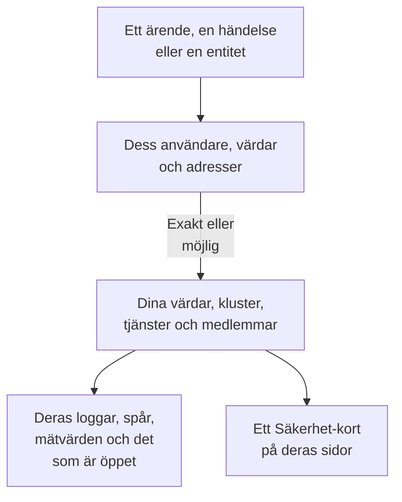

# Kopplade signaler

Ett säkerhetsärende säger vilka användare, värdar och adresser det handlar om. Kopplade signaler säger vilka av dem OneUptime redan känner till - dina värdar, containervärdar, Kubernetes-kluster, nätverksenheter, tjänster och medlemmar - och vad som hände på var och en kring ärendet: dess loggar, spår och mätvärden, incidenterna och larmen som är öppna på den, monitorerna som bevakar den och vad som ändrades på den. Åt andra hållet säger sidan för en värd, ett kluster, en tjänst eller en medlem vad Security Events har hittat om den.

:::cards
- [Var du ser det](#var-du-ser-det): Ett ärendes sida, en händelses flik, en entitets sida och sidorna för det de nämner.
- [Hur ett värde matchas](#hur-ett-värde-matchas): Vad som räknas som samma post, och vad som bara kanske gör det.
- [Vad varje post visar](#vad-varje-post-visar): Dess signaler kring ärendet, och vad som är öppet på den.
- [Vem ser vad](#vem-ser-vad): Varje post läses med läsarens egen roll.
:::

## Så fungerar det

OneUptime slår upp varje värde bland projektets poster, säger hur säker varje matchning är och visar vad som hände på varje post kring ärendet.

## Innan du börjar

- Säkerhetshändelser som kommer in, och värdar, Kubernetes-kluster, tjänster eller medlemmar i projektet som de kan nämna. Se [Kom igång med säkerhet](/docs/telemetry/security-getting-started).
- En roll som kan läsa säkerhetshändelser, och de sorters poster du vill se.

## Var du ser det

- **Kopplade signaler**, en sida i varje säkerhetsärende: öppna ett ärende under **Produkter → Security Events → Säkerhetsärenden → Öppna ärenden** och sedan **Kopplade signaler** efter **Entiteter** i dess meny.
- **Ansluten**, en flik i varje säkerhetshändelse: öppna en händelse under **Produkter → Security Events → Händelser**. Den listar vad händelsen nämner, under timmen kring den.
- En entitets sida under **Produkter → Security Events → Entitetsrisk**: var OneUptime känner till användaren, värden eller adressen, kring dess senaste säkerhetshändelse.
- Ett **Säkerhet**-kort på sidan för varje värd, Docker-värd, Podman-värd, Kubernetes-kluster, nätverksenhet, tjänst, medlem och inventariepost: de öppna säkerhetsärenden som nämner den, hur många säkerhetshändelser och fynd som nämnde den under de senaste 7 dagarna, det allvarligaste av dem och dess risk. **Öppna i Security Events** öppnar den där.
- Ett **Säkerhet**-kort på en incidents sida, när ett säkerhetsärende deklarerade incidenten (**Deklarerad från**) eller öppna ärenden nämner en värd eller ett kluster som den påverkar (**Öppna ärenden som nämner det den påverkar**).

## Hur ett värde matchas

Varje användare, värd och adress som ett ärende eller en händelse nämner slås upp bland projektets poster:

| Det ärendet eller händelsen nämner | Matchad mot | Hur säkert |
| --- | --- | --- |
| Ett värd- eller domännamn som är detsamma som namnet en värd, en containervärd, ett kluster eller en nätverksenhet rapporterar | Den posten | Exakt |
| Samma namn, angivet utan att säga att det är en värd | Den posten | Möjlig |
| En kort eller fullständig form av en posts namn, som `web-1` och `web-1.acme.internal` | Den posten | Möjlig |
| En offentlig IP-adress som bara en post har | Den posten | Exakt |
| En privat IP-adress, eller en som flera poster har | Varje post som har den | Möjlig |
| En medlems e-postadress | Den medlemmen | Exakt |
| Posten som en loggrad skickades under, för händelserna som läses från dina loggar | Den värden, det klustret eller den tjänsten | Exakt |
| Ett rent användarnamn, en URL, en filhash eller en process | Ingenting: ingen post är nycklad efter dem | - |

- En möjlig matchning visar **Möjlig matchning** bredvid namnet och säger varför. Den räknas aldrig på postens sida, och en incident som ärendet deklarerar kopplas aldrig till den.
- Det som söktes och inte är en post i projektet listas under **Inte i OneUptime**. Ett värde listas aldrig där när en sorts post som det kan vara inte kunde läsas.
- Högst 10 poster listas för ett ärende, de exakta först.

## Vad varje post visar

- Dess signaler, var och en öppnad på posten och ärendets period: **Loggar**, **Spår** och **Mätvärden**, en tjänsts **Undantag**, ett klusters **Kubernetes-händelser**, postens **Topologi** och dess post i **Inventarie** när inventariet har en.
- Incidenterna och larmen som är öppna på den nu, och monitorerna som bevakar den, var och en med sin egen sida.
- Vad som ändrades på den under perioden: en tjänsts driftsättningar, ett klusters utrullningar och en värds åtgärder.

| Var | Period |
| --- | --- |
| Ett ärende | Från 30 minuter före dess första detektering till 30 minuter efter dess senaste, högst dess senaste 24 timmar |
| En händelse | 30 minuter före och efter den |
| En entitets sida | 30 minuter före och efter dess senaste säkerhetshändelse |
| En posts **Säkerhet**-kort | De senaste 7 dagarna |

## Vem ser vad

- Kopplade signaler och en posts **Säkerhet**-kort kräver en roll som kan läsa säkerhetshändelser: Security Admin, Security Member, Security Viewer, Project Owner eller Project Admin. Ingen annan ser säkerhetsdata på någon sida. Se [Roller](/docs/permissions/reference#roller).
- En incidents **Säkerhet**-kort kräver en roll som kan läsa säkerhetsärenden.
- Varje post läses med din egen roll. En sorts post som din roll inte kan läsa utelämnas, och sidan säger det; en som inte kunde läsas just nu säger det också, med **Försök igen**.
- En posts sida visar sitt **Säkerhet**-kort bara i ett projekt som använder Security Events: ett som har tagit emot en säkerhetshändelse under de senaste 7 dagarna.

## Incidenter som ett ärende deklarerar

**Deklarera incident** på ett ärende, eller ett playbook-steg som deklarerar en, kopplar incidenten till de värdar, Docker- och Podman-värdar, Kubernetes-kluster och tjänster som ärendet är exakt kopplat till. Incidenten visas på deras sidor och deras ägares regler gäller för den, och dess flöde nämner ärendet och vad den kopplades till. En möjlig matchning kopplas aldrig.

## OneUptime AI

OneUptime AI:s triagering av ett ärende läser dess kopplade signaler: vad som är öppet och vad som ändrades på de värdar, tjänster och medlemmar som ärendet nämner. En incidents utredning läser säkerhetsärendet som deklarerade den och de öppna ärenden som nämner det den påverkar. Se [OneUptime AI i säkerhet](/docs/telemetry/security-ai).

## Felsökning

:::details En värd som ärendet nämner listas inte
Kontrollera att ärendet nämner värden som värden nämner sig själv, eller nämner en offentlig adress som bara den värden har. Ett kort namn som `web-1` för `web-1.acme.internal` listas som en möjlig matchning, och ett rent användarnamn, en URL, en filhash eller en process slås inte upp alls.
:::

:::details Rätt värd listas som en möjlig matchning
En möjlig matchning räknas eller kopplas aldrig, så att ett namn som två maskiner delar aldrig säger dig något om fel maskin. Låt dina loggar och detekteringar nämna värden med det namn den rapporterar.
:::

:::details En värds sida har inget Säkerhet-kort
Kortet visas för en roll som kan läsa säkerhetshändelser, i ett projekt som har tagit emot en säkerhetshändelse under de senaste 7 dagarna. En värd som inget har nämnt under den tiden visar en rad som säger det.
:::

:::details Sidan säger att din roll inte kan se en sorts post
Varje post läses med din egen roll. Be en Project Owner eller Project Admin om en roll som kan läsa den sortens post.
:::

## Nästa steg

:::cards
- [Säkerhetsärenden och playbooks](/docs/telemetry/security-cases): Arbeta med ett ärende och deklarera en incident från det.
- [Säkerhetshändelser (SIEM)](/docs/telemetry/security-events): Händelserna bakom ett ärende och loggarna de läses från.
- [Entitetsrisk (riskbaserad larmning)](/docs/telemetry/security-entity-risk): En entitets sida, dess risk och var OneUptime känner till den.
- [OneUptime AI i säkerhet](/docs/telemetry/security-ai): Hur en triagering läser det ett ärende nämner.
:::
