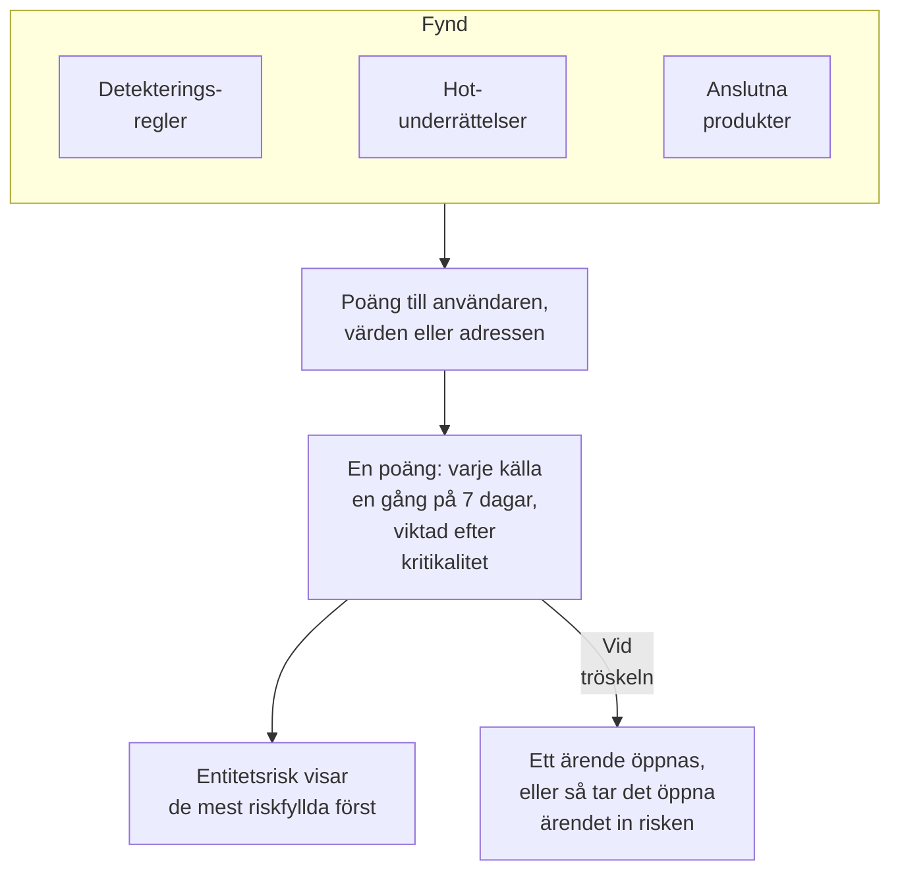

# Entitetsrisk (riskbaserad larmning)

Ett enskilt fynd säger sällan mycket. En rad misslyckade inloggningar, ett första sudo på en värd och en inloggning från ett nytt land är var för sig värda en blick; samma konto i alla tre inom en vecka är värt ett ärende. Entitetsrisk lägger ihop det som dina detekteringsregler, hotunderrättelser och anslutna produkter hittar om varje användare, värd och IP-adress, visar de mest riskfyllda först och öppnar ett ärende om den vars risk når projektets tröskel.

:::cards
- [Så räknas en poäng](#så-räknas-en-poäng): Poäng efter allvarlighetsgrad, och varje källa en gång i veckan.
- [Risknivåer och ärenden](#risknivåer-och-ärenden): Vad en poäng motsvarar, och när ett ärende öppnas.
- [Entitetskritikalitet](#entitetskritikalitet): Låt det som betyder mer räknas mer, och det som betyder mindre räknas mindre.
- [En entitets sida](#en-entitets-sida): Varför den är riskfylld, dess månad och ärendena om den.
- [Riskpoäng på en detekteringsregel](#riskpoäng-på-en-detekteringsregel): En regels egen vikt i poängen.
:::

## Så fungerar det

Öppna **Produkter → Security Events → Entitetsrisk**: varje användare, värd och IP-adress med risk just nu, de mest riskfyllda först, med nivå, hur mycket den betyder, vad som hittade den och när. Var och en öppnas på en egen sida.

## Innan du börjar

- Säkerhetshändelser som kommer in, och detekteringsregler, hotunderrättelser eller anslutna produkter som hittar något i dem. Se [Kom igång med säkerhet](/docs/telemetry/security-getting-started).
- Detekteringsregler som grupperar efter ett fält som nämner någon: **Group By Field**, till exempel `principalUser`, `principalHost` eller `principalIp`, eller fälten som en korrelation grupperar efter. En regel som inte grupperar efter något lägger inte till någon risk.
- För att ändra **Riskbedömning**: Project Owner eller Project Admin för reglaget och tröskeln, och en roll som får skapa detekteringsregler för listan över entiteter. Security Viewer läser allt. Se [Roller](/docs/permissions/reference#roller).

## Så räknas en poäng

Varje fynd ger riskpoäng till användaren, värden eller IP-adressen det gäller:

| Ett fynd med allvarlighetsgrad | Ger |
| --- | --- |
| Låg | 10 poäng |
| Medel | 25 poäng |
| Hög | 50 poäng |
| Kritisk | 75 poäng |

- Ett informativt fynd ger ingenting, och ett fynd med okänd allvarlighetsgrad räknas som Medel.
- En detekteringsregels poäng går till värdet den grupperar efter. En träff i hotunderrättelser räknas för IP-adressen som indikatorn nämner. En ansluten produkts larm räknas för användaren och värden det nämner, annars för dess IP-adress.
- Varje källa räknas en gång. En detekteringsregel, ett flöde med hotunderrättelser eller en ansluten produkts regel räknas en gång på 7 dagar, med det mesta den lade till, hur ofta den än utlöses: en bullrig regel kan aldrig få en entitet att se värre ut än tre olika.
- En källa som inte har hittat något på 7 dagar slutar räknas, och poängen sjunker. Poängen kontrolleras var 15:e minut, så en poäng sjunker i tid utan ett nytt fynd.

En entitets poäng är summan av dess källor, viktad efter dess kritikalitet. Testattacken från **Skicka en testattack**, och ett ärende som någon öppnar för hand, lägger inte till någon risk.

## Risknivåer och ärenden

Varje poäng motsvarar en nivå mot projektets tröskel, 100 om du inte ändrar den:

| Riskpoäng | Motsvarar | Vad som händer |
| --- | --- | --- |
| 1 till 49 | Låg | Listas under Entitetsrisk |
| 50 till 99 | Medel | Listas under Entitetsrisk |
| 100 till 199 | Hög | Ett ärende öppnas, som Hög |
| 200 eller mer | Kritisk | Ett ärende öppnas, som Kritisk |

När en entitets risk når tröskeln skapas en detektering från källan Entitetsrisk om den. Den ansluter till det öppna ärendet om entiteten, eller öppnar ett som är uppkallat efter den, till exempel `High risk — k.morgan@acme-commerce.example`, och listar de källor som bidrog mest till risken, upp till 10, med deras poäng, hur ofta var och en utlöstes och när senast.

När ett ärende har öppnats om en entitets risk räknas inte det som låg bakom igen: ett nytt ärende öppnas bara när källor som är nya sedan dess når tröskeln igen. Ett ärende som stängts som hanterat öppnas inte igen av samma fynd.

Ändra tröskeln under **Produkter → Security Events → Inställningar → Riskbedömning → Risktröskel**: ett heltal från 10 till 10000. Medel börjar vid hälften och Kritisk vid det dubbla, på alla sidor.

### Slå på eller av riskärenden

**Riskärenden**, under **Inställningar → Riskbedömning**, avgör om risk öppnar ärenden, och sparas när du slår om det. Nya projekt börjar med det påslaget. Ett projekt som skapades före entitetsrisk har det avslaget tills någon slår på det, och **Entitetsrisk** säger det ovanför sin lista. Risk poängsätts och listas i vilket fall som helst.

## Entitetskritikalitet

Vissa entiteter betyder mer än andra: en domänkontrollant, en chefs konto, en betalningsserver. Andra betyder mindre, till exempel en sårbarhetsskanner vars skanningar är väntade. Lista dem under **Inställningar → Riskbedömning → Entitetskritikalitet** med **Lägg till Entitet**:

| Kritikalitet | Räknar dess risk |
| --- | --- |
| Låg | ×0.5 |
| Inte listad | ×1 |
| Hög | ×1.5 |
| Extrem | ×2 |

En post är ett värde eller ett `*`-mönster, oavsett skiftläge: `dc-*` namnger varje domänkontrollant, och `*@contractors.example` varje konsult. **Typ** begränsar den till användare, värdar eller IP-adresser; tomt passar alla. När flera poster nämner en entitet räknas den mest specifika: ett utskrivet värde före ett mönster, och ett längre mönster före ett kortare. En ändring når varje entitets poäng inom några minuter.

## En entitets sida

Klicka på **Visa** på en rad i **Entitetsrisk**, eller på risken bredvid en entitet på ett ärendes sida **Entiteter**:

| Del | Vad den visar |
| --- | --- |
| Rubriken | Dess typ och kritikalitet, dess poäng och nivå, och hur poängen räknas fram |
| **Aktivitet** | Dess säkerhetshändelser och fynd från de senaste 7 dagarna |
| **Vad som ökar dess risk** | Varje källa, dess allvarlighetsgrad, poängen den ger, hur ofta den utlöstes och när senast |
| **Risk de senaste 30 dagarna** | Dess poäng i slutet av varje dag, färgad efter nivå |
| **Ärenden om den** | Säkerhetsärendena som öppnats om den, de senaste först |

**Öppna i Korrelera** ritar en graf över dess händelser, och **Sök i dess händelser** öppnar **Händelser** på dess vecka. **Återställ risk** rensar dess poäng och källor, till exempel efter ett planerat test: det som hittas därefter räknas från noll, och dess ärenden ändras inte. Återställning kräver en roll som får ta bort säkerhetsdata, och [granskningsloggen](/docs/configuration/audit-logs) registrerar den.

OneUptime AI läser risken för ett ärendes entiteter när den bedömer ärendet. Se [OneUptime AI i säkerhet](/docs/telemetry/security-ai).

## Riskpoäng på en detekteringsregel

En detekteringsregel ger poängen för sin nivå, från sin Sigma-`level`. För att ge den en egen vikt öppnar du regelns formulär, går till **Vid träff**, öppnar **Fler fält** och anger **Riskpoäng**, från 0, som inte ger någon risk, till 100. Lämna det tomt för poängen för dess nivå.

## Felsökning

:::details En entitet finns inte under Entitetsrisk
Kontrollera att en detekteringsregel, ett flöde med hotunderrättelser eller en ansluten produkt har hittat något om den de senaste 7 dagarna, och att regeln grupperar efter ett fält som nämner den. Informativa fynd ger ingenting, och en källa som inte har hittat något på 7 dagar slutar räknas.
:::

:::details En entitets risk nådde tröskeln, och inget ärende öppnades
Kontrollera att **Riskärenden** är påslaget under **Inställningar → Riskbedömning**. Om ett ärende redan har öppnats om entitetens risk räknas bara källor som är nya sedan dess mot nästa.
:::

:::details En regel utlöses om och om igen, och entitetens poäng stiger inte
Så räknas det: en källa räknas en gång på 7 dagar, med det mesta den lade till. Sänk en bullrig regels **Riskpoäng**, eller ge en entitet vars fynd är väntade låg kritikalitet.
:::

:::details En poäng är inte summan av dess källor
Dess kritikalitet viktar den. Entitetens sida visar summan av dess källor och vikten, till exempel 100 från dess källor × 2 = 200.
:::

## Nästa steg

:::cards
- [Säkerhetsärenden och playbooks](/docs/telemetry/security-cases): Arbeta med ärendena som risk öppnar, och stäng dem med ett utlåtande.
- [Säkerhetshändelser (SIEM)](/docs/telemetry/security-events): Detekteringsregler, Korrelera och händelserna bakom varje fynd.
- [Hotunderrättelser (STIX/TAXII)](/docs/telemetry/threat-intelligence): Träffarna som bidrar till en adress risk.
- [OneUptime AI i säkerhet](/docs/telemetry/security-ai): Hur en bedömning läser risken för ett ärendes entiteter.
:::
