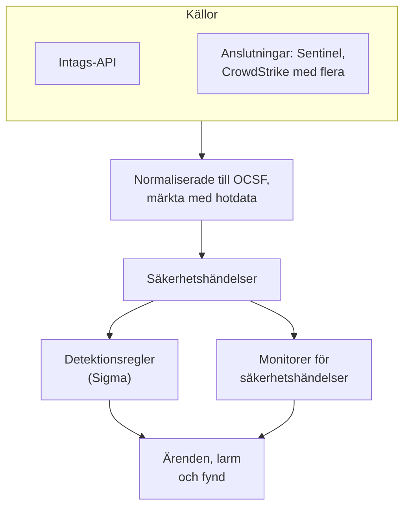
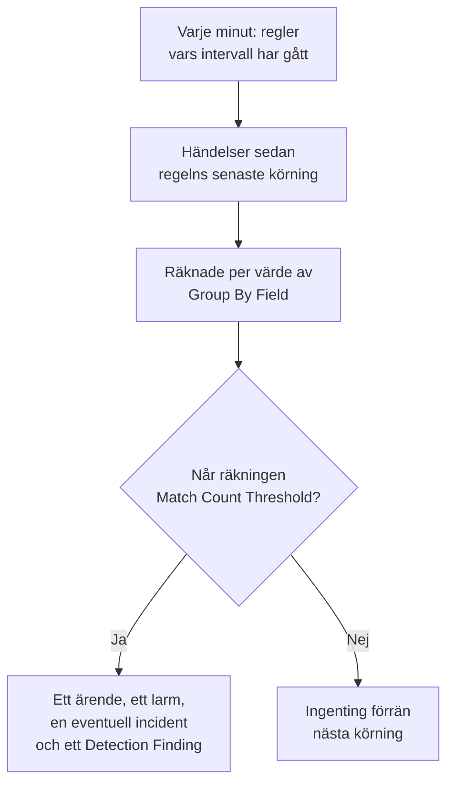

# Säkerhetshändelser (SIEM)

OneUptime lagrar säkerhetshändelser bredvid dina loggar, spår och metriker, och ger alla samma form, [OCSF](https://schema.ocsf.io/) (Open Cybersecurity Schema Framework), oavsett vilket format de kom i. Skicka händelser från vilken källa som helst, sök i dem och hitta de viktiga med Sigma-detektionsregler, hotunderrättelser och monitorer. Det de hittar blir [ärenden](/docs/telemetry/security-cases) att arbeta med, och playbooks reagerar på dem.

:::cards
- [Skicka händelser](#skicka-säkerhetshändelser): En HTTPS-POST, en Fluent Bit-utdata eller en anslutning till en säkerhetsprodukt.
- [Sök och korrelera](#utforska-säkerhetshändelser): Händelseutforskaren och korrelationsgrafen.
- [Detektionsregler](#detektionsregler): Sigma-regler som öppnar ärenden och larm.
- [Monitorer](#monitorer-för-säkerhetshändelser): Räkningar över ett glidande fönster, med en status som återhämtar sig.
:::

## Så fungerar det



Öppna **Produkter → Security Events**, under **Observerbarhet**. Dess meny har ett avsnitt för varje del av säkerheten, och en egen sida för varje sak i den:

| Sida | Avsnitt | Vad den används till |
| --- | --- | --- |
| **Översikt** | Översikt | Hur säkerhet är uppsatt, vad som behöver någon nu och hur snabbt ärenden hanteras |
| **Öppna ärenden** | Säkerhetsärenden | Kön: varje ärende som inte är stängt än, grupperat efter vad det handlar om |
| **Tilldelade mig** | Säkerhetsärenden | De öppna ärenden som är tilldelade dig |
| **Ej tilldelad** | Säkerhetsärenden | De öppna ärenden som ingen har tagit sig an |
| **Stängda ärenden** | Säkerhetsärenden | Ärendena som stängts med ett utfall, de senaste först |
| **Alla ärenden** | Säkerhetsärenden | Varje ärende, öppet eller stängt |
| **Händelser** | Händelser | Sök och filtrera alla händelser, och öppna en för att se alla dess fält |
| **Campaigns** | Händelser | Varje adress som skickade attackförfrågningar, och om någon av dess förfrågningar kom igenom |
| **Entitetsrisk** | Händelser | Varje användare, värd och adress, poängsatt efter vad som hittats om den den här veckan, de mest riskfyllda först |
| **Korrelera** | Händelser | En graf över händelserna som delar en värd, en användare eller en IP-adress |
| **Detektionsregler** | Detections | Sigma-regler som körs enligt ett schema och öppnar ärenden |
| **Regelundantag** | Detections | Det dina regler hoppar över med flit, som en skanner eller ett planerat test, vart och ett med vem som lade till det och varför |
| **Regelbibliotek** | Detections | Färdiga detektionsregler att lägga till, var och en med händelserna den läser och om de kommer in, med de rekommenderade markerade |
| **Hotinformation** | Detections | STIX/TAXII-flöden med kända skadliga indikatorer |
| **ATT&CK-täckning** | Detections | MITRE ATT&CK-teknikerna som dina regler täcker |
| **Playbooks** | Playbooks | Steg som körs på ärenden, av sig själva eller manuellt |
| **Godkännanden** | Playbooks | Playbook-stegen som väntar på att någon godkänner eller avvisar dem |
| **Playbook-körningar** | Playbooks | Vad varje playbook gjorde, steg för steg |
| **Skyddade entiteter** | Playbooks | De användare och värdar som ingen playbook begränsar |
| **Inställningar** | AI | Om OneUptime AI bedömer varje nytt ärende |
| **Anslutningar** | Connections | Dina loggar, säkerhetsprodukterna som OneUptime hämtar från och de SIEM som det skickar till |
| **Installationsguide** | Connections | Kodsnuttar för att skicka händelser, ifyllda med din ingestion-nyckel |
| **Ärendeprioriteter** | Inställningar | Hur brådskande ett ärende är: projektets egna prioriteter, den mest brådskande först |
| **Ärendestatusar** | Inställningar | Stegen ett ärende går igenom, och vad ett ärende i varje steg räknas som |
| **Riskbedömning** | Inställningar | Om en entitets risk öppnar ett ärende, vid vilken risk, och hur mycket varje entitet betyder |

**Detektioner**, **AI**, **Anslutningar** och **Inställningar**, som sätts upp en gång, förblir hopfällda tills du öppnar dem. Ny inom säkerhet? [Kom igång med säkerhet](/docs/telemetry/security-getting-started) sätter upp det med två klick.

## Innan du börjar

Säkerhetsdata kan bara läsas av rollerna Project Owner och Project Admin och av de tre Security-rollerna; andra roller ser ingenting i Security Events. Se [Roller](/docs/permissions/reference#roller).

| Roll | Vad den kan göra |
| --- | --- |
| Security Admin | Allt: händelser, ärenden, playbooks, detektionsregler, threat intel-flöden och anslutningar |
| Security Member | Läsa händelser och threat intel, arbeta med ärenden, köra playbooks och godkänna deras steg, samt skapa, ändra och ta bort detektionsregler och flöden. Den kan inte konfigurera playbooks eller anslutningar, och inte ta bort säkerhetsdata. |
| Security Viewer | Läsa händelser, ärenden, playbooks, regler, flöden, indikatorer och anslutningar |

## Skicka säkerhetshändelser

:::steps
### Skapa en ingestion-nyckel

Öppna **Projektinställningar → Telemetri och APM → Intagningsnycklar** och klicka på **Skapa ingestion-nyckel**. Säkerhetshändelser använder samma nycklar som resten av din telemetri.

### Skicka dina händelser

Skicka JSON till `/security-events/v1/ingest` med nyckeln i `x-oneuptime-token`:

:::tabs
@tab OCSF
```bash
curl -X POST "https://oneuptime.com/security-events/v1/ingest?format=ocsf" \
  -H "Content-Type: application/json" \
  -H "x-oneuptime-token: YOUR_INGESTION_TOKEN" \
  -H "x-oneuptime-service-name: my-security-source" \
  -d '{ "events": [ { "class_uid": 3002, "severity_id": 4, "status": "Failure", "message": "Failed logon for alice", "actor": { "user": { "name": "alice" } }, "src_endpoint": { "ip": "203.0.113.7", "hostname": "laptop-alice" } } ] }'
```
@tab Google UDM
```bash
curl -X POST "https://oneuptime.com/security-events/v1/ingest?format=udm" \
  -H "Content-Type: application/json" \
  -H "x-oneuptime-token: YOUR_INGESTION_TOKEN" \
  -d '{ "events": [ { "metadata": { "event_type": "USER_LOGIN" }, "principal": { "hostname": "laptop-alice", "user": { "userid": "alice" }, "ip": ["203.0.113.7"] }, "security_result": [{ "severity": "HIGH", "action": ["BLOCK"] }] } ] }'
```
@tab Generic JSON
```bash
curl -X POST "https://oneuptime.com/security-events/v1/ingest" \
  -H "Content-Type: application/json" \
  -H "x-oneuptime-token: YOUR_INGESTION_TOKEN" \
  -d '{ "events": [ { "severity": "high", "event_type": "ssh_brute_force", "message": "12 failed SSH logins in 60s", "username": "root", "hostname": "web-01", "src_ip": "203.0.113.7" } ] }'
```
:::

Slutpunkten svarar `200` när händelserna har lagts i kö. En händelse som skickas utan tid, som dessa, placeras vid den tidpunkt då den kommer in.

### Hitta dem under Händelser

Öppna **Produkter → Security Events → Händelser**. Händelserna visas inom några sekunder, med allvarlighetsgrad, klass, användare, värd och IP-adresser ifyllda.
:::

### Format

| `format` | Vad det läser | Accepteras också |
| --- | --- | --- |
| `ocsf` | OCSF-händelse-JSON (`class_uid`, `severity_id` och så vidare) | Inga |
| `udm` | UDM-händelser från Google SecOps (Chronicle) (`metadata.event_type` och så vidare) | `chronicle`, `google-secops` |
| `google-secops-alert` | Detektioner och larm från Google SecOps: SOAR-webhooks och detektionsflödet | `secops-alert`, `detection` |
| `generic` | All annan JSON, läst utifrån vanliga fältnamn | Inga |

Ange formatet med `?format=`, med huvudet `x-oneuptime-security-event-format` eller med ett fält `"format"` på översta nivån. Utelämnar du det avgörs varje händelses format för sig, så en enda webhook kan blanda detektioner med råa händelser.

- Kroppen kan vara en händelse, en array av händelser eller `{ "events": [...] }`.
- Huvudet `x-oneuptime-service-name` anger telemetritjänsten som händelserna hör till. Utan det hör de till tjänsten som är uppkallad efter den första händelsens produkt eller leverantör, eller till `Security Events`.
- Ingenting kastas för att det inte gick att mappa: varje fält från källan hamnar i händelsens attribut.

### Fält i generisk JSON

En generisk händelse läses utifrån vanliga fältnamn:

| Händelsens fält | Läses från det första av |
| --- | --- |
| `message` | `message`, `msg`, `summary`, `description`, `title` |
| `severityName` | `severity`, `severity_name`, `level`, `priority`, `risk_level` |
| `time` | `timestamp`, `time`, `@timestamp`, `event_time`, `created_at` |
| `principalUser` | `user`, `username`, `user_name`, `account`, `actor` |
| `principalHost` | `host`, `hostname`, `computer`, `device`, `machine` |
| `principalIp` | `source_ip`, `src_ip`, `client_ip`, `ip` |
| `targetIp` | `destination_ip`, `dest_ip`, `dst_ip`, `target_ip` |
| `className` | `event_type`, `category`, `type`, `action` |
| `ruleName` | `rule`, `rule_name`, `signature`, `detection` |
| `productName` | `product`, `product_name`, `source`, `log_source` |
| `processName` | `process_name`, `process.name`, `proc.name`, `comm` |
| `processPath` | `process_path`, `Image`, `NewProcessName`, `exe`, `process.executable` |
| `processCommandLine` | `command_line`, `CommandLine`, `cmdline`, `process.command_line`, `proc.cmdline`, `process` |
| `parentProcessName` | `parent_process_name`, `process.parent.name`, `proc.pname` |
| `parentProcessPath` | `parent_process_path`, `ParentImage`, `ParentProcessName`, `process.parent.executable` |
| `parentProcessCommandLine` | `parent_command_line`, `ParentCommandLine`, `process.parent.command_line`, `proc.pcmdline` |

Ett ord för allvarlighetsgrad blir en OCSF-nivå: `info` läses som Informational, `warning` som Low, `error` som Medium, `alert` som Critical och `emergency` som Fatal.

### Vidarebefordra med Fluent Bit

För att skicka säkerhetsloggar som du redan samlar in, till exempel auditd, syslog eller Falco, lägger du till en `http`-utdata i Fluent Bit:

```ini title="fluent-bit.conf"
[OUTPUT]
    Name             http
    Match            security.*
    Host             oneuptime.com
    Port             443
    tls              On
    URI              /security-events/v1/ingest
    Format           json
    Json_date_key    timestamp
    Json_date_format iso8601
    Header           x-oneuptime-token YOUR_INGESTION_TOKEN
    Header           x-oneuptime-service-name my-security-source
    Retry_Limit      5
```

Sidan **Installationsguide**, under **Anslutningar**, har de här kodsnuttarna med din egen värd och nyckel ifyllda.

### Hitta säkerhetshändelser i dina loggar

Kortet **Dina loggar**, högst upp på **Anslutningar**, gör loggarna du redan skickar till OneUptime till en källa. Med **Hitta säkerhetshändelser i dina loggar** påslaget läses projektets nya loggar varje minut, och varje SSH-inloggning, sudo-kommando, Kubernetes-granskningspost, AWS CloudTrail-ändring och webbattack i dem lagras som en säkerhetshändelse. Se [Kom igång med säkerhet](/docs/telemetry/security-getting-started#hitta-säkerhetshändelser-i-dina-loggar) för vad varje typ täcker.

### Anslut en säkerhetsprodukt

**Anslutningar** hämtar data från en säkerhetsprodukt åt dig och importerar dess nya poster som säkerhetshändelser. En anslutning innehåller produktens inställningar och en krypterad autentiseringsuppgift; en worker hämtar från den med intervallet du anger och hoppar över poster som den redan har importerat.

| Produkt | Importerar | Installationsguide |
| --- | --- | --- |
| Google SecOps (Chronicle) | Regeldetektioner, kurerade detektioner och larm, som Detection Findings | [Google SecOps](/docs/integrations/google-secops) |
| Microsoft Sentinel | Incidenter, som Incident Findings | [Microsoft Sentinel](/docs/integrations/microsoft-sentinel) |
| Microsoft Defender XDR | Larm, som Detection Findings | [Microsoft Defender XDR](/docs/integrations/microsoft-defender-xdr) |
| CrowdStrike Falcon | Larm, som Detection Findings | [CrowdStrike Falcon](/docs/integrations/crowdstrike-falcon) |
| Splunk Enterprise Security | Notable events, eller vilken sökning som helst, som Detection Findings | [Splunk Enterprise Security](/docs/integrations/splunk) |
| Elastic Security | Detektionslarm, som Detection Findings | [Elastic Security](/docs/integrations/elastic-security) |
| AWS Security Hub | Findings, som Detection och Compliance Findings | [AWS Security Hub](/docs/integrations/aws-security-hub) |
| Okta System Log | Händelser för inloggning, MFA, konton och policyer | [Okta System Log](/docs/integrations/okta) |

- Produktens egna larm på eller över **Open Cases From** (**Hög och högre** om du inte väljer en annan nivå, eller **Aldrig**) öppnar [ärenden](/docs/telemetry/security-cases), grupperade efter användaren, värden eller adressen som de handlar om.
- En anslutning läser poster efter tiden då produkten skapade dem, inte efter tiden för aktiviteten de beskriver. En SIEM-regel som körs varje timme skapar detektioner långt efter händelserna den träffade, och de importeras ändå.
- Den första hämtningen tittar 24 timmar bakåt, så en ny anslutning visar nya poster direkt.
- **Testa anslutningen**, i anslutningens rad, kontrollerar åtkomsten till produkten och att OneUptimes egna workers körs, och importerar ingenting. **Kör nu** hämtar direkt.

## Vad en händelse innehåller

Varje händelse lagras med typade fält och källans nyttolast:

| Grupp | Fält |
| --- | --- |
| Klassificering | `categoryName`, `className`, `activityName`, `statusName`, med deras OCSF-ID:n (`categoryUid`, `classUid`) |
| Allvarlighetsgrad | `severityName`, en av Unknown, Informational, Low, Medium, High, Critical, Fatal eller Other, och `severityId` |
| Vem som gjorde det | `principalUser`, `principalHost`, `principalIp`, `principalProcess` |
| Vad det berörde | `targetUser`, `targetHost`, `targetIp`, `targetPort`, `targetResource` |
| Processen | `processName`, `processPath` och `processCommandLine`: vid processaktivitet den process som startades, öppnades, injicerades i eller avslutades, annars den process som agerade. `parentProcessName`, `parentProcessPath` och `parentProcessCommandLine`: den process som startade den |
| Källa | `productName`, `vendorName`, `ruleId`, `ruleName`, `eventUid` |
| Innehåll | `message`, `mitreTactics`, `mitreTechniques` och `observables`: varje användare, värd, IP-adress, domän och hash som hämtats från händelsen |
| Attribut | Hela källans nyttolast, utplattad till nycklar med punkter |

Händelser som lagrades före OneUptime 14.0.84 lämnar processfälten tomma och anger sin process bara som `principalProcess`, den process som agerade. De fylls inte i efteråt: de behåller det de lagrades med tills deras lagringstid tar slut.

## Utforska säkerhetshändelser

**Händelser** är en telemetriutforskare som utforskarna för loggar och spår: ett diagram över fönstrets händelser efter allvarlighetsgrad, en sidopanel med facetter, listan och en panel med varje fält och attribut i händelsen du öppnar. Fönstret, filtren och sökningen finns alla i URL:en, så en filtrerad vy kan delas och överlever en omladdning.

### Sök

Sökfältet talar samma språk som de andra telemetriutforskarna (se [Söksyntax](/docs/telemetry/search-syntax)):

| Syntax | Betyder | Exempel |
| --- | --- | --- |
| fritext | Meddelandet innehåller den | `failed logon` |
| `"quoted phrase"` | Håll ihop orden | `"brute force"` |
| `<field>:<value>` | Ett typat fält | `severity:Critical` |
| `@<attribute>:<value>` | Ett källattribut | `@threat.matched:true` |
| `-<filter>` | Inte detta | `-severity:Informational` |
| `<field>:(a OR b)` | Vilket som helst av de här värdena | `severity:(High OR Critical)` |
| `<field>:a*` | `*` är vilken text som helst, `?` ett tecken | `host:web-*` |
| `@<attribute>:*` | Attributet finns | `@threat.indicator_id:*` |
| `@<attribute>:~text` | Attributet innehåller texten | `@finding_info.title:~ransom` |

Ett fält är antingen ett kort namn (`severity`, `class`, `category`, `activity`, `status`, `vendor`, `product`, `rule`, `user`, `host`, `ip`, `targetuser`, `targethost`, `targetip`, `processname`, `commandline`, `parentprocessname`, `observable`, `tactic`, `technique`, `requestoutcome`, `trace`, `session`) eller fältets eget namn, till exempel `severityName` eller `principalHost`. Alla andra namn läses som ett källattribut. `observable:<value>` hittar varje händelse som nämner ett värde, oavsett på vilken sida av aktiviteten det fanns.

### Facetter

Sidopanelen räknar fönstrets händelser efter **Källa**, **Allvarlighetsgrad**, **Request Outcome**, **Händelseklass**, **Kategori**, **Aktivitet**, **Status**, **Leverantör**, **Produkt**, **Detektionsregel**, **Källanvändare**, **Källvärd**, **Process** och **Överordnad process**. Klicka på ett värde för att bara behålla dess händelser, eller på minustecknet bredvid för att utesluta dem. Klicka igen för att ångra. Diagrammet och varje räkning beskriver exakt händelserna i listan.

### Vad som hände sedan

En händelse läst från en loggrad som skrevs inuti en spårad förfrågan följs in i den förfrågan. Dess panel visar hur långt förfrågan kom (**Avvisad**, **Reached App**, **Errored** eller **Reached Database**), vem som skickade den, och länkar till dess spårning, dess undantag, dess sessionsuppspelning och själva loggraden. En loggrad, en spårning och ett undantag som är del av en attack säger det också på sina egna sidor.

### Campaigns

**Campaigns** listar varje adress som skickade attackförfrågningar som en rad, med attacktyperna, verktygen och förfrågningarna den skickade, och hur många som kom igenom. Adresserna vars förfrågningar nådde din app kommer först.

### Korrelera

**Korrelera** ritar händelserna runt en värd, en användare eller en IP-adress: deras händelseklasser runt det du sökte efter, markerade med sin värsta allvarlighetsgrad, och de andra värdena från samma händelser på den yttre ringen. Klicka på en klass för att lista dess händelser, eller på ett värde för att korrelera på det härnäst. Varje observable i en händelses panel under **Händelser** öppnar **Korrelera** på den.

## Detektionsregler

En detektionsregel är en [Sigma](https://sigmahq.io/)-regel, ett öppet YAML-format för att beskriva misstänkt aktivitet, som OneUptime kör enligt ett schema mot dina händelser. När den träffar öppnar den ett [ärende](/docs/telemetry/security-cases) eller lägger träffen i ett som redan är öppet, öppnar ett larm, eventuellt en incident, och skriver ett Detection Finding tillbaka bland händelserna. **Regelbibliotek** har färdiga regler att utgå från.



### Skapa en regel

:::steps
1. Öppna **Produkter → Security Events → Detektioner → Detektionsregler** och klicka på **Skapa Detektionsregel**.
2. Klistra in regelns YAML i **Sigma-regel (YAML)** under **Sigma-regel**. Den tolkas när du sparar, så ett fel visas i formuläret.
3. **Namn** fylls i från regelns `title`: skriv över det för att kalla regeln något annat. En ny regel körs; **Aktiverad** finns i dess redigeringsformulär.
4. Låt **Öppna ett ärende vid matchning** vara påslaget under **Vid träff** för att samla regelns träffar i ärenden, efter värdet som regeln grupperar efter.
5. Välj under **Larm och incidenter** vad en träff mer ska utlösa: **Skapa ett larm** (standard), **Deklarera en incident**, **Båda** eller **Ingetdera**, med valfri **Larmallvar** eller **Incidentallvar**.
6. **Fler fält** innehåller **Beskrivning**, **Skriv Detection Finding vid matchning** (på) och hur träffar räknas; se [Utvärderingsinställningar](#utvärderingsinställningar).
:::

En första regel, som träffar misslyckade inloggningar utanför `10.x.x.x`:

```yaml title="failed-logon-burst.yml"
title: Failed logon burst
description: Repeated authentication failures from one source.
level: high
tags:
  - attack.t1110
  - attack.ta0006
detection:
  selection:
    className: Authentication
    statusName: Failure
  filter_internal:
    principalIp|startswith: '10.'
  condition: selection and not filter_internal
```

### Vad en regel kan uttrycka

OneUptime kör den booleska kärnan i Sigma:

- Urval är fältmappningar (varje fält måste träffa; en lista med värden träffar vilket som helst av dem) eller nyckelordslistor, som träffar var som helst i meddelandet.
- Villkor kombinerar urval med `and`, `or`, `not` och parenteser, eller med `1 of selection_*`, `all of selection_*`, `any of them` och `all of them`.
- Fältmodifierare: `contains`, `startswith`, `endswith`, `all`, `re`, `cased`, `gt`, `gte`, `lt`, `lte`, `cidr`, `exists` och `windash`. Text jämförs utan hänsyn till versaler och gemener, om du inte lägger till `cased`.
- Ett fält är ett typat fält (`principalUser`), en vanlig Sigma-stavning av ett (`CommandLine`, `src_ip`, `Hostname`) eller vilken attributnyckel som helst, stavad som i händelsen (`threat.matched`).
- `Image` och `CommandLine` läser den process som händelsen handlar om, vid en processtart den som startade (`processPath`, `processCommandLine`), och `ParentImage` och `ParentCommandLine` den process som startade den (`parentProcessPath`, `parentProcessCommandLine`). `principalProcess` är den process som agerade, vilket vid en start är den överordnade.
- `level` anger allvarlighetsgraden: `informational`, `low`, `medium`, `high` eller `critical`, och `medium` när den saknas. ATT&CK-ID:n i `tags` (`attack.t1110`, `attack.ta0006`) fyller i fyndets MITRE-fält.

Aggregeringar som `| count() by principalIp > 5` avvisas när du sparar: använd en [korrelationsregel](#korrelationsregler), eller **Grupperingsfält** och **Tröskel för antal träffar**, i stället. `logsource` är bara informativ och begränsar ingenting: lägg det filtret i ett urval, till exempel `className: Authentication`. En `timeframe` ignoreras, eftersom regelns intervall bestämmer dess fönster.

### Korrelationsregler

En [Sigma-korrelation](https://sigmahq.io/docs/meta/correlations.html) utlöses av flera händelser tillsammans i stället för en. Klistra in den i **Sigma-regel (YAML)** tillsammans med reglerna den läser, som YAML-dokument åtskilda av `---`, eller namnge regler som projektet redan har med deras Sigma-`name` eller -`id`. **Regelbibliotek** har färdiga, till exempel misslyckade inloggningar följda av en lyckad.

| Typ | Utlöses när | Visas som |
| --- | --- | --- |
| `event_count` | En grupp når ett antal händelser inom `timespan` | Antal händelser |
| `value_count` | En grupp visar ett antal olika värden för ett fält inom `timespan` | Olika värden |
| `temporal` | Varje regel matchar för samma grupp inom `timespan`, i valfri ordning | Händelser tillsammans |
| `temporal_ordered` | Reglerna matchar i sin ordning för samma grupp inom `timespan` | Sequence |
| `new_value` | En grupp visar ett värde för ett fält som den inte har visat inom `timespan` | First seen |

```yaml title="failed-then-success.yml"
title: Failed sign-ins, then a success from the same address
level: high
correlation:
  type: temporal_ordered
  rules:
    - failed_sign_ins
    - successful_sign_in
  group-by:
    - principalIp
  timespan: 10m
---
title: Five failed sign-ins
name: failed_sign_ins
correlation:
  type: event_count
  rules:
    - failed_sign_in
  group-by:
    - principalIp
  timespan: 10m
  condition:
    gte: 5
---
title: Failed sign-in
name: failed_sign_in
detection:
  selection:
    className: Authentication
    statusName: Failure
  condition: selection
---
title: Successful sign-in
name: successful_sign_in
detection:
  selection:
    className: Authentication
    statusName: Success
  condition: selection
```

- En grupp är värdet av fälten i `group-by`, till exempel en adress. Räkningar är rullande: en skur som två körningar delar räknas ändå hel inom sitt `timespan`, som är högst 24 timmar.
- `new_value` är OneUptimes egen typ, eftersom Sigma saknar en korrelation för "först sedd": den jämför med upp till 30 dagars historik. `value_sum`, `value_avg`, `value_percentile` och `value_median` avvisas när du sparar.
- Kolumnen **Typ** i **Detektionsregler** visar varje regels slag, och formuläret säger i en mening vad regeln letar efter.

### Utvärderingsinställningar

| Fält | Vad det gör |
| --- | --- |
| **Utvärderingsintervall (minuter)** | Hur ofta regeln körs: hela minuter, 1 till 1440. Formuläret för en ny regel börjar på 5. |
| **Grupperingsfält** | Valfritt. Träffar som delar det här fältets värde, till exempel `principalHost`, räknas, larmas och dedupliceras tillsammans: ett larm per värd i stället för hundratals. |
| **Fält för unik räkning** | Valfritt. Räkna de olika värdena i det här fältet i stället för de träffande händelserna. Tomma värden räknas inte. |
| **Tröskel för antal träffar** | En grupp löser bara ut när dess räkning når det här talet inom en körning: 1 till 1000000, och 1 löser ut vid varje träff. |

Group By och Distinct Count tar samma fältnamn som regeln. Med dem säger tröskeln ”så här många, från samma sak, i en körning”, utan någon monitor ovanpå:

| Mål | Group By Field | Distinct Count Field | Tröskel |
| --- | --- | --- | --- |
| Larma vid varje träff | Tomt | Tomt | 1 |
| Ett larm per värd | `principalHost` | Tomt | 1 |
| Brute force: 5 misslyckade inloggningar från en IP | `principalIp` | Tomt | 5 |
| Password spraying: en IP som misslyckas mot 5 olika konton | `principalIp` | `principalUser` | 5 |
| Portskanning: en IP som når 20 olika portar | `principalIp` | `targetPort` | 20 |

### När en regel körs

OneUptime kontrollerar varje minut om det finns aktiverade regler vars intervall har gått sedan deras senaste körning. Varje körning läser händelserna vars händelsetid infaller mellan den föregående körningen och för två minuter sedan, och går sedan vidare. De två minuterna ger utrymme åt händelser som fortfarande är på väg, till exempel en loggrad som läses en minut efter att den skrevs:

- Fönstren ligger efter varandra och glider inte. Med ett intervall på 10 minuter kan misslyckanden kl. 09:58 och 10:01 hamna i olika körningar och räknas var för sig, så lämna marginal när du väljer en tröskel.
- Efter ett uppehåll, till exempel ett worker-avbrott eller en regel som slagits på igen, täcker nästa körning hela uppehållet, upp till de senaste 24 timmarna.
- En händelse som kommer mer än två minuter för sent, efter att en körning redan har täckt dess tid, lagras och är sökbar, men den regeln läser den aldrig.
- Varje grupp som når tröskeln blir ett Detection Finding, upp till 10 000 per körning. Larm, incidenter och ärenden öppnas för de 100 med högst räkning; resten delar ett ärende om regeln, och regelns **Senaste fel** säger hur många grupper som träffade.

### Allvarlighetsgrad

En regels `level` är allvarlighetsgraden för dess fynd: `informational`, `low`, `medium`, `high` och `critical` blir Informational, Low, Medium, High och Critical. Dess larm och incidenter får en av projektets allvarlighetsgrader, i den här ordningen:

1. Regelns **Larmallvar** (eller **Incidentallvar**), när den är angiven.
2. Din allvarlighetsgrad som är uppkallad efter nivån, till exempel High, oavsett versaler och gemener.
3. Efter rang: regler med `critical` och `high` får din allvarligaste allvarlighetsgrad, de andra din minst allvarliga.

> [!TIP]
> Namnge dina larmallvarlighetsgrader efter Sigma-nivåerna (Critical, High, Medium, Low, Informational), så hamnar varje regel på rätt grad utan någon inställning per regel.

### Larm och fynd

Varje grupp som löser ut öppnar ett larm med titeln `[Detection] <rule name> — <group value>`, eller `[Detection] <rule name>` för en regel utan Group By Field. Så länge det är öppet öppnar fler träffar för den gruppen inget nytt. En regel ser bara träffar och kan inte avgöra att en attack har upphört, så dess larm förblir öppna tills någon löser dem.

Ett Detection Finding är en säkerhetshändelse av klassen `Detection Finding` (OCSF-klass 2004) från produkten `OneUptime Detections`, med regelns MITRE-taggar, gruppvärdet först i `observables` och de här attributen:

| Attribut | Värde |
| --- | --- |
| `oneuptime.detection.rule_id` | ID:t för regeln som löste ut |
| `oneuptime.detection.rule_name` | Regelns namn |
| `oneuptime.detection.match_count` | Hur många händelser som ligger bakom fyndet |
| `oneuptime.detection.distinct_count` | Hur många olika värden som ligger bakom det, för en regel med ett Distinct Count Field |
| `oneuptime.detection.group_value` | Gruppens värde, för en regel med ett Group By Field |
| `oneuptime.detection.sigma_id` | Sigma-regelns egen `id` |

Fynd är vanliga händelser: sök efter dem under **Händelser** och pivotera på dem i **Korrelera**. För att prova en ny regel i det tysta stänger du av alla åtgärder utom fyndet tills du litar på den.

### Undantag

Ett undantag är något en regel hoppar över eftersom du väntar dig det, som en sårbarhetsskanner, ett nattligt säkerhetskopieringsjobb eller ett planerat penetrationstest. Det tystar regeln för just den saken utan att stänga av den, och regelns andra träffar utlöses fortfarande. Alla undantag listas under **Produkter → Security Events → Detektioner → Regelundantag**: lägg till ett där med **Lägg till Regelundantag**, med **Lägg till undantag** i en regels rad, eller med **Lägg till undantag** i en detektions rad i ett ärende, som börjar med detektionens regel och det den utlöstes för.

| Det regeln hoppar över | Vad det träffar |
| --- | --- |
| **En entitet** | En användare, värd eller IP-adress, var en händelse än nämner den: som den som agerade (`principalUser`, `principalHost`, `principalIp`), som den som agerades mot (`targetUser`, `targetHost`, `targetIp`), eller bland dess `observables` |
| **Ett värde** | Värdet i ett fält, med fältet namngivet så som en regel namnger det: `processName`, `principalUser` eller en attributnyckel som `http.user_agent` |
| **Ett tidsfönster** | Alla händelser från **Börjar den** till **Slutar den**, högst 30 dagar isär |

- Värden träffar oavsett versaler och gemener, och `*` står för vilken följd av tecken som helst: `svc-*` hoppar över alla tjänstekonton, och `*.lab.example.com` alla värdar i en domän. En IP-adress kan vara ett intervall, som `10.20.0.0/16`. Ett värde som bara är `*` avvisas: stäng av en regel för att stoppa den.
- Varje undantag säger varför i sin **Orsak**, som alla som läser listan ser, och sparar vem som lade till det och när. En entitet eller ett värde kan ha ett datum i **Upphör**, varefter regeln ser det igen; ett tidsfönster slutar av sig självt.
- **Status** säger var vart och ett står: **Aktiv**, **Kommande** för ett fönster som inte har börjat, **Utgången** eller **Avslutad**. Under en regels namn i **Detektionsregler** räknar en rad dess aktiva undantag, och **Visa undantag** i regelns rad öppnar listan filtrerad på regeln.
- Överhoppade händelser lämnas utanför innan regeln räknar något, så de räknas aldrig mot dess **Tröskel för antal träffar** och öppnar inget ärende, larm, incident eller fynd. Undantag gäller för varje körning av regeln, korrelationer inräknade, och för **Kör på tidigare händelser**, men aldrig för en testattack, som kontrollerar att händelser kommer fram.
- En regel har högst 100 undantag. Den som får redigera detektionsregler lägger till, ändrar och tar bort dem, alla Security-roller kan läsa dem, och varje ändring sparas i projektets granskningslogg.

### Kör på tidigare händelser

**Kör på tidigare händelser** visar vad en regel skulle ha hittat om den hade körts, utan att öppna, skicka eller skriva något. Den finns i en regels rad, för regeln som den är sparad, och under **Sigma-regel (YAML)** i regelns formulär, för regeln som den står där, innan du sparar den. Välj **Senaste 24 timmarna**, **Senaste 7 dagarna** eller **Senaste 30 dagarna**.

- En regel räknas så som dess körningar räknar den: i fönster lika långa som dess **Utvärderingsintervall (minuter)**, där en grupp utlöses i ett fönster när dess antal där når **Tröskel för antal träffar**. En korrelation läses över hela perioden och listar de grupper den skulle ha träffat, var och en med vad som hände.
- Svaret säger hur många gånger regeln skulle ha utlösts, hur många gånger per dag, för hur många användare, värdar eller adresser, och hur många händelser som träffade. De 50 grupper som utlöstes mest listas, var och en med sina händelser och när den senast utlöstes.
- En sparad regels undantag gäller, och svaret säger hur många händelser de hoppade över och hur många utlösningar de förhindrade. En regel som inte skulle ha utlösts säger hur nära den kom: hur många händelser som träffade, och tröskeln som ingen grupp nådde i ett fönster.
- En regel som skulle utlösas mer än 20 gånger per dag utlöses oftare än en människa hinner titta på, och svaret säger det, med sätt att göra den tystare.
- Den läser bara de källor du får läsa. En körning som tar mer än 45 sekunder stoppas och säger det: välj en kortare period.

## Monitorer för säkerhetshändelser

En monitor för säkerhetshändelser räknar händelserna som träffar dess filter över ett glidande fönster och kör de vanliga monitorkriterierna på räkningen: den ändrar monitorns status, öppnar larm eller incidenter och larmar jourhavande. Skapa en under **Övervakare → Skapa monitor**, med **Säkerhetshändelser** som typ; den listas där med dina andra monitorer.

Dess formulär visar **Monitor events that include this text**, **Monitor Security Events for (time)**, **Event Severity** och **Händelseklass**. **Filtrera efter telemetritjänst** och **Filtrera efter attribut** väntar under **Fler fält**, vars rubrik visar vilka en monitor använder. Dess kriterier kontrollerar **Security Event Count**.

| | Detektionsregel | Monitor för säkerhetshändelser |
| --- | --- | --- |
| Träffar | En Sigma-regel | Filter på allvarlighetsgrad, klass, meddelande, tjänst och attribut |
| Fönster | Efter varandra, ett per körning | Glidande: de senaste 5 sekunderna till 24 timmar |
| Räknar per grupp | Ja, med **Grupperingsfält** | Nej: en räkning för allt som träffar |
| Öppnar | Larm, incidenter och fynd | En status, larm och incidenter |
| Återhämtar sig | Nej: larm förblir öppna tills de löses | Ja: statusen återgår när räkningen gör det |

Skriv själva detektionen som en regel, med dess tröskel. Använd en monitor när du vill ha ett glidande fönster, en status som återhämtar sig av sig själv, en statussida eller olika jourpolicyer per kriterium.

### Håll koll på dina detektioner

Fynd är händelser, så en monitor kan bevaka själva reglerna:

- Stormar: en monitor på klassen `Detection Finding`, som räknar varje fynd. Tjugo olika regler som löser ut inom en timme är en signal som ingen enskild regel kan se.
- Förändringar i takt: filtrera på en regels `oneuptime.detection.rule_id`. En regel som löser ut varje vecka och plötsligt löser ut femtio gånger i timmen kräver en annan respons.
- Tystnad: fynd som sjunker till noll, när du normalt ser några stycken, betyder oftast att en källa har slutat skicka. Använd ett kriterium som kontrollerar om räkningen understiger ett tal.

Åtgärden **Skapa monitor** i en regels rad öppnar en ny monitor som redan är konfigurerad på det här sättet: klassen `Detection Finding`, regelns ID (aldrig dess namn, som ett namnbyte skulle ändra) och den senaste timmen. En sådan monitor räknar fynd, ett per grupp och körning, inte händelserna bakom dem. För att kräva ett antal händelser innan något löser ut använder du regelns **Tröskel för antal träffar**.

## Hotunderrättelser

**Hotinformation** prenumererar på STIX/TAXII-flöden med kända skadliga IP-adresser, domäner, URL:er, e-postadresser och filhashar. Händelser som nämner en av dem märks med `threat.*`-attribut när de kommer in, som regler och monitorer kan filtrera på, och varje minut matchas nya händelser mot flödena, vilket öppnar larm och fynd som en regel gör. Se [Hotunderrättelser](/docs/telemetry/threat-intelligence).

## Lagring och fakturering

Säkerhetshändelser faktureras per GB som tas in, som resten av din telemetri, och lagras enligt din lagringstid för telemetri: projektets **Standardlagring (dagar)**, under **Projektinställningar → Telemetri och APM → Datalagring**, eller en lagringstid som angetts på telemetritjänsten de hör till. När en händelses lagringstid löper ut tas den bort.

## Felsökning

:::details Händelserna visas inte
Kontrollera nyckeln i `x-oneuptime-token` och sökvägen, `/security-events/v1/ingest`. Kontrollera sedan fönstret under **Händelser**, det senaste dygnet om du inte ändrar det: en händelse placeras på sin egen tid, så en med en äldre tidsstämpel hamnar utanför det.
:::

:::details En regel träffar aldrig
Kontrollera dess **Status**: med **Inaktiverad** körs regeln inte, och med **Körningen misslyckades** visar **Visa fel** i dess rad varför. Öppna en händelse som du väntade dig skulle träffa och jämför den med regeln, fält för fält: ett vanligt värde måste vara lika med hela fältet, så använd `contains` eller `*` för en del av ett fält. Ett attribut namnges som i händelsen (`threat.matched`, inte `attributes.threat.matched`). Med en tröskel över 1 måste träffarna infalla inom en körning.
:::

:::details En regel träffade, men inget larm öppnades
**Larm och incidenter** är satt till **Deklarera en incident** eller **Ingetdera**, eller ett larm för samma regel och gruppvärde är fortfarande öppet, och senare träffar slås ihop med det. Ett projekt behöver minst en larmallvarlighetsgrad för att regler ska kunna öppna larm.
:::

:::details En regel öppnar för många larm
Varje värde i **Grupperingsfält** får ett eget larm: gruppera efter något grövre, höj tröskeln eller lägg till ett Distinct Count Field. Bryr du dig om takten snarare än om varje träff, sätter du **Larm och incidenter** till **Ingetdera** och sätter en monitor på regelns fynd.
:::

:::details En regel utlöses av något du väntar dig
Lägg till ett undantag för det i stället för att stänga av regeln: **Lägg till undantag** i detektionens rad i dess ärende börjar med regeln och det den utlöstes för. För att ändra själva regeln visar **Kör på tidigare händelser** under dess YAML vad ändringen skulle ha hittat innan du sparar.
:::

:::details Ett undantag hoppar inte över det det ska
Kontrollera undantagets **Status** i **Regelundantag**: ett undantag med status **Utgången** hoppar inte över något, och ett tidsfönster hoppar bara över händelserna mellan sina två tidpunkter. En entitet söks som den som agerade, som den som agerades mot och bland händelsens `observables`; för att hoppa över ett värde i ett annat fält lägger du till ett undantag av typen **Ett värde** som namnger fältet. Utan `*` måste ett värde vara lika med hela fältet: `svc-*` hoppar över `svc-backup`, och `svc-` gör det inte.
:::

:::details Att köra en regel på tidigare händelser hittar ingenting
Den läser bara den period du väljer och de källor du får läsa. När händelser träffade men ingen grupp nådde **Tröskel för antal träffar** i ett fönster säger svaret hur många som träffade: sänk tröskeln, eller räkna över ett längre **Utvärderingsintervall (minuter)**.
:::

## Nästa steg

:::cards
- [Hotunderrättelser](/docs/telemetry/threat-intelligence): Matcha dina händelser mot STIX/TAXII-flöden.
- [Säkerhetsärenden och playbooks](/docs/telemetry/security-cases): Arbeta med det som dina regler hittar, och reagera med playbooks.
- [Google SecOps](/docs/integrations/google-secops): Hämta in Chronicles detektioner och händelser.
- [Söksyntax](/docs/telemetry/search-syntax): Allt som sökfältet förstår.
- [Behörighetsreferens](/docs/permissions/reference): Security-rollerna, och vad var och en kan göra.
:::
