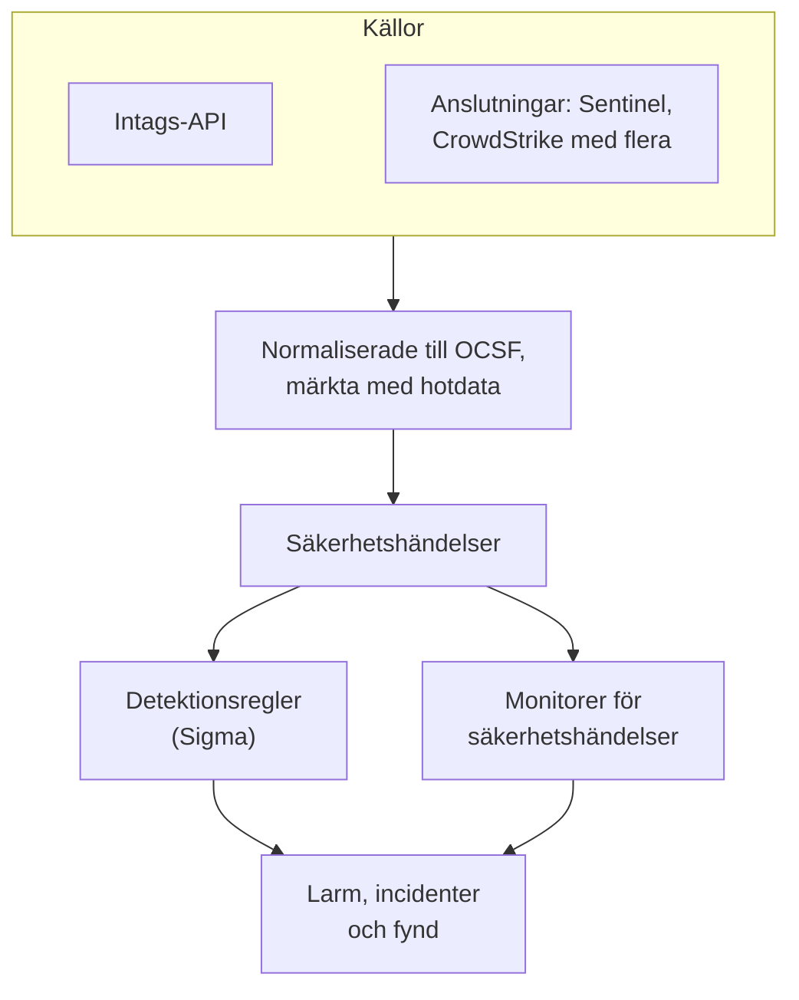
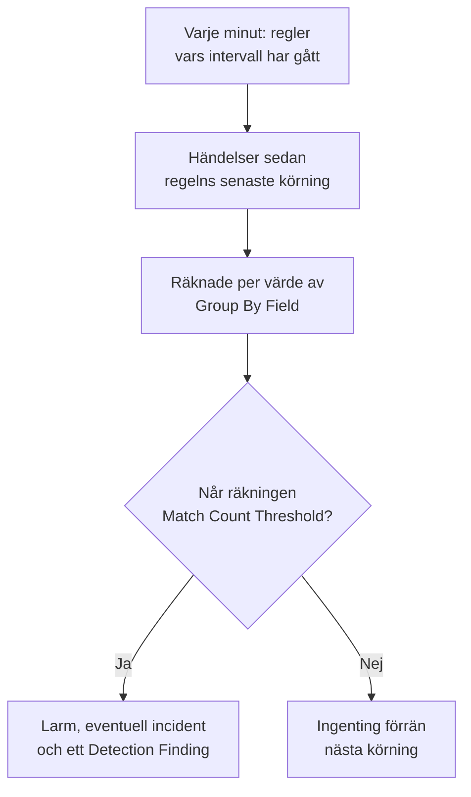

# Säkerhetshändelser (SIEM)

OneUptime lagrar säkerhetshändelser bredvid dina loggar, spår och metriker, och ger alla samma form, [OCSF](https://schema.ocsf.io/) (Open Cybersecurity Schema Framework), oavsett vilket format de kom i. Skicka händelser från vilken källa som helst, sök i dem och gör de viktiga till larm med Sigma-detektionsregler, hotunderrättelser och monitorer.

:::cards
- [Skicka händelser](#skicka-säkerhetshändelser): En HTTPS-POST, en Fluent Bit-utdata eller en anslutning till en säkerhetsprodukt.
- [Sök och korrelera](#utforska-säkerhetshändelser): Händelseutforskaren och korrelationsgrafen.
- [Detektionsregler](#detektionsregler): Sigma-regler som öppnar larm.
- [Monitorer](#monitorer-för-säkerhetshändelser): Räkningar över ett glidande fönster, med en status som återhämtar sig.
:::

## Så fungerar det



Öppna **Produkter → Security Events**, under **Observerbarhet**. Dess flikar:

| Flik | Vad den används till |
| --- | --- |
| **Händelser** | Sök och filtrera alla händelser, och öppna en för att se alla dess fält |
| **Korrelera** | En graf över händelserna som delar en värd, en användare eller en IP-adress |
| **Detection Rules** | Sigma-regler som körs enligt ett schema och öppnar larm |
| **Threat Intel** | STIX/TAXII-flöden med kända skadliga indikatorer |
| **Monitorer** | Projektets monitorer för säkerhetshändelser |
| **Connections** | Säkerhetsprodukter som OneUptime hämtar nya poster från |
| **Installationsguide** | Kodsnuttar för att skicka händelser, ifyllda med din ingestion-nyckel |

## Innan du börjar

Säkerhetsdata kan bara läsas av rollerna Project Owner och Project Admin och av de tre Security-rollerna; andra roller ser ingenting i Security Events. Se [Roller](/docs/permissions/reference#roller).

| Roll | Vad den kan göra |
| --- | --- |
| Security Admin | Allt: händelser, detektionsregler, threat intel-flöden och anslutningar |
| Security Member | Läsa händelser och threat intel, samt skapa, ändra och ta bort detektionsregler och flöden. Den kan inte konfigurera anslutningar eller ta bort säkerhetsdata. |
| Security Viewer | Läsa händelser, regler, flöden, indikatorer och anslutningar |

## Skicka säkerhetshändelser

:::steps
### Skapa en ingestion-nyckel

Öppna **Projektinställningar → Telemetri och APM → Intagningsnycklar** och klicka på **Skapa ingestion-nyckel**. Säkerhetshändelser använder samma nycklar som resten av din telemetri.

### Skicka dina händelser

Skicka JSON till `/security-events/v1/ingest` med nyckeln i `x-oneuptime-token`:

:::tabs
@tab OCSF
```bash
curl -X POST "https://oneuptime.com/security-events/v1/ingest?format=ocsf" \
  -H "Content-Type: application/json" \
  -H "x-oneuptime-token: YOUR_INGESTION_TOKEN" \
  -H "x-oneuptime-service-name: my-security-source" \
  -d '{ "events": [ { "class_uid": 3002, "severity_id": 4, "status": "Failure", "message": "Failed logon for alice", "actor": { "user": { "name": "alice" } }, "src_endpoint": { "ip": "203.0.113.7", "hostname": "laptop-alice" } } ] }'
```
@tab Google UDM
```bash
curl -X POST "https://oneuptime.com/security-events/v1/ingest?format=udm" \
  -H "Content-Type: application/json" \
  -H "x-oneuptime-token: YOUR_INGESTION_TOKEN" \
  -d '{ "events": [ { "metadata": { "event_type": "USER_LOGIN" }, "principal": { "hostname": "laptop-alice", "user": { "userid": "alice" }, "ip": ["203.0.113.7"] }, "security_result": [{ "severity": "HIGH", "action": ["BLOCK"] }] } ] }'
```
@tab Generic JSON
```bash
curl -X POST "https://oneuptime.com/security-events/v1/ingest" \
  -H "Content-Type: application/json" \
  -H "x-oneuptime-token: YOUR_INGESTION_TOKEN" \
  -d '{ "events": [ { "severity": "high", "event_type": "ssh_brute_force", "message": "12 failed SSH logins in 60s", "username": "root", "hostname": "web-01", "src_ip": "203.0.113.7" } ] }'
```
:::

Slutpunkten svarar `200` när händelserna har lagts i kö. En händelse som skickas utan tid, som dessa, placeras vid den tidpunkt då den kommer in.

### Hitta dem under Händelser

Öppna **Produkter → Security Events → Händelser**. Händelserna visas inom några sekunder, med allvarlighetsgrad, klass, användare, värd och IP-adresser ifyllda.
:::

### Format

| `format` | Vad det läser | Accepteras också |
| --- | --- | --- |
| `ocsf` | OCSF-händelse-JSON (`class_uid`, `severity_id` och så vidare) | Inga |
| `udm` | UDM-händelser från Google SecOps (Chronicle) (`metadata.event_type` och så vidare) | `chronicle`, `google-secops` |
| `google-secops-alert` | Detektioner och larm från Google SecOps: SOAR-webhooks och detektionsflödet | `secops-alert`, `detection` |
| `generic` | All annan JSON, läst utifrån vanliga fältnamn | Inga |

Ange formatet med `?format=`, med huvudet `x-oneuptime-security-event-format` eller med ett fält `"format"` på översta nivån. Utelämnar du det avgörs varje händelses format för sig, så en enda webhook kan blanda detektioner med råa händelser.

- Kroppen kan vara en händelse, en array av händelser eller `{ "events": [...] }`.
- Huvudet `x-oneuptime-service-name` anger telemetritjänsten som händelserna hör till. Utan det hör de till tjänsten som är uppkallad efter den första händelsens produkt eller leverantör, eller till `Security Events`.
- Ingenting kastas för att det inte gick att mappa: varje fält från källan hamnar i händelsens attribut.

### Fält i generisk JSON

En generisk händelse läses utifrån vanliga fältnamn:

| Händelsens fält | Läses från det första av |
| --- | --- |
| `message` | `message`, `msg`, `summary`, `description`, `title` |
| `severityName` | `severity`, `severity_name`, `level`, `priority`, `risk_level` |
| `time` | `timestamp`, `time`, `@timestamp`, `event_time`, `created_at` |
| `principalUser` | `user`, `username`, `user_name`, `account`, `actor` |
| `principalHost` | `host`, `hostname`, `computer`, `device`, `machine` |
| `principalIp` | `source_ip`, `src_ip`, `client_ip`, `ip` |
| `targetIp` | `destination_ip`, `dest_ip`, `dst_ip`, `target_ip` |
| `className` | `event_type`, `category`, `type`, `action` |
| `ruleName` | `rule`, `rule_name`, `signature`, `detection` |
| `productName` | `product`, `product_name`, `source`, `log_source` |

Ett ord för allvarlighetsgrad blir en OCSF-nivå: `info` läses som Informational, `warning` som Low, `error` som Medium, `alert` som Critical och `emergency` som Fatal.

### Vidarebefordra med Fluent Bit

För att skicka säkerhetsloggar som du redan samlar in, till exempel auditd, syslog eller Falco, lägger du till en `http`-utdata i Fluent Bit:

```ini title="fluent-bit.conf"
[OUTPUT]
    Name             http
    Match            security.*
    Host             oneuptime.com
    Port             443
    tls              On
    URI              /security-events/v1/ingest
    Format           json
    Json_date_key    timestamp
    Json_date_format iso8601
    Header           x-oneuptime-token YOUR_INGESTION_TOKEN
    Header           x-oneuptime-service-name my-security-source
    Retry_Limit      5
```

Fliken **Installationsguide** har de här kodsnuttarna med din egen värd och nyckel ifyllda.

### Anslut en säkerhetsprodukt

**Connections** hämtar data från en säkerhetsprodukt åt dig och importerar dess nya poster som säkerhetshändelser. En anslutning innehåller produktens inställningar och en krypterad autentiseringsuppgift; en worker hämtar från den med intervallet du anger och hoppar över poster som den redan har importerat.

| Produkt | Importerar | Installationsguide |
| --- | --- | --- |
| Google SecOps (Chronicle) | Regeldetektioner, kurerade detektioner och larm, som Detection Findings | [Google SecOps](/docs/integrations/google-secops) |
| Microsoft Sentinel | Incidenter, som Incident Findings | [Microsoft Sentinel](/docs/integrations/microsoft-sentinel) |
| Microsoft Defender XDR | Larm, som Detection Findings | [Microsoft Defender XDR](/docs/integrations/microsoft-defender-xdr) |
| CrowdStrike Falcon | Larm, som Detection Findings | [CrowdStrike Falcon](/docs/integrations/crowdstrike-falcon) |
| Splunk Enterprise Security | Notable events, eller vilken sökning som helst, som Detection Findings | [Splunk Enterprise Security](/docs/integrations/splunk) |
| Elastic Security | Detektionslarm, som Detection Findings | [Elastic Security](/docs/integrations/elastic-security) |
| AWS Security Hub | Findings, som Detection och Compliance Findings | [AWS Security Hub](/docs/integrations/aws-security-hub) |
| Okta System Log | Händelser för inloggning, MFA, konton och policyer | [Okta System Log](/docs/integrations/okta) |

- En anslutning läser poster efter tiden då produkten skapade dem, inte efter tiden för aktiviteten de beskriver. En SIEM-regel som körs varje timme skapar detektioner långt efter händelserna den träffade, och de importeras ändå.
- Den första hämtningen tittar 24 timmar bakåt, så en ny anslutning visar nya poster direkt.
- **Testa anslutningen**, i anslutningens rad, kontrollerar åtkomsten till produkten och att OneUptimes egna workers körs, och importerar ingenting. **Run now** hämtar direkt.

## Vad en händelse innehåller

Varje händelse lagras med typade fält och källans nyttolast:

| Grupp | Fält |
| --- | --- |
| Klassificering | `categoryName`, `className`, `activityName`, `statusName`, med deras OCSF-ID:n (`categoryUid`, `classUid`) |
| Allvarlighetsgrad | `severityName`, en av Unknown, Informational, Low, Medium, High, Critical, Fatal eller Other, och `severityId` |
| Vem som gjorde det | `principalUser`, `principalHost`, `principalIp`, `principalProcess` |
| Vad det berörde | `targetUser`, `targetHost`, `targetIp`, `targetPort`, `targetResource` |
| Källa | `productName`, `vendorName`, `ruleId`, `ruleName`, `eventUid` |
| Innehåll | `message`, `mitreTactics`, `mitreTechniques` och `observables`: varje användare, värd, IP-adress, domän och hash som hämtats från händelsen |
| Attribut | Hela källans nyttolast, utplattad till nycklar med punkter |

## Utforska säkerhetshändelser

**Händelser** är en telemetriutforskare som utforskarna för loggar och spår: ett diagram över fönstrets händelser efter allvarlighetsgrad, en sidopanel med facetter, listan och en panel med varje fält och attribut i händelsen du öppnar. Fönstret, filtren och sökningen finns alla i URL:en, så en filtrerad vy kan delas och överlever en omladdning.

### Sök

Sökfältet talar samma språk som de andra telemetriutforskarna (se [Söksyntax](/docs/telemetry/search-syntax)):

| Syntax | Betyder | Exempel |
| --- | --- | --- |
| fritext | Meddelandet innehåller den | `failed logon` |
| `"quoted phrase"` | Håll ihop orden | `"brute force"` |
| `<field>:<value>` | Ett typat fält | `severity:Critical` |
| `@<attribute>:<value>` | Ett källattribut | `@threat.matched:true` |
| `-<filter>` | Inte detta | `-severity:Informational` |
| `<field>:(a OR b)` | Vilket som helst av de här värdena | `severity:(High OR Critical)` |
| `<field>:a*` | `*` är vilken text som helst, `?` ett tecken | `host:web-*` |
| `@<attribute>:*` | Attributet finns | `@threat.indicator_id:*` |
| `@<attribute>:~text` | Attributet innehåller texten | `@finding_info.title:~ransom` |

Ett fält är antingen ett kort namn (`severity`, `class`, `category`, `activity`, `status`, `vendor`, `product`, `rule`, `user`, `host`, `ip`, `targetuser`, `targethost`, `targetip`, `observable`, `tactic`, `technique`) eller fältets eget namn, till exempel `severityName` eller `principalHost`. Alla andra namn läses som ett källattribut. `observable:<value>` hittar varje händelse som nämner ett värde, oavsett på vilken sida av aktiviteten det fanns.

### Facetter

Sidopanelen räknar fönstrets händelser efter **Källa**, **Allvarlighetsgrad**, **Händelseklass**, **Category**, **Aktivitet**, **Status**, **Leverantör**, **Produkt**, **Detection Rule**, **Källanvändare** och **Källvärd**. Klicka på ett värde för att bara behålla dess händelser, eller på minustecknet bredvid för att utesluta dem. Diagrammet och varje räkning beskriver exakt händelserna i listan.

### Korrelera

**Korrelera** ritar händelserna runt en värd, en användare eller en IP-adress: deras händelseklasser runt det du sökte efter, markerade med sin värsta allvarlighetsgrad, och de andra värdena från samma händelser på den yttre ringen. Klicka på en klass för att lista dess händelser, eller på ett värde för att korrelera på det härnäst. Varje observable i en händelses panel under **Händelser** öppnar **Korrelera** på den.

## Detektionsregler

En detektionsregel är en [Sigma](https://sigmahq.io/)-regel, ett öppet YAML-format för att beskriva misstänkt aktivitet, som OneUptime kör enligt ett schema mot dina händelser. När den träffar öppnar den ett larm, eventuellt en incident, och skriver ett Detection Finding tillbaka bland händelserna.



### Skapa en regel

:::steps
1. Öppna **Produkter → Security Events → Detection Rules** och klicka på **Skapa Detection Rule**.
2. Ge den ett **Namn** under **Grundläggande information**, och låt **Aktiverad** vara påslaget.
3. Klistra in regelns YAML i **Sigma Rule (YAML)** under **Sigma Rule**. Den tolkas när du sparar, så ett fel visas i formuläret.
4. Ange under **Utvärdering** hur ofta den körs och hur många träffar den behöver; se [Utvärderingsinställningar](#utvärderingsinställningar).
5. Välj under **Vid träff** vad en träff gör: **Create Alert on Match** (på), **Create Incident on Match** (av) och **Write Detection Finding on Match** (på), med valfri **Varningsallvar** och **Incidentallvar**.
:::

En första regel, som träffar misslyckade inloggningar utanför `10.x.x.x`:

```yaml title="failed-logon-burst.yml"
title: Failed logon burst
description: Repeated authentication failures from one source.
level: high
tags:
  - attack.t1110
  - attack.ta0006
detection:
  selection:
    className: Authentication
    statusName: Failure
  filter_internal:
    principalIp|startswith: '10.'
  condition: selection and not filter_internal
```

### Vad en regel kan uttrycka

OneUptime kör den booleska kärnan i Sigma:

- Urval är fältmappningar (varje fält måste träffa; en lista med värden träffar vilket som helst av dem) eller nyckelordslistor, som träffar var som helst i meddelandet.
- Villkor kombinerar urval med `and`, `or`, `not` och parenteser, eller med `1 of selection_*`, `all of selection_*`, `any of them` och `all of them`.
- Fältmodifierare: `contains`, `startswith`, `endswith`, `all`, `re`, `cased`, `gt`, `gte`, `lt`, `lte`, `cidr`, `exists` och `windash`. Text jämförs utan hänsyn till versaler och gemener, om du inte lägger till `cased`.
- Ett fält är ett typat fält (`principalUser`), en vanlig Sigma-stavning av ett (`CommandLine`, `src_ip`, `Hostname`) eller vilken attributnyckel som helst, stavad som i händelsen (`threat.matched`).
- `level` anger allvarlighetsgraden: `informational`, `low`, `medium`, `high` eller `critical`, och `medium` när den saknas. ATT&CK-ID:n i `tags` (`attack.t1110`, `attack.ta0006`) fyller i fyndets MITRE-fält.

Aggregeringar som `| count() by principalIp > 5` avvisas när du sparar: använd **Group By Field** och **Match Count Threshold** i stället. `logsource` är bara informativ och begränsar ingenting: lägg det filtret i ett urval, till exempel `className: Authentication`. En `timeframe` ignoreras, eftersom regelns intervall bestämmer dess fönster.

### Utvärderingsinställningar

| Fält | Vad det gör |
| --- | --- |
| **Evaluation Interval (Minutes)** | Hur ofta regeln körs: hela minuter, 1 till 1440. Formuläret för en ny regel börjar på 5. |
| **Group By Field** | Valfritt. Träffar som delar det här fältets värde, till exempel `principalHost`, räknas, larmas och dedupliceras tillsammans: ett larm per värd i stället för hundratals. |
| **Distinct Count Field** | Valfritt. Räkna de olika värdena i det här fältet i stället för de träffande händelserna. Tomma värden räknas inte. |
| **Match Count Threshold** | En grupp löser bara ut när dess räkning når det här talet inom en körning: 1 till 1000000, och 1 löser ut vid varje träff. |

Group By och Distinct Count tar samma fältnamn som regeln. Med dem säger tröskeln ”så här många, från samma sak, i en körning”, utan någon monitor ovanpå:

| Mål | Group By Field | Distinct Count Field | Tröskel |
| --- | --- | --- | --- |
| Larma vid varje träff | Tomt | Tomt | 1 |
| Ett larm per värd | `principalHost` | Tomt | 1 |
| Brute force: 5 misslyckade inloggningar från en IP | `principalIp` | Tomt | 5 |
| Password spraying: en IP som misslyckas mot 5 olika konton | `principalIp` | `principalUser` | 5 |
| Portskanning: en IP som når 20 olika portar | `principalIp` | `targetPort` | 20 |

### När en regel körs

OneUptime kontrollerar varje minut om det finns aktiverade regler vars intervall har gått sedan deras senaste körning. Varje körning läser händelserna vars händelsetid infaller mellan den föregående körningen och nu, och går sedan vidare:

- Fönstren ligger efter varandra och glider inte. Med ett intervall på 10 minuter kan misslyckanden kl. 09:58 och 10:01 hamna i olika körningar och räknas var för sig, så lämna marginal när du väljer en tröskel.
- Efter ett uppehåll, till exempel ett worker-avbrott eller en regel som slagits på igen, täcker nästa körning hela uppehållet, upp till de senaste 24 timmarna.
- En händelse som kommer sent, med en tid från före regelns senaste körning, lagras och är sökbar, men den regeln läser den aldrig.
- Högst 100 grupper löser ut per körning: de med högst räkning.

### Allvarlighetsgrad

En regels `level` är allvarlighetsgraden för dess fynd: `informational`, `low`, `medium`, `high` och `critical` blir Informational, Low, Medium, High och Critical. Dess larm och incidenter får en av projektets allvarlighetsgrader, i den här ordningen:

1. Regelns **Varningsallvar** (eller **Incidentallvar**), när den är angiven.
2. Din allvarlighetsgrad som är uppkallad efter nivån, till exempel High, oavsett versaler och gemener.
3. Efter rang: regler med `critical` och `high` får din allvarligaste allvarlighetsgrad, de andra din minst allvarliga.

> [!TIP]
> Namnge dina larmallvarlighetsgrader efter Sigma-nivåerna (Critical, High, Medium, Low, Informational), så hamnar varje regel på rätt grad utan någon inställning per regel.

### Larm och fynd

Varje grupp som löser ut öppnar ett larm med titeln `[Detection] <rule name> — <group value>`, eller `[Detection] <rule name>` för en regel utan Group By Field. Så länge det är öppet öppnar fler träffar för den gruppen inget nytt. En regel ser bara träffar och kan inte avgöra att en attack har upphört, så dess larm förblir öppna tills någon löser dem.

Ett Detection Finding är en säkerhetshändelse av klassen `Detection Finding` (OCSF-klass 2004) från produkten `OneUptime Detections`, med regelns MITRE-taggar, gruppvärdet först i `observables` och de här attributen:

| Attribut | Värde |
| --- | --- |
| `oneuptime.detection.rule_id` | ID:t för regeln som löste ut |
| `oneuptime.detection.rule_name` | Regelns namn |
| `oneuptime.detection.match_count` | Hur många händelser som ligger bakom fyndet |
| `oneuptime.detection.distinct_count` | Hur många olika värden som ligger bakom det, för en regel med ett Distinct Count Field |
| `oneuptime.detection.group_value` | Gruppens värde, för en regel med ett Group By Field |
| `oneuptime.detection.sigma_id` | Sigma-regelns egen `id` |

Fynd är vanliga händelser: sök efter dem under **Händelser** och pivotera på dem i **Korrelera**. För att prova en ny regel i det tysta stänger du av alla åtgärder utom fyndet tills du litar på den.

## Monitorer för säkerhetshändelser

En monitor för säkerhetshändelser räknar händelserna som träffar dess filter över ett glidande fönster och kör de vanliga monitorkriterierna på räkningen: den ändrar monitorns status, öppnar larm eller incidenter och larmar jourhavande. Skapa en under **Övervakare → Skapa monitor**, med **Security Events** som typ; **Security Events → Monitorer** listar dem alla.

Dess formulär visar **Monitor events that include this text**, **Monitor Security Events for (time)**, **Event Severity** och **Händelseklass**. **Filtrera efter telemetritjänst** och **Filtrera efter attribut** väntar under **Fler fält**, vars rubrik visar vilka en monitor använder. Dess kriterier kontrollerar **Security Event Count**.

| | Detektionsregel | Monitor för säkerhetshändelser |
| --- | --- | --- |
| Träffar | En Sigma-regel | Filter på allvarlighetsgrad, klass, meddelande, tjänst och attribut |
| Fönster | Efter varandra, ett per körning | Glidande: de senaste 5 sekunderna till 24 timmar |
| Räknar per grupp | Ja, med **Group By Field** | Nej: en räkning för allt som träffar |
| Öppnar | Larm, incidenter och fynd | En status, larm och incidenter |
| Återhämtar sig | Nej: larm förblir öppna tills de löses | Ja: statusen återgår när räkningen gör det |

Skriv själva detektionen som en regel, med dess tröskel. Använd en monitor när du vill ha ett glidande fönster, en status som återhämtar sig av sig själv, en statussida eller olika jourpolicyer per kriterium.

### Håll koll på dina detektioner

Fynd är händelser, så en monitor kan bevaka själva reglerna:

- Stormar: en monitor på klassen `Detection Finding`, som räknar varje fynd. Tjugo olika regler som löser ut inom en timme är en signal som ingen enskild regel kan se.
- Förändringar i takt: filtrera på en regels `oneuptime.detection.rule_id`. En regel som löser ut varje vecka och plötsligt löser ut femtio gånger i timmen kräver en annan respons.
- Tystnad: fynd som sjunker till noll, när du normalt ser några stycken, betyder oftast att en källa har slutat skicka. Använd ett kriterium som kontrollerar om räkningen understiger ett tal.

Åtgärden **Skapa monitor** i en regels rad öppnar en ny monitor som redan är konfigurerad på det här sättet: klassen `Detection Finding`, regelns ID (aldrig dess namn, som ett namnbyte skulle ändra) och den senaste timmen. En sådan monitor räknar fynd, ett per grupp och körning, inte händelserna bakom dem. För att kräva ett antal händelser innan något löser ut använder du regelns **Match Count Threshold**.

## Hotunderrättelser

**Threat Intel** prenumererar på STIX/TAXII-flöden med kända skadliga IP-adresser, domäner, URL:er, e-postadresser och filhashar. Händelser som nämner en av dem märks med `threat.*`-attribut när de kommer in, som regler och monitorer kan filtrera på, och varje minut matchas nya händelser mot flödena, vilket öppnar larm och fynd som en regel gör. Se [Hotunderrättelser](/docs/telemetry/threat-intelligence).

## Lagring och fakturering

Säkerhetshändelser faktureras per GB som tas in, som resten av din telemetri, och lagras enligt din lagringstid för telemetri: projektets **Standardlagring (dagar)**, under **Projektinställningar → Telemetri och APM → Datalagring**, eller en lagringstid som angetts på telemetritjänsten de hör till. När en händelses lagringstid löper ut tas den bort.

## Felsökning

:::details Händelserna visas inte
Kontrollera nyckeln i `x-oneuptime-token` och sökvägen, `/security-events/v1/ingest`. Kontrollera sedan fönstret under **Händelser**, det senaste dygnet om du inte ändrar det: en händelse placeras på sin egen tid, så en med en äldre tidsstämpel hamnar utanför det.
:::

:::details En regel träffar aldrig
Kontrollera att den är **Aktiverad**, och läs **Last Evaluated** och **Last Error** i dess rad. Öppna en händelse som du väntade dig skulle träffa och jämför den med regeln, fält för fält: ett vanligt värde måste vara lika med hela fältet, så använd `contains` eller `*` för en del av ett fält. Ett attribut namnges som i händelsen (`threat.matched`, inte `attributes.threat.matched`). Med en tröskel över 1 måste träffarna infalla inom en körning.
:::

:::details En regel träffade, men inget larm öppnades
**Create Alert on Match** är avstängt, eller ett larm för samma regel och gruppvärde är fortfarande öppet, och senare träffar slås ihop med det. Ett projekt behöver minst en larmallvarlighetsgrad för att regler ska kunna öppna larm.
:::

:::details En regel öppnar för många larm
Varje värde i **Group By Field** får ett eget larm: gruppera efter något grövre, höj tröskeln eller lägg till ett Distinct Count Field. Bryr du dig om takten snarare än om varje träff, stänger du av **Create Alert on Match** och sätter en monitor på regelns fynd.
:::

## Nästa steg

:::cards
- [Hotunderrättelser](/docs/telemetry/threat-intelligence): Matcha dina händelser mot STIX/TAXII-flöden.
- [Google SecOps](/docs/integrations/google-secops): Hämta in Chronicles detektioner och händelser.
- [Söksyntax](/docs/telemetry/search-syntax): Allt som sökfältet förstår.
- [Behörighetsreferens](/docs/permissions/reference): Security-rollerna, och vad var och en kan göra.
:::
