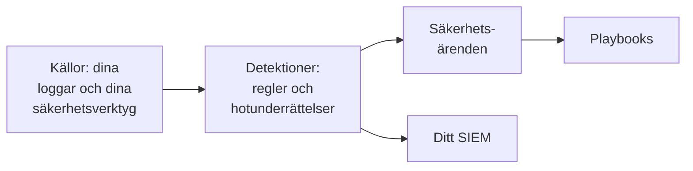

# Kom igång med säkerhet

OneUptime hittar hot i data du redan har - dina loggar, säkerhetsverktygen du använder och allt du skickar till det -, samlar fynden i ärenden och svarar med playbooks. Två klick räcker för att sätta upp det, och det finns inget att installera.

:::cards
- [Sätt upp det](#sätt-upp-det): Slå på det som de flesta team behöver och se en testattack öppna ett ärende.
- [Så fungerar det](#så-fungerar-det): Källor, detektioner, ärenden och playbooks, och vad var och en gör.
- [Dina loggar](#hitta-säkerhetshändelser-i-dina-loggar): Säkerhetshändelserna som redan finns i loggarna du skickar till OneUptime.
- [Ditt SIEM](#skicka-det-oneuptime-hittar-till-ditt-siem): Skicka det OneUptime hittar till Google SecOps.
:::

## Innan du börjar

För att sätta upp säkerhet krävs rollen Project Owner, Project Admin eller Security Admin. Rollerna Security Member och Security Viewer läser det som hittas; se [Roller](/docs/permissions/reference#roller).

## Sätt upp det

:::steps
### Slå på det som de flesta team behöver

Öppna **Produkter → Security Events**. Klicka på **Slå på rekommenderat** på **Översikt**. Det slår på tre saker samtidigt: **Hitta säkerhetshändelser i dina loggar**, de rekommenderade detektionsreglerna och **Berika nya ärenden**, en playbook som kontrollerar varje nytt ärende mot hotunderrättelser och lämnar en checklista för triage i det.

### Skicka en testattack

Klicka på **Skicka en testattack**. Ett dussin misslyckade inloggningar från en dokumentationsadress går igenom den riktiga bearbetningen: de lagras, brute force-regeln fångar dem och ett ärende öppnas. Ingen larmas, och inget SIEM tar emot dem.

### Öppna ärendet

Klicka på **Öppna ärendet**. Så ser ett riktigt fynd ut: händelserna bakom det, adressen det gäller och vad **Berika nya ärenden** hittade. Stäng det som ett test när du är klar.
:::

Därefter öppnar **Översikt** på det som behöver någon, under **Kräver uppmärksamhet**: dina öppna ärenden, de som ingen har tagit och playbook-stegen som väntar på ett godkännande. När det inte finns några står det **Allt är lugnt**.

## Så fungerar det

| Del | Var | Vad den gör |
| --- | --- | --- |
| **Källor** | **Anslutningar** | Dina loggar, säkerhetsprodukterna som OneUptime hämtar från och allt du skickar |
| **Detektioner** | **Detektioner** | Sigma-regler och flöden med hotunderrättelser som letar efter hot i varje händelse |
| **Säkerhetsärenden** | **Säkerhetsärenden** | Det som hittades, grupperat efter användaren, värden eller adressen det gäller |
| **Playbooks** | **Playbooks** | Steg som körs på nya ärenden: berikar dem, meddelar, öppnar en incident eller begränsar |

Högst upp på **Översikt**, under det som behöver någon, visar varje del sina siffror: källorna och deras händelser de senaste 24 timmarna, reglerna som är påslagna, de öppna ärendena och playbooks som svarar. En del som inte är konfigurerad säger det och öppnar sidan där du konfigurerar den.

## Hitta säkerhetshändelser i dina loggar

Kortet **Dina loggar**, högst upp på **Anslutningar**, behöver ingen installation. Med **Hitta säkerhetshändelser i dina loggar** påslaget läser OneUptime projektets nya loggar varje minut och gör raderna det känner igen till säkerhetshändelser:

| Loggar | Vad som blir en säkerhetshändelse |
| --- | --- |
| SSH-inloggningar | Misslyckade och lyckade SSH-inloggningar från en servers auth-logg, journal eller syslog |
| sudo | Kommandon som körs som en annan användare, fel sudo-lösenord och personer som inte får använda sudo |
| Windows-händelser | Inloggningar, nya processer, ändrade konton och grupper, installerade tjänster och rensade loggar från Windows, Sysmon och Microsoft Defender |
| AWS CloudTrail | Inloggningar i konsolen, ändringar i dina AWS-konton och anrop som AWS nekade |
| Google Cloud-granskningsloggar | Ändringar i dina Google Cloud-projekt, anrop som Google nekade och inloggningar i Google Workspace som delas med Google Cloud |
| Azure-aktivitetsloggar och Entra ID-loggar | Ändringar i dina Azure-prenumerationer, larm från Defender for Cloud, samt inloggningar och katalogändringar i Microsoft Entra ID |
| CEF | Hot, blockerade anslutningar och inloggningar från brandväggar, IDS, WAF:ar och andra säkerhetsprodukter som skickar Common Event Format |
| LEEF | Samma sak från produkter som skickar Log Event Extended Format, som många gör för IBM QRadar |
| Kubernetes granskningsloggar | Ändringar i klustret, skal som öppnas i poddar, lästa hemligheter och nekade förfrågningar |
| Webbattacker | Förfrågningar i en webbservers åtkomstlogg som försöker med SQL-injektion, path traversal eller Log4Shell |

Dina loggar förblir som de är. Bara raderna som spelar roll för säkerheten blir händelser: aldrig varje sida som en webbserver har levererat, eller varje läsning av ett API.

## Skicka det OneUptime hittar till ditt SIEM

Arbetar ditt team redan i ett SIEM skickar OneUptime sina fynd dit också. Klicka på **Lägg till mål** under **Anslutningar → Skicka till ditt SIEM**, fyll i region, instans och tjänstekontonyckel för din Google SecOps-instans och klicka på **Skicka en testhändelse** innan du sparar. Se [Skicka säkerhetshändelser till Google SecOps](/docs/integrations/google-secops#skicka-säkerhetshändelser-till-google-secops).

## Felsökning

:::details Turn on recommended är nedtonad
Din roll får inte lägga till detektionsregler, playbooks eller loggkällan. Fråga en Project Owner, en Project Admin eller en Security Admin, eller be dem ge dig rollen Security Admin.
:::

:::details Turn on recommended kunde inte slå på allt
Kortet nämner allt det inte kunde slå på och varför: din roll, din plan eller ett fel hos OneUptime. Allt annat är på. Åtgärda det kortet nämner och klicka sedan på **Försök igen**: bara det som fortfarande saknas slås på, och inget läggs till två gånger.
:::

:::details Testattacken öppnade inget ärende
Ärendet öppnas oftast innan knappen svarar; när regeln fortfarande hämtar in säger den det, och ärendet öppnas inom en minut. Titta under **Säkerhetsärenden** igen och kontrollera under **Detektioner** att brute force-regeln är påslagen.
:::

:::details Inga säkerhetshändelser kommer från mina loggar
Kontrollera att **Hitta säkerhetshändelser i dina loggar** är påslaget och att kortet **Dina loggar** visar när det senast kontrollerades. Bara typerna av rader i tabellen ovan blir händelser: en server som inte skickar SSH-, sudo-, Windows-, gransknings-, CEF-, LEEF- eller åtkomstloggar har inget att hitta. Klistra in en av dess rader i **Kontrollera en loggrad** på **Dina loggar** för att se om OneUptime läser den.
:::

:::details Översikt säger att den senaste säkerhetshändelsen kom för flera dagar sedan
Inget har nått Security sedan dess. Öppna **Anslutningar** och kontrollera att **Dina loggar** och varje anslutning fortfarande är påslagna, och när var och en senast kontrollerade.
:::

:::details Kortet som slår på Security är borta
Någon stängde det med **Stäng**. Så länge inget bevakas efter hot ännu erbjuder **Översikt** **Konfigurera Security**, som tar tillbaka det.
:::

## Nästa steg

:::cards
- [Säkerhetshändelser (SIEM)](/docs/telemetry/security-events): Skicka händelser, sök i dem och skriv detektionsregler.
- [Säkerhetsärenden och playbooks (SOAR)](/docs/telemetry/security-cases): Hantera ärendena och svara med playbooks.
- [Hotunderrättelser (STIX/TAXII)](/docs/telemetry/threat-intelligence): Jämför dina händelser med kända skadliga indikatorer.
- [Google SecOps](/docs/integrations/google-secops): Hämta in detektioner från Google SecOps och skicka det OneUptime hittar dit.
:::
