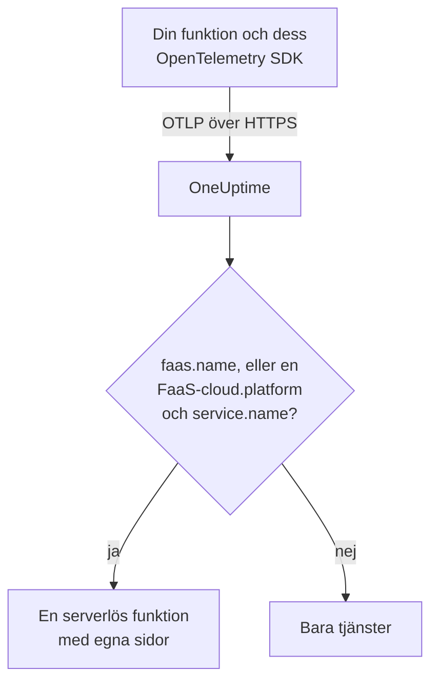

# Serverlösa funktioner

OneUptime känner igen en serverlös funktion i samma ögonblick som den tar emot OpenTelemetry-data från den, och listar den under **Serverlösa funktioner** med dess spårningar, loggar och mätvärden. Det fungerar för AWS Lambda, Google Cloud Functions, Azure Functions, Cloudflare Workers och alla andra FaaS-körmiljöer som kan skicka OpenTelemetry. Det finns inget att skapa för hand: instrumentera funktionen med OpenTelemetry SDK:t för dess körmiljö och rikta dess OTLP-exportör mot OneUptime.

:::cards
- [Så identifierar OneUptime en funktion](#så-identifierar-oneuptime-en-funktion): `faas.name`, eller en FaaS-`cloud.platform` med ett `service.name`.
- [Skicka en funktions telemetri](#skicka-en-funktions-telemetri): Exportörens inställningar och Lambda-lagret.
- [Azure Functions](#azure-functions): En funktion per Function App, från Functions-värden.
- [Felsökning](#felsökning): En funktion som inte dyker upp, eller vars sidor är tomma.
:::

## Så fungerar det

OneUptime läser resursattributen i varje batch när den kommer in. En resurs med ett `faas.name`, eller med en FaaS-`cloud.platform` som `aws_lambda` eller `azure_functions` tillsammans med ett `service.name`, är en serverlös funktion: OneUptime skapar den med dess första data och arkiverar telemetrin under den.



## Innan du börjar

- En intagningsnyckel. Skapa en under **Projektinställningar → Telemetri och APM → Intagningsnycklar** och kopiera värdet.
- OpenTelemetry SDK:t, eller ett autoinstrumenteringslager, för din funktions språk.

## Så identifierar OneUptime en funktion

OneUptime identifierar varje funktion utifrån resursattributet `faas.name`. Vissa plattformars resursdetektorer sätter det aldrig ([Azure Functions](#azure-functions) är det vanliga fallet), så när en resurs saknar `faas.name` men dess `cloud.platform` är en FaaS-plattform använder OneUptime i stället dess `service.name` som funktionens identitet, och fyller i `faas.name` med det värdet på varje span, logg, mätvärde och profil som lagras, så att funktionens sidor hittar all dess telemetri:

| Attribut | Krävs | Syfte |
| --- | --- | --- |
| `faas.name` | **ja**, om inte de två nästa är satta | Funktionens identitet (till exempel `checkout-handler`) |
| `cloud.platform` | med `service.name`, när det inte finns något `faas.name` | `aws_lambda`, `gcp_cloud_functions`, `azure_functions`, `tencent_cloud_scf` eller `alibaba_cloud_fc` |
| `service.name` | på en FaaS-`cloud.platform` utan `faas.name` | Funktionens identitet, skriven i telemetrin som `faas.name` |
| `faas.version` | nej | Visas på översikten |
| `faas.instance` | nej | Följs per instans på sidan **Instanser** |
| `cloud.provider` / `cloud.region` / `cloud.account.id` | nej | Visas på översikten |
| `process.runtime.name` / `process.runtime.version` | nej | Visas som körmiljö på översikten |

Ett `faas.name` som du själv sätter ersätts aldrig. Värdet på `cloud.platform` måste stavas som i listan (varianten med punkt, `azure.functions`, som vissa Azure-detektorer skickar, accepteras också), och `service.name` måste vara ett resursattribut: rubriken `x-oneuptime-service-name` namnger en tjänst, inte en funktion.

> [!NOTE]
> En funktion som också sätter `service.name` visas fortfarande även under **Tjänster**. **Serverlösa funktioner** är vyn som är byggd för funktioner, avgränsad av `faas.name`.

## Skicka en funktions telemetri

:::steps
### Ställ in OTLP-exportörens miljövariabler

De flesta autoinstrumenteringar för språk läser OpenTelemetrys standardmiljövariabler:

```bash
OTEL_EXPORTER_OTLP_ENDPOINT="https://oneuptime.com/otlp"
OTEL_EXPORTER_OTLP_HEADERS="x-oneuptime-token=YOUR_TELEMETRY_INGESTION_TOKEN"
OTEL_RESOURCE_ATTRIBUTES="faas.name=checkout-handler,faas.version=1.4.2"
```

Om du själv är värd för OneUptime ersätter du slutpunkten med `https://YOUR-ONEUPTIME-HOST/otlp`. På Azure Functions ska du lämna `faas.name` utanför `OTEL_RESOURCE_ATTRIBUTES` – se [Azure Functions](#azure-functions).

> [!WARNING]
> Intagningsnyckeln är en hemlighet. Använd en intagningsnyckel av typen **Server**, satt som en miljövariabel för funktionen. En nyckel som når en webbläsare kan läsas av alla som tittar på sidans källkod.

### Lägg till OpenTelemetry Lambda-lagret (AWS Lambda)

På AWS Lambda är den enklaste vägen [OpenTelemetry Lambda-lagret](https://opentelemetry.io/docs/faas/lambda-auto/). Koppla lagret för din funktions körmiljö och ställ in:

```bash
AWS_LAMBDA_EXEC_WRAPPER=/opt/otel-handler
OTEL_EXPORTER_OTLP_ENDPOINT=https://oneuptime.com/otlp
OTEL_EXPORTER_OTLP_HEADERS=x-oneuptime-token=YOUR_TELEMETRY_INGESTION_TOKEN
```

Lagret sätter `faas.name` utifrån funktionens namn, och dess resursdetektor fyller i `cloud.platform`, `cloud.region` och `cloud.account.id`. På en annan plattform hoppar du över det här steget.

### Anropa funktionen och kontrollera att den kommer fram

Kontrollera att OneUptime godtar nyckeln:

```bash
curl -i https://oneuptime.com/otlp/v1/validate \
  -H "x-oneuptime-token: YOUR_TELEMETRY_INGESTION_TOKEN"
```

`200` med `"valid": true` betyder att OneUptime godtar nyckeln; `401` betyder att den är okänd, återkallad, inaktiverad eller har gått ut. Anropa sedan funktionen. Så snart den skickar ett span, en logg eller ett mätvärde visas den under **Produkter → Infrastruktur → Serverlös → Alla funktioner**.
:::

## Azure Functions

Azure Functions-värden kan själv skicka OpenTelemetry, så en Function App rapporterar sina anrop (spårningar, loggar och mätvärden) utan kodändringar, oavsett vilket språk den är skriven i. Microsofts guide är [Use OpenTelemetry with Azure Functions](https://learn.microsoft.com/en-us/azure/azure-functions/opentelemetry-howto).

### Så visas en Function App

Azures resursdetektorer (Functions-värdens egen, den isolerade .NET-workerns i `Microsoft.Azure.Functions.Worker.OpenTelemetry` och Node.js-detektorn i `@opentelemetry/resource-detector-azure`) beskriver själva **Function App**, inte en enskild funktion, och ingen av dem sätter `faas.name`:

| Attribut | Värde |
| --- | --- |
| `service.name` | Namnet på Function App, från `WEBSITE_SITE_NAME` |
| `cloud.provider` | `azure` |
| `cloud.platform` | `azure_functions`; Node.js-detektorn skriver `azure.functions`, som OneUptime skriver om |
| `cloud.region` | Appens region, från `REGION_NAME` |
| `cloud.resource_id` | `/subscriptions/<subscription>/resourceGroups/<group>/providers/Microsoft.Web/sites/<app>` |
| `faas.instance` | Instansen, från `WEBSITE_INSTANCE_ID`: bara Node.js-detektorn |

Därför identifierar OneUptime funktionen utifrån `service.name`, fyller i `faas.name` med namnet på Function App och visar **en serverlös funktion per Function App**. Resursen beskriver appen, inte en av dess funktioner: varje instans rapporterar samma attribut på appnivå oavsett vilken av appens funktioner den kör, och på Flex Consumption-planen skalar vissa funktioner till och med ut på egna instanser. De enskilda funktionerna finns i själva telemetrin:

- Värden startar ett span för varje anrop, namngivet efter funktionen den körde: sök efter det namnet på funktionens sida **Spår**.
- Värden registrerar `faas.invoke_duration`, ett histogram i sekunder, med funktionens namn i datapunktsattributet `faas.name`: gruppera mätvärdet efter det på sidan **Mätvärden** eller i en instrumentpanel för varje funktions latens.

Lägg inte till `faas.name` i `OTEL_RESOURCE_ATTRIBUTES` på en Function App, som det allmänna exemplet i [första steget](#ställ-in-otlp-exportörens-miljövariabler) gör. Programinställningar når alla appens processer, så telemetrin från alla dess funktioner skulle bära det enda namnet, och OneUptime ersätter aldrig ett `faas.name` det får. Microsofts guide säger samma sak: lägg inte funktionsspecifika värden på resursen. Lämna det osatt, så får funktionen namn efter appen.

Värden och den isolerade .NET-workern använder `OTEL_SERVICE_NAME` i stället för appens namn när den är satt. Håll alla processer i en app på samma `service.name`: värden och språk-workern skickar båda telemetri, och en worker som rapporterar ett andra namn skapar en andra serverlös funktion. En worker vars resurs saknar en FaaS-`cloud.platform` hör inte till någon serverlös funktion alls – se [Instrumentera din funktionskod](#instrumentera-din-funktionskod-valfritt).

:::steps
### Slå på OpenTelemetry i Functions-värden

Lägg till `"telemetryMode": "OpenTelemetry"` i roten av appens `host.json`:

```json title="host.json"
{
  "version": "2.0",
  "telemetryMode": "OpenTelemetry"
}
```

Värden skickar sedan, oavsett appens språk, sina egna spårningar (ett span per anrop, plus processor-spans från Service Bus och Event Hubs bakom utlösta funktioner), sina loggar och mätvärden, bland annat `faas.invoke_duration`.

### Rikta värden mot OneUptime

Ställ in exportören som programinställningar:

```bash
az functionapp config appsettings set \
  --name my-function-app \
  --resource-group my-rg \
  --settings \
    OTEL_EXPORTER_OTLP_ENDPOINT=https://oneuptime.com/otlp \
    OTEL_EXPORTER_OTLP_PROTOCOL=http/protobuf \
    "OTEL_EXPORTER_OTLP_HEADERS=x-oneuptime-token=YOUR_TELEMETRY_INGESTION_TOKEN"
```

Om du själv är värd för OneUptime ersätter du slutpunkten med `https://YOUR-ONEUPTIME-HOST/otlp`. `OTEL_EXPORTER_OTLP_PROTOCOL=http/protobuf` spelar roll: värdens .NET-exportör använder gRPC som standard, och med `http/protobuf` skickar den till `/otlp/v1/traces`, `/otlp/v1/metrics` och `/otlp/v1/logs` under slutpunkten. Värden skickar OTLP bara så länge `OTEL_EXPORTER_OTLP_ENDPOINT` är satt.

> [!WARNING]
> Den här token är en hemlighet: använd en intagningsnyckel av typen **Server**. Programinställningar krypteras i vila; vill du hellre förvara token i Key Vault ställer du in `OTEL_EXPORTER_OTLP_HEADERS` på en Key Vault-referens som `@Microsoft.KeyVault(SecretUri=https://my-vault.vault.azure.net/secrets/oneuptime-otlp-headers/)` och ger appens hanterade identitet rollen **Key Vault Secrets User** på valvet. Referensen löses upp till hemlighetens värde så som det är lagrat, så lagra hela rubriken, `x-oneuptime-token=YOUR_TELEMETRY_INGESTION_TOKEN`, inte bara token.

Behåll `APPLICATIONINSIGHTS_CONNECTION_STRING` om du fortfarande vill ha Application Insights: med båda satta skickar värden samma OpenTelemetry-data till Application Insights och till OneUptime. Ta bort den för att bara skicka till OneUptime.

### Instrumentera din funktionskod (valfritt)

Värden spårar redan varje anrop. Om du vill lägga till spans och loggar från din egen kod, kopplade till värdens, slår du också på OpenTelemetry i språk-workern. Den skickar med samma `OTEL_EXPORTER_OTLP_*`-inställningar:

- **C# (isolated worker)**: lägg till NuGet-paketen `Microsoft.Azure.Functions.Worker.OpenTelemetry`, `OpenTelemetry.Extensions.Hosting` och `OpenTelemetry.Exporter.OpenTelemetryProtocol`, och sedan i `Program.cs`: `builder.Services.AddOpenTelemetry().UseFunctionsWorkerDefaults().UseOtlpExporter();`
- **JavaScript / TypeScript**: `npm install @azure/functions-opentelemetry-instrumentation` tillsammans med OpenTelemetry Node.js SDK:t och dess OTLP-exportörer, och registrera `AzureFunctionsInstrumentation` i en fil som fältet `main` i `package.json` tar med.
- **Java**: lägg till Maven-beroendet `com.microsoft.azure.functions:azure-functions-java-opentelemetry`.
- **Python**: ställ in programinställningen `PYTHON_ENABLE_OPENTELEMETRY=true`, lägg till de OpenTelemetry-paket som Microsoft listar (bland dem `opentelemetry-sdk` och `opentelemetry-exporter-otlp`) i `requirements.txt` och konfigurera exportörerna i `function_app.py`.
- **PowerShell**: ställ in programinställningen `OTEL_FUNCTIONS_WORKER_ENABLED=True` och läs in modulen `AzureFunctions.PowerShell.OpenTelemetry.SDK` från `profile.ps1`.

Microsofts guide har den fullständiga koden för varje språk. .NET-workern (via `UseFunctionsWorkerDefaults()`) och Python-workern (via `PYTHON_ENABLE_OPENTELEMETRY`) ber värden att lämna deras loggar åt dem, så att de loggarna inte skickas två gånger.

En workers spans och loggar når bara funktionens sidor när dess resurs beskriver appen på samma sätt som värdens: samma `service.name` och en FaaS-`cloud.platform`. Den isolerade .NET-workern (via `UseFunctionsWorkerDefaults()`) och Microsofts Node.js-exempel (via de Azure-detektorer som `getResourceDetectors()` innehåller) rapporterar båda. Microsofts Python-exempel bygger sin resurs utan en Azure-detektor, så som standard rapporterar det ingetdera och dess telemetri når aldrig funktionen. För Python, eller vilken worker som helst som är konfigurerad utan en resursdetektor för Azure Functions, lägger du till två programinställningar till. Alla appens processer läser dem, värden inräknad, så att alla rapporterar samma identitet:

```bash
az functionapp config appsettings set \
  --name my-function-app \
  --resource-group my-rg \
  --settings \
    OTEL_SERVICE_NAME=my-function-app \
    "OTEL_RESOURCE_ATTRIBUTES=cloud.provider=azure,cloud.platform=azure_functions"
```

Ställ in `OTEL_SERVICE_NAME` på det egna namnet på din Function App. Det är namnet som värden och Node.js-detektorn rapporterar utan den, så funktionen behåller den identitet den redan har.
:::

### Begränsningar

- **C#-appar i processen** kan inte använda OpenTelemetry: flytta dem först till modellen med isolerad worker.
- **Loggströmning** i Azure-portalen fungerar inte medan värden är i OpenTelemetry-läge, och portalens lista _Recent function invocations_ behöver telemetrin i Application Insights. Använd i stället funktionens sidor **Loggar** och **Spår** i OneUptime.
- Avsnittet `logging.applicationInsights` i `host.json` gäller inte längre när `telemetryMode` är `OpenTelemetry`.
- **Instanser** listar `faas.instance`-värden. Av detektorerna ovan är det bara Node.js-detektorn som sätter det, så sidan förblir tom för telemetri från värden och .NET-workern.

## Vad du får

Så snart funktionen skickar ett span, en logg eller ett mätvärde visas den under **Serverlösa funktioner**. Dess **Översikt** visar:

- **Anrop**, **felfrekvens** och **p95-varaktighet**, beräknade från dina spårningar över ett tidsintervall du väljer, med trenddiagram.
- **Instanser**: en direktlista över de `faas.instance`-värden som funktionen rapporterar.
- Fullständiga sidor **Loggar**, **Spår** och **Mätvärden**, avgränsade till den här funktionen.

## Etikettera funktioner och tilldela ägare

Ett resursattribut som börjar med `oneuptime.label.` blir en projektetikett på funktionen: `oneuptime.label.team=payments` lägger till etiketten `team:payments`. Lägg till attributen i `OTEL_RESOURCE_ATTRIBUTES`:

```bash
OTEL_RESOURCE_ATTRIBUTES="faas.name=checkout-handler,oneuptime.label.team=payments,oneuptime.label.env=production"
```

Vill du i stället etikettera funktioner eller tilldela ägare utifrån deras namn öppnar du **Produkter → Infrastruktur → Serverlös** och använder **Etikettregler** och **Ägarregler** i sidomenyn. Regler körs när en funktion skapas, även automatiskt upptäckta. För att tillämpa en regel på de funktioner du redan har använder du dess **Run Now** (se [Köra regler på befintliga resurser](/docs/configuration/run-rules-now)).

## Felsökning

:::details Funktionen visas inte under Serverlösa funktioner
Kontrollera i den här ordningen:

1. Funktionen har anropats sedan du ställde in variablerna: den skickar telemetri bara medan den körs.
2. På AWS Lambda är lagret kopplat för funktionens körmiljö, och `AWS_LAMBDA_EXEC_WRAPPER` är `/opt/otel-handler`: utan wrappern startar lagrets instrumentering aldrig.
3. På andra ställen läser funktionens kod in OpenTelemetry SDK:t eller autoinstrumenteringen: variablerna ensamma skickar ingenting.
4. Resursen har `faas.name`, eller en FaaS-`cloud.platform` och ett `service.name`. Utan dem arkiveras telemetrin i stället under **Tjänster**, som en tjänst.
5. Funktionen når din OneUptime-URL. En funktion i ett privat nätverk behöver en väg ut dit, till exempel en NAT-gateway.
:::

:::details Funktionen finns i listan, men dess sidor är tomma
Funktionens **Översikt**, **Loggar**, **Spår** och **Mätvärden** visar telemetri vars `faas.name` exakt motsvarar funktionens namn, inklusive versaler och gemener. En funktion som namnges via en FaaS-`cloud.platform` och dess `service.name` behöver inget eget `faas.name`: OneUptime skriver `service.name` i telemetrin som `faas.name` när den kommer in. Telemetri som lagrades innan OneUptime började fylla i `faas.name` uppdateras inte och hålls utanför sidorna: anropa funktionen för att skicka ny telemetri. Kontrollera också tidsintervallet högst upp på sidan.
:::

:::details Funktionen visas som frånkopplad
En funktion blir frånkopplad när OneUptime inte har tagit emot något från den på 15 minuter; OneUptime kontrollerar var 5:e minut, och tid då OneUptime själv inte tog emot data räknas inte. En funktion som bara körs då och då är frånkopplad mellan körningarna: den blir ansluten igen med sin nästa telemetri.
:::

## Nästa steg

:::cards
- [OpenTelemetry](/docs/telemetry/open-telemetry): Skicka spårningar, loggar och mätvärden från vilket program som helst.
- [Köer](/docs/telemetry/queues): Köerna och ämnena som dina funktioner publicerar till och konsumerar från.
- [Spårningsövervakning](/docs/monitor/traces-monitor): Larma om en funktions misslyckade eller långsamma anrop.
:::
