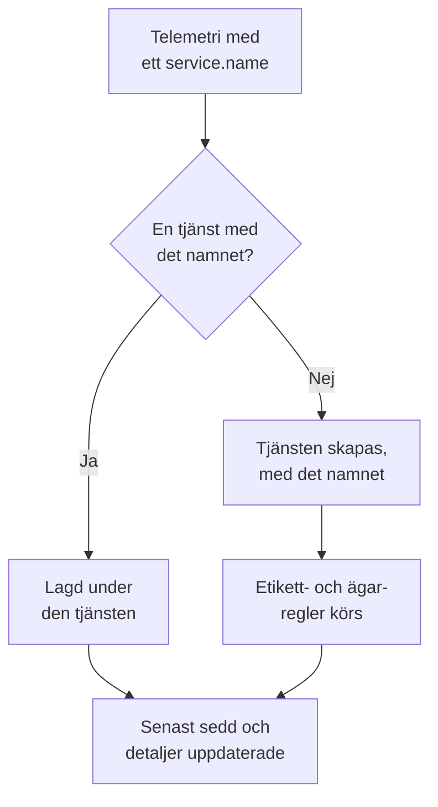

# Tjänstekatalog

Tjänstekatalogen visar de applikationer och mikrotjänster du kör. OneUptime lägger till en tjänst första gången dess telemetri kommer in och samlar sedan dess loggar, spår, mätvärden, undantag, incidenter och ägare på en sida, så att alla kan se vad en tjänst gör, vem som äger den och hur den mår.

:::cards
- [Så hamnar en tjänst i katalogen](#så-hamnar-en-tjänst-i-katalogen): Dess `service.name`, vid dess första telemetri.
- [Hitta en tjänst](#hitta-en-tjänst): Listan, dess filter och dess kolumner.
- [En tjänsts sidor](#en-tjänsts-sidor): Allt om en tjänst.
- [Arkivera eller ta bort en tjänst](#arkivera-eller-ta-bort-en-tjänst): Behåll historiken, eller ta bort den.
:::

## Så hamnar en tjänst i katalogen

Du behöver inte skapa tjänster. Varje batch telemetri namnger tjänsten som skickade den i resursattributet `service.name`. OneUptime lägger batchen under tjänsten med det namnet och skapar tjänsten när projektet inte har någon än.

- **Namnet är tjänstens identitet.** Stora och små bokstäver spelar ingen roll i jämförelsen, så `Checkout-API` och `checkout-api` är en tjänst. Ett nytt `service.name` startar en ny tjänst.
- **Containrar namnger sig själva.** Telemetri från Docker- och Podman-agenterna namnger en tjänst efter dess container när den saknar `service.name`.
- **En intagningsnyckel kan bestämma tjänsten.** OpenTelemetry-data som skickas med en nyckel som har ett **Pinned Service Name** hamnar under det namnet, oavsett vad dess `service.name` säger. Se [Intagningsnycklar](/docs/telemetry/ingestion-keys#lås-ned-en-webbläsarnyckel).
- **Webbläsare och telefoner är inga tjänster.** Telemetri från en webbläsare eller en mobilapp hör i stället till en [RUM-applikation](/docs/rum/applications).
- **Etiketter kan följa med telemetrin.** Ett resursattribut med namnet `oneuptime.label.<name>` ger tjänsten etiketten `<name>:<value>`, till exempel `oneuptime.label.team=payments` för `team:payments`.

Varje gång telemetri kommer in flyttas tjänstens **Senast sedd** fram, och dess detaljer uppdateras från de resursattribut som följer med:

| Detalj | Från attributet |
| --- | --- |
| Tjänsteversion | `service.version` |
| Distributionsmiljö | `deployment.environment.name` eller `deployment.environment` |
| Tjänstens namnrymd | `service.namespace` |
| Körmiljö | `process.runtime.name` och `process.runtime.version` |
| Teknik | `telemetry.sdk.language` eller körmiljön |
| Moln | `cloud.provider`, `cloud.platform`, `cloud.region` och `cloud.account.id` |

## Innan du börjar

- **Telemetri som kommer in** med ett `service.name`. Se [OpenTelemetry](/docs/telemetry/open-telemetry): `OTEL_SERVICE_NAME` sätter det.
- **En roll som får läsa tjänster.** Project Owner, Project Admin, Project Member, Viewer, Settings Admin, Settings Member eller Settings Viewer, eller en anpassad roll med behörigheten Read Service. Att skapa, ändra och ta bort tjänster kräver Project Owner, Project Admin, Project Member, Settings Admin eller Settings Member, eller motsvarande tjänstebehörigheter.

## Hitta en tjänst

Gå till **Produkter → Resurser → Tjänster**. **Alla tjänster** visar varje tjänst med **Namn**, **Beskrivning**, **Technology**, **Senast sedd**, **Etiketter** och **Ägare**.

- Sök på namn eller beskrivning, och filtrera på ägare eller etikett med fältet ovanför listan.
- Markera flera tjänster för att ge alla etiketter eller ägare på en gång, eller för att arkivera dem.
- Klicka på en tjänst för att öppna dess sidor.

För att lägga till en tjänst innan dess telemetri kommer in, till exempel för att ange dess ägare först, klickar du på **Skapa Tjänst** och anger dess **Namn** exakt som dess `service.name` kommer att vara. Etikett- och ägarregler körs på den som på en upptäckt tjänst. När den har sparats öppnas installationsguiden för OpenTelemetry med det namnet i varje kodsnutt, och dess sista steg, **Vänta på anslutningen**, visar när tjänstens första data kommer in.

## En tjänsts sidor

En tjänsts sidomeny har fem avsnitt:

| Avsnitt | Sidor |
| --- | --- |
| **Grundläggande** | **Översikt**: förfrågningar, felfrekvens och p95-latens från dess spans, diagram och dess detaljer. **Recommendations**: färdiga monitorer för tjänsten, valda efter dess språk. **Ägare**: de personer och team som ansvarar för den. **Feed**: allt som har hänt den, från hur den skapades till varje ändring sedan dess. |
| **Telemetri** | Dess **Loggar**, **Spår**, **Mätvärden**, **Prestandaprofiler**, **Undantag** och **Source Maps**, redan filtrerade på den här tjänsten. |
| **Aktivitet** | De **Incidenter**, **Varningar** och händelser under **Schemalagt underhåll** som berör den. |
| **Utvecklare** | **Terraform**, **API** och **AI-assistenter**: tjänsten styrd från kod. Avsnittet är hopfällt från början. |
| **Avancerad** | **Inställningar**, **Granskningsloggar** och **Ta bort tjänst**. **Avancerad** är hopfälld från början: fäll ut den först. |

Ägare spelar roll även utanför sidan: en roll med omfånget Owned läser telemetrin för de tjänster som du eller dina team äger. Se [Telemetri](/docs/permissions/index#telemetri).

## Ändra en tjänst

:::steps
### Öppna dess inställningar

Öppna tjänsten, fäll ut **Avancerad** i dess sidomeny och klicka på **Inställningar**.

### Byt namn eller beskriv den

Under **Tjänsteinformation** klickar du på **Redigera detaljer** för att ändra dess **Namn**, **Beskrivning** eller **Etiketter**. Namnet måste fortfarande stämma med det `service.name` som dess telemetri rapporterar: ändra det även i din OpenTelemetry-konfiguration, annars skapar nästa telemetri en ny tjänst.

### Välj dess färg och teknikstack

Under **Tjänsteinställningar** klickar du på **Redigera inställningar**. **Tjänstefärg** markerar tjänsten i diagram och listor; en ny tjänst får en egen. **Teknikstack** är valfri: lämna den tom för att visa språket som upptäckts i dess telemetri.
:::

Samma sida innehåller tjänstens lagring. Korten **Datalagring för telemetri** och **Lagring efter telemetrityp** sparar dess telemetri längre eller kortare tid än projektets standardlagring. De ingår i [Enterprise Edition](/docs/self-hosted/enterprise) och i Scale-planen på OneUptime Cloud; utan dem visar sidan vad de tillför, och tjänsten behåller projektets lagring.

## Ge etiketter och ägare automatiskt

Regler ger nya tjänster deras etiketter och ägare när de skapas, upptäckta tjänster inräknade. Du hittar dem under **Tjänster → Inställningar → Ägarregler** och **Tjänster → Inställningar → Etikettregler**; **Inställningar** är hopfälld från början i sidomenyn. Se [Etikett- och ägarregler](/docs/configuration/label-and-owner-rules).

## Arkivera eller ta bort en tjänst

Arkivera en tjänst som du inte längre följer men vars historik du vill behålla. En arkiverad tjänst döljs i **Alla tjänster**, men den fortsätter att samla in telemetri. Arkivera den från dess sida **Inställningar**, eller markera flera i listan. För att ta tillbaka en öppnar du **Tjänster → Avancerad → Arkiverad**.

> [!WARNING]
> När du tar bort en tjänst tas även dess source maps bort, liksom de pipelineregler för mätvärden och LLM-kostnadsbudgetar som är inställda för den. Om OneUptime fortfarande tar emot dess telemetri skapas tjänsten på nytt, utan de etiketter, ägare och inställningar som du gav den. Arkivera den i stället för att ta bort den från listan och behålla allt.

## Felsökning

:::details En tjänst visas två gånger
Två värden på `service.name` nådde OneUptime, till exempel från två versioner av din konfiguration eller efter ett namnbyte på bara ena sidan. Telemetri matchas på namn: se till att varje instans rapporterar samma `service.name`, och arkivera eller ta sedan bort den tjänst du inte längre behöver.
:::

:::details Min tjänst finns inte i katalogen
Kontrollera att dess telemetri har ett `service.name`. Telemetri från en webbläsare eller en mobilapp går i stället till Real User Monitoring, och en värd eller ett kluster utan tjänstenamn läggs under den värden eller det klustret.
:::

:::details Senast sedd ligger efter
**Senast sedd** uppdateras ungefär en gång i minuten, inte vid varje batch, så den kan ligga ungefär en minut efter den levande telemetrin.
:::

## Nästa steg

:::cards
- [Loggutforskare](/docs/telemetry/logs-explorer): Sök i en tjänsts loggar.
- [Spårutforskare](/docs/telemetry/traces-explorer): Följ dess förfrågningar.
- [Undantagsspårning](/docs/telemetry/exceptions): Gå igenom felen den kastar.
- [Etikett- och ägarregler](/docs/configuration/label-and-owner-rules): Ge nya tjänster etiketter och ägare.
:::
