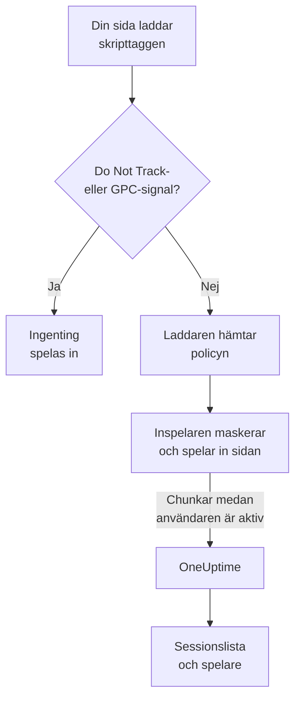
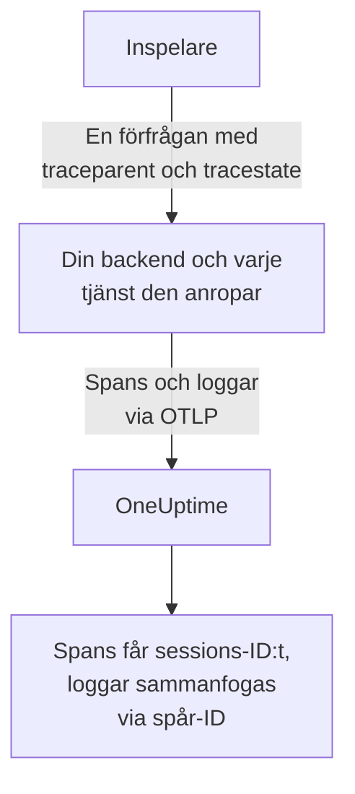
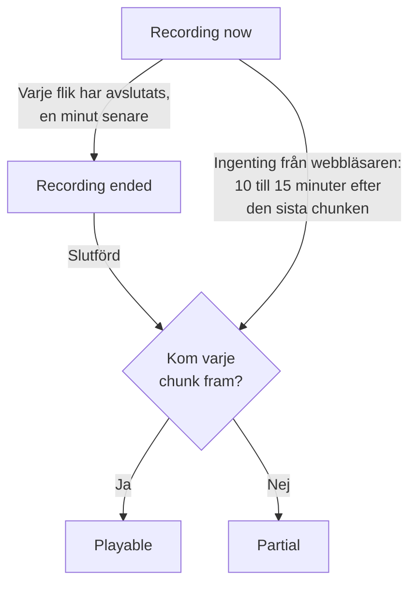
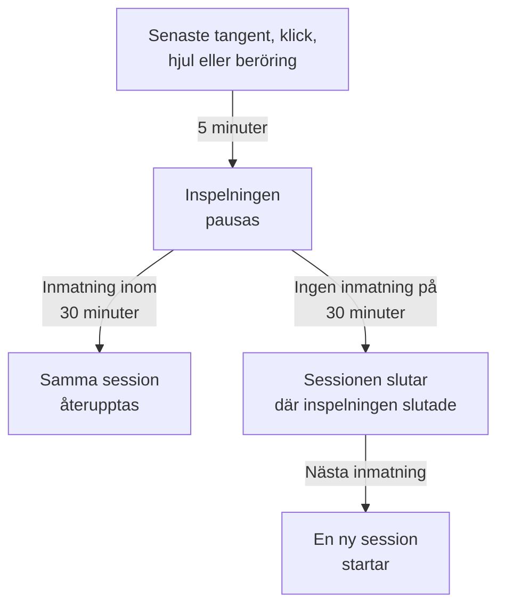

# Sessionsuppspelning

Sessionsuppspelning spelar in vad riktiga användare såg i din webb- eller React Native-app och spelar upp det bredvid felen, spåren och loggarna från samma session. Du lägger till en skripttagg, väljer vad som maskeras och tittar på vilken session som helst från dess RUM-applikation.

:::cards
- [Så fungerar det](#så-fungerar-det): En laddare, en policy och en inspelare som laddar upp efter hand.
- [Installation](#installation): En skripttagg på varje sida, eller React Native-SDK:t.
- [Integritet](#integritet): Vad som maskeras, samtycke och vem som kan skicka inspelningar.
- [Korrelera med resten av din telemetri](#korrelera-med-resten-av-din-telemetri): Spår, loggar och fel från backend, kopplade utan kod.
- [Titta på en session](#titta-på-en-session): Sessionslistan, sidan Användare, användarflöden och spelaren.
- [Inspelningsstatus](#inspelningsstatus): Varför ingenting kommer in, och aviseringar innan en budget är förbrukad.
:::

## Så fungerar det

Skriptet på din sida är en liten laddare. Den kontrollerar webbläsarens integritetssignaler, hämtar applikationens policy från OneUptime och laddar först därefter inspelaren, som maskerar sidan medan den spelar in den och laddar upp den i chunkar medan användaren är aktiv.



Som standard spelas varje session in och laddas upp medan den pågår, inte bara de som gick fel. Det är i sessionerna där ingenting gick fel som du hittar kassan som ingen slutförde, formuläret som alla gav upp och sidan som enligt en kund «såg konstig ut».

För att lagra mindre samverkar två inställningar i applikationens policy:

| Inställning | Standard | Vad den ändrar |
| --- | --- | --- |
| **Samplingsprocent** | 100 | Hur många sessioner som är behöriga. Halvera den så halverar du både de lagrade byten och de lagrade slutanvändardata. Beslutet fattas en gång per session utifrån en hash av sessions-ID:t, så en session spelas aldrig in till hälften. |
| **När en inspelning ska laddas upp** | _Always_ | Med _On error or frustration_ håller inspelaren en ringbuffert i minnet och laddar bara upp när något går fel. Det finns då en inspelning av nästan varje misslyckad session, till en kostnad som är ungefär 15 gånger lägre än att spela in alla, men du kan inte titta på en session som inte gick fel. |

## Innan du börjar

- En RUM-applikation. Skapa en under **Produkter → Resurser → Övervakning av verkliga användare**, eller låt din telemetri skapa den: se [Hantera applikationer](/docs/rum/applications).
- En **Webbläsare**-intagningsnyckel, från **Projektinställningar → Telemetri och APM → Intagningsnycklar**. En Browser-nyckel fungerar bara från de ursprung som du anger på den: se [Ange dina tillåtna ursprung i produktion](#ange-dina-tillåtna-ursprung-i-produktion).

Sessionsuppspelning är påslagen som standard. Dess inställningar finns på tre ställen:

| Var | Vad som finns där |
| --- | --- |
| Applikationens sida **Replay Policy** | Policyn (inspelning, maskering, samtycke, spårning och gränser), en sammanfattning av **Inspelningens hälsa**, kortet **Vad en inspelning innehåller**, panelen **Test your installation** och **Record a specific user's next session**. |
| Applikationens sida **Hälsa** | Om inspelningar kommer in, och varför inte när de inte gör det. Se [Inspelningsstatus](#inspelningsstatus). |
| **Övervakning av verkliga användare → Inställningar → Sessionsuppspelning** | Brytaren för hela projektet som stoppar alla applikationer på en gång, och en skrivskyddad lista över varje applikations policy. |

## Installation

Lägg till en skripttagg på varje sida som du vill spela in.

:::steps
### Skapa en Browser-nyckel

Under **Projektinställningar → Telemetri och APM → Intagningsnycklar** klickar du på **Skapa ingestion-nyckel**, väljer **Webbläsare** som **Nyckeltyp** och anger din webbplats ursprung under **Tillåtna ursprung**. Kopiera sedan nyckelns **Hemlig nyckel**. [Webbläsarkonfiguration](/docs/rum/browser-setup#konfigurera) visar varje skärm.

### Lägg till skripttaggen

Placera taggen på varje sida, med din nyckel och din applikations identifierare:

```html
<script
  src="https://oneuptime.com/telemetry/session-replay/v1/recorder.js"
  data-oneuptime-token="YOUR_TELEMETRY_INGESTION_KEY"
  data-oneuptime-app-identifier="storefront-web"
  crossorigin="anonymous"
  async
></script>
```

`data-oneuptime-app-identifier` måste matcha RUM-applikationens identifierare, samma värde som du använder för `service.name`. Applikationens sida **Dokumentation**, i avsnittet **Sessionsuppspelning** i dess sidomeny, visar den här kodsnutten med båda värdena redan ifyllda, tillsammans med dess varianter för Next.js / React och Google Tag Manager.

### Kontrollera att inspelningar kommer in

Öppna en av dina sidor och klicka runt i några sekunder. Inom ungefär en minut visas sessionen på applikationens sida **Sessionsuppspelning**, markerad som **Spelar in nu**. Gör den inte det säger applikationens sida **Hälsa** varför: se [Inspelningsstatus](#inspelningsstatus).
:::

Skriptet på `/v1/recorder.js` är en liten laddare. Den kontrollerar Do Not Track, hämtar din applikations policy och laddar först därefter `/latest/recorder.js`. Policyn och inspelaren levereras med `no-store`, så en ändring i någon av dem når nästa sidladdning utan att vänta på att en webbläsarcache ska gå ut.

### Skripttaggens attribut

| Attribut | Obligatoriskt | Vad det gör |
| --- | --- | --- |
| `data-oneuptime-token` | Ja | Din intagningstoken för telemetri. |
| `data-oneuptime-app-identifier` | Ja | RUM-applikationens identifierare. |
| `data-oneuptime-host` | Nej | OneUptime-ursprunget. Utelämnat härleds det från skriptets egen `src`, så du behöver det bara när du levererar skriptet via din egen domän. |
| `data-oneuptime-user-ref` | Nej | Slutanvändarens referens som är känd vid sidladdningen (ett användar-ID, aldrig en e-postadress som du inte vill lagra). Detsamma som `identify()` sätter senare; det är den enda formen som fungerar för [Spela in en viss användares nästa session](#spela-in-en-viss-användares-nästa-session). |
| `data-oneuptime-respect-do-not-track` | Nej | Respekterar som standard Do Not Track och Global Privacy Control. Sätt det till `"false"` för att spela in oavsett signalen; se [Do Not Track](#do-not-track). |
| `data-oneuptime-debug` | Nej | `"true"` skriver ut inspelarens beslut i konsolen. Se [Felsökning av sessionsuppspelning](/docs/rum/session-replay-troubleshooting). |
| `data-oneuptime-offline-storage` | Nej | Sätt det till `"false"` för att bara hålla chunkar som spelas in medan besökaren är offline i minnet, i stället för att även spara dem i webbläsarens IndexedDB. Se [Offlineläge](#offlineläge). |

Samma alternativ kan ges i en global i stället för på taggen, vilket är vad tagghanterare och paketerade installationer använder:

```js
window.__ONEUPTIME_SESSION_REPLAY__ = {
  host: "https://oneuptime.com",
  token: "YOUR_TELEMETRY_INGESTION_KEY",
  appIdentifier: "storefront-web",
  userRef: "user-123", // optional
  respectDoNotTrack: true, // optional
  debug: false, // optional
  offlineStorage: true, // optional; false keeps offline chunks in memory only
};
```

### Så ser en frisk installation ut

Öppna DevTools → Network och filtrera på `session-replay`. En fungerande sida ger:

1. **En `GET .../session-replay/v1/config`** per sidladdning — hämtningen av policyn.
2. **En `POST .../session-replay/v1/chunk` ungefär var 15:e sekund medan användaren gör något**, eller tidigare när 256 KB händelser har samlats. En inaktiv flik ger inga händelser och därmed inga POST:ar: rör musen eller klicka innan du bedömer en installation utifrån fliken Network.
3. När fliken döljs, och igen när sidan försvinner, en `POST` som skickas med `keepalive`. Att lämna sidan — fliken stängd, omladdad eller skickad till en annan sida, eller sidan lagd i webbläsarens back/forward-cache (varje `pagehide`) — markerar den som den sista, vilket säger till OneUptime att flikens inspelning är klar; en sida som användaren hämtar tillbaka från back/forward-cachen fortsätter att spela in som en ny flik i samma session. En flik som bara döljs förblir öppen, så inspelningen fortsätter när användaren kommer tillbaka till den. Hela dess body håller sig under 56 KB — inspelarens andel av webbläsarens keepalive-kvot på 64 KB per ursprung — och kan bära flera chunkar som ramar i den enda förfrågan: den avslutande chunken, de bitar som en stor avslutande chunk delades upp i (högst 48 KB händelser var, så att ramens huvud fortfarande får plats) och varje chunk som fortfarande väntade på ett nytt försök. En chunk som redan är större än den budgeten när fliken bara döljs går i stället den vanliga vägen, medan sidan fortfarande lever och kan skicka den.

Med utlösaren _On error or frustration_ sker steg 2 inte förrän en utlösare slår till — se [Felsökning](#felsökning).

## Installation i React Native

React Native-SDK:t spelar in hierarkin av inbyggda vyer som syntetiska händelser som är kompatibla med rrweb, så mobilinspelningar öppnas i samma sessionslista och samma spelare som webbinspelningar. Det tar inga skärmbilder. Spelaren markerar varje inspelning som en React Native-app, och dess flik **Fidelity** förklarar de inbyggda ytor som inte kunde återges.

:::steps
### Installera SDK:t

SDK:t stöder React Native-appar för iOS och Android. Installera det med dess peer-beroende för den beständiga utkorgen:

```bash
npm install @oneuptime/react-native-replay @react-native-async-storage/async-storage
```

I ett iOS-projekt utan Expo kör du din vanliga CocoaPods-installation efter att ha lagt till paketen; aktuella versioner av React Native länkar Android automatiskt utan manuell registrering. Inspelaren har en egen inbyggd modul för vyträdet utöver Async Storage, så Expo-projekt måste använda ett anpassat utvecklings- eller produktionsbygge (till exempel EAS Build eller ett prebuild). Expo Go kan inte köra det här SDK:t, eftersom ingen av de två inbyggda modulerna kan läggas till i Expo Gos fasta binärfil.

### Starta inspelaren och omslut din app

Starta singletonen en gång och placera providern ovanför den del av appen som du vill spela in:

```tsx
import {
  OneUptimeReplay,
  OneUptimeReplayProvider,
} from "@oneuptime/react-native-replay";

OneUptimeReplay.start({
  host: "https://oneuptime.com",
  token: "YOUR_TELEMETRY_INGESTION_KEY",
  appIdentifier: "storefront-mobile",
  mobileAppIdentifier: "com.example.storefront",
  appName: "Storefront", // optional, shown in session details
  appVersion: "4.2.0", // optional, shown in session details
});

export default function App() {
  return (
    <OneUptimeReplayProvider>
      <Navigation />
    </OneUptimeReplayProvider>
  );
}
```

`appIdentifier` är RUM-applikationens identifierare. `mobileAppIdentifier` är Android-applikations-ID:t eller iOS-bundle-identifieraren som levereras i binärfilen, inte ett visningsnamn. Använd samma värde i [listorna över tillåtna ursprung med `app://`](#ange-dina-tillåtna-ursprung-i-produktion). SDK:t hämtar applikationens uppspelningspolicy från `host`; sampling, utlösare, samtycke, lagring och uppladdningsbudgetar förblir styrda av servern.
:::

Providern har en inbyggd rot som inte kan fällas ihop och spelar in sitt vyträd och start-, rörelse- och sluthändelser för beröringar. Om du redan bygger inspelarinstanser själv skickar du en med `<OneUptimeReplayProvider recorder={recorder}>`. `MobileReplayRecorder` exporteras också för isolerade integrationer eller integrationer med flera klienter; de flesta appar bör använda singletonen.

### React Native-API

Importera `OneUptimeReplay` direkt, eller anropa `useOneUptimeReplay()` under providern. Singletonen exponerar:

| Metod | Vad den gör |
| --- | --- |
| `start(options)` | Hämtar policyn och startar inspelningen. Obligatoriska alternativ är `host`, `token`, `appIdentifier` och `mobileAppIdentifier`; `appName` och `appVersion` är valfria visningsmetadata, och `connectivity` är en valfri källa till nätverksstatus för [offlineläge](#offlineläge). |
| `stop()` | Tömmer det som kan skickas, stoppar inspelningen och kopplar bort livscykelhanterarna. |
| `identify(userRef, traits?)` | Kopplar den inloggade användaren och valfria egenskaper, beroende på **Registrera slutanvändarens identitet**. |
| `setTags(tags)` / `addTag(key, value)` | Ersätter alla sessionens sökbara taggar, eller lägger till en tagg utan att ersätta de andra. |
| `track(name, properties?)` | Placerar en apphändelse på uppspelningens tidslinje. |
| `setRoute(route)` | Spelar in en rensad logisk skärm eller rutt efter en navigering. Anropa den från din navigerares återanrop vid ruttbyte. |
| `captureSession(reason?)` | Laddar med _On error or frustration_ upp ringbufferten av ett skäl som appen bestämmer, som en användare som trycker på «Rapportera ett problem». |
| `captureError(error)` | Spelar in ett hanterat JavaScript-fel och utlöser felstyrd inspelning. |
| `grantConsent()` / `revokeConsent()` | Tillåter uppladdningar, eller rensar omedelbart bufferten i minnet, den lagrade utkorgen, sessionen och besöks-ID:t. Senare samtycke börjar med nya identifierare. |
| `getSessionId()` / `onSessionChange(listener)` | Läser den aktuella uppspelningssessionens ID med samtycke, eller prenumererar på det, för att korrelera spår och loggar. Lyssnaren får också `null` när inspelningen eller samtycket upphör. |
| `getDiagnostics()` | Returnerar inspelarens tillstånd och dess senaste beslut utan att returnera innehållet i de inspelade vyerna. |

SDK:t lyssnar på React Natives `AppState`: att gå till bakgrunden stänger och tömmer händelser med samtycke, medan inspelning från före samtycket bara stannar i minnet. Innan inspelningen i förgrunden återupptas uppdaterar SDK:t policyn utan att använda ett cachat svar. Det uppdaterar också policyn med jämna mellanrum medan det är aktivt, så att inaktivering, samtycke, sampling, inriktning och identitetsbyten får effekt i en app som står öppen länge. Anropa `stop()` när din integration avmonteras permanent; vanlig navigering mellan skärmar ska använda `setRoute()` i stället för att stoppa och starta om inspelaren.

**När en mobilsession avslutas på grund av inaktivitet.** Fem minuter utan inmatning pausar redan inspelningen (se [Inaktiv tid](#inaktiv-tid)). Trettio minuter utan någon beröring och utan något inspelat SDK-anrop (`track()`, `setTags()`, `identify()` och liknande, gjorda medan inspelningen pågick) avslutar sessionen. Den slutar vid den senaste aktiviteten, eller för en pausad session vid pausen, där dess inspelning slutade — inte när appen kommer tillbaka eller inspelaren märker det — så tid i bakgrunden eller i paus läggs aldrig till i slutet av en session. En app som står öppen i förgrunden startar inte en ny session varje halvtimme. Nästa session börjar när användaren kommer tillbaka: den första beröringen, skärmtangentbordet som visas eller döljs, appen som återvänder till förgrunden, eller ett anrop till `captureSession()`. Den öppnas med en ny ögonblicksbild av skärmen. Fram till dess returnerar `getSessionId()` `null`, och `onSessionChange()` anropas med `null`. Fel, navigering och anrop till `track()` däremellan spelas inte in.

För att korrelera mobiltelemetri med en uppspelning prenumererar du med `onSessionChange()` och sätter det returnerade värdet som attributet `session.id` i din OpenTelemetry-instrumentering. Ersätt det attributet varje gång återanropet utlöses, och rensa det även när värdet är `null`. Uppspelnings-SDK:t ändrar inte det inbyggda nätverket och ändrar inte självt en OpenTelemetry-provider.

### Integritet och maskering i React Native

Mobilinspelning är avsiktligt striktare än webbens maskeringslägen. Inbyggd UI-text, tillgänglighetsvärden, inmatningsvärden och bildpixlar serialiseras aldrig; servern tar emot en trådmodellsstruktur även när applikationens maskeringsläge för webben skulle tillåta läsbar text. Metadata som anroparen tillhandahåller, som användarreferenser, händelsenamn, rutter och sökbara taggar, följer API-kontraktet, så lägg inga hemligheter i de fälten. Omslut ett särskilt känsligt underträd med `<ReplayMask>` för att ersätta det området med en integritetsplatshållare och behålla layouten runt omkring.

Samtycke härleds inte från en behörighet i operativsystemet eller från din samtyckesbanner. Med _Require explicit_ anropar du bara `grantConsent()` när din app har det nödvändiga samtycket. Att anropa `revokeConsent()` kastar både oskickade data i kön och sparade data och de identifierare som skulle kunna koppla en senare session till den återkallade.

Mobilinspelaren fångar vyernas gränser och typer, beröringspositioner, logiska rutter, anpassade händelser och JavaScript-fel. De här begränsningarna rapporteras alltid på spelarens flik Fidelity:

- Pixlar i inbyggd `Image` är ogenomskinliga; bara ramen återges.
- Innehållet i `WebView` ligger utanför React Native-trädet. Installera webbinspelaren i den värdade sidan om den behöver en egen inspelning.
- Canvas, Skia, OpenGL, kartor, kameraförhandsvisningar, video och andra specialritade ytor är ogenomskinliga.
- Beröringsbanor inuti `ReplayMask` eller en ogenomskinlig yta spelas inte in. Den inbyggda bryggan kontrollerar beröringens verkliga mål och dess förfäder, och undertrycker gesten om den integritetskontrollen inte kan slutföras.
- Animationer från Reanimated, native-driver och UI-tråden samplas vid ögonblicksbilder av vyträdet, inte återskapade bildruta för bildruta.
- Inbyggda krascher som avslutar JavaScript innan det hinner tömma kräver ett inbyggt krasch-SDK; `captureError()` täcker hanterade JavaScript-fel, inte kraschdumpar på processnivå.

## Identifiera dina användare

Varje session är anonym tills din sida säger vem den tillhör. Utan det kan listan fortfarande gruppera en webbläsares sessioner under ett anonymt besöks-ID (se [Anonyma besökare](#anonyma-besökare) nedan), men ingenting nämner personen eller kopplar personens andra webbläsare till den första. Anropa `identify()` så snart du vet det, eller lägg det i kö innan skriptet laddas — i båda fallen tillämpas det innan den första chunken laddas upp, så sessionen är sökbar per användare från det ögonblick den visas:

```js
// After the script has loaded:
OneUptimeReplay.identify("user-123", { plan: "pro", tenant: "acme" });

// Or at any time, whether or not the script has loaded yet:
(window.OneUptimeReplayQueue = window.OneUptimeReplayQueue || []).push([
  "identify",
  "user-123",
  { plan: "pro", tenant: "acme" },
]);
```

- Referensen är det som sessionslistan visar och det som sökningar med `user:` matchar. Egenskaper visas i spelarens huvud och i sessionens detaljpanel.
- **Identiteten tillhör sessionen, inte bara sidan.** En session omfattar varje sidladdning och varje flik i besöket, och så snart någon av dess sidor anropar `identify()` är hela sessionen den användarens — även sidorna före inloggningen, eftersom de är samma besök. Varje senare sida och flik i sessionen nämner också användaren, även en som aldrig själv anropar `identify()`: målsidan för omdirigeringen efter inloggning, en länk som har öppnats i en ny flik. Så länge **Registrera slutanvändarens identitet** är påslagen minns inspelaren vem den aktuella sessionen tillhör i `localStorage` under `oneuptime.replay.user` — sessions-ID:t och referensen, inget annat, och med samtycket _Require explicit_ först efter att samtycke har getts — och bara för den sessionen: nästa session (efter 30 minuters inaktivitet eller gränsen på 4 timmar) börjar anonym tills en sida identifierar den, om inte sidan som startade den själv hade identifierat användaren. Så anropa `identify()` vid varje sidladdning där din app känner användaren, inte bara direkt efter inloggning.
- **En annan användare får en egen session.** När `identify()` nämner någon annan än den användare som sessionen redan tillhör — en person loggade ut och en annan loggade in i samma webbläsare, i den här fliken eller en annan — avslutas den aktuella sessionen, fortfarande arkiverad under den första användaren, och en ny session börjar för den andra. Lyssnare på `onSessionChange` får besked, och spelaren visar bytet som slutet på en inspelning och början på nästa. Att identifiera samma användare igen ändrar ingenting; referenser jämförs efter att blanksteg i ändarna har tagits bort och med skillnad på stora och små bokstäver, exakt som servern jämför dem.
- Det som `identify()` ger inspelaren laddas bara upp med inspelningen medan **Registrera slutanvändarens identitet** är påslagen för applikationen (standard). Är den avstängd utelämnar inspelaren referensen och egenskaperna från chunken, och servern lagrar **ingenting alls** om personen — ingen referens, ingen nyckelbaserad hash av den, inga egenskaper. De sessionerna är verkligen pseudonyma, och priset är att de inte kan raderas _per användare_: en raderingsbegäran har ingenting att matcha mot, så använd i stället `BySessionId`, `ByDateRange` eller `ByRumApplication` (se [Radera sessioner](#radera-sessioner)). Om det är viktigare för dig att kunna tillgodose en begäran om radering per användare än att inte lagra någon identifierare alls, låter du brytaren vara påslagen — den lagrade nyckeln är en nyckelbaserad envägshash som kan jämföras men inte läsas, och bara den separata etiketten bär själva referensen.
- En referens lämnar webbläsaren oavsett den brytaren, avsiktligt: den som din sida tillhandahåller **vid laddning** via `data-oneuptime-user-ref` eller `userRef` på init-globalen färdas som ett förfrågningshuvud vid hämtningen av policyn vid varje sidladdning, eftersom det är så som [Spela in en viss användares nästa session](#spela-in-en-viss-användares-nästa-session) känner igen en besökare innan någon inspelare finns. Servern jämför den med det aktiverade målet och kastar den; den skrivs inte in i sessionen om inte identitetsinspelning är påslagen och inspelaren skickar den igen med inspelningen. En referens som skickas till `identify()` skickas aldrig på det här sättet.
- Egenskaper är begränsade till 20 nycklar, 40 tecken per nyckel och 200 per värde, omvandlas till strängar och går genom applikationens maskeringsläge: under _Mask all text_ maskeras de före uppladdning.
- Att läsa tillbaka identiteten i instrumentpanelen kräver samma behörighet som att titta på inspelningen (se [Vem kan titta på en inspelning](#vem-kan-titta-på-en-inspelning)); andra roller ser «Identity hidden».

### Anonyma besökare

En sida som aldrig anropar `identify()` behöver ändå att dess sessioner kan grupperas, annars säger en lista med fyrtio _Anonymous_-rader inte om en person fick samma fel fyrtio gånger eller om fyrtio personer fick det en gång. Därför skapar inspelaren ett slumpmässigt besöks-ID per webbläsarprofil och per ursprung — 32 hexadecimala tecken med gemener, sparade i `localStorage` under `oneuptime.replay.visitor`, bredvid sessionsposten, så att en webbplats som levereras från två värdnamn eller portar visas som två besökare och bara `identify()` förenar dem — och skickar det som `meta.visitorId` på varje chunk som bär metadata: den första chunken, den avslutande chunken och chunken efter ett anrop till `identify()` eller `setTags()`. Servern kontrollerar dess form och lagrar det på sessionen med samma åtkomstregler som resten av sessionens huvud. Det överlever sessions-ID:t med avsikt: bytet efter 30 minuters inaktivitet och gränsen på 4 timmar startar en ny session, och den nya sessionen bär samma besöks-ID, så två besök från samma webbläsare med en veckas mellanrum visas tillsammans på [sidan Användare](#sidan-användare) och i spelarens meny med andra sessioner (se [Spelaren](#spelaren)).

Var exakt om vad det inte är:

- **Det är ingen identitet.** Det är slumpmässigt, skapas i webbläsaren och härleds inte från något som din sida tillhandahöll eller från något hos enheten. Två webbläsare på samma bärbara dator, eller samma person på en telefon och en dator, är två besökare; bara `identify()` förenar dem. Ett privat fönster får ett nytt ID som försvinner med fönstret, och där ingenting kan skrivas till lagringen (Safaris privata läge, blockerade webbplatsdata) varar ID:t en sidladdning.
- **Det beror inte på Capture end-user identity.** Den brytaren avgör om referensen och egenskaperna lämnar webbläsaren; besöks-ID:t skickas oavsett, eftersom det inte nämner någon. Om du inte vill att något ID ska skapas är svaret ingen inspelare: stäng av sessionsuppspelning för applikationen, eller låt [Do Not Track](#do-not-track) respekteras.
- **Det följer sessions-ID:ts regler för samtycke.** `revokeConsent()` tar bort det från lagringen tillsammans med sessionen, ingenting skrivs medan samtycket är återkallat, och en senare `grantConsent()` skapar ett nytt — så en användare som återkallar sitt samtycke och kommer tillbaka kopplas inte på nytt till de sessioner som hen bad dig glömma. Under Do Not Track eller Global Privacy Control körs ingen inspelare, så inget ID skapas.
- **Det färdas aldrig med dina egna förfrågningar.** Den spårningskontext som inspelaren lägger till i din sidas förfrågningar till dess eget ursprung nämner sessionen, aldrig besökaren (se [Vad dina egna förfrågningar bär](#vad-dina-egna-förfrågningar-bär)); besöks-ID:t går bara till OneUptime, med inspelningen.
- **Det kan inte vara målet för en raderingsbegäran.** Begärandetyperna har inte ändrats (se [Radera sessioner](#radera-sessioner)); en sökning med `visitor:` begränsar listan till en webbläsares sessioner, och därifrån tar du de sessions-ID:n som ska raderas.

`OneUptimeReplay.getVisitorId()` returnerar det aktuella ID:t, eller en tom sträng innan inspelaren startar, efter `stop()` och mellan en `revokeConsent()` och nästa `grantConsent()`. Inspelare som byggdes innan det här fanns skickade inget, så de sessioner de spelade in har ett tomt `visitorId`: listan visar dem som _Anonymous_ och sidan Användare arkiverar dem under **Unlinked sessions**. En inspelare som skapar ett listar `visitor-id` bland sina `capabilities` i `getDiagnostics()` och på sidan **Hälsa**.

## JavaScript-API

Inspelaren publicerar `window.OneUptimeReplay`. Eftersom den laddas asynkront måste allt som din sida anropar innan den har kommit gå genom kommandokön — `window.OneUptimeReplayQueue` är en vanlig array av `[command, ...arguments]`-poster som inspelaren tömmer så snart den startar, och den accepterar varje kommando nedan via namn:

```js
(window.OneUptimeReplayQueue = window.OneUptimeReplayQueue || []).push(
  ["grantConsent"],
  ["identify", "user-123", { plan: "pro" }],
  ["setTags", { build: "1.4.2" }],
  ["onSessionChange", (sessionId, tabId) => console.log(sessionId)],
);
```

`grantConsent`, `revokeConsent`, `stop`, `identify`, `setTags` och `addTag` tillämpas innan inspelaren startar, så ett samtyckesbeslut i kön avgör om något laddas upp, och en identitet i kön färdas redan med den första chunken. `track`, `captureSession` och `onSessionChange` körs direkt efter att den har startat.

| Metod | Vad den gör |
| --- | --- |
| `identify(userRef, traits?)` | Kopplar slutanvändaren till sessionen — till varje sida och flik i den, från dess början (se [Identifiera dina användare](#identifiera-dina-användare)). `traits` är ett objekt med sträng-, tal- eller booleska värden (≤ 20 nycklar, nyckel ≤ 40 tecken, värde ≤ 200 tecken), maskerat under _Mask all text_ och bara uppladdat när **Registrera slutanvändarens identitet** är påslagen. Att anropa den igen för samma användare skickar identiteten (och eventuella nya egenskaper) igen med nästa chunk; att nämna en annan användare avslutar sessionen och startar en ny för hen. |
| `track(name, properties?)` | Spelar in en affärshändelse (`"checkout_failed"`) på tidslinjen. `name` ≤ 64 tecken, ≤ 20 egenskapsnycklar med samma värdegränser som egenskaper. Upp till 50 per chunk om 15 sekunder; utöver det bär chunken en enda markör «events dropped» med antalet. |
| `setTags(tags)` / `addTag(key, value)` | Taggar per session (`{ build: "1.4.2", experiment: "new-checkout" }`), ≤ 20 taggar, nyckel ≤ 32 tecken, värde ≤ 128. Sökbara från sessionslistan med `tag:key=value` och visade i sessionsdetaljerna. `setTags` **ersätter** hela mappningen, så en andra `setTags({ experiment })` tar bort en tagg `build` som den första satte; `addTag` sätter en nyckel och behåller resten. Bygg mappningen i ett enda anrop till `setTags`, eller använd `addTag` allt eftersom du får veta varje värde. |
| `captureSession(reason?)` | Tvingar med _On error or frustration_ den här sessionen att ladda upp från sin ringbuffert och framåt; med _Always_ ändrar den ingenting i uppladdningen, men `reason` (≤ 80 tecken) markeras ändå på tidslinjen. Använd den från din egen knapp «rapportera ett problem». |
| `onSessionChange(listener)` | `listener(sessionId, tabId)` anropas direkt om en session finns och igen varje gång ID:t ändras — när användaren kommer tillbaka efter 30 minuters inaktivitet, vid gränsen på 4 timmar, när `identify()` nämner en annan användare, eller när en annan flik från samma besökare bytte session först. Returnerar en funktion som avslutar prenumerationen. **Valfritt**: förfrågningar till ditt eget ursprung kopplar din backends spans, loggar och undantag till inspelningen även utan den (se [Korrelera med resten av din telemetri](#korrelera-med-resten-av-din-telemetri)). Använd den för att sätta `session.id` på telemetri som sidan själv producerar, som spans från OpenTelemetry-SDK:t för webbläsare; se [Din egen sidas webbläsartelemetri](#din-egen-sidas-webbläsartelemetri). |
| `grantConsent()` | Tillåter uppladdningar i samtyckesläget _Require explicit_. Innan dess laddas ingenting upp. |
| `revokeConsent()` | Kastar allt i bufferten och stoppar uppladdningar. Inspelaren fortsätter att köras bara i minnet, så en senare `grantConsent()` fortsätter med ett nytt sessions-ID. |
| `getSessionId()` | Det aktuella sessions-ID:t, eller `null` när ingenting spelas in. Föredra `onSessionChange()`, som också följer sessionsbyten. |
| `getVisitorId()` | Det [anonyma besöks-ID:t](#anonyma-besökare) — 32 hexadecimala tecken, ett per webbläsarprofil, detsamma över sessionsbyten — eller `""` innan inspelaren startar, efter `stop()` och medan samtycket är återkallat. Slumpmässigt och ingen identitet; beror inte på **Registrera slutanvändarens identitet**. |
| `stop()` | Laddar upp den sista chunken, förseglar sessionen och stoppar under resten av sidans livstid. |
| `setDebug(enabled)` | Skriver från och med nu ut inspelarens beslut i konsolen. |
| `getDiagnostics()` | Allt som inspelaren beslutade, oavsett om diagnostik var påslagen. Se nedan. |

### `getDiagnostics()`

Det första du ska klistra in i ett supportärende. Den innehåller genom sin konstruktion inget sidinnehåll (se [Vad diagnostiken aldrig innehåller](/docs/rum/session-replay-troubleshooting#vad-diagnostiken-aldrig-innehåller)).

```js
copy(JSON.stringify(OneUptimeReplay.getDiagnostics(), null, 2));
```

| Fält | Betydelse |
| --- | --- |
| `state` | `none` (ingen inspelare byggdes), `not-started`, `recording` (bara i minnet), `uploading`, `paused` (ingen har rört vid sidan på fem minuter, så ingenting fångas förrän nästa inmatning — se [Inaktiv tid](#inaktiv-tid)), `not-sampled` eller `stopped`. |
| `stopReason` | Varför den stoppade, om den gjorde det: `api` (din `stop()`), `server-directive`, `transport-failure` eller `chunk-cap`. |
| `bootstrapDecision` | Varför artefakten byggde en inspelare eller inte: `started`, `privacy-signal`, `directive-stop`, `already-started`, `cancelled-before-start` (en `revokeConsent`/`stop` i kön) eller `not-started`. |
| `decisions` | Varje grinds svar: `isSampled`, `captureTrigger`, `consentMode`, `consentState`, `uploadsAllowed`, `uploadBlockedBy` (`consent`, `transport` eller `null`), `lastDirective` och dess orsak, samt `startDecision` (`recording-and-uploading`, `recording-into-memory`, `not-sampled`, `not-started`). |
| `capabilities` | Vad det här bygget av inspelaren fångar: `click-events`, `web-vitals`, `custom-events`, `traits`, `tags`, `visibility`, `visitor-id`. Instrumentpanelens sida **Hälsa** visar samma lista för den senaste sessionen, så det är lätt att upptäcka en inspelning från en gammal sida som har varit öppen länge. |
| `tags`, `hasTraits`, `triggerReason`, `isRecording`, `isUploading`, `sessionId`, `tabId`, `visitorId`, `version` | Sessionens aktuella tillstånd. `isRecording` är bara true medan inspelaren faktiskt spelar in. `visitorId` är `null` tills en inspelare finns och `""` medan samtycket är återkallat. |
| `records` | De senaste 250 besluten med stabila koder — inklusive laddarens, från innan artefakten fanns. Varje kod förklaras i [Felsökning av sessionsuppspelning](/docs/rum/session-replay-troubleshooting#koder). |

## Integritet

**Maskering sker vid inspelningen, på slutanvändarens enhet, innan något laddas upp.** Servern tar aldrig emot det som maskerades, så ett maskeringsbeslut kan inte ångras i efterhand och inte heller tillämpas retroaktivt. På webben beror det som maskeras på läget; React Native skickar alltid den striktare trådmodellsstrukturen som beskrivs i [Integritet och maskering i React Native](#integritet-och-maskering-i-react-native). Kortet **Vad en inspelning innehåller** på applikationens sida **Replay Policy** formulerar om de här besluten till vanliga meningar för det du har konfigurerat.

Policyns integritetsinställningar, med det namn som **Redigera policy** ger dem:

| Inställning | Standard | Vad den gör |
| --- | --- | --- |
| **Spela in sessioner för den här applikationen** | På | Applikationens egen brytare. Stäng av den för att sluta spela in den här applikationen. |
| **Maskeringsläge** | _Mask sensitive inputs only_ | Lösenord, kortfält och fält för engångskoder maskeras. Resten av sidan, dess statiska text och vanliga inmatningsvärden, spelas in som den såg ut. Se [Välj ett maskeringsläge med omsorg](#välj-ett-maskeringsläge-med-omsorg). |
| **Samtycke** | _Not required_ | Uppladdningar börjar direkt. Välj _Require explicit_ om du behöver ett samtyckesutbyte för varje session, vilket de flesta driftsättningar i EU kommer att behöva. |
| **När en inspelning ska laddas upp** | _Always_ | Varje samplad session laddas upp från sin första händelse. Välj _On error or frustration_ för att bara ladda upp när något går fel. |
| **Samplingsprocent** | 100 % | Andelen sessioner som kan spelas in, och kostnadsreglaget. 0 % tillsammans med _Always_ spelar inte in något alls, och policysidan varnar när du ställer in det. |
| **Tillåtna ursprung** | Tom: alla ursprung | Ange dina domäner för att begränsa vem som kan skicka inspelningar. Se [Ange dina tillåtna ursprung i produktion](#ange-dina-tillåtna-ursprung-i-produktion). |
| **Registrera slutanvändarens identitet** | På | Slutanvändarens referens och egenskaper som din sida tillhandahåller lagras, så att du kan hitta en namngiven kunds session. Stäng av det för att hålla inspelningar pseudonyma: avstängt lagras ingenting om personen, inte ens den nyckel som en raderingsbegäran per användare skulle behöva matcha ([Identifiera dina användare](#identifiera-dina-användare)). Påverkar inte det [anonyma besöks-ID:t](#anonyma-besökare), som är slumpmässigt, inte nämner någon och skickas oavsett. |
| **Spårvidarebefordran från samma ursprung** | På | Medan en session laddar upp bär din sidas förfrågningar till dess eget ursprung en W3C-`traceparent` och en `tracestate` som nämner sessionen, så din backends telemetri kopplas till inspelningen utan kod. Din backends OpenTelemetry vidarebefordrar båda till varje tjänst den anropar. Se [Vad dina egna förfrågningar bär](#vad-dina-egna-förfrågningar-bär). |
| **Registrera land** | På | Bara landet, aldrig en IP-adress. |
| **Spela in canvasinnehåll** | Av | Canvas och WebGL spelas inte in. |
| **Lagringstid** | 7 dagar | Kortare än resten av din telemetri, med avsikt. 1, 14, 30 och 90 dagar finns också. |
| **Månadsbudget (GB)** | Tom | En valfri gräns för uppladdade byte per kalendermånad för den här applikationen. Tom eller 0 betyder ingen gräns. |

### Välj ett maskeringsläge med omsorg

> [!WARNING]
> Standarden spelar in en läsbar sida, eftersom en trådmodell sällan räcker för felsökning. Allt som visas på din sida finns i inspelningen: ett ordernummer, en e-postadress i ett sidhuvud, en felbanner som citerar användardata. Och allt som skrivs i ett fält som din markup inte deklarerar som känsligt. Maskering sker i webbläsaren före uppladdning, så ett striktare läge senare rensar inte inspelningar som redan har gjorts.

De tre lägena, från minst till mest privat:

| Läge | Sidans statiska text | Vanliga inmatningsvärden | Fält för lösenord, kort och OTP |
| --- | --- | --- | --- |
| Mask sensitive inputs only *(standard)* | inspelad | inspelade | maskerade |
| Mask inputs only | inspelad | maskerade | maskerade |
| Mask all text | maskerad | maskerade | maskerade |

Under _Mask all text_ är uppspelningen en trådmodell: textnoder, de etiketter som inspelaren kopplar till klick, egenskaper från `identify()` och egenskaper från `track()` maskeras före uppladdning, och spelaren laddar inga av sidans bilder eller webbtypsnitt från deras adresser. Inspelningen behåller fortfarande de adresserna, och en session som spelats in i det här läget spelas upp utan dem, med ett undantag: en bild som sidan hade som `data:`-URL ingår i själva inspelningen och visas fortfarande. Blockera element som på det sättet kan visa en personlig bild, som förhandsvisningen av ett dokument som användaren laddar upp. Formatmallar laddas fortfarande, så layouten behåller sin form (se [Bilder, stilar och typsnitt under uppspelning](#bilder-stilar-och-typsnitt-under-uppspelning)).

Om dina sidor visar personuppgifter höjer du läget eller lägger till maskerings- eller blockeringsväljare för de specifika elementen: se [Markera ditt eget innehåll](#markera-ditt-eget-innehåll). Väljare är rätt verktyg när bara några få områden är känsliga; ett striktare läge är rätt verktyg när du inte kan räkna upp dem.

### Ange dina tillåtna ursprung i produktion

Sessionsuppspelning fungerar direkt med en tom lista över tillåtna ursprung, som accepterar inspelningar från alla ursprung. Det är bekvämt för att komma igång och fel för produktion.

Din intagningstoken lämnas ut till klienten — i sidans JavaScript eller i mobilappens binärfil — så det finns två grindar, och de kombineras:

- **På nyckeln.** Skapa intagningsnyckeln med **Webbläsare** som **Nyckeltyp**. För webben anger du dess **Tillåtna ursprung** (`https://app.example.com`, eller `https://*.example.com` för en underdomännivå). För React Native lägger du till appens exakta identitet som `app://com.example.storefront`. Ge också nyckeln ett **Upphör**: då slutar en kopierad token att fungera på ett datum som du väljer, i stället för aldrig.
- **På applikationen.** **Replay Policy → Tillåtna ursprung** begränsar vem som kan skriva inspelningar till den här applikationen, oavsett vilken nyckel som visas. Lägg till samma webbursprung och de exakta mobila `app://`-identiteterna här.

En `app://`-post är det bokstavliga prefixet plus det normaliserade Android-applikations-ID:t eller den iOS-bundle-identifierare som tillhandahålls som `mobileAppIdentifier`. Jämförelsen skiljer inte på stora och små bokstäver, efter att blanksteg har tagits bort och en giltig reverse-DNS-identifierare har gjorts om till gemener. Mobila identiteter accepterar **inte** jokertecken: `app://*.example.com` är ogiltigt. Mobil-SDK:t skickar inget webbläsar-`Origin`; det skickar sin inspelartyp och appens identitet i egna huvuden. Om en förfrågan bär ett riktigt `Origin` vinner alltid det ursprunget — de mobila huvudena kan aldrig användas för att kringgå webbläsarens ursprungskontroll.

Den mobila identiteten är självdeklarerad HTTP-metadata, inte en plattformsattestering från Apple/Google och inte ett bevis på att förfrågan kom från din signerade binärfil. Den som plockar ut token ur klienten kan skicka en förfrågan som inte kommer från en webbläsare med samma huvud för appidentitet. Exakta `app://`-poster förhindrar ändå oavsiktlig användning mellan appar och skiljer åt de mobila identiteter som du vill acceptera, men kalla dem inte en äkthetsgräns. Sätt ett utgångsdatum, rotera exponerade nycklar och låt hastighets- och bytebudgetarna vara påslagna för att begränsa missbruk; lägg aldrig en serverhemlighet i appen som skydd, eftersom den kan plockas ut.

En förfrågan måste klara båda listorna över tillåtna ursprung. För webbförfrågningar hindrar webbläsarens kontrollerade `Origin`-kontroll en webbplats från att återanvända en annan webbplats nyckel; för inbyggda förfrågningar begränsar och delar kontrollerna ovan upp en självdeklarerad identitet. Ange båda listorna innan du skickar riktig trafik till någon av inspelarna; avvisade uppladdningar visas på sidan **Hälsa** som `origin-not-allowed`.

### Alltid maskerat

Alltid maskerat oavsett läge, och inte konfigurerbart:

- **Lösenord**, även efter en knapp «visa lösenord». Ett fält som en gång har varit ett lösenordsfält förblir maskerat, och själva typbytet undertrycks.
- **Kortfält**, som känns igen via `autocomplete` (`cc-number`, `cc-csc`, `cc-exp`), eftersom kortinmatningar är `type="text"` och annars skulle vara osynliga för typbaserad maskering.
- **Engångskoder** (`autocomplete="one-time-code"`).
- **Värden i filinmatningar** — webbläsaren exponerar det verkliga filnamnet, och filnamn är ofta personliga.
- **Frågesträngar och fragment**: tas bort från de sid-URL:er som inspelningen behåller och från URL:en för varje nätverksförfrågan, och sökvägssegment som ser ut som identifierare (UUID:er, e-postadresser, långa sifferserier, långa ogenomskinliga token) ersätts. Det är den enda kanal som textmaskering inte täcker: annars skulle en länk för lösenordsåterställning hamna i sessionslistan. Adresser inuti sidan är något annat. En länks mål rensas bara på det här sättet under _Mask all text_; i de andra två lägena spelas det in som resten av sidan. Adresser till bilder, formatmallar och typsnitt behålls som sidan skrev dem i alla lägen, frågesträng inkluderad, eftersom uppspelningen laddar dem därifrån (under _Mask all text_ bara formatmallar; se [Bilder, stilar och typsnitt under uppspelning](#bilder-stilar-och-typsnitt-under-uppspelning)). Blockera ett element vars bildadress bär något känsligt, som en signerad token.
- **Urklippshändelser**: spelas aldrig in.
- **Tangenttryckningarnas rytm** kvantiseras, eftersom tiden mellan tangenttryckningar avslöjar inskrivet innehåll även när värdet är maskerat.
- **Body och huvuden i förfrågningar och svar**: spelas aldrig in. En nätverksrad i spelaren bär metoden, URL:en, statusen, tidsförloppet, antalet byte och spår-ID:t — inget annat. (Inspelaren _lägger till_ spårningskontext i förfrågningar till ditt eget ursprung; se [Vad dina egna förfrågningar bär](#vad-dina-egna-förfrågningar-bär).)
- **Klicketiketter**: kommer från ett elements `aria-label` eller synliga text, aldrig från värdet i en formulärkontroll, och utelämnas helt inuti maskerade områden.

Maskerade värden bevarar inte längden. Ett maskerat fält är en platshållare med fast bredd, så det kan inte användas för att härleda längden på ett lösenord eller ett kortnummer.

### Markera ditt eget innehåll

```html
<!-- Not recorded at all: the element and its subtree are omitted. -->
<div class="oneuptime-block">...</div>

<!-- Recorded, but all text inside is masked. -->
<div class="oneuptime-mask">...</div>

<!-- Recorded, but input events inside are dropped. -->
<div class="oneuptime-ignore">...</div>
```

Du kan också lägga till **Ytterligare maskeringsväljare** och **Blockeringsväljare** på din applikations sida **Replay Policy**, utan att ändra din markup. Med standardläget för maskering är de det främsta verktyget för att skydda innehåll som din markup inte deklarerar som känsligt.

### Vad dina egna förfrågningar bär

Inspelaren spelar aldrig in en förfrågans huvuden eller body, men den **lägger till** spårningskontext i några av din egen sidas förfrågningar, och det går till din backend i stället för till OneUptime. Det är det som kopplar backend-telemetri till en inspelning (se [Korrelera med resten av din telemetri](#korrelera-med-resten-av-din-telemetri)):

```text
traceparent: 00-<32 hex trace id>-<16 hex parent id>-01
tracestate:  oneuptime=sid:<32 hex session id>;p:<16 hex parent id>
```

- **Vilka förfrågningar.** Anrop till `fetch` och `XMLHttpRequest` till sidans **eget ursprung**, som görs medan sessionen **laddar upp**, utom sidans egna OpenTelemetry-exporter (`POST`-förfrågningar till sökvägar som slutar på `/v1/traces`, `/v1/logs` eller `/v1/metrics`). Ingenting läggs till före samtycke under _Require explicit_, efter `revokeConsent()`, under _On error or frustration_ tills en utlösare slår till, i en session som inte är samplad, medan inspelningen är [pausad eftersom ingen är på sidan](#inaktiv-tid), eller efter `stop()`. En `traceparent` eller `tracestate` som förfrågan redan bär ersätts aldrig: den behåller sin egen, och inspelaren lägger bara till det som saknas. `;p:` visas bara när inspelaren själv skapade `traceparent`. Förfrågningar till andra ursprung får ingenting om du inte anger ursprunget i **Ursprung för spårvidarebefordran**, och då bara en `traceparent`, som inte bär något sessions-ID.
- **Vad sessions-ID:t är.** Samma slumpmässiga ID på 32 hexadecimala tecken som inspelningen arkiveras under. Det säger ingenting om personen och förblir detsamma under hela besöket, tills 30 minuters inaktivitet eller gränsen på 4 timmar avslutar sessionen, `identify()` nämner en annan användare, eller en `revokeConsent()` följd av `grantConsent()` skapar ett nytt. En session som avslutades på grund av inaktivitet skickar inget ID förrän användaren kommer tillbaka, vilket startar nästa session. Det [anonyma besöks-ID:t](#anonyma-besökare), användarreferensen och egenskaperna färdas aldrig på det här sättet.
- **Var det hamnar.** Din backends OpenTelemetry behåller `tracestate` tillsammans med spåret och vidarebefordrar det i varje anrop den gör, till dina andra tjänster och till varje tredjeparts-API som den anropar med spårningskontext, exakt som spår-ID:t. OneUptime läser medlemmen på varje span vid intag, sparar sessions-ID:t i spannets kolumn för sessions-ID och tar bort medlemmen från den trace state som den lagrar.
- **Vad det kopplar.** Ett span, en logg eller ett undantag från backend som nämner användaren (ett attribut `enduser.id`, en e-postadress i en loggrad) är nu ett klick från inspelningen, även med **Registrera slutanvändarens identitet** avstängd: den brytaren avgör vad inspelningen behåller, inte vad din backend loggar. Om inspelningar inte får kunna kopplas till vem användaren var stänger du också av **Spårvidarebefordran från samma ursprung**.
- **Vem som kan påstå det.** Som all spårningskontext skrivs medlemmen av klienten. Någon som kände till ett sessions-ID skulle kunna skicka det till ditt API och få spans från sina egna förfrågningar arkiverade under den sessionen. Sessions-ID:n är slumpmässiga värden på 128 bitar, så hen skulle först behöva ID:t. Detsamma gäller spåret som en klient nämner: en förfrågan som skickar en `traceparent` från ett spår som den känner till, tillsammans med medlemmen för sin egen session, drar in det spårets backend-rader i sin sessions panel och inom räckvidden för den sessionens radering. Radering tar bara bort ett helt spår när det enbart tillhör de raderade sessionerna; från ett spår som delas med andra sessioner tar den bara bort de rader som är märkta med de raderade ID:na (se [Radera sessioner](#radera-sessioner)).

Stäng av det per applikation med **Spårvidarebefordran från samma ursprung** på sidan **Replay Policy**; se [Stäng av automatisk koppling](#stäng-av-automatisk-koppling).

### Samtycke

```js
// After the user accepts. Nothing is uploaded before this.
window.OneUptimeReplay.grantConsent();

// Drops everything buffered and stops uploading. A later grantConsent()
// continues on a fresh session.
window.OneUptimeReplay.revokeConsent();
```

Din banner avgörs vanligtvis innan inspelarens skript laddas, så lägg beslutet i kö i stället för att vänta på globalen:

```js
(window.OneUptimeReplayQueue = window.OneUptimeReplayQueue || []).push(["grantConsent"]);
```

Under _Require explicit_ spelar inspelaren in i minnet från den första händelsen och laddar upp hela bufferten så snart samtycket kommer, så sekunderna innan bannern accepterades går inte förlorade. Tills det kommer säger sidan **Hälsa** «waiting for consent», vilket är ett svar från policyn och inte ett fel.

`revokeConsent()` glömmer tre saker, och en senare `grantConsent()` återskapar de två första:

- Sessions-ID:t, så att en användare som återkallar sitt samtycke och kommer tillbaka inte kopplas till samma session igen.
- Det [anonyma besöks-ID:t](#anonyma-besökare), som tas bort från lagringen tillsammans med sessionen. Ingenting skrivs medan samtycket är återkallat, och `getVisitorId()` svarar `""` till nästa samtycke — så sessioner som spelas in efter förnyat samtycke grupperas med varandra, aldrig med dem som användaren bad dig glömma.
- Vem sessionen tillhörde (`oneuptime.replay.user`), som tas bort från lagringen tillsammans med sessionen. En sida som anropade `identify()` behåller referensen i minnet, och den session som ett senare samtycke startar tillhör åter den användaren; ingenting finns kvar av den återkallade sessionens användare som en senare sida skulle kunna plocka upp.

Samma grind styr den [spårningskontext som inspelaren lägger till i dina egna förfrågningar](#vad-dina-egna-förfrågningar-bär): inget sessions-ID skickas före `grantConsent()` eller efter `revokeConsent()`, och efter förnyat samtycke bär förfrågningar den nya sessionens ID, aldrig det återkallade.

### Do Not Track

`navigator.doNotTrack` och `navigator.globalPrivacyControl` respekteras innan konfigurationsförfrågan görs: en sida som inte säger något på sin skripttagg drar sig tillbaka för en användare som skickar någon av signalerna, utan att någon förfrågan görs om hen bara för att ta reda på om hen skulle ha spelats in. Laddaren loggar `privacy-signal` och ingenting annat händer.

Regeln har ett enda undantag. Sätt `data-oneuptime-respect-do-not-track="false"` (eller `respectDoNotTrack: false` på init-globalen) för att spela in oavsett signalen, om din rättsliga grund verkligen inte beror på den. Bara sidans egen markup kan säga det: ingenting i instrumentpanelens policy lättar på det, och en sida som inte säger något respekterar signalen.

## Content Security Policy

> [!IMPORTANT]
> Om din webbplats skickar en Content Security Policy misslyckas inspelaren tyst tills du tillåter den. Inget fel når OneUptime från dina användares webbläsare, så det är det första du ska kontrollera när inga inspelningar visas.

Lägg till OneUptimes ursprung i de direktiv som du redan har. Ersätt dem inte, annars stänger du ute dina egna skript från din sida:

```text
script-src  'self' https://oneuptime.com;
connect-src 'self' https://oneuptime.com;
```

Om du driftar OneUptime själv använder du din egen värd i stället.

En sak till som hör ihop med CSP, och som gäller formatmallar och inte din policy: inspelaren kan bara behålla en formatmall som den kan läsa. En formatmall från ett annat ursprung kan bara läsas när dess server skickar ett huvud `Access-Control-Allow-Origin` som tillåter din webbplats, **och** din `<link>` bär `crossorigin="anonymous"`. Annars behåller inspelningen bara adressen, och uppspelningen laddar den därifrån i tittarens webbläsare; se [Bilder, stilar och typsnitt under uppspelning](#bilder-stilar-och-typsnitt-under-uppspelning). Lägg bara till attributet när huvudet finns på plats: `crossorigin` utan huvudet får din egen sida att avvisa formatmallen.

Använd panelen **Test your installation** på applikationens sida **Replay Policy** för att bekräfta token, policyns brytare och listorna över tillåtna ursprung från serversidan. Den kan inte kontrollera din CSP: en CSP är ett huvud som din egen webbplats skickar till dina egna besökare, och ingenting på serversidan ser den någonsin. En CSP-blockering visar sig där bara indirekt: `script-src` blockerar inspelaren, så panelens rad _Recorder loaded on your site_ fortsätter att vänta; `connect-src` blockerar uppladdningen, så den raden godkänns medan raden för den mottagna inspelningen under den fortsätter att vänta. I båda fallen loggar webbläsarkonsolen på den blockerade sidan avvisningen, och det är det enda positiva beviset.

## Korrelera med resten av din telemetri

Att installera inspelaren räcker för att koppla en inspelning till din backends spår, loggar och undantag. Det finns ingen kod att lägga till på din sida eller i dina tjänster.



Medan en session laddar upp bär varje `fetch` och `XMLHttpRequest` som din sida gör **till sitt eget ursprung** sessionens W3C-spårningskontext:

- en `traceparent`, skapad av inspelaren, om inte förfrågan redan har en eller en annan spårningsagent på sidan är konfigurerad att spåra den, och då överlåter inspelaren den till agenten;
- en `tracestate`-medlem, `oneuptime=sid:<session id>`, om inte förfrågan redan bär en `tracestate`.

Inspelaren överlåter bara `traceparent` till en annan agent när den agenten är konfigurerad att spåra förfrågan: fetch- eller XMLHttpRequest-instrumenteringen i OpenTelemetry-SDK:t för webbläsare; Datadog RUM, när den har startat och spårar sessionen, när den första posten i dess `allowedTracingUrls` som matchar förfrågans URL använder propagatorn `tracecontext` (en post utan `propagatorTypes` använder den); en aktiv Elastic APM RUM-agent med distribuerad spårning påslagen och standardnamnet på huvudet `traceparent` (`distributedTracingHeaderName`); eller New Relic med distribuerad spårning påslagen. Den lägger fortfarande till sin `tracestate`-medlem. Med de tre första kopplas förfrågan bara om den agenten faktiskt skickar en W3C-`traceparent` med den, och Datadog skickar bara en i en spårad Datadog-session som är samplad för spår. New Relic skickar sin egen `tracestate` med sin `traceparent`, och den tar medlemmens plats, så New Relic-förfrågningar märks aldrig med sessionen och kopplas bara via spår-ID (se [Vad som inte kopplas automatiskt](#vad-som-inte-kopplas-automatiskt)). En agent som bara är laddad hindrar inte inspelaren från att skapa en: Datadog RUM utan en post i `allowedTracingUrls` för ditt ursprung, innan den har startat eller `trackingConsent` har getts, eller i en session som den inte spårar.

Förfrågningar till samma ursprung gör ingen CORS-preflight, så de här huvudena utlöser inte ditt API:s CORS-regler; det enda undantaget är en [omdirigering till ett annat ursprung](#omdirigeringar-till-ett-annat-ursprung).

Din backends OpenTelemetry-SDK extraherar båda huvudena, varje span som den registrerar för förfrågan ärver trace state, och den vidarebefordrar dem i varje anrop som den gör till en annan tjänst. Vid intag märker OneUptime därför spans från **varje tjänst som fortsätter W3C-spårningskontexten** med sessions-ID:t, och de undantag som registrerats på de spansen. OTLP-loggposter bär ingen trace state, så backend-loggar, och undantag som rapporteras via loggar, sammanfogas med inspelningen **via spår-ID** när du öppnar den. När inspelaren skapade `traceparent` bär medlemmen också det överordnade ID:t (`;p:<parent id>`): det webbläsarspannet exporteras aldrig, och intaget använder ID:t för att behålla backendens ingångsspan som rotspan i stället för ett som saknar sin överordnade. Ett span som bär både medlemmen och ett attribut `session.id` arkiveras under medlemmens ID, eftersom `session.id` också är konversationsnyckeln i flera LLM-SDK:er.

Spelarens flikar **Loggar**, **Spår** och **Fel** visar sedan de raderna på inspelningens klocka, och varje förfrågans rad på fliken **Nätverk** länkar till backend-spåret. Vad de här huvudena betyder för integriteten står i [Vad dina egna förfrågningar bär](#vad-dina-egna-förfrågningar-bär).

### API:er på ett annat ursprung

En förfrågan till ett annat ursprung får ingenting som standard: att lägga till ett huvud, vilket som helst, gör en enkel förfrågan mellan ursprung till en med preflight, och ett API som inte tillåter huvudet skulle börja misslyckas för att du installerade en inspelare. För att koppla ett lägger du till ursprunget i **Ursprung för spårvidarebefordran** på sidan **Replay Policy**, i steget **Prestanda och spårning** i **Redigera policy**. Ange bara ett ursprung vars API tillåter `traceparent` i `Access-Control-Allow-Headers`; det är hela anledningen till att det är en uttrycklig lista.

Förfrågningar till ett ursprung på listan får bara en `traceparent`, ingen `tracestate` och därför inget sessions-ID, och deras backend-telemetri matchas med inspelningen **via spår-ID**, genom de spår-ID:n som inspelningen observerade. Förfrågningar som redan bär en `traceparent`, och `fetch`-anrop med ett `Request`-objekt i stället för en URL, påverkas inte på den här vägen.

### Sampling av spår som startas i webbläsaren

Inspelaren skapar sin `traceparent` med samplingsflaggan satt (`-01`), eftersom en backend som följer sin överordnades beslut annars skulle kasta varje span i förfrågan. Baksidan är att standardsamplarna `ParentBased` behåller varje spår som inspelaren startar, även om din backend samplar sina egna rotspår med till exempel 10 %: förfrågningarna till samma ursprung i varje session som laddar upp, och förfrågningarna till ursprungen i **Ursprung för spårvidarebefordran** i varje session där inspelaren körs, inspelad eller inte. Spårvolymen och intagskostnaderna kan öka när dina sidor kör inspelaren. `OTEL_TRACES_SAMPLER=parentbased_traceidratio` beter sig likadant: kvoten gäller bara rotspans.

För att behålla kvotbaserad sampling på spår som startas i webbläsaren ger du en kvotbaserad samplare för samplade fjärröverordnade **bara till den eller de tjänster som dina sidor anropar direkt**. Låt standardsamplaren `ParentBased` vara kvar på varje tjänst som de anropar, så att de följer det första hoppets beslut:

:::tabs
@tab Node.js
```js
import {
  ParentBasedSampler,
  TraceIdRatioBasedSampler,
} from "@opentelemetry/sdk-trace-base";

const sampler = new ParentBasedSampler({
  root: new TraceIdRatioBasedSampler(0.1),
  remoteParentSampled: new TraceIdRatioBasedSampler(0.1),
});
```
@tab Java
```java
Sampler sampler = Sampler.parentBasedBuilder(Sampler.traceIdRatioBased(0.1))
    .setRemoteParentSampled(Sampler.traceIdRatioBased(0.1))
    .build();
```
@tab Python
```python
from opentelemetry.sdk.trace.sampling import ParentBased, TraceIdRatioBased

sampler = ParentBased(
    root=TraceIdRatioBased(0.1),
    remote_parent_sampled=TraceIdRatioBased(0.1),
)
```
@tab Go
```go
sampler := sdktrace.ParentBased(
    sdktrace.TraceIDRatioBased(0.1),
    sdktrace.WithRemoteParentSampled(sdktrace.TraceIDRatioBased(0.1)),
)
```
:::

Sätt inte den här delegaten på tjänster längre ned i kedjan. `TraceIdRatioBased` hashar spår-ID:t olika i varje språks SDK: JavaScript gör XOR av sina 32-bitarsord, Go och Python använder de lägsta 64 bitarna, och Java använder absolutvärdet av de lägsta 64 bitarna med tecken. En tjänst längre ned i ett annat språk skulle kasta spans från spår som det första hoppet behöll, och skulle också sampla om spår som börjar i din backend. OpenTelemetry-specifikationen rekommenderar den här samplaren bara för rotspans. För en jämn samplingsfrekvens mellan tjänster använder du i stället tail sampling i en OpenTelemetry Collector.

Ett spår som din backend sedan kastar når aldrig OneUptime, så det kopplas inte heller. Eller stäng av [automatisk koppling](#stäng-av-automatisk-koppling). En `traceparent` som sidans egen instrumentering sätter bär den instrumenteringens beslut, inte inspelarens.

### Stäng av automatisk koppling

**Spårvidarebefordran från samma ursprung**, på sidan **Replay Policy** bredvid **Ursprung för spårvidarebefordran**, är påslagen som standard för varje applikation. Avstängd lägger inspelaren inte till något i förfrågningar till samma ursprung från nästa sidladdning, och **Ursprung för spårvidarebefordran** fortsätter att fungera som tidigare för varje ursprung som den innehåller. Så om du har lagt ditt eget ursprung där (tidigare versioner av den här sidan sa att du skulle göra det) tar du bort det också, annars fortsätter dina egna förfrågningar att få en `traceparent`. Med diagnostik påslagen säger inspelaren vid start vilken som gäller: `same-origin-propagation`, med `enabled` och en `reason` (se [Felsökning av sessionsuppspelning](/docs/rum/session-replay-troubleshooting#koder)).

### Omdirigeringar till ett annat ursprung

En förfrågan till samma ursprung som din server omdirigerar till ett annat ursprung (en nedladdning som skickas till en försignerad URL hos S3, GCS eller Azure Blob, en avatar som levereras från ett CDN) tar med sig de tillagda huvudena, och webbläsaren måste då först be det ursprunget om lov med en CORS-preflight. Om det ursprunget inte tillåter `traceparent` och `tracestate` misslyckas förfrågan.

Inspelaren märker det. När en förfrågan som den lade till huvuden i misslyckas på nätverksnivå slutar den att lägga till dem under resten av sidladdningen och loggar `same-origin-propagation-tripped`. En `fetch` `GET` eller `HEAD` utan body försöks igen en gång, exakt som din sida gjorde den, och din sida får resultatet av det nya försöket. Ingenting annat försöks igen: en `XMLHttpRequest` kan inte försökas igen, och inte heller en `fetch` med en annan metod eller med body, så den förfrågan misslyckas. För att åtgärda det permanent tillåter du `traceparent` och `tracestate` i det andra ursprungets CORS-konfiguration (bucketens `AllowedHeaders` på S3), eller stänger av **Spårvidarebefordran från samma ursprung** och tar bort ditt eget ursprung från **Ursprung för spårvidarebefordran** om du har lagt det där.

### Vad som inte kopplas automatiskt

- **Förfrågningar som inspelaren inte ser:** dokumentnavigeringar och formulärinskick, serverrendering av en sida, WebSocket och server-sent events, `navigator.sendBeacon` och förfrågningar från Web Workers eller Service Workers.
- **Förfrågningar som görs innan inspelaren startar** vid varje sidladdning. Inspelaren laddas asynkront, ofta efter att sidans första förfrågningar har gått iväg.
- **Förfrågningar som görs medan sessionen inte laddar upp:** före samtycke under _Require explicit_, efter `revokeConsent()`, före en utlösare under _On error or frustration_ (de buffrade sekunderna före utlösaren kopplas bara via en `traceparent` som din egen sida satte) och i en session som inte är samplad.
- **Förfrågningar som redan bär en `tracestate`**, från Datadog RUM, Elastic RUM eller din egen instrumentering, och varje förfrågan som New Relic spårar. Inspelaren skriver inte i en annan leverantörs huvud. De här förfrågningarna kopplas fortfarande via spår-ID när inspelningen observerade deras `traceparent`. New Relic skickar med distribuerad spårning påslagen sin egen `tracestate` med varje `traceparent` som den lägger till, i stället för medlemmen, så ingen av dess förfrågningar märks med sessionen. Dess `XMLHttpRequest`-anrop och dess `fetch`-anrop med ett `Request`-objekt kopplas fortfarande via spår-ID. En `fetch` som anropas med en URL kopplas inte alls när New Relic laddas först (snippeten står i sidans `<head>`), eftersom New Relic då lägger till sina huvuden i en kopia av förfrågans alternativ som inspelaren aldrig ser.
- **Förfrågningar utan `traceparent`.** Trace state färdas bara med ett spår, så en förfrågan som din egen instrumentering med avsikt lämnar ospårad (en URL i dess `ignoreUrls`) kopplas inte.
- **Förfrågningar som en annan spårningsagent skulle spåra men skickade utan en W3C-`traceparent`.** När Datadog RUM spårar sessionen och har URL:en med i `allowedTracingUrls`, eller en Elastic APM RUM-agent är aktiv med distribuerad spårning påslagen, överlåter inspelaren `traceparent` till den agenten och lägger bara till sin `tracestate`-medlem. Om agenten sedan inte skickar någon `traceparent` kastar din backend den ensamma `tracestate`, och ingenting kopplas. Datadog skickar bara en i de sessioner som den samplar för spår: med en `traceSampleRate` under 100 och standarden `traceContextInjection: "sampled"` kopplas inte förfrågningarna i dess andra sessioner. `traceSampleRate: 100` kopplar varje session som Datadog spårar. `traceContextInjection: "all"` får Datadog att även skicka en `traceparent` i de andra sessionerna, men märkt som inte samplad, så de kopplas bara om din backend behåller de spåren (standardsamplaren `ParentBased` kastar dem). Med diagnostik påslagen nämner `same-origin-propagation` med `reason: "agent-stand-down"` agenten första gången inspelaren drar sig tillbaka under en sidladdning. Om agenten hoppade över förfrågan av en annan anledning (i Elastic `fetch` eller `xmlhttprequest` i dess `disableInstrumentations`) konfigurerar du den att skicka en W3C-`traceparent` till ditt eget ursprung.
- **Sidans egna OpenTelemetry-exporter.** En `POST` till samma ursprung vars sökväg slutar på `/v1/traces`, `/v1/logs` eller `/v1/metrics` (webbläsarexportören som skickar genom en proxy på ditt eget ursprung) får ingenting från inspelarens väg för samma ursprung, så att exportera din webbläsartelemetri lägger inte till ett backend-spår per batch i inspelningen. Andra förfrågningar till sådana sökvägar, som en `GET /api/v1/logs` på ditt eget API, kopplas som alltid. Om ditt eget ursprung också står i **Ursprung för spårvidarebefordran** (tidigare versioner av den här sidan sa att du skulle lägga det där) får de exporterna fortfarande den listans `traceparent`, så ta bort ditt ursprung från listan.
- **Backends som inte fortsätter W3C-spårningskontexten:** en tjänst vars propagatorer utelämnar W3C-`tracecontext` (OpenTelemetry-SDK:t för Go vidarebefordrar ingenting förrän du anropar `otel.SetTextMapPropagator(propagation.TraceContext{})`; uppsättningar med bara B3 eller bara X-Ray), och proxyer eller CDN:er som tar bort `traceparent` och `tracestate` innan din backend ser dem.
- **API:er på ett annat ursprung** som du inte har angett i [Trace propagation origins](#apier-på-ett-annat-ursprung).
- **Sidor utan ett riktigt eget ursprung:** sandlådade iframes, `about:blank`, `srcdoc` och `file:`-sidor.
- **React Native.** SDK:t instrumenterar inte nätverket, så koppla mobiltelemetri själv med `onSessionChange()` (se [React Native-API](#react-native-api)).

### Din egen sidas webbläsartelemetri

Backend-telemetri behöver inget av det här. Om sidan också kör [OpenTelemetry-SDK:t för webbläsare](/docs/rum/browser-setup) är dess egna spans (dokumentladdningar, ruttändringar, felen som du rapporterar) separat telemetri som huvudena inte berör. För att även arkivera dem under inspelningen märker du varje span med `session.id` när det startar, med hjälp av `onSessionChange`, som utlöses direkt när en session finns, och igen vid varje sessionsbyte:

```js
let replaySessionId = null;

(window.OneUptimeReplayQueue = window.OneUptimeReplayQueue || []).push([
  "onSessionChange",
  (sessionId) => {
    replaySessionId = sessionId;
  },
]);

// Add to the spanProcessors of your WebTracerProvider.
const replaySessionSpanProcessor = {
  onStart: (span) => {
    if (replaySessionId) {
      span.setAttribute("session.id", replaySessionId);
    }
  },
  onEnd: () => {},
  forceFlush: () => Promise.resolve(),
  shutdown: () => Promise.resolve(),
};
```

En spanprocessor märker varje span med det ID som gällde när det startade. Att skriva ID:t i `resource.attributes` i stället skulle märka om spans som fortfarande väntar i exportbatchen när sessionen byts. Till skillnad från de automatiska huvudena får lyssnaren ID:t så snart inspelaren startar, före samtycke eller en utlösare, så gör märkningen villkorad av ditt eget samtyckestillstånd om det spelar roll. [Webbläsarkonfiguration](/docs/rum/browser-setup#koppla-spår-till-sessionsuppspelning) visar var det här hör hemma i en komplett konfiguration.

### Var kopplingarna finns

Ett undantag i instrumentpanelen visar ett kort **Watch what the user saw** när det finns en inspelning av en session som hade det felet, och öppnar spelaren tio sekunder före undantaget med fliken Fel vald. Detaljerna för ett span erbjuder **Watch session at this span**; detaljerna för en loggrad erbjuder **View session replay** vid radens tidpunkt när loggen själv bär sessions-ID:t, och en logg som kopplats via spår-ID når inspelningen genom sitt spår. I den andra riktningen länkar varje nätverks-, logg-, spår- och felrad i spelaren till spårvyn, loggutforskaren avgränsad till sessionen vid den tidpunkten, eller undantagsgruppen.

## Titta på en session

### Sessionslistan

Applikationens sida **Sessionsuppspelning** visar sessionerna i det valda tidsintervallet (som standard de senaste 24 timmarna), från nyast till äldst. Om inspelningar kommer in just nu, och varför inte när de inte gör det, står på applikationens sida **Hälsa** (se [Inspelningsstatus](#inspelningsstatus)); när listan är tom nämner det tomma tillståndet samma orsak.

Varje rad visar:

| Kolumn | Vad den visar |
| --- | --- |
| **Session** | Ingångssökvägen och under den upp till tre av sidorna som besöktes därefter («→ /cart → /checkout → /pay +2»), sedan när sessionen startade och, där det finns plats, det korta sessions-ID:t. En pulserande prick markerar en session som fortfarande spelas in. |
| **User & device** | En avatar och ett namn: den identifierade användarens referens; _Visitor a1b2c3_ (de sex första tecknen i det [anonyma besöks-ID:t](#anonyma-besökare)) för en oidentifierad session från en aktuell inspelare; _Anonymous_ när sessionen inte bär något av dem; eller _Hidden_ när din roll inte kan läsa identiteten. Därefter webbläsare, operativsystem, enhetstyp och land. Klicka på namnet för att begränsa listan till den personen: en `user:`-token för en identifierad användare (visas i sökfältet), en `visitor:`-token för en besökare och ett filter på pseudonym nyckel när etiketten är dold för dig. |
| **Varaktighet** | Varaktighet, sidor, klick och den inaktiva andelen («idle 40%»). Siffror visas först när de har mätts; en session som ännu inte är slutförd säger «counting». |
| **Signaler** | Fel, ilske-, döda och felklick, ilskeomladdningar, spår, undantagsgrupper och _Slow_ (en prestandabudget överskreds). Varje märke öppnar spelaren på motsvarande flik i händelsepanelen. En slutförd session utan något att rapportera säger _Clean_; en som ännu inte är slutförd, _Not counted yet_. |
| **Inspelning** | Ett märke som ärligt säger om det finns inspelning att titta på, plus utlösarens orsak («Always-on», «Sampled (25%)», «Error», «Frustration», «Slow page», «Manual»). |
| **Åtgärder** | **Watch** är radens knapp. Radens meny **⋯** har **Visa ID**, sessionens hela ID att kopiera, och, när sessionen hade ett fel, **Watch from first error**, som öppnar spelaren vid det första felet med fliken Fel vald. **Watch** erbjuds bara där det finns inspelning; annars säger raden _Signals only_. Klicka var som helst på en rad för att öppna den; Cmd/Ctrl-klick öppnar en ny flik. |

Inspelningsmärkets tillstånd:

| Märke | Betydelse |
| --- | --- |
| **Spelar in nu** | Sessionen spelas möjligen fortfarande in; inspelningen spelas upp allt eftersom den kommer in, och spelaren uppdateras var 30:e sekund. Övergår till _Recording ended_ ungefär en minut efter att varje flik i sessionen har avslutats. Varaktighet, sidor och signaler räknas när sessionen slutförs (se nedan). |
| **Inspelning avslutad** — finalizing | Alla sessionens flikar har avslutats, så ingenting spelas in längre. Inspelningen kan redan spelas upp; varaktighet, sidor och signaler räknas strax därefter, när sessionen slutförs och raden övergår till _Playable_ eller _Partial_. |
| **Spelbara** — expires in 6d | Inspelningen är lagrad, med datumet då den går ut ur lagringstiden. |
| **Delvis** — about 45s missing | Några chunkar kom aldrig fram. Spelaren hoppar över hålen och markerar dem på tidslinjen. |
| **Endast metadata** | Bara sessionens metadata finns kvar — signalerna, enheten och sidlistan — och inspelningen är inte längre lagrad. |
| **Inspelning förlorad** | En session öppnades, men inspelningen kom aldrig fram, eller den gick ut innan den kunde bearbetas. Signaler och siffror är fortfarande korrekta; det finns ingenting att spela upp. |



**När en session avslutas på grund av inaktivitet.** Trettio minuter utan tangenttryckning, klick, musrörelse, scrollhjul eller beröring i någon av sessionens flikar avslutar den — där inspelningen slutade, inte när inspelaren märkte det — så en sida som står öppen på en dator visas i listan med den tid som någon faktiskt ägnade åt den, och varaktigheten stämmer med den inspelning som du kan spela upp. Inspelningen hade redan [pausats](#inaktiv-tid) under 25 av de minuterna, så ingenting från dem fångades eller lagrades. Därefter spelar fliken inte in något förrän användaren kommer tillbaka; det första klicket, scrollningen eller tangenttryckningen startar en ny session på en ny ögonblicksbild, med samma besöks-ID. En flik som står öppen hela natten ger därför en session, inte en varje halvtimme.

**När en session slutförs.** En sessions varaktighet, sidor och signaler räknas, och märket hamnar på plats som _Playable_ eller _Partial_, så snart det inte kommer mer för den. En flik är avslutad när sidan försvann — stängd, omladdad, lämnad för en annan sida eller lagd i back/forward-cachen — eller när den nådde gränsen för chunkar (480 chunkar, ungefär två timmars oavbruten inspelning), varefter OneUptime inte accepterar något mer från den. När varje flik i en session har avslutats väntar OneUptime ungefär en minut ifall nästa sida i samma app tar upp sessionen; gör ingen det säger raden **Inspelning avslutad**, och sessionen slutförs vanligtvis inom ungefär en minut till. När webbläsaren aldrig säger att fliken har avslutats — en mobilwebbläsare som har svepts bort, en webbläsare som kraschade eller kastade en flik i bakgrunden — slutförs sessionen i stället 10 till 15 minuter efter den sista chunken, och säger **Spelar in nu** fram till dess. Detsamma gäller en sida som fortfarande kör en äldre inspelare än den som den här versionen av OneUptime publicerar, när den går in i back/forward-cachen: äldre inspelare markerade inte det som en avslutning.

Medan listsidan som du är på visar en session som inte är slutförd uppdaterar listan sig själv var 30:e sekund och behåller dina filter och din sida — bara medan webbläsarfliken är synlig, och i upp till 10 minuter efter att du senast laddade listan eller kom tillbaka till fliken; därefter läser **Uppdatera** i menyn **⋯** in den igen och startar om de 10 minuterna. En uppdatering väntar medan din pekare är över listan eller en rad har fokus, så att raden som du ska öppna inte flyttar sig under handen på dig.

En rad med chips ovanför listan smalnar av den, varje chip efter ett fält. **Signal** behåller en sorts session: Errors, Frustration, Identified (sidan anropade `identify()`), Playable, Slow (prestandautlösare), Live (ännu inte slutförd: spelar fortfarande in, eller avslutad och räknas fortfarande) eller Traced (bär minst ett backend-spår-ID). **Webbläsare**, **Operativsystem**, **Enhet**, **Land**, **Utlösare** och **Varaktighet** behåller ett värde var; **Rensa alla** i slutet av raden tömmer dem alla. Avsnittet **Sortera** i menyn **⋯** bredvid sökrutan ordnar listan efter Nyaste, Längsta, Flest fel eller Mest frustration. Sidstorleken är 20, 50 eller 100.

**Sök.** Sökfältet är fältet **Sök…** överst i listan; `/` öppnar det var som helst på sidan, och så länge det är tomt listar det de token det accepterar. Det accepterar fritext och token, som kombineras:

| Token | Matchar |
| --- | --- |
| `user:jane@acme.com` | Den identifierade användarens referens. Skrivs aldrig i URL:en. |
| `visitor:<id>` | Varje session från en webbläsare, via det fullständiga [anonyma besöks-ID:t](#anonyma-besökare). Att klicka på ett _Visitor_-namn, eller på **Sessioner** på en rad på sidan Användare, sätter det åt dig; det skrivs i URL:en som `visitor`. |
| `url:/checkout` eller `page:/checkout` | Sessioner där ingångs-URL:en eller en besökt rutt börjar med den sökvägen (en fullständig `https://`-URL fungerar också). |
| `tag:build=1.4.2` | En tagg som har satts med `setTags()` / `addTag()`. Upprepa token för flera taggar. |
| `browser:Chrome` `os:macOS` `device:mobile` `country:DE` | Enhetsuppgifter. `device:` är `desktop`, `mobile` eller `tablet`. |
| `trigger:error` | Utlösarens orsak: `error`, `frustration` (eller `rage`), `slow` (eller `performance`), `sampled` (eller `always`), `manual`. |
| `min:2m` | Minsta varaktighet: `90`, `90s`, `2m`, `1h30m` eller `1:30`. |
| `id:<sessionId>` | Begränsar listan till ID:n med det prefixet; att trycka på `Enter` öppnar sessionen direkt. |

Text utan token läses utifrån sin form: det som börjar med `/` eller `http` är ett URL-prefix, det som innehåller `@` är en användarreferens, och allt annat är en fritextsökning i sessions-ID:ts prefix, ingångs- och utgångs-URL:er, besökta rutter, exakta spår-ID:n och — när din roll kan läsa den — användarens etikett. Fritext är begränsad till 200 tecken och ett fönster på 30 dagar; ett större tidsintervall svarar «narrow the range» i stället för en tom lista. Sätt citattecken runt ett värde som innehåller blanksteg. Fältet behåller det du söker efter och chippen visar resten: en token `browser:`, `os:`, `device:`, `country:`, `trigger:` eller `min:` smalnar av listan medan du skriver, och `Enter` flyttar den till sitt chip. **Filter** i menyn **⋯** öppnar samma fält som ett formulär, plus ett filter på exakt rutt som fältet inte täcker.

Listans URL bär hela tillståndet — `signal`, `browser`, `os`, `device`, `country`, `route`, `urlPrefix`, `tag` (kan upprepas), `minDuration`, `trigger`, `sort`, `q`, `visitor`, `userKey`, `range` eller ett absolut par `startTime`/`endTime`, och `page` — så en filtrerad vy kan länkas från en incident. Användarens referens är det enda filter som aldrig skrivs i URL:en. De två personfilter som skrivs nämner ingen i sig: `visitor` är inspelarens slumpmässiga ID, och `userKey` är den pseudonyma nyckel som servern lagrar en identifierad användare under — det filter som listan använder när du klickar på ett namn som din roll ser som _Hidden_. Den råa nyckeln visas aldrig; filtrets etikett säger «pseudonymous key».

Om din roll inte kan läsa slutanvändarens identitet släpper servern ett `user:`-filter, och listan visar ett meddelande **User filter ignored** i stället för att tyst svara för alla. Filter på `visitor:` och på pseudonym nyckel har inte den grinden, eftersom ingen av de token säger vem personen är.

**När varje session är anonym.** Om varje rad på sidan är oidentifierad säger en diskret notis ovanför listan det — _No session here is linked to a signed-in user_ — och förklarar att ett anrop till `OneUptimeReplay.identify()` när din sida vet vem som är inloggad grupperar sessioner per person här och i spelaren, och att sessioner från samma webbläsare fram till dess grupperas efter besöks-ID. Den länkar till installationsguiden och till sidan Användare, och att stänga den gör den tyst för den fliken. Den behöver minst tre rader för att visas, och den visas inte när en rads identitet bara är dold för din roll, eftersom den raden mycket väl kan vara en identifierad person.

### Sidan Användare

Sidan Användare är en egen sida bredvid sessionslistan: **Replay Users** i avsnittet **Sessionsuppspelning** i applikationens sidomeny, på `.../session-replay-users`, och den nås från bannern om `identify()` ovanför sessionslistan. Den visar samma tidsintervall grupperat per person. Där sessionslistan svarar på «vad hände» svarar sidan Användare på «vem hade problem, och hur ofta»: en rad per identifierad användare, en per [anonym besökare](#anonyma-besökare) och högst en rad **Unlinked sessions** för inspelningar från en inspelare som inte skickade något besöks-ID. Raderna sorteras efter när personen senast sågs. Sidan har inga sök-, sorterings- eller filterkontroller, eftersom grupperingen inte stöder några; bara tidsintervallet gäller, och det är det enda som de två sidorna delar — URL:en bär det med samma nycklar `range` eller `startTime`/`endTime`, så en länk till den ena sidan öppnar den andra på samma fönster.

En rad för en besökare räknar bara de sessioner där ingen identifierades; att öppna dess sessioner visar varje session från den webbläsaren, även de som spelades in efter att personen loggade in, så listan kan ha fler rader än siffran.

| Kolumn | Vad den visar |
| --- | --- |
| **Användare** | Avataren och namnet enligt samma regler som sessionslistan — referensen, _Visitor a1b2c3_ eller _Hidden_ — med webbläsare, operativsystem och land från personens senaste session och, för en identifierad användare, hur många egenskaper den bar. |
| **Sessioner** | Hur många sessioner det finns i tidsintervallet och hur många som fortfarande spelas in («2 live»), eller, när det inte finns några, när personen först sågs. |
| **Senast sedd** | När deras senaste session startade. |
| **Tid** | Den inspelade tiden summerad över deras sessioner, och det totala antalet sidor. |
| **Signaler** | Totaler för fel och frustration över deras sessioner (felmärket säger i hur många sessioner de uppstod); _Clean_ när det inte finns några. |
| **Åtgärder** | **Sessioner** öppnar sessionslistan filtrerad på den personen, med samma tidsintervall — för en identifierad användare visar listan `user:<reference>` i sökfältet, för en besökare `visitor:` och den pseudonyma nyckeln när etiketten är dold för dig. Själva referensen färdas aldrig i URL:en: länken bär bara den pseudonyma nyckeln, och listan slår upp namnet från din egen webbläsarflik. **Watch latest** öppnar deras senaste session i spelaren — från radens meny **⋯** när **Sessioner** erbjuds, eller som radens egen länk när den inte gör det. |

Identifierade användare grupperas efter den pseudonyma nyckel som servern lagrar referensen under, så grupperingen fungerar för roller som inte kan läsa identiteten; etiketten och egenskaperna skickas bara till roller som kan det, och annars säger raden _Hidden_. Besökare grupperas efter besöks-ID. Det är också sidans ärliga begränsning: en person som surfade anonymt och sedan loggade in i samma webbläsare räknas i sin besöksrad för sessionerna före `identify()` och i sin användarrad efteråt. Spelarens meny med andra sessioner förenar båda; grupperingen gör det inte. Raden **Unlinked sessions** erbjuder inte filtret **Sessioner** — ingenting i de sessionerna gör det möjligt att välja dem som en grupp — även om **Watch latest** fortfarande öppnar den senaste.

Grupperingen beräknas på servern (`POST /telemetry/rum/session-replay/users`, med samma behörigheter som listan) i stället för genom att gruppera sessionslistan i webbläsaren, eftersom listan pagineras med keyset: en sida med 20 sessioner skulle säga «3 sessions» om en person som hade 30, med de andra 27 på sidor som du inte hade hämtat. Servern grupperar hela tidsintervallet och paginerar i stället personerna.

### Användarflöden

**User Flows** ligger i avsnittet **Sessionsuppspelning** i applikationens sidomeny, på `.../user-flows`. Den ritar hur människor rör sig genom din app från sida till sida, utifrån inspelningarna i det valda tidsintervallet (som standard en vecka): var de landar, vilken sida de går till därefter, var de lämnar den och var de går i cirklar.

Flödeskartan har en kolumn per steg. En sida är en ruta vars höjd är antalet sessioner på det steget, och ett band mellan två rutor är lika tjockt som antalet sessioner som gjorde den förflyttningen. En röd stump som går ut från en ruta är de sessioner som lämnade appen där; en grå uttoning betyder att vägen fortsätter bortom den sista kolumnen. Ett band som ritas i bärnsten är ett där de flesta sessionerna gick tillbaka till en sida som de redan hade sett. En röd prick på en ruta betyder att sessioner hade ett fel på den sidan. Håll pekaren över en ruta eller ett band för att följa trafiken genom kartan; klicka för detaljpanelen.

| Kontroll | Vad den gör |
| --- | --- |
| **From session start** | Steg 1 är varje sessions landningssida. |
| **After a page** | Förankrar kartan vid en sida och följer sessionerna från första gången de nådde den — «vart går folk efter `/pricing`?» |
| **Before a page** | Följer sessioner bakåt från första gången de nådde en sida — «hur kommer folk till `/checkout`?» Ankaret ritas till höger. |
| **Steg** / **Pages per step** | Hur många kolumner som ritas, och hur många sidor en kolumn nämner innan resten samlas i **Other pages** (klicka på den för att se vad den innehåller). |
| **Sessioner** | Alla sessioner, bara sessioner med fel eller bara sessioner med frustrationssignaler (ilskeklick, döda klick, felklick, ilskeomladdningar). |
| **Enhet** | Bara sessioner från dator, mobil eller surfplatta. |
| **Group IDs in URLs** | Påslagen som standard: `/orders/1042` och `/orders/1043` är en sida, `/orders/:id`. Tal, hexadecimala ID:n och långa token av bokstäver och siffror grupperas, precis som varje segment som inspelaren redan har ersatt med `[redacted]`. |
| **Hide this page** | I en sidas detaljpanel. Tar bort sidan från varje väg, så att en mellansida för inloggning eller samtycke slutar dela vägar i två; dolda sidor visas ovanför kartan och kan visas igen. |

En sidas detaljpanel visar hur många sessioner som nådde den på det steget, hur många som lämnade den där, hur många som hade ett fel där, var besökarna kom ifrån och vart de gick därefter under hela tidsintervallet, upp till fem sessioner att titta på och en länk till sessionslistan filtrerad på varje session som besökte sidan. För ett band visar den varje sidas andel och de sessioner som gjorde exakt den förflyttningen.

Ovanför kartan nämner några få fynd de sidor som du bör titta på först: sidan där den största andelen besökare hade ett fel, sidan där flest vägar som var på väg någonstans slutar (sidor som nästan ingen fortsätter från, som en orderbekräftelse, behandlas som naturliga slut och nämns aldrig), sidan med mest frustration, och det sidpar som folk går fram och tillbaka mellan (A → B → A). Varje fynd kräver minst tre sessioner. Klicka på ett för att rikta kartan mot den sidan. Under kartan visar **Top paths** hela vägar efter hur många sessioner som gick dem, **Pages** har varje sidas ingångar, utgångar, utgångsfrekvens, fel och frustration, och **Back and forth** visar slingorna.

Varje kontroll behålls i URL:en, så en karta är en länk som du kan dela.

Vad kartan är byggd av: varje inspelningschunk bär i ordning de sidor som besöktes medan den var öppen, och chunkar sorteras efter tid över flikar (inspelaren startar en ny flik vid varje fullständig sidladdning). En sida som upprepas direkt efter sig själv — en omladdning eller två chunkar på en sida — räknas en gång, och två besök på samma sida inom en chunk räknas också en gång, så kartan visar vägar i stället för exakta antal sidvisningar. Fel och frustration tillskrivs den sida som en chunk tömdes från. Sidan läser de 5000 senaste inspelade sessionerna i tidsintervallet och säger det när tidsintervallet hade fler; bara inspelade sessioner visas, så sampling och inspelningsutlösare formar den på samma sätt som de formar sessionslistan. Sidan levereras av `POST /telemetry/rum/session-replay/user-flow` med samma behörigheter och samma abonnemang som sessionslistan.

### Spelaren

Spelaren öppnas i brett läge som standard — RUM-sidomenyn flyttar sig, så att scenen och händelsepanelen får bredden; tryck på `W` eller använd **Wide** i huvudet för att få tillbaka den. Huvudet är en kompakt rad i stället för ett sammanfattningskort, eftersom varje rad som det inte tar är en rad som inspelningen får. Den första raden bär **All recordings** (tillbaka till listan med dina filter intakta), användaren (eller _Visitor a1b2c3_ för en anonym session som bär ett [besöks-ID](#anonyma-besökare), _Anonymous_ när den inte gör det, _Identity hidden_ när din roll inte kan läsa identiteten), den här personens andra sessioner och knapparna **Kopiera länk**, **Sessionsdetaljer**, **Wide** och **Theater**. Den andra raden bär webbläsare, operativsystem, viewport och land, när sessionen spelades in, det korta sessions-ID:t och uppspelningshuvudet som förskjutning och som faktisk klocktid, så att du kan stämma av paneler med en blick.

Från 1280px bredd och uppåt anpassar sig spelaren till fönstret: scenen tar varje pixel som huvudet, tidslinjen och kontrollerna inte tar, så inspelningen ritas så stor som skärmen tillåter, i stället för i en fast ruta. Den är aldrig lägre än 720px, så i ett lågt fönster på en bärbar dator scrollar sidan lite i stället för att pressa in inspelningen i remsan som blir kvar efter ramen — att dölja tidslinjens signalbanor från kontrollmenyn ger ungefär 90px mer tillbaka till bilden. Under den bredden faller sidan tillbaka till ett vanligt flöde — scenen behåller inspelningens bildförhållande, högst 70 % av fönstrets höjd, och händelsepanelen flyttar sig ned under den.

**Den här personens andra sessioner.** Bredvid identiteten säger huvudet hur många sessioner det finns, till exempel _3 sessions_: varje session från samma person under de 30 dagarna före den här, fram till nu — matchade via den pseudonyma användarnyckeln för en identifierad användare, annars via besöks-ID:t, och via båda när sessionen bär båda, så sessioner som en användare spelade in innan hen loggade in i samma webbläsare finns med. Trettio dagar är ett fast fönster som håller uppslaget billigt; lagringstiden kan nå 90 dagar, och äldre sessioner kan fortfarande nås med listans filter `user:` och `visitor:`. Siffran öppnar en rullgardinsmeny som visar dem från nyast till äldst — när, ingångssidan, webbläsare och enhet, varaktighet, ett antal fel, en röd prick för den som fortfarande spelas in, och _Watching_ på den som är på skärmen — och knapparna **Older** / **Newer** bredvid går igenom dem; `{` och `}` gör samma sak från tangentbordet och står i kortkommandoöversikten `?`. En session utan andra i fönstret säger _Only session in 30 days_. En session som varken bär en användarnyckel eller ett besöks-ID — inspelad av en äldre inspelare för en sida som aldrig identifierade någon — säger _Not linked to other sessions_, eftersom det inte finns något att slå upp de andra sessionerna efter. När en inspelning har spelats upp till slutet och samma person har en nyare session erbjuder slutkortet ovanför scenen **Next session by this user** bredvid **Watch again**, som öppnar samma inspelning som `}` skulle ha öppnat.

Ovanför scenen visar en URL-rad sidan som användaren var på vid uppspelningshuvudet, med knappar för att kopiera och öppna, och en etikett visar den inspelade viewporten och skalan som den ritas i. Bredvid har scenens anpassning tre val: **Fit** skalar hela sidan till scenen, **Bredd** fyller scenens bredd och scrollar inspelningen lodrätt — så läser du en hög sida i detalj i stället för som en miniatyr — och **1:1** ritar den i inspelade pixlar och scrollar i båda riktningarna (etiketten utelämnar procenten där, eftersom 1:1 per definition är 100 %). `Z` växlar mellan de tre, och valet sparas till nästa inspelning som du öppnar. Mobilinspelningar ritas i en telefonformad ram.

Använd **Select text** i den raden för att pausa uppspelningen och kopiera synlig text från den inspelade sidan till en felrapport, en sökning eller en terminal. Sidan förblir skrivskyddad: länkar navigerar inte, kontroller och media fungerar inte, och redigering, inklistring, urklippning, dra och släpp och formulärinskick är blockerade. All scrollning under inspektionen återställs när du lämnar; att starta uppspelning, hoppa i tid eller byta inspelad flik lämnar först markeringsläget. Kopiering kan inte avslöja innehåll som maskerades eller blockerades vid inspelningen; inspelningar med _Mask all text_ innehåller fortfarande platshållare i stället för de ursprungliga orden.

Medan uppspelningen är pausad erbjuder en skärmbildsdocka i scenens nedre högra hörn **Copy image** och **Ladda ner**. Båda tar scenens bild som PNG — i den inspelade viewportens storlek, eller upp till det dubbla på en skärm med hög täthet, med pekaren där scenen ritar den — och en miniatyr bekräftar vad som togs. **Copy image** lägger den i urklipp, redo att klistras in i ett ärende eller en chatt; **Ladda ner** sparar den som `session-replay-<session>-<offset>.png`, med namn efter sessionen och uppspelningshuvudet (och fliken, när sessionen har mer än en). Bilden ritas om i din webbläsare utifrån själva uppspelningen, och ingenting hämtas för att skapa den, så den kan vara enklare än scenen: de flesta bilder som scenen laddade från andra webbplatser ritas som grå rutor i samma storlek, eftersom webbläsaren inte låter en sida läsa deras pixlar; CSS-bakgrundsbilder och webbtypsnitt utelämnas, så text ritas i ett reservtypsnitt; och reglerna i en formatmall från en annan webbplats som webbläsaren inte låter sidan läsa utelämnas, förutom att det som den döljer med `display: none` eller `visibility` förblir dolt. Därför kan text som bara är avsedd för skärmläsare, och allt annat som den formatmallen beskär, transformerar eller flyttar utanför skärmen, visas i bilden även om scenen inte visar det. En bild som scenen inte kunde ladda ritas trasig; en som fortfarande laddas förblir tom, även en vars adress just har ändrats medan scenen fortfarande visar den föregående bilden; och innehåll som maskerades eller blockerades vid inspelningen förblir maskerat. Webbläsare låter bara en säker sida (`https`) kopiera bilder; på en installation med vanlig http säger **Copy image** det och erbjuder **Ladda ner** i stället. Dockan flyttar sig medan **Select text** är påslagen.

Kontrollerna under scenen står på en rad: spela/pausa, aktuell tid och varaktighet, −10s / +10s, en hastighetsmeny (0,25× till 8×), **Skip idle**, föregående / nästa fel, nästa frustration, en knapp **?** som visar alla kortkommandon, och en meny för musspåret, panelens följfunktion, tidslinjens signalbanor och om uppspelningen fortsätter över flikar.

**Tidslinjen** visar vilken inspelning som finns, och vad som hände i den:

- Själva tidslinjen är färgad efter vad som har laddats och vad som fortfarande finns på servern. **Gaps** — sträckor som inspelaren aldrig levererade — är skrafferade i bärnsten och märkta («18s missing»); uppspelningen hoppar över dem med ett meddelande på två sekunder i stället för att spela upp mutationer över ett hål. **Inaktiv**-sträckor (fem sekunder eller mer utan mus, scrollning, inmatning eller klick) är skrafferade i grått och märkta; **Skip idle** hoppar över dem, och en etikett ovanför scenen erbjuder samma hopp när uppspelningshuvudet är i en. En sträcka där fliken var i bakgrunden (användaren bytte flik) ritas prickad. En sträcka **Recording paused**, där inspelaren stoppade eftersom ingen rörde vid sidan (se [Inaktiv tid](#inaktiv-tid)), ritas med lodräta streck och en streckad kant. Uppspelningen hoppar alltid över den, med ett meddelande som _Skipped 23m: recording paused while the page was idle_, eftersom ingenting spelades in där, och händelsepanelen markerar var inspelningen pausade och var den fortsatte.
- Aktivitetsbanan visar hur mycket som hände i varje segment. Tre markörbanor visar Errors (klientfel, serverundantag och felloggar), Network / Traces (4xx-, 5xx- och misslyckade förfrågningar, långsamma förfrågningar, spans med fel) och Navigation / Frustration (ruttändringar, ilske-, döda och felklick, ilskeomladdningar). Markörer som överlappar samlas i ett piller med en siffra. Markörer som ritas ihåliga är ungefärliga — segmentet som de tillhör har inte avkodats än — och fylls när det laddas. **Hide signal lanes** i kontrollmenyn tar bort de tre banorna och förklaringen och ger den höjden tillbaka till inspelningen; tidslinjen behåller färgerna och markörerna som varnar för att en sträcka inte kan spelas upp, och valet sparas.
- Håll pekaren över för en förhandsvisning av tiden, den närmaste rutten och signalerna inom två sekunder; klicka på en markör för att hoppa till en sekund före den och välja den i händelsepanelen; dra för att spola; använd scrollhjulet för att gå en sekund i taget.

**Flikar.** En session har en inspelning per flik, och inspelaren startar ett nytt flik-ID vid varje sidladdning — så en besökare som gick igenom fyra sidor kommer in som fyra «flikar» i en session, och en besökare med två fönster öppna lägger till fler. Väljaren i huvudet visar först flikarna som fortfarande är öppna, var och en med en grön prick som visar att den fortfarande spelar in, och sedan de stängda; varje piller nämner sidan som fliken var på och hur länge den varade («Tab 3 · /checkout · 30s»), och en rad ovanför dem räknar dem («3 tabs · 1 open · 2 closed»). Att byta flik håller uppspelningshuvudet där det är på sessionens klocka. Pillren radbryts på extra rader i stället för att scrolla vågrätt, och en flik utan lagrad inspelning är inaktiverad och säger det.

Över sex flikar slutar remsan att växa: den visar de öppna flikarna och den som du tittar på, och _All 11 tabs_ öppnar en väljare som visar alla. Väljaren grupperar dem i öppna, stängda eller utan inspelning, med en siffra på varje rubrik, filtrerar medan du skriver en sida eller ett fliknummer, och ger varje rad sidan, när fliken öppnades, hur länge den varade, felen och frustrationssignalerna, en rad som placerar fliken på sessionens klocka så att «den som var öppen när det gick sönder» kan hittas efter sin position, och **Watching** på fliken som är på skärmen. När en session har avslutats är ingenting öppet längre, så rubrikerna slås ihop till en lista.

**Spela upp ett helt besök.** Eftersom varje sidladdning är en annan flik skulle uppspelningen annars stoppa vid varje sida i ett besök. Det gör den inte: när fliken som du tittar på slutar och en annan har senare inspelning går spelaren vidare till den fliken och fortsätter att spela upp, och säger vilken den gick till. Så ett besök på fyra sidor spelas upp från början till slut med ett tryck på Spela. Genomgången följer sessionens klocka, går in i varje flik högst en gång och stoppar när det inte finns något efter — där slutkortet erbjuder **Watch again** och, när samma person har en, **Next session by this user**.

Den tvingar sig aldrig på dig. En flik som du har pausat vid slutet förblir pausad, och att själv välja en flik i väljaren ger dig tillbaka kontrollen över genomgången för den sträckan. För att titta på en sidladdning i taget stänger du av det med **Stop at the end of each tab** i kontrollernas rullgardinsmeny; valet sparas, och etiketten _Continue in Tab 2_ i huvudet och på slutkortet är då sättet att gå vidare — ett klick byter flik och fortsätter. Den etiketten är också det du får där genomgången vägrar att flytta dig — stoppad på paus ovan, och en flik som den redan har gått in i en gång. En sida som användaren kom tillbaka till via webbläsarens back/forward-cache visas som en egen flik.

**Direktsessioner.** Medan en session fortfarande spelas in visar huvudet ett rött piller **Live**, och spelaren hämtar ny inspelning var 30:e sekund utan att skriva extra poster i åtkomstloggen. Pillret släcks ungefär en minut efter att varje flik i sessionen har avslutats; spelaren fortsätter att kontrollera var 30:e sekund tills sessionen är slutförd, så siffrorna visas utan omladdning.

**Teaterläge och länkar.** `F` eller **Theater** går till helskärm med händelsepanelen bredvid; `Esc` avslutar. **Kopiera länk** (eller `C`) kopierar en URL till det aktuella ögonblicket, inklusive den valda raden och fliken i händelsepanelen, så att en kollega öppnar exakt det du ser. URL-parametrarna är `t` (sekunder från start), `at` (en absolut tidpunkt i Unix-millisekunder — det som länkar från loggar och undantag använder; går före `t`), `tab`, `rail`, `signal` och `q` (en sökning i händelsepanelen).

**Sessionsdetaljer** (`I`) öppnar en sidopanel med tre flikar: **Session** (uppgifterna, de observerade spår-ID:na och undantagsgrupperna, sessionens taggar och egenskaper), **Integritet** (maskeringsläget, samtyckestillståndet och inspelarversionen som sessionen spelades in med) och **Fidelity** (varje meddelande om vad inspelningen inte kunde fånga — en formatmall från ett annat ursprung, en canvas, en iframe, en ögonblicksbild som var för stor för att lagras, inspelarfel — med vad var och en av dem betyder för uppspelningen, och under **Missing assets** de bilder och formatmallar som inte laddades i din webbläsare medan du tittade).

### Händelsepanelen

Bredvid scenen visar panelen allt som hände, på inspelningens klocka, med en fast skiljelinje «now» som följer uppspelningshuvudet. Klicka på en rad för att hoppa till en sekund före den; expandera den för detaljen. Varje flik visar en siffra så snart den har hämtats — aldrig en antagen nolla. `R` döljer och visar panelen igen i alla bredder; dold lämnar den en smal remsa **Händelser** vid kanten som öppnar den igen. (Hopfällningsknappen i panelens eget huvud är ett alternativ för dator, så på en smal skärm använder du `R`.)

| Flik | Vad den visar |
| --- | --- |
| **Alla** | Allt nedan, samlat. |
| **Konsol** | Utdata från `console.error` och `console.warn`, med argument som är ytligt serialiserade och maskerade. |
| **Nätverk** | Varje `fetch` och XHR: metod, URL, status, varaktighet, byte i förfrågan och svaret, initiativtagare. När det finns ett backend-spår för förfrågan visar raden det inbäddat: rotspan, tjänst, varaktighet, status, antal spans och eventuella felloggar från det spåret. Inspelaren fångar högst 500 förfrågningar per session. |
| **Nav** | Ruttändringar, fullständiga sidladdningar och återställningar från back/forward-cachen, med sidans LCP när den mättes. |
| **Interaktioner** | Klick med elementets väljare och etikett, plus ilske-, döda och felklick och ilskeomladdningar. Inspelningar från innan klicketiketter fanns visar bara koordinater. |
| **Prestanda** | Web vitals (LCP, CLS, INP, FCP, TTFB med sina bedömningar) och händelserna för prestandabudgetar som överskreds. |
| **Fel** | Inspelningens fel på klientsidan samlade med undantagen på serversidan som är kopplade till sessionen, märkta med dess ID eller i ett av dess spår; ett klientfel och ett serverundantag med samma meddelande inom två sekunder från varandra knyts till varandra, men slås aldrig ihop. |
| **Loggar** | Backendens loggar i den här sessionens spår, samlade via spår-ID, plus varje logg som själv bär sessions-ID:t, från loggutforskaren. Se [Korrelera med resten av din telemetri](#korrelera-med-resten-av-din-telemetri). |
| **Spår** | Backendens spår som är kopplade till den här sessionen: de spans som vid intag märktes med dess ID, och de spår som dess förfrågningar bar. En rad per spår med ett litet vattenfallsdiagram i detaljen. |

Flikarna Loggar och Spår och serverhalvan av Fel läses med samma behörigheter som sidorna för loggar, spår och undantag; en roll utan dem ser en låst flik som nämner behörigheten. Rader som servern har märkt placeras på inspelningens klocka genom att förankra dem till spår som inspelningen själv observerade; panelen säger om förankringen lyckades («server times anchored via 6 traces»), eller om radens tid är ungefärlig.

Panelens sökfält (`/`) accepterar fritext och token: `status:500`, `status:>=400`, `status:5xx`, `status:failed`, `level:error`, `kind:network`, `trace:<id>`, `method:post`, `url:/api/orders`, `service:payment`. En omfångsväljare begränsar varje flik till ±30 sekunder runt uppspelningshuvudet. Panelen följer uppspelningshuvudet tills du scrollar den; en etikett **Resume following** (eller `M`) slår på följfunktionen igen.

### Kortkommandon

Tryck på `?` i spelaren för den här listan. Kortkommandon utlöses aldrig medan du skriver i ett fält.

| Tangenter | Åtgärd |
| --- | --- |
| `Space`, `K` | Spela upp eller pausa |
| `J` / `L` | 10 sekunder bakåt / framåt |
| `ArrowLeft` / `ArrowRight` | 5 sekunder bakåt / framåt |
| `Shift + ArrowLeft` / `Shift + ArrowRight` | 30 sekunder bakåt / framåt |
| `,` / `.` | 1 sekund bakåt / framåt |
| `0` … `9` | Hoppa till 0 % till 90 % av sessionen |
| `Home` / `End` | Hoppa till början / slutet |
| `<` / `>` | Långsammare / snabbare |
| `S` | Hoppa över den aktuella inaktiva sträckan |
| `Shift + S` | Slå på eller av överhoppning av inaktiv tid |
| `E` / `Shift + E` | Nästa / föregående fel |
| `N` | Nästa frustration |
| `[` / `]` | Föregående / nästa rad i panelens aktuella flik |
| `{` / `}` | Föregående / nyare session från den här användaren |
| `J` / `K` (panel i fokus) | Nästa / föregående rad i panelen |
| `Enter` (panel i fokus) | Hoppa till den valda raden i panelen |
| `Escape` | Rensa markeringen, eller stäng ett modalfönster |
| `F` | Teaterläge |
| `W` | Brett läge |
| `M` | Följ uppspelningshuvudet i panelen |
| `R` | Visa eller dölj händelsepanelen |
| `Z` | Växla scenens anpassning (Fit, Width, 1:1) |
| `/` | Sök i panelen |
| `C` | Kopiera en länk till det här ögonblicket |
| `I` | Sessionsdetaljer |
| `?` | Kortkommandoöversikt |

## Inspelningsstatus

Applikationens sida **Hälsa**, i avsnittet **Sessionsuppspelning** i sidomenyn, svarar från serversidan på «spelas något in, och om inte, varför?», och sidan **Replay Policy** upprepar diagnosen på en rad ovanför policyn. Diagnosen nämner en orsak, sätter en siffra på den och erbjuder en åtgärd; den säger aldrig «disconnected» utan en anledning. Tillstånden, i den ordning som de kontrolleras:

| Tillstånd | Vad det betyder | Vad du gör |
| --- | --- | --- |
| `disabled-project` | Huvudbrytaren för hela projektet är avstängd. | Slå på den under **Övervakning av verkliga användare → Inställningar → Sessionsuppspelning**. |
| `disabled-app` | Sessionsuppspelning är avstängd för den här applikationen. | Slå på den under **Replay Policy**. |
| `budget-paused` | Applikationens månadsbudget eller driftsättningens dagliga bytegräns är förbrukad; aktiva inspelare har fått besked om att stoppa. | Höj budgeten, eller vänta till nästa dag / månad. Ställ in [aviseringar för lagringsbudgeten](#aviseringar-för-lagringsbudgeten) för att få veta det innan det händer. |
| `refusing` | Uppladdningar kommer in och avvisas — diagnosen anger den viktigaste orsaken och antalet under de senaste 24 timmarna, till exempel `origin-not-allowed` (212 uppladdningar från ett ursprung som inte finns bland dina tillåtna ursprung) eller `not-sampled`. | Följ orsaken: redigera de tillåtna ursprungen, höj samplingsprocenten och så vidare. |
| `never-loaded` | Ingen webbläsare har någonsin hämtat den här applikationens policy. Skripttaggen finns inte på sidan, eller så stämmer inte identifieraren. | Installationsguiden på applikationens sida **Dokumentation**, i avsnittet **Sessionsuppspelning**, leder dig igenom det. |
| `loaded-never-uploaded` | Inspelaren hämtade sin policy nyligen, men ingen chunk har någonsin kommit fram. Detaljen förklarar det utifrån policyn: samplingen står på 0 %, samtyckesläget är _Require explicit_ och sidan har inte gett det, utlösaren är _On error or frustration_ och ingenting har slagit till — eller, med en frisk policy, avvisar en CSP eller en annonsblockerare intags-URL:en. | Åtgärden matchar orsaken. |
| `stale` | Inspelare fortsätter att hämta policyn, men ingen chunk har kommit fram på mer än sex timmar. | Samma orsaker som ovan, på en sida som brukade fungera: kontrollera vad som har ändrats. |
| `healthy-quiet` | Ingen chunk på mer än sex timmar, **och** ingen sida har hämtat policyn under de senaste 24 timmarna heller, utan att något är avstängt, över budget eller avvisat. Ingen inspelare körs på den här applikationen just nu — en app med lite trafik eller en staging-app, eller en snippet som inte längre finns på sidan. Sidan sätter siffror på båda tystnaderna. | Om dina sidor levereras kontrollerar du att skripttaggen fortfarande finns på dem; annars ingenting. |
| `healthy` | Chunkar kommer in: diagnosen visar åldern på den senaste chunken, dagens sessioner och samplingsprocenten. | Ingenting. |
| `unknown` | Statusslutpunkten kunde inte läsas. | Försök igen; kontrollera behörighetsfelet som sidan visar. |

Under diagnosen delar sidan upp en inspelning i fyra faser — **Recorder loaded**, **Recording allowed**, **Chunks received** och **Sessions in 24h** — var och en märkt med grönt, bärnsten eller rött efter vad servern vet om den, så den första fasen i bärnsten eller rött är där inspelningarna stannar. Under det visar den per orsak uppladdningar som avvisades vid grinden och chunkar som kastades efter att de hade accepterats, de byte som har använts i dag och den här månaden mot gränserna, policyn så som inspelaren tar emot den, etiketten på den publicerade inspelarartefakten och egenskaperna hos den senaste inspelare som rapporterade. Räknare som kommer från Valkey visar **okänd** — aldrig 0 — när Valkey inte kan nås. Längst ned tar **Ask the browser** utdata från `getDiagnostics()` och förklarar varje kod i den.

### Aviseringar för lagringsbudgeten

De två lagringsbudgetarna — projektets dagliga uppladdningsgräns och en applikations valfria **Månadsbudget (GB)** — upprätthålls tyst: så snart en är förbrukad får inspelarna besked om att stoppa, och inspelningarna slutar helt enkelt att komma in. För att någon ska få veta det, helst innan det händer, skriver OneUptime var 5:e minut som mätvärden hur mycket av varje som har använts, och vanliga [metrikövervakningar](/docs/monitor/metrics-monitor) aviserar på dem.

**Ställa in dem.** Fyra färdiga aviseringar övervakar de här budgetarna, på applikationens flik **Rekommendationer** under **Sessionsuppspelning**:

| Rekommendation | Allvarlighetsgrad | Aviserar när |
| --- | --- | --- |
| **Session Replay Daily Budget Nearly Spent** | Varning | Projektet har använt 80 % av dagens gräns. |
| **Session Replay Daily Budget Spent** | Kritisk | Projektets dagliga gräns är förbrukad: varje inspelare i projektet har fått besked om att stoppa till 00:00 UTC. |
| **Session Replay Monthly Budget Nearly Spent** | Varning | Applikationen har använt 80 % av sin månadsbudget. |
| **Session Replay Monthly Budget Spent** | Kritisk | Applikationens månadsbudget är förbrukad: inspelarna har fått besked om att stoppa till den 1:a nästa månad (UTC) eller tills budgeten höjs. |

Så länge sessionsuppspelning är påslagen för applikationen erbjuds det dagliga paret så snart den har spelat in en uppspelning, och månadsparet så snart den också har en **Månadsbudget (GB)** på sidan **Replay Policy**; saknas något av dem på en applikation där du använder sessionsuppspelning säger fliken varför. Så snart det dagliga paret erbjuds öppnar **Konfigurera larm** i panelen **Storage budget** på sidan **Hälsa** fliken filtrerad på budgetaviseringarna, inklusive de som du redan har skapat. Varje avisering som du skapar är en vanlig metrikövervakning på applikationen, och incidenten och aviseringen som den öppnar säger vad du ska göra. För att få en budget att räcka längre sänker du **Samplingsprocent**, laddar bara upp _On error or frustration_ eller begränsar **Tillåtna ursprung** på **Replay Policy** — var och en av dem stoppar en uppladdning innan den räknas — eller höjer **Månadsbudget (GB)**. Den dagliga gränsen kan inte höjas från instrumentpanelen; på en installation i egen drift är den `SESSION_REPLAY_MAX_BYTES_PER_PROJECT_PER_DAY` (se [Anteckningar om egen drift](#anteckningar-om-egen-drift)).

**En daglig övervakning täcker projektet.** Den dagliga gränsen tillhör projektet, inte en applikation: alla applikationer använder av den tillsammans, och varje applikation som spelar in bär projektets siffra, så det dagliga paret erbjuds på var och en av dem, och en daglig övervakning på vilken som helst av dem täcker dem alla. Skapa det dagliga paret på en applikation, en som håller sessionsuppspelning påslagen (dess övervakning ser bara de punkter som skrivs för den applikationen), och avfärda de dagliga korten på de andra; annars ger en förbrukad dag en avisering per applikation. Månadsparet tillhör varje applikation: skapa det överallt där du sätter en budget.

**Mätvärdena.**

| Mätvärde | Enhet | Aggregering | Vad det innehåller |
| --- | --- | --- | --- |
| `oneuptime.rum.session.replay.budget.project.daily.used.bytes` | `By` | Max | Uppladdningsbyten från sessionsuppspelning som har räknats mot projektets dagliga gräns sedan 00:00 UTC, alla applikationer tillsammans, så som inspelarna skickade dem (vanligtvis komprimerade). |
| `oneuptime.rum.session.replay.budget.project.daily.used.percent` | `%` | Max | Detsamma, som procent av den dagliga gränsen. Vid 100 eller mer får varje inspelare i projektet besked om att stoppa till 00:00 UTC. |
| `oneuptime.rum.session.replay.budget.application.monthly.used.bytes` | `By` | Max | Uppladdningsbyten från sessionsuppspelning som har räknats mot applikationens månadsbudget sedan den 1:a i månaden (UTC). |
| `oneuptime.rum.session.replay.budget.application.monthly.used.percent` | `%` | Max | Detsamma, som procent av dess **Månadsbudget (GB)**. Vid 100 eller mer får inspelarna besked om att stoppa till den 1:a nästa månad (UTC) eller tills budgeten höjs. |

Procentsatserna avrundas nedåt till 0,01, så 100 eller mer betyder exakt det som uppladdningsgrinden menar med förbrukad. De har inget tak: den uppladdning som korsar en gräns avvisas men förblir räknad, så en förbrukad budget kan visa lite över 100, och en månadsbudget som har sänkts under det som redan har använts visar en bra bit över.

Varje punkt arkiveras under den RUM-applikation som den skrevs för, och det är så en övervakning som har skapats från en rekommendation bara övervakar sin egen applikation. Projektets dagliga siffra skrivs därför en gång för varje applikation som spelar in, med samma värde på var och en: aggregera den med Max, summera den aldrig.

| Attribut | På | Värde |
| --- | --- | --- |
| `projectId` | Alla fyra | Projektets ID. |
| `rumApplicationId` | Månadsparet | Applikationens ID. Filtrera på det här: det ändras aldrig. |
| `rumApplicationName` | Månadsparet | Applikationens namn när punkten skrevs; utelämnas när det är tomt. |

Det dagliga paret bär bara `projectId`: siffran är projektets, och ingenting i en daglig punkt säger vilken applikation som använde den.

**När inga punkter skrivs.** En saknad punkt är ett hål i grafen, aldrig en 0:

- Ingen uppladdning har räknats än i dag, eller den här månaden för månadsparet — till exempel mellan 00:00 UTC och dagens första uppladdning.
- Användningsräknarna kan inte läsas från Valkey. En okänd siffra skrivs aldrig som 0, precis som sidan Health visar **okänd** i stället för 0. Öppna aviseringar löses så snart deras fönster inte innehåller någon punkt, och öppnas igen, med ny avisering, när räknarna kan läsas och budgeten fortfarande är över tröskeln.
- Sessionsuppspelning är avstängd för applikationen (**Replay Policy**) eller för hela projektet (**Övervakning av verkliga användare → Inställningar → Sessionsuppspelning**).
- Applikationen har aldrig spelat in en uppspelning.
- Applikationen har ingen månadsbudget: ingenting räknas mot en budget som inte är satt, så det finns inget månadspar alls. Att ta bort budgeten gör månadsövervakningarna tysta, och månadssiffran räknar bara uppladdningar som görs medan en budget är satt: en som sätts för första gången mitt i månaden räknar från det ögonblicket, inte från den 1:a, medan en som tas bort och sätts igen under samma månad fortsätter månadens tidigare räkning.

**Skapa din egen övervakning.** En [metrikövervakning](/docs/monitor/metrics-monitor) som du skapar själv behöver samma inställningar som rekommendationerna använder:

- Hitta mätvärdena i projektets mätvärdesutforskare (**Mätvärden** i huvudnavigeringen) och i en övervaknings mätvärdesväljare när deras första punkt har skrivits. De finns inte på applikationens egen flik **Mätvärden**.
- Sätt det [rullande tidsfönstret](/docs/monitor/metrics-monitor#rullande-tidsfönster) till 15 minuter eller mer. En punkt kommer var 5:e minut, så ett kortare fönster kan innehålla en punkt eller ingen, och ett tomt fönster löser aviseringen: en enda försenad körning skulle få den att fladdra.
- Sätt frågans aggregering till **Max** och kriteriets till **Maximum Value**. **Summa** lägger ihop avläsningar — kopiorna av den dagliga siffran, en per applikation som spelar in, och i kriteriet varje avläsning i fönstret — och **Antal** räknar avläsningarna i stället för att använda deras värden.
- Filtrera månadsparet på `rumApplicationId` för att övervaka en applikation, eller [gruppera efter](/docs/monitor/metrics-monitor#larm-per-serie-group-by) det för en avisering per applikation. Det dagliga paret behöver inget filter: en övervakning täcker projektet.
- Låt **Om ingen data** (under kriteriets **Fler fält**) stå på **Ignore**. Hål är normala här — ingenting skrivs före dagens eller månadens första uppladdning, eller medan räknarna inte kan läsas — och **Utlösare** skulle avisera vid vart och ett av dem.
- Avisera på procenten, inte på byten. Gränserna räknas i binära enheter — «GB» på sidan Health är 1024³ byte — medan grafer skalar byte i decimala enheter, så en dag som förbrukar standardgränsen på 1 GB visas i grafen som ungefär 1,07 GB.

**När aviseringar öppnas och löses.** En överskridning skrivs vid nästa körning var 5:e minut, så en avisering öppnas inom ungefär 6 minuter. Den löses 10 till 15 minuter efter att värdet har fallit under tröskeln igen, när den sista avläsningen på eller över den har lämnat fönstret på 15 minuter: de dagliga aviseringarna av sig själva runt 00:10–00:15 UTC, månadsaviseringarna vid samma tid den 1:a i månaden, eller 10 till 15 minuter efter att budgeten har höjts. En daglig gräns som förbrukas under de sista minuterna före 00:00 UTC ger kanske ingen avisering alls: dagen är över innan nästa körning kan skriva den.

**Lagring och användning.** De här serierna lagras lika länge som övervakningsmått: **30 dagar** som standard, satt på en installation i egen drift av **Lagringstid för övervakningsmått (dagar)** i Admin Dashboards inställningar för **Datalagring**. De räknas inte som telemetrianvändning. Mätvärdesnamn som börjar med `oneuptime.rum.session.replay.`, oavsett stora och små bokstäver, är reserverade för dem: mätvärden som dina egna applikationer skickar under ett sådant namn, eller ger ett sådant namn med en regel i en mätvärdespipeline, kastas vid intag, och en inspelningsregel kan inte sparas med ett sådant namn som utdata.

## Prestandautlösare för inspelning

Under standardutlösaren _Always_ laddas varje samplad session upp, så de här budgetarna ändrar ingenting i vad som spelas in — de markerar bara händelserna som överskred dem, på tidslinjen och på fliken **Prestanda**. När utlösaren är _On error or frustration_ utvidgar de utlösarna till sessioner som bara var *långsamma*. Ställ in dem på sidan **Replay Policy**, i steget **Prestanda och spårning** i **Redigera policy**:

| Budget | Slår till när | Föreslagen utgångspunkt |
| --- | --- | --- |
| **Budget för Largest Contentful Paint (ms)** | Sidans LCP överskrider budgeten | 4000 — gränsen för en «poor» LCP |
| **Budget för långa uppgifter (ms)** | En enskild uppgift på huvudtråden blockerar i minst budgeten | 200+ — webbläsare rapporterar bara uppgifter över 50 ms |
| **Budget för långsamma förfrågningar (ms)** | En `fetch`/XHR lyckas men tar minst budgeten | API:ets förväntade tidsgräns |

Varje budget är avstängd vid `0` (standard). Sessioner som fångas på det här sättet visas med utlösarorsaken `performance` (_Slow_ i listan). Misslyckade och avbrutna förfrågningar räknas inte här — ett 5xx eller ett nätverksfel utlöser redan via felvägen.

Oberoende av budgetarna rapporterar inspelaren varje sidas Core Web Vitals — LCP, CLS, INP, FCP och TTFB med bedömningen good / needs-improvement / poor — som **Prestanda**-rader. Vitals utlöser aldrig en uppladdning av sig själva. CLS och INP täcker hela sidans livstid: växer någon av dem efter att besökaren har kommit tillbaka till fliken rapporteras den igen som en ny rad, och de två radernas detaljer länkar till varandra.

Inspelaren mäter varje vital så som Googles bibliotek `web-vitals` gör, så en inspelning ger samma siffror som din egen web-vitals-telemetri för samma besök. Tre slags sidladdning mäts annorlunda än en vanlig:

- En sida som webbläsaren förrenderade innan besökaren öppnade den, så som Chrome gör med en sida som den väntar sig ska öppnas från adressfältet, mäts från det ögonblick den öppnades: dess FCP, LCP och TTFB utelämnar tiden den väntade osedd, och det gör LCP-budgeten också. Var och en av dess vitals säger det i sina detaljer.
- En sida som öppnades i en flik i bakgrunden rapporterar ingen FCP, LCP eller CLS. Webbläsaren ritar en dold sida först när den visas, så de siffrorna skulle mäta fliken, inte sidan.
- En sida som återställdes från back/forward-cachen rapporterar en egen uppsättning: TTFB 0, FCP och LCP fram till dess första bildruta tillbaka på skärmen, sedan CLS och INP för det besöket. Var och en av dem säger det i sina detaljer.

INP rapporteras per vy, inte per sidladdning. I en enkelsidesapp stänger varje ruttändring (`pushState`, `replaceState`, bakåt/framåt eller en hash-rutt `#/`) den aktuella vyn och startar en ny, så ett besök genom fem rutter får upp till fem INP-rader, var och en märkt med sin rutt. En interaktion tillhör den vy som den startade i: klicket som navigerade från `/products` till `/cart` räknas för `/products`, som är sidan som var långsam att svara. Varje INP-rad säger också vad den långsamma interaktionen var — pekare eller tangentbord, elementet (en strukturell väljare som `div#checkout > button.pay`, byggd som ett klicks och utan att någonsin innehålla text eller attributvärden), och hur tiden fördelade sig på inmatningsfördröjning, bearbetning och presentation. En vy rapporteras ungefär en sekund efter att användaren lämnar den, eller när fliken döljs.

Fel kan vara en för bullrig utlösare: ett tredjepartsskript som kastar ett fel på varje sida skulle ladda upp varje session. Ange deras meddelanden i **Mönster för ignorerade fel**, i steget **Inspelning** i **Redigera policy**, som bara visar det under _On error or frustration_, den enda utlösare det ändrar: en JSON-array med upp till 20 reguljära uttryck på upp till 200 tecken vardera, som jämförs med meddelandet och käll-URL:en i ett ofångat fel, till exempel `["ResizeObserver loop"]`. Ett fel som matchar spelas fortfarande in i sessionen; det startar bara inte längre en uppladdning. Brus från `Script error.` utan stack från andra ursprung ignoreras automatiskt.

## Spela in en viss användares nästa session

När en namngiven kund rapporterar ett problem som du inte kan återskapa aktiverar du ett engångsmål i stället för att vänta på ett fel.

:::steps
### Öppna policyn

Öppna applikationens sida **Replay Policy** och leta upp **Record a specific user's next session**.

### Aktivera målet

Ange samma slutanvändarreferens som din sida tillhandahåller och klicka på **Record next session**.

### Vänta på besöket

Den användarens nästa besök spelas in från den första händelsen, med utlösarorsaken `manual`.
:::

Begränsningarna, så att «aktiverat» inte läses som «garanterat»:

- Din sida måste tillhandahålla referensen **vid laddning** — attributet `data-oneuptime-user-ref` eller `userRef` på init-globalen — eftersom målet jämförs när policyn hämtas, innan inspelarens artefakt finns. En referens som sätts senare via `identify()` kommer för sent för den sidladdningen, även om den fortfarande gör sessionen sökbar med `user:`.
- Samtycke gäller fortfarande. En målinriktad session i läget _Require explicit_ laddar inte upp något förrän din sida ger samtycke.
- Målet går ut efter 24 timmar, förbrukas av den första matchande sidladdningen, och bara en nyckelbaserad hash av referensen lagras på servern.

## Inaktiv tid

En flik som ingen använder slutar att kosta något efter fem minuter.



- **Vad som räknas som att någon är där.** En tangenttryckning, en musknapp, en mus som rör sig, scrollhjulet eller en beröring på sidan. Det som sidan gör av sig själv räknas inte, hur mycket det än ändrar sidan: en instrumentpanel som ritas om efter varje fråga, en klocka som tickar, en karusell som roterar av sig själv, ett ramverk som skriver i ett fält, en animation, en video som spelas upp.
- **De första fem minuterna spelas in som vanligt.** Ingen kan veta att en användare har gått förrän hen har varit borta en stund, så fram till dess spelas sidan in som vilket annat ögonblick som helst. En sida som inte ändras laddar inte upp något under den tiden, eftersom inspelaren bara skickar det som ändrades; en sida som ändras av sig själv laddar upp de ändringarna.
- **Efter fem minuter utan inmatning pausas inspelningen.** Inspelaren sätter en markör _Recording paused_ i slutet av inspelningen, skickar det som den höll på med och slutar observera sidan: inga DOM-ändringar, inga ögonblicksbilder, ingen fångst av konsol, nätverk eller fel, inga uppladdningar, ingenting lagrat och inget arbete på din sida. Förfrågningar som din sida gör till sitt eget ursprung bär inget sessions-ID medan den är pausad. Ett fel eller ett 5xx i bakgrunden räknas varken mot sessionen eller startar, under _On error or frustration_, en uppladdning, och ett anrop till `track()` släpps. Före pausen rapporterar inspelaren sidans web vitals på samma sätt som den skulle göra när fliken döljs, så en flik som senare stängs av någon som hade gått har dem fortfarande.
- **Nästa inmatning återupptar samma session.** Inom 30 minuter efter den senaste inmatningen återupptar användarens nästa tangent, klick, scrollning eller beröring inspelningen i samma session och samma flik, på en ny ögonblicksbild av sidan som den är då, följd av en markör _Recording resumed_. Efter 30 minuter har sessionen avslutats, vid slutet av inspelningen, och den inmatningen startar en ny session under samma besöks-ID. I båda fallen visar den första ögonblicksbilden efter pausen sidan så som användaren hittade den när hen kom tillbaka. Det som ändrades medan ingen var där spelas inte in.
- **Varaktigheten räknar inspelning, inte frånvaro.** En session som avslutas under pausen slutar vid markören _Recording paused_, oavsett om fliken stängs, `stop()` anropas eller de 30 minuterna löper ut, så en flik som står öppen under lunchen visas inte som en timme lång i listan. En session som fortsätter visas från den första inspelningen till den sista, med den pausade sträckan inuti, och listans inaktiva andel räknar den sträckan som inaktiv.
- **Uppspelningen hoppar över den pausade sträckan.** Spelaren ritar den på tidslinjen som _Recording paused_ och hoppar över den av sig själv, med ett meddelande, oavsett vad **Skip idle** är inställt på, eftersom det inte finns något inspelat att titta på. Vanliga inaktiva sträckor, som är inspelning där ingenting hände, följer **Skip idle** som tidigare.
- **Lagring och kostnad.** Ingenting laddas upp under pausen, så inaktiv tid utöver de första fem minuterna lägger ingenting till de lagrade byten, till dina dagliga och månatliga budgetar eller till de data som dina användares webbläsare skickar. Lagringstiden räknas från sessionens start och beror inte på inaktiv tid.
- **Ingen inställning.** De fem minuterna och de 30 minuterna är fasta. Fem minuter är gott och väl över den längsta tid som någon läser en skärmbild utan att scrolla eller röra musen, och det som en sida gör därefter, utan att någon tittar på den, är inte det som en uppspelning är till för. För att spela in ett ögonblick medan ingen är vid sidan anropar du `OneUptimeReplay.captureSession()`. Det återupptar inspelningen direkt, och inspelningen pausas igen vid nästa kontroll om det fortfarande inte finns någon där.
- **React Native** pausas på samma sätt. Efter fem minuter utan en beröring stoppar samplingen av vyträdet (`getDiagnostics().status` visar `paused`) tills nästa beröring, skärmtangentbordet som visas eller döljs, eller appens återkomst till förgrunden återupptar den i samma session. Den pausas aldrig medan skärmtangentbordet är uppe, eftersom skrivande på det inte når någon vy som SDK:t kan se.

Sidor börjar använda det här nästa gång de laddas. En flik som har stått öppen sedan före uppdateringen av OneUptime fortsätter att spela in inaktiv tid tills den laddas om.

## Offlineläge

Båda inspelarna fortsätter att spela in när enheten tappar anslutningen, och laddar upp allt som de har spelat in, i ordning och under samma session, när den kommer tillbaka. Det finns ingenting att konfigurera.

- **Ett avbrott är inget fel.** En förfrågan som aldrig når OneUptime räknas inte mot inspelarens säkring eller mot chunken, hur länge avbrottet än varar. Begränsningar från servern inväntas på samma sätt. (Webbläsarinspelaren räknar fortfarande ett fel före sin allra första lyckade uppladdning, eftersom det också är så en annonsblockerare som avvisar uppladdnings-URL:en ser ut.)
- **Den laddar upp så snart den kan.** Webbläsarinspelaren skickar ingenting medan webbläsaren rapporterar sig som offline, och tömmer eftersläpningen vid webbläsarens händelse `online`; React Native-SDK:t försöker igen med en mild backoff, igen när appen kommer tillbaka till förgrunden, och direkt om du ger det en källa `connectivity` som NetInfo: `connectivity: { subscribe: (listener) => NetInfo.addEventListener((state) => listener(state.isConnected)) }`.
- **En stängd flik eller en avslutad app förlorar ingenting.** Webbläsarinspelaren skriver också det som den har i kö till webbläsarens IndexedDB (databasen `oneuptime-session-replay`), inklusive de sista sekunderna av en flik som stängdes offline, och nästa sida i din applikation som laddas med anslutning laddar upp det. React Native-SDK:t håller sin kö i AsyncStorage, komprimerad, och laddar upp den vid nästa start. En app som startas utan anslutning spelar in under den senaste policy som den fick (högst tre dagar gammal) och hämtar en ny när den kan.
- **Inspelningar behåller sin faktiska tid.** En session som spelades in under en flygning och laddades upp vid landningen visas i sessionslistan vid den tidpunkt då den hände, inte då den kom in.
- **Begränsat och privat.** Webbläsarens kö rymmer upp till 240 chunkar eller 4 MB, den mobila utkorgen 240 chunkar eller 3 MB komprimerat; utöver det kastas de äldsta chunkarna, och spelaren visar luckan. Det som lagras är samma maskerade innehåll som skulle ha laddats upp, raderas efter tre dagar om det aldrig skickades, och raderas direkt av `revokeConsent()`. En sida som inte har fått samtycke laddar inte upp något av det som en tidigare sida har lagrat. Sätt `data-oneuptime-offline-storage="false"` för att bara hålla köade chunkar i minnet.

En webbsida som _laddas_ offline spelar inte in: inspelaren måste hämta applikationens policy från OneUptime innan den startar.

## Vad som inte spelas in

De flesta av de här nämns på spelarens flik **Fidelity** i stället för att stå tomma utan förvarning, och listan **Missing assets** på samma flik nämner de bilder och formatmallar som inte laddades medan du tittade:

| Inte fångat | Varför |
| --- | --- |
| Canvas / WebGL | Av som standard. Kan slås på per applikation; det är dyrt och kan fånga ritade användardata. |
| Iframes från andra ursprung | Betalnings-iframes förblir svarta rutor. Det är avsiktligt. |
| Stängda shadow roots | Kan inte genomgås, så de spelas inte in i stället för att spelas in omaskerade. |
| Bilder | Behålls som adresser i stället för filer och laddas från den ursprungliga webbplatsen medan du tittar — aldrig under _Mask all text_. En bild som är inbäddad som en `data:`-URL är en del av inspelningen och visas i alla lägen. Se [Bilder, stilar och typsnitt under uppspelning](#bilder-stilar-och-typsnitt-under-uppspelning). |
| Webbtypsnitt | För stora för att spelas in. Uppspelningen laddar dem från de ursprungliga adresserna när typsnittets server tillåter det — aldrig under _Mask all text_ — och faller tillbaka på ett systemtypsnitt när den inte gör det. Se [Bilder, stilar och typsnitt under uppspelning](#bilder-stilar-och-typsnitt-under-uppspelning). |
| `<video>` / `<audio>` | De spelas inte upp i uppspelningen: deras källor är ofta signerade URL:er som går ut, och uppspelningspositionen kan inte synkroniseras. En affischbild visas där sidan har satt en (inte under _Mask all text_); en affischadress som sidan skrev relativt löses först mot den inspelade sidans adress, så den hämtas från din webbplats, aldrig från OneUptime. |
| Formatmallar från andra ursprung | Spelas inte in, om de inte levereras med `Access-Control-Allow-Origin` och länkas med `crossorigin`. Uppspelningen laddar dem i stället från de ursprungliga adresserna, och ett meddelande säger det. Se [Spela in en formatmall från ett annat ursprung](#spela-in-en-formatmall-från-ett-annat-ursprung). |
| En mycket stor DOM-ögonblicksbild | En ögonblicksbild som inspelaren inte kunde lagra rapporteras, och uppspelningen startar från nästa. |
| Signaler över en gräns | Konsolutdata, nätverksförfrågningar och klick är begränsade per session eller per chunk; händelsepanelen markerar var fångsten stoppade. |
| Bildpixlar i React Native | Bildens ram behålls som en ogenomskinlig platshållare; användarnas bilder och nedladdade pixlar kopieras inte. |
| WebViews i React Native | Utanför det inbyggda vyträdet. Spela vid behov in den inbäddade sidan separat med webbinspelaren. |
| Canvas och anpassad ritning i React Native | Skia, OpenGL, kartor, förhandsvisningar från kamera/video och liknande ytor är ogenomskinliga platshållare. |
| Animationsbildrutor i React Native | Inbyggd rörelse och rörelse på UI-tråden samplas vid ögonblicksbilder i stället för att återskapas bildruta för bildruta. |

## Bilder, stilar och typsnitt under uppspelning

En inspelning behåller sidans struktur, text och stilar, men inte de filer som sidan laddade. För en bild behåller den adressen — `src`, `srcset`, en videos `poster`, en `url()` i sidans CSS — och aldrig själva bilden. En formatmall som inspelaren kan läsa kopieras i sin helhet in i inspelningen; en som den inte kan läsa, en formatmall från ett annat ursprung som inte delas med din sida via CORS, behålls bara som adressen. Webbtypsnitt behålls som de adresser som deras `@font-face`-regler nämner. Inspelaren laddar aldrig ned en bild eller ett typsnitt för att lagra det (en bild som din sida bäddar in som en `data:`-URL är en del av markupen och spelas in tillsammans med den).

**Uppspelningen laddar de filerna från de ursprungliga adresserna, i din webbläsare, medan du tittar.** Bilder (inklusive `srcset`-kandidater, videoaffischer och CSS-bakgrundsbilder), de formatmallar som inspelaren inte kunde läsa och webbtypsnitt hämtas från de webbplatser som din sida laddade dem från, så som användarens webbläsare hämtade dem, förutom att förfrågan kommer från din webbläsare och från OneUptimes ursprung. En videoaffisch vars adress din sida skrev relativt (`poster="/media/hero.jpg"`) spelas in så, så före uppspelningen löser spelaren den mot den inspelade sidans adress så som inspelningen behåller den (ursprung och sökväg): den går också till din webbplats, aldrig till OneUptime, och där spelaren inte har någon sidadress att lösa den mot utelämnas affischen. Det fungerar för de inspelningar som du redan har, även de som gjordes innan OneUptime laddade de här filerna under uppspelning: ingenting i en inspelning behöver ändras, eftersom det är spelaren som laddar dem.

Allt annat förblir blockerat inuti uppspelningen: skript, `fetch`-, XHR- och WebSocket-anslutningar, laddning av en sida i en ram, `<object>` och `<embed>`, video och ljud samt formulärinskick. En inspelad sida kan inte köra kod, öppna en anslutning, bädda in en annan sida eller skicka ett formulär medan du tittar på den.

Under _Mask all text_ laddar spelaren varken bilder eller webbtypsnitt från deras adresser. Inspelningen behåller de adresserna, men uppspelningen förblir den trådmodell som det läget lovar, och en inspelningsnotis under spelaren säger _Images and web fonts are not loaded_. Formatmallar laddas fortfarande, så att layouten behåller sin form, och din webbläsare kontaktar fortfarande de webbplatser som de kommer från (se [Vad det avslöjar att titta på en uppspelning](#vad-det-avslöjar-att-titta-på-en-uppspelning)). En bild som din sida hade som en `data:`-URL är undantaget: den är en del av inspelningen i stället för en adress, så den visas fortfarande, i det här läget som i de andra. Blockera ett element som på det sättet kan visa en personlig bild, som förhandsvisningen av ett dokument som användaren laddar upp (se [Markera ditt eget innehåll](#markera-ditt-eget-innehåll)).

En session där maskeringsläget inte rapporterades, eller inte är ett som den här instrumentpanelen känner igen, spelas också upp utan sina bilder och webbtypsnitt, för säkerhets skull; texten spelas upp så som den spelades in. Spelaren utgår från det maskeringsläge som sessionen rapporterar, vilket är läget för den senaste sidladdningen: en session vars policy lättades upp medan den spelade in spelas upp under det lättare läget och laddar sina bilder.

### Vad en fil behöver för att visas i uppspelningen

Eftersom förfrågan kommer från din webbläsare i stället för användarens, och från OneUptimes ursprung i stället för webbplatsens, visas en fil bara när:

- **Den inte kräver inloggning.** Din webbläsare har ingenting av användarens session, så en fil som bara en inloggad användare kan hämta — en privat avatar, en bilaga, en bild bakom en inloggning — laddas inte.
- **Den inte kräver en `Referer` från din webbplats.** Förfrågningar efter bilder och formatmallar från uppspelningen bär ingen `Referer`, och förfrågningar från sidans CSS (bakgrundsbilder, typsnitt) bär ditt OneUptime-ursprung i Chrome och Edge, så ett hotlink-skydd som bara accepterar din egen webbplats adress avvisar dem. Få det att acceptera förfrågningar utan `Referer` och förfrågningar där `Referer` är ditt OneUptime-ursprung.
- **Servern låter andra webbplatser använda den.** `Cross-Origin-Resource-Policy: same-origin` eller `same-site` avvisar alla andra webbplatser, även uppspelningen; skicka `cross-origin` på statiska filer, eller inget sådant huvud alls. Webbtypsnitt, och bilder som din sida laddar med ett attribut `crossorigin`, behöver också `Access-Control-Allow-Origin` satt till `*` eller till ditt OneUptime-ursprung.
- **Den fortfarande finns.** Uppspelningen ber om filen som den är nu. En driftsättning som gav de hashade filerna nya namn, en raderad bild eller en utgången signerad länk lämnar ett hål där din användare såg filen. Att hålla den föregående driftsättningens filer tillgängliga så länge du behåller inspelningar undviker det.
- **Din webbläsare kan nå den.** Filer på ett intranät, bakom ett VPN eller bakom en lista över tillåtna IP-adresser laddas bara på ett nätverk som kan nå dem.
- **Den levereras via `https` när instrumentpanelen gör det.** På en `https`-instrumentpanel blockerar webbläsaren formatmallar, typsnitt, `srcset`-kandidater och bilder inuti `<picture>` via `http://` som blandat innehåll, och uppgraderar andra `http://`-bilder (en vanlig ``, en videoaffisch, en CSS-bakgrund) till `https://`, vilket misslyckas där värden inte svarar på `https`.
- **Ingenting i din egen webbläsare avvisar den.** En annons- eller spårningsblockerare, eller ett annat tillägg, avvisar filerna från värdarna på sina listor i en uppspelning precis som överallt annars, även där din användare såg dem.

Ikoner som ritas från en SVG-spritefil (`<use href="/icons.svg#close">`) återges aldrig. Webbläsare låter bara `<use>` peka på en fil på sidans eget ursprung, och uppspelningens ursprung är OneUptimes, så en sprite på din egen domän är också utom räckhåll. En sprite som är inbäddad i sidan (`<use href="#close">`) fungerar.

**Egen drift:** om en omvänd proxy framför OneUptime lägger till ett huvud `Content-Security-Policy` på instrumentpanelen gäller den policyn också inuti uppspelningen. Dess `img-src`, `style-src` och `font-src` måste tillåta de webbplatser som dina inspelade sidor laddar filer från (`https:` täcker dem), annars visas inte de filerna.

### Spela in en formatmall från ett annat ursprung

En formatmall som inspelaren kunde läsa är en del av inspelningen, så dess regler spelas upp oavsett vad tittarens webbläsare kan nå (de bilder och typsnitt som den nämner laddas fortfarande från sina adresser). För att få en från ett annat ursprung inspelad levererar du den med ett huvud `Access-Control-Allow-Origin` som tillåter din webbplats (`*`, eller webbplatsens ursprung), **och** lägger till `crossorigin="anonymous"` på din `<link>`:

```html
<link rel="stylesheet" href="https://cdn.example.com/app.css" crossorigin="anonymous" />
```

Ställ in huvudet först, och lägg aldrig till attributet ensamt: med `crossorigin` och utan huvud avvisar din egen sida formatmallen, för dina användare lika väl som i uppspelningen.

### Vad det avslöjar att titta på en uppspelning

Att ladda de här filerna får din webbläsare att kontakta de webbplatser som den inspelade sidan använde:

- De webbplatserna ser din IP-adress och din user agent, och när du tittade.
- Förfrågningar efter bilder och formatmallar bär ingen `Referer`. Spelaren tar också bort den inspelade sidans egna referrer-inställningar — ett attribut `referrerpolicy`, en tagg `<meta name="referrer">` — från inspelningen innan den spelas upp, så att ingenting på sidan kan lägga tillbaka en. Förfrågningar från den inspelade sidans CSS — bakgrundsbilderna och typsnitten — bär ditt OneUptime-ursprung (`https://oneuptime.com/`, eller din egen värd) i Chrome och Edge, och de förfrågningar som en formatmall som har laddats från sin egen adress gör bär högst den formatmallens adress, precis som de gör på din webbplats. Ingen förfrågan till en annan webbplats bär uppspelningens URL eller sessions-ID:t. En förfrågan som sidans CSS gör tillbaka till själva OneUptime-värden är undantaget: Chrome och Edge skickar den med spelarens fullständiga adress.
- En `` vars attribut `width` och `height` båda är 1 eller mindre, som spårnings- och konverteringspixlar oftast är, hämtas aldrig under uppspelning. Varje annan bild som din sida använder som spårare (en som är skalad eller dold med CSS, till exempel) hämtas på nytt från din webbläsare varje gång uppspelningen visas, och kan räkna en ny sidvisning, konvertering eller försäljning i den tjänsten, skickad med de cookies som din webbläsare lagrar för den. Håll sådana element utanför inspelningen med **Blockeringsväljare** eller `.oneuptime-block`.
- Adresser laddas som sidan skrev dem, frågesträng inkluderad, så en signerad länk som fortfarande är giltig fungerar. För att hålla ett elements adresser helt utanför inspelningen blockerar du det med `.oneuptime-block` eller en post i **Blockeringsväljare** (se [Markera ditt eget innehåll](#markera-ditt-eget-innehåll)): ett blockerat element spelas inte in alls. Blockering når inte en adress som är skriven i en formatmall: den är en del av formatmallen, inte av elementet.

### När en fil inte laddas

Spelaren säger till. När bilder eller formatmallar inte laddas i din webbläsare säger den första inspelningsnotisen under spelaren det — _2 images didn't load in this replay_, med de webbplatser som de kom från och vad som kan stoppa en fil, från användarens inloggning till en annons- eller spårningsblockerare i din egen webbläsare — och **Sessionsdetaljer** (`I`) → **Fidelity** → **Missing assets** visar varje adress. Båda täcker varje flik som spelaren har spelat upp sedan du öppnade sessionen, inte bara sidan på scenen. Listan behåller de första 200 adresserna: utöver det säger notisen det, till exempel _At least 200 images didn't load in this replay_, och listan slutar med _More failed than this; only the first 200 are listed._ Båda länkar till [Bilder, ikoner eller stilar saknas i uppspelningen](/docs/rum/session-replay-troubleshooting#bilder-ikoner-eller-stilar-saknas-i-uppspelningen), som går igenom orsakerna och vad som behöver ändras. Listan täcker ``-bilder och `<link>`-formatmallar. En CSS-bakgrundsbild eller ett typsnitt som misslyckas visas inte, och inte heller något inuti en shadow root eller en ram, så leta efter dem i webbläsarens utvecklarverktyg. En bild som din sida skapade i webbläsaren (en `blob:`-adress, som förhandsvisningar av uppladdningar och bilder som hämtats med en token ofta är) laddas aldrig i en uppspelning, eftersom adressen bara betyder något inuti användarens flik, och den visas inte heller.

## Lagring och radering

Inspelningar lagras som standard i 7 dagar; 1, 14, 30 och 90 dagar finns också per applikation. Utgången beräknas från sessionens start, inte från när varje chunk kom fram, så en session går ut som en helhet i stället för att förlora de sista minuterna först. Sessionslistan visar utgången på varje rad («expires in 6d»).

Var medveten om att sessionsraden går ut tillsammans med inspelningen: antalet fel, frustrationssignaler, enhetsuppgifter och resten av metadatan delar inspelningens lagringstid och är borta när den är borta. De spans och undantag som är märkta med sessionens ID följer i stället applikationens lagringstid för telemetri och kan fortfarande sökas fram efter sessions-ID i sina egna utforskare; backend-loggar som är kopplade via spår-ID kan fortfarande sökas fram efter det spår-ID:t. Borttagningen körs i bakgrunden, så en kort stund efter utgången kan en session fortfarande stå i listan medan spelaren förklarar att inspelningen har gått ut; när raden är borta svarar en sparad länk «expired on ⟨date⟩ under the application's N-day retention».

### Radera sessioner

För att tillgodose en raderingsbegäran skickar du in en raderingsbegäran via OneUptimes API — resursen `/rum-session-erasure-request`; det finns ännu inget formulär i instrumentpanelen för det. En begäran kräver `CreateRumSessionErasureRequest` (eller en projektägare / -administratör) och tar:

| Fält | Värden |
| --- | --- |
| `requestType` | `BySessionId`, `ByIdentifiedUserKey`, `ByDateRange` eller `ByRumApplication`. |
| `targetValue` | Sessions-ID:t, slutanvändarnyckeln så som den är lagrad på sessionen (envägshärledningen av referensen — den råa referensen accepteras aldrig, med avsikt), eller applikationens ID. Används inte för ett datumintervall. |
| `startDate` / `endDate` | Fönstret för `ByDateRange`. |
| `rumApplicationId` | Applikationen som begäran gäller. |

Två ärliga begränsningar för `ByIdentifiedUserKey`. Nyckeln visas ingenstans i instrumentpanelen: den kommer tillbaka som `identifiedUserKey` på varje rad i sessionslistans API (`POST /telemetry/rum/session-replay/list`), så i dag börjar en radering per användare med en sökning `user:` där och en kopia av det fältet. Och en session som spelades in medan **Registrera slutanvändarens identitet** var avstängd har ingen nyckel alls — ingenting om personen lagrades — så den kan bara nås via sessions-ID, datumintervall eller applikation.

Varje begäran registrerar sin `status` (`Pending`, `InProgress`, `Completed`, `Failed`), siffrorna `sessionsDeleted` och `chunksDeleted` och en eventuell `failureReason`; `ReadRumSessionErasureRequest` låter någon granska dem. Radering tar bort inspelningen och telemetrin som är kopplad till de sessionerna, och varje inspelning som fortfarande är på väg när begäran slutförs kastas i stället för att skrivas. En länk till en raderad session svarar «erased» i stället för «not found». Den kopplade telemetrin är:

- varje span och varje undantag som är märkt med sessionens ID, inklusive de backend-spans som märks [automatiskt](#korrelera-med-resten-av-din-telemetri) i varje tjänst som vidarebefordrade spårningskontexten, och varje logg som själv bär ID:t;
- loggarna, undantagen och spansen i varje spår som bara tillhör de raderade sessionerna: varje märkt span i spåret bär ett av deras ID:n, och ingenting i spåret startade mer än tio minuter före det första eller efter det sista av de spansen. Det täcker backend-loggarna från de förfrågningar som dina sidor gjorde till sitt eget ursprung, som delar ett spår-ID med de märkta spansen.

Radering följer inte ett spår-ID längre än så, så den lämnar kvar:

- telemetri som spelaren bara matchade med inspelningen via ett spår-ID som inspelningen observerade, eftersom ingenting i det spåret bär sessions-ID:t: förfrågningar till API:er på ett annat ursprung som anges i [Trace propagation origins](#apier-på-ett-annat-ursprung), förfrågningar som redan bar en `tracestate`, och andra spår-ID:n som din sida satte på förfrågningar som inte bar något sessions-ID;
- resten av ett spår som delas med andra sessioner, eller av ett som startade mer än tio minuter före sitt första märkta span eller fortsatte mer än tio minuter efter sitt sista (ett spår-ID som din sida återanvänder mellan besökare, ett långvarigt spår som förfrågan anslöt till): bara de rader som är märkta med ett raderat ID tas bort, eftersom de andra kan tillhöra andra personer;
- resten av ett spår som bara delas av raderade sessioner som raderingen behandlar i olika batcher. Radering bedömer ägarskap per batch om upp till 1000 sessioner, så i en radering som täcker fler sessioner än så (vanligtvis per applikation eller per datumintervall) kan ett spår som två av dem delar räknas som delat i varje batch, och bara de rader som är märkta med ett raderat ID tas bort.

Radera den telemetrin själv efter spår-ID, eller låt lagringstiden för telemetri ta bort den. Radering tar bara bort rader i det här projektet. Och en flik som fortfarande är öppen när dess session raderas fortsätter att skicka det raderade ID:t på sina förfrågningar tills den sessionen avslutas (30 minuters inaktivitet, eller gränsen på 4 timmar), så backend-spans som märks efter raderingen tas inte bort; lagringstiden för telemetri tar bort dem.

Eftersom märkningen når varje tjänst som en webbläsarförfrågan gick igenom tar en radering per applikation eller per datumintervall också bort backend-spans, -loggar och -undantag från den webbläsartrafiken, inom begränsningarna ovan, vilket på en livligt använd applikation är många rader. Radering efter användarnyckel, datumintervall eller applikation hittar sina sessioner via sessionslistan, som går ut tillsammans med inspelningen (se ovan); när en inspelning har gått ut raderar du telemetrin med `BySessionId`, eftersom ID:t står på de märkta spansen, eller låter lagringstiden för telemetri ta bort den.

## Vem kan titta på en inspelning

Att titta på en inspelning är en annan behörighet än att lista sessioner, och ingen av dem ges av Viewer-rollen för hela projektet. Projektägare och -administratörer har alla.

| Behörighet | Låser upp |
| --- | --- |
| `ReadRumSessionReplay` (_List Session Replays_) | Sessionslistan, sidan Användare och varje sessions metadata: siffror, signaler, enhet, besöks-ID:t — men inte inspelningen, och inte vem användaren var. En supportmedarbetare kan sortera ut vilka sessioner som hade fel utan att spela upp någons skärm. |
| `ReadRumSessionReplayPayload` (_Watch Session Replays_) | Att spela upp en inspelning och läsa den identifierade användarens referens och egenskaper i listan, spelaren och filtret `user:`. |
| `ReadRumSessionReplayAudit` (_Read Session Replay Audit_) | **Åtkomstlogg för uppspelningar** — vem som tittade på vad. |
| `DeleteRumSessionReplay` (_Delete Session Replays_) | Att radera inspelningar. |
| `CreateRumSessionErasureRequest` / `ReadRumSessionErasureRequest` | Att skicka in och granska raderingsbegäranden. |

Etikettbaserad åtkomst gäller: en medlem som är begränsad till en uppsättning etiketter kan bara nå applikationer som har en av dem, och identitetsgrinden respekterar samma omfång. En medlem vars tilldelning är begränsad till **Owned** når de applikationer som hen eller ett av hens team äger, och en blockering med etiketter på en av de här behörigheterna tar bort de applikationer som har de etiketterna, oavsett vad medlemmen annars har. Se [Telemetri](/docs/permissions/index) i Användare, team och behörigheter.

Varje uppspelning registreras i en granskningslogg på applikationens sida **Åtkomstlogg för uppspelningar**: vem som tittade på vilken session, när, från vilken IP-adress och user agent, hur länge (rapporterat i block om 15 sekunder medan spelaren faktiskt spelar upp, så «< 15s» betyder att den öppnades och stängdes), och anledningen — incidenten eller undantaget som tittaren kom från, när det fanns en. Att uppdatera en direktsession lägger inte till poster; varje öppning av spelaren lägger till en.

## Felsökning

Under standardutlösaren _Always_ skickar en fungerande sida en chunk ungefär var 15:e sekund medan användaren gör något; en inaktiv sida skickar ingenting, så interagera med den innan du bestämmer dig för att installationen är trasig. Under _On error or frustration_ gör en frisk sida exakt en förfrågan till OneUptime per sidladdning, hämtningen av konfigurationen, och skickar ingenting annat förrän ett fel, ett 5xx, en frustrationssignal eller en överskriden prestandabudget inträffar. Från en Nätverk-flik ser det exakt ut som en installation som inte fungerar.

Två saker säger vilken av dem du har framför dig:

- **Från serversidan** applikationens sida **Hälsa** (se [Inspelningsstatus](#inspelningsstatus)) och panelen **Test your installation** på **Replay Policy**.
- **Från webbläsarsidan** inspelarens egen diagnostik. Slå på den och ladda om:

  ```js
  localStorage.setItem("oneuptime.sessionReplay.debug", "true");
  // then reload the page
  ```

  Varje beslut som inspelaren fattar skrivs då ut med en stabil kod, och `OneUptimeReplay.getDiagnostics()` returnerar de senaste 250 med inspelarens `state`, `decisions` och `capabilities`, oavsett om diagnostik var påslagen när de hände. Den bär inget sidinnehåll, så den kan säkert klistras in i ett supportärende, och sidan **Hälsa** har ett fält som förklarar den åt dig.

[Felsökning av sessionsuppspelning](/docs/rum/session-replay-troubleshooting) förklarar varje kod och vad du gör med den. Om inspelningar kommer in och spelas upp men bilder, ikoner eller stilar saknas i dem, se [Bilder, ikoner eller stilar saknas i uppspelningen](/docs/rum/session-replay-troubleshooting#bilder-ikoner-eller-stilar-saknas-i-uppspelningen).

## Anteckningar om egen drift

- Sessionsuppspelning är påslagen som standard på driftsättningsnivå. Sätt `SESSION_REPLAY_ENABLED_BY_DEFAULT=false` för att stänga av den för hela instansen — inspelare som redan körs på kunders sidor slutar då att spela in, inte bara att ladda upp.
- Sätt `SESSION_REPLAY_MAX_BYTES_PER_PROJECT_PER_DAY` för att begränsa diskanvändningen. Uppspelning är den största tabellen i systemet, och en obegränsad konfiguration kan pressa ClickHouse in i kapacitetsbeskärning. När gränsen är förbrukad säger sidan **Hälsa** «Uploads paused for today». Appen upprätthåller gränsen, och bakgrundsarbetaren beräknar procentsatserna bakom [aviseringarna för lagringsbudgeten](#aviseringar-för-lagringsbudgeten) utifrån sin egen kopia av variabeln, så båda behöver samma värde. Med Docker Compose sätter du den i `config.env`: en enda `app`-container kör båda. Med Helm sätter du den i chartets gemensamma `extraEnv`, och även i `app.extraEnv` eller `worker.extraEnv` om du sätter någon av dem, eftersom en komponent som sätter sin egen `extraEnv` ersätter chartets gemensamma lista i stället för att lägga till i den. Användningsräknarna hålls i Valkey, som som standard körs utan persistens, så en omstart av Valkey nollställer dem: dagens användning, och varje applikations månad, börjar om från 0.
- Inspelningar lagras i ClickHouse. Ingen objektlagring krävs.
- Ett huvud `Content-Security-Policy` som en omvänd proxy lägger till på OneUptimes instrumentpanel gäller också inuti uppspelningen, så dess `img-src`, `style-src` och `font-src` måste tillåta de webbplatser som dina inspelade sidor laddar bilder, formatmallar och typsnitt från. Se [Bilder, stilar och typsnitt under uppspelning](#bilder-stilar-och-typsnitt-under-uppspelning).
- `SESSION_REPLAY_DEBUG=true` får varje inspelare som den här driftsättningen levererar att skriva ut sina beslut i webbläsarkonsolen. Det är den enda diagnostikbrytaren som inte kräver någon vid webbläsaren där det går fel, så den är användbar när en kund rapporterar «ingenting händer» på en sida där du inte kan öppna en konsol. Den ändrar ingen policy — varken sampling, maskering eller samtycke — men den loggar på varje sida som varje inspelare körs på, så slå på den, samla in en ny laddning och stäng av den igen.

## Nästa steg

:::cards
- [Felsökning av sessionsuppspelning](/docs/rum/session-replay-troubleshooting): Varje kod från inspelaren, och vad du gör med den.
- [Webbläsarkonfiguration](/docs/rum/browser-setup): Lägg till OpenTelemetry-spår, -loggar och Core Web Vitals på samma sidor.
- [Hantera applikationer](/docs/rum/applications): Lagringstid, etiketter och vem som kan titta på inspelningar.
- [Metrikövervakning](/docs/monitor/metrics-monitor): Avisera på lagringsbudgetens mätvärden, eller på allt annat som din app skickar.
:::
