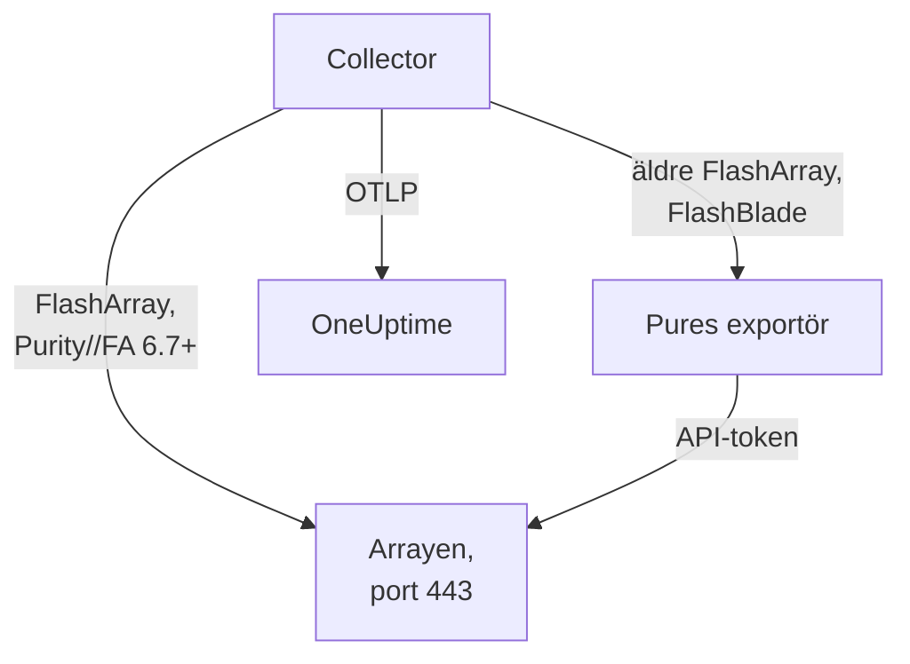

# Lagringsarray-agent

OneUptimes Storage Array-agent övervakar lagringsarrayer: kapacitet och datareduktion, latens, IOPS och bandbredd, volymer, värdar, poddar och replikering, maskinvaruhälsa, filsystem och buckets. Den är en vanlig OpenTelemetry Collector som skrapar arrayens OpenMetrics-slutpunkter med en skrivskyddad användares API-token, stämplar varje mätvärde med arrayens identitet och skickar det till OneUptime. [Lagringsarray-övervakare](/docs/monitor/storage-array-monitor) larmar utifrån det som kommer in.

:::cards
- [Installera agenten](#installera-agenten): En skrivskyddad användare, sedan installationsskriptet eller Docker Compose.
- [Vad agenten samlar in](#vad-agenten-samlar-in): Varje slutpunkt och de sidor som byggs av den.
- [Övervaka flera arrayer](#övervaka-flera-arrayer): En agent per array, på en maskin.
- [Felsökning](#felsökning): Ett diagnosskript, och de vanliga problemen.
:::

## Så fungerar det

Storage Arrays är en produkt som fungerar likadant för alla leverantörer. Den stöder:

| Array | Hur agenten läser den | Collector-konfiguration |
| --- | --- | --- |
| **Pure Storage FlashArray**, Purity//FA 6.7 och senare | Arrayens egen OpenMetrics-slutpunkt (`https://<array>/metrics/...?namespace=purefa`): inget körs bredvid collectorn | `otel-collector-config.yaml` (standard) |
| **Pure Storage FlashArray**, äldre Purity//FA | Pures FlashArray OpenMetrics-exportör, som samma Compose-fil kör som tjänsten `pure-fa-exporter` | `otel-collector-config.flasharray-exporter.yaml` |
| **Pure Storage FlashBlade** | Pures FlashBlade OpenMetrics-exportör, som samma Compose-fil kör som tjänsten `pure-fb-exporter` | `otel-collector-config.flashblade.yaml` |

Pure Storage bytte namn till **Everpure** i februari 2026. FlashArray, FlashBlade och Purity behöll sina namn, liksom mätvärdena `purefa_*` och `purefb_*`, så allt på den här sidan gäller arrayer som säljs under båda namnen.



En agent övervakar en array: Kör en agent per array (se [Övervaka flera arrayer](#övervaka-flera-arrayer)). Arrayen registrerar sig med sina första data, under det namn som agenten stämplar på varje mätvärde som `storage.array.name`.

## Innan du börjar

- Docker Engine 20.10 eller senare med pluginet Docker Compose v2, på en maskin som når arrayens administrationsgränssnitt över HTTPS (TCP 443).
- Ett administratörskonto på arrayen, för att skapa en användare med den inbyggda rollen **readonly** och en API-token för den.
- En intagningsnyckel. Skapa en under **Projektinställningar → Telemetri och APM → Intagningsnycklar** och kopiera värdet.

### Var du kör agenten

Agenten pratar med arrayens administrationsgränssnitt över HTTPS, så den kan köras på vilken maskin som helst med Docker och en väg till administrationsnätverket på TCP 443: en övervakningsvärd eller en liten administrations-VM. Välj helst en maskin vars egen lagring inte ligger på den array den övervakar: Om arrayen går ned bör inte din övervakning gå ned med den. Den valfria syslog-lyssnaren kräver också att arrayen når agenten på syslog-porten (se [Skicka arrayens syslog](#valfritt-skicka-arrayens-syslog)).

## Installera agenten

:::steps
### Skapa den skrivskyddade användaren och API-token

Agenten läser bara. Ge den en egen användare med den inbyggda rollen **readonly**, aldrig en administratör, och en API-token för den användaren. Skapa token **utan utgångsdatum**, annars slutar agenten den dag token går ut.

:::tabs
@tab Purity CLI
Anslut till FlashArray med SSH som administratör. Det första kommandot frågar efter den nya användarens lösenord; det andra skriver ut dess API-token, ett UUID:

```bash
pureadmin create --role readonly oneuptime
pureadmin create --api-token oneuptime
```
@tab FlashArray GUI
1. Öppna _Settings → Users and Policies_ (_Settings → Access_ i äldre versioner).
2. Välj **Create User…** i ⋮-menyn i panelen **Users**, döp användaren till `oneuptime` och ge den rollen readonly.
3. Välj **Create API Token…** i den nya användarens ⋮-meny, lämna **Expires In** tomt och kopiera token.
@tab FlashBlade
Skapa på samma sätt en användare med rollen **readonly** och en API-token för den: i användarinställningarna i FlashBlade-GUI:t, eller med `pureadmin` i Purity//FB-CLI:t. I en version utan lokala användare använder du ett konto från en katalogtjänst (LDAP eller Active Directory) vars grupp är mappad till rollen readonly. FlashBlade-API-tokens börjar med `T-`.
:::

### Kontrollera om FlashArray serverar sina egna mätvärden

Pure dokumenterar den inbyggda OpenMetrics-slutpunkten för **Purity//FA 6.7.0 och senare** (utfasningsmeddelandet för Pures FlashArray-exportör säger 6.6.11 och senare). Det snabbaste sättet att veta är att fråga arrayen, från den maskin som agenten ska köras på:

```bash
curl -k 'https://<array>/metrics/array?namespace=purefa' --header 'Authorization: Bearer <api-token>' | grep purefa_info
```

En rad `purefa_info{...} 1` betyder att arrayen serverar sina mätvärden inbyggt: Använd standardkonfigurationen. En `404` betyder att den inte gör det: Använd exportörkonfigurationen, som kör Pures exportör bredvid collectorn. Pure har fasat ut den exportören, så byt till den inbyggda konfigurationen när arrayen har uppgraderats. En FlashBlade går alltid via Pures FlashBlade-exportör, så hoppa över det här steget för den.

### Installera och starta agenten

:::tabs
@tab install.sh
Ladda ned installationsskriptet och kör det på maskinen som ska vara värd för agenten:

```bash
curl -sSL https://raw.githubusercontent.com/OneUptime/oneuptime/master/agents/StorageArrayAgent/install.sh -o install.sh
bash install.sh
```

Skriptet frågar vilken array det är (en FlashArray som serverar inbyggda mätvärden, en FlashArray med äldre Purity//FA eller en FlashBlade) och sedan efter din OneUptime-URL, intagningsnyckeln, ett namn på arrayen, arrayens administrationsadress och den skrivskyddade användarens API-token (läses utan eko). Det installerar till `/opt/oneuptime-storage-array-agent`, laddar ned Compose-filen och alla tre collector-konfigurationerna, skriver en fil med `0600` som heter `.env` med matchande konfiguration och Compose-profil, och startar agenten med Docker Compose. Det citerar varje värde för Docker Compose så som du skrev det. Om du kör det igen återanvänder det allt i en befintlig `.env` i stället för att fråga igen, och sparar en fil som du har redigerat som `<file>.bak.<timestamp>` innan den ersätts.
@tab Docker Compose
Ladda ned `docker-compose.yml` och de tre filerna `otel-collector-config*.yaml` från [StorageArrayAgent-katalogen](https://github.com/OneUptime/oneuptime/tree/master/agents/StorageArrayAgent) till en ny mapp:

```bash
curl -fsSLO https://raw.githubusercontent.com/OneUptime/oneuptime/master/agents/StorageArrayAgent/docker-compose.yml
curl -fsSLO https://raw.githubusercontent.com/OneUptime/oneuptime/master/agents/StorageArrayAgent/otel-collector-config.yaml
curl -fsSLO https://raw.githubusercontent.com/OneUptime/oneuptime/master/agents/StorageArrayAgent/otel-collector-config.flasharray-exporter.yaml
curl -fsSLO https://raw.githubusercontent.com/OneUptime/oneuptime/master/agents/StorageArrayAgent/otel-collector-config.flashblade.yaml
```

Skapa en `.env`-fil bredvid dem. Den innehåller API-token, så håll den privat med `chmod 600 .env`. För en FlashArray som serverar inbyggda mätvärden:

```bash title=".env"
ONEUPTIME_URL=YOUR_ONEUPTIME_URL
ONEUPTIME_TELEMETRY_INGESTION_KEY=YOUR_TELEMETRY_INGESTION_TOKEN
STORAGE_ARRAY_NAME=my-storage-array
STORAGE_SYSTEM=purestorage.flasharray
STORAGE_ARRAY_COLLECTOR_CONFIG=otel-collector-config.yaml
COMPOSE_PROFILES=
PURE_FA_ENDPOINT=fa-prod-01.example.com
PURE_FA_API_TOKEN=YOUR_READ_ONLY_API_TOKEN
PURE_FB_ENDPOINT=
PURE_FB_API_TOKEN=
STORAGE_ARRAY_INSECURE_SKIP_VERIFY=true
```

För en FlashArray med äldre Purity//FA sätter du `STORAGE_ARRAY_COLLECTOR_CONFIG=otel-collector-config.flasharray-exporter.yaml` och `COMPOSE_PROFILES=flasharray-exporter`. För en FlashBlade sätter du `STORAGE_SYSTEM=purestorage.flashblade`, `STORAGE_ARRAY_COLLECTOR_CONFIG=otel-collector-config.flashblade.yaml` och `COMPOSE_PROFILES=flashblade`, och fyller i `PURE_FB_ENDPOINT` och `PURE_FB_API_TOKEN` i stället för paret `PURE_FA_*`. Starta agenten:

```bash
docker compose up -d
```
:::

### Kontrollera att agenten körs

```bash
docker compose ps
docker logs -f oneuptime-storage-array-agent
```

`docker compose ps` listar collectorn (`oneuptime-storage-array-agent`) och, med en exportörkonfiguration, exportören (`pure-fa-exporter` eller `pure-fb-exporter`). Collectorns loggar bör visa den här raden när den har startat:

```text
Everything is ready. Begin running and processing data.
```

### Hitta arrayen i OneUptime

Öppna **Produkter → Infrastruktur → Storage Arrays → All Storage Arrays**. Efter den första skrapningen (ungefär en minut) finns arrayen där med kapacitet, prestanda, öppna larm och maskinvara. Volymer, värdar och poddar följer inom 2 minuter, en FlashBlades filsystem och buckets inom 5 och FlashArray-kataloger inom 30.
:::

## Miljövariabler

Installationsskriptet skriver dessa till `/opt/oneuptime-storage-array-agent/.env`; en Docker Compose-installation läser dem från `.env` bredvid `docker-compose.yml`. När du har ändrat ett kör du `docker compose up -d` i den mappen.

| Variabel | Obligatorisk | Beskrivning |
| --- | --- | --- |
| `ONEUPTIME_URL` | Ja | Din OneUptime-URL, till exempel `https://oneuptime.com` eller din självhostade instans. Använd `http://` och dess port om instansen bara använder HTTP. |
| `ONEUPTIME_TELEMETRY_INGESTION_KEY` | Ja | Intagningsnyckeln från **Projektinställningar → Telemetri och APM → Intagningsnycklar**. |
| `STORAGE_ARRAY_NAME` | Ja | Det namn som arrayen registreras under i OneUptime, stämplat på varje mätvärde som resursattributet `storage.array.name`. Håll det stabilt: att ändra det senare registrerar en andra array. Collectorn vägrar starta utan det. |
| `STORAGE_SYSTEM` | Nej | Plattformen, stämplad som resursattributet `storage.system`: `purestorage.flasharray` eller `purestorage.flashblade`. Standard är `purestorage.flasharray`. |
| `STORAGE_ARRAY_COLLECTOR_CONFIG` | Nej | Vilken medföljande collector-konfiguration som körs: `otel-collector-config.yaml` (FlashArray, inbyggd: standard), `otel-collector-config.flasharray-exporter.yaml` (äldre FlashArray) eller `otel-collector-config.flashblade.yaml` (FlashBlade). |
| `COMPOSE_PROFILES` | Nej | Startar den exportör som den valda konfigurationen skrapar: tomt för den inbyggda FlashArray-konfigurationen, `flasharray-exporter` eller `flashblade` för de två andra. |
| `PURE_FA_ENDPOINT` | FlashArray | FlashArrayens administrationsadress: ett värdnamn eller en IP, utan `https://`. |
| `PURE_FA_API_TOKEN` | FlashArray | API-token för FlashArray-användaren med rollen readonly. |
| `PURE_FB_ENDPOINT` | FlashBlade | FlashBladens administrationsadress: ett värdnamn eller en IP, utan `https://`. |
| `PURE_FB_API_TOKEN` | FlashBlade | API-token för FlashBlade-användaren med rollen readonly. |
| `STORAGE_ARRAY_INSECURE_SKIP_VERIFY` | Nej | `true` godtar arrayens självsignerade certifikat på den inbyggda slutpunkten; `false` verifierar det. Standard är `true`. Pures exportörer verifierar aldrig arrayens certifikat, så det gäller inte för dem. |

## Så skrapar agenten

- **Ett skrapjobb per slutpunkt, var och en läst så ofta som det är värt.** FlashArray: `/metrics/array` var 60:e sekund; `/metrics/volumes`, `/metrics/hosts` och `/metrics/pods` varannan minut; `/metrics/directories` var 30:e minut, vilket är Pures eget råd, eftersom katalogernas utrymme är dyrt för arrayen att räkna ut. FlashBlade: `/metrics/array` var 60:e sekund; `/metrics/filesystems` och `/metrics/objectstore` var 5:e minut, återigen enligt Pures råd att läsa slutpunkterna för filsystem och objektlager mer sällan än arrayen.
- **Varje jobb märker sina serier med `scrape_endpoint: <endpoint>`.** Varje slutpunkt exporterar också `purefa_info` eller `purefb_info`, så OneUptime vet vilka familjer en batch är den fullständiga listan över: Det är så en borttagen volym, värd, podd, ett filsystem eller en bucket lämnar inventariet i stället för att bli kvar. Behåll etiketterna som de levereras.
- **Latens per volym och per värd behåller tre dimensioner.** Varje volym och värd exporterar sin latens i upp till sexton `dimension`. En regel `metric_relabel_configs` behåller `usec_per_read_op`, `usec_per_write_op` och `usec_per_mirrored_write_op` och släpper uppdelningen efter QoS-hastighetsgräns, kö, SAN och tjänsttid, som mångdubblar serierna i en stor array. Den arrayövergripande uppdelningen på `purefa_array_performance_latency_usec` behålls. Ta bort regeln för att även behålla uppdelningen per volym.
- **API-token är en Bearer-token.** Den inbyggda konfigurationen skickar den till själva arrayen; exportörkonfigurationerna skickar den till exportören bara över Compose-nätverket, och exportörernas portar publiceras aldrig.
- **Ingen `send_batch_max_size`.** OneUptime bygger om inventariet från en hel skrapning per begäran, så den medföljande processorn `batch` delar aldrig upp en skrapning på flera exporter. Behåll batch-inställningarna som de levereras.

## Vad agenten samlar in

Pures semantiska konventioner delas av den inbyggda FlashArray-slutpunkten och båda exportörerna. Varje värde är en gauge som arrayen själv räknar ut (latenser i mikrosekunder per operation, genomströmning per sekund), så inga hastigheter behöver räknas ut, och objekt namnges med **datapunktsetiketter**: `name` för volymer, poddar, kataloger, filsystem och buckets, `host` för värdar, `component_name` för FlashArray-maskinvara. Agenten lägger till resursattributen `storage.array.name` och `storage.system`, så att OneUptime arkiverar allt under din array:

| Slutpunkt | Mätvärdesfamiljer | Vad OneUptime bygger av dem |
| --- | --- | --- |
| FlashArray `/metrics/array` | `purefa_info`, `purefa_alerts_open`, `purefa_array_space_*`, `purefa_array_performance_*`, `purefa_hw_component_status`, `purefa_hw_component_temperature_celsius`, `purefa_hw_controller_info`, `purefa_drive_capacity_bytes`, `purefa_network_interface_*` | Arrayens namn, Purity-version och system-ID; kapacitet, använt utrymme och datareduktion; antal öppna larm; arrayens hälsa; sidan **Hardware** (komponenter, enheter, styrenheter, nätverksgränssnitt) |
| FlashArray `/metrics/volumes` | `purefa_volume_performance_*`, `purefa_volume_space_*`, `purefa_volume_qos_*` | Sidan **Volymer**: tilldelad och fysisk storlek, datareduktion, läs- och skrivlatens, IOPS och bandbredd per volym |
| FlashArray `/metrics/hosts` | `purefa_host_connectivity_info`, `purefa_host_connections_info`, `purefa_host_performance_*`, `purefa_host_space_*` | Sidan **Värdar**: anslutning (redundanta vägar eller inte), anslutna volymer, latens, IOPS och bandbredd per värd |
| FlashArray `/metrics/pods` | `purefa_pod_performance_*`, `purefa_pod_space_*`, `purefa_pod_replica_links_*`, `purefa_pod_mediator_status` | Sidan **Replication**: ActiveCluster- och ActiveDR-poddar, status och fördröjning för replikalänkar |
| FlashArray `/metrics/directories` | `purefa_directory_performance_*`, `purefa_directory_space_*` | Sidan **Directories** (FlashArray File Services) |
| FlashBlade `/metrics/array` | `purefb_info`, `purefb_alerts_open`, `purefb_array_space_*`, `purefb_array_performance_*`, `purefb_hardware_health` | FlashBladens namn, Purity-version och system-ID; kapacitet och datareduktion; antal öppna larm; arrayens hälsa; sidan **Hardware** |
| FlashBlade `/metrics/filesystems` | `purefb_file_systems_space_*`, `purefb_file_systems_performance_*` | Sidan **File Systems**: tilldelat och använt utrymme, datareduktion, latens, IOPS och bandbredd per filsystem |
| FlashBlade `/metrics/objectstore` | `purefb_buckets_space_*`, `purefb_buckets_quota_space_bytes`, `purefb_buckets_object_count`, `purefb_buckets_performance_*`, `purefb_object_store_accounts_*` | Sidan **Buckets**: utrymme, kvot, antal objekt och prestanda per bucket, grupperat efter konto |

Arrayens hälsa på dess sida **Översikt** är **Kritisk** så länge den rapporterar ett öppet kritiskt larm, eller en maskinvarukomponent, enhet eller styrenhet som är kritisk, trasig, saknas eller är ohälsosam; **Warning** så länge den rapporterar ett öppet varningslarm, eller en försämrad eller okänd komponent; och annars **OK**. I övervakarkriterier får arrayens attribut prefixet `resource.` (`resource.storage.array.name`, `resource.storage.system`), medan datapunktsetiketterna står utan prefix (`name`, `host`, `dimension`, `space`).

## Valfritt — Skicka arrayens syslog

Som standard skickar agenten bara mätvärden, så arrayens sida **Loggar** förblir tom. Arrayer vidarebefordrar sina larm och granskningshändelser som syslog, och varje medföljande collector-konfiguration har ett bortkommenterat mottagarpar `syslog` (TCP och UDP på port 5514, RFC 3164), kopplat till en bortkommenterad pipeline `logs` som stämplar `storage.array.name` så att loggarna hamnar på din array.

:::steps
### Slå på mottagarna

Avkommentera de två mottagarna `syslog/*` och pipelinen `logs` i den collector-konfiguration som du använder. Tidsstämplar enligt RFC 3164 har ingen tidszon: Sätt `location` till arrayens tidszon, om inte dess klocka går på UTC.

### Öppna porten

Avkommentera blocket `ports:` i `docker-compose.yml`, så att maskinen publicerar `5514/tcp` och `5514/udp`, och kör sedan `docker compose up -d`. Öppna porten i maskinens brandvägg för arrayens administrationsnätverk.

### Peka arrayen mot agenten

Gör detta som administratör, inte som den skrivskyddade övervakningsanvändaren. På en FlashArray öppnar du _Settings → System → Syslog Servers_, lägger till `udp://<agent-host>:5514` (eller `tcp://<agent-host>:5514`) och skickar ett testmeddelande. På en FlashBlade lägger du till en syslog-server med samma URI i dess syslog-inställningar. Båda arrayerna godtar formen `PROTOCOL://HOST:PORT`, även via sina REST-API:er (`syslog-servers`).
:::

En syslog-mottagare lyssnar bara på en transport, och därför är TCP och UDP två mottagare: Låt den ena vara bortkommenterad om du bara behöver den andra. Collectorns standardavbildning läser syslog som den är: Ingen egen avbildning behövs.

## Tagga arrayen med projektetiketter

Ett resursattribut som börjar med `oneuptime.label.` blir en projektetikett på lagringsarrayen: `oneuptime.label.<dimension>=<value>` är etiketten `<dimension>:<value>`. Lägg till attributen i processorn `resource` i den collector-konfiguration som du använder, bredvid `storage.array.name`:

```yaml
processors:
  resource:
    attributes:
      # ...existing attributes...
      - key: oneuptime.label.team
        value: storage
        action: upsert
      - key: oneuptime.label.env
        value: production
        action: upsert
```

Collectorn läser sin konfiguration bara när den startar: Kör `docker compose restart oneuptime-storage-array-agent`. Arrayen visar då etiketterna `team:storage` och `env:production`. Etiketter jämförs utan hänsyn till skiftläge, så en befintlig etikett `Production` återanvänds i stället för att dupliceras, och agenten tar aldrig bort en etikett som någon har lagt till i OneUptime.

## Övervaka flera arrayer

En agent läser en array. För att övervaka flera från samma maskin installerar du var och en i en egen mapp med en egen `.env`, till exempel `INSTALL_DIR=/opt/oneuptime-storage-array-agent-fa02 bash install.sh`, och ger var och en ett eget `container_name` i sin `docker-compose.yml` (till exempel `oneuptime-storage-array-agent-fa02`): Två containrar kan inte dela ett namn. Skicka mappen till diagnosskriptet med `-d`.

## Kör som en systemd-tjänst

För att starta agenten med maskinen och starta om den när den misslyckas installerar du dess systemd-enhet. Den förutsätter att agenten ligger i `/opt/oneuptime-storage-array-agent`, där installationsskriptet placerar den:

```bash
sudo curl -fsSL https://raw.githubusercontent.com/OneUptime/oneuptime/master/agents/StorageArrayAgent/systemd/oneuptime-storage-array-agent.service -o /etc/systemd/system/oneuptime-storage-array-agent.service
sudo systemctl daemon-reload
sudo systemctl enable --now oneuptime-storage-array-agent
```

## Uppgradera agenten

Agenten rapporterar den collectorversion som dess filer låser som sin **Agentversion**. När den är äldre än den version som den här OneUptime-versionen låser, visas ett varningstecken bredvid den på arrayens sida **Översikt**. Välj det för att se de här kommandona. En agent som installerades innan dess filer rapporterade en version visar ingen förrän den har uppgraderats på det här sättet.

Collectorns image är låst i `docker-compose.yml` och dess konfigurationer är filer bredvid den, så att bara hämta images för inte agenten framåt. Kör `install.sh` igen: det återanvänder varje värde i din befintliga `.env` (inget frågas efter igen), förnyar `docker-compose.yml` och de tre collector-konfigurationerna (en fil som du har redigerat sparas som `<file>.bak.<timestamp>`) och återskapar agenten så att collectorn läser sin nya konfiguration. En agent som är installerad utanför `/opt/oneuptime-storage-array-agent` behöver sin mapp: `INSTALL_DIR=<folder> bash install.sh`.

```bash
curl -sSL https://raw.githubusercontent.com/OneUptime/oneuptime/master/agents/StorageArrayAgent/install.sh -o install.sh
bash install.sh
```

Installerade du den med Docker Compose i stället? I agentens mapp laddar du ned Compose-filen och de tre collector-konfigurationerna igen (och gör om eventuella ändringar du hade gjort i dem), hämtar sedan imagesen och återskapar agenten:

```bash
curl -fsSLO https://raw.githubusercontent.com/OneUptime/oneuptime/master/agents/StorageArrayAgent/docker-compose.yml
curl -fsSLO https://raw.githubusercontent.com/OneUptime/oneuptime/master/agents/StorageArrayAgent/otel-collector-config.yaml
curl -fsSLO https://raw.githubusercontent.com/OneUptime/oneuptime/master/agents/StorageArrayAgent/otel-collector-config.flasharray-exporter.yaml
curl -fsSLO https://raw.githubusercontent.com/OneUptime/oneuptime/master/agents/StorageArrayAgent/otel-collector-config.flashblade.yaml
docker compose pull
docker compose up -d --force-recreate
```

## Avinstallera agenten

```bash
cd /opt/oneuptime-storage-array-agent
docker compose down
```

Ta sedan bort den skrivskyddade användaren och dess API-token på arrayen om du inte längre behöver dem.

## Felsökning

:::details Kör diagnosskriptet först
Agenten levereras med ett skript, [`troubleshoot.sh`](https://github.com/OneUptime/oneuptime/blob/master/agents/StorageArrayAgent/troubleshoot.sh), som kontrollerar hela kedjan: containerkörtiden; arrayens slutpunkt precis som collectorn når den (den inbyggda slutpunkten eller Pures exportör: DNS, TLS, om en FlashArray alls har den inbyggda slutpunkten och om arrayen godtar API-token, som skriptet skickar till curl via stdin); det arraynamn som stämplas på varje mätvärde; tokenens format; collectorns egna mätvärden; och om OneUptime godtar intagningsnyckeln. Den sista kontrollen är viktigast. OneUptime nekar en felaktig nyckel med `401` (`422` för en inaktiverad nyckel eller en webbläsarnyckel), och collectorn behandlar båda som permanenta: den släpper batchen och loggar ett enda `Exporting failed`-fel, som är lätt att missa medan containern förblir frisk. Skriptet frågar `GET <url>/otlp/v1/validate` inifrån agentens nätverk för ett direkt `200` (giltig) eller `401` (ogiltig), och faller tillbaka på `POST /fluentd/v1/logs` på äldre servrar.

```bash
curl -sSL https://raw.githubusercontent.com/OneUptime/oneuptime/master/agents/StorageArrayAgent/troubleshoot.sh -o troubleshoot.sh
bash troubleshoot.sh    # add -d <dir> if you installed outside /opt/oneuptime-storage-array-agent
```

Det avslutas med en bedömning som anger den mest sannolika orsaken.
:::

:::details Ingen array visas i OneUptime
1. Läs collectorns loggar: `docker logs oneuptime-storage-array-agent`. `server returned HTTP status 401` betyder att arrayen nekade API-token, `404` att FlashArray saknar inbyggd slutpunkt, `x509` att TLS-verifiering är påslagen mot arrayens självsignerade certifikat, `no such host` eller `connection refused` en felaktig `PURE_FA_ENDPOINT` eller `PURE_FB_ENDPOINT`, och en `401` vid export en felaktig intagningsnyckel.
2. Fråga arrayen från agentens nätverk. Collectorns avbildning har varken skal eller curl, så fråga från en container i dess nätverk: `docker run --rm --network container:oneuptime-storage-array-agent curlimages/curl -sk -H 'Authorization: Bearer <api-token>' 'https://<array>/metrics/array?namespace=purefa'` bör skriva ut `purefa_*`-rader.
3. Kontrollera att `STORAGE_ARRAY_NAME` är satt: Arrayen hittas via sitt resursattribut `storage.array.name`, och collectorn vägrar starta utan det.
:::

:::details Arrayen visas som frånkopplad
En array blir frånkopplad när OneUptime inte har tagit emot något från den på 15 minuter; OneUptime kontrollerar var 5:e minut, och tid då OneUptime själv inte tog emot data räknas inte. Kontrollera att collectorn körs (`docker compose ps`), att dess loggar inte visar några skrap- eller exportfel och att maskinen fortfarande når arrayen och din OneUptime-URL. Arrayen blir ansluten igen med sina nästa data.
:::

:::details FlashArray svarar 404
Dess Purity//FA har ingen inbyggd OpenMetrics-slutpunkt. Kör `install.sh` igen och välj alternativet för äldre Purity, eller sätt `STORAGE_ARRAY_COLLECTOR_CONFIG=otel-collector-config.flasharray-exporter.yaml` och `COMPOSE_PROFILES=flasharray-exporter` i `.env` och kör `docker compose up -d`. När arrayen har uppgraderats till Purity//FA 6.7 eller senare byter du tillbaka till den inbyggda konfigurationen och tar bort profilen.
:::

:::details Arrayen nekar API-token
Kontrollera att du klistrade in API-token och inte användarens lösenord, att användaren fortfarande finns och har rollen readonly, och att token inte har gått ut. Skapa en ny token (`pureadmin create --api-token oneuptime` på en FlashArray), lägg den i `.env` och kör `docker compose up -d`. Via Pures exportörer syns en nekad token i collectorns logg som en HTTP `400` från exportören, vars innehåll lyder `failed to login`.
:::

:::details x509- eller TLS-fel
Arrayer presenterar som standard ett självsignerat certifikat, som ingen Docker-avbildning litar på. Sätt antingen `STORAGE_ARRAY_INSECURE_SKIP_VERIFY=true` (det praktiska valet på ett privat administrationsnätverk), eller installera ett certifikat på arrayen från en CA som collectorns avbildning litar på.
:::

:::details pure-fa-exporter eller pure-fb-exporter kan inte slås upp
Exportören körs inte: `COMPOSE_PROFILES` måste matcha `STORAGE_ARRAY_COLLECTOR_CONFIG` (`flasharray-exporter` för FlashArray-exportörkonfigurationen, `flashblade` för FlashBlade-konfigurationen). Rätta `.env` och kör `docker compose up -d`; `docker compose ps` listar då exportören.
:::

:::details Borttagna volymer eller värdar blir kvar i inventariet
OneUptime tar bort ett objekt när en fullständig skrapning av dess slutpunkt inte längre innehåller det, vilket den känner igen på etiketten `scrape_endpoint`. Om du har ersatt den medföljande collector-konfigurationen med din egen behåller du etiketterna `scrape_endpoint` på dess skrapjobb; annars lämnar objekt inventariet först när de blir inaktuella.
:::

:::details Mätvärden hamnar under fel array
OneUptime registrerar en lagringsarray efter dess `storage.array.name`, som agenten tar från `STORAGE_ARRAY_NAME`. Att ändra det efter de första data skapar en andra array i stället för att byta namn på den första.
:::

:::details Skicka mätvärden utan agenten
Agenten är en enda vanlig collector-konfiguration, så collectorer som du redan kör kan göra samma jobb: Kopiera skrapjobben och processorn `resource` från den medföljande konfigurationen till din egen. Resursattributet `storage.array.name` är det som registrerar arrayen i OneUptime, och borttagningarna av `service.name` / `service.instance.id` hindrar att data arkiveras under en tjänst: Behåll båda, och behåll etiketterna `scrape_endpoint`.
:::

## Nästa steg

:::cards
- [Lagringsarray-övervakning](/docs/monitor/storage-array-monitor): Larma om larm, kapacitet, latens, maskinvara, värdvägar, replikering och filsystem.
- [VMware-agent](/docs/telemetry/vmware): Kör du VMware på arrayen? Se även dess datalager och VM:ar.
- [OpenTelemetry-collector på värden](/docs/telemetry/host-otel-collector): Operativsystemets vy av de maskiner som använder arrayen.
:::
