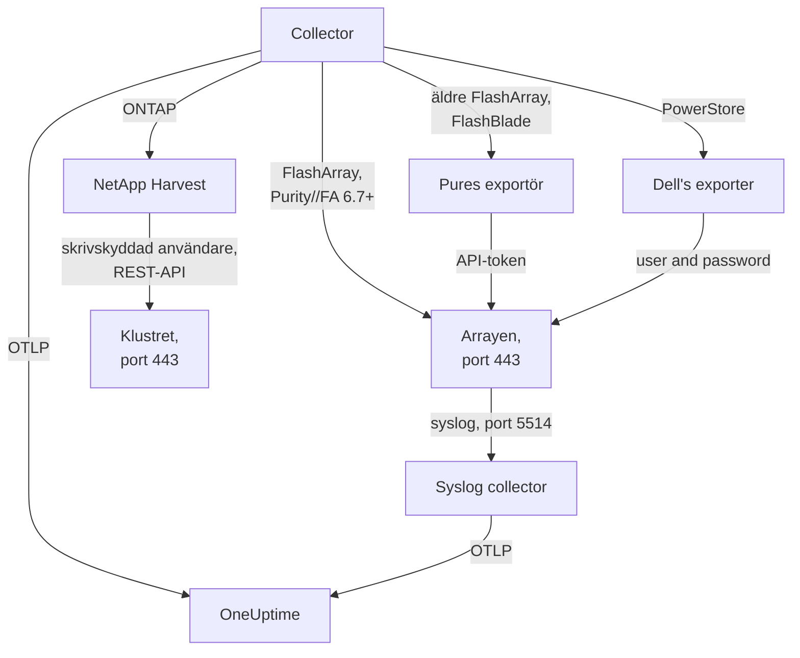

# Lagringsarray-agent

OneUptimes Lagringsarray-agent övervakar lagringsarrayer: kapacitet och datareduktion, latens, IOPS och bandbredd, volymer, värdar, poddar och replikering, maskinvaruhälsa, filsystem och buckets, och på NetApp ONTAP även aggregat, SVM:ar, LUN:ar och SnapMirror-relationer. Den är en vanlig OpenTelemetry Collector som skrapar arrayens OpenMetrics-slutpunkter med en skrivskyddad användares API-token (eller, för ONTAP, NetApps egen exportör Harvest som körs bredvid den), stämplar varje mätvärde med arrayens identitet och skickar det till OneUptime. [Lagringsarray-monitorer](/docs/monitor/storage-array-monitor) larmar utifrån det som kommer in.

:::cards
- [Installera agenten](#installera-agenten): En skrivskyddad användare, sedan installationsskriptet eller Docker Compose.
- [Vad agenten samlar in](#vad-agenten-samlar-in): Varje slutpunkt och de sidor som byggs av den.
- [Övervaka flera arrayer](#övervaka-flera-arrayer): En agent per array, på en maskin.
- [Felsökning](#felsökning): Ett diagnosskript, och de vanliga problemen.
:::

## Så fungerar det

Storage Arrays är en produkt som fungerar likadant för alla leverantörer. Den stöder:

| Array | `storage.system` | Hur agenten läser den | Collector-konfiguration |
| --- | --- | --- | --- |
| **Pure Storage FlashArray**, Purity//FA 6.7 och senare | `purestorage.flasharray` | Arrayens egen OpenMetrics-slutpunkt (`https://<array>/metrics/...?namespace=purefa`): inget körs bredvid collectorn | `otel-collector-config.yaml` (standard) |
| **Pure Storage FlashArray**, äldre Purity//FA | `purestorage.flasharray` | Pures FlashArray OpenMetrics-exportör, som samma Compose-fil kör som tjänsten `pure-fa-exporter` | `otel-collector-config.flasharray-exporter.yaml` |
| **Pure Storage FlashBlade** | `purestorage.flashblade` | Pures FlashBlade OpenMetrics-exportör, som samma Compose-fil kör som tjänsten `pure-fb-exporter` | `otel-collector-config.flashblade.yaml` |
| **Dell PowerStore** | `dell.powerstore` | Dells PowerStore Metrics Exporter, som samma Compose-fil bygger och kör som tjänsten `powerstore-exporter`; klustrets larm kommer via syslog till dess tjänst `powerstore-syslog` | `otel-collector-config.powerstore.yaml` |
| **NetApp ONTAP** 9.12.1 och senare (AFF, FAS, ASA, ONTAP Select, Cloud Volumes ONTAP) samt **Amazon FSx for NetApp ONTAP** | `netapp.ontap` | [NetApp Harvest](https://github.com/NetApp/harvest) 26.11, som samma Compose-fil kör som tjänsten `netapp-harvest`: den loggar in i klustrets REST-API med en skrivskyddad användare och ett lösenord | `otel-collector-config.netapp-ontap.yaml` |

ONTAP har ingen egen slutpunkt för mätvärden, så agenten kör NetApps exportör med öppen källkod, Harvest, bredvid collectorn. Harvest läser klustrets REST-API och serverar det den har läst på Compose-nätverket, där varje serie heter `netapp_<object>_<counter>`; collectorn skrapar den och skickar det vidare. Harvest skriver aldrig till klustret, och dess AutoSupport-rapport till NetApp är avstängd.

Pure Storage bytte namn till **Everpure** i februari 2026. FlashArray, FlashBlade och Purity behöll sina namn, liksom mätvärdena `purefa_*` och `purefb_*`, så allt på den här sidan gäller arrayer som säljs under båda namnen.



En agent övervakar en array: Kör en agent per array (se [Övervaka flera arrayer](#övervaka-flera-arrayer)). Arrayen registrerar sig med sina första data, under det namn som agenten stämplar på varje mätvärde som `storage.array.name`.

## Innan du börjar

- Docker Engine 20.10 eller senare med pluginet Docker Compose v2, på en maskin som når arrayens administrationsgränssnitt över HTTPS (TCP 443).
- Ett administratörskonto på arrayen, för att skapa en användare med den inbyggda rollen **readonly** och en API-token för den. På ONTAP en klusteradministratör (på Amazon FSx for NetApp ONTAP `fsxadmin`), för att skapa en skrivskyddad REST-användare med ett lösenord.
- För en Dell PowerStore en x86-64-maskin (Dell bygger sin exportör bara för x86-64) och en PowerStore-användare för agenten: se [Dell PowerStore](#dell-powerstore).
- En intagningsnyckel. Skapa en under **Projektinställningar → Telemetri och APM → Intagningsnycklar** och kopiera värdet.

### Var du kör agenten

Agenten pratar med arrayens administrationsgränssnitt över HTTPS, så den kan köras på vilken maskin som helst med Docker och en väg till administrationsnätverket på TCP 443: en övervakningsvärd eller en liten administrations-VM. Välj helst en maskin vars egen lagring inte ligger på den array den övervakar: Om arrayen går ned bör inte din övervakning gå ned med den. Den valfria syslog-lyssnaren kräver också att arrayen når agenten på syslog-porten (se [Skicka arrayens syslog](#valfritt-skicka-arrayens-syslog)).

## Installera agenten

:::steps
### Skapa den skrivskyddade användaren och API-token

Agenten läser bara. Ge den en egen användare med den inbyggda rollen **readonly**, aldrig en administratör, och en API-token för den användaren. Skapa token **utan utgångsdatum**, annars slutar agenten den dag token går ut.

:::tabs
@tab Purity CLI
Anslut till FlashArray med SSH som administratör. Det första kommandot frågar efter den nya användarens lösenord; det andra skriver ut dess API-token, ett UUID:

```bash
pureadmin create --role readonly oneuptime
pureadmin create --api-token oneuptime
```
@tab FlashArray GUI
1. Öppna _Settings → Users and Policies_ (_Settings → Access_ i äldre versioner).
2. Välj **Create User…** i ⋮-menyn i panelen **Users**, döp användaren till `oneuptime` och ge den rollen readonly.
3. Välj **Create API Token…** i den nya användarens ⋮-meny, lämna **Expires In** tomt och kopiera token.
@tab FlashBlade
Skapa på samma sätt en användare med rollen **readonly** och en API-token för den: i användarinställningarna i FlashBlade-GUI:t, eller med `pureadmin` i Purity//FB-CLI:t. I en version utan lokala användare använder du ett konto från en katalogtjänst (LDAP eller Active Directory) vars grupp är mappad till rollen readonly. FlashBlade-API-tokens börjar med `T-`.
@tab ONTAP CLI
Anslut med SSH till klustrets administrationsadress som administratör. Det första kommandot skapar en REST-roll som får läsa alla API:er och inget annat; det andra skapar en HTTP-användare som har rollen och frågar efter dess lösenord:

```bash
security login rest-role create -role oneuptime-readonly -api /api -access readonly
security login create -user-or-group-name oneuptime -application http -authentication-method password -role oneuptime-readonly
```

Agenten loggar in med den här användaren och lösenordet. Ingen API-token behövs.
@tab ONTAP System Manager
1. Öppna _Cluster → Settings → Users and Roles_.
2. Välj **Add** under **Roles**, döp rollen till `oneuptime-readonly`, ange `/api` som **REST API path** och välj åtkomsten **Read-Only**.
3. Välj **Add** under **Users**, döp användaren till `oneuptime`, ge den den nya rollen, lägg till inloggningsmetoden **HTTP** med **Password** och ange lösenordet.
@tab Amazon FSx for NetApp ONTAP
Anslut med SSH till filsystemets administrationsslutpunkt (dess DNS-namn eller IP, från FSx-konsolen) som `fsxadmin`, och skapa användaren med FSx:s fördefinierade skrivskyddade roll. Kommandot frågar efter dess lösenord:

```bash
security login create -user-or-group-name oneuptime -application http -authentication-method password -role fsxadmin-readonly
```

AWS driver filsystemets hårdvara, så FSx svarar inte på någons frågor om diskar, hyllor eller sensorer: Arrayens sida **Hårdvara** listar dess noder och portar och säger det.
:::

### Kontrollera om FlashArray serverar sina egna mätvärden

Pure dokumenterar den inbyggda OpenMetrics-slutpunkten för **Purity//FA 6.7.0 och senare** (utfasningsmeddelandet för Pures FlashArray-exportör säger 6.6.11 och senare). Det snabbaste sättet att veta är att fråga arrayen, från den maskin som agenten ska köras på:

```bash
curl -k 'https://<array>/metrics/array?namespace=purefa' --header 'Authorization: Bearer <api-token>' | grep purefa_info
```

En rad `purefa_info{...} 1` betyder att arrayen serverar sina mätvärden inbyggt: Använd standardkonfigurationen. En `404` betyder att den inte gör det: Använd exportörkonfigurationen, som kör Pures exportör bredvid collectorn. Pure har fasat ut den exportören, så byt till den inbyggda konfigurationen när arrayen har uppgraderats. En FlashBlade går alltid via Pures FlashBlade-exportör och ett ONTAP-kluster via NetApp Harvest, så hoppa över det här steget för dem.

### Installera och starta agenten

Varje OneUptime tillhandahåller agentens installationsskript och filer från sin egen version: Kommandona nedan laddar ned dem från `https://oneuptime.com`, så på en egenvärdad OneUptime ersätter du den adressen med din URL. Installationsskriptet sparas först som `install.sh`, så att du kan läsa det innan du kör det.

:::tabs
@tab install.sh
Ladda ned installationsskriptet och kör det på maskinen som ska vara värd för agenten:

```bash
curl -fsSL https://oneuptime.com/install/storage-array-agent -o install.sh
bash install.sh
```

Skriptet frågar vilken array det är (en FlashArray som serverar inbyggda mätvärden, en FlashArray med äldre Purity//FA, en FlashBlade eller ett NetApp ONTAP-kluster) och sedan efter din OneUptime-URL, intagningsnyckeln, ett namn på arrayen, arrayens administrationsadress och den skrivskyddade användarens API-token, eller för ONTAP den skrivskyddade användarens namn och lösenord (läses utan eko). Det installerar till `/opt/oneuptime-storage-array-agent`, laddar ned Compose-filen, alla collector-konfigurationer och Harvests fyra filer, skriver en fil med `0600` som heter `.env` med matchande konfiguration och Compose-profil, och startar agenten med Docker Compose. Det citerar varje värde för Docker Compose så som du skrev det. Om du kör det igen återanvänder det allt i en befintlig `.env` i stället för att fråga igen, och sparar en fil som du har redigerat som `<file>.bak.<timestamp>` innan den ersätts.
@tab Docker Compose
Ladda ned `docker-compose.yml` och de tre filerna `otel-collector-config*.yaml` från din OneUptime till en ny mapp:

```bash
curl -fsSLO https://oneuptime.com/install/storage-array-agent/docker-compose.yml
curl -fsSLO https://oneuptime.com/install/storage-array-agent/otel-collector-config.yaml
curl -fsSLO https://oneuptime.com/install/storage-array-agent/otel-collector-config.flasharray-exporter.yaml
curl -fsSLO https://oneuptime.com/install/storage-array-agent/otel-collector-config.flashblade.yaml
```

Skapa en `.env`-fil bredvid dem. Den innehåller API-token, så håll den privat med `chmod 600 .env`. För en FlashArray som serverar inbyggda mätvärden:

```bash title=".env"
ONEUPTIME_URL=YOUR_ONEUPTIME_URL
ONEUPTIME_TELEMETRY_INGESTION_KEY=YOUR_TELEMETRY_INGESTION_TOKEN
STORAGE_ARRAY_NAME=my-storage-array
STORAGE_SYSTEM=purestorage.flasharray
STORAGE_ARRAY_COLLECTOR_CONFIG=otel-collector-config.yaml
COMPOSE_PROFILES=
PURE_FA_ENDPOINT=fa-prod-01.example.com
PURE_FA_API_TOKEN=YOUR_READ_ONLY_API_TOKEN
PURE_FB_ENDPOINT=
PURE_FB_API_TOKEN=
STORAGE_ARRAY_INSECURE_SKIP_VERIFY=true
POWERSTORE_ENDPOINT=
POWERSTORE_PASSWORD=
POWERSTORE_USERNAME=
POWERSTORE_BULK_METRICS=
POWERSTORE_API_VERSION=
POWERSTORE_REQUEST_LIMIT=
POWERSTORE_SYSLOG_PORT=
```

För en Dell PowerStore laddar du också ned `otel-collector-config.powerstore.yaml`, `powerstore-exporter.Dockerfile` och `powerstore-syslog.yaml`, sätter `STORAGE_SYSTEM=dell.powerstore`, `STORAGE_ARRAY_COLLECTOR_CONFIG=otel-collector-config.powerstore.yaml` och `COMPOSE_PROFILES=powerstore` och fyller i `POWERSTORE_ENDPOINT`, `POWERSTORE_USERNAME` och `POWERSTORE_PASSWORD`, lösenordet inom enkla citattecken.

För en FlashArray med äldre Purity//FA sätter du `STORAGE_ARRAY_COLLECTOR_CONFIG=otel-collector-config.flasharray-exporter.yaml` och `COMPOSE_PROFILES=flasharray-exporter`. För en FlashBlade sätter du `STORAGE_SYSTEM=purestorage.flashblade`, `STORAGE_ARRAY_COLLECTOR_CONFIG=otel-collector-config.flashblade.yaml` och `COMPOSE_PROFILES=flashblade`, och fyller i `PURE_FB_ENDPOINT` och `PURE_FB_API_TOKEN` i stället för paret `PURE_FA_*`.

För ett NetApp ONTAP-kluster eller Amazon FSx for NetApp ONTAP laddar du dessutom ned ONTAP-konfigurationen och Harvests fyra filer:

```bash
curl -fsSLO https://oneuptime.com/install/storage-array-agent/otel-collector-config.netapp-ontap.yaml
curl -fsSLO https://oneuptime.com/install/storage-array-agent/netapp-harvest.yml
curl -fsSLO https://oneuptime.com/install/storage-array-agent/netapp-harvest-rest.yaml
curl -fsSLO https://oneuptime.com/install/storage-array-agent/netapp-harvest-keyperf.yaml
curl -fsSLO https://oneuptime.com/install/storage-array-agent/netapp-harvest-restperf.yaml
```

och använder den här `.env`. Behåll lösenordet inom enkla citattecken, som här: Docker Compose läser det då exakt som det är skrivet, vad det än innehåller. Ett lösenord som innehåller ett `'` skrivs i stället inom dubbla citattecken, med `\"`, `\\` och `$$` för ett `"`, ett `\` och ett `$`:

```bash title=".env"
ONEUPTIME_URL=YOUR_ONEUPTIME_URL
ONEUPTIME_TELEMETRY_INGESTION_KEY=YOUR_TELEMETRY_INGESTION_TOKEN
STORAGE_ARRAY_NAME=ontap-prod-01
STORAGE_SYSTEM=netapp.ontap
STORAGE_ARRAY_COLLECTOR_CONFIG=otel-collector-config.netapp-ontap.yaml
COMPOSE_PROFILES=netapp-ontap
NETAPP_ONTAP_ENDPOINT=ontap-prod-01.example.com
NETAPP_ONTAP_USERNAME=oneuptime
NETAPP_ONTAP_PASSWORD='YOUR_READ_ONLY_USER_PASSWORD'
STORAGE_ARRAY_INSECURE_SKIP_VERIFY=true
```

Starta agenten:

```bash
docker compose up -d
```
:::

### Kontrollera att agenten körs

```bash
docker compose ps
docker logs -f oneuptime-storage-array-agent
```

`docker compose ps` listar collectorn (`oneuptime-storage-array-agent`) och, med en exportörkonfiguration, exportören (`pure-fa-exporter`, `pure-fb-exporter` eller `netapp-harvest`). Collectorns loggar bör visa den här raden när den har startat:

```text
Everything is ready. Begin running and processing data.
```

### Hitta arrayen i OneUptime

Öppna **Produkter → Infrastruktur → Lagringsarrayer → Alla lagringsarrayer**. Efter den första skrapningen (ungefär en minut) finns arrayen där med kapacitet, prestanda, öppna larm och maskinvara. Volymer, värdar och poddar följer inom 2 minuter, en FlashBlades filsystem och buckets inom 5 och FlashArray-kataloger inom 30. Ett ONTAP-kluster visas så snart Harvest har läst det, och hela dess inventarie inom ungefär 3 minuter, det intervall med vilket Harvest läser dess konfiguration. Arrayens sida **Topologi** ritar dess värdar, volymer, filsystem och hårdvara på en karta: se [Topologi](/docs/telemetry/topology#öppna-en-resurs-egen-karta).
:::

## Dell PowerStore

Agenten läser ett PowerStore-kluster genom Dells PowerStore Metrics Exporter, version `powerstore-metrics-exporter_v1.0.3`. Dell publicerar den som binärfil, inte som avbild, så tjänsten `powerstore-exporter` bygger vid första starten den avbild Dell dokumenterar från `powerstore-exporter.Dockerfile` och kontrollerar binärfilens SHA-256; det bygget behöver `quay.io` och `github.com` en gång.

Dells exportör loggar in med användarnamn och lösenord, eftersom PowerStore inte har API-token. Lägg i PowerStore Manager under _Settings → Users_ till en lokal användare enbart för agenten, med rollen **Storage Operator**: exportören läser prestandan från PowerStores femminutersarkiv med massmätvärden, som den själv slår på och som PowerStoreOS 4.1 och senare kräver, och enligt Dells README kan rollen Operator inte slå på det. På en äldre PowerStoreOS räcker den skrivskyddade rollen **Operator** med `POWERSTORE_BULK_METRICS=false`. Bara exportören läser lösenordet, från `.env`.

Dells exportör läser inga larm, så klustret skickar sina egna: tjänsten `powerstore-syslog` tar emot dess fjärr-syslog på port 5514, via TCP och UDP, och lägger varje rad på arrayens sida **Loggar** med PowerStores post i attribut (`powerstore.alert.id`, `powerstore.alert.state`, `powerstore.event.code`) och en allvarlighetsgrad från Dells händelsekoder (`powerstore.alert.severity`). Öppna _Settings → Security → Remote Logging_ i PowerStore Manager, lägg till den här maskinen på port 5514 och öppna porten i dess brandvägg. Syslog över TLS på port 6514 beskrivs i `powerstore-syslog.yaml`.

Dells exportör rapporterar inga värdar och inga replikeringssessioner, så den här versionen har inga.

## Miljövariabler

Installationsskriptet skriver dessa till `/opt/oneuptime-storage-array-agent/.env`; en Docker Compose-installation läser dem från `.env` bredvid `docker-compose.yml`. När du har ändrat ett kör du `docker compose up -d` i den mappen.

| Variabel | Obligatorisk | Beskrivning |
| --- | --- | --- |
| `ONEUPTIME_URL` | Ja | Din OneUptime-URL, till exempel `https://oneuptime.com` eller din självhostade instans. Använd `http://` och dess port om instansen bara använder HTTP. |
| `ONEUPTIME_TELEMETRY_INGESTION_KEY` | Ja | Intagningsnyckeln från **Projektinställningar → Telemetri och APM → Intagningsnycklar**. |
| `STORAGE_ARRAY_NAME` | Ja | Det namn som arrayen registreras under i OneUptime, stämplat på varje mätvärde som resursattributet `storage.array.name`. Håll det stabilt: att ändra det senare registrerar en andra array. Collectorn vägrar starta utan det. |
| `STORAGE_SYSTEM` | Nej | Plattformen, stämplad som resursattributet `storage.system`: `purestorage.flasharray`, `purestorage.flashblade` eller `netapp.ontap`. Standard är `purestorage.flasharray`. |
| `STORAGE_ARRAY_COLLECTOR_CONFIG` | Nej | Vilken medföljande collector-konfiguration som körs: `otel-collector-config.yaml` (FlashArray, inbyggd: standard), `otel-collector-config.flasharray-exporter.yaml` (äldre FlashArray), `otel-collector-config.flashblade.yaml` (FlashBlade) eller `otel-collector-config.netapp-ontap.yaml` (ONTAP). |
| `COMPOSE_PROFILES` | Nej | Startar den exportör som den valda konfigurationen skrapar: tomt för den inbyggda FlashArray-konfigurationen, `flasharray-exporter`, `flashblade` eller `netapp-ontap` för de andra. |
| `PURE_FA_ENDPOINT` | FlashArray | FlashArrayens administrationsadress: ett värdnamn eller en IP, utan `https://`. |
| `PURE_FA_API_TOKEN` | FlashArray | API-token för FlashArray-användaren med rollen readonly. |
| `PURE_FB_ENDPOINT` | FlashBlade | FlashBladens administrationsadress: ett värdnamn eller en IP, utan `https://`. |
| `PURE_FB_API_TOKEN` | FlashBlade | API-token för FlashBlade-användaren med rollen readonly. |
| `POWERSTORE_ENDPOINT` | PowerStore | PowerStore-klustrets administrationsadress: ett värdnamn eller en IP, utan `https://`. |
| `POWERSTORE_USERNAME` | PowerStore | PowerStore-användaren som Dells exportör loggar in som. |
| `POWERSTORE_PASSWORD` | PowerStore | Den användarens lösenord. Bara exportören läser det. |
| `POWERSTORE_BULK_METRICS` | Nej | `true` läser prestandan från PowerStores arkiv med massmätvärden; `false` läser varje objekt för sig. Standard är `true`. |
| `POWERSTORE_API_VERSION` | Nej | `v3` för PowerStoreOS 3.6 och senare, eller `v1`. Standard är `v3`. |
| `POWERSTORE_REQUEST_LIMIT` | Nej | Hur många förfrågningar exportören skickar till klustret samtidigt. Standard är `16`. |
| `POWERSTORE_SYSLOG_PORT` | Nej | Porten där den här maskinen tar emot klustrets syslog, via TCP och UDP. Standard är `5514`. |
| `NETAPP_ONTAP_ENDPOINT` | ONTAP | Klustrets administrationsadress (på FSx filsystemets administrationsslutpunkt): ett värdnamn eller en IP, utan `https://`. |
| `NETAPP_ONTAP_USERNAME` | ONTAP | Den skrivskyddade REST-användaren, till exempel `oneuptime`. |
| `NETAPP_ONTAP_PASSWORD` | ONTAP | Dess lösenord. Bara Harvest läser det, exakt som det är skrivet. |
| `STORAGE_ARRAY_INSECURE_SKIP_VERIFY` | Nej | `true` godtar arrayens självsignerade certifikat på den inbyggda slutpunkten och i Harvest; `false` verifierar det. Standard är `true`. Pures exportörer verifierar aldrig arrayens certifikat, så det gäller inte för dem. |

## Så skrapar agenten

- **Ett skrapjobb per slutpunkt, var och en läst så ofta som det är värt.** FlashArray: `/metrics/array` var 60:e sekund; `/metrics/volumes`, `/metrics/hosts` och `/metrics/pods` varannan minut; `/metrics/directories` var 30:e minut, vilket är Pures eget råd, eftersom katalogernas utrymme är dyrt för arrayen att räkna ut. FlashBlade: `/metrics/array` var 60:e sekund; `/metrics/filesystems` och `/metrics/objectstore` var 5:e minut, återigen enligt Pures råd att läsa slutpunkterna för filsystem och objektlager mer sällan än arrayen.
- **Varje jobb märker sina serier med `scrape_endpoint: <endpoint>`.** Varje slutpunkt exporterar också `purefa_info` eller `purefb_info`, så OneUptime vet vilka familjer en batch är den fullständiga listan över: Det är så en borttagen volym, värd, podd, ett filsystem eller en bucket lämnar inventariet i stället för att bli kvar. Behåll etiketterna som de levereras.
- **Latens per volym och per värd behåller tre dimensioner.** Varje volym och värd exporterar sin latens i upp till sexton `dimension`. En regel `metric_relabel_configs` behåller `usec_per_read_op`, `usec_per_write_op` och `usec_per_mirrored_write_op` och släpper uppdelningen efter QoS-hastighetsgräns, kö, SAN och tjänsttid, som mångdubblar serierna i en stor array. Den arrayövergripande uppdelningen på `purefa_array_performance_latency_usec` behålls. Ta bort regeln för att även behålla uppdelningen per volym.
- **API-token är en Bearer-token.** Den inbyggda konfigurationen skickar den till själva arrayen; exportörkonfigurationerna skickar den till exportören bara över Compose-nätverket, och exportörernas portar publiceras aldrig.
- **En PowerStore var 5:e minut.** Dells exportör tillhandahåller varje del av klustret på `/metrics/<cluster>/<part>`: konfigurationen läser `cluster` var 60:e sekund, dess hjärtslag, och `appliance`, `capacity`, `hardware`, `port`, `volume`, `volumeGroup`, `nas` och `file` var 5:e minut, eftersom PowerStore beräknar dem i femminutersprov.
- **Ingen `send_batch_max_size`.** OneUptime bygger om inventariet från en hel skrapning per begäran, så den medföljande processorn `batch` delar aldrig upp en skrapning på flera exporter. Behåll batch-inställningarna som de levereras.
- **ONTAP: Harvest läser klustret, collectorn skrapar Harvest.** Harvest läser klustrets konfiguration och tillstånd var 3:e minut, dess prestanda varje minut (latenser i mikrosekunder per operation, operationer och byte per sekund) och dess EMS-händelser var 3:e minut, och serverar det senaste av allt på `netapp-harvest:12990`, som collectorn skrapar var 60:e sekund med etiketten `scrape_endpoint: harvest`. De tre filerna `netapp-harvest-*.yaml` begränsar Harvest till det som OneUptime läser. Harvests egna serier `netapp_metadata_*` anger vilka objekt den listade i sin helhet, så en borttagen volym lämnar inventariet medan ett objekt som Harvest inte kunde läsa behåller sitt senaste antal. Collectorn släpper Harvests mätningar av sig själv och prestandaserierna per disk, och gör om varje SnapMirror-relations schema till `netapp_snapmirror_schedule_seconds` (ett schema per timme är 3600), som SnapMirror Behind Schedule jämför fördröjningen med.

## Vad agenten samlar in

Pures semantiska konventioner delas av den inbyggda FlashArray-slutpunkten och båda exportörerna; ONTAP:s är Harvests, som beskrivs efter tabellen. Varje värde är en gauge som arrayen själv räknar ut (latenser i mikrosekunder per operation, genomströmning per sekund), så inga hastigheter behöver räknas ut, och objekt namnges med **datapunktsetiketter**: `name` för volymer, poddar, kataloger, filsystem och buckets, `host` för värdar, `component_name` för FlashArray-maskinvara. Agenten lägger till resursattributen `storage.array.name` och `storage.system`, så att OneUptime arkiverar allt under din array:

| Slutpunkt | Mätvärdesfamiljer | Vad OneUptime bygger av dem |
| --- | --- | --- |
| FlashArray `/metrics/array` | `purefa_info`, `purefa_alerts_open`, `purefa_array_space_*`, `purefa_array_performance_*`, `purefa_hw_component_status`, `purefa_hw_component_temperature_celsius`, `purefa_hw_controller_info`, `purefa_drive_capacity_bytes`, `purefa_network_interface_*` | Arrayens namn, Purity-version och system-ID; kapacitet, använt utrymme och datareduktion; antal öppna larm; arrayens hälsa; sidan **Hårdvara** (komponenter, enheter, styrenheter, nätverksgränssnitt) |
| FlashArray `/metrics/volumes` | `purefa_volume_performance_*`, `purefa_volume_space_*`, `purefa_volume_qos_*` | Sidan **Volymer**: tilldelad och fysisk storlek, datareduktion, läs- och skrivlatens, IOPS och bandbredd per volym |
| FlashArray `/metrics/hosts` | `purefa_host_connectivity_info`, `purefa_host_connections_info`, `purefa_host_performance_*`, `purefa_host_space_*` | Sidan **Värdar**: anslutning (redundanta vägar eller inte), anslutna volymer, latens, IOPS och bandbredd per värd |
| FlashArray `/metrics/pods` | `purefa_pod_performance_*`, `purefa_pod_space_*`, `purefa_pod_replica_links_*`, `purefa_pod_mediator_status` | Sidan **Replikering**: ActiveCluster- och ActiveDR-poddar, status och fördröjning för replikalänkar |
| FlashArray `/metrics/directories` | `purefa_directory_performance_*`, `purefa_directory_space_*` | Sidan **Kataloger** (FlashArray File Services) |
| FlashBlade `/metrics/array` | `purefb_info`, `purefb_alerts_open`, `purefb_array_space_*`, `purefb_array_performance_*`, `purefb_hardware_health` | FlashBladens namn, Purity-version och system-ID; kapacitet och datareduktion; antal öppna larm; arrayens hälsa; sidan **Hårdvara** |
| FlashBlade `/metrics/filesystems` | `purefb_file_systems_space_*`, `purefb_file_systems_performance_*` | Sidan **Filsystem**: tilldelat och använt utrymme, datareduktion, latens, IOPS och bandbredd per filsystem |
| FlashBlade `/metrics/objectstore` | `purefb_buckets_space_*`, `purefb_buckets_quota_space_bytes`, `purefb_buckets_object_count`, `purefb_buckets_performance_*`, `purefb_object_store_accounts_*` | Sidan **Buckets**: utrymme, kvot, antal objekt och prestanda per bucket, grupperat efter konto |
| PowerStore `cluster`, `appliance`, `capacity` | `powerstore_cluster`, `powerstore_metro_*`, `powerstore_appliance`, `powerstore_perf_*`, `powerstore_cap_*` | Klustrets namn och tillstånd; sidan **Appliances**: kapacitet, datareduktion, latens, IOPS och bandbredd för varje appliance |
| PowerStore `hardware`, `port` | `powerstore_hardware_*`, `powerstore_wear_metrics_by_drive`, `powerstore_fc_port_*`, `powerstore_eth_port_*`, `powerstore_metricFcPort_*`, `powerstore_metricEthPort_*` | Sidan **Hårdvara**: noder, fläktar, nätaggregat, batterier, diskar och frontendportar, var och en med sin appliance |
| PowerStore `volume`, `volumeGroup`, `nas`, `file` | `powerstore_volume_*`, `powerstore_metricVolume_*`, `powerstore_volumegroup_*`, `powerstore_metricVg_*`, `powerstore_nas_server_operational_status`, `powerstore_metricNas_*`, `powerstore_filesystem_*`, `powerstore_metricFilesystem_*` | Sidorna **Volymer**, **Volymgrupper**, **NAS-servrar** och **Filsystem** |
| ONTAP, via Harvest | `netapp_cluster_*`, `netapp_node_*`, `netapp_aggr_*`, `netapp_svm_*`, `netapp_volume_*`, `netapp_lun_*`, `netapp_snapmirror_*` | Klustrets namn, version och UUID; dess kapacitet (summan av dess dataaggregat) och datareduktion; sidan **Volymer**; sidorna **Aggregat**, **SVM:ar**, **LUN:ar** och **SnapMirror**, en sida per objekt |
| ONTAP-hårdvara, via Harvest | `netapp_disk_*`, `netapp_shelf_*`, `netapp_environment_sensor_*`, `netapp_net_port_*`, `netapp_nic_*`, `netapp_fcp_*` | Sidan **Hårdvara**: noder, diskar, hyllor, deras nätaggregat, fläktar, moduler och sensorer, nodernas sensorer samt Ethernet- och Fibre Channel-portar |
| ONTAP:s öppna problem och händelser | `netapp_health_*`, `netapp_ems_events` | Antalet öppna larm och kortet **Aktiva larm** (trasiga diskar, hyllfel, HA-takeover, portar nere, larm om systemhälsa), samt EMS-mallarna |

På ONTAP är varje serie Harvests: ett objekt namnges av sina etiketter (`volume` inom sin `svm`, `aggr`, `lun`, `node`, `disk`, `shelf`, `destination_location` för en SnapMirror-relation), ett tillstånd är en `netapp_*_new_status` på 1 eller 0 eller en serie `netapp_*_labels` vars etiketter anger det, och varje öppet problem är en serie `netapp_health_*_alerts` som finns så länge problemet består.

Kolumnen **Hälsa** under **Alla lagringsarrayer** läser arrayens egna larm och maskinvara i dess senaste data: **Kritisk** så länge den rapporterar ett öppet kritiskt larm, eller en maskinvarukomponent, enhet eller styrenhet som är kritisk, trasig, saknas eller är ohälsosam; **Varning** så länge den rapporterar ett öppet varningslarm, eller en försämrad eller okänd komponent; annars **OK**; och **Okänd** medan agenten är frånkopplad. Arrayens **Översikt** bedömer mer, som nästa avsnitt säger. I monitorkriterier får arrayens attribut prefixet `resource.` (`resource.storage.array.name`, `resource.storage.system`), medan datapunktsetiketterna står utan prefix (`name`, `host`, `dimension`, `space`).

En PowerStores hälsa är dess hårdvaras, eftersom dess larm kommer som loggar. Agenten beräknar själv `powerstore_cap_physical_used_percent` och `powerstore_filesystem_logical_used_percent`, och läser en nods tillstånd som 1 medan den är Healthy.

## Vad arrayens sidor visar

Arrayens **Översikt** anger dess hälsa, **Felfri**, **Försämrad** eller **Ej felfri**, utifrån vad som behöver uppmärksamhet, och listar det under **Kräver uppmärksamhet**, det mest brådskande först, vart och ett ett steg från där man ska titta:

- **Själva arrayen.** Ett öppet larm som arrayen utlöste med kritisk allvarlighetsgrad är kritiskt, och ett med varningsgrad behöver en titt. Över 80 % av den användbara kapaciteten behöver den en titt, och över 90 % är den kritisk, där larmen Capacity Above 80% och Capacity Above 90% utlöses. En FlashArray med en genomsnittlig läs- eller skrivlatens över 5 ms, eller en FlashBlade vars läsningar tar längre än 10 ms, behöver en titt.
- **Maskinvara.** En komponent, disk, styrenhet eller ett nätverksgränssnitt som arrayen rapporterar som kritisk, trasig, saknad eller ohälsosam är kritisk: redundansen är borta tills delen är utbytt. En som den rapporterar som försämrad, okänd, ej igenkänd eller inte klar behöver en titt. Delar som inte är installerade, är avstängda eller oanvända listas aldrig.
- **Värdar.** En värd som inte längre når arrayen genom båda styrenheterna behöver en titt, med orsaken: genom bara en styrenhet, över ojämna sökvägar eller helt utan sökväg.
- **Poddar.** En podd vars replikalänk arrayen rapporterar som ohälsosam är kritisk, och en som ligger mer än en minut efter behöver en titt.
- **Filsystem.** Ett FlashBlade-filsystem med mindre än 10 % av sin tilldelade storlek kvar behöver en titt.
- **Ett ONTAP-klusters egna objekt.** En volym, ett aggregat eller en LUN som ONTAP rapporterar som offline, en trasig disk, en hylldel med fel, en nodsensor över sin kritiska gräns och en port som är nere är kritiska; en stoppad SVM, en nod med en trasig fläkt eller ett trasigt nätaggregat och en sensor över sin varningsgräns behöver en titt, med ONTAP:s egna ord för orsaken. En SnapMirror-relation som ONTAP rapporterar som ej felfri är kritisk, och en som ligger mer än ett och ett halvt schemaintervall efter behöver en titt.

Listorna **Värdar**, **Replikering** och **Filsystem** anger varje dels tillstånd enligt samma regler, med orsaken under, och det gör även ett ONTAP-klusters listor **Volymer**, **Aggregat**, **SVM:ar**, **LUN:ar** och **SnapMirror**, där varje rad öppnar en egen sida: dess tillstånd, vad som behöver uppmärksamhet, vad som är öppet för den, klustrets larm som bevakar den, vad ONTAP rapporterar om den och dess diagram. Varje plattforms sidor använder plattformens egna ord: En ONTAP-volym visar sin SVM, sitt aggregat och hur full den är, och dess sida visar diagram över ONTAP:s serier. På Amazon FSx for NetApp ONTAP listar sidan **Hårdvara** noderna och portarna och förklarar varför det inte finns några diskar eller hyllor. En värds och ett filsystems egen sida säger vad i den som behöver uppmärksamhet och vilka av arrayens larm som bevakar den, med ett steg för att slå på resten, och varje dels sida, även en volyms och en buckets, säger vad som är öppet för den. Medan agenten är frånkopplad visar hälsan **Hälsa okänd**: arrayens senaste rapport är inte längre sanningen. Varje gräns ovan är den där dess larmmall utlöses, så som [lagringsarray-monitorn](/docs/monitor/storage-array-monitor) listar dem.

På en PowerStore listar flikarna **Appliances**, **Volymgrupper** och **NAS-servrar** de delar som bara en PowerStore har, och sidan **Hårdvara** anger varje dels appliance, eftersom varje appliance namnger sina delar likadant.

## Valfritt — Skicka arrayens syslog

En PowerStores syslog-insamlare körs som den levereras (se [Dell PowerStore](#dell-powerstore)): det här avsnittet gäller Pures arrayer.

Som standard skickar agenten bara mätvärden, så arrayens sida **Loggar** förblir tom. Arrayer vidarebefordrar sina larm och granskningshändelser som syslog, och varje medföljande collector-konfiguration har ett bortkommenterat mottagarpar `syslog` (TCP och UDP på port 5514, RFC 3164), kopplat till en bortkommenterad pipeline `logs` som stämplar `storage.array.name` så att loggarna hamnar på din array.

:::steps
### Slå på mottagarna

Avkommentera de två mottagarna `syslog/*` och pipelinen `logs` i den collector-konfiguration som du använder. Tidsstämplar enligt RFC 3164 har ingen tidszon: Sätt `location` till arrayens tidszon, om inte dess klocka går på UTC.

### Öppna porten

Avkommentera blocket `ports:` i `docker-compose.yml`, så att maskinen publicerar `5514/tcp` och `5514/udp`, och kör sedan `docker compose up -d`. Öppna porten i maskinens brandvägg för arrayens administrationsnätverk.

### Peka arrayen mot agenten

Gör detta som administratör, inte som den skrivskyddade övervakningsanvändaren. På en FlashArray öppnar du _Settings → System → Syslog Servers_, lägger till `udp://<agent-host>:5514` (eller `tcp://<agent-host>:5514`) och skickar ett testmeddelande. På en FlashBlade lägger du till en syslog-server med samma URI i dess syslog-inställningar. Båda arrayerna godtar formen `PROTOCOL://HOST:PORT`, även via sina REST-API:er (`syslog-servers`).
:::

En syslog-mottagare lyssnar bara på en transport, och därför är TCP och UDP två mottagare: Låt den ena vara bortkommenterad om du bara behöver den andra. Collectorns standardavbildning läser syslog som den är: Ingen egen avbildning behövs.

## Tagga arrayen med projektetiketter

Ett resursattribut som börjar med `oneuptime.label.` blir en projektetikett på lagringsarrayen: `oneuptime.label.<dimension>=<value>` är etiketten `<dimension>:<value>`. Lägg till attributen i processorn `resource` i den collector-konfiguration som du använder, bredvid `storage.array.name`:

```yaml
processors:
  resource:
    attributes:
      # ...existing attributes...
      - key: oneuptime.label.team
        value: storage
        action: upsert
      - key: oneuptime.label.env
        value: production
        action: upsert
```

Collectorn läser sin konfiguration bara när den startar: Kör `docker compose restart oneuptime-storage-array-agent`. Arrayen visar då etiketterna `team:storage` och `env:production`. Etiketter jämförs utan hänsyn till skiftläge, så en befintlig etikett `Production` återanvänds i stället för att dupliceras, och agenten tar aldrig bort en etikett som någon har lagt till i OneUptime.

## Övervaka flera arrayer

En agent läser en array. För att övervaka flera från samma maskin installerar du var och en i en egen mapp med en egen `.env`, till exempel `INSTALL_DIR=/opt/oneuptime-storage-array-agent-fa02 bash install.sh`, och ger var och en ett eget `container_name` i sin `docker-compose.yml` (till exempel `oneuptime-storage-array-agent-fa02`): Två containrar kan inte dela ett namn. Skicka mappen till diagnosskriptet med `-d`.

En andra PowerStore-agent behöver också en egen syslog-port: sätt `POWERSTORE_SYSLOG_PORT`, till exempel `5515`, i dess `.env`.

## Kör som en systemd-tjänst

För att starta agenten med maskinen och starta om den när den misslyckas installerar du dess systemd-enhet. Den förutsätter att agenten ligger i `/opt/oneuptime-storage-array-agent`, där installationsskriptet placerar den:

```bash
sudo curl -fsSL https://oneuptime.com/install/storage-array-agent/systemd/oneuptime-storage-array-agent.service -o /etc/systemd/system/oneuptime-storage-array-agent.service
sudo systemctl daemon-reload
sudo systemctl enable --now oneuptime-storage-array-agent
```

## Uppgradera agenten

Agenten rapporterar den collectorversion som dess filer låser som sin **Agentversion**. När den är äldre än den version som den här OneUptime-versionen låser, visas ett varningstecken bredvid den på arrayens sida **Översikt**. Välj det för att se de här kommandona. En agent som installerades innan dess filer rapporterade en version visar ingen förrän den har uppgraderats på det här sättet.

Collectorns image är låst i `docker-compose.yml` och dess konfigurationer är filer bredvid den, så att bara hämta images för inte agenten framåt. Kör `install.sh` igen: det återanvänder varje värde i din befintliga `.env` (inget frågas efter igen), förnyar `docker-compose.yml`, alla collector-konfigurationer och Harvests filer (en fil som du har redigerat sparas som `<file>.bak.<timestamp>`) och återskapar agenten så att collectorn läser sin nya konfiguration. En agent som är installerad utanför `/opt/oneuptime-storage-array-agent` behöver sin mapp: `INSTALL_DIR=<folder> bash install.sh`.

```bash
curl -fsSL https://oneuptime.com/install/storage-array-agent -o install.sh
bash install.sh
```

Installerade du den med Docker Compose i stället? I agentens mapp laddar du ned Compose-filen och collector-konfigurationerna igen (för ONTAP även ONTAP-konfigurationen och Harvests fyra filer, och gör om eventuella ändringar du hade gjort i dem), hämtar sedan imagesen och återskapar agenten:

```bash
curl -fsSLO https://oneuptime.com/install/storage-array-agent/docker-compose.yml
curl -fsSLO https://oneuptime.com/install/storage-array-agent/otel-collector-config.yaml
curl -fsSLO https://oneuptime.com/install/storage-array-agent/otel-collector-config.flasharray-exporter.yaml
curl -fsSLO https://oneuptime.com/install/storage-array-agent/otel-collector-config.flashblade.yaml
docker compose pull
docker compose up -d --force-recreate
```

En PowerStore-agent laddar också ned `otel-collector-config.powerstore.yaml`, `powerstore-exporter.Dockerfile` och `powerstore-syslog.yaml` igen; `docker compose up` bygger om exportörens avbild när en ny version flyttar dess tagg.

## Avinstallera agenten

```bash
cd /opt/oneuptime-storage-array-agent
docker compose down
```

Ta sedan bort den skrivskyddade användaren och dess API-token på arrayen om du inte längre behöver dem. På ONTAP kör du `security login delete -user-or-group-name oneuptime -application http -authentication-method password` och sedan `security login rest-role delete -role oneuptime-readonly -api /api`.

På en PowerStore kör du `docker compose --profile powerstore down`, så att även exportören och syslog-insamlaren stannar.

## Felsökning

:::details Kör diagnosskriptet först
Agenten levereras med ett skript, [`troubleshoot.sh`](https://oneuptime.com/install/storage-array-agent/troubleshoot.sh), som kontrollerar hela kedjan: containerkörtiden; arrayens slutpunkt precis som collectorn når den (den inbyggda slutpunkten eller Pures exportör: DNS, TLS, om en FlashArray alls har den inbyggda slutpunkten och om arrayen godtar API-token, som skriptet skickar till curl via stdin); det arraynamn som stämplas på varje mätvärde; tokenens format; collectorns egna mätvärden; och om OneUptime godtar intagningsnyckeln. Den sista kontrollen är viktigast. OneUptime nekar en felaktig nyckel med `401` (`422` för en inaktiverad nyckel eller en webbläsarnyckel), och collectorn behandlar båda som permanenta: den släpper batchen och loggar ett enda `Exporting failed`-fel, som är lätt att missa medan containern förblir frisk. Skriptet frågar `GET <url>/otlp/v1/validate` inifrån agentens nätverk för ett direkt `200` (giltig) eller `401` (ogiltig), och faller tillbaka på `POST /fluentd/v1/logs` på äldre servrar.

```bash
curl -fsSL https://oneuptime.com/install/storage-array-agent/troubleshoot.sh -o troubleshoot.sh
bash troubleshoot.sh    # add -d <dir> if you installed outside /opt/oneuptime-storage-array-agent
```

Det avslutas med en bedömning som anger den mest sannolika orsaken.
:::

:::details Ingen array visas i OneUptime
1. Läs collectorns loggar: `docker logs oneuptime-storage-array-agent`. `server returned HTTP status 401` betyder att arrayen nekade API-token, `404` att FlashArray saknar inbyggd slutpunkt, `x509` att TLS-verifiering är påslagen mot arrayens självsignerade certifikat, `no such host` eller `connection refused` en felaktig `PURE_FA_ENDPOINT` eller `PURE_FB_ENDPOINT`, och en `401` vid export en felaktig intagningsnyckel.
2. Fråga arrayen från agentens nätverk. Collectorns avbildning har varken skal eller curl, så fråga från en container i dess nätverk: `docker run --rm --network container:oneuptime-storage-array-agent curlimages/curl -sk -H 'Authorization: Bearer <api-token>' 'https://<array>/metrics/array?namespace=purefa'` bör skriva ut `purefa_*`-rader.
3. Kontrollera att `STORAGE_ARRAY_NAME` är satt: Arrayen hittas via sitt resursattribut `storage.array.name`, och collectorn vägrar starta utan det.
:::

:::details Arrayen visas som frånkopplad
En array blir frånkopplad när OneUptime inte har tagit emot något från den på 15 minuter; OneUptime kontrollerar var 5:e minut, och tid då OneUptime själv inte tog emot data räknas inte. Kontrollera att collectorn körs (`docker compose ps`), att dess loggar inte visar några skrap- eller exportfel och att maskinen fortfarande når arrayen och din OneUptime-URL. Arrayen blir ansluten igen med sina nästa data.
:::

:::details FlashArray svarar 404
Dess Purity//FA har ingen inbyggd OpenMetrics-slutpunkt. Kör `install.sh` igen och välj alternativet för äldre Purity, eller sätt `STORAGE_ARRAY_COLLECTOR_CONFIG=otel-collector-config.flasharray-exporter.yaml` och `COMPOSE_PROFILES=flasharray-exporter` i `.env` och kör `docker compose up -d`. När arrayen har uppgraderats till Purity//FA 6.7 eller senare byter du tillbaka till den inbyggda konfigurationen och tar bort profilen.
:::

:::details Arrayen nekar API-token
Kontrollera att du klistrade in API-token och inte användarens lösenord, att användaren fortfarande finns och har rollen readonly, och att token inte har gått ut. Skapa en ny token (`pureadmin create --api-token oneuptime` på en FlashArray), lägg den i `.env` och kör `docker compose up -d`. Via Pures exportörer syns en nekad token i collectorns logg som en HTTP `400` från exportören, vars innehåll lyder `failed to login`.
:::

:::details x509- eller TLS-fel
Arrayer presenterar som standard ett självsignerat certifikat, som ingen Docker-avbildning litar på. Sätt antingen `STORAGE_ARRAY_INSECURE_SKIP_VERIFY=true` (det praktiska valet på ett privat administrationsnätverk), eller installera ett certifikat på arrayen från en CA som collectorns avbildning litar på.
:::

:::details pure-fa-exporter, pure-fb-exporter eller netapp-harvest kan inte slås upp
Exportören körs inte: `COMPOSE_PROFILES` måste matcha `STORAGE_ARRAY_COLLECTOR_CONFIG` (`flasharray-exporter` för FlashArray-exportörkonfigurationen, `flashblade` för FlashBlade-konfigurationen, `netapp-ontap` för ONTAP-konfigurationen). Rätta `.env` och kör `docker compose up -d`; `docker compose ps` listar då exportören.
:::

:::details ONTAP: Harvest kan inte logga in, eller ett objekt saknas
Läs Harvests logg: `docker compose logs netapp-harvest`. En `401` eller `Unauthorized` betyder att klustret nekade användaren eller dess lösenord: Kontrollera att användaren har inloggningsmetoden **http** och den skrivskyddade REST-rollen (`security login show -user-or-group-name oneuptime`), rätta `.env` och kör `docker compose up -d`. En `403` eller `not authorized` för ett objekt betyder att rollen inte når det API:et; rollen ovan når hela `/api`. På Amazon FSx for NetApp ONTAP svarar FSx så för diskar, hyllor och sensorer vem som än frågar: Det är väntat, och sidan **Hårdvara** säger det. `connection refused` eller `no such host` betyder en felaktig `NETAPP_ONTAP_ENDPOINT`: Det är klustrets administrationsadress (på FSx administrationsslutpunkten), inte en nods eller en SVM:s. Diagnosskriptet kontrollerar allt detta också.
:::

:::details En PowerStore skickar ingenting
Läs exportörens logg med `docker compose logs powerstore-exporter`: en `401` betyder fel användarnamn eller lösenord, och en `403` på `latest_five_min_metrics` betyder att användarens roll inte kan slå på arkivet med massmätvärden (ge den **Storage Operator**, eller sätt `POWERSTORE_BULK_METRICS=false` på en PowerStoreOS äldre än 4.1). Exportören behöver en minut efter starten innan den svarar. Inga larm på sidan **Loggar**: kontrollera klustrets inställningar för _Remote Logging_, brandväggen på port 5514 och `docker compose logs powerstore-syslog`.
:::

:::details Borttagna volymer eller värdar blir kvar i inventariet
OneUptime tar bort ett objekt när en fullständig skrapning av dess slutpunkt inte längre innehåller det, vilket den känner igen på etiketten `scrape_endpoint`. Om du har ersatt den medföljande collector-konfigurationen med din egen behåller du etiketterna `scrape_endpoint` på dess skrapjobb; annars lämnar objekt inventariet först när de blir inaktuella.
:::

:::details Mätvärden hamnar under fel array
OneUptime registrerar en lagringsarray efter dess `storage.array.name`, som agenten tar från `STORAGE_ARRAY_NAME`. Att ändra det efter de första data skapar en andra array i stället för att byta namn på den första.
:::

:::details Skicka mätvärden utan agenten
Agenten är en enda vanlig collector-konfiguration, så collectorer som du redan kör kan göra samma jobb: Kopiera skrapjobben och processorn `resource` från den medföljande konfigurationen till din egen. Resursattributet `storage.array.name` är det som registrerar arrayen i OneUptime, och borttagningarna av `service.name` / `service.instance.id` hindrar att data arkiveras under en tjänst: Behåll båda, och behåll etiketterna `scrape_endpoint`.
:::

## Nästa steg

:::cards
- [Lagringsarray-övervakning](/docs/monitor/storage-array-monitor): Larma om larm, kapacitet, latens, maskinvara, värdvägar, replikering och filsystem.
- [VMware-agent](/docs/telemetry/vmware): Kör du VMware på arrayen? Se även dess datalager och VM:ar.
- [OpenTelemetry-collector på värden](/docs/telemetry/host-otel-collector): Operativsystemets vy av de maskiner som använder arrayen.
:::
