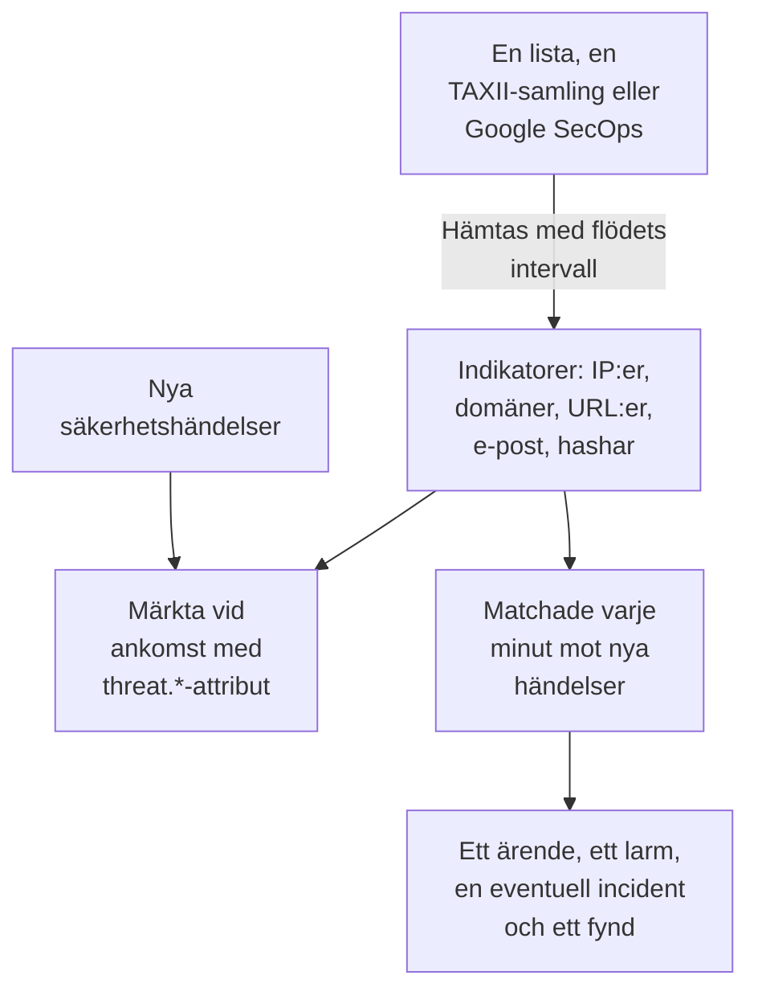

# Hotunderrättelser (STIX/TAXII)

Ett threat intel-flöde hämtar in kända skadliga IP-adresser, domäner, URL:er, e-postadresser och filhashar i OneUptime och talar om för dig när dina [säkerhetshändelser](/docs/telemetry/security-events) nämner någon av dem. Ett flöde läser en källa: en lista med indikatorer på en https-adress, som gratislistorna OneUptime lägger till med ett klick, en TAXII 2.1-samling med STIX 2.1-indikatorer från din egen MISP-, OpenCTI- eller OpenTAXII-server eller från en leverantör, eller indikatorerna som Google SecOps hittade i dina händelser.

:::cards
- [Lägg till en gratislista](#lägg-till-en-gratislista): Feodo Tracker, Emerging Threats och Tors utgångsnoder, med ett klick.
- [Prenumerera på ett flöde](#prenumerera-på-ett-flöde): En listas adress, en TAXII-samling eller en Google SecOps-anslutning.
- [Vad som tas in](#vad-som-tas-in): Indikatormönstren som OneUptime behåller, och hur länge.
- [Så hittas träffar](#så-hittas-träffar): Märkta när händelser kommer in, och matchade varje minut.
- [Hotnivåer](#hotnivåer): Hur en indikators confidence blir en allvarlighetsgrad.
:::

## Så fungerar det



## Innan du börjar

- För en lista: en `https`-adress som laddar ned en textfil med en indikator per rad.
- För ett TAXII-flöde: en TAXII 2.1-server som publicerar STIX 2.1-objekt av typen `indicator`, och ID:t för samlingen som ska hämtas. Ett TAXII-flöde loggar in anonymt, med en bearer-token eller med HTTP Basic-autentisering.
- För ett Google SecOps-flöde: en [Google SecOps-anslutning](/docs/integrations/google-secops#konfigurera-den-hanterade-anslutningen) vars tjänstkonto får söka bland indikatorträffar: rollen `roles/chronicle.viewer` får det.
- Servrar som kräver ett TLS-klientcertifikat (mutual TLS), till exempel CISA AIS, stöds inte. MITRE:s offentliga ATT&CK-server publicerar tekniker och grupper i stället för indikatorer, så ett flöde som pekar på den förblir tomt.
- En roll som kan skapa flöden: Project Owner, Project Admin, Security Admin eller Security Member. Security Viewer kan läsa flöden och indikatorer. Se [Roller](/docs/permissions/reference#roller).

## Lägg till en gratislista

Kortet **Gratislistor** på **Hotinformation** lägger till en gratis blockeringslista med ett klick: klicka på **Lägg till lista** vid en lista, så skapar OneUptime ett flöde som laddar ned den enligt listans schema. En lista som projektet redan läser visar **Tillagd**.

| Lista | Publiceras av | Läses | Confidence | En träff öppnar |
| --- | --- | --- | --- | --- |
| Feodo Trackers C2-servrar för botnät | abuse.ch | Varje timme | 90, Critical | Ett ärende och ett larm |
| Emerging Threats komprometterade värdar | Proofpoint Emerging Threats | Varje dag | 70, High | Ett ärende och ett larm |
| Tors utgångsnoder | The Tor Project | Varje timme | 30, Low | Ett ärende |

En listas ruta länkar till dess villkor: Feodo Tracker är fri för all användning (CC0), och Emerging Threats-listan är BSD-licensierad. Ett flöde som lagts till från en lista redigeras och tas bort som alla andra.

## Prenumerera på ett flöde

:::steps
### Gå till Threat Intel

Öppna **Produkter → Security Events → Detektioner → Hotinformation**.

### Skapa flödet

Klicka på **Skapa Flöde med hotinformation** och välj dess **Källa**: **Lista med indikatorer**, **TAXII-samling** eller **Google SecOps**. Nästa steg frågar bara efter den källan: en listas **List-URL**, en samlings **TAXII-server** och **Inloggning**, eller **Google SecOps-anslutning**. **Vid träff** kommer sist. Fälten finns i tabellen nedan.

### Kontrollera den första hämtningen

Inom en minut eller två visar flödets rad **Senast hämtad**, och **Sammanfattning av senaste hämtning** berättar vad hämtningen fick med sig. Indikatorerna visas i tabellen **Indikatorer** under flödena.
:::

| Fält | Vad du anger |
| --- | --- |
| **Källa** | Var indikatorerna kommer ifrån. Den bestäms när flödet skapas: ett flöde från en annan källa är ett nytt flöde. |
| **List-URL** | För en lista: `https`-adressen till en textfil med en IP-adress, en domän, en URL eller en filhash per rad. |
| **Konfidens** | För en lista: hur säker listan är, 1 till 100. Varje indikator på listan får värdet, och det avgör [hotnivån](#hotnivåer); tomt är Medium. |
| **Google SecOps-anslutning** | För Google SecOps: anslutningen vars nyckel läser indikatorerna som Google SecOps hittade. **Anslut Google SecOps** öppnar **Anslutningar** när det inte finns någon. |
| **Rot-URL för TAXII-API** | Serverns TAXII 2.1-API-rot, till exempel `https://taxii.example.com/api1/`. Samlingarna adresseras under den. |
| **Samlings-id** | Samlingen som publicerar indikatorerna. |
| **Hämtningsintervall (minuter)** | Hur ofta källan läses: 1 till 1440 minuter, 60 som standard. En lista läses högst var 15:e minut. |
| **Lägsta konfidens** | För en TAXII-samling eller Google SecOps: indikatorer med lägre confidence hoppas över, 0 till 100, och 0 behåller allt. Indikatorer utan confidence släpps alltid igenom. |
| **Inloggning** | Hur OneUptime loggar in: **Ingen inloggning** för en offentlig samling, **Bearer-token** för en token från serverns operatör eller **Användarnamn och lösenord** för HTTP Basic-autentisering. |
| **API-token**, **Användarnamn för Basic Auth** och **Lösenord för Basic Auth** | Efterfrågas bara för den valda inloggningen. |
| **Öppna ett ärende vid matchning** | På som standard: varje händelse som nämner en indikator öppnar ett [ärende](/docs/telemetry/security-cases) om den, eller läggs till i det öppna ärende som redan handlar om den. |
| **Larm och incidenter** | **Skapa ett larm** som standard: varje indikator som träffar öppnar ett larm. |
| **Larmallvar** | Allvarlighetsgraden för varje larm som det här flödet öppnar. Lämna den tom för att använda varje indikators hotnivå. |
| **Deklarera en incident** eller **Båda** | Under **Larm och incidenter**. Incidenter driver joureskalering, SLA:er och statussidor, och larm räcker oftast för indikatorträffar. |
| **Incidentallvar** | Som **Larmallvar**, för incidenter. |
| **Skriv Detection Finding vid matchning** | På som standard: varje träff skriver ett fynd i händelseflödet. |

Ett TAXII-flödes tokens och lösenord krypteras och visas aldrig igen efter att du har sparat dem. För att ändra dem väljer du **Uppdatera inloggningsuppgifter** i flödets rad och sedan **Bearer-token**, **Användarnamn och lösenord** eller **Ingen inloggning**, som rensar det sparade: ditt val ersätter flödets inloggning, så att spara en token rensar ett sparat lösenord, och tvärtom.

### Så hämtas ett flöde

Varje hämtning ber om objekten som lagts till sedan den föregående, via TAXII-markören `added_after`, och läser upp till 10 sidor med 500 objekt. En stor samling synkroniseras därför över flera hämtningar: **Sammanfattning av senaste hämtning** säger till när fler sidor återstår. För att bli klar med en stor första synkronisering snabbare sänker du **Hämtningsintervall (minuter)**, ända ner till 1, tills den har kommit ikapp.

Hämtningarna presenterar sig med användaragenten `OneUptime/<version> (+https://oneuptime.com)`. Om leverantörens brandvägg svarar `403`, be dem att tillåta den: många brandväggar blockerar begäranden som ser ut som ett namnlöst skript.

Ett inaktiverat flöde varken hämtas eller matchas. Indikatorerna som det redan har fortsätter att märka nya händelser tills de löper ut.

### Så läses en lista

- Varje hämtning laddar ned hela listan och läser den en rad i taget: det första värdet på en rad, fram till ett mellanslag, en tabb, ett kommatecken eller ett semikolon. Rader som börjar med `#`, `;` eller `//` är kommentarer, en port efter en adress eller en domän tas bort, och ett adressintervall som `198.51.100.0/24` hoppas över.
- Ett värde förblir en aktiv indikator i 2 dagar efter hämtningen som senast läste det, och ett värde som listan tar bort slutar träffa vid nästa hämtning. En lista som inte har ändrats skrivs om en gång per dag.
- En lista rymmer högst 50 000 indikatorer. **Sammanfattning av senaste hämtning** berättar hur många som lästes, hur många rader som hoppades över och hur många som lämnades utanför.
- Adressen måste använda `https` och följer samma utgående regler som en anslutning: i OneUptime Cloud avvisas en privat adress.

### Så läses Google SecOps

- Varje hämtning läser indikatorträffarna som Google SecOps har registrerat sedan förra hämtningen, med Mandiants attribut: den träffade domänen, adressen eller filhashen, dess confidence, dess kategori och de kampanjer och aktörer den är kopplad till. Den första hämtningen läser de senaste 7 dagarna.
- En indikator förblir aktiv i 30 dagar efter att Google SecOps senast såg den, eller tills dess källa säger att den inte längre är aktiv, och en som en analytiker har tystat i Google SecOps slutar träffa även här.
- En träff som Google SecOps markerar som ett aktivt intrång är Critical, och en med hög prioritet är minst High.

## Vad som tas in

Från en TAXII-samling behåller OneUptime STIX-objekt av typen `indicator` vars mönster är ren likhet på någon av de här typerna. En lista och Google SecOps ger samma typer:

| Typ | Exempelmönster |
| --- | --- |
| IPv4-adress (`ipv4-addr`) | `[ipv4-addr:value = '198.51.100.7']` |
| IPv6-adress (`ipv6-addr`) | `[ipv6-addr:value = '2001:db8::7']` |
| Domännamn (`domain-name`) | `[domain-name:value = 'evil.example']` |
| URL (`url`) | `[url:value = 'http://evil.example/payload']` |
| E-postadress (`email-addr`) | `[email-addr:value = 'billing@evil.example']` |
| Filhash, SHA-256 (`file-hash-sha256`) | `[file:hashes.'SHA-256' = 'e3b0…b855']` |
| Filhash, SHA-1 (`file-hash-sha1`) | `[file:hashes.'SHA-1' = 'da39…0709']` |
| Filhash, MD5 (`file-hash-md5`) | `[file:hashes.MD5 = 'd41d…427e']` |

Jämförelser som är sammanfogade med `OR`, inom en `[...]` eller över flera, går bra, och varje värde blir en egen indikator:

```text
[domain-name:value = 'evil.example' OR domain-name:value = 'evil2.example']
[ipv4-addr:value = '198.51.100.7'] OR [url:value = 'http://evil.example/x']
```

Alla andra mönster, med `AND`, `FOLLOWEDBY`, `NOT`, `LIKE`, `MATCHES`, en tidsbestämning som `WITHIN` eller en annan objekttyp, hoppas över i sin helhet och räknas som ej stödda i **Sammanfattning av senaste hämtning**. Att översätta bara en del av ett `AND`-mönster skulle träffa mycket mer än vad flödets författare avsåg.

### Hur länge en indikator är aktiv

- En indikator träffar från sin `valid_from` till sin `valid_until`. Utan `valid_until` är den aktiv i 365 dagar från `valid_from`, och en ny hämtning förlänger inte det.
- En återkallad indikator, eller en som uppdaterats med en `valid_until` i det förflutna, slutar träffa så snart uppdateringen har hämtats. Detsamma gäller ett värde som leverantören tar bort från ett uppdaterat mönster.
- Värden lagras med gemener och träffar oavsett versaler och gemener.

Tabellen **Indikatorer** listar indikatorerna som de är lagrade, med en **Status** som är **Aktiv**, **Utgången** eller **Återkallad**. En indikator som hämtats på nytt kan visas två gånger en stund, och en utgången eller återkallad rad ligger kvar i listan tills lagringsrensningen tar bort den, upp till ungefär en månad efter att den löpt ut. Matchningen kontrollerar alltid giltighet och återkallelse, så en sådan rad träffar aldrig.

## Så hittas träffar

### Märkta när händelser kommer in

Varje inkommande säkerhetshändelse, från intags-API:et eller en anslutning, kontrolleras mot dina aktiva indikatorer innan den lagras. När en av dess observables (IP-adresserna, värdarna, domänerna, hasharna och användarna som hämtats från händelsen) är lika med en indikators värde, stämplas händelsen med de här attributen:

| Attribut | Värde |
| --- | --- |
| `threat.matched` | Alltid `"true"` på en märkt händelse |
| `threat.indicator_id` | STIX-indikatorns ID, eller `list` eller `google-secops` för de källorna |
| `threat.indicator_type` | Indikatorns typ, till exempel `ipv4-addr` eller `file-hash-sha256` |
| `threat.indicator_value` | Värdet som träffade, med gemener |
| `threat.feed` / `threat.feed_id` | Flödet som indikatorn kom från |
| `threat.confidence` | Indikatorns STIX-confidence |
| `threat.match_count` | Hur många av händelsens observables som träffade en indikator |

När flera indikatorer träffar en händelse är det den med högst confidence som fyller i de här värdena. De är vanliga attribut, så du kan söka på dem under **Händelser**, filtrera monitorer för säkerhetshändelser med dem och använda dem i detektionsregler:

```yaml title="threat-intel-logon.yml"
title: High-confidence indicator in a successful logon
level: critical
detection:
  selection:
    threat.matched: 'true'
    threat.confidence|gte: 80
    className: Authentication
    statusName: Success
  condition: selection
```

Märkningen känner bara till indikatorerna som finns när en händelse kommer in: händelser märks aldrig om senare.

### Matchade varje minut

Varje minut matchas varje aktiverat flödes aktiva indikatorer mot händelserna vars händelsetid infaller efter flödets föregående kontroll. Det fångar underrättelser som kom in efter att en händelse märktes.

- Den första kontrollen täcker de senaste 15 minuterna. Efter ett avbrott tar nästa kontroll igen högst de senaste 24 timmarna.
- Varje fönster kontrolleras en gång. Underrättelser som kommer in efter att deras fönster har kontrollerats gäller bara senare händelser.
- En händelse som kommer sent, med en tid från före den föregående kontrollen, märks fortfarande när den kommer in, men matchas inte.
- Varje kontroll registrerar varje indikatorvärde som träffade som ett Detection Finding, upp till 10 000 per flöde. Larm, incidenter och ärenden öppnas för de 100 värden som förekommer i flest händelser; resten delar ett ärende om flödet, och flödets **Senaste matchningsfel** säger hur många som träffade.

### Vad en träff gör

- Ett larm med titeln `[Threat Intel] <feed name> — <indicator value>`, ett per flöde och värde så länge det är öppet. När det har lösts öppnar nästa träff ett nytt. Larm löses inte automatiskt.
- En incident, bara med **Deklarera en incident** eller **Båda** under **Larm och incidenter**, deduplicerad på samma sätt.
- Ett Threat Intel-fynd, med **Skriv Detection Finding vid matchning**: en händelse `Detection Finding` (OCSF-klass 2004) från produkten `OneUptime Threat Intel`, med indikatorns hotnivå som allvarlighetsgrad och de här attributen:

| Attribut | Värde |
| --- | --- |
| `oneuptime.threat.feed_id` / `oneuptime.threat.feed_name` | Flödet |
| `oneuptime.threat.indicator_id` | STIX-indikatorns ID, eller `list` eller `google-secops` för de källorna |
| `oneuptime.threat.indicator_type` / `oneuptime.threat.indicator_value` | Det som träffade |
| `oneuptime.threat.confidence` | Indikatorns confidence |
| `oneuptime.threat.match_count` | Hur många händelser som ligger bakom det här fyndet |

Fynd matchas aldrig själva, så en träff kan inte utlösa en annan.

## Hotnivåer

Indikatorer har ingen Sigma-nivå: deras STIX-`confidence` ger i stället en hotnivå.

| Indikatorns confidence | Hotnivå |
| --- | --- |
| 90 till 100 | Critical |
| 70 till 89 | High |
| 40 till 69 | Medium |
| 1 till 39 | Low |
| Utan poäng (0 eller saknas) | Medium |

En indikator utan poäng räknas som Medium: någon valde ändå att lägga den i ett flöde. Hotnivån är fyndets allvarlighetsgrad och väljer larmets allvarlighetsgrad bland projektets allvarlighetsgrader, i den här ordningen:

1. Flödets **Larmallvar** (eller **Incidentallvar**), när den är angiven: den gäller varje träff från flödet.
2. Din allvarlighetsgrad som är uppkallad efter hotnivån, till exempel High, oavsett versaler och gemener.
3. Efter rang: Critical och High får din allvarligaste allvarlighetsgrad, Medium och Low din minst allvarliga.

Hotnivån hör till varje indikator, inte till flödet, så ett flöde kan öppna ett Critical-larm och ett Low-larm under samma minut. **Lägsta konfidens** filtrerar på samma tal: ett minimum på 70 behåller bara High- och Critical-indikatorer, plus de utan poäng, som alltid släpps igenom.

## Håll koll på ett flödes träffar

Åtgärden **Skapa monitor** i ett flödes rad öppnar en ny monitor för säkerhetshändelser som räknar flödets fynd: händelseklassen `Detection Finding`, filtrerad på flödets ID i `oneuptime.threat.feed_id` (aldrig dess namn, som ett namnbyte skulle ändra), över den senaste timmen. Använd den för en plötslig våg av träffar, eller för ett flitigt flöde som tystnar.

## Lagring och fakturering

Indikatorer är konfiguration, inte telemetri, och faktureras inte som intagna data. Fynden som en träff skriver är vanliga säkerhetshändelser, som faktureras och lagras som resten: se [Säkerhetshändelser](/docs/telemetry/security-events#lagring-och-fakturering).

## Felsökning

:::details Last Error är satt efter en hämtning
`401` eller `403`: autentiseringsuppgifterna är fel eller saknas; ersätt dem med **Uppdatera inloggningsuppgifter**. En `403` kan också vara leverantörens brandvägg som blockerar användaragenten. `404`: kontrollera **Rot-URL för TAXII-API**, som oftast slutar med en sökväg som `/api1/`, och **Samlings-id**. Felet försvinner vid nästa lyckade hämtning.
:::

:::details Flödet hämtas, men inga indikatorer visas
Läs **Sammanfattning av senaste hämtning**. Inga objekt hämtade: samlingen är tom eller publicerar inga indikatorer. Mönster som inte stöds: leverantören använder mönsterfunktioner som den här sidan anger som överhoppade. Under minsta confidence: sänk **Lägsta konfidens**. Redan inaktiva: leverantören skickade indikatorer som redan var återkallade eller utgångna.
:::

:::details Det finns indikatorer, men ingenting träffar
Matchningen jämför en indikators värde med en händelses observables, inte med varje fält: öppna en händelse som du väntade dig skulle träffa under **Händelser** och kontrollera att dess observables innehåller värdet. Bara indikatorer med statusen **Aktiv** träffar. Står det **Jämförelsen misslyckades** i flödets **Status**, visar **Visa fel** i dess rad varför.
:::

:::details Senaste fel för ett listflöde säger att adressen svarade med en webbsida
**List-URL** öppnar en sida, till exempel en inloggnings- eller felsida, inte listan: öppna den i en webbläsare och kopiera adressen till själva filen. En lista vars text inte innehåller någon IP-adress, domän, URL eller filhash avvisas på samma sätt, och flödets indikatorer behålls som de var.
:::

:::details Senaste fel för ett Google SecOps-flöde säger HTTP 403
Anslutningens tjänstkonto får inte söka bland indikatorträffar: ge det `roles/chronicle.viewer`. Om anslutningen har tagits bort säger flödet det: redigera det och välj en annan **Google SecOps-anslutning**.
:::

:::details En träff öppnade inget larm
**Larm och incidenter** är satt till **Deklarera en incident** eller **Ingetdera**, eller ett larm för samma flöde och värde är fortfarande öppet, och senare träffar slås ihop med det. Ett projekt behöver minst en larmallvarlighetsgrad för att ett flöde ska kunna öppna larm.
:::

## Nästa steg

:::cards
- [Säkerhetshändelser](/docs/telemetry/security-events): Skicka händelser, sök i dem och skriv detektionsregler.
- [Google SecOps](/docs/integrations/google-secops): Hämta in Chronicles detektioner och händelser.
- [Behörighetsreferens](/docs/permissions/reference): Security-rollerna, och vad var och en kan göra.
:::
