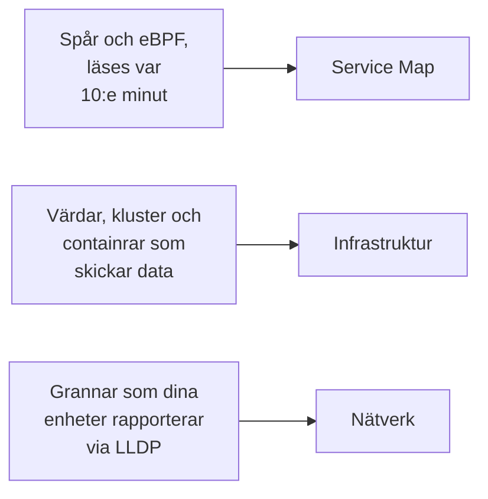

# Topologi

Topologi ritar hur dina system hänger ihop: vilka tjänster som anropar vilka, vad som körs var och hur dina nätverksenheter är kopplade. OneUptime bygger den från den telemetri du redan skickar, så det finns inget att rita för hand, och den visar med en blick var fel och incidenter finns.

:::cards
- [Öppna Topologi](#öppna-topologi): Tre vyer av en sida.
- [Läs tjänstekartan](#läs-tjänstekartan): Vem som anropar vem, och hur friska anropen är.
- [Utforska din infrastruktur](#utforska-din-infrastruktur): Var varje tjänst körs.
- [Öppna en resurs egen karta](#öppna-en-resurs-egen-karta): Ett vCenter, ett kluster eller en värd i detalj.
- [Se ditt nätverk](#se-ditt-nätverk): Enheter och deras länkar, live.
:::

## Så byggs kartan

Varje vy i Topologi byggs från en annan sorts telemetri:

- **Bara det som var aktivt ritas.** En vy visar de tjänster och resurser som skickade data under tidsintervallet, och de anslutningar som sågs under det. Slå på **Visa inaktiva** för att också rita de tysta.
- **Anrop räknas över ett nyligt fönster.** OneUptime letar efter anrop mellan tjänster var 10:e minut, och trafiksiffrorna täcker de senaste 15 minuterna, inte hela tidsintervallet.
- **Nätverksvyn är live.** Den visar dina enheter som de är anslutna nu, så den har inget tidsintervall.

## Innan du börjar

- **Telemetri som kommer in.** Tjänstekartan behöver spår: se [OpenTelemetry](/docs/telemetry/open-telemetry). Infrastrukturvyn behöver en värd eller ett kluster som skickar data: se [Kubernetes-agenten](/docs/telemetry/kubernetes-agent). Nätverksvyn behöver nätverksenheter: se [Nätverksenhets-övervakning](/docs/monitor/network-device-monitor).
- **En roll som läser telemetri.** Project Owner, Project Admin, Project Member, Viewer, Telemetry Admin, Telemetry Member eller Telemetry Viewer, eller en anpassad roll med behörigheten Read Telemetry Service.

## Öppna Topologi

Gå till **Produkter → Observerbarhet → Topologi**. **Inventarie → Topology Map** öppnar samma sida. Den öppnas på **Service Map**, för **Senaste dygnet**.

| Vy | Frågan den besvarar |
| --- | --- |
| **Service Map** | Vilka tjänster beror på varandra? |
| **Infrastruktur** | Vad körs var i din infrastruktur? |
| **Nätverk** | Hur är dina nätverksenheter anslutna? |

Bredvid tidsväljaren lägger **Visa inaktiva** till det som inte skickade data under intervallet, och uppdateringsknappen läser in vyn igen. **Vad som visas · Om dessa data** berättar vad vyn ritar och hur ofta den räknas fram. Adressfältet minns vyn du är i, så en länk du delar öppnar samma vy.

## Läs tjänstekartan

**Service Map** ritar varje tjänst som skickade data, och de databaser, API:er och meddelandemäklare som de anropar, även när dessa inte skickar någon egen telemetri. Pilar pekar från anroparen till den anropade, och tjockare linjer bär fler begäranden. Siffrorna ovanför säger hur många tjänster, beroenden och anslutningar den ritar, och hur många som kräver uppmärksamhet.

Varje tjänst visar sin status, beräknad från de anrop den tog emot under de senaste 15 minuterna:

| Status | När |
| --- | --- |
| **Felfri** | Högst 1 % av de mottagna anropen misslyckades. |
| **Some errors** | Mer än 1 % och mindre än 5 % misslyckades. |
| **High error rate** | 5 % eller mer misslyckades. |
| **Entry point** | Den tog inte emot några anrop, men gjorde några: en webbfrontend eller ett schemalagt jobb. |
| **No calls observed** | Den varken gjorde eller tog emot något anrop. |

En tjänst med en aktiv incident eller larm visar i stället hur många, och precis som en tjänst med **Some errors** eller en **High error rate** räknas den som en som kräver uppmärksamhet.

:::steps
### Hitta tjänsterna som kräver uppmärksamhet

Klicka på **Kräver uppmärksamhet** för att bara behålla de tjänsterna och deras direkta anslutningar, eller sök efter namn i rutan ovanför kartan.

### Öppna en tjänst

Klicka på en tjänst för att se dess begäranden, fel och genomsnittliga latens under de senaste 15 minuterna, dess **Aktiva incidenter** och **Aktiva larm**, och länkar till **Spår för den här tjänsten** och dess **Inventariedetaljer**.

### Öppna en anslutning

Klicka på en pil för att se dess begärandefrekvens, felfrekvens och genomsnittliga latens. Mellan två tjänster som du instrumenterar har den också en **History** över anrop, fel och latens.
:::

**Anslutningsetiketter** skriver en siffra på varje pil: **Begärandefrekvens**, **Felfrekvens** eller **Genomsnittlig latens**, eller ingen förrän du håller muspekaren över. **Tabell** listar samma tjänster med deras **Begäranden**, **Felfrekvens**, **Snittlatens** och **Anslutningar**, och **Visa på kartan** ritar en av dem.

## Utforska din infrastruktur

**Infrastruktur** visar var dina tjänster körs: kluster, värdar, poddar, containrar och de andra resurser som skickar data. Repliker av samma arbetsbelastning grupperas i en post, och du kan öppna vad som helst för att se inuti.

- **Bläddra på ditt sätt.** Visa den som **Lista** eller **Karta**, från hela din infrastruktur ned till en enda podd. Siffrorna ovanför säger hur många resurser och arbetsbelastningar den ritar, hur många tjänster den kan placera och hur många tysta resurser den utelämnar.
- **Hitta en resurs.** Sök efter den med namn och klicka på **Visa detaljer** för att öppna dess sida.
- **Växla mellan vyer.** En tjänst som listas på en resurs öppnas på **Service Map**, och de resurser som en tjänst körs på öppnas på **Infrastruktur**.

## Öppna en resurs egen karta

Ett vCenter, ett Kubernetes-kluster, en värd, en Docker- eller Podman-värd, ett Docker Swarm-, Proxmox- eller Ceph-kluster och en lagringsarray har var sin egen sida **Topologi**. Den ritar just den resursen i detalj utifrån dess eget inventarie: vad som ligger i vad, varje del färgad efter hur den mår, och varje öppen incident och varje öppet larm på den del det gäller.

- **Läs det som ett träd.** Resursen står överst, och varje dels delar ritas till höger om den, förbundna med den genom en linje som blir röd eller orange där något kräver uppmärksamhet. Delar med problem inuti öppnas av sig själva, den runda knappen på en del öppnar eller stänger den, och piltangenterna rör sig genom kartan.
- **Hitta det som kräver uppmärksamhet.** **Kräver uppmärksamhet** behåller bara delarna med problem och vägen till var och en, och sökningen hittar en del var som helst i resursen.
- **Titta närmare.** Klicka på en del för att se vad den är, med en länk till dess egen sida, och på **Fokusera på detta** för att bara rita den delen, vad den innehåller och vad den hänger ihop med.
- **Gå åt båda hållen.** **Öppna i Topologi** öppnar resursen på **Infrastruktur**, och dess knapp **Öppna vCenter-topologin**, **Öppna klustertopologin**, **Öppna värdtopologin** eller **Öppna lagringsarrayens topologi** leder tillbaka.

## Se ditt nätverk

**Nätverk** är den levande kartan över dina nätverksenheter, byggd från de grannar de rapporterar via LLDP, och via CDP på Cisco-enheter. Den har ingen tidsväljare: anslutningarna uppdateras av sig själva.

Om du grupperar enheter i platser öppnas vyn på dina platser: välj en, eller växla till **All devices**. **Map options** ordnar kartan och väljer vad den tar med, och **Exportera PDF** sparar kartan du ser. Nätverksenheternas sidor ritar samma karta: se [Nätverkstopologi](/docs/monitor/network-device-monitor#nätverkstopologi).

## Felsökning

:::details Tjänstekartan visar tjänster men inga anslutningar
OneUptime hittar anrop mellan tjänster i dina spår var 10:e minut. Den ser ett anrop när en begäran bär spårkontext, `traceparent`-headern, från en instrumenterad tjänst till nästa, som OpenTelemetrys HTTP- och gRPC-instrumenteringar gör; när en tjänst rapporterar klient-spans för de databaser och API:er den anropar; eller när Kubernetes-agenten körs med eBPF.
:::

:::details En tjänst som jag har tagit bort finns kvar på kartan
Den skickade data inom tidsintervallet. Välj ett kortare intervall, eller vänta tills dess senaste telemetri hamnar utanför intervallet. Med **Visa inaktiva** påslaget ritar kartan också det som har slutat skicka data.
:::

:::details Kartan säger att bara en del av den visas
Ett mycket stort projekt når kartans gränser, och ett meddelande säger hur många resurser eller anslutningar den visar. Sök efter en tjänst, eller använd **Visa på kartan** i tabellen, för att rita en läsbar del av den.
:::

## Nästa steg

:::cards
- [Tjänstekatalog](/docs/telemetry/services): Allt om en tjänst.
- [Spårutforskare](/docs/telemetry/traces-explorer): Begärandena bakom varje pil.
- [Inventarie – Översikt](/docs/inventory/overview): Varje resurs som kartan ritar.
- [Nätverksenhets-övervakning](/docs/monitor/network-device-monitor): Sätt ditt nätverk på kartan.
:::
