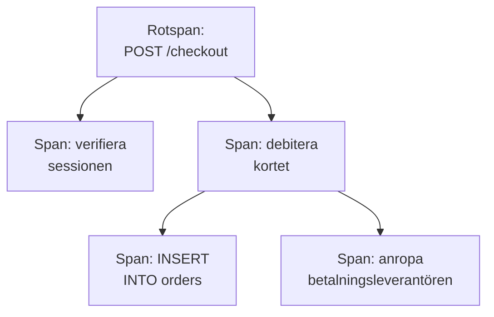

# Spårutforskare

Spårutforskaren hittar förfrågningarna som har gått genom dina tjänster: de långsamma, de misslyckade, de som rörde en viss kunds konto. Sök i och filtrera de spans som dina tjänster skickar, och öppna sedan ett spår för att se varje steg i förfrågan som ett vattenfall, ett flamdiagram eller en tjänstekarta.

:::cards
- [Hitta en förfrågan](#hitta-en-förfrågan): Sök i spans och filtrera sedan på tjänst, status eller typ.
- [Läs ett spår](#läs-ett-spår): Vart tiden tog vägen, och vilket steg som misslyckades.
- [Visa dina spans i diagram](#visa-dina-spans-i-diagram): Antal förfrågningar och svarstider, grupperade som du vill.
- [Insikter i spår](#insikter-i-spår): Felfrekvenser, latens och de långsammaste förfrågningarna.
- [Hitta och åtgärda långsamma och felande operationer med AI](#hitta-och-åtgärda-långsamma-och-felande-operationer-med-ai): Pull requests som åtgärdar dem och lägger till den spårning som ett spår saknar.
:::

## Spår och spans

Ett spår är en förfrågan på väg genom ditt system. Varje steg den tar, som en HTTP-hanterare, en databasfråga eller ett anrop till en annan tjänst, är ett span, och spans ligger inuti de spans som startade dem. Det första spannet i ett spår, utan förälder, är dess rotspan: förfrågans ingångspunkt.

Varje rad i utforskaren är ett span. Som standard visar listan **Entry spans**, de span där en förfrågan eller ett meddelande kommer in i en tjänst, så att en förfrågan visas en gång för varje tjänst den når, medan databasfrågor och interna anrop hålls utanför listan. För att visa en rad per förfrågan väljer du **Root spans** under **Span-kategori** i sidopanelen; för att visa varje operation väljer du **All spans**.

Utforskaren har fem flikar:

| Flik | Vad den är till för |
| --- | --- |
| **Tittare** | Sök i och filtrera spans, och öppna deras spår. Den öppnas på den senaste timmen, nyaste först, 50 spans per sida. |
| **Insikter** | Antal förfrågningar, felfrekvenser och latens per tjänst, och de förfrågningar som är värda en titt. |
| **AI** | De långsamma och felande operationer och den saknade spårning som OneUptime hittar i dina spår, och vad OneUptime AI gjorde åt dem. Se [Hitta och åtgärda långsamma och felande operationer med AI](#hitta-och-åtgärda-långsamma-och-felande-operationer-med-ai). |
| **Installationsguide** | Hur du skickar spår med OpenTelemetry med en av dina [inmatningsnycklar](/docs/telemetry/ingestion-keys). |
| **Inställningar** | Vad som händer med spans när de kommer in: **Pipelines**, **Drop-filter**, **Scrub-regler** och **Inspelningsregler**. |

## Innan du börjar

- **Spår som kommer in.** Instrumentera dina tjänster med [OpenTelemetry](/docs/telemetry/open-telemetry). Fliken **Installationsguide** visar koden för ditt språk.
- **En roll som får läsa telemetri.** Project Owner, Project Admin, Project Member, Viewer, Telemetry Admin, Telemetry Member eller Telemetry Viewer, eller en anpassad roll med behörigheten Read Telemetry Service Traces. Dess omfång avgör vems spans du ser: se [Telemetri](/docs/permissions/index#telemetri).

## Hitta en förfrågan

:::steps
### Öppna Tittare

Gå till **Produkter → Observerbarhet → Spår**. **Tittare** visar spans från den senaste timmen, nyaste först, vart och ett med status, tjänst, namn och varaktighet.

### Välj tidsintervallet

Välj ett intervall i tidsväljaren, eller dra över diagrammet ovanför listan för att zooma in på en topp. Dubbelklicka på diagrammet för att zooma ut igen. Se [Zooma in på ett tidsintervall](/docs/telemetry/charts-and-time-ranges).

### Sök

Skriv en fråga och tryck på Enter, till exempel `service:checkout status:error duration:>500`. Lösa ord söker i span-namn, och `@key:value` söker i ett attribut som `@http.route:/orders`. Se [Söksyntax](/docs/telemetry/search-syntax#spår).

### Avgränsa med filter

Klicka på ett värde i sidopanelen **Filter** för att lägga till det som ett chip. Sidopanelen filtrerar på **Tjänst**, på värden, klustret eller den andra resursen som skickade spannet, på **Status**, **Span-kategori**, **Har undantag**, **Span-typ**, **Span-namn**, **Tjänstinstans** och **Värdens namn**.

### Öppna ett span

Klicka på en rad för att fälla ut den: dess attribut, och loggarna och undantagen som den registrerade. Klicka på **See full trace** för att öppna hela spåret.
:::

Din sökning, dina chips och tidsintervallet sparas i sidans adress, så att en omladdning, ett bokmärke eller en delad länk öppnar samma spans.

## Läs ett spår

Ett spårs sida börjar med förfrågans siffror:

| Siffra | Vad den är |
| --- | --- |
| Varaktighet | Hur lång tid hela förfrågan tog. |
| Spans | Hur många spans spåret har. |
| Tjänster | Hur många tjänster förfrågan gick genom. |
| Fel | Hur många spans som slutade med en felstatus. Klicka på den för att bara visa dem. |
| Djup | Den djupaste kedjan av nästlade spans. |

Under dem väljer du en av fyra vyer:

| Vy | Vad den visar |
| --- | --- |
| **Waterfall** | Varje span på en tidslinje, nästlat under det span som startade det. Slå på **Critical path** för att markera kedjan av spans som avgjorde hur lång tid förfrågan tog. |
| **Flamdiagram** | Samma träd som staplade staplar, där de bredaste staplarna tog längst tid. |
| **Service map** | Tjänsterna som förfrågan gick genom, och anropen mellan dem. |
| **Operations** | En rad per tjänst och span-namn, med anrop, fel, egen tid och total tid. En operation som anropas 10 gånger eller mer från ett och samma föräldraspan markeras: ofta en N+1-fråga eller en loop som kunde ha samlats ihop. |

Klicka på ett span i valfri vy för att öppna dess panel, med flikar för attribut, händelser, loggar, undantag och länkar, och för dess profil eller LLM-anrop när det har ett. Sök bland spårets spans på namn, ID eller tjänst med sökrutan bredvid vyerna (tryck på `/`), och slå på **Errors only** för att bara behålla de spans som misslyckades.

Ett stort spår läser in 500 spans åt gången. Klicka på knappen längst ned i spåret för att läsa in fler, eller alla.

> [!TIP]
> **Åtgärda prestandan med AI** visas bara på ett spår som är värt att åtgärda: ett med en N+1-fråga, anrop efter varandra som kunde köras parallellt, eller ett anrop som tar största delen av begäran, när det kostar verklig tid (100 ms eller mer för anropen tillsammans, 500 ms eller mer för ett enskilt anrop och minst en tiondel av begäran). Den talar om vad den hittade, till exempel "Samma databasfråga kördes 40 gånger i ReportService.build", och startar en AI-uppgift som öppnar en pull request som åtgärdar det. När flera repositorier är anslutna och inget matchar spårets tjänst eller kod frågar den först vilket repository som innehåller koden. När en åtgärd för spåret redan har gjort sitt arbete länkar spåret till dess uppgift i stället för att erbjuda en till. När något annat hindrar AI från att arbeta, som abonnemanget, slut på AI-krediter eller ingen Runner online, säger spåret vad, med länken som löser det. Se [Kod](/docs/ai/ai-agent).

## Visa dina spans i diagram

Diagrammet ovanför listan visar antalet spans över tid, uppdelat på status. Välj ett annat mått i diagrammets rubrik för att i stället visa deras genomsnittliga svarstid, median (P50) eller P95.

För mer byter du listan från **Spans** till **Analytics**. Välj en tidsserie, en topplista eller en tabell; mät antal förfrågningar, antal fel eller svarstider (genomsnitt, P50, P90, P95, P99, minimum eller maximum); och gruppera på span-namn, tjänst, status, span-typ eller valfritt attribut, och sedan på ett andra fält. En topplista eller en tabell visar de 5 till 100 största grupperna.

## Följ, spara och dela

- Klicka på **Pausad** ovanför listan för att slå på liveuppdateringar. Knappen visar då **Live**, och listan letar efter nya spans var tionde sekund. Klicka igen för att pausa.
- **Sparade vyer** behåller en sökning, dess filter och tidsintervallet under ett namn, för alla i projektet. Sparade vyer fungerar som i [Loggutforskare](/docs/telemetry/logs-explorer#spara-en-vy).
- Knapparna **Loggar** och **Mätvärden** öppnar de utforskarna för samma tidsfönster, med så mycket av din filtrering som de kan använda. Peka på en knapp för att se vad den inte kan ta med sig.

## Insikter i spår

Fliken **Insikter** sammanfattar förfrågningarna i ett tidsintervall:

- antalet förfrågningar, felfrekvensen och latensen för P50, P95 och P99;
- en hälsotabell över dina tjänster, sorterad på felfrekvens, så att de tjänster som behöver uppmärksamhet kommer först;
- de senaste misslyckade förfrågningarna, och de långsammaste.

Begränsa den till vissa tjänster med listrutan bredvid tidsväljaren.

## Hitta och åtgärda långsamma och felande operationer med AI

Varje timme går OneUptime igenom varje tjänsts spår från den senaste timmen efter operationer som är långsamma, som misslyckas eller vars spår inte kan visa varför, och registrerar det den hittar som AI-insikter, med bevisen. Sedan undersöker OneUptime AI varje fynd och öppnar en pull request som åtgärdar det. Inget slås någonsin ihop: ditt team granskar varje pull request.

En operation är en tjänsts spans med samma namn, till exempel `GET /orders`. OneUptime läser en tjänst så snart den har skickat minst 100 spans under den senaste timmen, och registrerar tre sorters fynd:

| Fynd | När OneUptime registrerar det | Pull requesten |
| --- | --- | --- |
| **Långsam operation** | Operationens P99 är 1 sekund eller mer över minst 20 spans, och dess långsammaste förfrågan upprepar ett mönster som kostar verklig tid: samma anrop om och om igen, anrop efter varandra som kunde köras parallellt, eller ett anrop som tar det mesta av förfrågan. | Gör operationen snabbare. |
| **Felande operation** | Minst 20 av operationens spans misslyckades, 5 % eller fler av dem, och de senaste felen säger varför, med ett undantag eller ett felmeddelande. | Åtgärdar orsaken till att den misslyckas. |
| **Saknad spårning** | Spåren kan inte visa varför: var och en av en tjänsts 500 eller fler spans var roten i sitt spår, utan något span från tjänsten under sig, en långsam förfrågan tillbringade 60 % eller mer av sin tid (och 500 ms eller mer) i ett span utan något spårat under sig, eller en operations fel registrerade varken ett felmeddelande eller ett undantag. | Lägger till den spårning som saknas. |

OneUptime AI öppnar bara själv pull requesten för en felande operation när den hittar den skyldiga koden. Ett fel som kommer från något annat håll, till exempel ett beroende som ligger nere, får ingen pull request om inte någon ber om en med **Åtgärda med AI**.

### Slå på det

**Spår → AI → Inställningar** har reglaget **Hitta och åtgärda långsamma och felande operationer**, som är på för nya projekt. När **Aktivera AI** är av hittas långsamma och felande operationer fortfarande, men OneUptime AI gör ingenting med dem. För att öppna pull requests behöver OneUptime AI ett repository anslutet i [Kod](/docs/ai/ai-agent): sidan säger först vad som saknas. Koden i varje repository ändras på den Runner som repositoryt väljer i Kod.

OneUptime AI öppnar själv högst 5 pull requests per dag (UTC), en för varje fynd, och aldrig fler än ett repositorys gräns för öppna AI-pull requests.

### AI-regler

Utan regler undersöker OneUptime AI direkt varje problem den hittar i dina spår och öppnar en pull request för vart och ett den kan åtgärda. **AI-regler** under **Fler inställningar** begränsar det, i tre steg:

| Steg | Vad det avgör |
| --- | --- |
| **Matcha** | Vilka tjänster: de valda, de med vissa etiketter eller de vars namn matchar ett mönster. |
| **Utreda** | **Direkt**, eller **Bara om fortfarande hittad efter en väntetid**: ett problem som försvinner under väntetiden undersöks inte. |
| **Åtgärd** | **Åtgärda inte**, **Fråga innan något åtgärdas** eller **Åtgärda utan att fråga**. Att fråga först lämnar pull requesten till en person: fyndet erbjuder **Åtgärda med AI**. |

Under **Fler fält** väljer en regel de kodrepositorier, MCP-servrar och den LLM-leverantör som OneUptime AI får använda för den. Är inget valt får den använda alla, och projektets standard-LLM-leverantör.

### Se vad den gjorde

- **Spår → AI → Insikter** visar vad OneUptime hittade, varje fynd med sina bevis och **Öppna i Spår**, som öppnar de spans det gäller, från timmen då det hittades, i **Tittare**. För en felande operation skapar **Skapa monitor** en spårmonitor för dess misslyckade spans.
- **Spår → AI → Loggar** visar varje utredning och varje pull request, nyast först, med hur var och en står och vad varje utredning hittade.
- I Kod säger uppgiften att OneUptime startade den, med en länk till dess fynd, och pull requesten säger varför den öppnades.

## Vad som händer med spans när de kommer in

Fliken **Inställningar** innehåller reglerna som OneUptime tillämpar på spans när de kommer in, som för loggar. De gäller de spans som kommer in efteråt, inte de som redan är lagrade. Hur länge varje span sparas avgörs också när den kommer in: se [Datalagring](/docs/telemetry/data-retention).

| Regel | Vad den gör |
| --- | --- |
| **Drop-filter** | Kasta spans som du inte vill behålla, eller behåll ett stickprov av dem. Se [Kassera poster eller ta stickprov](/docs/telemetry/drop-filters-and-scrub-rules#kassera-poster-eller-ta-stickprov). |
| **Scrub-regler** | Maskera känsliga data i span-attribut. Se [Rensa känsliga data](/docs/telemetry/drop-filters-and-scrub-rules#rensa-känsliga-data). |
| **Pipelines** | Ändra och berika spans: varje pipeline väljer ut spans med ett filter och kör sedan sina processorer i ordning. |
| **Inspelningsregler** | Gör om antal spans, antal fel och varaktigheter till nya mätvärden, varje minut. Se [Inspelningsregler för loggar](/docs/telemetry/log-recording-rules). |

## Felsökning

:::details Ett spår säger att inga spans hittades
Spans kommer oftast in inom en minut efter att förfrågan är klar. Klicka på **Uppdatera** på spårets sida för att kontrollera igen.
:::

:::details Vissa spans ligger på översta nivån i vattenfallet
De pekar på ett föräldraspan som OneUptime inte har tagit emot, ofta för att tjänsten som skrev föräldern ännu inte skickar spår till OneUptime. Instrumentera den tjänsten också.
:::

:::details Listan visar betydligt fler rader än förfrågningar
Varje rad är ett span, inte en förfrågan: med **Entry spans**, som är standard, visas en förfrågan en gång för varje tjänst den når, och med **All spans** en gång för varje operation. Välj **Root spans** under **Span-kategori** i sidopanelen för att visa en rad per förfrågan.
:::

## Nästa steg

:::cards
- [Söksyntax](/docs/telemetry/search-syntax): Varje filter som sökrutan förstår.
- [Spårningsövervakning](/docs/monitor/traces-monitor): Få larm om misslyckade eller långsamma förfrågningar.
- [Undantagsspårning](/docs/telemetry/exceptions): Gå igenom felen som dina spans registrerar.
- [Loggutforskare](/docs/telemetry/logs-explorer): Läs loggraderna som en förfrågan skrev.
:::
