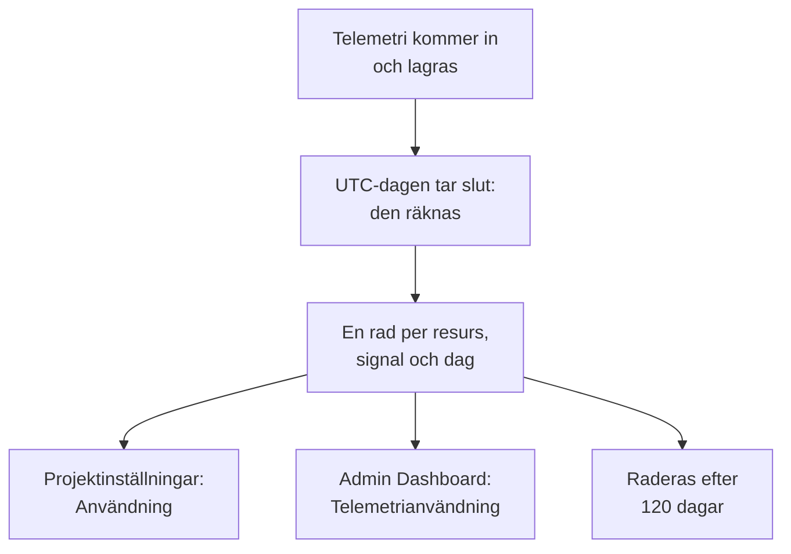

# Telemetrianvändning

Se hur mycket telemetri varje projekt, och varje tjänst eller resurs i det, skickar: loggar, mätvärden, spår och deras undantag, profiler, sessionsuppspelningar och säkerhetshändelser. Användningen räknas på varje OneUptime-installation, med eller utan fakturering, så att du kan hitta det som fyller din lagring utan att köra frågor mot ClickHouse.

:::cards
- [Hur användningen räknas](#hur-användningen-räknas): En gång om dagen, för varje resurs och signal.
- [Se ett projekts användning](#se-ett-projekts-användning): Projektinställningar → Telemetri och APM → Användning.
- [Se alla projekts användning](#se-alla-projekts-användning): Admin Dashboard, för instansadministratören.
- [Hur länge användningen sparas](#hur-länge-användningen-sparas): 120 dagar om du inte ändrar det.
:::

## Hur användningen räknas

En gång om dagen, när en dag har tagit slut i UTC, räknar OneUptime vad varje resurs i varje projekt skickade den dagen, för varje signal, och sparar resultatet som en rad per resurs, signal och dag.



- **En dag räknas när den är slut.** Varje dag räknas senast omkring 08:00 UTC nästa dag, så dagens användning visas i morgon. En dag som inte gick att räkna försöker OneUptime räkna igen under en vecka.
- **Storleken är den lagrade storleken.** Varje signal räknas som storleken på de rader den lagras i, före komprimering. Sessionsuppspelningar räknas som de byte som inspelarna laddade upp.
- **Spår inkluderar sina undantag, och profiler sina prov.**
- **OneUptimes egen telemetri räknas inte.** Avläsningar från monitorer, larm, incidenter och SLO:er, avläsningar från Dataobserverbarhet och budgetmätvärdena för sessionsuppspelningar skrivs av OneUptime självt.
- **På OneUptime Cloud är det de här raderna som telemetrin faktureras efter.** På en installation utan fakturering räknas användningen utan kostnad, och inget debiteras för den, inte ens om fakturering slås på senare.

## Innan du börjar

- **En roll som läser projektets telemetri.** Projektägare, Projektadministratör, Projektmedlem, Tittare, Telemetriadministratör, Telemetrimedlem eller Telemetritittare, eller en av faktureringsrollerna. Rollen måste omfatta hela projektet: en roll som är begränsad till vissa etiketter visar ingen användning.
- **Telemetri i projektet.** Användningen räknas för den telemetri som projektets [intagningsnycklar](/docs/telemetry/ingestion-keys) skickar.

## Se ett projekts användning

:::steps
### Öppna Användning

Gå till **Projektinställningar → Telemetri och APM → Användning**. **Telemetri och APM** är först hopfälld i sidomenyn: klicka på den för att öppna den.

### Välj ett intervall

Sidan öppnas på **Senaste 30 dagarna**. Välj **Senaste 7 dagarna** eller **Senaste 90 dagarna** i rutan längst upp till höger på kortet **Telemetrianvändning**. Ett intervall slutar med i går, den senaste dagen som har räknats.

### Hitta det som har växt

Kortet **Användning per resurs** listar varje tjänst och resurs som skickade något under intervallet, störst först. Klicka på en kolumns rubrik för att sortera efter den, och på en resurs namn för att öppna dess sida.
:::

Sidan har tre kort:

| Kort | Vad det visar |
| --- | --- |
| **Telemetrianvändning** | **Totalt** för intervallet, en summa för varje signal och ett diagram över varje dag, med signalerna staplade. |
| **Användning per resurs** | Varje **Resurs** med sin typ, en kolumn för varje signal, **Totalt** och **Lagringstid**, hur länge dess telemetri sparas. |
| **Användningshistorik för telemetri** | En rad per signal, resurs och dag, med filter för **Produkt**, **Dag** och **Tjänst**. |

Telemetri som inte angav någon tjänst listas som **Okänd tjänst**. En resurs som har tagits bort sedan dess, eller vars typ din roll inte läser, listas med sin typ och början av sitt ID.

## Vem ser vad

| Roll | Ser |
| --- | --- |
| Projektägare, Projektadministratör, Faktureringsadministratör, Faktureringsmedlem, Faktureringstittare, Manage Billing | Hur mycket varje resurs skickade och hur länge det sparas, och på OneUptime Cloud vad det kostade |
| Projektmedlem, Tittare, Telemetriadministratör, Telemetrimedlem, Telemetritittare | Hur mycket varje resurs skickade och hur länge det sparas |

Vad användningen kostade visas bara på OneUptime Cloud: en installation utan fakturering debiterar ingenting för den. Se [Fakturering och användning](/docs/configuration/billing#användningshistorik) för priserna.

## Se alla projekts användning

På en installation i egen drift ser instansadministratören alla projekts användning i Admin Dashboard:

:::steps
### Öppna Telemetrianvändning

Öppna menyn i Admin Dashboard och klicka på **Telemetrianvändning**. Listan visar varje projekt som skickade något under intervallet, störst först, med en kolumn för varje signal och **Totalt**.

### Hitta de största projekten

Välj ett intervall längst upp till höger på kortet och klicka på en kolumns rubrik för att sortera efter den: **Totalt**, en signal eller **Projekt** för namnet.

### Öppna ett projekt

Klicka på ett projekts namn. Dess sida **Telemetrianvändning**, under **Projekt** i Admin Dashboard, visar dess användning per dag, signal och resurs, så som projektets medlemmar ser den.
:::

## Hur länge användningen sparas

Användningen sparas i 120 dagar om du inte ändrar det, med fakturering på eller av. Det är så länge användningssiffrorna sparas, inte själva telemetrin: se [Datalagring](/docs/telemetry/data-retention) för den.

:::steps
### Öppna Databevarande

Gå till **Inställningar → Databevarande** i Admin Dashboard.

### Ange antalet dagar

På kortet **Bevarande av telemetrianvändning** klickar du på **Redigera bevarande av telemetrianvändning**, anger **Lagringstid för telemetrianvändning (dagar)** från 30 till 1095 och klickar på **Spara ändringar**. Lämna fältet tomt för 120 dagar.
:::

Användning som är äldre än så raderas en gång om dagen. Lagringstiden är aldrig kortare än 30 dagar: en dag som har räknats raderas aldrig för att sedan räknas igen.

## Läs användningen med API:et

`GET /api/telemetry-usage/project` svarar med ett projekts användning över ett intervall av UTC-dagar, så som sidan visar den. Anropa den med en [API-nyckel](/docs/permissions/index#api-nycklar) som har en av rollerna ovan:

```bash
curl 'https://oneuptime.com/api/telemetry-usage/project?startDay=2026-10-01&endDay=2026-10-31' \
  -H "ApiKey: $ONEUPTIME_API_KEY"
```

`startDay` och `endDay` är dagar skrivna `YYYY-MM-DD`, båda inräknade, och ett intervall kan vara upp till 1095 dagar långt. Svaret innehåller summorna, varje dag per signal och varje resurs per signal, i GB, med kostnaden bara där fakturering är på och nyckeln läser fakturering.

## Felsökning

:::details Sidan Användning visar ”Ingen telemetrianvändning ännu”
En dag räknas när den har tagit slut i UTC, senast omkring 08:00 UTC nästa dag: ett projekt som började skicka i dag visar sin första dag i morgon. Kontrollera i utforskarna att projektet tar emot telemetri.
:::

:::details Siffrorna är större än min ClickHouse-disk
Användningen är storleken på raderna före komprimering. ClickHouse komprimerar det som lagras, så disken som används är flera gånger mindre.
:::

:::details En resurs listas med sin typ och ett ID
Resursen har tagits bort sedan den skickade telemetrin, eller så läser din roll inte den typen av resurs. Dess användning räknas fortfarande.
:::

## Nästa steg

:::cards
- [Drop-filter och scrub-regler](/docs/telemetry/drop-filters-and-scrub-rules): Sluta lagra telemetri som du inte behöver.
- [Datalagring](/docs/telemetry/data-retention): Behåll telemetri så länge som behövs, och inte längre.
- [Fakturering och användning](/docs/configuration/billing): Vad telemetri kostar på OneUptime Cloud.
- [Intagningsnycklar](/docs/telemetry/ingestion-keys): Skicka telemetri till ditt projekt.
:::
