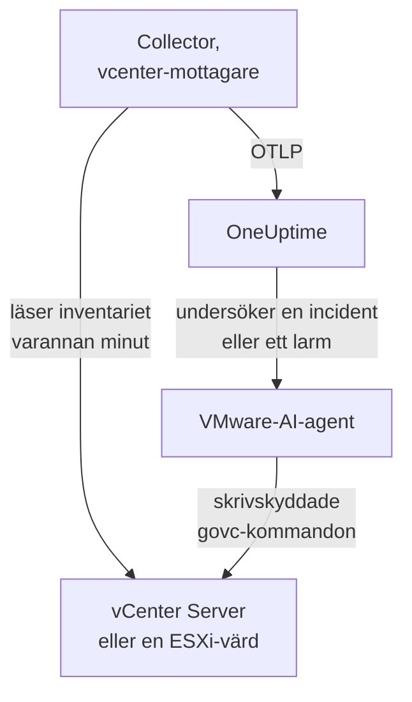

# VMware-agent

OneUptimes VMware-agent övervakar VMware vSphere: vCenter Server, ESXi-värdar, virtuella maskiner, datalager, kluster, resurspooler och vSAN. Den är en vanlig OpenTelemetry Collector vars [`vcenter`-mottagare](https://github.com/open-telemetry/opentelemetry-collector-contrib/tree/main/receiver/vcenterreceiver) läser vSphere-API:t med en skrivskyddad användare, stämplar varje mätvärde med ditt vCenters namn och skickar det till OneUptime: inget plugin på vCenter och inget inuti VM:arna. [VMware-övervakare](/docs/monitor/vmware-monitor) larmar utifrån det som kommer in.

:::cards
- [Installera agenten](#installera-agenten): En skrivskyddad användare, sedan installationsskriptet, Docker Compose eller systemd.
- [Vad agenten samlar in](#vad-agenten-samlar-in): Varje vSphere-objekt, dess identitet och dess mätvärden.
- [AI-agent](#ai-agent): Låt OneUptime AI läsa vCenter medan den undersöker.
- [Felsökning](#felsökning): Ett diagnosskript, och de vanliga problemen.
:::

## Så fungerar det

En agent övervakar en vSphere-slutpunkt: en **vCenter Server**, som täcker varje datacenter, kluster och värd som den hanterar, eller en **fristående ESXi-värd** som inget vCenter hanterar. Kör en agent per vCenter. Collectorn går igenom hela inventariet en gång per insamling (som standard varannan minut) och skickar en resurs per objekt. Samma Compose-fil kör VMware-AI-agenten bredvid, för OneUptime AI. Vill du hellre slippa Docker? Samma collector, med samma konfiguration, körs också som en systemd-tjänst på vilken Linux-maskin som helst.



vCenter registrerar sig med sina första data, under det namn som agenten stämplar på varje mätvärde som `vmware.vcenter.name`. För att övervaka ett vCenter utan att köra agenten alls, se [VMware utan agent](/docs/telemetry/vmware-agentless): En av dina prober samlar in samma data med ett skrivskyddat konto.

## Innan du börjar

- Docker Engine 20.10 eller senare med pluginet Docker Compose v2, eller, för att installera utan Docker, en Linux-maskin (x86_64 eller arm64) med systemd 235 eller senare. I båda fallen måste maskinen nå vCenter över HTTPS (TCP 443).
- vCenter Server eller ESXi 7.0 eller senare: Mottagaren stöder vSphere 7 och 8.
- Ett konto som kan skapa en vSphere-användare och ge den en roll på det översta vCenter-objektet.
- En intagningsnyckel. Skapa en under **Projektinställningar → Telemetri och APM → Intagningsnycklar** och kopiera värdet.

### Var du kör agenten

Agenten pratar med vCenter över HTTPS, så den behöver inte köras i närheten, och helst bör den varken köras på vCenter Server Appliance eller i en VM på det kluster den övervakar: Om det klustret går ned går din övervakning ned med det. En liten administrations-VM på separat hårdvara, en övervakningsvärd eller vilken maskin som helst som kör Docker (eller, utan Docker, vilken Linux-maskin som helst med systemd) och når vCenter på TCP 443 är rätt plats. Den valfria syslog-lyssnaren kräver också att ESXi-värdarna når agenten på syslog-porten (se [Skicka ESXi-syslog](#valfritt-skicka-esxi-syslog)).

## Installera agenten

:::steps
### Skapa den skrivskyddade vSphere-användaren

Agenten läser bara: inventariet, prestandaräknare och vSAN-statistik. Ge den ett eget konto med den inbyggda rollen **Read-Only**, aldrig en administratör.

:::tabs
@tab vSphere Client
1. Skapa kontot: Öppna _Menu → Administration → Single Sign On → Users and Groups_, välj domänen `vsphere.local` (eller din identitetskälla), klicka på **Add**, döp användaren till `oneuptime` och ange ett lösenord. Användaren är då `oneuptime@vsphere.local`.
2. Tilldela rollen: Välj det översta objektet **vCenter Server** i inventariet _Hosts and Clusters_, öppna fliken **Permissions**, klicka på **Add**, välj användaren, sätt rollen till **Read-Only** och markera **Propagate to children**.
@tab govc
Från en maskin med administratörsuppgifter:

```bash
govc sso.user.create -p 'a-strong-password' -R ReadOnly oneuptime
govc permissions.set -principal oneuptime@vsphere.local -role ReadOnly -propagate=true /
```
@tab PowerCLI
Från en session som är ansluten till vCenter som administratör:

```powershell
New-SsoPersonUser -UserName oneuptime -Password 'a-strong-password'
New-VIPermission -Entity (Get-Folder -NoRecursion) -Principal 'VSPHERE.LOCAL\oneuptime' -Role ReadOnly -Propagate:$true
```
@tab ESXi Host Client
För en fristående ESXi-värd (utan vCenter) skapar du användaren under _Host → Manage → Security & Users → Users_ och ger den rollen Read-Only under _Host → Manage → Security & Users → Permissions_. Eller kör `esxcli system account add` i värdens skal och sedan `esxcli system permission set --id oneuptime --role ReadOnly`.
:::

> [!IMPORTANT]
> Spridningen är den del som folk missar. Mottagaren går igenom datacenter, kluster, värdar, VM:ar, datalager och resurspooler, och varje objekt som användaren inte kan se utelämnas i tysthet. En Read-Only-roll som tilldelats på vCenter-objektet _utan_ spridning ger ett tomt inventarium och en instrumentpanel full av nollor.

### Installera och starta agenten

:::tabs
@tab install.sh
Ladda ned installationsskriptet och kör det på maskinen som ska vara värd för agenten:

```bash
curl -sSL https://raw.githubusercontent.com/OneUptime/oneuptime/master/agents/VMwareAgent/install.sh -o install.sh
bash install.sh
```

Skriptet frågar efter din OneUptime-URL, intagningsnyckeln, ett namn på vCenter, vCenter-slutpunkten och de skrivskyddade inloggningsuppgifterna (det läser lösenordet utan eko), och om AI-agenten får tillämpa åtgärder (i så fall efter en egen vSphere-användare för den och de VM:ar den aldrig får ändra). Det installerar till `/opt/oneuptime-vmware-agent`, skriver en fil med `0600` som heter `.env` och startar agenten med Docker Compose. Det citerar varje värde för Docker Compose så som du skrev det, så ett lösenord med `$`, `#`, mellanslag eller citattecken fungerar så som du skrev det. Om du kör skriptet igen återanvänder det allt i en befintlig `.env` i stället för att fråga igen, och det är så du [uppgraderar agenten](#uppgradera-agenten).
@tab Docker Compose
Ladda ned `docker-compose.yml` och `otel-collector-config.yaml` från [VMwareAgent-katalogen](https://github.com/OneUptime/oneuptime/tree/master/agents/VMwareAgent) till en ny mapp och skapa sedan en `.env`-fil bredvid dem. Den innehåller ett lösenord, så håll den privat med `chmod 600 .env`:

```bash title=".env"
ONEUPTIME_URL=YOUR_ONEUPTIME_URL
ONEUPTIME_TELEMETRY_INGESTION_KEY=YOUR_TELEMETRY_INGESTION_TOKEN
VMWARE_VCENTER_NAME=my-vcenter
VCENTER_ENDPOINT=https://vcsa.example.com
VCENTER_USERNAME=oneuptime@vsphere.local
VCENTER_PASSWORD=a-strong-password
VCENTER_INSECURE_SKIP_VERIFY=true
VCENTER_COLLECTION_INTERVAL=2m
```

Ett lösenord med `$`, `#`, mellanslag eller citattecken ska stå inom enkla citattecken (se [vCenter nekar inloggningen](#felsökning)). Starta agenten:

```bash
docker compose up -d
```
@tab systemd
Agenten behöver inte Docker: Den är en OpenTelemetry Collector-binär och en konfigurationsfil. På en Linux-maskin (x86_64 eller arm64) med systemd 235 eller senare (Ubuntu 18.04, Debian 10, RHEL 8 eller nyare) kör du den version av `otelcol-contrib` som agenten låser, med samma `otel-collector-config.yaml`, som en systemd-tjänst. Enheten som agenten levererar för detta, [`oneuptime-vmware-agent-native.service`](https://github.com/OneUptime/oneuptime/blob/master/agents/VMwareAgent/systemd/oneuptime-vmware-agent-native.service), kör collectorn som en tillfällig, oprivilegierad användare utan capabilities och utan något den kan skriva till.

Ladda ned collectorn, konfigurationen och enheten och installera dem till `/opt/oneuptime-vmware-agent`:

```bash
cd "$(mktemp -d)"
VERSION=0.161.0   # the collector release the agent pins
ARCH=$(uname -m | sed 's/x86_64/amd64/;s/aarch64/arm64/')
curl -fL -o otelcol-contrib.tar.gz \
  https://github.com/open-telemetry/opentelemetry-collector-releases/releases/download/v${VERSION}/otelcol-contrib_${VERSION}_linux_${ARCH}.tar.gz
curl -fsSLO https://raw.githubusercontent.com/OneUptime/oneuptime/master/agents/VMwareAgent/otel-collector-config.yaml
curl -fsSL -o oneuptime-vmware-agent.service \
  https://raw.githubusercontent.com/OneUptime/oneuptime/master/agents/VMwareAgent/systemd/oneuptime-vmware-agent-native.service

sudo install -d -m 0755 /opt/oneuptime-vmware-agent
sudo tar --no-same-owner --preserve-permissions -xzf otelcol-contrib.tar.gz -C /opt/oneuptime-vmware-agent otelcol-contrib
sudo install -m 0644 otel-collector-config.yaml /opt/oneuptime-vmware-agent/otel-collector-config.yaml
sudo install -m 0644 oneuptime-vmware-agent.service /etc/systemd/system/oneuptime-vmware-agent.service
```

Inställningarna ska in i `/opt/oneuptime-vmware-agent/.env`: samma variabler som i Docker-installationens `.env`. Den innehåller ett lösenord, så gör den läsbar endast för root innan du öppnar den:

```bash
sudo touch /opt/oneuptime-vmware-agent/.env
sudo chmod 600 /opt/oneuptime-vmware-agent/.env
sudoedit /opt/oneuptime-vmware-agent/.env
```

Skriv in detta:

```bash
ONEUPTIME_URL=YOUR_ONEUPTIME_URL
ONEUPTIME_TELEMETRY_INGESTION_KEY=YOUR_TELEMETRY_INGESTION_TOKEN
VMWARE_VCENTER_NAME=my-vcenter
VCENTER_ENDPOINT=https://vcsa.example.com
VCENTER_USERNAME="oneuptime@vsphere.local"
VCENTER_PASSWORD="a-strong-password"
VCENTER_INSECURE_SKIP_VERIFY=true
VCENTER_COLLECTION_INTERVAL=2m
```

systemd läser den här filen, inte ett skal: Håll användarnamnet och lösenordet inom dubbla citattecken, där varje `\` skrivs `\\` och varje `"` skrivs `\"` — `DOMAIN\user` är `"DOMAIN\\user"` —, medan `$`, `#`, `'` och mellanslag går in som de är. Det är den form som alla systemd-versioner läser likadant; äldre versioner (RHEL 8:s, till exempel) tappar ett omvänt snedstreck även inom enkla citattecken. Starta sedan agenten och låt den starta vid varje uppstart:

```bash
sudo systemctl daemon-reload
sudo systemctl enable oneuptime-vmware-agent
sudo systemctl restart oneuptime-vmware-agent
```

Den här installationen kör bara collectorn: [AI-agenten](#ai-agent) levereras bara som containeravbildning. Kör en agent per vCenter: Om du lämnar Docker-installationen kör du först `docker compose down` där, annars kommer varje mätvärde in två gånger.
:::

### Verifiera installationen

Kontrollera att agenten körs och läs collectorns loggar:

```bash
docker compose ps
docker logs -f oneuptime-vmware-agent
```

Installerat med systemd? Kontrollera i stället tjänsten och dess journal:

```bash
systemctl status oneuptime-vmware-agent --no-pager
sudo journalctl -u oneuptime-vmware-agent -f
```

Collectorns loggar bör visa den här raden när den har startat:

```text
Everything is ready. Begin running and processing data.
```

### Hitta vCenter i OneUptime

Inget skickas förrän den första fullständiga genomgången av inventariet är klar, så ge det ett insamlingsintervall (2 minuter som standard). Öppna sedan **Produkter → Infrastruktur → VMware → Alla vCenter**: vCenter finns där, med sina datacenter, kluster, ESXi-värdar, virtuella maskiner, datalager och resurspooler.
:::

## Miljövariabler

Docker Compose läser dessa från `.env` bredvid `docker-compose.yml`; systemd-installationen läser dem från `/opt/oneuptime-vmware-agent/.env`, och dess enhet ger samma standardvärden.

| Variabel | Obligatorisk | Beskrivning |
| --- | --- | --- |
| `ONEUPTIME_URL` | Ja | Din OneUptime-URL, till exempel `https://oneuptime.com` eller din självhostade instans. Använd `http://` och dess port om instansen bara använder HTTP. |
| `ONEUPTIME_TELEMETRY_INGESTION_KEY` | Ja | Intagningsnyckeln från **Projektinställningar → Telemetri och APM → Intagningsnycklar**. |
| `VMWARE_VCENTER_NAME` | Ja | vCenters namn i OneUptime, stämplat på varje mätvärde som resursattributet `vmware.vcenter.name`. Håll det stabilt: att ändra det senare registrerar ett andra vCenter. Standard är `vmware-vcenter`. |
| `VCENTER_ENDPOINT` | Ja | Schemat och värden för vCenter Server eller en fristående ESXi-värd, **utan** `/sdk`, till exempel `https://vcsa.example.com`. |
| `VCENTER_USERNAME` | Ja | vSphere-användaren med rollen Read-Only, till exempel `oneuptime@vsphere.local` (eller `DOMAIN\user` för en Active Directory-identitetskälla). |
| `VCENTER_PASSWORD` | Ja | Användarens lösenord. Om det innehåller `$`, `#`, mellanslag eller citattecken ska det stå inom enkla citattecken i Docker-installationens `.env` (`install.sh` gör det åt dig) och inom dubbla i systemd-installationens (se [Felsökning](#felsökning)). |
| `VCENTER_INSECURE_SKIP_VERIFY` | Nej | `true` godtar vCenters självsignerade standardcertifikat (VMCA); `false` håller TLS-verifieringen påslagen. Standard är `false`. |
| `VCENTER_COLLECTION_INTERVAL` | Nej | Hur ofta hela inventariet läses. Höj det till `5m` eller `10m` för mycket stora vCenter. Standard är `2m`. |

AI-agentens egna inställningar finns under [AI-agent](#ai-agent).

## Vad agenten samlar in

Vid varje `VCENTER_COLLECTION_INTERVAL` går mottagaren igenom hela vSphere-inventariet och skickar en OpenTelemetry-resurs per objekt. Varje objekts identitet ligger i dess **resursattribut** — `vcenter.datacenter.name`, `vcenter.cluster.name`, `vcenter.host.name`, `vcenter.vm.name` / `vcenter.vm.id`, `vcenter.datastore.name`, `vcenter.resource_pool.name` / `vcenter.resource_pool.inventory_path` — och agenten lägger till `vmware.vcenter.name` ovanpå, så att OneUptime arkiverar allt under ditt vCenter:

| vSphere-objekt | Identitet (resursattribut) | Mätvärden |
| --- | --- | --- |
| Datacenter | `vcenter.datacenter.name` | `vcenter.datacenter.cluster.count`, `vcenter.datacenter.host.count`, `vcenter.datacenter.vm.count`, `vcenter.datacenter.datastore.count`, `vcenter.datacenter.disk.space`, `vcenter.datacenter.cpu.limit`, `vcenter.datacenter.memory.limit` |
| Kluster | + `vcenter.cluster.name` | `vcenter.cluster.cpu.effective`, `vcenter.cluster.cpu.limit`, `vcenter.cluster.memory.effective`, `vcenter.cluster.memory.limit`, `vcenter.cluster.host.count`, `vcenter.cluster.vm.count`, `vcenter.cluster.vm_template.count`, `vcenter.cluster.vsan.*` (genomströmning, operationer, latens, överbelastningar) |
| ESXi-värd | + `vcenter.host.name` (och `vcenter.cluster.name` när värden ingår i ett kluster) | `vcenter.host.cpu.usage` / `.capacity` / `.utilization` / `.reserved`, `vcenter.host.memory.usage` / `.utilization` / `.capacity`, `vcenter.host.disk.latency.avg` / `.latency.max` / `.throughput`, `vcenter.host.network.usage` / `.throughput` / `.packet.rate` / `.packet.drop.rate` / `.packet.error.rate`, `vcenter.host.vsan.*` |
| Virtuell maskin | + `vcenter.host.name`, `vcenter.vm.name`, `vcenter.vm.id` (instans-UUID); `vcenter.resource_pool.*` eller `vcenter.virtual_app.*` | `vcenter.vm.disk.usage`, `vcenter.vm.disk.utilization`, `vcenter.vm.memory.usage` / `.utilization` / `.ballooned` / `.swapped` / `.swapped_ssd`; bara påslagna VM:ar: `vcenter.vm.cpu.usage`, `vcenter.vm.cpu.readiness`, `vcenter.vm.cpu.utilization`, `vcenter.vm.disk.latency.avg` / `.latency.max` / `.throughput`, `vcenter.vm.network.*`, `vcenter.vm.vsan.*` |
| VM-mall | `vcenter.vm_template.name`, `vcenter.vm_template.id` | bara `vcenter.vm.disk.usage` |
| Datalager | + `vcenter.datastore.name` | `vcenter.datastore.disk.usage`, `vcenter.datastore.disk.utilization` |
| Resurspool | + `vcenter.resource_pool.name`, `vcenter.resource_pool.inventory_path` | `vcenter.resource_pool.cpu.usage` / `.cpu.shares`, `vcenter.resource_pool.memory.usage` / `.memory.shares` / `.memory.ballooned` / `.memory.swapped` / `.memory.granted` |

Räknings- och kapacitetsmätvärden fördelas över **datapunktsattribut**, som är precis det du filtrerar och grupperar på i övervakarkriterier:

| Attribut | Värden | Finns på |
| --- | --- | --- |
| `direction` | `read` / `write` för disk, `transmitted` / `received` för nätverk | Disklatens och -genomströmning, nätverksgenomströmning och paketfrekvenser |
| `disk_state` | `available` / `used` | `vcenter.datastore.disk.usage`, `vcenter.vm.disk.usage`, `vcenter.datacenter.disk.space` |
| `status` | `red` / `yellow` / `green` / `gray` (objektets övergripande status i vSphere) | `vcenter.datacenter.cluster.count` / `.host.count` / `.vm.count` |
| `power_state` | Värdar: `on` / `off` / `standby` / `unknown`; VM:ar: `on` / `off` / `suspended` / `unknown` | `vcenter.datacenter.host.count` / `.vm.count`, `vcenter.cluster.vm.count` |
| `effective` | `true` / `false` (lagrade som strängar) | `vcenter.cluster.host.count` |
| `object` | NIC-, disk- eller vCPU-instansen (till exempel `vmnic0`) | Disk- och nätverksserier per enhet för värdar och VM:ar |
| `cpu_reservation_type` | `total` / `used` | `vcenter.host.cpu.reserved` |
| `type` | Minne: `guest` / `host` / `overhead`, `private` / `shared`; vSAN: `read` / `write` / `unmap` | Minnesserier för resurspooler, vSAN-latens och -operationer |

Enheterna är mottagarens egna OTLP-enheter, som OneUptime skalar för visning: `MHz` för CPU-användning och -kapacitet, `%` för utnyttjande och CPU ready, `MiBy` för minne i värdar, VM:ar och resurspooler, `By` för minne i kluster och datacenter och allt diskutrymme, `ms` för disklatens i värdar och VM:ar och `us` (mikrosekunder) för vSAN-latens. I övervakarkriterier får identitetsattributen prefixet `resource.` (`resource.vcenter.host.name`, `resource.vmware.vcenter.name`), medan datapunktsattribut står utan prefix (`disk_state`, `power_state`, `status`).

`vcenter.host.memory.capacity` är avstängd som standard uppströms; den medföljande konfigurationen slår på den, eftersom OneUptime dividerar med den för värdarnas minnesutnyttjande. En kommentar i `otel-collector-config.yaml` listar de andra valfria mätvärdena (`vcenter.vm.cpu.time`, `vcenter.vm.memory.granted`, `vcenter.host.memory.active`, `vcenter.host.memory.ballooned`, `vcenter.host.memory.granted`, `vcenter.vm.network.broadcast.packet.rate`, `vcenter.vm.network.multicast.packet.rate`): Slå på vilket som helst av dem på samma sätt.

### VM:ars strömtillstånd

Mottagaren skickar inget mätvärde för en VM:s strömtillstånd. Den skickar `vcenter.vm.cpu.*` **bara för påslagna VM:ar**, så OneUptime härleder tillståndet ur det som kom in i varje insamling: En VM som rapporterade CPU-mätvärden är **Powered on**; en som bara rapporterade minnes- och diskanvändning är **Powered off** (eller pausad: vSphere skiljer inte på de två här). VM-mallar har inget strömtillstånd. Detta läser **en hel insamling i taget**, och därför har den medföljande processorn `batch` en stor `send_batch_size` och med avsikt ingen `send_batch_max_size`: En insamling som delas över två exporter skulle nollställa inventariets räknare och "stänga av" VM:ar. Behåll batch-inställningarna som de levereras.

## vCenter i OneUptime


Sidan **Översikt** besvarar först "är det här vCenter friskt": de effektiva värdarna, värdarnas CPU och minne viktade efter kapacitet, det fullaste datalagret och den sämsta CPU ready-tiden för en VM. När något är försämrat namnger den det ansvariga objektet, så att du slipper leta.

### ESXi-värdar


### Virtuella maskiner


Avstängda virtuella maskiner och mallar listas också. vCenter rapporterar CPU-räknare bara för påslagna VM:ar, så deras CPU-kolumner visar N/A i stället för en missvisande nolla.

### Datalager


## Valfritt — Skicka ESXi-syslog

Som standard skickar agenten bara mätvärden, så vCenters sida **Loggar** förblir tom. ESXi-värdar (och vCenter självt) kan vidarebefordra sin syslog till vilken lyssnare som helst, och den medföljande `otel-collector-config.yaml` har ett bortkommenterat mottagarpar `syslog` (TCP och UDP på port 5514, RFC 3164: ESXi:s eget format), kopplat till en bortkommenterad pipeline `logs` som stämplar `vmware.vcenter.name` så att loggarna hamnar på ditt vCenter.

:::steps
### Slå på mottagarna

Avkommentera de två mottagarna `syslog/*` och pipelinen `logs` i `otel-collector-config.yaml`.

### Öppna porten

Avkommentera blocket `ports:` i `docker-compose.yml`, så att maskinen publicerar `5514/tcp` och `5514/udp`, och kör sedan `docker compose up -d`. Med systemd finns ingen port att publicera, eftersom collectorn lyssnar på själva maskinen: Kör i stället `sudo systemctl restart oneuptime-vmware-agent`. Öppna porten i maskinens brandvägg för ESXi-administrationsnätverket.

### Peka varje ESXi-värd mot agenten

I vSphere Client väljer du värden, öppnar _Configure → System → Advanced System Settings_, redigerar `Syslog.global.logHost` och sätter den till `udp://<agent-host>:5514` (eller `tcp://<agent-host>:5514`; separera flera mål med kommatecken). Tillåt sedan den utgående trafiken under _Configure → System → Firewall → Edit → syslog_. Eller, på varje värd, med `esxcli`:

```bash
esxcli system syslog config set --loghost='udp://<agent-host>:5514'
esxcli system syslog reload
esxcli network firewall ruleset set --ruleset-id=syslog --enabled=true
```

Med PowerCLI, över ett helt kluster: `Get-VMHost | Get-AdvancedSetting -Name Syslog.global.logHost | Set-AdvancedSetting -Value 'udp://<agent-host>:5514' -Confirm:$false`.
:::

En syslog-mottagare lyssnar bara på en transport, och därför är TCP och UDP två mottagare: Låt den ena vara bortkommenterad om du bara behöver den andra. TLS-syslog (`ssl://`) ska termineras framför agenten; själva mottagaren talar vanlig TCP och UDP. Collectorns standardavbildning läser syslog som den är: Ingen egen avbildning behövs.

## Tagga vCenter med projektetiketter

Ett resursattribut som börjar med `oneuptime.label.` blir en projektetikett på vCenter: `oneuptime.label.<dimension>=<value>` är etiketten `<dimension>:<value>`. Lägg till attributen i processorn `resource` i `otel-collector-config.yaml`, bredvid `vmware.vcenter.name`:

```yaml
processors:
  resource:
    attributes:
      # ...existing attributes...
      - key: oneuptime.label.team
        value: platform
        action: upsert
      - key: oneuptime.label.env
        value: production
        action: upsert
```

Collectorn läser sin konfiguration bara när den startar: Kör `docker compose restart oneuptime-vmware-agent`, eller `sudo systemctl restart oneuptime-vmware-agent` med systemd. vCenter visar då etiketterna `team:platform` och `env:production`. Etiketter jämförs utan hänsyn till skiftläge, så en befintlig etikett `Production` återanvänds i stället för att dupliceras, och agenten tar aldrig bort en etikett som någon har lagt till i OneUptime.

## Kör som en systemd-tjänst

Docker-installationen kan också köras under systemd, så att den startar med maskinen och startar om när den misslyckas. Dess enhet omsluter Docker Compose och förutsätter att agenten ligger i `/opt/oneuptime-vmware-agent`, där installationsskriptet placerar den:

```bash
sudo curl -fsSL https://raw.githubusercontent.com/OneUptime/oneuptime/master/agents/VMwareAgent/systemd/oneuptime-vmware-agent.service -o /etc/systemd/system/oneuptime-vmware-agent.service
sudo systemctl daemon-reload
sudo systemctl enable --now oneuptime-vmware-agent
```

Installationen utan Docker är redan en systemd-tjänst, med en egen enhet.

## Uppgradera agenten

Agenten rapporterar den collectorversion som dess filer låser som sin **Agentversion**. När den är äldre än den version som den här OneUptime-versionen låser, visas ett varningstecken bredvid den, på vCenters sida **Översikt** och i listan **Alla vCenter**. Välj det för att se de här kommandona. En agent som installerades innan dess filer rapporterade en version visar ingen förrän den har uppgraderats på det här sättet.

Collectorn är låst i `docker-compose.yml` (eller, utan Docker, av den version du laddade ned) och dess konfiguration är en fil bredvid den, så att bara hämta images för inte agenten framåt:

:::tabs
@tab install.sh
Kör `install.sh` igen: Det återanvänder varje värde i din befintliga `.env` (inget frågas efter igen), förnyar `docker-compose.yml` och `otel-collector-config.yaml` och återskapar agenten så att collectorn läser sin nya konfiguration.

```bash
curl -sSL https://raw.githubusercontent.com/OneUptime/oneuptime/master/agents/VMwareAgent/install.sh -o install.sh
bash install.sh
```
@tab Docker Compose
I agentens mapp laddar du ned båda filerna igen (och gör om eventuella ändringar du hade gjort i dem), hämtar sedan imagesen och återskapar agenten:

```bash
curl -fsSLO https://raw.githubusercontent.com/OneUptime/oneuptime/master/agents/VMwareAgent/docker-compose.yml
curl -fsSLO https://raw.githubusercontent.com/OneUptime/oneuptime/master/agents/VMwareAgent/otel-collector-config.yaml
docker compose pull
docker compose up -d --force-recreate
```
@tab systemd
Kör installationskommandona igen: De laddar ned den version som den här OneUptime låser, med den senaste `otel-collector-config.yaml` och enheten, och lämnar din `.env` som den är (gör om eventuella ändringar du gjort i konfigurationen). Starta sedan om tjänsten:

```bash
cd "$(mktemp -d)"
VERSION=0.161.0   # the collector release the agent pins
ARCH=$(uname -m | sed 's/x86_64/amd64/;s/aarch64/arm64/')
curl -fL -o otelcol-contrib.tar.gz \
  https://github.com/open-telemetry/opentelemetry-collector-releases/releases/download/v${VERSION}/otelcol-contrib_${VERSION}_linux_${ARCH}.tar.gz
curl -fsSLO https://raw.githubusercontent.com/OneUptime/oneuptime/master/agents/VMwareAgent/otel-collector-config.yaml
curl -fsSL -o oneuptime-vmware-agent.service \
  https://raw.githubusercontent.com/OneUptime/oneuptime/master/agents/VMwareAgent/systemd/oneuptime-vmware-agent-native.service

sudo install -d -m 0755 /opt/oneuptime-vmware-agent
sudo tar --no-same-owner --preserve-permissions -xzf otelcol-contrib.tar.gz -C /opt/oneuptime-vmware-agent otelcol-contrib
sudo install -m 0644 otel-collector-config.yaml /opt/oneuptime-vmware-agent/otel-collector-config.yaml
sudo install -m 0644 oneuptime-vmware-agent.service /etc/systemd/system/oneuptime-vmware-agent.service
sudo systemctl daemon-reload
sudo systemctl restart oneuptime-vmware-agent
```
:::

## Avinstallera agenten

:::tabs
@tab Docker Compose
```bash
cd /opt/oneuptime-vmware-agent
docker compose down
```
@tab systemd
```bash
sudo systemctl disable --now oneuptime-vmware-agent
sudo rm /etc/systemd/system/oneuptime-vmware-agent.service
sudo systemctl daemon-reload
sudo rm -r /opt/oneuptime-vmware-agent
```
:::

Ta sedan bort användaren `oneuptime`:s behörighet i vCenter om du inte längre behöver den, och AI-agentens egen användare om du skapade en.

## AI-agent

Agentens `docker-compose.yml` kör också **VMware-AI-agenten**, `oneuptime-vmware-ai-agent` (image `oneuptime/resource-ai-agent:release`). Medan OneUptime AI undersöker en incident eller ett larm på det här vCenter kör den skrivskyddade `govc`-kommandon genom den — `govc vm.info web-01`, `govc events -n 50 /DC/vm/web-01`, `govc metric.sample -n 12 /DC/vm/web-01 cpu.usage.average` — och tillämpar, bara om du tillåter det, åtgärder som att slå på en VM igen. Den registrerar sig som det vCenter som heter `VMWARE_VCENTER_NAME`, precis som collectorn, och visas på vCenters sida **AI → AI-agent** i OneUptime.

- **AI-undersökningar är på som standard.** När agenten väl ansluter undersöker OneUptime AI incidenter och larm på det här vCenter med den, och vCenters sida **Översikt** visar agentens status. För att stoppa sätter du `ONEUPTIME_AI_INVESTIGATION=false` där agenten körs (**Ändra** under **Vad AI får göra** på AI-agentsidan visar hur), eller utelämnar agenten.
- **vSphere-rollen är den hårda gränsen.** Undersökningar loggar in som collectorns användare **Read-Only** (`VCENTER_USERNAME` / `VCENTER_PASSWORD`), som kan läsa och inget annat. Åtgärder kräver en egen användare för AI-agenten vars roll får slå på, stänga av och återställa VM:ar (`VirtualMachine.Interact.PowerOn`, `PowerOff` och `Reset`), tilldelad bara på de mappar som AI får åtgärda och angiven som `ONEUPTIME_AI_VCENTER_USERNAME` / `ONEUPTIME_AI_VCENTER_PASSWORD`.
- Den är **skrivskyddad** om du inte sätter `ONEUPTIME_AI_ALLOW_WRITES=true`; `ONEUPTIME_AI_WRITE_TARGETS` (VM- och värdnamn eller inventariesökvägar) begränsar vad en åtgärd får röra. Den ändrar aldrig den VM som är uppkallad efter värden i `VCENTER_ENDPOINT` — normalt vCenter-appliancen — och känner bara igen appliancen under det namnet: När `VCENTER_ENDPOINT` är en IP-adress, eller appliancens VM har ett annat namn, lägger du den VM:en i `ONEUPTIME_AI_PROTECTED_TARGETS`, tillsammans med den VM som agenten körs på. `ONEUPTIME_AI_FIXES` i samma `.env` anger hur åtgärder körs — `ask-for-approval` (en person godkänner varje), `automatic` eller `bypass-approval` — och AI-agentsidan visar det skrivskyddat ([Vad AI får göra, fastställt av agenten](/docs/ai/infrastructure-ai-agents#what-ai-may-do-set-by-the-agent)).
- För att verifiera vCenters certifikat i stället för att hoppa över verifieringen monterar du dess CA i containern och sätter `VCENTER_CA_FILE`; på ett vCenter med flera datacenter sätter du `GOVC_DATACENTER`.
- Den körs som UID 1000 utan capabilities och kör aldrig gästoperationer, ögonblicksbilder, `esxcli` eller något som skapar eller förstör en VM. Ta bort tjänsten `oneuptime-vmware-ai-agent` ur `docker-compose.yml` om du inte använder OneUptime AI.
- Installationen utan Docker har ingen AI-agent: Den levereras bara som containeravbildning. För att lägga till en kör du den med Docker på vilken maskin som helst som når vCenter — ladda ned `docker-compose.yml`, skriv en `.env` bredvid med inställningarna från `/opt/oneuptime-vmware-agent/.env`, inom enkla citattecken som Docker Compose vill ha dem, och starta AI-agenten ensam med `docker compose up -d oneuptime-vmware-ai-agent` (inte collectorn, som redan körs).

Vad den får köra, hur åtgärder fungerar och hur du felsöker den: [Infrastructure AI Agents](/docs/ai/infrastructure-ai-agents#vmware-vcenter). Agentens README har de exakta kommandona för rollen för åtgärder.

## Felsökning

:::details Kör diagnosskriptet först
Agenten levereras med ett skript, [`troubleshoot.sh`](https://github.com/OneUptime/oneuptime/blob/master/agents/VMwareAgent/troubleshoot.sh), som kontrollerar hela kedjan: containerkörtiden, om vCenter svarar och godtar inloggningsuppgifterna, det vCenter-namn som stämplas på varje mätvärde, tokenens format, collectorns egna mätvärden, och om OneUptime godtar intagningsnyckeln. Den sista kontrollen är viktigast. OneUptime nekar en felaktig nyckel med `401` (`422` för en inaktiverad nyckel eller en webbläsarnyckel), och collectorn behandlar båda som permanenta: den släpper batchen och loggar ett enda `Exporting failed`-fel, som är lätt att missa medan containern förblir frisk. Skriptet frågar `GET <url>/otlp/v1/validate` inifrån agentens nätverk för ett direkt `200` (giltig) eller `401` (ogiltig), faller tillbaka på `POST /fluentd/v1/logs` på äldre servrar och frågar efter `<VCENTER_ENDPOINT>/sdk/vimServiceVersions.xml` på samma sätt, så att DNS-, brandväggs- och TLS-fel syns precis som collectorn möter dem.

```bash
curl -sSL https://raw.githubusercontent.com/OneUptime/oneuptime/master/agents/VMwareAgent/troubleshoot.sh -o troubleshoot.sh
bash troubleshoot.sh    # add -d <dir> if you installed outside /opt/oneuptime-vmware-agent
```

Det avslutas med en bedömning som anger den mest sannolika orsaken.
:::

:::details Installerat utan Docker
Diagnosskriptet behöver Docker. Utan det körs collectorn på själva maskinen, så kontrollera samma kedja direkt: tjänsten och dess logg, vCenters API på collectorns egen nätverksväg, om OneUptime godtar intagningsnyckeln (`"valid":true` med `"keyType":"Server"`) och collectorns egna räknare, som den serverar på `127.0.0.1:8890` i stället för `8888` så att den kan köras bredvid en annan collector:

```bash
systemctl status oneuptime-vmware-agent --no-pager
sudo journalctl -u oneuptime-vmware-agent -n 100 --no-pager
curl -sk https://<vcenter-host>/sdk/vimServiceVersions.xml
curl -s -H "x-oneuptime-token: <key>" https://<oneuptime-host>/otlp/v1/validate
curl -s http://127.0.0.1:8890/metrics | grep -E 'otelcol_(receiver_accepted|exporter_sent|exporter_send_failed)_metric_points'
```

Loggen läses som containerns, så punkterna nedan gäller. En tjänst som hela tiden startar om loggar varför: `Failed with result 'resources'` betyder att systemd inte kan läsa `/opt/oneuptime-vmware-agent/.env`, och `cannot unmarshal the configuration` eller `requires positive value` betyder att ett värde i den inte är ett som collectorn godtar. systemd läser `.env` med egna regler, och äldre versioner (RHEL 8:s, till exempel) tappar ett omvänt snedstreck även inom enkla citattecken: Håll användarnamnet och lösenordet inom dubbla citattecken, där varje `\` skrivs `\\` och varje `"` skrivs `\"`, den enda form som alla versioner läser som den är skriven. Eftersom collectorn litar på maskinens CA-lager kan du behålla TLS-verifieringen påslagen: Lägg till vCenters rotcertifikat (`.0`-filerna under `certs/lin/` i `https://<vcenter>/certs/download.zip`) i `/usr/local/share/ca-certificates/` med ett `.crt`-namn och kör `update-ca-certificates` på Debian och Ubuntu, eller i `/etc/pki/ca-trust/source/anchors/` och kör `update-ca-trust` på RHEL; starta sedan om tjänsten.
:::

:::details Inget vCenter visas i OneUptime
1. Läs collectorns loggar: `docker logs oneuptime-vmware-agent`. Ett inloggningsfel (`incorrect user name or password`, `InvalidLogin`) betyder felaktiga inloggningsuppgifter, `x509: certificate signed by unknown authority` betyder att TLS-verifiering är påslagen mot ett självsignerat certifikat, `connection refused` eller `no such host` betyder en felaktig `VCENTER_ENDPOINT`, och en `401` vid export betyder en felaktig intagningsnyckel.
2. Kontrollera att vCenter svarar från agentens nätverk. Collectorns avbildning har varken skal eller curl, så fråga från en container i dess nätverk: `docker run --rm --network container:oneuptime-vmware-agent curlimages/curl -sk https://<vcenter-host>/sdk/vimServiceVersions.xml` bör skriva ut ett XML-dokument som nämner `urn:vim25`.
3. Kontrollera att `VMWARE_VCENTER_NAME` är satt: vCenter hittas via sitt resursattribut `vmware.vcenter.name`.
4. Ge det ett insamlingsintervall: Inget skickas förrän den första fullständiga genomgången av inventariet är klar.
:::

:::details vCenter visas som frånkopplat
Ett vCenter blir frånkopplat när OneUptime inte har tagit emot något från det på 15 minuter; OneUptime kontrollerar var 5:e minut, och tid då OneUptime själv inte tog emot data räknas inte. Kontrollera att collectorn körs, att dess loggar inte visar några exportfel och att en insamling blir klar inom `VCENTER_COLLECTION_INTERVAL` (se punkten om stora inventarier nedan). vCenter blir anslutet igen med sina nästa data.
:::

:::details x509- eller TLS-fel
vCenter-appliancer presenterar ett certifikat som deras egen VMCA har utfärdat och som ingen Docker-avbildning litar på. Sätt antingen `VCENTER_INSECURE_SKIP_VERIFY=true` (det praktiska valet på ett privat administrationsnätverk), eller ersätt vCenters maskincertifikat med ett från en CA som collectorns avbildning litar på. Peka **inte** slutpunkten mot en `http://`-URL: vCenter serverar sitt API endast över HTTPS.
:::

:::details vCenter nekar inloggningen (401 eller InvalidLogin)
Använd hela principalnamnet — `oneuptime@vsphere.local`, eller `DOMAIN\user` / `user@domain.example` för en Active Directory-identitetskälla — och kontrollera hur lösenordet är skrivet i `.env`. Docker Compose v2 expanderar `$VAR`-referenser i värden utan citattecken och inom dubbla citattecken, och läser ett mellanslag följt av `#` som början på en kommentar, så ett lösenord som innehåller `$`, `#`, mellanslag eller citattecken måste stå inom enkla citattecken — `VCENTER_PASSWORD='p@ss$word'` —, vilket är vad `install.sh` skriver. Ett lösenord som själv innehåller ett enkelt citattecken ska stå inom dubbla citattecken, med varje `$` skrivet som `$$` och `"` / `\` escapade med ett omvänt snedstreck. Ett låst konto (för många misslyckade försök) nekar också ett korrekt lösenord: Kontrollera _Administration → Single Sign On → Users and Groups_.
:::

:::details Värdar visas men inga VM:ar, datalager eller kluster (NoPermission)
Rollen Read-Only tilldelades på vCenter-objektet utan **Propagate to children**, eller på ett snävare objekt än vCenter-roten. Objekt som användaren inte kan se utelämnas i tysthet. Rätta behörigheten på det översta vCenter-objektet med spridning påslagen; nästa insamling fyller i inventariet.
:::

:::details Alla VM:ar visas som avstängda
En VM:s strömtillstånd härleds ur `vcenter.vm.cpu.*`-datapunkter som kommer in i samma insamling som dess minnes- och diskdatapunkter (se [VM:ars strömtillstånd](#vmars-strömtillstånd)). Om du ändrade processorn `batch` och lade till en `send_batch_max_size` delas ett stort inventarium över flera exporter, och CPU-datapunkterna hamnar i en annan begäran än resten: Återställ de medföljande batch-inställningarna.
:::

:::details Stora inventarier: långsamma insamlingar, fel med vpxd.stats.maxQueryMetrics
Varje insamling går igenom hela inventariet och gör en prestandafråga per batch av objekt. För vCenter med tusentals VM:ar:

- Höj `VCENTER_COLLECTION_INTERVAL` till `5m` eller `10m`. En insamling som tar längre tid än intervallet hoppas över, överlappas inte, så ett för kort intervall lämnar bara luckor.
- Mottagaren ber om upp till `max_query_metrics: 256` entiteter per prestandafråga. vCenter begränsar detta med `vpxd.stats.maxQueryMetrics` (256 som standard i vCenter 7 och 8). Om en administratör har sänkt det loggar collectorn `The maximum number of performance metrics per query exceeded`: Sänk `max_query_metrics` i `otel-collector-config.yaml` så att de matchar, eller höj vCenter-inställningen under _vCenter → Configure → Advanced Settings_.
- Håll koll på collectorns minne: Den medföljande `memory_limiter` tillåter 512 MiB. Om loggen säger att begränsaren släpper data höjer du `limit_mib` (och ger containern mer minne).
:::

:::details Övervaka en fristående ESXi-värd (utan vCenter)
Peka `VCENTER_ENDPOINT` mot själva värden (`https://esxi01.example.com`), med en lokal ESXi-användare som har rollen Read-Only. Allt som en värd vet samlas in: värden, dess VM:ar, datalager och resurspooler. En fristående värd har inget datacenter- eller klusterobjekt, så de sidorna förblir tomma, och den har inget vCenter-REST-API, så diagnosskriptet rapporterar kontrollen av inloggningsuppgifterna som ofullständig (collectorns logg har svaret där).
:::

:::details Mätvärden hamnar under fel vCenter
OneUptime registrerar ett vCenter efter dess `vmware.vcenter.name`, som agenten tar från `VMWARE_VCENTER_NAME`. Att ändra det efter de första data skapar ett andra vCenter i stället för att byta namn på det första.
:::

:::details Skicka mätvärden utan agenten
vSphere har ingen egen OpenTelemetry-push, så agenten (eller vilken OpenTelemetry Collector som helst med `vcenter`-mottagaren) är vägen in. Om du redan kör collectorer lägger du till `vcenter`-mottagaren i en av dem i stället för att köra den här agenten: Kopiera `vcenter`-mottagaren och processorn `resource` från den medföljande `otel-collector-config.yaml` till din egen konfiguration. Resursattributet `vmware.vcenter.name` är det som registrerar vCenter i OneUptime, och borttagningarna av `service.name` / `service.instance.id` hindrar att data arkiveras under en tjänst: Behåll båda.
:::

## Nästa steg

:::cards
- [VMware-övervakning](/docs/monitor/vmware-monitor): Larma om värdar, VM:ar, datalager, kluster, datacenter och vSAN.
- [VMware utan agent](/docs/telemetry/vmware-agentless): Låt i stället en prob samla in vCenter.
- [Infrastructure AI Agents](/docs/ai/infrastructure-ai-agents): Vad VMware-AI-agenten får köra och hur åtgärder fungerar.
- [OpenTelemetry-collector på värden](/docs/telemetry/host-otel-collector): Operativsystemets vy inuti VM:arna, eller av agentens maskin.
:::
