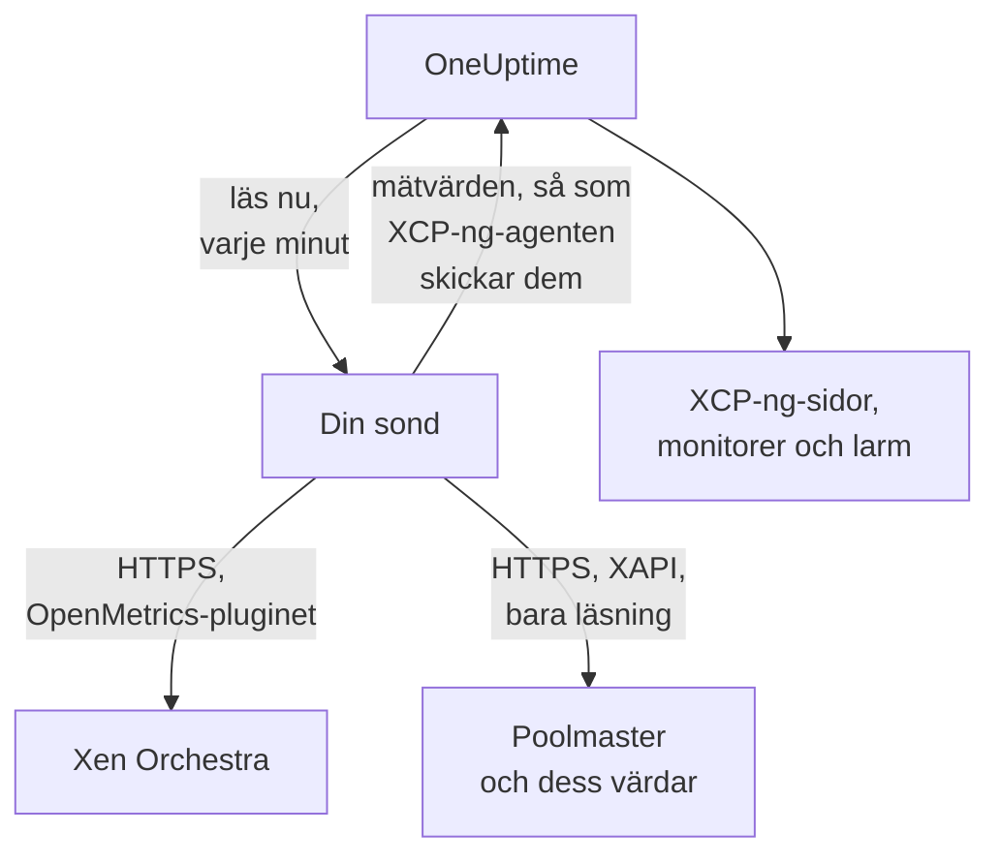

# XCP-ng utan agent

Övervaka XCP-ng-pooler utan att installera något: en OneUptime-sond läser dem, antingen via den Xen Orchestra som hanterar dem eller, för en pool utan Xen Orchestra, direkt från XAPI på poolens master. Varje pool får samma sidor, [XCP-ng-monitorer](/docs/monitor/xcp-ng-monitor) och mallar som en pool som [XCP-ng-agenten](/docs/telemetry/xcp-ng) skickar. Det finns ingen agent att installera, uppgradera eller hålla igång.

:::cards
- [Innan du börjar](#innan-du-börjar): En sond som når Xen Orchestra eller poolen, och skrivskyddad åtkomst.
- [Anslut Xen Orchestra](#anslut-xen-orchestra): Varje pool den hanterar, via en enda anslutning.
- [Anslut en pool utan Xen Orchestra](#anslut-en-pool-utan-xen-orchestra): En pool, läst från dess master.
- [Larm, HA och säkerhetskopior](#larm-ha-och-säkerhetskopior): Vad en sond läser utöver mätvärdena, och de larm den erbjuder.
- [Felsökning](#felsökning): Vad varje meddelande betyder och vad som åtgärdar det.
:::

## Så fungerar det

Varje minut läser sonden varje anslutning och skickar det den läste till OneUptime:

- **Xen Orchestra**: sonden läser Xen Orchestras OpenMetrics-plugin med pluginets hemlighet, precis som XCP-ng-agenten, så varje pool som Xen Orchestra hanterar kommer med samma serier. Med ett API-token läser den också varje pools larm, HA och säkerhetskopior från Xen Orchestras REST-API.
- **En pools XAPI**: sonden loggar in på poolmastern och gör de läsningar som Xen Orchestras plugin själv gör: poolens poster och mätvärdena för varje värd som körs, lästa från den värden. Den gör dem till samma serier som pluginet levererar, så poolen läses precis som den skulle via Xen Orchestra. Den lägger också poolens XAPI-meddelanden, som en VM som kraschade eller en värd som HA förlorade, i poolens flöde.

Varje pool registrerar sig utifrån sitt UUID vid sin första läsning, precis som agentens pooler, och visas under **XCP-ng → Alla pooler**.

## Vilket sätt att ansluta

| | Xen Orchestra, från en sond | En pools XAPI, från en sond | XCP-ng-agenten |
|---|---|---|---|
| Vad du kör | En sond som du redan kör, eller en ny | En sond som du redan kör, eller en ny | Agenten, på en egen dator |
| Vad den läser | Varje pool som Xen Orchestra hanterar | En pool | Varje pool som Xen Orchestra hanterar |
| Vad den behöver | OpenMetrics-pluginets hemlighet och eventuellt ett skrivskyddat API-token | Ett konto i poolen: root eller en Active Directory-användare med rollen read-only | OpenMetrics-pluginets hemlighet |
| Var hemligheterna sparas | Krypterade i OneUptime, skickas bara till sonden | Krypterade i OneUptime, skickas bara till sonden | I agentens fil `.env` |
| Larm, HA och säkerhetskopior | Alla tre, och saknade uppdateringar, med ett API-token | Larm och HA, utan säkerhetskopior | Ingår inte |

Alla tre skickar samma serier. En pool läses av en av dem i taget, så att dess historik förblir en linje oavsett vem som läser den.

## Innan du börjar

- **En sond som når adressen på TCP 443.** Det är oftast en [anpassad sond](/docs/probe/custom-probe) i samma nätverk. I OneUptime Cloud får de delade sonderna aldrig XCP-ng-hemligheter, så lägg till en egen sond. På en egen värdad instans kan även instansens egna sonder läsa.
- **För Xen Orchestra:** Xen Orchestra 6.9 eller senare med OpenMetrics-pluginet påslaget: följ [Slå på OpenMetrics-pluginet](/docs/telemetry/xcp-ng#slå-på-openmetrics-pluginet) och kopiera dess hemlighet. Eventuellt ett API-token för en Xen Orchestra-användare med den inbyggda rollen **Read only**: OneUptime kontrollerar att det bara läser och varnar dig innan det upphör.
- **För en pool utan Xen Orchestra:** XCP-ng 8.2 eller senare, och adressen till dess master. XAPI:s roller gäller bara Active Directory-användare, så dess enda lokala konto, `root`, kan ändra allt i poolen. För skrivskyddad åtkomst ansluter du poolen till Active Directory och ger en användare rollen `read-only`.

> [!IMPORTANT]
> Anslut en pool via Xen Orchestra eller via dess XAPI, inte båda: den andra anslutningen som läser en pool lämnar den till den första.

## Anslut Xen Orchestra

:::steps
### Öppna anslutningar
Öppna **XCP-ng → Anslutningar** i OneUptime och klicka på **Anslut XCP-ng**.

### Välj Xen Orchestra
Under **Vad som ska läsas** väljer du **Xen Orchestra**. Ange **Xen Orchestra-adress**, den som du öppnar den på i en webbläsare, till exempel `https://xo.example.com`, och välj den sond som når den.

### Ange pluginets hemlighet
Klistra in **OpenMetrics-hemlighet**. Lägg till ett **API-token** för den skrivskyddade användaren om du har ett.

### Testa anslutningen och lita på certifikatet
Klicka på **Testa anslutningen**. Xen Orchestra signerar sitt eget certifikat, så testet visar det: kontrollera dess fingeravtryck och klicka sedan på **Lita på det här certifikatet**. Resultatet visar de pooler som Xen Orchestra levererar, med deras värdar, VM:ar och lagringsrepositorier.

### Ge den ett namn och anslut
Namnet är som standard Xen Orchestras värdnamn, och varje pool den läser visar det. Klicka på **Anslut XCP-ng**, så öppnas anslutningens sida.
:::

## Anslut en pool utan Xen Orchestra

:::steps
### Börja från anslutningarna
Öppna **XCP-ng → Anslutningar** i OneUptime och klicka på **Anslut XCP-ng**.

### Välj poolen
Under **Vad som ska läsas** väljer du **En pool utan Xen Orchestra**. Ange **Poolmasterns adress**, till exempel `https://10.0.0.10`, och välj den sond som når den.

### Ange kontot
Ange **Användarnamn** och **Lösenord**: `root` eller en Active Directory-användare med rollen read-only, skriven med sin domän, till exempel `EXAMPLE\oneuptime`.

### Testa anslutningen och lita på masterns certifikat
Klicka på **Testa anslutningen**. Varje XCP-ng-värd signerar sitt eget certifikat, så testet visar masterns: kontrollera dess fingeravtryck och klicka sedan på **Lita på det här certifikatet**. Resultatet säger vilken XCP-ng som mastern kör och vad kontot kan läsa, och varnar dig när kontot kan ändra poolen.

### Ge poolen ett namn och anslut
Klicka på **Anslut XCP-ng**, så öppnas anslutningens sida.
:::

Anslutningens sida visar hur läsningen står till. Den visar **Kontrollerar** fram till den första läsningen, som börjar inom en minut, sedan **Samlar in**, och de pooler den läser visas under **Pooler den läser**.

Om ingen sond kommer för anslutningen på 20 minuter, eftersom den är offline eller för gammal, visar sidan **Samlar inte in** och säger det. När ingen sond får läsa anslutningen visar den **Samlar inte in** direkt och säger vad som ska ändras: en hemlighet, ett användarnamn eller ett lösenord saknas, ingen sond är inställd på att läsa den, dess sond får inte läsa den (en delad sond i OneUptime Cloud eller ett annat projekts) eller dess sond är frånkopplad.

## Pooler som agenten redan skickar

En pool som XCP-ng-agenten registrerade tas över av den första anslutning som läser den: dess historik fortsätter som en linje, och poolens flöde säger att agenten kan stoppas.

> [!WARNING]
> Stoppa XCP-ng-agenten så snart en sond läser dess pooler. Så länge båda körs kommer varje mätvärde två gånger.

För att gå tillbaka öppnar du poolens sida **Inställningar**. Dess kort **Datainsamling** erbjuder **Använd XCP-ng-agenten** för en pool som en sond läser, och **Samla in med en sond** för en pool som agenten skickar. En pool som har bytts tillbaka till agenten stannar hos den, vad anslutningen än läser.

## Certifikat

Sonden hoppar aldrig över certifikatkontrollen. Varje anslutning genomför ett fullständigt TLS-handskakning, och sedan:

- utan betrott certifikat måste certifikatet komma från en utfärdare som sondens dator litar på, för den angivna adressen;
- med ett betrott certifikat måste adressen visa exakt det certifikatet, igenkänt på sitt SHA-256-fingeravtryck, vilket namn certifikatet än har. Xen Orchestras eget certifikat nämner ingen adress och betros på det här sättet.

För att kontrollera ett fingeravtryck kör du `openssl s_client -connect xo.example.com:443 </dev/null | openssl x509 -noout -fingerprint -sha256` från sondens dator och jämför det med själva certifikatet: på en poolmaster `openssl x509 -noout -fingerprint -sha256 -in /etc/xensource/xapi-ssl.pem`.

För en pool litar du på masterns certifikat. Poolen listar själv det certifikat som var och en av dess värdar levererar, och sonden läser varje annan värd fäst vid det. När en annan värd blir master följer sonden bara efter till en värd som poolen gick i god för vid sin senaste läsning. När ett certifikat ändras stoppas läsningen med **Certifikatet har ändrats**, och det nya certifikatet visas: inget skickas förrän du litar på det, på anslutningens sida.

## De sparade hemligheterna

Hemligheten, tokenet och lösenordet är krypterade och bara skrivbara: ingen kan läsa tillbaka dem, och API:et returnerar dem aldrig. De skickas bara till den sond som läser anslutningen, och den håller dem i minnet.

En sparad hemlighet skickas bara till den adress, via den sond och till det certifikat som den angavs för. Ändrar du adressen, sonden eller det betrodda certifikatet under **Redigera anslutning** måste den anges igen, så att ingen som kan redigera anslutningen kan skicka den någon annanstans, och ett sparat API-token som inte anges igen glöms bort. Att lita på det certifikat som sonden hittade på den sparade adressen behåller dem. **Ta bort API-tokenet** tar bort tokenet från OneUptime: återkalla det också i Xen Orchestra.

## API-tokenet

Ett API-token är valfritt: mätvärdena kommer via pluginets hemlighet, och tokenet läser varje pools larm, HA och säkerhetskopior. Med ett token kontrollerar varje läsning det högst en gång i timmen:

- **Det bara läser.** Ett token vars användare är administratör, eller vars roll får ändra något, klarar inte testet och visas som ett problem på anslutningens sida. OneUptime sparar bara skrivskyddade token.
- **Det läser det som OneUptime behöver.** Xen Orchestra svarar med en tom lista på en lista som en användare inte får läsa, så tokenet måste kunna läsa larm, meddelanden och loggar för säkerhetskopior. Den inbyggda rollen **Read only** läser alla tre.
- **När det upphör.** Xen Orchestra glömmer ett token i samma ögonblick som det upphör. Två veckor innan säger anslutningens sida och flödet för varje pool den läser det. Skapa ett nytt token för samma användare och ange det under **Redigera anslutning**.

## Larm, HA och säkerhetskopior

Utöver mätvärdena läser en sond det som XCP-ng och Xen Orchestra rapporterar om varje pool. Vad den läser beror på anslutningen:

| | Xen Orchestra, med ett API-token | En pools XAPI |
|---|---|---|
| XAPI-meddelanden och larm | Läses | Läses |
| HA och poolmastern | Läses | Läses, med HA:s egen plan |
| Säkerhetskopieringsjobb och deras körningar | Läses | Läses inte: säkerhetskopior hör till Xen Orchestra |
| Saknade uppdateringar | Läses var sjätte timme, där Xen Orchestras abonnemang omfattar dem | Läses inte: Xen Orchestra tar fram dem |

En Xen Orchestra-anslutning utan API-token läser bara mätvärdena, precis som XCP-ng-agenten.

- **På poolens sidor.** Poolens **Översikt** visar HA-tillståndet och de senaste körningarna för varje säkerhetskopieringsjobb, en värds sida dess saknade uppdateringar och en VM:s sida dess senaste säkerhetskopia. Meddelanden med prioritet 1 till 4, ett byte av master, HA som slås på eller av eller inte längre klarar ett värdhaveri, och misslyckade säkerhetskopieringskörningar hamnar i poolens **Feed**, och varje meddelande och varje säkerhetskopieringskörning är en post på poolens sida **Loggar**.
- **Som larm.** Poolens **Rekommendationer** erbjuder en mall för vart och ett under **XCP-ng-larm** och **Säkerhetskopior**: VM Crashed, HA Host Failed, HA State File Lost, HA Protected VM Restart Failed, Storage Failed to Plug, Storage GC Out of Space, XAPI Alarm, Pool Master Changed och Backup Job Failed. [XCP-ng-monitorn](/docs/monitor/xcp-ng-monitor) lägger till HA Cannot Tolerate a Host Failure och VM Not Backed Up.
- **Från och med första läsningen.** Det som XAPI sa före en pools första läsning rapporteras inte, och varje meddelande rapporteras bara en gång. Den första läsningen av loggarna för säkerhetskopior ser en vecka och en dag tillbaka, så de senaste körningarna för varje jobb visas direkt.

## Referens

| Inställning | Standard | Anmärkningar |
|---|---|---|
| Läs var | 1 minut | Från 1 till 60 minuter. Varje minut motsvarar XCP-ng-agenten; läs en stor Xen Orchestra mer sällan för att skona den. |
| Läsningar samtidigt | 4 per sond | En läsning som är långsammare än sitt intervall hoppas över och staplas aldrig. |
| Största läsning | Cirka 48 MiB | Större Xen Orchestra-instanser behöver XCP-ng-agenten. |
| XAPI-meddelanden | 200 per läsning | Från det ögonblick poolen ansluts, vart och ett levererat en gång, det äldsta först. |
| Säkerhetskopieringskörningar | 20 per läsning | Den första läsningen ser en vecka och en dag tillbaka. En körning som Xen Orchestra fortfarande anger som väntande efter tre dagar väntar man inte längre på. |
| Saknade uppdateringar | Var 6:e timme | Via Xen Orchestra, för upp till 100 värdar per kontroll. |
| Anslutningstest | 90 sekunder till start | Ett test som ingen sond plockar upp i tid, eller som pågår längre än 150 sekunder, besvaras som misslyckat. |

## Felsökning

:::details Certifikatet är inte betrott
Xen Orchestra och XCP-ng-värdar signerar sina egna certifikat som standard. Jämför det visade fingeravtrycket med certifikatet och klicka sedan på **Lita på det här certifikatet**.
:::

:::details Certifikatet har ändrats
Inget skickas förrän du litar på det nya certifikatet. Om du har förnyat det kontrollerar du det nya fingeravtrycket, litar på det och anger hemligheterna igen under **Redigera anslutning**.
:::

:::details Xen Orchestra nekade hemligheten
Kopiera hemligheten igen från **Settings → Plugins → openmetrics** i Xen Orchestra och ange den under **Redigera anslutning**.
:::

:::details OpenMetrics-pluginet svarar inte
Läs in **openmetrics** under **Settings → Plugins** i Xen Orchestra och slå på **Auto-load** så att det kommer tillbaka efter en omstart.
:::

:::details Den här Xen Orchestra-instansen har inget OpenMetrics-plugin
Pluginet kräver Xen Orchestra 6.9 eller senare och, på en Xen Orchestra Appliance, en Premium-licens. Utan den ansluter du i stället varje pool via dess XAPI.
:::

:::details Ingen pool är ansluten
Xen Orchestra rapporterar ingen ansluten pool. Lägg till eller återanslut dina pooler i Xen Orchestra och testa sedan igen.
:::

:::details API-tokenet kan ändra Xen Orchestra
OneUptime sparar bara skrivskyddade token. Skapa ett för en användare som har en kopia av den inbyggda rollen **Read only** och ingen annan roll.
:::

:::details API-tokenet kan inte läsa larm, meddelanden eller säkerhetskopior
Ge tokenets användare en kopia av Xen Orchestras inbyggda roll **Read only**, som läser alla tre.
:::

:::details API-tokenet har upphört
Skapa ett nytt token för den skrivskyddade användaren i Xen Orchestra och ange det under **Redigera anslutning**. Mätvärdena fortsätter att komma under tiden.
:::

:::details XAPI nekade inloggningen
Kontrollera användarnamn och lösenord. En Active Directory-användare skrivs med sin domän, till exempel `EXAMPLE\oneuptime`.
:::

:::details Den här värden är inte poolmastern
En medlem i poolen svarar med adressen till sin master, som meddelandet nämner. Ange den adressen och testa igen.
:::

:::details Kontot kan inte läsa poolen
Ge Active Directory-användaren rollen read-only på poolen, eller använd ett konto som har den.
:::

:::details Sonden får inget svar
Sondens nätverk kan inte nå adressen på TCP 443. Tillåt det i brandväggen, eller välj en sond i samma nätverk.
:::

:::details Sonden plockade inte upp detta
Sonden är offline eller kör en OneUptime-version som är äldre än läsning av XCP-ng. Kontrollera i tabellen **Anpassade sonder** att den är ansluten, och uppdatera den.
:::

:::details Den här anslutningen är för stor för att läsas från en sond
Dess mätvärden är större än en uppladdning från en sond får vara. Använd [XCP-ng-agenten](/docs/telemetry/xcp-ng) för den.
:::

## Nästa steg

:::cards
- [XCP-ng-monitorer](/docs/monitor/xcp-ng-monitor): Larma om pooler, värdar, VM:ar och lagringsrepositorier.
- [Anpassad sond](/docs/probe/custom-probe): Kör en sond i poolernas nätverk.
- [XCP-ng-agent](/docs/telemetry/xcp-ng): Läs Xen Orchestra med agenten i stället.
:::
