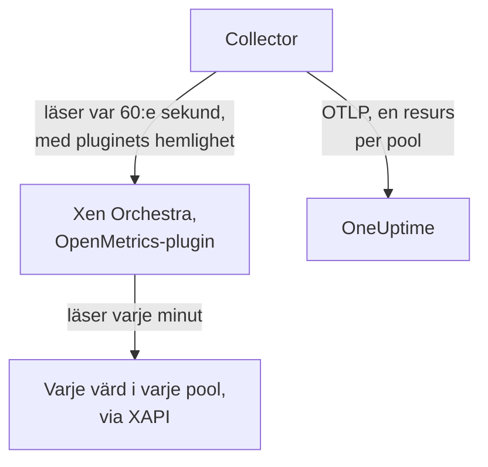

# XCP-ng-agent

OneUptimes XCP-ng-agent övervakar de XCP-ng-pooler som en Xen Orchestra hanterar: deras värdar, VM:ar, lagringsrepositoryn och virtuella diskar. Den är en standard-OpenTelemetry Collector som läser Xen Orchestras eget OpenMetrics-plugin med pluginets hemlighet och skickar det den läser till OneUptime, där varje pool visas med sin inventering. Inget lösenord till en pool eller till Xen Orchestra når någonsin agenten. [XCP-ng-monitorer](/docs/monitor/xcp-ng-monitor) larmar på det som kommer in. För att läsa samma pooler utan att installera något, från en OneUptime-sond, se [XCP-ng utan agent](/docs/telemetry/xcp-ng-agentless).

:::cards
- [Installera agenten](#installera-agenten): Slå på pluginet och använd sedan installationsskriptet eller Docker Compose.
- [Xen Orchestras certifikat](#xen-orchestras-certifikat): Hur agenten litar på Xen Orchestra, aldrig genom att hoppa över kontrollen.
- [Vad agenten samlar in](#vad-agenten-samlar-in): Varje serie från pluginet, och räknarna som egentligen är takter.
- [Felsökning](#felsökning): Ett diagnosskript, och de vanliga problemen.
:::

## Vad du får

- **Varje pool för sig.** Varje pool som Xen Orchestra hanterar blir en XCP-ng-pool i OneUptime, igenkänd på sitt XAPI-UUID och namngiven som Xen Orchestra namnger den. Två pooler bakom en Xen Orchestra är två pooler, och det är säkert att byta namn på en pool i OneUptime: telemetri kopplas till den via dess UUID.
- **Dess inventering.** Poolens värdar, VM:ar, lagringsrepositoryn och virtuella diskar med deras tillstånd och mätvärden. Kontrolldomäner (dom0) rapporterar sig som VM:ar, och poolens sidor döljer dem om du inte ber om dem.
- **En agent per Xen Orchestra.** Pluginet levererar varje pool som dess Xen Orchestra är ansluten till, så en agent läser alla, och en pool som ansluts senare visas vid nästa läsning.

## Så fungerar det

Agenten är en container som du kör med Docker Compose på en maskin: en standard-OpenTelemetry Collector, utan någon egen OneUptime-image. Var 60:e sekund ber den Xen Orchestra om `/openmetrics/metrics`, med pluginets hemlighet som Bearer-token, över Xen Orchestras egen adress och eget certifikat. Pluginet läser varje värds mätvärden via XAPI med en upplösning på 60 sekunder. Collectorn behåller poolernas serier, grupperar dem per pool och skickar dem till OneUptime över OTLP.



Varje pool registrerar sig själv med sina första data, under det UUID som agenten sätter på dess serier som `xcp_ng.pool.id`, och namnet som Xen Orchestra ger den, `xcp_ng.pool.name`. En pool utan namn i Xen Orchestra heter "Pool" följt av början på dess UUID, tills du byter namn på den.

## Innan du börjar

- Xen Orchestra 6.9 eller senare, ansluten till de pooler du vill övervaka, med sitt OpenMetrics-plugin. På en Xen Orchestra Appliance (XOA) kräver pluginet en Premium-licens; en Xen Orchestra byggd från källkoden innehåller det.
- Docker Engine 20.10 eller senare med Docker Compose v2-pluginet, `curl` och `openssl`, på en maskin som når Xen Orchestra över HTTPS.
- Ett certifikat på Xen Orchestra som anger adressen som agenten ansluter till. Det självsignerade certifikat som Xen Orchestra skapar åt sig själv anger ingen, så ingen nuvarande TLS-klient kan kontrollera det, och en Xen Orchestra byggd från källkoden serverar vanlig HTTP tills du ger den ett: se [Xen Orchestras certifikat](#xen-orchestras-certifikat).
- En intagningsnyckel. Skapa en under **Projektinställningar → Telemetri och APM → Intagningsnycklar** och kopiera värdet.
- Utgående HTTPS från den maskinen till din OneUptime-URL.

### Versioner som stöds

| | Stöds | Varför |
| --- | --- | --- |
| Xen Orchestra | 6.9 eller senare, med OpenMetrics-pluginet `xo-server-openmetrics` 1.9 | Pluginet behåller sin hemlighet när Xen Orchestra startar om, innehåller korrigeringarna av minnesläckorna vid läsning och levererar varje serie som poolens sidor läser: tillståndet för värdar och VM:ar, lagringsrepositoryn och virtuella diskar. Ett äldre plugin kunde skapa en ny hemlighet vid en omstart och stänga ute agenten tills någon kopierade den igen. |
| XCP-ng | 8.3 LTS | Stöds av Vates till den 30 november 2028. XCP-ng 8.2 nådde slutet av sin livslängd den 16 september 2025. |
| XenServer | Inte provat ännu | Xen Orchestra rapporterar en XenServer-pool som den hanterar med samma serier, så det borde fungera, men ingen har provat en med OneUptime ännu. |

### Var du kör agenten

Agenten pratar med Xen Orchestra över HTTPS, så den kan köras på vilken maskin som helst med Docker och en väg dit: själva Xen Orchestras maskin, en övervakningsvärd eller en liten administrations-VM. Välj helst en maskin vars VM inte körs på de pooler den övervakar: när en pool går ned ska inte övervakningen gå ned med den. En agent läser en Xen Orchestra; för flera, se [Läsa flera Xen Orchestra](#läsa-flera-xen-orchestra).

## Slå på OpenMetrics-pluginet

Agenten läser varje pool via Xen Orchestras OpenMetrics-plugin, med pluginets hemlighet.

:::steps
### Slå på pluginet

Öppna *Settings → Plugins* i Xen Orchestra, leta upp **openmetrics** och slå på det. Första gången det startar skapar det en hemlighet, och Xen Orchestra behåller den vid omstarter.

### Kopiera dess hemlighet

Öppna pluginets inställningar och kopiera dess **Prometheus secret**: du ger den till agenten i nästa steg. Du kan också skriva in en egen hemlighet där och spara den. Håll den privat: den som har den kan läsa varje pools mätvärden.

### Kontrollera att det svarar

Pluginet svarar på Xen Orchestras egen adress och med dess eget certifikat, på `/openmetrics/metrics`, och bara på en begäran som skickar med dess hemlighet. Dess hälsokontroll behöver ingen, så just den här begäran får hoppa över certifikatkontrollen med `-k`; agenten gör aldrig det:

```bash
curl -k https://xo.example.com/openmetrics/health
```

Det svarar `{"status":"ok"}` så länge pluginet körs. En `404` betyder att pluginet inte är påslaget.
:::

## Installera agenten

:::steps
### Installera och starta agenten

Varje OneUptime tillhandahåller agentens installationsskript och filer från sin egen version: Kommandona nedan laddar ned dem från `https://oneuptime.com`, så på en egenvärdad OneUptime ersätter du den adressen med din URL. Installationsskriptet sparas först som `install.sh`, så att du kan läsa det innan du kör det.

:::tabs
@tab install.sh
Ladda ned installationsskriptet och kör det på maskinen som ska vara värd för agenten:

```bash
curl -fsSL https://oneuptime.com/install/xcp-ng-agent -o install.sh
bash install.sh
```

Skriptet frågar efter din OneUptime-URL, intagningsnyckeln, Xen Orchestras adress som du öppnar den i en webbläsare (till exempel `https://xo.example.com` eller `https://10.0.0.5:8443`), pluginets hemlighet (visas inte medan du skriver) och vad den här Xen Orchestra ska heta i OneUptime. Sedan läser det Xen Orchestras certifikat: ett certifikat som den här maskinen redan litar på kontrolleras mot dess CA-paket; alla andra visas med sitt SHA-256-fingeravtryck, och du svarar **y** för att lita på det certifikatet och inget annat, när du har jämfört fingeravtrycket med det på Xen Orchestras maskin. Det slår aldrig av kontrollen. Till sist ber det pluginet om dess mätvärden med hemligheten och anger de pooler som Xen Orchestra rapporterar, innan det installerar något. Det installerar i `/opt/oneuptime-xcp-ng-agent`, skriver med behörigheterna `0600` en `.env`-fil och `xo-ca.pem`, certifikaten som agenten litar på för Xen Orchestra, och startar agenten med Docker Compose. Om du kör skriptet igen återanvänder det allt i den `.env` i stället för att fråga igen; så [uppgraderar du agenten](#uppgradera-agenten).
@tab Docker Compose
Ladda ned `docker-compose.yml` och `otel-collector-config.yaml` från din OneUptime till en ny mapp:

```bash
mkdir oneuptime-xcp-ng-agent && cd oneuptime-xcp-ng-agent
curl -fsSLO https://oneuptime.com/install/xcp-ng-agent/docker-compose.yml
curl -fsSLO https://oneuptime.com/install/xcp-ng-agent/otel-collector-config.yaml
```

Skapa en `.env`-fil bredvid dem. Den innehåller pluginets hemlighet, så håll den privat med `chmod 600 .env`:

```bash title=".env"
ONEUPTIME_URL=YOUR_ONEUPTIME_URL
ONEUPTIME_TELEMETRY_INGESTION_KEY=YOUR_TELEMETRY_INGESTION_TOKEN
XO_SCHEME=https
XO_ADDRESS=xo.example.com
XO_OPENMETRICS_SECRET='your-plugin-secret'
XO_NAME='Xen Orchestra'
XO_TLS_SERVER_NAME=
```

`XO_ADDRESS` är Xen Orchestras `host` eller `host:port`, utan `https://`. Sätt pluginets hemlighet inom enkla citattecken och skriv varje `$` i den som `$$`: collectorn läser värdet en gång till och skulle ta ett `$` för början på en variabel. En hemlighet med ett `'` i kan inte stå inom enkla citattecken: låt installationsskriptet skriva den, eller välj en annan hemlighet i Xen Orchestra.

Spara sedan Xen Orchestras certifikat som `xo-ca.pem` bredvid `docker-compose.yml`: agenten kontrollerar Xen Orchestra mot den här filen och inget annat. För att lita på Xen Orchestras eget certifikat läser du det och jämför dess fingeravtryck med det på Xen Orchestras maskin innan du använder det:

```bash
openssl s_client -connect xo.example.com:443 -servername xo.example.com </dev/null 2>/dev/null \
  | openssl x509 -out xo-ca.pem
openssl x509 -in xo-ca.pem -noout -fingerprint -sha256
```

Har din egen CA utfärdat certifikatet kopierar du i stället den CA:ns certifikat till `xo-ca.pem`; har en offentlig CA utfärdat det kopierar du den här maskinens CA-paket (`cp /etc/ssl/certs/ca-certificates.crt xo-ca.pem`). Starta agenten:

```bash
docker compose up -d
```
:::

### Kontrollera att agenten körs

```bash
docker compose ps
docker logs -f oneuptime-xcp-ng-agent
```

`docker compose ps` visar collectorn, `oneuptime-xcp-ng-agent`. Dess loggar bör visa den här raden när den har startat:

```text
Everything is ready. Begin running and processing data.
```

### Hitta poolerna i OneUptime

Öppna **Produkter → Infrastruktur → XCP-ng → Alla pooler**. Varje pool som Xen Orchestra rapporterar visas ungefär en minut efter den första läsningen, under namnet som Xen Orchestra ger den, med sina värdar, VM:ar och sin lagring. Dess sida **Topologi** ritar dem som en karta: se [Topologi](/docs/telemetry/topology#öppna-en-resurs-egen-karta).
:::

## Xen Orchestras certifikat

Agenten kontrollerar Xen Orchestras certifikat vid varje läsning, mot `xo-ca.pem` och inget annat, och hoppar aldrig över kontrollen: pluginets hemlighet följer med i varje begäran. `xo-ca.pem` innehåller en av tre saker:

- **Xen Orchestras eget certifikat**, fäst via sitt SHA-256-fingeravtryck (`XO_TLS_FINGERPRINT`): agenten litar på det certifikatet och inget annat.
- **Den CA som utfärdade det** (`XO_CA_FILE`), för ett certifikat från din egen CA.
- **Den här maskinens CA-paket**, för ett certifikat som den här maskinen redan litar på, till exempel ett från en offentlig CA.

Hur som helst måste certifikatet ange adressen som agenten ansluter till. Agenten kontrollerar de namn som ett certifikat är utfärdat för, dess alternativa ämnesnamn (subject alternative names), som varje nuvarande TLS-klient gör, och aldrig själva ämnet. Det självsignerade certifikat som Xen Orchestra skapar åt sig själv anger inget, så agenten kan inte lita på det, fäst eller inte, och misslyckas med `x509: certificate is not valid for any names`; installationsskriptet stannar vid ett sådant certifikat och säger varför.

### Ge Xen Orchestra ett certifikat som anger dess adress

Använd ett certifikat från din egen CA eller från en offentlig, eller skapa ett självsignerat på Xen Orchestras maskin som anger Xen Orchestras adress, med dess namn och dess adress i sina alternativa ämnesnamn:

```bash
sudo mkdir -p /etc/ssl/xo
sudo openssl req -x509 -newkey rsa:2048 -nodes -days 825 \
  -subj "/CN=xo.example.com" \
  -addext "subjectAltName=DNS:xo.example.com,IP:10.0.0.5" \
  -keyout /etc/ssl/xo/key.pem -out /etc/ssl/xo/cert.pem
```

Peka xo-servers HTTPS-lyssnare på de två filerna, som användaren som xo-server körs som (root som standard) måste kunna läsa, i en egen konfigurationsfil: `/etc/xo-server/config.httpscert.toml` på en XOA, eller bredvid xo-servers `config.toml` för en Xen Orchestra byggd från källkoden. Xen Orchestras lyssnare är numrerade, och den andra, `http.listen.1`, är dess HTTPS-lyssnare:

```toml
[http.listen.1]
port = 443
cert = '/etc/ssl/xo/cert.pem'
key = '/etc/ssl/xo/key.pem'
```

Starta sedan om xo-server med `systemctl restart xo-server` och installera agenten, eller kör installationsskriptet igen: det läser det nya certifikatet och visar dess fingeravtryck för kontroll. Eller låt Xen Orchestra själv begära ett Let's Encrypt-certifikat, som en XOA kan (se Xen Orchestras dokumentation): det är offentligt betrott, så agenten behöver ingen inställning. Med ett certifikat som anger Xen Orchestra med ett annat namn än adressen i `XO_ADDRESS` sätter du `XO_TLS_SERVER_NAME` till det namnet; installationsskriptet fyller i det från certifikatet när det kan.

När ett fäst certifikat förnyas slutar agenten läsa Xen Orchestra tills den litar på det nya. Kör installationsskriptet igen: det visar det nya fingeravtrycket och stannar, utan att ändra något. Kontrollera det fingeravtrycket på Xen Orchestras maskin och kör sedan skriptet en gång till med det: `XO_TLS_FINGERPRINT=<new fingerprint> bash install.sh`. Installerad med Docker Compose: skriv `xo-ca.pem` igen och kör `docker compose up -d --force-recreate`.

## Miljövariabler

Installationsskriptet skriver dem till `/opt/oneuptime-xcp-ng-agent/.env`; en Docker Compose-installation läser dem från `.env` bredvid `docker-compose.yml`. När du har ändrat en variabel kör du `docker compose up -d` i den mappen.

| Variabel | Obligatorisk | Beskrivning |
| --- | --- | --- |
| `ONEUPTIME_URL` | Ja | Din OneUptime-URL, till exempel `https://oneuptime.com` eller din självhostade instans. Använd `http://` och dess port om instansen bara använder HTTP. |
| `ONEUPTIME_TELEMETRY_INGESTION_KEY` | Ja | Intagningsnyckeln från **Projektinställningar → Telemetri och APM → Intagningsnycklar**. |
| `XO_URL` | Installationsskript | Xen Orchestras adress som du öppnar den i en webbläsare, till exempel `https://xo.example.com` eller `https://10.0.0.5:8443`. Installationsskriptet härleder `XO_SCHEME` och `XO_ADDRESS` ur den. |
| `XO_SCHEME` | Nej | `https`, standard. `http` bara i ett labb: hemligheten går då okrypterad över nätverket. |
| `XO_ADDRESS` | Ja | Xen Orchestras `host` eller `host:port`, utan schema. |
| `XO_OPENMETRICS_SECRET` | Ja | OpenMetrics-pluginets hemlighet, skickad som Bearer-token. Varje `$` i den skrivs som `$$`. |
| `XO_NAME` | Nej | Vad den här Xen Orchestra heter i OneUptime, satt som `xen_orchestra.name` på varje pool den läser och visad i varje pools **Inställningar**. Standard är Xen Orchestras adress. |
| `XO_TLS_FINGERPRINT` | Installationsskript | SHA-256-fingeravtrycket för Xen Orchestras eget certifikat, som `openssl x509 -fingerprint -sha256` visar det, kolon valfria, när agenten litar på det certifikatet och inget annat. Installationsskriptet vägrar ett certifikat som inte stämmer med det. |
| `XO_CA_FILE` | Installationsskript | Ett CA-paket som utfärdade Xen Orchestras certifikat; installationsskriptet kontrollerar certifikatet mot det och kopierar det till `xo-ca.pem`. |
| `XO_TLS_SERVER_NAME` | Nej | Namnet som Xen Orchestras certifikat kontrolleras mot, när `XO_ADDRESS` är en adress som certifikatet inte anger. Tomt: värden i `XO_ADDRESS`. |

## Vad agenten samlar in

Varje minut läser agenten pluginet, som via XAPI läser varje värds round-robin-databaser med en upplösning på 60 sekunder. Den behåller serierna `xcp_*` och flyttar varje series pool till resursen som den skickar dem på, som `xcp_ng.pool.id` (poolens UUID, som aldrig ändras) och `xcp_ng.pool.name`:

| Kategori | Serier |
| --- | --- |
| Pool | `xcp_pool_connected`, närvarande så länge Xen Orchestra är ansluten till poolen |
| Värdar | `xcp_host_status` (dess strömtillstånd, och om den är aktiverad), `xcp_host_uptime_seconds`, `xcp_host_cpu_average`, `xcp_host_cpu_core_usage`, `xcp_host_load`, `xcp_host_load_average`, `xcp_host_memory_*`, `xcp_host_running_vcpus`, `xcp_host_network_*` per fysiskt gränssnitt, `xcp_host_disk_*` per lagringsrepository, `xcp_host_power_consumption_watts` |
| VM:ar | `xcp_vm_status`, `xcp_vm_uptime_seconds`, `xcp_vm_cpu_usage`, `xcp_vm_cpu_core_usage`, `xcp_vm_runstate_*` (CPU-konkurrens), `xcp_vm_memory_*`, `xcp_vm_network_*` per gränssnitt, `xcp_vm_disk_*` per disk, `xcp_vm_power_consumption_watts` |
| Lagring | `xcp_sr_physical_size_bytes`, `xcp_sr_physical_usage_bytes`, `xcp_sr_virtual_size_bytes`, `xcp_vdi_virtual_size_bytes`, `xcp_vdi_physical_usage_bytes` |
| XOSTOR | `xcp_xostor_*`, på pooler som kör XOSTOR |

Kontrolldomäner rapporterar sig som VM:ar med `is_control_domain="true"`. Varje serie från Xen Orchestra behåller sitt namn och sina etiketter, till exempel `uuid`, `host_name`, `vm_name`, `sr_name` och `tags`; [XCP-ng-monitorn](/docs/monitor/xcp-ng-monitor#insamlade-mätvärden) anger dem alla.

### Räknarna som är takter

Xen Orchestra typar åtta genomströmningsserier som räknare och kallar dem `_total`, fast var och en innehåller XAPI:s takt per sekund: `xcp_host_network_receive_bytes_total`, `xcp_host_network_transmit_bytes_total`, `xcp_vm_network_receive_bytes_total`, `xcp_vm_network_transmit_bytes_total`, `xcp_vm_network_receive_errors_total`, `xcp_vm_network_transmit_errors_total`, `xcp_vm_disk_read_bytes_total` och `xcp_vm_disk_write_bytes_total`. Lästa som räknare skulle varje diagram över nätverks- och diskgenomströmning bli fel: en takt som sjunker läses som en nollställning av räknaren. Agentens processor `transform/xcp-ng-rates` gör dem till gauges med oförändrade namn och värden, så OneUptime lagrar dem som de takter de är, i byte eller fel per sekund. OneUptime konverterar också varje serie som fortfarande kommer som räknare, från en collector som du har konfigurerat själv.

### Vad OneUptime lägger till

OneUptime härleder fyra 0/1-serier för varje pool medan dess data kommer in, och larmmallarna läser dem:

| Serie | 1 så länge |
| --- | --- |
| `xcp_ng.host.running` | Xen Orchestra rapporterar värden som Running; 0 medan den är Halted, eller dess tillstånd är Unknown |
| `xcp_ng.host.enabled` | värden är aktiverad; 0 i underhållsläge eller under en evakuering, när XAPI inte startar någon VM på den |
| `xcp_ng.vm.running` | VM:en är Running; 0 medan den är Halted, Paused eller Suspended |
| `xcp_ng.vm.stopped_after_running` | en VM som kördes under de senaste 24 timmarna är Halted eller Paused |

Den sätter också `xcp_ng.scope` (`pool`, `host`, `vm`, `sr`, `vdi` eller `xostor`) och `xcp_ng.id` (objektets UUID) på varje punkt, och monitorer och instrumentpaneler filtrerar på dem: se [Resursidentitet](/docs/monitor/xcp-ng-monitor#resursidentitet).

### Vad agenten inte behåller

- Xen Orchestras egna processerier (`xo_*`), som inte hör till någon pool, och collectorns egna lässerier.
- En värds effekt som Xen Orchestra läser via IPMI: pluginet skickar den mätningen utan dess pool, så den hör inte heller till någon pool. Varje VM:s uppskattade andel, `xcp_vm_power_consumption_watts`, behålls.

## Vad en pools sidor visar

Öppna en pool från **Produkter → Infrastruktur → XCP-ng → Alla pooler**. Dess meny innehåller:

| Sida | Vad den visar |
| --- | --- |
| **Översikt** | Poolens hälsa och det som kräver uppmärksamhet, dess värdar, VM:ar och lagring, dess mest belastade VM:ar och värdar, och den Xen Orchestra som den läses från, med agentens version. |
| **Värdar**, **VM:ar**, **Lagring** | Varje värd, VM och lagringsrepository, var och en med en egen sida och sina diagram. **VM:ar** döljer kontrolldomäner om du inte ber om dem, och ett lagringsrepositorys sida visar dess virtuella diskar. |
| **Topologi** | Poolen, dess värdar, VM:arna på varje värd och de lagringsrepositoryn som de använder, som en karta. |
| **Resursanvändning** | Diagram över poolens värdar, VM:ar, lagring, diskar och nätverk över tid, en linje per värd, VM eller lagringsrepository. |
| **Rekommendationer** | De [larmmallar](/docs/monitor/xcp-ng-monitor#färdiga-larmmallar) som kan slås på, var och en en monitor. |
| **Mätvärden**, **Loggar** | Varje serie från poolen i utforskarna, avgränsad till den. Agenten skickar bara mätvärden, så **Loggar** visar bara loggar som du skickar med poolens `xcp_ng.pool.id`. |
| **Incidenter**, **Larm**, **Schemalagt underhåll** | De som nämner poolen. |
| **Feed** | Vad som hände med poolen i OneUptime: när den lades till, ändrades, arkiverades eller återställdes, vilka dess ägare är, och de ägar- och etikettregler som kördes på den. |
| **Ägare** | Vem som får veta om den, manuellt eller via ägarregler. |
| **Inställningar** | Dess namn, den Xen Orchestra som den läses från, dess namn där och agentens version, och hur länge dess telemetri sparas. |
| **Dokumentation** | Den här installationen, med din URL och nyckel redan ifyllda. |

Poolens **Översikt** anger dess hälsa, **Felfri**, **Försämrad** eller **Ej felfri**, utifrån det som kräver uppmärksamhet, och visar det under **Kräver uppmärksamhet**, det mest brådskande först:

- **Kritiskt:** en värd som är Halted, eller i ett tillstånd som Xen Orchestra inte kan avgöra (Unknown); ett lagringsrepository som är mer än 95 % fullt, där VM:ar inte längre kan skriva.
- **Värt en blick:** en inaktiverad värd, i underhållsläge eller under evakuering; en VM som är Halted eller Paused och kördes under de senaste 24 timmarna; ett lagringsrepository som är mer än 90 % fullt, där larmet Storage Repository Near Full utlöses, eller som via thin provisioning är tilldelat över sin storlek.

En försatt VM (Suspended) är försatt i vila med avsikt och räknas aldrig, inte heller en VM som ingen har sett köras på ett dygn, eller ett kontrolldomän. ISO-bibliotek och flyttbara medier innehåller inga VM-diskar, så poolens lagringssiffror utelämnar dem.

När Xen Orchestra slutar rapportera en pool i 15 minuter blir poolen **Frånkopplad**, och dess sidor behåller det som den senast rapporterade. En värd, VM, ett lagringsrepository eller en virtuell disk som inte längre finns i Xen Orchestras rapporter lämnar inventeringen 15 minuter senare; att stoppa en VM tar aldrig bort den.

## Märk poolerna med projektetiketter

Ett resursattribut som börjar med `oneuptime.label.` blir en projektetikett på varje pool som agenten läser: `oneuptime.label.<dimension>=<value>` är etiketten `<dimension>:<value>`. Lägg till attributen i processorn `resource` i `otel-collector-config.yaml`, bredvid `oneuptime.agent.version`:

```yaml
processors:
  resource:
    attributes:
      # ...existing attributes...
      - key: oneuptime.label.team
        value: platform
        action: upsert
      - key: oneuptime.label.env
        value: production
        action: upsert
```

Collectorn läser sin konfiguration bara vid start: kör `docker compose restart oneuptime-xcp-ng-agent`. Poolerna visar då etiketterna `team:platform` och `env:production`. Etiketter jämförs utan hänsyn till skiftläge, så en befintlig etikett `Production` återanvänds i stället för att dubbleras, och agenten tar aldrig bort en etikett som någon har lagt till i OneUptime. När du kör installationsskriptet igen ersätts en redigerad `otel-collector-config.yaml`, och din sparas bredvid som `otel-collector-config.yaml.bak.<timestamp>`.

## Läsa flera Xen Orchestra

En agent läser en Xen Orchestra och varje pool som den hanterar. För att läsa en andra Xen Orchestra från samma maskin installerar du en andra agent i en egen mapp med en egen `.env`, till exempel `INSTALL_DIR=/opt/oneuptime-xcp-ng-agent-lab bash install.sh`, och ger den ett eget `container_name` i dess `docker-compose.yml` (till exempel `oneuptime-xcp-ng-agent-lab`): två containrar kan inte dela namn. Ge var och en ett eget `XO_NAME`, så att varje pools **Inställningar** säger vilken Xen Orchestra som läser den, och ge mappen till diagnosskriptet med `-d`.

Låt aldrig två agenter läsa samma pool via två Xen Orchestra som båda hanterar den: den är en pool i OneUptime via sitt UUID och skulle rapporteras två gånger.

## Kör som en systemd-tjänst

För att starta agenten med maskinen och starta om den när den misslyckas installerar du dess systemd-enhet. Den förutsätter att agenten ligger i `/opt/oneuptime-xcp-ng-agent`, där installationsskriptet placerar den:

```bash
sudo curl -fsSL https://oneuptime.com/install/xcp-ng-agent/systemd/oneuptime-xcp-ng-agent.service -o /etc/systemd/system/oneuptime-xcp-ng-agent.service
sudo systemctl daemon-reload
sudo systemctl enable --now oneuptime-xcp-ng-agent
```

## Uppgradera agenten

Agenten rapporterar den collector-version som dess filer låser som sin **Agentversion**, på varje pools **Översikt** och **Inställningar**. När den är äldre än den version som den här OneUptime-utgåvan låser visas en varningssymbol bredvid den. Välj den för att se de här kommandona.

Collector-imagen är låst i `docker-compose.yml` och dess konfiguration är en fil bredvid, så en pull ensam flyttar inte agenten framåt. Kör `install.sh` igen: det återanvänder varje värde i din befintliga `.env` (inget frågas igen), kontrollerar Xen Orchestras certifikat på samma sätt, förnyar `docker-compose.yml` och `otel-collector-config.yaml` (en fil som du har redigerat behålls som `<file>.bak.<timestamp>`), hämtar imagen och återskapar agenten, så att collectorn läser sin nya konfiguration. En agent som är installerad utanför `/opt/oneuptime-xcp-ng-agent` behöver sin mapp: `INSTALL_DIR=<folder> bash install.sh`.

```bash
curl -fsSL https://oneuptime.com/install/xcp-ng-agent -o install.sh
bash install.sh
```

Installerade du den med Docker Compose i stället? Ladda ned båda filerna igen i agentens mapp (och gör om eventuella ändringar som du hade gjort i dem), hämta sedan imagen och återskapa agenten. Din `.env` och `xo-ca.pem` finns kvar:

```bash
curl -fsSLO https://oneuptime.com/install/xcp-ng-agent/docker-compose.yml
curl -fsSLO https://oneuptime.com/install/xcp-ng-agent/otel-collector-config.yaml
docker compose pull
docker compose up -d --force-recreate
```

## Avinstallera agenten

```bash
cd /opt/oneuptime-xcp-ng-agent
docker compose down
```

Slå sedan av OpenMetrics-pluginet i Xen Orchestra om inget annat läser det.

## Felsökning

:::details Kör diagnosskriptet först
Agenten har ett skript, [`troubleshoot.sh`](https://oneuptime.com/install/xcp-ng-agent/troubleshoot.sh), som kontrollerar hela kedjan i den ordning som data färdas: containern; Xen Orchestras adress från agentens eget nätverk; pluginets hälsokontroll; Xen Orchestras certifikat mot `xo-ca.pem`, och om ett fäst certifikat fortfarande är det som den visar; pluginets hemlighet; de pooler som Xen Orchestra rapporterar; intagningsnyckelns form; collectorns egna mätvärden; och om OneUptime accepterar intagningsnyckeln. Den sista kontrollen väger tyngst. OneUptime avvisar en felaktig nyckel med `401` (`422` för en inaktiverad nyckel eller en webbläsarnyckel), och collectorn behandlar båda som permanenta: den kastar batchen och loggar ett enda fel `Exporting failed`, som är lätt att missa medan containern förblir frisk. Skriptet anropar `GET <url>/otlp/v1/validate` från agentens nätverk för ett omedelbart `200` (giltig) eller `401` (ogiltig) och faller tillbaka på `POST /fluentd/v1/logs` på äldre servrar. Det visar aldrig hemligheten eller nyckeln.

```bash
curl -fsSL https://oneuptime.com/install/xcp-ng-agent/troubleshoot.sh -o troubleshoot.sh
bash troubleshoot.sh    # add -d <dir> if you installed outside /opt/oneuptime-xcp-ng-agent
```

Det avslutas med en bedömning som anger den mest sannolika orsaken.
:::

:::details Xen Orchestra avvisar hemligheten (401)
Collectorn loggar `server returned HTTP status 401 Unauthorized`. Kopiera hemligheten igen från *Settings → Plugins → openmetrics*, sätt `XO_OPENMETRICS_SECRET` till den i `.env`, inom enkla citattecken och med varje `$` skrivet som `$$`, och kör `docker compose up -d` i agentens mapp. Före 6.8 kunde Xen Orchestra skapa en ny hemlighet vid en omstart: uppgradera den.
:::

:::details Pluginet svarar inte (404, 500, 502 eller 503)
Xen Orchestra svarar, men dess OpenMetrics-plugin gör det inte. Slå på pluginet under *Settings → Plugins → openmetrics* och kontrollera att Xen Orchestra är 6.9 eller senare. En XOA behöver en Premium-licens för pluginet. `/openmetrics/health` svarar `{"status":"ok"}` utan hemlighet så länge pluginet körs.
:::

:::details Certifikatfel
- `x509: certificate is not valid for any names`: certifikatet anger ingen adress, som Xen Orchestras eget självsignerade certifikat. [Ge Xen Orchestra ett certifikat som anger dess adress](#ge-xen-orchestra-ett-certifikat-som-anger-dess-adress).
- `x509: certificate is valid for <names>, not <address>`: anslut till ett av de namnen, eller sätt `XO_TLS_SERVER_NAME` till ett av dem.
- `x509: cannot validate certificate for <IP> because it doesn't contain any IP SANs`: `XO_ADDRESS` är en IP-adress som certifikatet inte anger. Sätt `XO_TLS_SERVER_NAME` till ett namn som det anger, eller kör installationsskriptet igen, som gör det.
- `x509: certificate signed by unknown authority`: `xo-ca.pem` innehåller varken det här certifikatet eller den CA som utfärdade det. Certifikatet har förnyats, eller filen innehåller ett annat: kontrollera det nya fingeravtrycket på Xen Orchestras maskin och kör installationsskriptet med det, `XO_TLS_FINGERPRINT=<new fingerprint> bash install.sh`, eller skriv filen igen.
- `unable to read CA cert`: `xo-ca.pem` saknas eller kan inte läsas. Kör installationsskriptet igen.
:::

:::details Läsningen får tidsgräns (context deadline exceeded)
Xen Orchestra behövde mer än 50 sekunder, agentens gräns, för att samla in mätvärdena, så den läsningen skickar inget: oftast svarar inte en värd i någon av dess pooler. Kontrollera poolernas värdar i Xen Orchestra; agenten läser igen en minut senare.
:::

:::details En pool är Frånkopplad
OneUptime markerar en pool som Frånkopplad när inget har lästs för den på 15 minuter; OneUptime kontrollerar var 5:e minut, och tid då den själv inte tog emot data räknas inte.

1. Är alla den här Xen Orchestras pooler Frånkopplade kontrollerar du agenten: `docker compose ps` och `docker logs oneuptime-xcp-ng-agent`, i agentens mapp.
2. Är det bara en rapporterar Xen Orchestra den inte längre: under *Settings → Servers* i Xen Orchestra måste poolens server vara ansluten. Poolens värdar, VM:ar och lagring finns kvar som Xen Orchestra senast rapporterade dem.
:::

:::details En pool saknas
Xen Orchestra rapporterar bara de pooler som den är ansluten till, och agenten läser bara den Xen Orchestra. Anslut poolens server under *Settings → Servers* i Xen Orchestra; poolen visas i OneUptime vid nästa läsning. En pool som en annan Xen Orchestra hanterar behöver en egen agent, bredvid den Xen Orchestra.
:::

:::details Genomströmningsdiagram ser fel ut
De åtta serierna `_total` som innehåller takter måste nå OneUptime som gauges. Har du ersatt den medföljande `otel-collector-config.yaml` med din egen behåller du processorn `transform/xcp-ng-rates` i den. Läs dem som de är, i byte eller fel per sekund: en takt per sekund av dem vore en takt av en takt.
:::

:::details Skicka mätvärden utan agenten
Agenten är en standardkonfiguration av collectorn, så en collector som du redan kör kan göra samma jobb: kopiera läsjobbet och processorerna från den medföljande konfigurationen till din. Resursattributet `xcp_ng.pool.id` registrerar varje pool i OneUptime, processorn `groupbyattrs` gör varje pool till en resurs, och borttagningen av `service.name` och `service.instance.id` hindrar att data hamnar under en tjänst: behåll alla tre, och `transform/xcp-ng-rates`.
:::

## Vad pluginet inte täcker ännu

Xen Orchestras OpenMetrics-plugin levererar mätvärden, så en del av det du håller koll på i en XCP-ng-pool finns inte där ännu:

- **Larm** utöver XOSTOR:s, **HA-tillståndet**, **pool-mastern**, **saknade patchar**, **säkerhetskopior** och **ögonblicksbilder**, och **länktillståndet** för en värds fysiska gränssnitt (PIF:ar). De kommer från Xen Orchestras REST-API, i [#10997](https://github.com/OneUptime/oneuptime/issues/10997).
- **Pooler utan Xen Orchestra**, eller bakom en XOA utan den Premium-licens som pluginet behöver: en OneUptime-sond läser dem direkt via XAPI ([#10999](https://github.com/OneUptime/oneuptime/issues/10999)), se [XCP-ng utan agent](/docs/telemetry/xcp-ng-agentless).
- **Anslutning utan agent**: en OneUptime-sond läser själv Xen Orchestras plugin, som VMware kan ([#10996](https://github.com/OneUptime/oneuptime/issues/10996)), på samma sida.

## Nästa steg

:::cards
- [XCP-ng-övervakning](/docs/monitor/xcp-ng-monitor): Larm för pooler, värdar, VM:ar och lagringsrepositoryn.
- [Proxmox-agent](/docs/telemetry/proxmox): Övervaka Proxmox VE-kluster på samma sätt.
- [OpenTelemetry-collector på värden](/docs/telemetry/host-otel-collector): Operativsystemets vy inifrån dina VM:ar.
:::
