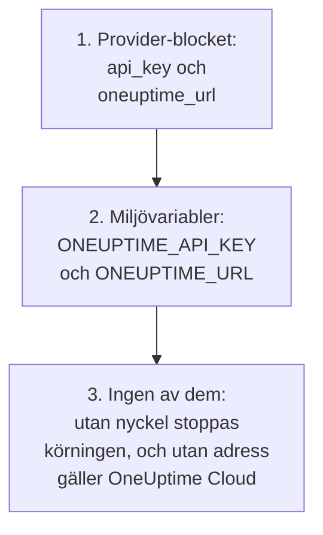
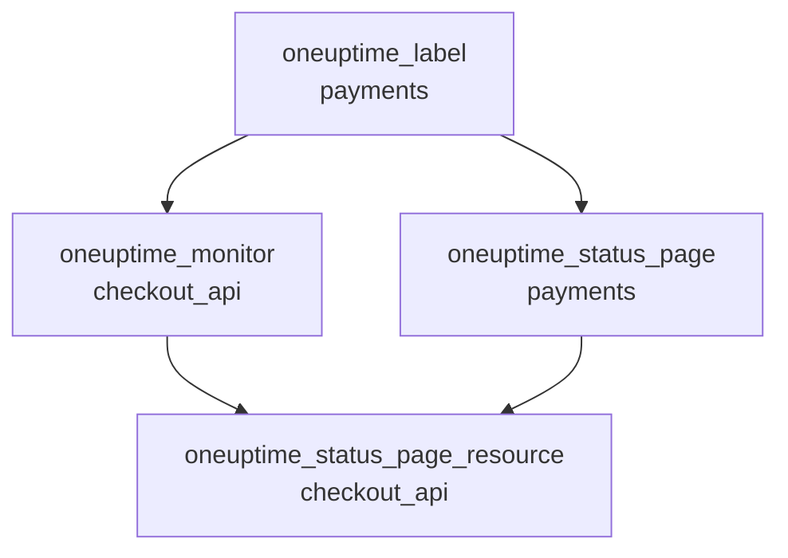

# Komplett guide

Den här guiden tar upp det som kommer efter din första apply: hur providern hittar sin API-nyckel, hur du lägger upp en konfiguration för ett eller flera projekt, hur resurser hänvisar till varandra, hur du läser poster som du inte hanterar, hur du håller din state säker och hur du uppgraderar. Ny med providern? Börja med [Snabbstart](/docs/terraform/quick-start).

:::cards
- [Konfigurera providern](#konfigurera-providern): API-nyckeln och adressen, och var providern läser dem.
- [Lägg upp en konfiguration](#lägg-upp-en-konfiguration): Filer, projekt och många resurser från ett block.
- [Läs det som redan finns](#läs-det-som-redan-finns): Datakällor, och hur en uppslagning hittar sin träff.
- [Håll din state säker](#håll-din-state-säker): En fjärrbackend, och vad du aldrig ska committa.
:::

## Konfigurera providern

Providern tar två inställningar. Var och en kommer från provider-blocket, eller annars från en miljövariabel:

| Inställning | Miljövariabel | När ingen av dem är angiven |
| --- | --- | --- |
| `api_key` | `ONEUPTIME_API_KEY` | Providern stannar innan något planeras: `Missing API Key` |
| `oneuptime_url` | `ONEUPTIME_URL` | `https://oneuptime.com`, vilket är OneUptime Cloud |



`oneuptime_url` är adressen till ditt OneUptime, utan `/api`: providern lägger till `https://` när adressen saknar schema, och `/api` i slutet. `api_key` är känslig, så Terraform skriver aldrig ut den.

Nyckeln måste vara en API-nyckel till det projekt som du hanterar, med behörighet att skapa, läsa, ändra och ta bort varje slags post som din konfiguration har: se [Skapa en API-nyckel till projektet](/docs/terraform/quick-start#skapa-en-api-nyckel-till-projektet). Master-API-nyckeln i ett självhostat OneUptime hör inte till något projekt, så en skapning som görs med den misslyckas med `ProjectId required`.

### Ge providern dess nyckel

:::tabs
@tab Miljövariabel
```bash
export ONEUPTIME_API_KEY="<your-api-key>"
# Only on a self-hosted OneUptime:
export ONEUPTIME_URL="https://oneuptime.example.com"
```

```hcl title="main.tf"
provider "oneuptime" {}
```
@tab Terraform-variabel
```hcl title="variables.tf"
variable "oneuptime_api_key" {
  description = "API key of the OneUptime project"
  type        = string
  sensitive   = true
}

provider "oneuptime" {
  api_key = var.oneuptime_api_key
}
```

```hcl title="terraform.tfvars"
oneuptime_api_key = "<your-api-key>"
```
:::

En miljövariabel håller nyckeln utanför alla filer. En variabelfil är praktisk på din egen dator: lägg till `terraform.tfvars` i `.gitignore`. I en pipeline anger du `TF_VAR_oneuptime_api_key` i stället för att skriva filen.

### Kör den i CI/CD

Ge jobbet nyckeln som en hemlighet, i miljövariabeln `ONEUPTIME_API_KEY`:

:::tabs
@tab GitHub Actions
```yaml title=".github/workflows/oneuptime.yml"
name: OneUptime
on:
  push:
    branches: [main]

jobs:
  apply:
    runs-on: ubuntu-latest
    env:
      ONEUPTIME_API_KEY: ${{ secrets.ONEUPTIME_API_KEY }}
    steps:
      - uses: actions/checkout@v4
      - uses: hashicorp/setup-terraform@v3
      - run: terraform init -input=false
      - run: terraform plan -input=false -out=tfplan
      - run: terraform apply -input=false tfplan
```
@tab GitLab CI
```yaml title=".gitlab-ci.yml"
apply:
  image:
    name: hashicorp/terraform:latest
    entrypoint: [""]
  rules:
    - if: $CI_COMMIT_BRANCH == $CI_DEFAULT_BRANCH
  script:
    - terraform init -input=false
    - terraform plan -input=false -out=tfplan
    - terraform apply -input=false tfplan
```
:::

I GitHub lägger du till hemligheten under **Settings → Secrets and variables → Actions**; i GitLab lägger du till en maskerad CI/CD-variabel med samma namn. Håll din state i en [fjärrbackend](#håll-din-state-säker), så att varje körning börjar från den state som den förra lämnade.

## Lägg upp en konfiguration

Ett upplägg som fungerar bra:

```text
oneuptime/
├── main.tf          # the terraform and provider blocks
├── variables.tf     # input variables
├── outputs.tf       # the IDs other configurations need
├── shared.tf        # labels, teams and monitor statuses
├── monitors.tf      # monitors and monitor groups
├── status-pages.tf  # status pages and their domains
└── on-call.tf       # on-call policies and escalation rules
```

- **En konfiguration för varje projekt.** En API-nyckel hör till ett projekt, så en konfiguration hanterar naturligt ett.
- **Delade poster en gång.** Definiera etiketter, team och monitorstatusar i en fil, och hänvisa till dem med deras adress överallt annars.

### Hantera flera projekt

För att hantera mer än ett projekt från en konfiguration ger du providern ett alias för varje projekt, vart och ett med det projektets nyckel. En resurs anger med `provider` vilket alias den använder:

```hcl
provider "oneuptime" {
  alias   = "production"
  api_key = var.production_api_key
}

provider "oneuptime" {
  alias   = "staging"
  api_key = var.staging_api_key
}

resource "oneuptime_label" "staging_critical" {
  provider = oneuptime.staging

  name  = "critical"
  color = "#FF5733"
}
```

Deklarera `production_api_key` och `staging_api_key` som variabler som är markerade `sensitive`, som ovan.

### Många resurser från ett block

`for_each` skapar en resurs för varje post i en map. De här monitorerna delar sina kriterier och skiljer sig bara i namn och adress:

```hcl
variable "websites" {
  type = map(string)
  default = {
    homepage = "https://example.com"
    docs     = "https://docs.example.com"
  }
}

resource "oneuptime_monitor" "website" {
  for_each = var.websites

  name                = "Website: ${each.key}"
  monitor_type        = "Website"
  monitoring_interval = "*/5 * * * *"

  monitor_steps = [{
    monitor_destination      = each.value
    monitor_destination_type = "URL"

    criteria = [
      {
        name                  = "Offline"
        filter_condition      = "Any"
        change_monitor_status = true
        monitor_status_id     = data.oneuptime_monitor_status.offline.id

        filters = [
          {
            check_on    = "Is Online"
            filter_type = "False"
          }
        ]
      }
    ]
  }]
}
```

Lägg till en webbplats i mappen, så skapar nästa apply dess monitor. Ta bort en, så tar den bort den.

## Hänvisa till andra resurser

En resurs som nämner en annan resurs attribut är beroende av den, och Terraform ordnar arbetet efter de hänvisningarna. Här skapas etiketten först och tas bort sist, eftersom monitorn och statussidan nämner den:



```hcl
resource "oneuptime_label" "payments" {
  name        = "payments"
  description = "Payment infrastructure"
  color       = "#2ECC71"
}

resource "oneuptime_monitor" "checkout_api" {
  name         = "Checkout API"
  description  = "Availability of the checkout API"
  monitor_type = "Manual"
  labels       = [oneuptime_label.payments.id]
}

resource "oneuptime_status_page" "payments" {
  name                  = "Payments Status"
  page_title            = "Payments Status"
  is_public_status_page = true
  labels                = [oneuptime_label.payments.id]
}

resource "oneuptime_status_page_resource" "checkout_api" {
  status_page_id = oneuptime_status_page.payments.id
  monitor_id     = oneuptime_monitor.checkout_api.id
  display_name   = "Checkout API"
}
```

Du behöver sällan `depends_on`: lägg bara till den för en ordning som Terraform inte kan se utifrån attributen. Listor med ID:n som `labels` är mängder, så att ändra ordningen ändrar ingenting.

## Läs det som redan finns

Varje resurs har en datakälla med samma namn. En datakälla läser en post som den här konfigurationen inte hanterar, skapad i instrumentpanelen eller av en annan konfiguration, så att du kan hänvisa till den utan att ta över den.

```hcl
data "oneuptime_label" "critical" {
  name = "critical"
}

data "oneuptime_monitor_status" "offline" {
  is_offline_state = true
}

data "oneuptime_status_page" "main" {
  id = "5f8a1b2c-3d4e-4f6a-8b9c-0d1e2f3a4b5c"
}

resource "oneuptime_monitor" "database" {
  name         = "Database Health"
  monitor_type = "Manual"
  labels       = [data.oneuptime_label.critical.id]
}
```

Så hittar en uppslagning sin träff:

| Du anger | Den hittar | Fel |
| --- | --- | --- |
| `id` | Posten med det ID:t | `Not Found` när ingen post har det |
| Andra enkla argument, ett eller flera | Den enda post som stämmer med alla | `Not Found` när ingen stämmer, `Ambiguous Match` när fler än en stämmer |
| `id` och ett annat argument, eller ingenting | Ingenting | `Invalid Lookup` |

Enkla argument är text, tal och sant eller falskt: ett namn, en prioritet, en flagga som `is_offline_state`. Listor, JSON-värden, tidsstämplar och hemligheter går inte att slå upp efter. För att ta över en post i stället för att bara läsa den [importerar du den](/docs/terraform/importing-resources).

## Håll din state säker

Terraforms state innehåller ID:n och attribut för allt som den hanterar, hemligheter inräknade. Håll den i en fjärrbackend som låser den, så att ett team delar en state och två körningar aldrig skriver den samtidigt. Vilken standardbackend som helst fungerar, till exempel en S3-bucket:

```hcl
terraform {
  backend "s3" {
    bucket       = "my-terraform-state"
    key          = "oneuptime/production.tfstate"
    region       = "us-east-1"
    encrypt      = true
    use_lockfile = true
  }
}
```

`use_lockfile` kräver Terraform 1.10 eller OpenTofu 1.10, eller senare. Före dem låser S3-backenden med en DynamoDB-tabell (`dynamodb_table`).

- **Redigera aldrig din state för hand.** Använd `terraform state mv` och `terraform state rm`.
- **Committa aldrig `terraform.tfstate`, eller en `.tfvars`-fil med en hemlighet i.**

## Drift, och vad som inte orsakar den

`terraform plan` jämför OneUptime med din konfiguration och visar det som skiljer sig. Vissa skillnader visas aldrig:

- **Tider jämförs som tidpunkter.** `2030-06-01T02:00:00Z` och serverns sätt att skriva samma tidpunkt är lika.
- **Standardvärden som servern lägger till** i en monitors steg, eller i ett JSON-värde, är ingen skillnad mot det som du skrev.
- **Det som servern håller uppdaterat**, till exempel en monitors nuvarande status, är inte heller någon skillnad.

Ett värde som du beräknar vid varje körning är det däremot: `timestamp()` ger en ny tid vid varje körning, så en plan visar den alltid. Skriv fasta tider i stället:

```hcl
resource "oneuptime_scheduled_maintenance_event" "database_upgrade" {
  title       = "Database upgrade"
  description = "Planned PostgreSQL upgrade"
  starts_at   = "2030-06-01T02:00:00Z"
  ends_at     = "2030-06-01T04:00:00Z"
}
```

## Uppgradera providern

:::steps
### Läs versionsinformationen

[Terraform Registry](https://registry.terraform.io/providers/oneuptime/oneuptime) och [providerns versioner på GitHub](https://github.com/OneUptime/terraform-provider-oneuptime/releases) visar vad som har ändrats.

### Höj versionsbegränsningen

`{{TERRAFORM_PROVIDER_VERSION}}` tar redan varje {{TERRAFORM_PROVIDER_MAJOR}}.x-version. En ny huvudversion kräver en ny begränsning.

### Hämta den nya versionen

```bash
terraform init -upgrade
```

### Planera innan du tillämpar

Kör `terraform plan`, och tillämpa bara när den är tom eller visar de ändringar som du väntar dig.
:::

På ett självhostat OneUptime uppgraderar du först OneUptime och sedan providern: providern får inte vara nyare än ditt OneUptime. Se [Självhostad konfiguration](/docs/terraform/self-hosted).

## Nästa steg

:::cards
- [Monitorsteg](/docs/terraform/monitor-steps): Bestäm vad en monitor kontrollerar och vad varje resultat betyder.
- [Exempel](/docs/terraform/examples): Färdiga konfigurationer för de vanliga resurserna.
- [Importera resurser](/docs/terraform/importing-resources): För in det du har skapat i instrumentpanelen under Terraform.
- [Felsökning](/docs/terraform/troubleshooting): Vanliga fel och hur du åtgärdar dem.
:::
