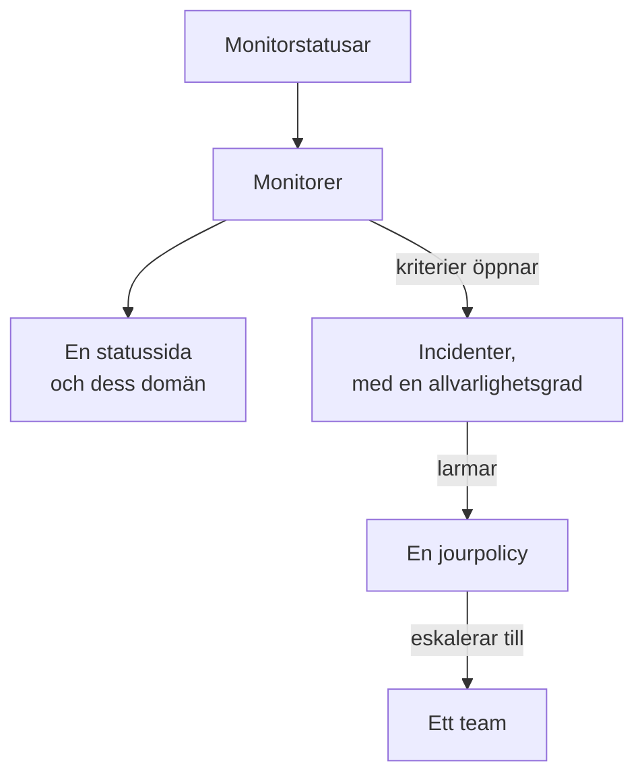

# Exempel

Färdiga konfigurationer för de resurser som de flesta projekt börjar med. Varje block kan tillämpas som det är ovanpå provider-konfigurationen nedan, och de flesta kommer från providerns end-to-end-tester, som tillämpar dem på ett riktigt OneUptime vid varje ändring.

:::cards
- [Monitorer](#monitorer): Webbplats-, API-, ping-, port-, SSL-certifikat-, heartbeat- och manuella monitorer.
- [Statussidor](#statussidor): En statussida med en grupp och en monitor, och en egen domän.
- [Team och jour](#team-och-jour): Ett team, och en jourpolicy som larmar det.
- [Incidenter och underhåll](#incidenter-och-underhåll): Allvarlighetsgrader, tillstånd, en deklarerad incident och ett underhållsfönster.
:::



## Provider-konfiguration

Varje exempel förutsätter den här konfigurationen, med API-nyckeln i miljövariabeln `ONEUPTIME_API_KEY`:

```hcl title="main.tf"
terraform {
  required_providers {
    oneuptime = {
      source  = "oneuptime/oneuptime"
      version = "{{TERRAFORM_PROVIDER_VERSION}}"
    }
  }
}

provider "oneuptime" {
  # On a self-hosted OneUptime, add your OneUptime's address:
  # oneuptime_url = "https://oneuptime.example.com"
}
```

## Etiketter

Etiketter sorterar och filtrerar poster. De flesta resurser tar en mängd etikett-ID:n i `labels`:

```hcl
resource "oneuptime_label" "production" {
  name        = "production"
  description = "Production infrastructure"
  color       = "#FF5733"
}
```

## Monitorer

Monitorerna nedan sätter sin status med tre av de statusar som varje projekt börjar med, lästa med datakällor:

```hcl
data "oneuptime_monitor_status" "operational" {
  name = "Operational"
}

data "oneuptime_monitor_status" "degraded" {
  name = "Degraded"
}

data "oneuptime_monitor_status" "offline" {
  name = "Offline"
}
```

Varje monitors `monitor_steps` säger vad den kontrollerar och hur varje resultat bedöms: [Monitorsteg](/docs/terraform/monitor-steps) förklarar varje attribut.

### Webbplatsmonitor

Offline när webbplatsen inte svarar, online när den svarar med 200. End-to-end-testet `35-monitor-with-steps` tillämpar en monitor med de här kontrollerna:

```hcl
resource "oneuptime_monitor" "website" {
  name                = "Website"
  description         = "Homepage availability and status code"
  monitor_type        = "Website"
  monitoring_interval = "*/5 * * * *"
  labels              = [oneuptime_label.production.id]

  monitor_steps = [{
    monitor_destination      = "https://example.com"
    monitor_destination_type = "URL"
    request_type             = "GET"

    criteria = [
      {
        name                  = "Offline"
        description           = "The website does not respond"
        filter_condition      = "Any"
        change_monitor_status = true
        monitor_status_id     = data.oneuptime_monitor_status.offline.id

        filters = [
          {
            check_on    = "Is Online"
            filter_type = "False"
          }
        ]
      },
      {
        name                  = "Online"
        description           = "The website responds with 200"
        filter_condition      = "All"
        change_monitor_status = true
        monitor_status_id     = data.oneuptime_monitor_status.operational.id

        filters = [
          {
            check_on    = "Is Online"
            filter_type = "True"
          },
          {
            check_on    = "Response Status Code"
            filter_type = "Equal To"
            value       = "200"
          }
        ]
      }
    ]
  }]
}
```

### API-monitor

En `POST` med headrar och en JSON-body, försämrad när svaret är långsamt. End-to-end-testet `35-monitor-with-steps` tillämpar en liknande API-monitor:

```hcl
resource "oneuptime_monitor" "orders_api" {
  name         = "Orders API"
  description  = "Health check of the orders API"
  monitor_type = "API"

  monitor_steps = [{
    monitor_destination      = "https://api.example.com/v1/health"
    monitor_destination_type = "URL"
    request_type             = "POST"
    request_headers = {
      "Content-Type" = "application/json"
      "Accept"       = "application/json"
    }
    request_body = jsonencode({ check = "health" })

    criteria = [
      {
        name                  = "Offline"
        description           = "The API does not answer, or answers with an error"
        filter_condition      = "Any"
        change_monitor_status = true
        monitor_status_id     = data.oneuptime_monitor_status.offline.id

        filters = [
          {
            check_on    = "Is Online"
            filter_type = "False"
          },
          {
            check_on    = "Response Status Code"
            filter_type = "Greater Than Or Equal To"
            value       = "500"
          }
        ]
      },
      {
        name                  = "Slow"
        description           = "The API takes more than two seconds"
        filter_condition      = "All"
        change_monitor_status = true
        monitor_status_id     = data.oneuptime_monitor_status.degraded.id

        filters = [
          {
            check_on    = "Response Time (in ms)"
            filter_type = "Greater Than"
            value       = "2000"
          }
        ]
      },
      {
        name                  = "Online"
        description           = "The API answers in time"
        filter_condition      = "All"
        change_monitor_status = true
        monitor_status_id     = data.oneuptime_monitor_status.operational.id

        filters = [
          {
            check_on    = "Is Online"
            filter_type = "True"
          }
        ]
      }
    ]
  }]
}
```

### Ping-monitor

En Ping-monitor tar ett värdnamn eller en IP-adress i stället för en URL:

```hcl
resource "oneuptime_monitor" "gateway" {
  name         = "Gateway"
  description  = "The gateway answers ping"
  monitor_type = "Ping"

  monitor_steps = [{
    monitor_destination      = "gateway.example.com"
    monitor_destination_type = "Hostname"

    criteria = [
      {
        name                  = "Unreachable"
        filter_condition      = "Any"
        change_monitor_status = true
        monitor_status_id     = data.oneuptime_monitor_status.offline.id

        filters = [
          {
            check_on    = "Is Online"
            filter_type = "False"
          }
        ]
      },
      {
        name                  = "Reachable"
        filter_condition      = "All"
        change_monitor_status = true
        monitor_status_id     = data.oneuptime_monitor_status.operational.id

        filters = [
          {
            check_on    = "Is Online"
            filter_type = "True"
          }
        ]
      }
    ]
  }]
}
```

### Port-monitor

En Port-monitor lägger till den `port` som ska kontrolleras, som ett tal:

```hcl
resource "oneuptime_monitor" "database_port" {
  name         = "Database port"
  description  = "PostgreSQL accepts connections"
  monitor_type = "Port"

  monitor_steps = [{
    monitor_destination      = "db.example.com"
    monitor_destination_type = "Hostname"
    port                     = 5432

    criteria = [
      {
        name                  = "Closed"
        filter_condition      = "Any"
        change_monitor_status = true
        monitor_status_id     = data.oneuptime_monitor_status.offline.id

        filters = [
          {
            check_on    = "Is Online"
            filter_type = "False"
          }
        ]
      },
      {
        name                  = "Open"
        filter_condition      = "All"
        change_monitor_status = true
        monitor_status_id     = data.oneuptime_monitor_status.operational.id

        filters = [
          {
            check_on    = "Is Online"
            filter_type = "True"
          }
        ]
      }
    ]
  }]
}
```

### SSL-certifikatmonitor

Offline när certifikatet inte är giltigt, försämrad när det går ut om 14 dagar eller mindre, så som en ny SSL-certifikatmonitor är i instrumentpanelen:

```hcl
resource "oneuptime_monitor" "certificate" {
  name         = "example.com certificate"
  description  = "The TLS certificate of example.com"
  monitor_type = "SSL Certificate"

  monitor_steps = [{
    monitor_destination      = "https://example.com"
    monitor_destination_type = "URL"

    criteria = [
      {
        name                  = "Not valid"
        description           = "Expired, self-signed, untrusted or not reachable"
        filter_condition      = "Any"
        change_monitor_status = true
        monitor_status_id     = data.oneuptime_monitor_status.offline.id

        filters = [
          {
            check_on    = "Is Not A Valid Certificate"
            filter_type = "True"
          }
        ]
      },
      {
        name                  = "Expires soon"
        description           = "Valid, and expires in 14 days or less"
        filter_condition      = "All"
        change_monitor_status = true
        monitor_status_id     = data.oneuptime_monitor_status.degraded.id

        filters = [
          {
            check_on    = "Is Valid Certificate"
            filter_type = "True"
          },
          {
            check_on    = "Expires In Days"
            filter_type = "Less Than Or Equal To"
            value       = "14"
          }
        ]
      },
      {
        name                  = "Valid"
        filter_condition      = "All"
        change_monitor_status = true
        monitor_status_id     = data.oneuptime_monitor_status.operational.id

        filters = [
          {
            check_on    = "Is Valid Certificate"
            filter_type = "True"
          }
        ]
      }
    ]
  }]
}
```

### Manuell monitor

En manuell monitor kontrollerar ingenting: du sätter dess status själv. Den behöver inga `monitor_steps`:

```hcl
resource "oneuptime_monitor" "payment_provider" {
  name         = "Payment provider"
  description  = "Set by hand during the provider's incidents"
  monitor_type = "Manual"
}
```

### Heartbeat-monitor

En monitor för inkommande förfrågningar väntar på förfrågningar i stället för att skicka dem: här ett säkerhetskopieringsjobb som hör av sig varje natt. Den går offline när ingen förfrågan har kommit på 25 timmar:

```hcl
resource "oneuptime_monitor" "nightly_backup" {
  name         = "Nightly backup"
  description  = "The backup job sends a heartbeat when it finishes"
  monitor_type = "Incoming Request"

  monitor_steps = [{
    criteria = [
      {
        name                  = "No heartbeat"
        filter_condition      = "Any"
        change_monitor_status = true
        monitor_status_id     = data.oneuptime_monitor_status.offline.id

        filters = [
          {
            check_on    = "Incoming Request"
            filter_type = "Not Recieved In Minutes"
            value       = "1500"
          }
        ]
      },
      {
        name                  = "Heartbeat received"
        filter_condition      = "All"
        change_monitor_status = true
        monitor_status_id     = data.oneuptime_monitor_status.operational.id

        filters = [
          {
            check_on    = "Incoming Request"
            filter_type = "Recieved In Minutes"
            value       = "1500"
          }
        ]
      }
    ]
  }]
}

output "nightly_backup_heartbeat_key" {
  value     = oneuptime_monitor.nightly_backup.incoming_request_secret_key
  sensitive = true
}
```

Jobbet skickar sin förfrågan till `https://oneuptime.com/heartbeat/YOUR_SECRET_KEY`, med den nyckel som `terraform output -raw nightly_backup_heartbeat_key` skriver ut: se [Övervakning av inkommande förfrågningar](/docs/monitor/incoming-request-monitor). Agenten för en servermonitor loggar in på samma sätt, med `server_monitor_secret_key`.

### Monitorgrupp

En monitorgrupp visar en mängd monitorer med en status:

```hcl
resource "oneuptime_monitor_group" "storefront" {
  name        = "Storefront"
  description = "Everything the shop needs"
}

resource "oneuptime_monitor_group_resource" "website" {
  monitor_group_id = oneuptime_monitor_group.storefront.id
  monitor_id       = oneuptime_monitor.website.id
}

resource "oneuptime_monitor_group_resource" "orders_api" {
  monitor_group_id = oneuptime_monitor_group.storefront.id
  monitor_id       = oneuptime_monitor.orders_api.id
}
```

## Statussidor

### En statussida med en grupp och en monitor

En statussida visar resurser och kan sortera dem i grupper. End-to-end-testet `42-status-page-resources` tillämpar den här konfigurationen:

```hcl
resource "oneuptime_status_page" "public" {
  name                  = "Public Status"
  description           = "Customer-facing status page"
  page_title            = "System Status"
  page_description      = "Check our system status and incident history"
  is_public_status_page = true
}

resource "oneuptime_status_page_group" "services" {
  status_page_id = oneuptime_status_page.public.id
  name           = "Services"
}

resource "oneuptime_status_page_resource" "website" {
  status_page_id       = oneuptime_status_page.public.id
  status_page_group_id = oneuptime_status_page_group.services.id
  monitor_id           = oneuptime_monitor.website.id
  display_name         = "Website"
}
```

### En egen domän

Tre resurser arbetar tillsammans: en domän i ditt projekt, statussidan och statussidans domän, som förenar dem. Servern fyller i `full_domain` och CNAME-verifieringstoken: ange dem inte. End-to-end-testerna `12-status-page-domain` och `25-status-page-with-domain` tillämpar den här konfigurationen:

```hcl
resource "oneuptime_domain" "company" {
  domain = "example.com"
}

resource "oneuptime_status_page_domain" "status" {
  domain_id      = oneuptime_domain.company.id
  status_page_id = oneuptime_status_page.public.id
  subdomain      = "status"
}

output "status_page_address" {
  # The subdomain and the domain, such as status.example.com.
  value = oneuptime_status_page_domain.status.full_domain
}
```

En ny domän måste klara DNS-verifieringen innan statussidan svarar på den.

## Team och jour

### Ett team och dess medlemmar

```hcl
resource "oneuptime_team" "sre" {
  name        = "SRE"
  description = "Site reliability engineering"
}

variable "alice_user_id" {
  description = "Alice's user ID, the last part of the address of her page under Users"
  type        = string
}

resource "oneuptime_team_member" "alice" {
  team_id = oneuptime_team.sre.id
  user_id = var.alice_user_id
}
```

En person som redan finns i projektet går med i teamet direkt. Alla andra bjuds in, och är med i teamet så snart de tackar ja. End-to-end-testet `33-team-crud` tillämpar teamet.

### En jourpolicy som larmar ett team

Policyns första regel larmar teamet, och policyn börjar om, upp till två gånger, när ingen kvitterar:

```hcl
resource "oneuptime_on_call_policy" "primary" {
  name                                             = "Primary on-call"
  description                                      = "First line for production incidents"
  repeat_policy_if_no_one_acknowledges             = true
  repeat_policy_if_no_one_acknowledges_no_of_times = 2
}

resource "oneuptime_escalation_rule" "first_line" {
  on_call_duty_policy_id    = oneuptime_on_call_policy.primary.id
  name                      = "Page the SRE team"
  description               = "Moves on after 5 minutes without an acknowledgement"
  order                     = 1
  escalate_after_in_minutes = 5
}

resource "oneuptime_team_on_call_duty_escalation_rule" "sre" {
  on_call_duty_policy_id                 = oneuptime_on_call_policy.primary.id
  on_call_duty_policy_escalation_rule_id = oneuptime_escalation_rule.first_line.id
  team_id                                = oneuptime_team.sre.id
}
```

En monitors kriterier larmar policyn via `on_call_policy_ids` på de incidenter som de öppnar: se [Incidenter och larm](/docs/terraform/monitor-steps#incidenter-och-larm).

## Incidenter och underhåll

### Allvarlighetsgrader och tillstånd

Allvarlighetsgrader rangordnar en incidents påverkan, och tillstånd är stegen i dess livscykel. `order` är var var och en listas:

```hcl
resource "oneuptime_incident_severity" "sev1" {
  name        = "SEV-1"
  description = "Full outage, all hands"
  color       = "#E74C3C"
  order       = 1
}

resource "oneuptime_incident_state" "mitigated" {
  name        = "Mitigated"
  description = "Impact contained, fix in progress"
  color       = "#F39C12"
  order       = 3
}
```

`oneuptime_alert_severity` och `oneuptime_alert_state` fungerar på samma sätt för larm. End-to-end-testerna `03-incident-severity` och `04-incident-state` tillämpar dem.

### Deklarera en incident

Det är oftast monitorer som öppnar incidenter, men en incident är också en resurs, vilket passar en game day. Det är en riktig incident, så håll en övning borta från dina statussidor:

```hcl
resource "oneuptime_incident" "drill" {
  title                     = "Disaster recovery drill"
  description               = "A game day: we fail over the database"
  incident_severity_id      = oneuptime_incident_severity.sev1.id
  is_visible_on_status_page = false

  should_status_page_subscribers_be_notified_on_incident_created = false
}
```

End-to-end-testet `28-incident-crud` tillämpar en incident.

### Schemalagt underhåll

Ett underhållsfönster med fasta tider, visat på dina statussidor:

```hcl
resource "oneuptime_scheduled_maintenance_event" "database_upgrade" {
  title                       = "Database maintenance"
  description                 = "Planned PostgreSQL upgrade: writes pause briefly"
  starts_at                   = "2030-06-01T02:00:00Z"
  ends_at                     = "2030-06-01T04:00:00Z"
  is_visible_on_status_page   = true
  monitors                    = [oneuptime_monitor.website.id]
  change_monitor_status_to_id = data.oneuptime_monitor_status.degraded.id
}
```

Tider är i RFC 3339, och samma tidpunkt skriven på ett annat sätt är ingen ändring. End-to-end-testet `30-scheduled-maintenance-crud` tillämpar underhållshändelser.

För att sätta händelsens monitorer i en status medan den pågår kopplar du dem med `monitors` och sätter `change_monitor_status_to_id` till en av dina monitorstatusar: monitorerna byter till den när händelsen startar, och tillbaka till operativ när den slutar. Terraform ändrar `change_monitor_status_to_id` på plats tills händelsen startar. När händelsen har startat är dess monitorer redan i den statusen, och en apply som ändrar den misslyckas med ”Change Monitor Status to can no longer be changed: this event has already started.”

## Prober

En egen probe kör kontroller från ditt nätverk. Dess nyckel är den hemlighet som proben loggar in med, så skicka in den i en variabel:

```hcl
variable "probe_key" {
  description = "The key the probe signs in with"
  type        = string
  sensitive   = true
}

resource "oneuptime_probe" "eu_west" {
  key           = var.probe_key
  name          = "EU West"
  description   = "Probe in our eu-west-1 network"
  probe_version = "1.0.0"

  should_auto_enable_probe_on_new_monitors = true
}
```

Kör proben med `PROBE_ID` satt till probens `id` och `PROBE_KEY` satt till nyckeln: se [Anpassade probes](/docs/probe/custom-probe). End-to-end-testet `23-probe-crud` tillämpar prober.

## Nästa steg

:::cards
- [Monitorsteg](/docs/terraform/monitor-steps): Varje attribut i en monitors kontroller och kriterier.
- [Importera resurser](/docs/terraform/importing-resources): För in det du har skapat i instrumentpanelen under Terraform.
- [Komplett guide](/docs/terraform/complete-guide): Datakällor, state, CI/CD och uppgraderingar.
:::
