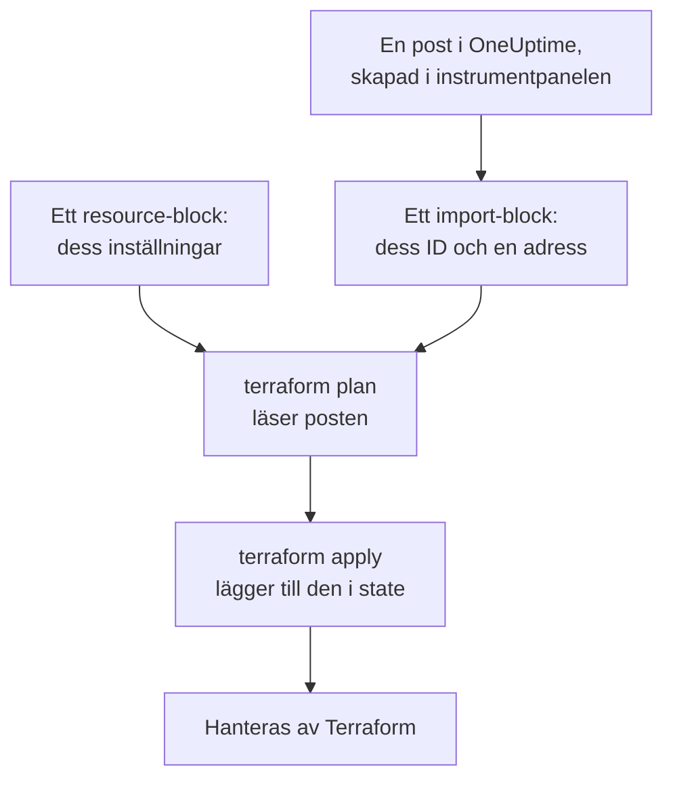
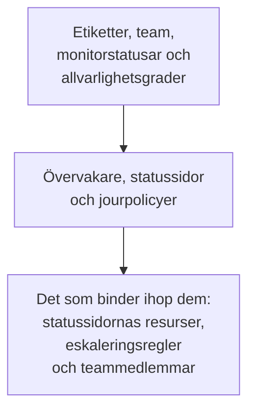

# Importera resurser

Du behöver inte börja om för att hantera OneUptime med Terraform. Importera de övervakare, statussidor, team och andra poster som du redan har, så hanterar Terraform dem därifrån, som de är. En import läser bara: ingenting ändras i OneUptime förrän du tillämpar en ändring som du har planerat.

:::cards
- [Så fungerar en import](#så-fungerar-en-import): Vad en import läser, och vad du skriver.
- [Importera en resurs](#importera-en-resurs): Från dess sida i instrumentpanelen, i fyra steg.
- [Importera många resurser](#importera-många-resurser): Importblock för en hel lista, och den konfiguration som Terraform skriver åt dig.
- [Sluta hantera en resurs](#sluta-hantera-en-resurs): Lämna tillbaka den till instrumentpanelen utan att ta bort den.
:::

## Så fungerar en import

En import kopplar en post som redan finns i OneUptime till ett `resource`-block i din konfiguration. Du skriver ett `import`-block med postens ID och den adress den ska till. Nästa `terraform plan` läser posten via dess ID och visar att den kommer att importeras, tillsammans med varje skillnad mellan posten och din konfiguration. `terraform apply` lägger till den i Terraforms state, och därifrån hanteras posten som allt annat som Terraform har skapat.



Skriv `resource`-blocket så att det säger vad posten redan är. Där de skiljer sig visar planen importen och en ändring, och när du tillämpar den ändras posten i OneUptime.

### Vad som kan importeras

Alla providerns resurser kan importeras via sitt ID, utom `oneuptime_file`: OneUptimes API kan inte läsa tillbaka en fil, så providern svarar `Import Not Supported`. Datakällor importeras aldrig. För att använda en post i din konfiguration utan att hantera den läser du den i stället med en [datakälla](/docs/terraform/complete-guide#läs-det-som-redan-finns).

## Innan du börjar

- **Terraform 1.5 eller senare, eller OpenTofu 1.6 eller senare.** `import`-blocken på den här sidan kräver de versionerna. Ett äldre Terraform importerar från [kommandoraden](#importera-från-kommandoraden).
- **En API-nyckel som kan läsa det du importerar.** Importen läser varje post med providerns nyckel, och att hantera den efteråt kräver också behörigheterna att ändra och ta bort den. Se [Skapa en API-nyckel för projektet](/docs/terraform/quick-start#skapa-en-api-nyckel-till-projektet).
- **Providern i din konfiguration**, inställd som i [Snabbstart](/docs/terraform/quick-start#rikta-terraform-mot-oneuptime).

## Importera en resurs

Instrumentpanelen skriver konfigurationen för resursen du tittar på, med dess `import`-block, så du skriver sällan ett för hand.

:::steps
### Öppna resursens Terraform-sida

Öppna övervakaren, statussidan eller en annan resurs i instrumentpanelen. Öppna **Utvecklare** i dess sidomeny, och sedan **Terraform**.

### Kopiera dess konfiguration

Sidan skriver resursens `resource`-block utifrån dess nuvarande inställningar, och ett `import`-block med dess ID. Lägg båda i en `.tf`-fil:

```hcl title="status-pages.tf"
resource "oneuptime_status_page" "public_status" {
  name       = "Public Status"
  page_title = "Acme Status"

  # Secrets are not shown here: master_password, embedded_overall_status_token.
  # Terraform leaves them as they are in OneUptime.
}

import {
  to = oneuptime_status_page.public_status
  id = "68a1b2c3-d4e5-4f6a-8b9c-0d1e2f3a4b02"
}
```

Den skriver de inställningar som avviker från standardvärdena, och en kommentar efter varje ID nämner posten som det pekar på. Hemligheter visas aldrig: de som resursen behöver läses från variabler märkta `sensitive`, och kommentaren nämner dem som den utelämnar.

### Planera

Kör `terraform plan`. Den slutar med `Plan: 1 to import, 0 to add, 0 to change, 0 to destroy.`: Terraform hittade posten, och din konfiguration stämmer med den.

### Tillämpa

Kör `terraform apply`. Statussidan finns nu i Terraforms state, och nästa plan svarar `No changes.` Sedan kan du ta bort `import`-blocket, eller behålla det som en anteckning om var resursen kom ifrån: det gör ingenting mer när resursen väl hanteras.
:::

### Skriv blocken själv

Utan instrumentpanelen skriver du båda blocken själv. Börja `resource`-blocket med de attribut som resursen behöver, och kör `terraform plan`. Där din konfiguration avviker från posten visar planen ändringen bredvid importen:

```text
  # oneuptime_label.critical will be updated in-place
  # (imported from "68a1b2c3-d4e5-4f6a-8b9c-0d1e2f3a4b03")
  ~ resource "oneuptime_label" "critical" {
      ~ color = "#FF5733" -> "#000000"
    }

Plan: 1 to import, 0 to add, 1 to change, 0 to destroy.
```

Kopiera postens värde till din konfiguration (här `color = "#FF5733"`), och planera igen tills planen visar importen och ingen ändring. Postens ID finns på tre ställen:

| Var | Hur |
| --- | --- |
| Resursens sida | Dess detaljkort slutar med en rad **ID**. Klicka på ID:t, eller på kopieringsknappen bredvid, för att kopiera hela ID:t. |
| Adressfältet | ID:t kommer efter listans namn: `/dashboard/<project-id>/monitors/<monitor-id>`. |
| API:et | Varje post har sitt ID i `_id`. |

## Importera många resurser

För att importera alla övervakare, statussidor eller andra resurser av ett slag börjar du från deras lista.

:::steps
### Öppna listans Terraform-sida

Öppna listan, och sedan **Utvecklare** och **Terraform** i dess sidomeny, till exempel **Övervakare → Utvecklare → Terraform**.

### Kopiera importblocken

Sidan skriver ett `import`-block för varje post (de första 100), med en adress som bildas av postens namn. Lägg dem i en egen fil, som `imports.tf`:

```hcl title="imports.tf"
import {
  to = oneuptime_monitor.homepage
  id = "68a1b2c3-d4e5-4f6a-8b9c-0d1e2f3a4b01"
}

import {
  to = oneuptime_monitor.checkout_api
  id = "68a1b2c3-d4e5-4f6a-8b9c-0d1e2f3a4b05"
}
```

### Låt Terraform skriva konfigurationen

Kör planen med ett filnamn för den konfiguration som Terraform skriver. Filen får inte finnas ännu: Terraform skriver bara till en ny fil.

```bash
terraform plan -generate-config-out=monitors.tf
```

Terraform läser varje post och skriver ett `resource`-block för varje `import`-block som saknar ett. Den varnar för att generering av konfiguration är experimentell, så läs det den skrev.

### Granska och tillämpa

Ersätt i den nya filen andra posters ID:n med referenser till deras resurser, som `labels = [oneuptime_label.critical.id]`, så att Terraform vet i vilken ordning den ska arbeta. Kör `terraform plan` tills den bara visar importerna, och sedan `terraform apply`.
:::

### Ett helt projekt

Importera ett projekt lista för lista, och börja med de poster som andra refererar till. Då kan varje resursblock referera till dem före sig via adress i stället för ID:



Poster som varje projekt börjar med, som dess monitorstatusar och allvarlighetsgrader för incidenter, är ofta bättre att läsa med datakällor än att importera: Terraform kan då referera till dem, men ändrar eller tar aldrig bort dem. Projektet är importerat när `terraform plan` svarar `No changes.`

## Importera från kommandoraden

`terraform import` importerar en resurs i taget och fungerar med alla versioner av Terraform och OpenTofu. Skriv `resource`-blocket först, och kör sedan kommandot med blockets adress och postens ID:

```bash
terraform import oneuptime_status_page.public_status 68a1b2c3-d4e5-4f6a-8b9c-0d1e2f3a4b02
terraform import oneuptime_label.critical 68a1b2c3-d4e5-4f6a-8b9c-0d1e2f3a4b03
terraform import oneuptime_team.sre 68a1b2c3-d4e5-4f6a-8b9c-0d1e2f3a4b04
```

Varje kommando slutar med `Import successful!`. Till skillnad från ett `import`-block skriver kommandot state direkt, utan en plan att granska först: kör `terraform plan` efteråt, och ändra din konfiguration tills planen svarar `No changes.`

## Sluta hantera en resurs

För att lämna tillbaka en resurs till instrumentpanelen utan att ta bort den ersätter du dess `resource`-block med ett `removed`-block som behåller posten:

```hcl
removed {
  from = oneuptime_team.sre

  lifecycle {
    destroy = false
  }
}
```

Planen säger att teamet inte längre hanteras av Terraform, och förstör ingenting. Tillämpa den, och ta sedan bort `removed`-blocket. Ett `removed`-block med `destroy = false` kräver Terraform 1.7 eller senare, eller OpenTofu 1.10 eller senare. På en äldre version kör du i stället `terraform state rm oneuptime_team.sre`.

> [!WARNING]
> När du tar bort ett `resource`-block tas dess post i OneUptime bort vid nästa apply. Under Terraform gör ett `removed`-block utan `destroy = false` samma sak: skriv alltid `lifecycle`-blocket.

## Bra att veta

- **En import ändrar ingenting, men nästa apply gör det.** När du tillämpar en plan som visar en ändring bredvid en import ändras posten i OneUptime. Se först till att planen bara visar importen.
- **Hemligheter läses inte tillbaka.** En hemlighet som OneUptime aldrig skickar tillbaka, som `secret_value` för en övervakarhemlighet, finns inte i state efter en import. Om din konfiguration anger den visar den första planen den som en ändring, och när du tillämpar den skrivs hemligheten igen.
- **En konfiguration för varje post.** En post som har importerats i två konfigurationer ändras vid varje apply tillbaka till det som var och en av dem säger.
- **Importerade poster är hanterade poster.** `terraform destroy` tar bort dem från OneUptime, precis som posterna som Terraform har skapat.

## Felsökning

:::details Meddelandet ”Cannot import non-existent remote object”
Ingen post har det ID:t, eller så får providerns API-nyckel inte läsa den: OneUptime svarar likadant i båda fallen. Kontrollera ID:t, och att nyckeln kan läsa det slaget av post.
:::

:::details Meddelandet ”Import Not Supported”
`oneuptime_file` är den enda resurs som inte kan importeras. Utelämna den, och låt Terraform skapa en ny fil i stället.
:::

:::details Meddelandet ”Invalid ID format”
ID:t är inte en posts ID, till exempel ett namn. En import tar ID:t, ett UUID som `68a1b2c3-d4e5-4f6a-8b9c-0d1e2f3a4b02`: kopiera det från resursens sida.
:::

:::details Meddelandet ”Target generated file already exists”
`-generate-config-out` nämner en fil som redan finns. Nämn en ny fil, eller flytta filens innehåll någon annanstans och ta bort den.
:::

:::details Meddelandet ”Resource already managed by Terraform”
`terraform import` fick en adress som redan finns i state. Importera posten till en annan adress, eller kontrollera med `terraform state list` vad adressen innehåller.
:::

## Nästa steg

:::cards
- [Komplett guide](/docs/terraform/complete-guide): Datakällor, referenser mellan resurser, och state.
- [Monitorsteg](/docs/terraform/monitor-steps): Läs och ändra vad en importerad övervakare kontrollerar.
- [Exempel](/docs/terraform/examples): Färdiga konfigurationer för de vanliga resurserna.
- [Felsökning](/docs/terraform/troubleshooting): Vanliga fel och hur du åtgärdar dem.
:::
