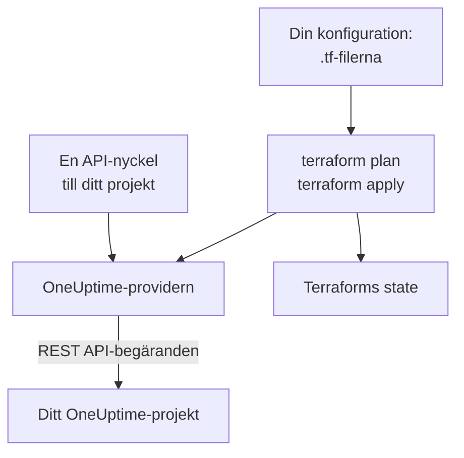

# Terraform – Översikt

OneUptimes Terraform-provider hanterar ditt OneUptime-projekt som kod. Beskriv monitorer, statussidor, jourpolicyer, team, etiketter och projektets övriga poster i `.tf`-filer, se med `terraform plan` vad som kommer att ändras och genomför ändringen med `terraform apply`. Den fungerar med OneUptime Cloud och med ett självhostat OneUptime, och med OpenTofu lika väl som med Terraform.

:::cards
- [Så fungerar providern](#så-fungerar-providern): Din konfiguration, planen och API-begärandena bakom dem.
- [Installera providern](#installera-providern): Provider-blocket, och vilken version du ska välja.
- [Låt instrumentpanelen skriva den](#låt-instrumentpanelen-skriva-den): Konfiguration och import-block för det du redan har.
- [Vad du kan hantera](#vad-du-kan-hantera): Resurser, datakällor och hur deras attribut skrivs.
:::

## Så fungerar providern

Providern är ett insticksprogram som Terraform hämtar från ett registry. Vid `terraform apply` gör den om varje ändring i planen till en begäran till OneUptimes REST API, gjord med en API-nyckel till ditt projekt. Terraform sparar det den har skapat i sin state, så att nästa plan bara visar det som har ändrats sedan dess.



En API-nyckel hör till ett projekt och avgör vad Terraform får läsa och ändra i det, så en konfiguration hanterar ett projekt. För att hantera flera ger du providern ett [alias](/docs/terraform/complete-guide#hantera-flera-projekt) för varje projekt.

## Innan du börjar

- **Terraform 1.5 eller senare, eller OpenTofu 1.6 eller senare.** De `import`-block som instrumentpanelen skriver kräver de här versionerna.
- **En API-nyckel till ditt projekt.** [Snabbstart](/docs/terraform/quick-start#skapa-en-api-nyckel-till-projektet) visar hur du skapar en under **Projektinställningar → Avancerad → API-nycklar**.
- **På OneUptime Cloud abonnemanget Growth eller högre.** Ett projekts API-nycklar fungerar bara på det.

## Installera providern

Lägg till providern i en `.tf`-fil. `terraform init` hämtar den från Terraform Registry, och `tofu init` från OpenTofu Registry:

```hcl title="main.tf"
terraform {
  required_providers {
    oneuptime = {
      source  = "oneuptime/oneuptime"
      version = "{{TERRAFORM_PROVIDER_VERSION}}"
    }
  }
}

provider "oneuptime" {
  # The API key comes from the ONEUPTIME_API_KEY environment variable.
  # On a self-hosted OneUptime, add your OneUptime's address:
  # oneuptime_url = "https://oneuptime.example.com"
}
```

Håll nyckeln utanför dina filer: exportera den innan du kör Terraform, eller skicka in den i en variabel som är markerad `sensitive`. [Komplett guide](/docs/terraform/complete-guide#konfigurera-providern) visar alla sätt att ge providern dess nyckel och adress.

### Välj en version

Providerns versioner följer OneUptimes: provider {{TERRAFORM_PROVIDER_MAJOR}}.x byggs från OneUptime {{TERRAFORM_PROVIDER_MAJOR}}.x. Begränsningen ovan, `{{TERRAFORM_PROVIDER_VERSION}}`, tar den senaste {{TERRAFORM_PROVIDER_MAJOR}}.x-versionen, och det är rätt för OneUptime Cloud. På ett självhostat OneUptime använder du den senaste providern som inte är nyare än ditt OneUptime: [Självhostad konfiguration](/docs/terraform/self-hosted) visar hur du låser den.

## Låt instrumentpanelen skriva den

Du behöver inte skriva en resurs som du redan har för hand. Varje resurs i OneUptimes instrumentpanel (en monitor, en statussida, ett arbetsflöde, en jourpolicy och de andra) har en sektion **Utvecklare** i sidomenyn, hopfälld tills du öppnar den. Dess sida **Terraform** skriver konfigurationen åt dig, ifylld från ditt eget projekt.

:::steps
### Öppna resursen

Öppna monitorn, statussidan eller den andra resurs som du vill att Terraform ska hantera.

### Öppna dess Terraform-sida

Öppna **Utvecklare** och sedan **Terraform** i sidomenyn.

### Kopiera konfigurationen

Sidan skriver resursens konfiguration utifrån dess nuvarande inställningar, med ett `import`-block. En kommentar efter varje ID namnger posten som det pekar på (`incident_severity_id = "..." # Critical Incident`).

### Planera och tillämpa

Kör `terraform plan`: den visar att resursen importeras och att inget ska ändras. Tillämpa den, så hanterar Terraform resursen från och med då.
:::

Under konfigurationen har **Bygg vidare på den** det som folk ofta lägger till bredvid resursen, med en hänvisning till dess adress: ett ägarteam för en incident, en grupp monitorer för en statussida, en eskaleringsregel för en jourpolicy.

Listsidorna (till exempel **Incidenter** eller **Monitorer**) har samma sektion. Där skriver sidan **Terraform** en ny resurs med de fält som de flesta fyller i, utifrån projektets egna poster: en incident med en av dina allvarlighetsgrader, en monitor med de kriterier som en ny monitor får i instrumentpanelen, kopplad till dina statusar. Den ger färdiga **Vanliga konfigurationer** (en statussida med en grupp och en monitor, en jourpolicy som larmar ett team, ett veckovis jourschema) och ett `import`-block för varje resurs som du redan har (de första 100), redo för `terraform plan -generate-config-out`. Båda sidorna ger också provider-blocket för ditt OneUptime: rätt `oneuptime_url` och en versionsbegränsning som passar ditt OneUptime.

Hemligheter visas aldrig på de här sidorna. När konfigurationen behöver en (till exempel en monitors `Authorization`-header) läser den den från en Terraform-variabel som är markerad `sensitive`. Hemligheter som den inte behöver utelämnas, och Terraform låter dem vara som de är i OneUptime.

Samma sektion har en sida **API** med `curl`-kommandon för resursen, och en sida **AI-assistenter**, som ansluter Claude, GitHub Copilot eller Cursor till [MCP-servern](/docs/ai/mcp-server).

## Vad du kan hantera

Providern har en resurs för varje slags post som du kan skapa via OneUptimes API, med namnet `oneuptime_<name>`. De här är de som de flesta konfigurationer börjar med:

| Resurs | Vad det är |
| --- | --- |
| `oneuptime_monitor` | En monitor: webbplats, API, ping, port, SSL-certifikat, server, inkommande förfrågan, manuell och alla andra typer |
| `oneuptime_monitor_status` | En monitorstatus, till exempel Operational, Degraded eller Offline |
| `oneuptime_monitor_group` | En grupp monitorer, visad med en status |
| `oneuptime_status_page` | En offentlig eller privat statussida |
| `oneuptime_status_page_domain` | En egen domän för en statussida |
| `oneuptime_domain` | En domän i ditt projekt, verifierad för statussidor |
| `oneuptime_label` | En etikett, för att sortera och filtrera poster |
| `oneuptime_team`, `oneuptime_team_member` | Ett team, och vilka som ingår i det |
| `oneuptime_on_call_policy`, `oneuptime_escalation_rule` | En jourpolicy, och de regler som den larmar i ordning |
| `oneuptime_incident`, `oneuptime_incident_severity`, `oneuptime_incident_state` | Incidenter, deras allvarlighetsgrader och deras tillstånd |
| `oneuptime_alert`, `oneuptime_alert_severity`, `oneuptime_alert_state` | Larm, deras allvarlighetsgrader och deras tillstånd |
| `oneuptime_scheduled_maintenance_event` | Ett schemalagt underhållsfönster |
| `oneuptime_probe` | En egen probe, som kontrollerar från ditt nätverk |

[Terraform Registry](https://registry.terraform.io/providers/oneuptime/oneuptime/latest/docs) visar varje resurs med alla dess attribut.

### Läs det som redan finns

Varje resurs har en datakälla med samma namn, till exempel `data "oneuptime_label"`. En datakälla läser en post som den här konfigurationen inte hanterar, till exempel en som har skapats i instrumentpanelen. Slå upp den med dess `id`, eller med dess andra enkla argument: varje argument som du anger måste stämma, och exakt en post får stämma med alla.

```hcl
data "oneuptime_monitor_status" "offline" {
  name = "Offline"
}

# Any plain argument works. Set several, and all of them must match.
data "oneuptime_monitor_status" "offline_state" {
  is_offline_state = true
}
```

Ingen träff, eller fler än en, är ett fel och inte ett tomt eller godtyckligt svar. [Komplett guide](/docs/terraform/complete-guide#läs-det-som-redan-finns) har reglerna.

### Omdöpta resurser

Resursnamn håller ihop ord som IoT och vCenter: `oneuptime_iot_fleet` och `oneuptime_vcenter`, där äldre providrar hade `oneuptime_io_t_fleet` och `oneuptime_v_center` (och detsamma för deras etikettregler, ägare och flöden). De gamla namnen fungerar fortfarande som föråldrade alias, och en plan som använder ett av dem säger det. För att byta döper du om resursen i din konfiguration och lägger till ett `moved`-block, så behåller Terraform den befintliga resursen i stället för att ersätta den:

```hcl
# Was: resource "oneuptime_io_t_fleet" "factory"
resource "oneuptime_iot_fleet" "factory" {
  name = "Factory floor"
}

moved {
  from = oneuptime_io_t_fleet.factory
  to   = oneuptime_iot_fleet.factory
}
```

Att flytta en resurs till en annan typ kräver Terraform 1.8 eller senare. På en äldre motor behåller du det gamla namnet så länge: det fortsätter att fungera.

## Så skrivs attribut

Attributen följer OneUptimes API, i snake_case:

| Slags värde | Så skriver du det | Exempel |
| --- | --- | --- |
| Text, tal, sant eller falskt | Som de är | `is_public_status_page = false` |
| En hänvisning till en annan post | Dess ID, oftast `id` för en annan resurs | `incident_severity_id = oneuptime_incident_severity.sev1.id` |
| En lista med hänvisningar | En mängd ID:n, vars ordning inte spelar någon roll | `labels = [oneuptime_label.critical.id]` |
| En färg, en domän och andra inslagna värden | Deras enkla värde | `color = "#FF5733"` |
| Ett datum och en tid | Text i RFC 3339 | `starts_at = "2030-06-01T02:00:00Z"` |
| En monitors kontroller | Typade nästlade attribut: se [Monitorsteg](/docs/terraform/monitor-steps) | `monitor_steps = [{ ... }]` |
| Andra strukturerade inställningar | JSON, skriven med `jsonencode()` | `log_monitor = jsonencode({ ... })` |

Två slags värden tillhör servern, och dem utelämnar du:

- **ID:n inuti en resurs.** En monitors steg och kriterier, och deras mallar för incidenter och larm, har ID:n som servern ger och behåller vid varje apply, så att incidenter fortsätter att peka på de kriterier som utlöste dem.
- **Det som servern håller uppdaterat.** En monitors nuvarande status, eller när den senast tog emot ett heartbeat, kan ändras mellan `terraform plan` och slutet av `terraform apply`. Providern behåller det planerade värdet för allt som du inte har angett, och nästa refresh läser serverns, så det här får aldrig en apply att misslyckas eller visas som en ändring.

## Få hjälp

- Buggar och önskemål om funktioner: [github.com/OneUptime/oneuptime/issues](https://github.com/OneUptime/oneuptime/issues).
- Providern genereras från OneUptimes OpenAPI-specifikation i [OneUptimes huvudrepository](https://github.com/OneUptime/oneuptime). Det publicerade provider-repositoryt är skrivskyddat, så rapportera problem i huvudrepositoryt.

## Nästa steg

:::cards
- [Snabbstart](/docs/terraform/quick-start): Skapa en API-nyckel och tillämpa dina första resurser på tio minuter.
- [Komplett guide](/docs/terraform/complete-guide): Autentisering, projektupplägg, datakällor, state och uppgraderingar.
- [Monitorsteg](/docs/terraform/monitor-steps): Bestäm vad en monitor kontrollerar och vad varje resultat betyder.
- [Exempel](/docs/terraform/examples): Färdiga konfigurationer för de vanliga resurserna.
- [Importera resurser](/docs/terraform/importing-resources): För in det du har skapat i instrumentpanelen under Terraform.
:::
