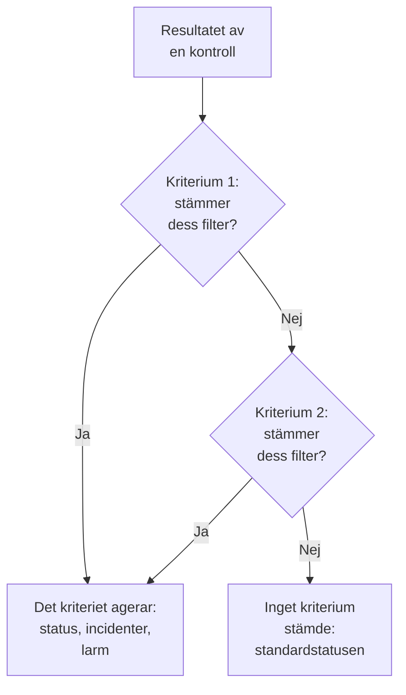
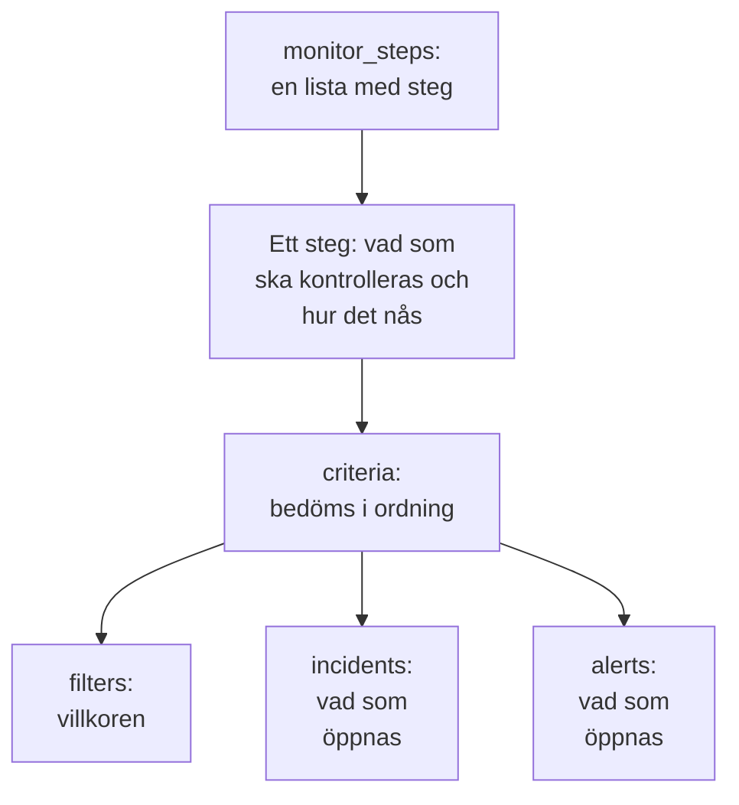

# Monitorsteg

`monitor_steps` är det attribut i `oneuptime_monitor` som säger vad en monitor kontrollerar och hur varje resultat bedöms: adressen som ska kontrolleras, begäran som ska skickas och de kriterier som gör ett resultat till en monitorstatus, en incident eller ett larm. Den här sidan förklarar varje del av det.

:::cards
- [Så bedöms en kontroll](#så-bedöms-en-kontroll): Kriterierna i ordning, och det första som stämmer.
- [Skriv stegen](#skriv-stegen): Deras form, ett fullständigt exempel och de två reglerna för värden.
- [Filterreferens](#filterreferens): Vad ett filter kan kontrollera, och hur det jämför.
- [Vanliga misstag](#vanliga-misstag): Det som oftast går fel, och lösningen.
:::

## Så bedöms en kontroll

Varje kontroll ger ett resultat: svaret från en probe, returvärdet från ett skript eller den telemetri som kontrollen läser. Stegets kriterier bedömer det sedan i sin ordning. Det första kriterium vars filter stämmer avgör vad som händer: det kan ändra monitorns status, öppna incidenter och öppna larm. Kriterierna efter det tittas inte på för den kontrollen.



Ordningen på kriterierna spelar alltså roll: lägg de kriterier som larmar först, det allvarligaste först, och det friska sist. [Attribut för ett kriterium](#attribut-för-ett-kriterium) förklarar varför, och det enda undantaget.

## Skriv stegen

`monitor_steps` är en lista med typade objekt som skrivs direkt i HCL. Det finns ingen `jsonencode()`, inget `{_type, value}`-omslag, ingen camelCase-nyckel och inget ID att skriva: providern gör om din HCL till API:ets format, och servern ger varje steg, kriterium, incidentmall och larmmall dess ID. Den behåller de ID:na vid varje apply genom att matcha varje kriterium och mall mot den som de ersätter, efter namn och annars efter position, så att proberesultat stannar hos sitt steg och incidenter fortsätter att peka på de kriterier som utlöste dem.



Det minsta användbara steget kontrollerar en adress och har ett kriterium med ett filter:

```hcl
resource "oneuptime_monitor" "example" {
  name         = "Example"
  description  = "The smallest monitor_steps"
  monitor_type = "Website"

  monitor_steps = [{
    monitor_destination      = "https://example.com"
    monitor_destination_type = "URL"
    request_type             = "GET"

    criteria = [
      {
        name             = "Check if online"
        description      = "The website responds"
        filter_condition = "All"

        filters = [
          {
            check_on    = "Is Online"
            filter_type = "True"
          }
        ]
      }
    ]
  }]
}
```

Två regler gäller överallt i `monitor_steps`:

- **Utelämna det som du inte använder.** Ett attribut som du inte anger skickas inte till API:et. Skriv aldrig `[]`, `{}` eller `""` som platshållare: providern avvisar tomma strängar, listor och maps, så att ett saknat värde alltid betyder "inte angivet".
- **Filtervärden är strängar.** Ett filters `value` är en sträng, även för ett tal: `value = "200"`, inte `value = 200`. Numeriska inställningar som `port` är tal.

:::details Byta från provider 1.x, där monitor_steps var JSON
I provider 1.x var `monitor_steps` en JSON-sträng skriven med `jsonencode({ _type = "MonitorSteps", value = { ... } })`. Skriv om den som de typade attributen på den här sidan: ta bort omslagen `_type` och `value`, skriv camelCase-nycklarna i snake_case (`monitorDestination` blir `monitor_destination` och `monitor_destination_type`, `filterCondition` blir `filter_condition`, `checkOn` blir `check_on`) och ta bort varje `id`. Servern ger nu alla ID:n, vilket också gör slut på de hårdkodade slumpmässiga ID:na från issue [#2291](https://github.com/OneUptime/oneuptime/issues/2291). State som har sparats som en JSON-sträng uppgraderas inte av sig själv: tillämpa den nya konfigurationen.
:::

### Ett fullständigt exempel

Den här webbplatsmonitorn kontrollerar det som webbplatsmonitorn i providerns end-to-end-tester kontrollerar (testet `35-monitor-with-steps`): offline när webbplatsen inte svarar, online när den svarar med 200.

```hcl
resource "oneuptime_monitor_status" "operational" {
  name                 = "Operational"
  description          = "Monitor is operational"
  color                = "#2ecc71"
  priority             = 1
  is_operational_state = true
}

resource "oneuptime_monitor_status" "offline" {
  name                 = "Offline"
  description          = "Monitor is offline"
  color                = "#e74c3c"
  priority             = 3
  is_operational_state = false
}

resource "oneuptime_monitor" "website" {
  name         = "Website"
  description  = "Website monitor with explicit steps"
  monitor_type = "Website"

  monitor_steps = [{
    monitor_destination      = "https://example.com" # what to check
    monitor_destination_type = "URL"                 # URL, Hostname or IP
    request_type             = "GET"                 # the HTTP method

    criteria = [ # judged in order: the first match decides
      {
        name                  = "Offline"
        description           = "Check if website is offline"
        filter_condition      = "Any"
        change_monitor_status = true
        create_incidents      = false
        create_alerts         = false
        monitor_status_id     = oneuptime_monitor_status.offline.id

        filters = [
          {
            check_on    = "Is Online"
            filter_type = "False"
          }
        ]
      },
      {
        name                  = "Online"
        description           = "Check if website is online"
        filter_condition      = "All" # All: every filter, Any: at least one
        change_monitor_status = true
        create_incidents      = false
        create_alerts         = false
        monitor_status_id     = oneuptime_monitor_status.operational.id

        filters = [
          {
            check_on    = "Is Online"
            filter_type = "True"
          },
          {
            check_on    = "Response Status Code"
            filter_type = "Equal To"
            value       = "200" # a string, even for a number
          }
        ]
      }
    ]
  }]
}
```

Ett kriterium hänvisar till en status via dess resurs, som `oneuptime_monitor_status.offline.id` gör här, eller till en status som ditt projekt redan har, via en [datakälla](/docs/terraform/complete-guide#läs-det-som-redan-finns).

## Attribut för ett steg

Varje element i `monitor_steps` är en sak att kontrollera:

| Attribut | Typ | Används av | Anteckningar |
| --- | --- | --- | --- |
| `monitor_destination` | string | Webbplats, API, Ping, IP, Port, SSL-certifikat, NTP | URL:en, värdnamnet eller IP-adressen som ska kontrolleras. Kräver `monitor_destination_type`. |
| `monitor_destination_type` | string | samma | `URL`, `Hostname` eller `IP`, efter vad monitortypen tar: en URL för webbplats-, API- och SSL-certifikatmonitorer; ett värdnamn eller en IP-adress för Ping-, IP-, Port- och NTP-monitorer. |
| `port` | number | Port, NTP | TCP-porten som ska kontrolleras, till exempel `443`. För NTP den UDP-port som tidsservern svarar på: `123` när den inte är angiven. |
| `request_type` | string | Webbplats, API | HTTP-metoden: `GET`, `POST`, `PUT`, `DELETE`, `HEAD` eller `PATCH`. Servern använder `GET` när den inte är angiven. |
| `request_headers` | map(string) | Webbplats, API | Headrar som ska skickas: `{ "Accept" = "application/json" }`. |
| `request_body` | string | API | Begärans body, som text. |
| `do_not_follow_redirects` | bool | Webbplats, API | Stanna vid det första svaret i stället för att följa omdirigeringar. |
| `allow_self_signed_certificates` | bool | Webbplats, API | Godta ett självsignerat TLS-certifikat. |
| `tls_client_certificate` | string | Webbplats, API | Ett klientcertifikat för ömsesidig TLS: PEM, eller en hänvisning `{{monitorSecrets.name}}`. |
| `tls_client_key` | string (känslig) | Webbplats, API | Klientcertifikatets privata nyckel. Ange den tillsammans med certifikatet. |
| `tls_client_key_passphrase` | string (känslig) | Webbplats, API | Den privata nyckelns lösenfras. |
| `request_timeout_in_ms` | number | Kontroller som en probe gör | Hur länge ett försök får ta, i millisekunder. Proben sänker allt över 60000 till 60000. |
| `retry_count` | number | Kontroller som en probe gör | Nya försök efter ett misslyckat första försök: `0` kontrollerar en gång, `3` upp till fyra gånger. Proben sänker allt över 3 till 3. |
| `custom_code` | string | Custom JavaScript Code, Synthetic | Skriptet som steget kör. |
| `screen_size_types` | list(string) | Synthetic | `Mobile`, `Tablet` och `Desktop`. |
| `browser_types` | list(string) | Synthetic | `Chromium` och `Firefox`. |
| `retry_count_on_error` | number | Synthetic | Nya försök när skriptet misslyckas: `0` kör det en gång. |
| `criteria` | list (obligatorisk) | Alla | Hur varje resultat bedöms: se [Attribut för ett kriterium](#attribut-för-ett-kriterium). |

### Inställningar för varje monitortyp

Monitortyper med mer att ange än en adress har sina inställningar (en loggfråga, en databasanslutning, ett kluster att bevaka) i ett eget attribut, som rå JSON skriven med `jsonencode()`: `log_monitor`, `trace_monitor`, `llm_monitor`, `metric_monitor`, `exception_monitor`, `profile_monitor`, `dns_monitor`, `domain_monitor`, `dnssec_monitor`, `sql_monitor`, `database_monitor`, `external_status_page_monitor`, `network_device_monitor`, `kubernetes_monitor`, `docker_monitor`, `docker_swarm_monitor`, `host_monitor`, `podman_monitor`, `proxmox_monitor`, `vmware_monitor`, `ceph_monitor`, `storage_array_monitor`, `iot_monitor` och `probe_status_monitor`.

Deras JSON är densamma som instrumentpanelens, med nycklar i camelCase. Ett ID i den skrivs som API:et skriver det: `{ _type = "ObjectID", value = "..." }`. En Logs-monitor som räknar fel från en tjänst:

```hcl
resource "oneuptime_service" "checkout" {
  name = "checkout"
}

resource "oneuptime_monitor" "checkout_errors" {
  name         = "Checkout errors"
  monitor_type = "Logs"

  monitor_steps = [{
    log_monitor = jsonencode({
      attributes          = {}
      body                = "error"
      severityTexts       = ["Error"]
      telemetryServiceIds = [{ _type = "ObjectID", value = oneuptime_service.checkout.id }]
      lastXSecondsOfLogs  = 300
    })

    criteria = [
      {
        name             = "Errors found"
        filter_condition = "Any"

        filters = [
          {
            check_on    = "Log Count"
            filter_type = "Greater Than"
            value       = "0"
          }
        ]
      }
    ]
  }]
}
```

> [!TIP]
> Det enklaste sättet att få den här JSON:en rätt: konfigurera monitorn i instrumentpanelen och öppna sedan dess sektion **Utvecklare** och **Terraform**. Sidan skriver monitorns `monitor_steps`, med `jsonencode()` och allt.

## Attribut för ett kriterium

Varje element i `criteria` är en regel: när dess filter stämmer, gör det som den säger.

Kriterierna bedöms uppifrån, och det första som stämmer avgör, så lägg de kriterier som larmar först, det allvarligaste först (kritiskt, sedan varning), och det friska sist. Ett friskt kriterium överst är det vanligaste sättet att bygga en monitor som aldrig larmar: en bred regel som `Is Online` är `True`, eller ett metrikvärde `Greater Than` `0`, stämmer med nästan varje kontroll, och kriterierna under den tittas aldrig på. Lagd sist stämmer den bara när inget ovanför den stämde, och det är det du vill.

Grupperade metrikmonitorer är det enda undantaget. När en metrikmonitors fråga är grupperad (`groupByAttributeKeys` angiven i JSON:en för `metric_monitor`, vid `metricViewConfig.queryConfigs[].metricQueryData.groupByAttributeKeys`), öppnar monitorn ett larm eller en incident för varje grupp (varje värd, container eller monteringspunkt), och varje kriterium bedöms, så att ett kritiskt kriterium och ett varningskriterium kan utlösas för olika värdar vid samma kontroll. En värd som bryter mot båda larmas ändå bara en gång, av det första kriterium som stämmer, så det allvarligaste ska fortfarande stå först. Se [Metrikövervakning](/docs/monitor/metrics-monitor).

| Attribut | Typ | Vad det är |
| --- | --- | --- |
| `name` | string (obligatorisk) | Namnet som instrumentpanelen visar. |
| `description` | string | Beskrivningen som instrumentpanelen visar. |
| `filter_condition` | string (obligatorisk) | `All`: varje filter måste stämma. `Any`: ett räcker. |
| `filters` | list (obligatorisk) | Villkoren, minst ett: se [Filterreferens](#filterreferens). |
| `change_monitor_status` | bool | Om en träff ändrar monitorns status. |
| `monitor_status_id` | string | ID:t för den `oneuptime_monitor_status` som ska bytas till. Ange det när `change_monitor_status` är `true`. |
| `create_incidents` | bool | Om en träff öppnar incidenter. |
| `incidents` | list | Incidenterna som ska öppnas. Utelämna det om inte `create_incidents = true`. |
| `create_alerts` | bool | Om en träff öppnar larm. |
| `alerts` | list | Larmen som ska öppnas. Utelämna det om inte `create_alerts = true`. |
| `is_enabled` | bool | `true` på servern när det inte är angivet. Ange `false` för att behålla ett kriterium utan att bedöma med det. |
| `incident_grouping` | string (JSON) | Bara monitorer för inkommande förfrågningar: en incident för varje värde som hittas i förfrågan, till exempel `jsonencode({ groupByJSONPath = "..." })`. |
| `open_for_every_email` | bool | Bara monitorer för inkommande e-post: `true` öppnar en incident (och ett larm) för varje e-postmeddelande som matchar, i stället för en i taget. |

### Incidenter och larm

Ett element i `incidents` tar `title` och `description` (båda obligatoriska), `incident_severity_id`, `auto_resolve_incident`, `remediation_notes`, `on_call_policy_ids`, `label_ids`, `owner_team_ids`, `owner_user_ids`, `show_incident_on_status_page` och `is_private`. Ett element i `alerts` tar samma, med `alert_severity_id` och `auto_resolve_alert`, och utan `show_incident_on_status_page`.

Det här kriteriet markerar monitorn som offline, öppnar en incident som larmar jourpolicyn och löser den när webbplatsen är tillbaka:

```hcl
criteria = [
  {
    name                  = "Offline"
    description           = "The site is unreachable"
    filter_condition      = "Any"
    change_monitor_status = true
    monitor_status_id     = oneuptime_monitor_status.offline.id
    create_incidents      = true

    filters = [
      {
        check_on    = "Is Online"
        filter_type = "False"
      }
    ]

    incidents = [
      {
        title                 = "Website is down"
        description           = "The website did not respond to the probe."
        incident_severity_id  = oneuptime_incident_severity.critical.id
        auto_resolve_incident = true
        on_call_policy_ids    = [oneuptime_on_call_policy.primary.id]
      }
    ]
  }
]
```

## Filterreferens

Ett filter har `check_on` (vad det tittar på), `filter_type` (hur det jämför) och `value` (vad det jämför med, som en sträng; utelämna det för sant-eller-falskt-kontroller som `True` och `False`).

Ett filter kan också bedöma ett tidsfönster i stället för den senaste kontrollen: ange `evaluate_over_time = true`, fönstrets längd i `evaluate_over_time_minutes` och i `evaluate_over_time_type` hur fönstret läses: `Average`, `Sum`, `Maximum Value`, `Minimum Value`, `All Values` eller `Any Value`.

`All Values` betyder att varje kontroll i fönstret bröt mot regeln, så det stämmer först när fönstret är täckt av data: en monitor som just har skapats väntar på att fönstret fylls i stället för att stämma vid sin första kontroll. Ge den ett fönster på minst dubbla monitorns `monitoring_interval`; annars rymmer fönstret en kontroll, och "alla värden" betyder samma sak som "vilket värde som helst". `Any Value` stämmer med avsikt vid en kontroll som bryter mot regeln.

`evaluate_over_time_no_data_policy` säger vad filtret gör medan fönstret inte rymmer tillräckligt med data: `Ignore` (standard) stämmer inte, `Trigger` behandlar de saknade data som felet, så som ett heartbeat gör, och `Treat As Zero` jämför fönstret som en enda nolla.

### Vad ett filter kan kontrollera

De `check_on`-värden som varje monitortyp använder mest. Instrumentpanelens kriterieredigerare erbjuder samma och visar alla:

| Monitortyp | `check_on`-värden |
| --- | --- |
| Webbplats / API | `Is Online`, `Response Time (in ms)`, `Response Status Code`, `Response Body`, `Response Header`, `Response Header Value`, `JavaScript Expression`, `Is Request Timeout` |
| Ping / IP | `Is Online`, `Response Time (in ms)`, `Packet Loss (in %)`, `Jitter (in ms)`, `Is Request Timeout` |
| Port | `Is Online`, `Response Time (in ms)` (instrumentpanelens totala anslutningstid), `Port DNS Lookup Time (in ms)`, `Port TCP Connect Time (in ms)`, `Is Request Timeout` |
| SSL-certifikat | `Is Valid Certificate`, `Is Not A Valid Certificate`, `Is Self Signed Certificate`, `Is Expired Certificate`, `Expires In Days`, `Expires In Hours` |
| Inkommande förfrågan | `Incoming Request`, `Request Body`, `Request Header`, `Request Header Value`, `JavaScript Expression` |
| Inkommande e-post | `Email Received`, `Email Subject`, `Email From Address`, `Email To Address`, `Email Body` |
| Server | `Is Online`, `CPU Usage (in %)`, `Memory Usage (in %)`, `Disk Usage (in %)` (med `disk_path`), `Server Process Name` |
| Loggar | `Log Count` |
| Spårningar | `Span Count` |
| Undantag | `Exception Count` |
| Profiler | `Profile Count`, `Function Share (in %)` |
| AI / LLM | `Bad AI Answers (in %)`, `Bad AI Answers`, `AI Answers` |
| Metriker | `Metric Value` (metrikfilter kan ta JSON i `metric_monitor_options`) |
| Anpassad kod / Synthetic | `Result Value` (kan jämföra ett fält i returnerade data, angivet i JSON:en i `custom_code_monitor_options`, t.ex. `jsonencode({ resultValuePath = "status" })` — se nedan), `Error`, `Execution Time (in ms)` |
| DNS | `DNS Is Online`, `DNS Response Time (in ms)`, `DNS Record Value`, `DNS Record Exists` |
| Domän | `Domain Expires In Days`, `Domain Is Expired`, `Domain Registrar`, `Domain Name Server` |
| DNSSEC | `DNSSEC Chain Is Valid`, `DNSSEC DS Record Exists At Parent`, `DNSSEC Signature Expires In Days` |
| SQL-fråga | `SQL Is Online`, `SQL Query Row Count`, `SQL Query Scalar Value` |
| Databashälsa | `Database Is Online`, `Database Metric` (med JSON i `database_monitor_options` som anger serien, t.ex. `jsonencode({ metricType = "oneuptime.monitor.database.connections.used.percent" })`), `Database Collection Error` |
| Extern statussida | `External Status Page Is Online`, `External Status Page Active Incidents`, `External Status Page Component Status` |
| NTP | `NTP Is Online`, `NTP Is Synchronized`, `NTP Stratum`, `NTP Clock Offset (in ms)`, `NTP Response Time (in ms)`, `NTP Root Dispersion (in ms)` (`NTP Is Online` och `NTP Is Synchronized` tar inget `value`) |
| Nätverksenhet (SNMP) | `SNMP Device Is Online` (den svarar på ping eller SNMP), `SNMP Walk Is Succeeding` (false när den svarar men inte kan genomlöpas), `SNMP OID Value` (SNMP-filter kan ta JSON i `snmp_monitor_options`) |

### Hur ett filter jämför

| Slag | `filter_type`-värden |
| --- | --- |
| Sant eller falskt | `True`, `False` |
| Tal | `Equal To`, `Not Equal To`, `Greater Than`, `Less Than`, `Greater Than Or Equal To`, `Less Than Or Equal To` |
| Text | `Contains`, `Not Contains`, `Starts With`, `Ends With`, `Is Empty`, `Is Not Empty` |
| Heartbeats | `Recieved In Minutes`, `Not Recieved In Minutes` (stavade som API:et stavar dem) |
| Serverprocesser | `Is Executing`, `Is Not Executing` |
| Skript | `Evaluates To True` |
| Avvikelser, för metriker, loggar och spårningar | `Anomalously High`, `Anomalously Low`, `Anomalous` |

Ett filter som stämmer när ett SSL-certifikat går ut om 14 dagar eller mindre:

```hcl
filters = [
  {
    check_on    = "Expires In Days"
    filter_type = "Less Than Or Equal To"
    value       = "14"
  }
]
```

Providern kontrollerar `check_on`, `filter_type` och de andra fasta listorna när den planerar, så ett stavfel misslyckas innan något skickas till API:et. Värdena är API:ets namn på alternativen i instrumentpanelens kriterieredigerare.

### Jämföra ett fält i ett skripts resultat

Skriptet i en monitor för anpassad kod eller en Synthetic-monitor returnerar `data`, och ett filter `Result Value` jämför det. När `data` är ett objekt eller en array anger `custom_code_monitor_options` det fält i det som ska jämföras: **Fältsökväg** i instrumentpanelens Result Value-filter. Använd punkter för nästlade fält och `[n]` för element i en array, och utelämna attributet för att jämföra hela värdet:

```hcl
monitor_steps = [{
  custom_code = <<-EOT
    const response = await axios.get("https://api.example.com/health");
    // For example { status: "UP", checks: [{ name: "db", latency: 12 }] }
    return { data: response.data };
  EOT

  criteria = [
    {
      name             = "Unhealthy"
      filter_condition = "Any"
      filters = [
        {
          check_on                    = "Result Value"
          filter_type                 = "Not Equal To"
          value                       = "UP"
          custom_code_monitor_options = jsonencode({ resultValuePath = "status" })
        },
        {
          check_on                    = "Result Value"
          filter_type                 = "Greater Than"
          value                       = "500"
          custom_code_monitor_options = jsonencode({ resultValuePath = "checks[0].latency" })
        }
      ]
    }
  ]
}]
```

`Greater Than` och de andra talvillkoren stämmer bara med ett fält som är ett tal, och ett fält som saknas i returnerade data stämmer bara med `Is Empty`. Se [Larma på returnerade data](/docs/monitor/custom-code-monitor#larma-på-returnerade-data) för hur sökvägar och villkor fungerar.

## Vanliga misstag

1. **Tomma platshållare.** `incidents = []`, `request_headers = {}` och `description = ""` avvisas: utelämna attributet i stället.
2. **Ett tal där en sträng ska stå.** Ett filters `value` är en sträng, även för ett tal: `value = "200"`. Numeriska inställningar som `port`, `retry_count`, `request_timeout_in_ms` och `evaluate_over_time_minutes` tar tal.
3. **Fel måltyp.** `monitor_destination_type = "URL"` med ett naket värdnamn, eller `Hostname` med en fullständig URL, får kontrollen att misslyckas. Webbplats- och API-monitorer tar URL:er; Ping-, IP- och Port-monitorer tar värdnamn eller IP-adresser.
4. **Ett statusbyte utan status.** `change_monitor_status = true` utan `monitor_status_id` stämmer och har ingen status att byta till.
5. **ID:n.** Inget element i `monitor_steps` har ett attribut `id`. Om du byter från den gamla JSON:en tar du bort dem: servern ger ID:na.
6. **JSON skriven för hand.** Skriv `log_monitor` och de andra inställningarna med `jsonencode()`, så att Terraform citerar dem och skriver JSON:en på samma sätt varje gång. För `metric_monitor` ger du hela objektet som instrumentpanelen skriver: servern normaliserar det.

## När inget kriterium stämmer

En kontroll som inte stämmer med något kriterium sätter monitorn i dess standardstatus: projektets operativa status, den som instrumentpanelen väljer för en ny monitor. Dess öppna incidenter vars kriterier har valt automatisk lösning löses också. För att själv avgöra varje utfall avslutar du listan med ett brett friskt kriterium, som exemplen på den här sidan gör.

## En monitor utan steg

`monitor_steps` är valfritt, men en monitor som skapas utan det har inga kriterier att bedöma ett resultat efter: prober hoppar över en monitor utan steg, och den stannar i den status som den startade i. Din state håller attributet tomt, och planen förblir ren. En manuell monitor behöver aldrig steg: du sätter dess status själv. Alla andra typer behöver minst ett steg för att kontrollera något.

## Överföringsformatet

Bakom providern talar API:et fortfarande sin egen JSON, där varje rikt objekt är inslaget som `{_type, value}`:

```json
{
  "_type": "MonitorSteps",
  "value": {
    "monitorStepsInstanceArray": [
      {
        "_type": "MonitorStep",
        "value": {
          "monitorDestination": { "_type": "URL", "value": "https://example.com" },
          "requestType": "GET",
          "monitorCriteria": {
            "_type": "MonitorCriteria",
            "value": { "monitorCriteriaInstanceArray": [ { "_type": "MonitorCriteriaInstance", "value": { "...": "..." } } ] }
          }
        }
      }
    ]
  }
}
```

Providern bygger det här från din HCL när den skriver, och läser tillbaka det till HCL, utan det som servern hanterar (ID:na och de standardvärden som den lägger till). Du stöter bara på det när du själv läser API:ets svar, till exempel i ett skript som läser `monitorSteps`.

## Nästa steg

:::cards
- [Exempel](/docs/terraform/examples): Ping-, port-, SSL-certifikat- och API-monitorer, färdiga att använda.
- [Komplett guide](/docs/terraform/complete-guide): Datakällor, state och uppgraderingar.
- [Metrikövervakning](/docs/monitor/metrics-monitor): Metrikfrågor, gruppering och avvikelser.
- [Felsökning](/docs/terraform/troubleshooting): Bland annat ett inkonsekvent resultat efter apply på en monitor.
:::
