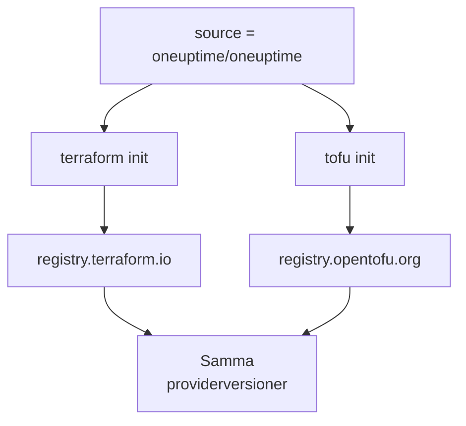

# OpenTofu

OneUptime-providern fungerar med [OpenTofu](https://opentofu.org) på samma sätt som med Terraform. Den publiceras i [OpenTofu Registry](https://search.opentofu.org/provider/oneuptime/oneuptime/latest), och varje release klarar samma end-to-end-tester under båda innan den publiceras. Din konfiguration ändras inte: kör `tofu` överallt där den här dokumentationen kör `terraform`.

:::cards
- [Använd providern med OpenTofu](#använd-providern-med-opentofu): Samma konfiguration, körd med `tofu`.
- [Vad som skiljer sig från Terraform](#vad-som-skiljer-sig-från-terraform): Register, låsfiler, `.tofu`-filer och versioner.
- [Flytta en konfiguration till OpenTofu](#flytta-en-konfiguration-till-opentofu): Byt en befintlig konfiguration i fyra steg.
- [En återanvändbar modul](#en-återanvändbar-modul): Övervakare, en jourpolicy och en statussida för en tjänst.
:::

## Använd providern med OpenTofu

Du behöver OpenTofu 1.6 eller senare. Deklarera providern som du skulle göra för Terraform:

```hcl title="main.tf"
terraform {
  required_providers {
    oneuptime = {
      source  = "oneuptime/oneuptime"
      version = "{{TERRAFORM_PROVIDER_VERSION}}"
    }
  }
}

provider "oneuptime" {
  # The API key comes from the ONEUPTIME_API_KEY environment variable.
  # On a self-hosted OneUptime, add your OneUptime's address:
  # oneuptime_url = "https://oneuptime.example.com"
}
```

Kör den sedan med `tofu`:

```bash
export ONEUPTIME_API_KEY="<your-api-key>"
tofu init
tofu plan
tofu apply
```

`tofu init` laddar ner providern från OpenTofu Registry. Allt i [Snabbstart](/docs/terraform/quick-start), [Komplett guide](/docs/terraform/complete-guide), [Monitorsteg](/docs/terraform/monitor-steps), [Exempel](/docs/terraform/examples) och [Importera resurser](/docs/terraform/importing-resources) gäller som det är, och konfigurationen som instrumentpanelens **Terraform**-sidor skriver fungerar oförändrad.

### Håll registret utanför källadressen

`source = "oneuptime/oneuptime"` nämner inget register, så varje verktyg läser den från sitt eget:



Utelämna värdnamnet. Med ett värdnamn använder varje verktyg det registret: under `registry.terraform.io/oneuptime/oneuptime` laddar även OpenTofu ner från Terraform Registry, och Terraform avvisar kopian från OpenTofu Registry med `authentication signature from unknown issuer`.

## Vad som skiljer sig från Terraform

| Ämne | Under OpenTofu |
| --- | --- |
| Registret | `oneuptime/oneuptime` är `registry.opentofu.org/oneuptime/oneuptime`, som publicerar samma versioner som Terraform Registry. |
| Signaturer | `tofu init` säger att signaturvalideringen hoppades över: OpenTofu Registry har ingen signeringsnyckel för den här providern, så OpenTofu kontrollerar nedladdningen mot registrets kontrollsummor. |
| `terraform`-blocket | Förblir `terraform`: det är en del av språket, och OpenTofu läser det som det är. |
| `.tofu`-filer | OpenTofu 1.8 och senare läser också `.tofu`-filer, och hoppar över en `.tf`-fil som har en `.tofu`-fil med samma namn. Terraform läser bara `.tf`-filer. |
| `required_version` | OpenTofus versioner börjar på 1.6.0, så `>= 1.5.0`, skrivet för Terraform, släpper igenom alla OpenTofu-versioner. |
| Låsfilen | Nämner `registry.opentofu.org/oneuptime/oneuptime`. Ett byte av verktyg skriver om den posten: checka in ändringen. |
| State | OpenTofu läser en state som Terraform har skrivit, som den är. |
| Variabler | `TF_VAR_name` anger en variabel även under OpenTofu. |
| CLI-konfigurationsfilen | `~/.tofurc` eller `~/.terraformrc`, eller filen som `TF_CLI_CONFIG_FILE` nämner. |
| Ett `removed`-block | Dess `lifecycle`-block kräver OpenTofu 1.10 eller senare. Utan det glömmer OpenTofu resursen och behåller posten, där Terraform förstör den. |
| Flytt till en resurstyp med nytt namn | Ett `moved`-block från `oneuptime_io_t_fleet` till `oneuptime_iot_fleet`, eller mellan de andra typerna med nya namn, kräver OpenTofu 1.12 eller senare. |

## Flytta en konfiguration till OpenTofu

En konfiguration som Terraform hanterar flyttar till OpenTofu som den är, med sin state:

:::steps
### Installera OpenTofu

Installera OpenTofu: 1.6 räcker för providern, och 1.12 eller senare flyttar också en resurs till en typ med nytt namn, som `oneuptime_io_t_fleet` till `oneuptime_iot_fleet`.

### Initiera med tofu

Kör `tofu init` i konfigurationens mapp. Den laddar ner providern från OpenTofu Registry, och säger att den har ändrat låsfilen: providerns post nämner nu OpenTofu Registry.

### Planera

Kör `tofu plan`. Den läser den state som Terraform lämnade, och svarar `No changes.`

### Checka in låsfilen

Checka in `.terraform.lock.hcl`, och kör konfigurationen med `tofu` från och med nu, även i CI.
:::

## En återanvändbar modul

[`Examples/opentofu/`](https://github.com/OneUptime/oneuptime/tree/master/Examples/opentofu) i OneUptime-repot innehåller konfigurationer som går att köra direkt, och en modul som sätter upp en tjänst: en webbplatsövervakare för varje adress som du ger den, en etikett på allt som den skapar, en jourpolicy med en eskaleringsregel, och en statussida som listar övervakarna. Det är vanlig HCL, så den fungerar även under Terraform.

```hcl title="main.tf"
module "storefront" {
  source = "github.com/OneUptime/terraform-provider-oneuptime//modules/monitoring-and-incident-response?ref=vX.Y.Z"

  service_name          = "storefront"
  status_page_is_public = true

  monitors = {
    homepage = { url = "https://example.com" }
    checkout = { url = "https://example.com/checkout" }
    api      = { url = "https://api.example.com/health", expected_status_code = "204" }
  }
}
```

Ersätt `vX.Y.Z` med en publicerad providerversion, som den senaste bland [providerns releaser](https://github.com/OneUptime/terraform-provider-oneuptime/releases): modulen publiceras med providern, och dess repo ändras vid varje release.

Modulen skapar inte monitorstatusar eller allvarlighetsgrader för incidenter. Den slår upp de som varje projekt börjar med, efter namn: `Operational`, `Offline` och `Critical Incident`. Om ditt projekt har bytt namn på dem anger du `operational_monitor_status_name`, `offline_monitor_status_name` eller `incident_severity_name`.

Dess eskaleringsregel larmar ingen förrän du säger vem: lägg till ett team i den med modulens utdata:

```hcl title="main.tf"
resource "oneuptime_team" "storefront" {
  name = "Storefront"
}

resource "oneuptime_team_on_call_duty_escalation_rule" "storefront" {
  on_call_duty_policy_id                 = module.storefront.on_call_policy_id
  on_call_duty_policy_escalation_rule_id = module.storefront.escalation_rule_id
  team_id                                = oneuptime_team.storefront.id
}
```

## Nästa steg

:::cards
- [Snabbstart](/docs/terraform/quick-start): Skapa en API-nyckel och tillämpa dina första resurser.
- [Användning av register](/docs/terraform/registry): Hur versioner numreras, och låsfilen.
- [Självhostad konfiguration](/docs/terraform/self-hosted): Ditt eget OneUptime, och en spegel för maskiner utan internet.
- [Felsökning](/docs/terraform/troubleshooting): Vanliga fel och hur du åtgärdar dem.
:::
