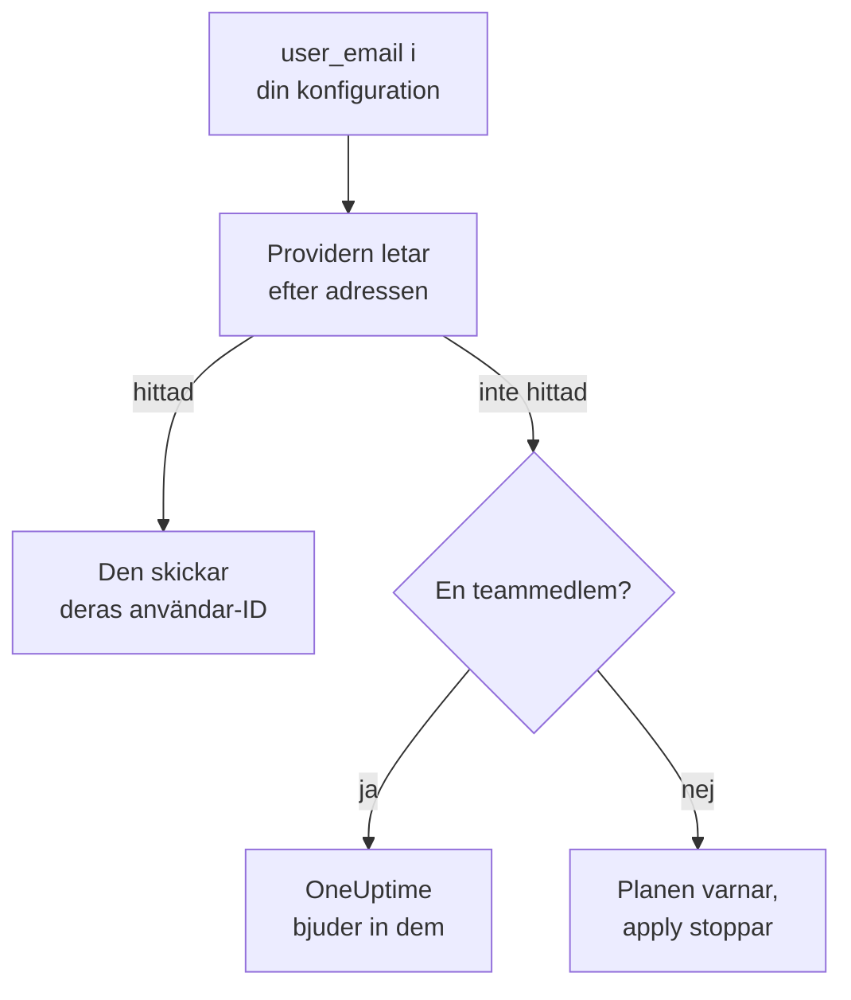

# Personer och team

Håll reda på vem som finns i ditt projekt i din Terraform-konfiguration: team och deras medlemmar, vem som har jour och vem som äger vad. Ange varje person med sin e-postadress: providern hittar dem och bjuder in alla som är nya i projektet.

:::cards
- [Ange personer med e-postadress](#ange-personer-med-e-postadress): Attributet bredvid varje användar-ID.
- [Ta in nya personer](#ta-in-nya-personer): Bjud in någon, och ge dem ett team, jourpass och något att äga.
- [Ta bort personer](#ta-bort-personer): Ta bort någon, och se vad OneUptime tar bort tillsammans med dem.
- [Importera medlemmar du redan har](#importera-medlemmar-du-redan-har): Via deras team och deras adress.
:::

## Så fungerar det

Providern slår upp adressen bland personerna i API-nyckelns projekt: dess medlemmar och de personer som är inbjudna till det. Den skickar API:t ID:t för den person den hittar. En teammedlem som anges med en adress som ingen i projektet har bjuder i stället in den adressen.



Bara API-nyckelns eget projekt genomsöks. Ingen utanför det hittas någonsin, och providern kan inte avgöra om en adress har ett konto någon annanstans.

## Innan du börjar

- **En API-nyckel som får läsa projektets team.** Providern hittar personer genom dem.
- **För att lägga till någon ny, en nyckel som får bjuda in personer.** Se [Bjud in personer](/docs/permissions/inviting-people).

## Ange personer med e-postadress

Varje resurs som anger en person tar deras e-postadress bredvid deras användar-ID. Ange en av de två:

| Användar-ID | E-postadress |
| --- | --- |
| `user_id` | `user_email` |
| `owner_users` | `owner_user_emails` |
| `assigned_to_user_id` | `assigned_to_user_email` |
| `override_user_id` | `override_user_email` |

Adressen hittas oavsett versaler och gemener och behålls i state som du skrev den. Användar-ID:t fylls i, så att andra resurser kan hänvisa till det.

## Ta in nya personer

Den här konfigurationen lägger till Alice, som är ny i projektet, i ett team, ger henne jourpass från första dagen och gör Bob, som redan finns i projektet, till ägare av en monitor:

```hcl title="people.tf"
resource "oneuptime_team" "sre" {
  name        = "SRE"
  description = "Site reliability engineering"
}

# New to the project: OneUptime invites her.
resource "oneuptime_team_member" "alice" {
  team_id    = oneuptime_team.sre.id
  user_email = "alice@example.com"
}

resource "oneuptime_on_call_policy_schedule" "weekly" {
  name     = "SRE weekly"
  timezone = "UTC"
}

resource "oneuptime_on_call_schedule_layer" "weekly" {
  on_call_duty_policy_schedule_id = oneuptime_on_call_policy_schedule.weekly.id
  name                            = "Weekly"
  starts_at                       = "2030-01-07T09:00:00Z"
  hand_off_time                   = "2030-01-14T09:00:00Z"
}

# Named through her membership, so she is invited first.
resource "oneuptime_on_call_schedule_layer_user" "alice" {
  on_call_duty_policy_schedule_id       = oneuptime_on_call_policy_schedule.weekly.id
  on_call_duty_policy_schedule_layer_id = oneuptime_on_call_schedule_layer.weekly.id
  user_id                               = oneuptime_team_member.alice.user_id
}

resource "oneuptime_monitor" "api" {
  name         = "Public API"
  monitor_type = "Manual"
}

# In the project already: named by his address.
resource "oneuptime_monitor_user_owner" "api" {
  monitor_id = oneuptime_monitor.api.id
  user_email = "bob@example.com"
}
```

`terraform apply` bjuder in Alice via e-post, så som en inbjudan från dashboarden gör. OneUptime skapar ett konto åt henne om hon inte har något. `has_accepted_invitation` förblir `false` tills hon accepterar, och att hon accepterar är ingen ändring i planen. Den som redan finns i projektet går direkt med i ett nytt team.

För att sätta någon som den här konfigurationen bjuder in på jour, eller göra dem till ägare, hänvisar du till deras medlemskap med `user_id = oneuptime_team_member.<name>.user_id`: Då bjuder Terraform in dem innan den anger dem någon annanstans. En adress som ingen i projektet har är en varning i planen och ett fel i apply.

## Hitta någon

Datakällan `oneuptime_user` slår upp någon via `email`, `name` eller `id`, och läser deras användar-ID, deras namn, om de har gått med, och de team de finns i:

```hcl
data "oneuptime_user" "alice" {
  email = "alice@example.com"
}

output "alice_teams" {
  value = data.oneuptime_user.alice.team_ids
}
```

Andra datakällor hittar en post via adressen till personen den anger, bredvid personens ID. Den här läser Alices medlemskap i SRE-teamet:

```hcl
data "oneuptime_team_member" "alice" {
  team_id    = oneuptime_team.sre.id
  user_email = "alice@example.com"
}
```

## Ta bort personer

Ta bort personens medlemskap från din konfiguration och tillämpa den. Ute ur sitt sista team i projektet är de ute ur projektet, och OneUptime tar bort dem från varje jourschema, varje eskaleringsregel och varje ersättare, och från det de äger: allt, utom de incidenter, larm och underhållshändelser som är över. Ta bort blocken som anger dem i samma ändring, annars skapar nästa plan dem igen för någon som inte längre finns i projektet.

Deras OneUptime-konto förblir deras: Det är bara projektet de lämnar. Ett team som måste behålla en medlem släpper inte sin sista medlem som har accepterat.

## Importera medlemmar du redan har

Ingen skärm visar ett medlemskaps ID, så importera det via teamets ID och personens adress:

```bash
terraform import oneuptime_team_member.alice 6b1d1c2e-4f3a-4b5c-8d6e-7f8091a2b3c4/alice@example.com
```

Adressen förblir som du skrev den, så skriv den som din konfiguration gör. Medlemskapets eget ID importerar det också, och då läses adressen från OneUptime, med gemener.

Ägare och jourrader importeras på samma sätt, via det de hör till. En monitors ägare tar monitorns ID och personens adress. En rad som nämner ett team eller ett schema, som ett ägarteam eller teamet som en eskaleringsregel larmar, tar båda ID:na:

```bash
terraform import oneuptime_monitor_user_owner.api 68a1b2c3-d4e5-4f6a-8b9c-0d1e2f3a4b01/bob@example.com
terraform import oneuptime_escalation_rule_team.sre 68a1b2c3-d4e5-4f6a-8b9c-0d1e2f3a4b06/6b1d1c2e-4f3a-4b5c-8d6e-7f8091a2b3c4
```

## När någon ändrar sin adress

En person som ändrar sin adress i OneUptime förblir samma person för Terraform: Inget ändras förrän du skriver den nya adressen, och då ändras bara `user_email`.

## Felsökning

:::details Planen säger att en adress inte finns i det här projektet ännu
Ingen i projektet, eller inbjuden till det, har den adressen. Bjud först in personen med ett `oneuptime_team_member`. Om det medlemskapet finns i samma konfiguration, hänvisa till det med `user_id = oneuptime_team_member.<name>.user_id` i stället för adressen. Om de har ändrat sin adress i OneUptime, använd den nya.
:::

:::details Apply säger att användaren redan är inbjuden till det här teamet
Personen finns redan i teamet. Importera det medlemskapet i stället för att skapa det, som i [Importera medlemmar du redan har](#importera-medlemmar-du-redan-har).
:::

## Nästa steg

:::cards
- [Importera resurser](/docs/terraform/importing-resources): Ta in resten av ditt projekt under Terraform.
- [Bjud in personer](/docs/permissions/inviting-people): Så fungerar inbjudningar i OneUptime.
- [Exempel](/docs/terraform/examples): Färdiga konfigurationer för de vanliga resurserna.
:::
