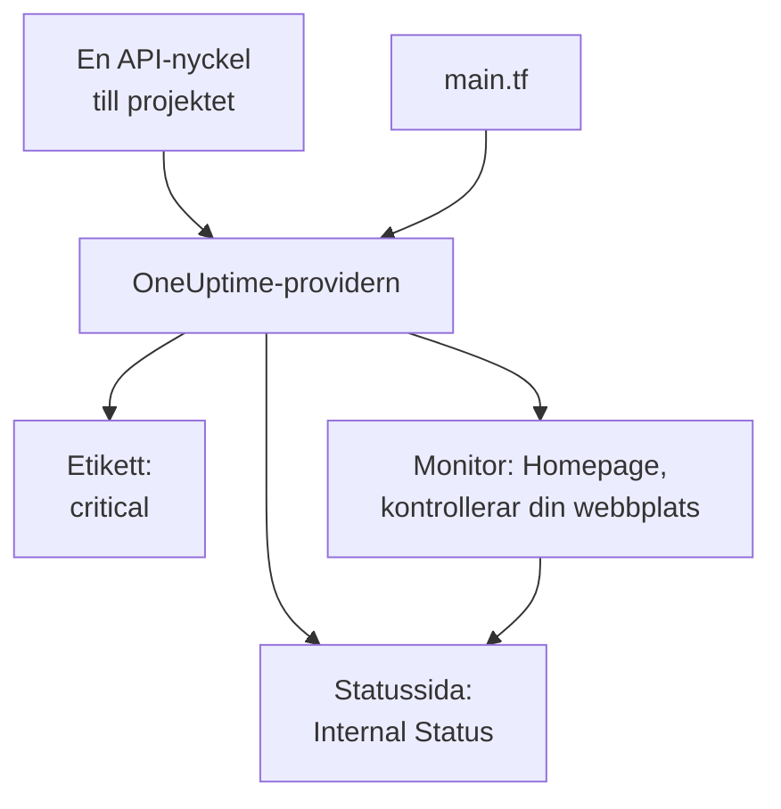

# Snabbstart

Den här guiden tar dig från ingenting till ett OneUptime-projekt som hanteras av Terraform på ungefär tio minuter. Du skapar en API-nyckel, riktar Terraform mot ditt projekt och tillämpar en etikett, en monitor som kontrollerar din webbplats och en privat statussida som visar den. Sedan ändrar du en av dem och städar upp.

:::cards
- [Innan du börjar](#innan-du-börjar): Terraform, ett projekt och ett abonnemang med API-nycklar.
- [Skapa dina första resurser](#skapa-dina-första-resurser): Från en API-nyckel till en tillämpad plan, i sex steg.
- [Ändra en resurs](#ändra-en-resurs): Redigera konfigurationen, planera och tillämpa.
- [Felsökning](#felsökning): De fel som en första körning kan stanna på.
:::



## Innan du börjar

- **Terraform 1.5 eller senare, eller OpenTofu 1.6 eller senare.** Med OpenTofu kör du `tofu` överallt där den här guiden kör `terraform`.
- **Ett OneUptime-projekt** på [oneuptime.com](https://oneuptime.com) eller på ditt eget OneUptime, där du kan skapa API-nycklar.
- **På OneUptime Cloud abonnemanget Growth eller högre.** Ett projekts API-nycklar fungerar bara på det.

## Skapa dina första resurser

:::steps
### Skapa en API-nyckel till projektet

Öppna **Projektinställningar → Avancerad → API-nycklar** i OneUptimes instrumentpanel och klicka på **Skapa API-nyckel**. Ge den ett **Namn**, till exempel `terraform`, och välj **Projektadministratör** under **Åtkomst**: Terraform skapar, läser, ändrar och tar bort alla slags poster som det hanterar, och **Projektadministratör** får göra allt det. För en mer begränsad nyckel väljer du **Välj behörigheter senare** och lägger bara till de behörigheter som du behöver på nyckelns sida.

Nyckeln går ut om ett år. För att välja ett annat datum öppnar du **Fler fält** innan du skapar den, eller ändrar datumet senare på nyckelns sida. När nyckeln har skapats öppnas dess sida: kopiera **API-nyckel** från kortet **Detaljer om API-nyckel**.

### Gör nyckeln tillgänglig för Terraform

Lägg nyckeln i miljövariabeln `ONEUPTIME_API_KEY` i det skal där du kör Terraform, så att den aldrig hamnar i en fil:

:::tabs
@tab Linux
```bash
export ONEUPTIME_API_KEY="<your-api-key>"
```
@tab macOS
```bash
export ONEUPTIME_API_KEY="<your-api-key>"
```
@tab Windows
```powershell
$env:ONEUPTIME_API_KEY = "<your-api-key>"
```
:::

### Rikta Terraform mot OneUptime

Skapa en tom mapp, och i den en fil med namnet `main.tf`:

```hcl title="main.tf"
terraform {
  required_providers {
    oneuptime = {
      source  = "oneuptime/oneuptime"
      version = "{{TERRAFORM_PROVIDER_VERSION}}"
    }
  }
}

provider "oneuptime" {
  # The API key comes from ONEUPTIME_API_KEY.
  # On a self-hosted OneUptime, add your OneUptime's address:
  # oneuptime_url = "https://oneuptime.example.com"
}
```

På ett självhostat OneUptime läser du [Självhostad konfiguration](/docs/terraform/self-hosted) innan du väljer en providerversion.

### Beskriv dina resurser

Lägg till de här blocken i `main.tf`. De läser två av de monitorstatusar som varje projekt börjar med, och skapar en etikett, en monitor som kontrollerar `https://example.com` var femte minut (ange din egen webbplats där) och en privat statussida som visar monitorn:

```hcl title="main.tf"
data "oneuptime_monitor_status" "operational" {
  name = "Operational"
}

data "oneuptime_monitor_status" "offline" {
  name = "Offline"
}

resource "oneuptime_label" "critical" {
  name        = "critical"
  description = "Resources that page on-call when down"
  color       = "#FF5733"
}

resource "oneuptime_monitor" "homepage" {
  name                = "Homepage"
  description         = "Checks that the homepage responds"
  monitor_type        = "Website"
  monitoring_interval = "*/5 * * * *"
  labels              = [oneuptime_label.critical.id]

  monitor_steps = [{
    monitor_destination      = "https://example.com"
    monitor_destination_type = "URL"
    request_type             = "GET"

    criteria = [
      {
        name                  = "Offline"
        description           = "The homepage does not respond"
        filter_condition      = "Any"
        change_monitor_status = true
        monitor_status_id     = data.oneuptime_monitor_status.offline.id

        filters = [
          {
            check_on    = "Is Online"
            filter_type = "False"
          }
        ]
      },
      {
        name                  = "Online"
        description           = "The homepage responds"
        filter_condition      = "All"
        change_monitor_status = true
        monitor_status_id     = data.oneuptime_monitor_status.operational.id

        filters = [
          {
            check_on    = "Is Online"
            filter_type = "True"
          }
        ]
      }
    ]
  }]
}

resource "oneuptime_status_page" "internal" {
  name                  = "Internal Status"
  description           = "Status of our internal services"
  page_title            = "Service Status"
  is_public_status_page = false
}

resource "oneuptime_status_page_resource" "homepage" {
  status_page_id = oneuptime_status_page.internal.id
  monitor_id     = oneuptime_monitor.homepage.id
  display_name   = "Homepage"
}

output "monitor_id" {
  value = oneuptime_monitor.homepage.id
}
```

Monitorns `monitor_steps` säger vad den kontrollerar och vad varje resultat betyder: efter varje kontroll sätter det första kriterium som stämmer dess status. [Monitorsteg](/docs/terraform/monitor-steps) förklarar varje del.

### Planera och tillämpa

:::tabs
@tab Terraform
```bash
terraform init
terraform plan
terraform apply
```
@tab OpenTofu
```bash
tofu init
tofu plan
tofu apply
```
:::

`init` hämtar providern. Planen slutar med `Plan: 4 to add, 0 to change, 0 to destroy.` Skriv `yes` för att tillämpa den; när den är klar skriver Terraform ut den nya monitorns ID.

### Kontrollera instrumentpanelen

I OneUptimes instrumentpanel:

- **Monitorer** visar `Homepage`, med etiketten `critical`. Dess första kontroll kommer in inom några minuter.
- **Statussidor** visar `Internal Status`, som visar `Homepage`.
- **Projektinställningar → Grundläggande → Etiketter** visar `critical`, i den färg som du angav.

Kör `terraform plan` igen. Den svarar `No changes.`: OneUptime innehåller exakt det som konfigurationen säger.
:::

## Ändra en resurs

Ändra konfigurationen, inte instrumentpanelen. Sätt etikettens `color` till `"#2ECC71"` i `main.tf`, och planera och tillämpa sedan:

```bash
terraform plan
terraform apply
```

Planen slutar med `Plan: 0 to add, 1 to change, 0 to destroy.`: etiketten ändras på plats. En ändring som någon gör i instrumentpanelen på en resurs som Terraform hanterar visas i nästa plan, och när du tillämpar den återställs det som konfigurationen säger.

## Städa upp

Om det här var en provtur tar du bort det som konfigurationen skapade:

```bash
terraform destroy
```

Det tar bort etiketten, monitorn, statussidan och dess resurs. De två monitorstatusarna blir kvar: datakällorna läser dem bara.

## Felsökning

:::details Meddelandet ”Missing API Key”
Providern hittade ingen API-nyckel. Exportera `ONEUPTIME_API_KEY` i det skal där du kör Terraform, eller ange `api_key` i provider-blocket, och kör kommandot igen.
:::

:::details Meddelandet ”the OneUptime API returned status 400: Invalid API Key”
Nyckeln är felskriven, har gått ut eller har tagits bort, eller så hör den till ett annat OneUptime än det som `oneuptime_url` pekar på. Kopiera nyckeln igen från dess sida, eller skapa en ny.
:::

:::details Meddelandet ”the OneUptime API returned status 402: API keys need the Growth plan”
På OneUptime Cloud fungerar ett projekts API-nycklar bara på abonnemanget Growth eller högre. Uppgradera projektet under **Projektinställningar → Fakturering och fakturor → Fakturering**, så fungerar samma nyckel igen.
:::

:::details Meddelandet ”the OneUptime API returned status 422: You do not have permissions to create Monitor”
Nyckeln har ingen behörighet för det slaget av post. Ge den **Projektadministratör** på nyckelns sida, eller den behörighet som meddelandet nämner.
:::

:::details Meddelandet ”No monitor status matches {name = "Offline"}”
Ditt projekts monitorstatusar har andra namn. Använd de namn som du ser under **Övervakare → Inställningar → Monitorstatus**, eller slå i stället upp statusen med `is_offline_state = true`.
:::

## Nästa steg

:::cards
- [Komplett guide](/docs/terraform/complete-guide): Autentisering, projektupplägg, datakällor, state och uppgraderingar.
- [Monitorsteg](/docs/terraform/monitor-steps): Bestäm vad en monitor kontrollerar och vad varje resultat betyder.
- [Exempel](/docs/terraform/examples): Färdiga konfigurationer för de vanliga resurserna.
- [Importera resurser](/docs/terraform/importing-resources): För in det du har skapat i instrumentpanelen under Terraform.
:::
