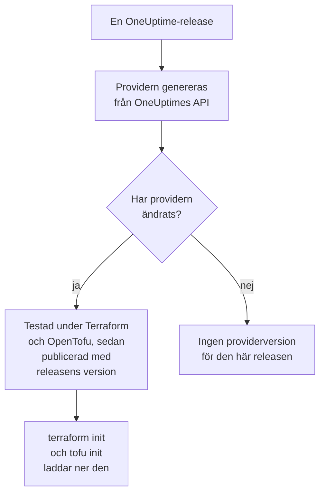

# Användning av register

OneUptime-providern publiceras i [Terraform Registry](https://registry.terraform.io/providers/oneuptime/oneuptime) och [OpenTofu Registry](https://search.opentofu.org/provider/oneuptime/oneuptime/latest). `terraform init` och `tofu init` laddar ner den därifrån: det finns inget att installera för hand. Den här sidan tar upp vad som publiceras, hur versioner numreras och hur du byter till en nyare.

:::cards
- [Vad som publiceras](#vad-som-publiceras): Providern för varje plattform, dess referens och dess versioner.
- [Hur versioner numreras](#hur-versioner-numreras): En providers version är den OneUptime-release som publicerade den.
- [Låsfilen](#låsfilen): Versionen och kontrollsummorna som varje maskin installerar.
- [Byt till en nyare version](#byt-till-en-nyare-version): Läs vad som ändrades, ladda ner den och planera.
:::

## Vad som publiceras

Varje OneUptime-release genererar providern från OneUptimes eget API. När providern har ändrats publicerar releasen den, under releasens version, när den har klarat sina end-to-end-tester under Terraform och under OpenTofu:



| Vad | Var |
| --- | --- |
| Providern, för Linux, macOS, Windows, FreeBSD, OpenBSD och Solaris | Laddas ner av `terraform init` och `tofu init`, med kontrollsummor som OneUptime signerar |
| Referensen för varje resurs och datakälla, med vart och ett av dess attribut | Registrets dokumentation, grupperad efter produkt: övervakare, statussidor, incidenter, jour och de andra |
| En guide för att använda providern med OpenTofu | Registrets guider |
| Varje version, den nyaste först | Registrets versionslista |

Referensen anger vad varje attribut är. Den här dokumentationen visar hur du använder dem tillsammans: börja från [Terraform – Översikt](/docs/terraform/index).

## Hur versioner numreras

En providers version är versionen av den OneUptime-release som publicerade den: provider {{TERRAFORM_PROVIDER_MAJOR}}.0.20 kom med OneUptime {{TERRAFORM_PROVIDER_MAJOR}}.0.20. En release vars provider inte ändrades publicerar ingen, så versionerna har luckor, och en begränsning som nämner en enda exakt version kan nämna en version som inte finns. Skriv ett intervall i stället:

| Du använder | Begränsning | Terraform installerar |
| --- | --- | --- |
| OneUptime Cloud | `{{TERRAFORM_PROVIDER_VERSION}}` | Den senaste {{TERRAFORM_PROVIDER_MAJOR}}.x-providern |
| Ett självhostat OneUptime | Ett intervall som slutar vid ditt OneUptimes version, som `>= {{TERRAFORM_PROVIDER_MAJOR}}.0, <= {{TERRAFORM_PROVIDER_MAJOR}}.0.40` | Den senaste providern som inte är nyare än ditt OneUptime |

På ett självhostat OneUptime kan en provider som är nyare än ditt OneUptime skicka inställningar som ditt OneUptime inte har än: [Självhostad konfiguration](/docs/terraform/self-hosted#välj-providerversion) visar hur du skriver dess intervall.

```hcl title="main.tf"
terraform {
  required_providers {
    oneuptime = {
      source  = "oneuptime/oneuptime"
      version = "{{TERRAFORM_PROVIDER_VERSION}}"
    }
  }
}
```

Källadressen nämner inget register: Terraform läser den från Terraform Registry, och OpenTofu från OpenTofu Registry, som publicerar samma versioner.

## Låsfilen

`terraform init` registrerar versionen som den valde, och kontrollsummorna för sina nedladdningar, i `.terraform.lock.hcl`. Checka in den filen: varje maskin och varje CI-körning installerar då exakt den versionen, tills du väljer en annan. Kontrollsummorna täcker varje plattform som registret publicerar, så en låsfil fungerar lika bra för Linux-, macOS- och Windows-maskiner.

```hcl title=".terraform.lock.hcl"
provider "registry.terraform.io/oneuptime/oneuptime" {
  version     = "{{TERRAFORM_PROVIDER_MAJOR}}.0.20"
  constraints = "{{TERRAFORM_PROVIDER_VERSION}}"
  hashes = [
    "h1:...",
    "zh:...",
  ]
}
```

Låsfilen nämner registret. OpenTofu skriver `registry.opentofu.org/oneuptime/oneuptime` där Terraform skriver `registry.terraform.io/oneuptime/oneuptime`, så ett byte av verktyg ändrar låsfilen: `init` ersätter posten och ber dig checka in ändringen.

## Byt till en nyare version

:::steps
### Läs vad som ändrades

[OneUptimes releaser](https://github.com/OneUptime/oneuptime/releases) säger vad varje release ändrade, providern inräknad. [Providerns releaser](https://github.com/OneUptime/terraform-provider-oneuptime/releases) länkar till ändringarna sedan den förra.

### Ladda ner den

```bash
terraform init -upgrade
```

`init -upgrade` tar den senaste versionen som din begränsning tillåter, visar den och uppdaterar `.terraform.lock.hcl`. Begränsningen `{{TERRAFORM_PROVIDER_VERSION}}` tar varje {{TERRAFORM_PROVIDER_MAJOR}}.x-release; en ny huvudversion kräver en ny begränsning.

### Planera innan du tillämpar

Kör `terraform plan`, och tillämpa bara när den är tom eller visar de ändringar som du väntar dig. Checka in den uppdaterade låsfilen.
:::

På ett självhostat OneUptime uppgraderar du OneUptime först, och höjer sedan slutet av providerns intervall.

## Var koden finns

Providern genereras från OneUptime-API:et i [OneUptimes huvudrepo](https://github.com/OneUptime/oneuptime), och varje version byggs från den release som publicerade den. Dess eget repo, [OneUptime/terraform-provider-oneuptime](https://github.com/OneUptime/terraform-provider-oneuptime), innehåller det som generatorn skrev, så ändringar görs i huvudrepot: rapportera problem, även de i dokumentationen, på [github.com/OneUptime/oneuptime/issues](https://github.com/OneUptime/oneuptime/issues).

## Nästa steg

:::cards
- [Självhostad konfiguration](/docs/terraform/self-hosted): Versionsintervallet för ditt eget OneUptime, och en spegel för maskiner utan internet.
- [OpenTofu](/docs/terraform/opentofu): Samma provider och konfiguration, med `tofu`.
- [Komplett guide](/docs/terraform/complete-guide): Autentisering, projektupplägg, datakällor, state och uppgraderingar.
- [Felsökning](/docs/terraform/troubleshooting): Vanliga fel och hur du åtgärdar dem.
:::
