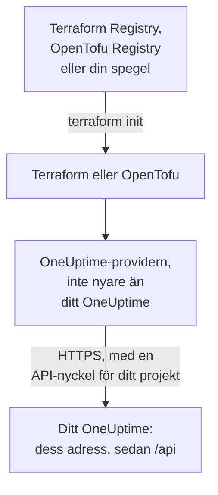

# Självhostad konfiguration

Providern fungerar med ditt eget OneUptime på samma sätt som med OneUptime Cloud: samma resurser, samma attribut och samma API-nycklar för projektet. Det som är ditt att ange: adressen till ditt OneUptime, den providerversion som passar det, och, där du behöver dem, en spegel för maskiner utan internetåtkomst och förtroende för en privat certifikatutfärdare.

:::cards
- [Peka providern mot ditt OneUptime](#peka-providern-mot-ditt-oneuptime): Dess adress, och en API-nyckel för ditt projekt.
- [Välj providerversion](#välj-providerversion): Den senaste providern som inte är nyare än ditt OneUptime.
- [Utan internetåtkomst](#utan-internetåtkomst): Spegla providern till ditt nätverk.
- [TLS och certifikat](#tls-och-certifikat): En privat certifikatutfärdare, proxyservrar och vanlig HTTP.
:::



## Peka providern mot ditt OneUptime

Sätt `oneuptime_url` till adressen där du öppnar instrumentpanelen: schemat och värden, utan sökväg. Providern lägger till `https://` när adressen saknar schema, och `/api` i slutet, så `https://oneuptime.example.com` skickar varje begäran till `https://oneuptime.example.com/api`.

```hcl title="main.tf"
terraform {
  required_providers {
    oneuptime = {
      source  = "oneuptime/oneuptime"
      version = "{{TERRAFORM_PROVIDER_MATCHING}}"
    }
  }
}

provider "oneuptime" {
  oneuptime_url = "https://oneuptime.example.com"
  # The API key comes from the ONEUPTIME_API_KEY environment variable.
}
```

Adressen kan i stället komma från miljövariabeln `ONEUPTIME_URL`, så att en konfiguration kan peka mot flera installationer:

```bash
export ONEUPTIME_URL="https://oneuptime.example.com"
export ONEUPTIME_API_KEY="<your-api-key>"
```

Adressen är värden som din installation serveras på: `HOST` och `HTTP_PROTOCOL` i `config.env` med Docker Compose, och `host` och `httpProtocol` i Helm-diagrammets values.

Nyckeln är en API-nyckel för projektet som du hanterar, skapad i ditt OneUptimes instrumentpanel under **Projektinställningar → Avancerad → API-nycklar**, som på OneUptime Cloud. Master-API-nyckeln i ett självhostat OneUptime hör inte till något projekt, så ett skapande med den misslyckas med `ProjectId required`.

> [!TIP]
> Ditt OneUptime skriver det här blocket åt dig. Öppna valfri resurs eller lista i instrumentpanelen, och sedan **Utvecklare** och **Terraform** i dess sidomeny: provider-blocket som visas har ditt OneUptimes adress, och ett versionsintervall som passar det.

## Välj providerversion

Använd den senaste publicerade providern som inte är nyare än ditt OneUptime. Providerversioner följer OneUptimes: en OneUptime-release som ändrar providern publicerar den under releasens eget versionsnummer, och en provider som är nyare än ditt OneUptime kan skicka inställningar som ditt OneUptime inte har än.

Skriv därför ett intervall som slutar vid ditt OneUptimes version, som instrumentpanelen gör. Blocket ovan tar `{{TERRAFORM_PROVIDER_MATCHING}}`, intervallet för det OneUptime som den här dokumentationen kommer från: när du läser den på ditt eget OneUptime är det intervallet ditt. Annars skriver du in din egen version:

:::steps
### Ta reda på ditt OneUptimes version

Fråga ditt OneUptime:

```bash
curl https://oneuptime.example.com/version
```

Svaret är JSON, som `{"version":"{{TERRAFORM_PROVIDER_MAJOR}}.0.40","commit":"..."}`. Som huvudadministratör kan du också öppna utgåvemärket i sidhuvudet i administratörspanelen: se [Ta reda på din nuvarande version](/docs/installation/upgrading#ta-reda-på-din-nuvarande-version).

### Skriv in den i intervallet

Intervallet börjar vid huvudversionen och slutar vid din. För ett OneUptime {{TERRAFORM_PROVIDER_MAJOR}}.0.40:

```hcl title="main.tf"
terraform {
  required_providers {
    oneuptime = {
      source  = "oneuptime/oneuptime"
      version = ">= {{TERRAFORM_PROVIDER_MAJOR}}.0, <= {{TERRAFORM_PROVIDER_MAJOR}}.0.40"
    }
  }
}
```

Terraform tar den senaste providern i intervallet. En OneUptime-release som inte ändrade providern publicerar ingen, och intervallet hoppar över de versioner som inte finns.

### Ladda ner providern

Kör `terraform init`. Den visar versionen som den installerade och registrerar den i `.terraform.lock.hcl`.
:::

När du uppgraderar, uppgradera OneUptime först. Höj sedan slutet av intervallet till dess nya version, och kör `terraform init -upgrade`.

## Utan internetåtkomst

När maskinerna som kör Terraform inte kan nå registret kopierar du providern till ditt nätverk en gång och låter Terraform peka mot kopian.

:::steps
### Spegla providern

Ladda ner providern för varje plattform som dina maskiner kör, på en maskin med internetåtkomst, i en mapp med din konfiguration. Utan `-platform` laddar kommandot bara ner providern för sin egen plattform:

:::tabs
@tab Terraform
```bash
terraform providers mirror -platform=linux_amd64 -platform=darwin_arm64 /srv/terraform-mirror
```
@tab OpenTofu
```bash
tofu providers mirror -platform=linux_amd64 -platform=darwin_arm64 /srv/terraform-mirror
```
:::

Mappen innehåller providern under registrets adress, som `registry.terraform.io/oneuptime/oneuptime/`. Kopiera den till ditt nätverk.

### Peka Terraform mot spegeln

Skriv en CLI-konfigurationsfil som installerar OneUptime-providern från mappen, och allt annat som vanligt:

:::tabs
@tab Terraform
```hcl title="mirror.tfrc"
provider_installation {
  filesystem_mirror {
    path    = "/srv/terraform-mirror"
    include = ["registry.terraform.io/oneuptime/oneuptime"]
  }
  direct {
    exclude = ["registry.terraform.io/oneuptime/oneuptime"]
  }
}
```
@tab OpenTofu
```hcl title="mirror.tfrc"
provider_installation {
  filesystem_mirror {
    path    = "/srv/terraform-mirror"
    include = ["registry.opentofu.org/oneuptime/oneuptime"]
  }
  direct {
    exclude = ["registry.opentofu.org/oneuptime/oneuptime"]
  }
}
```
:::

Ange den i `TF_CLI_CONFIG_FILE`, som både Terraform och OpenTofu läser: `export TF_CLI_CONFIG_FILE=/etc/terraform/mirror.tfrc`.

### Initiera

Kör `terraform init`: den installerar providern från spegeln. Den varnar för att låsfilen nu bara har kontrollsummor för den här plattformen. För att registrera dem för alla plattformar kör du `terraform providers lock` med samma `-platform`-alternativ på maskinen med internetåtkomst, och checkar in `.terraform.lock.hcl` tillsammans med din konfiguration.
:::

Spegla igen varje gång du höjer versionsintervallet.

## TLS och certifikat

Providern kontrollerar ditt OneUptimes certifikat mot förtroendearkivet på maskinen som kör Terraform, och det finns ingen inställning för att hoppa över kontrollen. När certifikatet kommer från en privat certifikatutfärdare lägger du till den utfärdaren i förtroendearkivet på varje maskin och CI-runner som kör Terraform:

:::tabs
@tab Debian / Ubuntu
```bash
sudo cp my-ca.crt /usr/local/share/ca-certificates/
sudo update-ca-certificates
```
@tab RHEL / Fedora
```bash
sudo cp my-ca.crt /etc/pki/ca-trust/source/anchors/
sudo update-ca-trust
```
:::

På Linux, där du inte kan ändra förtroendearkivet, som i en CI-container, sätter du `SSL_CERT_FILE` till en fil som innehåller din utfärdare och de offentliga utfärdarna. På macOS och Windows lägger du till utfärdaren i systemets certifikatarkiv.

- **Proxyservrar.** Providern skickar sina begäranden via proxyn i `HTTPS_PROXY`, utom till värdarna i `NO_PROXY`. En omvänd proxy framför OneUptime måste släppa igenom varje `/api`-sökväg och huvudet `APIKey` oförändrade.
- **Vanlig HTTP.** En `http://`-adress fungerar, för en testinstallation. API-nyckeln följer med varje begäran, så använd HTTPS för allt annat.

## Felsökning

:::details Meddelandet ”x509: certificate signed by unknown authority”
Maskinen som kör Terraform litar inte på ditt OneUptimes certifikat: lägg till din certifikatutfärdare som [TLS och certifikat](#tls-och-certifikat) visar.
:::

:::details Meddelandet ”invalid character '<' looking for beginning of value”
En webbsida svarade i stället för API:et: `oneuptime_url` innehåller en sökväg, eller så svarade en proxy. Sätt den till bara ditt OneUptimes adress.
:::

:::details Meddelandet ”no available releases match the given constraints”
Ingen publicerad provider passar versionsbegränsningen, till exempel en begränsning som nämner en enda version som OneUptime aldrig har publicerat. Skriv ett intervall, som [Välj providerversion](#välj-providerversion) visar.
:::

:::details Meddelandet ”ProjectId required”
Nyckeln är master-API-nyckeln, som inte hör till något projekt. Skapa en API-nyckel för projektet under **Projektinställningar → Avancerad → API-nycklar**.
:::

[Felsökning](/docs/terraform/troubleshooting) har de andra felen, och vad vart och ett betyder.

## Nästa steg

:::cards
- [Snabbstart](/docs/terraform/quick-start): Skapa en API-nyckel och tillämpa dina första resurser.
- [Användning av register](/docs/terraform/registry): Var providern publiceras, och hur versioner numreras.
- [Felsökning](/docs/terraform/troubleshooting): Vanliga fel och hur du åtgärdar dem.
- [Uppgradering](/docs/installation/upgrading): Uppgradera ditt OneUptime innan du höjer providerns intervall.
:::
