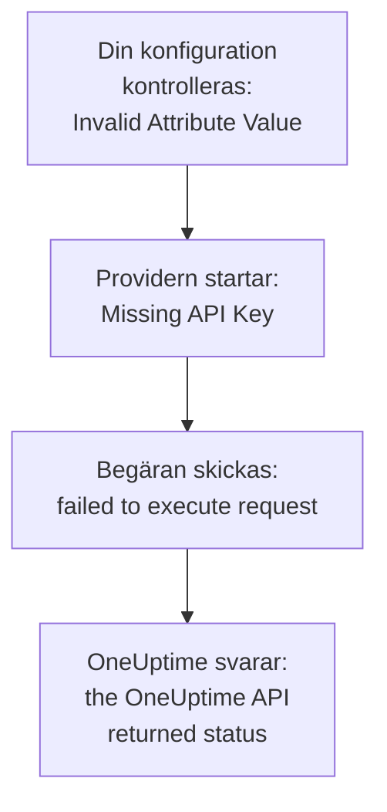

# Felsökning

Slå upp meddelandet som Terraform skrev ut, eller det du såg hända, i tabellen nedan: varje rad leder till lösningen. Avsnitten efter tabellen förklarar varje fel, grupperade efter var de kommer ifrån.

:::cards
- [Hitta ditt fel](#hitta-ditt-fel): Varje meddelande och symtom på den här sidan, med lösningen.
- [API-nycklar, behörigheter och abonnemang](#api-nycklar-behörigheter-och-abonnemang): När OneUptime avvisar providerns nyckel.
- [Planer som inte stabiliseras](#planer-som-inte-stabiliseras): Ändringar som kommer tillbaka, och resurser som lämnar state.
- [Ansluta till ett självhostat OneUptime](#ansluta-till-ett-självhostat-oneuptime): Adressen, certifikat och proxyservrar.
:::

## Hitta ditt fel

| Meddelande eller symtom | Vad du gör |
| --- | --- |
| `Missing API Key` | Ge providern dess nyckel: se [`Missing API Key` eller `Invalid API Key`](#missing-api-key-eller-invalid-api-key) |
| `Invalid API Key` | Kopiera nyckeln igen, eller skapa en ny: se [`Missing API Key` eller `Invalid API Key`](#missing-api-key-eller-invalid-api-key) |
| `ProjectId required` | Använd en API-nyckel för projektet, inte en huvudnyckel: se [`ProjectId required`](#projectid-required) |
| `You do not have permissions to create Monitor` | Ge nyckeln den behörighet som meddelandet nämner: se [Nyckeln saknar en behörighet](#nyckeln-saknar-en-behörighet) |
| `API keys need the Growth plan` | Flytta tillbaka projektet till abonnemanget Growth: se [Betalning krävs](#betalning-krävs) |
| `402` för en resurs eller en inställning | Uppgradera abonnemanget, eller låt inställningen stå kvar på standardvärdet: se [Betalning krävs](#betalning-krävs) |
| `This project has been blocked` | Be en huvudadministratör att häva blockeringen av projektet: se [Ett blockerat projekt](#ett-blockerat-projekt) |
| `references records that are not in this project` | Använd ID:t för en post i ditt eget projekt: se [ID:n från ett annat projekt](#idn-från-ett-annat-projekt) |
| `Not Found` eller `Ambiguous Match` från en datakälla | Rätta uppslagningens argument: se [Uppslagningar som hittar ingen eller flera](#uppslagningar-som-hittar-ingen-eller-flera) |
| `Cannot import non-existent remote object` | Kontrollera ID:t och nyckelns behörigheter: se [Importera resurser](/docs/terraform/importing-resources#felsökning) |
| `Provider produced inconsistent result after apply` | Uppgradera providern: se [Inkonsekvent resultat efter apply](#inkonsekvent-resultat-efter-apply) |
| En plan skapar en resurs som du inte har lagt till | Nyckeln kan inte längre läsa den, och OneUptime svarade `404`: ge nyckeln dess läsåtkomst tillbaka, och importera sedan resursen med `terraform import`: se [En resurs lämnar state, och nästa apply skapar den igen](#en-resurs-lämnar-state-och-nästa-apply-skapar-den-igen) |
| En `priority` eller `order` ändras efter apply | Ge var och en ett nummer som ingen annan har: se [En prioritet eller ordning som flyttar sig](#en-prioritet-eller-ordning-som-flyttar-sig) |
| `Invalid Configuration for Read-Only Attribute` | Ta bort attributet från konfigurationen: se [Skrivskyddade attribut](#skrivskyddade-attribut) |
| `has been renamed to` | Byt namn på resurstypen, med ett `moved`-block: se [En resurstyp med nytt namn](#en-resurstyp-med-nytt-namn) |
| En övervakare som skapats med Terraform visar aldrig sina kontroller | Uppgradera OneUptime: se [Övervakare från före steg-ID:n](#övervakare-från-före-steg-idn) |
| `must contain at least 1 elements` | Utelämna attributet i stället för att lämna det tomt: se [Tomma värden](#tomma-värden) |
| JSON från instrumentpanelen i en `.tf`-fil | Skriv det som HCL: se [JSON från instrumentpanelen](#json-från-instrumentpanelen) |
| `no available releases match the given constraints` | Använd ett versionsintervall, inte en enda exakt version: se [En version som aldrig publicerades](#en-version-som-aldrig-publicerades) |
| `x509: certificate signed by unknown authority` | Lita på din certifikatutfärdare: se [Certifikat](#certifikat) |
| `invalid character '<' looking for beginning of value` | Låt `oneuptime_url` peka på själva ditt OneUptime: se [En webbsida i stället för API:et](#en-webbsida-i-stället-för-apiet) |
| `connection refused` eller `Client.Timeout exceeded` | Kontrollera adressen, nätverket och en eventuell proxy: se [Anslutningar som misslyckas](#anslutningar-som-misslyckas) |

## Så läser du ett fel

Ett fel nämner steget som misslyckades, och dess meddelande säger var det kommer ifrån:



- Ett fel som kommer före någon begäran, som `Invalid Attribute Value`, handlar om din konfiguration: providern kontrollerar den innan den pratar med OneUptime.
- `failed to execute request` betyder att begäran aldrig fick något svar: se [Ansluta till ett självhostat OneUptime](#ansluta-till-ett-självhostat-oneuptime).
- `the OneUptime API returned status` är OneUptimes svar: statusen och meddelandet efter den säger vad OneUptime avvisade.

Providern nämner vad den höll på med: `Unable to create monitor` och `Unable to update monitor` för en ändring, och `Unable to parse label response` när den läser en resurs. En läsning som OneUptime avvisar rapporteras med sammanfattningen `Parse Error`, men meddelandet efter den är OneUptimes svar, inte ett problem med tolkningen.

## API-nycklar, behörigheter och abonnemang

### `Missing API Key` eller `Invalid API Key`

`Missing API Key` stoppar providern innan den skickar någon begäran: varken `api_key` i provider-blocket eller miljövariabeln `ONEUPTIME_API_KEY` är angiven. Exportera variabeln i det skal där du kör Terraform, eller skicka nyckeln i en variabel märkt `sensitive`.

`Invalid API Key` är OneUptimes svar på en nyckel som det inte känner till: en som är felskriven, har gått ut eller har tagits bort, eller en från ett annat OneUptime än det som `oneuptime_url` pekar på. Kopiera nyckeln igen från dess sida under **Projektinställningar → Avancerad → API-nycklar**, eller skapa en ny.

### `ProjectId required`

Providern behöver en API-nyckel för projektet som den hanterar: det är därifrån projektet kommer. Master-API-nyckeln i ett självhostat OneUptime hör inte till något projekt, så varje skapande med den misslyckas med `ProjectId required`. Skapa en API-nyckel för projektet, som i [Skapa en API-nyckel för projektet](/docs/terraform/quick-start#skapa-en-api-nyckel-till-projektet), och använd den i stället.

### Nyckeln saknar en behörighet

`You do not have permissions to create Monitor` och liknande meddelanden kommer med status `422`: nyckeln får inte göra det med det slaget av post. De nämner de behörigheter som skulle tillåta det. Öppna nyckelns sida under **Projektinställningar → Avancerad → API-nycklar** och ge den en av dem, eller **Projektadministratör**. En import kräver bara behörigheten att läsa.

### Betalning krävs

- **402 Payment Required på varje begäran** — `API keys need the Growth plan...`: på OneUptime Cloud ligger projektet under **Growth**, och ett projekts API-nycklar - även providerns - slutar fungera under den nivån. Varje anrop som providern gör avvisas, även `terraform plan`, tills projektet är tillbaka på Growth; då fungerar samma nyckel igen, utan att du behöver ändra något i din konfiguration. Uppgradera under **Projektinställningar → Fakturering och fakturor → Fakturering**, eller hantera projektet i instrumentpanelen så länge. Se [API-nycklar och SCIM under sin plan](/docs/api-reference/api-reference#api-nycklar-och-scim-under-sin-plan).
- **402 Payment Required** — du har nått en gräns i ditt OneUptime-abonnemang, eller så slår konfigurationen på en inställning som ditt abonnemang inte omfattar (en privat statussida, e-postrapporter, en offentlig instrumentpanel, en lista över tillåtna IP-adresser...), oavsett om `terraform apply` skapar resursen med den eller ändrar den senare. Terraform visar OneUptimes meddelande som det är. Uppgradera abonnemanget, eller skär ner konfigurationen.

Att sätta tillbaka en sådan inställning till standardvärdet, vilket slår av funktionen, fungerar på alla abonnemang, så en konfiguration som slår av betalda funktioner kan tillämpas efter att en provperiod har tagit slut eller abonnemanget har nedgraderats.

Detsamma gäller de resurser som ditt abonnemang säljer och som ett projekt behåller efter att det har nedgraderats - SSO-leverantörer, SCIM-anslutningar, API-nycklar, jourscheman, och regler och sammanfattningar för Slack och Microsoft Teams: under abonnemanget (medan projektet fortfarande är på Growth, som providerns egen API-nyckel behöver) kan de som projektet redan har fortfarande läsas (så `terraform plan` och `import` fungerar), tas bort (så det går att ta bort dem från konfigurationen, eller köra `terraform destroy`) och stängas av där de har ett attribut `is_enabled`. Att skapa dem, ändra dem eller slå på dem igen svarar fortfarande 402.

Andra resurser som ditt abonnemang säljer, som mallar, anpassade fält och övervakargrupper, kräver fortfarande abonnemanget för att läsas, så en plan som uppdaterar dem svarar 402; de kan ändå tas bort, till exempel med `terraform destroy -refresh=false`.

En API-nyckels behörigheter tas inte bort en i taget under Growth, eftersom det skulle ge nyckeln mer åtkomst att ta bort en blockerande behörighet: kör `terraform state rm` på behörighetsresurserna, förstör sedan nyckeln, så följer dess behörigheter med.

### Ett blockerat projekt

`This project has been blocked. Please contact your administrator.` kommer med status `403`: en huvudadministratör har blockerat projektet, och tills blockeringen hävs agerar ingen annan än en huvudadministratör i det, inte heller projektets API-nycklar.

## Poster och uppslagningar

### ID:n från ett annat projekt

Varje ID som en resurs nämner - en övervakares etiketter, en statussidegrupps statussida, en nätverksenhets plats, en eskaleringsregels team - måste vara en post i projektet som din API-nyckel hör till. Ett ID för en post i ett annat projekt, ett ID som inte finns och ett ID för en post som nyckeln inte får läsa får alla samma svar, som nämner fältet och ID:t:

```text
This network device references records that are not in this project: Network Site "…". Please pick values from this project and try again.
```

Det betyder oftast att ett ID har kopierats från ett annat projekts konfiguration eller state, eller att posten har tagits bort utanför Terraform. Referera till posten via dess resurs eller en datakälla i samma konfiguration (`oneuptime_label.critical.id`) i stället för ett bokstavligt ID, och tillämpa igen. En person som anges som användare måste vara medlem i projektet.

### Uppslagningar som hittar ingen eller flera

En datakälla hittar exakt en post, eller så stoppar den planen. `Not Found` säger att ingen post har det `id`, eller att ingen matchar argumenten som du har angett; `Ambiguous Match` säger att flera gör det. Rätta argumenten, ange fler av dem för att begränsa uppslagningen till en, eller slå upp posten via `id`. [Läs det som redan finns](/docs/terraform/complete-guide#läs-det-som-redan-finns) har reglerna.

## Planer som inte stabiliseras

### Inkonsekvent resultat efter apply

`Provider produced inconsistent result after apply` betyder att providern returnerade andra värden än den hade planerat. Äldre providers gjorde det med värden som servern räknar ut: standardvärden som servern lägger till i `monitor_steps`, tidsstämplar som servern skrev på ett annat sätt, inslagna värden som `probe_version`, och attribut som servern håller uppdaterade, som när en övervakare för inkommande begäranden senast tog emot sitt heartbeat. De läste också ett decimaltal som null när API:et skickade det som text, så varje apply av en färgregel för statussidans staplar misslyckades på `uptime_percent_greater_than_or_equal_to`. Nuvarande providers hanterar allt detta: tidsstämplar jämförs som tidpunkter, listor med etiketter är mängder, tal läses tillbaka som du skrev dem, och ett attribut som du inte har angett behåller sitt planerade värde tills nästa uppdatering läser serverns.

:::steps
1. Uppgradera providern: behåll `version = "{{TERRAFORM_PROVIDER_VERSION}}"` i providerkravet, och kör `terraform init -upgrade`.
2. Tillämpa igen. En resurs som den misslyckade apply-körningen lämnade märkt som tainted ersätts en gång, och planerna är tomma därefter. För att i stället behålla resursen som den är tar du först bort märkningen via dess adress: `terraform untaint oneuptime_status_page_history_chart_bar_color.operational`.
:::

Om en nuvarande provider fortfarande misslyckas på det här sättet, rapportera det på [github.com/OneUptime/oneuptime/issues](https://github.com/OneUptime/oneuptime/issues), med providerversionen, resurstypen, det minsta `resource`-block som misslyckas, och hela felet. Felet nämner attributet vars värde ändrades, och det är det mest användbara att skicka.

### En resurs lämnar state, och nästa apply skapar den igen

En läsning via ID svarar `404` både för en post som inte finns och för en som API-nyckeln inte får läsa: API:et säger ingenting om en post som det inte visar dig. Terraform tolkar en `404` vid uppdatering som en resurs som har tagits bort utanför Terraform. Den tar bort resursen från state, och nästa `terraform apply` skapar den igen, bredvid den som fortfarande finns kvar.

Det händer när nyckeln som hanterar en resurs inte längre kan läsa den: dess läsbehörighet har begränsats till etiketter som resursen inte har, eller till de resurser som dess team äger, eller så tar en blockering bort resursen - eller så har resursens etiketter eller ägare ändrats.

**Innan du planerar:**

- Ge nyckeln, för varje resurstyp som den hanterar, en läsbehörighet som når varje resurs som den hanterar: med omfånget **Alla**, eller begränsad till etiketter som de resurserna har. En nyckels behörigheter att uppdatera och ta bort når bara det som den får läsa.
- Läs planen innan du tillämpar den: en resurs som är planerad att skapas och som du inte har lagt till är en som nyckeln inte längre kan läsa.

**När state redan har tappat en resurs:** ge nyckeln dess läsåtkomst tillbaka, och [importera](/docs/terraform/importing-resources) sedan resursen i stället för att tillämpa, så att Terraform tar över den som finns i stället för att skapa en till. Om en kopia redan har skapats tar du bort den som du inte vill ha.

### En prioritet eller ordning som flyttar sig

Monitorstatusar, tillstånd och allvarlighetsgrader för incidenter och larm, och de andra listor som du sorterar i instrumentpanelen, har varje nummer en gång. Ett nummer som ingen annan har behålls som det är skrivet. Ett nummer som en annan redan har tas över, och de som står i vägen flyttar ner en plats, som när du drar i instrumentpanelen. Så två av dem som är konfigurerade med samma nummer byter plats vid varje apply.

Ge var och en sitt eget nummer med luckor emellan, som `101`, `102` och `103`, och ändra ordningen på dem som Terraform hanterar i Terraform, inte genom att dra dem i instrumentpanelen.

### Skrivskyddade attribut

`Invalid Configuration for Read-Only Attribute` stoppar planen när en konfiguration anger ett attribut som bara OneUptime skriver. Vem som skapade en post, och vem som arkiverade, löste eller kvitterade den, registreras utifrån begäran: personen som är inloggad, och ingen för en begäran med en API-nyckel, och det är så Terraform loggar in. Så `created_by_user_id`, och alla andra attribut som slutar på `_by_user_id`, kan läsas från en resurs eller en datakälla, men inte anges. Detsamma gäller `archived_at`: att ange `is_archived` registrerar när resursen arkiverades, och att tillämpa det igen oförändrat behåller den tidpunkten. Ta bort attributet från resursblocket; ingenting annat i resursen ändras.

### En resurstyp med nytt namn

`has been renamed to` varnar för att en resurstyp har fått ett nytt namn. Resurstyper håller nu ihop ord som IoT och vCenter: `oneuptime_iot_fleet` och `oneuptime_vcenter`, där äldre providers delade dem (`oneuptime_io_t_fleet`, `oneuptime_v_center`). De gamla namnen fungerar fortfarande som föråldrade alias. För att byta utan att ersätta något byter du namn på resursen i din konfiguration och talar om för Terraform att den har flyttats:

```hcl
resource "oneuptime_iot_fleet" "factory" {
  name = "Factory floor"
}

moved {
  from = oneuptime_io_t_fleet.factory
  to   = oneuptime_iot_fleet.factory
}
```

`terraform plan` visar då flytten och ingen annan ändring. Att flytta mellan resurstyper kräver Terraform 1.8 eller senare, eller OpenTofu 1.12 eller senare; på en äldre version behåller du det gamla namnet, som fortsätter att fungera. Datakällor har fått nya namn på samma sätt: ändra namnet, och ingenting annat.

### Övervakare från före steg-ID:n

ID:na i en övervakares steg - för varje steg, kriterium, och varje incident- och larmmall - är serverns att ge. Äldre OneUptime-versioner gav bara kriterier ID:n, och en ny uppsättning vid varje skrivning, så en övervakare som skrevs via API:et, som varje övervakare som providern skapade, sparades med ett steg utan ID. Dess prober kontrollerade den fortfarande och dess status ändrades fortfarande, men övervakarens sida hittade inte dess kontroller, dess incidenter kunde inte lösa sig själva, och varje `terraform apply` som ändrade `monitor_steps` slet loss öppna incidenter från deras kriterier.

Nuvarande OneUptime ger var och en av dem ett ID när de skapas, behåller dem vid varje apply, och fyller i de saknade på befintliga övervakare när det uppgraderas. Ingenting ändras i din konfiguration: det finns fortfarande inga ID:n att skriva. En incident som det gamla beteendet lämnade öppen stängs vid övervakarens nästa återhämtning, så länge kriteriet som öppnade den fortfarande finns; en incident vars kriterium en tidigare apply ersatte måste lösas en gång för hand.

## Konfiguration som providern avvisar

### Tomma värden

Providern avvisar en tom lista, en tom map eller en tom text i `monitor_steps` och dess delar, som `monitor_steps = []`, `request_headers = {}` eller `request_body = ""`:

```text
Attribute monitor_steps list must contain at least 1 elements, got: 0
```

Utelämna i stället attributet: ett attribut som inte finns där är inte angivet. [Monitorsteg](/docs/terraform/monitor-steps) listar vad varje del tar emot.

### JSON från instrumentpanelen

Den JSON som instrumentpanelen och API:et visar för en resurs är det som API:et skickar, inte Terraform-konfiguration: attributnamn är snake_case i Terraform, värden skrivs på ett annat sätt, och många fält tillhör servern. Inklistrat i en `.tf`-fil fungerar det inte.

- För att ta över resursen [importerar du den](/docs/terraform/importing-resources): instrumentpanelens sida **Terraform** skriver konfigurationen åt dig.
- För att skriva en ny börjar du från [Exempel](/docs/terraform/examples).
- För en övervakares steg skriver du det typade attributet `monitor_steps` som [Monitorsteg](/docs/terraform/monitor-steps) beskriver: ta bort `{_type, value}`-omslagen, skriv camelCase-nycklarna i snake_case, och utelämna varje `id`.

## Versioner och registret

### En version som aldrig publicerades

`no available releases match the given constraints` betyder att ingen publicerad version passar versionsbegränsningen. Inte varje OneUptime-release publicerar en provider: en release vars provider inte ändrades publicerar ingen, så en begränsning som nämner en enda exakt version kan nämna en version som inte finns. Använd ett intervall i stället:

```hcl
terraform {
  required_providers {
    oneuptime = {
      source  = "oneuptime/oneuptime"
      version = "{{TERRAFORM_PROVIDER_VERSION}}"
    }
  }
}
```

På ett självhostat OneUptime låter du intervallet sluta vid ditt OneUptimes version, som [Självhostad konfiguration](/docs/terraform/self-hosted#välj-providerversion) visar. [Användning av register](/docs/terraform/registry#hur-versioner-numreras) förklarar hur versioner numreras.

## Ansluta till ett självhostat OneUptime

### Certifikat

`x509: certificate signed by unknown authority` betyder att maskinen som kör Terraform inte litar på certifikatet som ditt OneUptime visar, oftast ett från en privat certifikatutfärdare. Providern kontrollerar det mot maskinens förtroendearkiv. Lägg till din certifikatutfärdare där, på varje maskin och CI-runner som kör Terraform: se [TLS och certifikat](/docs/terraform/self-hosted#tls-och-certifikat). Det finns ingen inställning för att hoppa över kontrollen.

### En webbsida i stället för API:et

`invalid character '<' looking for beginning of value` betyder att en webbsida svarade där providern väntade sig API:et: `oneuptime_url` har en sökväg efter värden, som `/dashboard`, eller så svarade en proxy framför OneUptime i stället. Sätt `oneuptime_url` till bara ditt OneUptimes adress, som `https://oneuptime.example.com`: providern lägger själv till `/api`.

### Anslutningar som misslyckas

`failed to execute request` med `connection refused`, `no such host` eller `Client.Timeout exceeded` betyder att inget svar kom tillbaka. Kontrollera att adressen och porten är rätt och går att nå från där Terraform körs, och ange `HTTPS_PROXY` om maskinen når internet via en proxy. Providern väntar upp till 60 sekunder på varje svar. Den försöker med en läsning eller en borttagning upp till tre gånger när inget svar kommer, eller när svaret är `429`, `502`, `503` eller `504`, men aldrig med ett skapande eller en ändring: när ett skapande misslyckas på det här sättet tittar du i instrumentpanelen innan du tillämpar igen, ifall det ändå blev gjort.

## Få mer information

Providern skriver sina varningar till Terraforms logg. Kör kommandot med `TF_LOG_PROVIDER=WARN` för att se dem, och med `TF_LOG_PATH` för att spara dem i en fil:

```bash
TF_LOG_PROVIDER=WARN TF_LOG_PATH=terraform.log terraform plan
```

`OneUptime rejected a column in the select; dropping it and retrying` nämner en kolumn som OneUptime inte ville skicka till providerns nyckel, oftast för att en behörighet saknas. Det attributet förblir tomt i state, så det kan visas som en ändring i varje plan.

## Sitter du fortfarande fast?

Öppna ett ärende på [github.com/OneUptime/oneuptime/issues](https://github.com/OneUptime/oneuptime/issues) med providerversionen (`terraform version` visar den efter `init`), resursblocket och hela felet. Providern genereras från OneUptimes kod, så ärenden om den hålls i huvudrepot.

## Nästa steg

:::cards
- [Importera resurser](/docs/terraform/importing-resources): Ta över det du har skapat i instrumentpanelen, och åtgärda importfel.
- [Självhostad konfiguration](/docs/terraform/self-hosted): Adressen, versionen och certifikaten för ditt eget OneUptime.
- [Komplett guide](/docs/terraform/complete-guide): Autentisering, datakällor, state och uppgraderingar.
- [Monitorsteg](/docs/terraform/monitor-steps): Varje attribut i en övervakares kontroller.
:::
