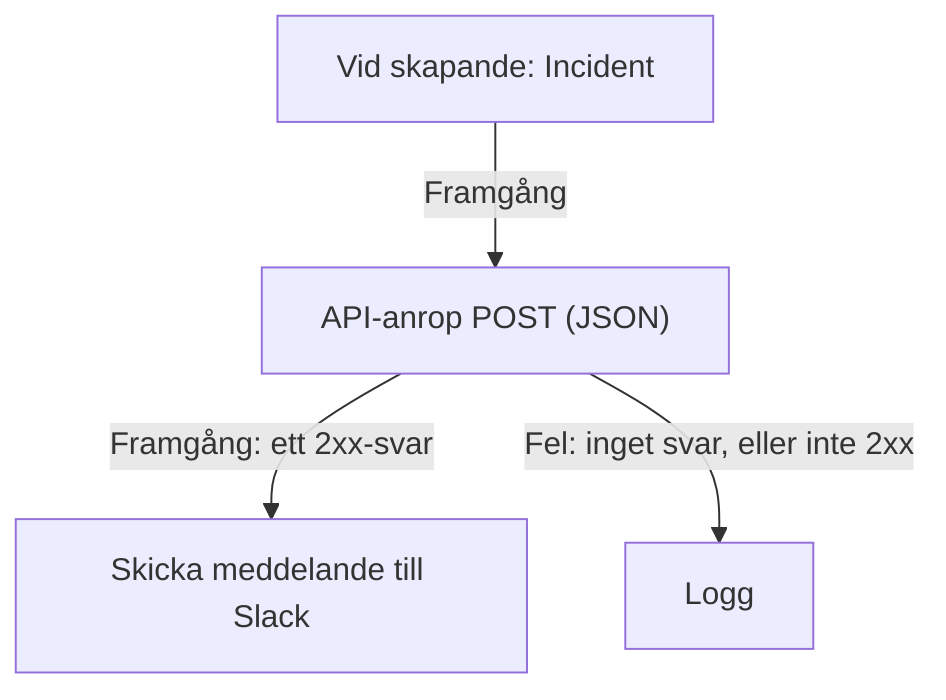

# Arbetsflödeskomponenter

Komponenter är de block du lägger till efter utlösaren. Var och en gör en sak — skickar ett meddelande, anropar ett API, kontrollerar ett villkor, ändrar en OneUptime-post — och tar sedan en av sina utgångar till de block som är kopplade till den. Den här sidan är katalogen: vad varje block behöver, vad det returnerar och när det tar varje utgång.

Du behöver sällan ha den öppen medan du bygger. Varje blocks inställningar slutar med **How to use**: vad blocket gör, stegen för att konfigurera det, ett exempel byggt utifrån ditt eget arbetsflöde och de misstag folk ofta gör. Se [Skapa ett arbetsflöde](/docs/workflows/authoring) för att lägga till och koppla ihop block.

:::cards
- [Skicka ett meddelande](#slack): Slack, Microsoft Teams, Discord, Telegram, IRC, Mattermost och e-post.
- [Anropa ett API](#api): Skicka en förfrågan till valfritt HTTP-API och läs svaret.
- [Lägg till logik](#conditions): Förgrena på ett värde, omforma data, vänta eller logga.
- [Arbeta med OneUptime-poster](#oneuptime-datakomponenter): Hitta, skapa, uppdatera och ta bort monitorer, incidenter och mer.
:::

## Vilken komponent ska jag använda?

| För att …                                                     | Använd                                                            |
| ------------------------------------------------------------- | ----------------------------------------------------------------- |
| Posta i ett chattverktyg                                      | [Slack](#slack), [Microsoft Teams](#microsoft-teams), [Discord](#discord), [Telegram](#telegram), [IRC](#irc) eller [Mattermost](#mattermost) |
| Skicka e-post via din egen e-postserver                       | [Email](#email)                                                   |
| Larma en person, ett team eller den som har jour | [Paging](#paging) |
| Anropa vilket annat API som helst, eller din egen tjänst      | [API](#api)                                                       |
| Sammanfatta, klassificera eller skriva utkast till text       | [Generate Text with AI](#generate-text-with-ai)                   |
| Ta den ena eller andra vägen beroende på ett värde            | [Conditions](#conditions)                                         |
| Ta en av flera vägar beroende på ett värde                    | [Switch / Case](#switch-case)                                     |
| Fortsätta bara när några rader JavaScript säger det           | [Check With JavaScript](#check-with-javascript)                   |
| Omforma data mellan två block                                 | [JSON](#json) eller [Custom Code](#custom-code)                   |
| Vänta före nästa block                                        | [Sleep](#sleep)                                                   |
| Starta ett annat arbetsflöde                                  | [Execute Workflow](#execute-workflow)                             |
| Läsa eller ändra incidenter, monitorer och andra poster       | [OneUptime-datakomponenter](#oneuptime-datakomponenter)           |
| Öppna, bekräfta och lösa incidenter eller larm för ett annat verktygs problem | [Incidenter och larm från andra verktyg](#incidenter-och-larm-från-andra-verktyg) |
| Bekräfta eller stänga ett Zabbix-problem                      | [Zabbix](#zabbix)                                                 |
| Be en person godkänna en åtgärd i ett OpenStack-moln          | [Propose an OpenStack fix](#propose-an-openstack-fix)             |

Ett dedikerat block slår ett generiskt: Slack-blocket känner till Slacks gränser och ett postblock känner till postens fält, så du får tydligare fel och loggar än från ett **API**-block som gör samma jobb.

## Så fungerar varje block

Ett block körs när blocket före det tar den utgång som är kopplad till det. Det läser sina inställningar, gör sitt jobb och tar sedan en av sina utgångar. Bara de block som är kopplade till den utgången körs därefter.



- **Inställningar** är det du fyller i. Inställningar märkta **(Valfritt)** kan lämnas tomma. Mindre använda inställningar är hopfällda under **Fler fält**.
- **Utdata** är punkterna på den nedre kanten. De flesta block har **Framgång** och **Fel**; [Conditions](#conditions) har **Ja** och **Nej**, och [Switch / Case](#switch-case) har en för vart och ett av sina fall, plus **Standard**.
- **Returns** är de värden ett block lämnar vidare till senare block, som ett API:s **Svarstext**. Ett senare block läser ett med `{{local.components.<block ID>.returnValues.<value ID>}}`; knappen **{ }** i en inställning infogar det åt dig. Se [Variabler](/docs/workflows/variables#komponentoutput-data-från-tidigare-block).

Ett block som tar **Fel** lämnar felet vidare till blocken som är kopplade till **Fel**, och körningen fortsätter där. Är inget kopplat till **Fel** misslyckas körningen: det den annars höll på med körs vidare, sedan slutar den med statusen **Fel**, och blockets post under körningens **Steg** säger varför. En obligatorisk inställning som lämnats tom, eller en inställning som aldrig kan fungera, stoppar däremot körningen med ett fel.

## API

Gör en HTTP-förfrågan till valfri URL. Det finns ett block per metod: **API-anrop GET (JSON)**, **API-anrop POST (JSON)**, **API-anrop PUT (JSON)**, **API-anrop PATCH (JSON)** och **API-anrop DELETE (JSON)**.

| Inställning         | Vad den gör                                                                                                                          |
| ------------------- | ------------------------------------------------------------------------------------------------------------------------------------ |
| **URL**             | Adressen som ska anropas, `http` eller `https`.                                                                                      |
| **Begärandekropp**    | JSON:en som ska skickas. Vanligtvis är det bara `POST`-, `PUT`- och `PATCH`-förfrågningar som behöver en.                            |
| **Begärandehuvuden** | Headers som ska skickas med, som en API-nyckel. Under **Fler fält**. Deras värden döljs i körningens logg.                           |
| **Tillåt självsignerade certifikat** | Under **Fler fält**, av som standard. När den är på tar blocket vilket certifikat servern än visar, så ett självsignerat fungerar, men det kontrollerar varken värdnamnet eller giltighetsdatumen, och vem som helst på nätverksvägen kan läsa förfrågan, headers inräknade, och ändra svaret. |
| **CA-certifikat** | Under **Fler fält**, så länge **Tillåt självsignerade certifikat** är av. Certifikatet, i PEM, från den CA som signerade serverns certifikat, eller serverns eget när det är självsignerat. Blocket litar då bara på det certifikatet, och kontrollerar fortfarande värdnamnet och giltighetsdatumen. |

| Utgång      | När                                                                                            |
| ----------- | ---------------------------------------------------------------------------------------------- |
| **Framgång** | Servern svarade med en 2xx-status.                                                             |
| **Fel**   | Förfrågan misslyckades: servern gick inte att nå, eller den svarade med en annan status.       |

Oavsett vilket returnerar blocket **Svarsstatus**, **Svarshuvuden** och **Svarstext**, plus **Fel** med orsaken när det misslyckades. Läs ett fält i ett JSON-svar genom att lägga till dess namn i referensen, som i `{{local.components.api-get-1.returnValues.response-body.id}}`.

Ett block läser högst 10 MB av ett svar. Ett större svar läses inte: blocket tar **Fel**, med orsaken.

Omdirigeringar följs inte, så peka blocket mot adressen som svarar. Förfrågningar skickas från OneUptime: en URL som pekar på en privat nätverksadress avvisas om inte en administratör för en självhostad installation tillåter det, och körningen stoppas med orsaken. Se [Utgående nätverksåtkomst](/docs/workflows/configuration#utgående-nätverksåtkomst).

En server vars certifikat den själv har signerat, eller som din egen CA har signerat, avvisas tills blocket litar på den: blocket tar **Fel**, inget skickas, och **Fel** säger vad du ska ändra. Klistra in certifikatet som signerade det i **CA-certifikat**: CA:ns, eller serverns eget när det är självsignerat. Blocket kontrollerar då serverns certifikat mot det, värdnamn och giltighetsdatum inräknade, så en server som bara utger sig för att vara din avvisas fortfarande. Slå på **Tillåt självsignerade certifikat** bara när du inte kan klistra in ett. Båda gäller bara det här blockets förfrågan, aldrig ett annat block, en annan förfrågan från OneUptime eller anslutningen till en utgående proxy. En server med ett sådant certifikat finns oftast i ditt eget nätverk, som blocket bara når om en administratör för en självhostad installation tillåter privata nätverksadresser, som ovan.

**API-anrop GET efter ID (JSON)** läser ett objekt utifrån ett ID som kom någon annanstans ifrån, till exempel ärendenyckeln som en webhook skickade. Sätt `{id}` i dess **URL** där ID:t ska stå, som i `https://your-domain.atlassian.net/rest/api/3/issue/{id}`, och ID:t i **ID**. Blocket sätter bara in ID:t när det är ett enkelt ID, högst 200 bokstäver, siffror, bindestreck och understreck, och procentkodar det ändå: allt annat, till exempel `x/../users`, tar **Fel** innan någon förfrågan skickas, så att text utifrån inte kan skicka förfrågan någon annanstans. I övrigt fungerar det som **API-anrop GET (JSON)** och returnerar samma värden.

## AI

### Generate Text with AI

Generera ett textsvar utifrån en prompt och valfri JSON-kontext. Blocket använder projektets standard-LLM-leverantör, eller installationens globala leverantör när projektet inte har någon. Leverantörer konfigureras centralt under **Projektinställningar → AI → LLM-leverantörer**; deras nycklar och slutpunkter är aldrig inställningar på blocket.

| Inställning               | Vad den gör                                                                                                                                                       |
| ------------------------- | ----------------------------------------------------------------------------------------------------------------------------------------------------------------- |
| **Systeminstruktioner**   | Valfri vägledning om modellens roll, ton och begränsningar.                                                                                                      |
| **Prompt**                | Uppgiften. Den skickas exakt som du skriver den, så Markdown går bra, och den kan innehålla variabler och värden från tidigare block.                              |
| **Kontext**               | Valfri JSON som du medvetet skickar med. Den läggs till efter en tydlig markering för meddelandets slut och behandlas som opålitliga data.                         |
| **Temperatur**           | Under **Fler fält**. Variation från `0` till `1`; standardvärdet är `0.2`, för förutsägbar automatisering. Aktuella Claude-modeller, Opus 4.7 och senare och alla Claude 5-modeller, väljer själva sin sampling: OneUptime utelämnar **Temperatur** från deras förfrågningar, så den har ingen effekt på dem. |
| **Högsta antal utdatatokens** | Under **Fler fält**. Från `1` till `4096`; standardvärdet är `1024`.                                                                                             |

System Instructions, Prompt och den serialiserade Context är tillsammans begränsade till 50 000 tecken. En bild som är inbäddad i dem som base64, som en skärmbild från en syntetisk monitor i en incidents beskrivning, ersätts med en kort anteckning som `[image omitted: PNG, 340 KB]` innan de mäts, eftersom modellen läser text, inte bilder. Körningens logg säger vad som utelämnades. Förfrågan till leverantören varar högst 60 sekunder och görs en gång. Högst tre AI-förfrågningar från arbetsflöden kan köras samtidigt per projekt.

Det returnerar **Svar** (den genererade texten), **Leverantör** och **Modell** (det som svarade), **Totalt antal tokens** och **Slutförandetokens** (förbrukningen som leverantören rapporterade), **LLM-logg-ID** (anropets post i AI-loggarna) och **Fel**.

Koppla **Framgång** till de block som använder svaret och **Fel** till en reservlösning: fel i validering, åtkomst, leverantör, budget, fakturering och tidsgräns tar alla den vägen. Blocket skickar inga verktyg, så modellen kan inte själv fråga OneUptime, anropa API:er eller ändra data.

> [!WARNING]
> Modellens utdata är opålitlig text. Granska den innan den når kunder, och låt aldrig fri AI-text ensam avgöra en destruktiv åtgärd. Se [AI-komponenter](/docs/workflows/configuration#ai-komponenter) för vad som skickas till leverantören, vad som loggas och vad det kostar.

## Slack

Posta ett meddelande i en Slack-kanal via en inkommande webhook.

| Inställning                    | Vad den gör                                                                                                                                                                                                  |
| ------------------------------ | ------------------------------------------------------------------------------------------------------------------------------------------------------------------------------------------------------------ |
| **URL för inkommande webhook i Slack** | Webhooken för kanalen som det ska postas i. Den måste börja med `https://hooks.slack.com/services/`. Slacks guide för att [skapa en](https://api.slack.com/messaging/webhooks) tar några minuter.            |
| **Meddelandetext**               | Texten som ska skickas. Den skickas exakt som du skriver den, så använd Slacks egen formatering: `*bold*`, `_italic_`, `~strikethrough~` och `<https://example.com|a link>`. En text som är längre än ett Slack-avsnitt (3 000 tecken) skickas som flera; bortom tio avsnitt kapas den och slutar med "… (truncated — see OneUptime for the full text)". |

**Framgång** aktiveras när Slack tog emot meddelandet och **Fel** när Slack avvisade det, med Slacks orsak i **Fel**. De här blocken postar via webhooken i sina inställningar, inte via ditt projekts Slack-koppling.

## Microsoft Teams

Posta ett meddelande i en Microsoft Teams-kanal. Blocket heter **Skicka meddelande till Teams**.

| Inställning                    | Vad den gör                                                                                                                                                                                                                                   |
| ------------------------------ | --------------------------------------------------------------------------------------------------------------------------------------------------------------------------------------------------------------------------------------------- |
| **Teams-webhook-URL för inkommande meddelanden** | Webhooken för kanalen som det ska postas till, en `https`-URL på `office.com`, `office365.com`, `logic.azure.com` eller `environment.api.powerplatform.com`. Microsofts guide visar hur du [skapar en med Teams Workflows](https://support.microsoft.com/en-us/teams/apps-service/create-incoming-webhooks-with-workflows-for-microsoft-teams). |
| **Meddelandetext**               | Texten som ska skickas. Ett meddelande som är större än vad en inkommande webhook tar emot (ungefär 12 000 tecken, mätt som det skickas) kapas och slutar med "… (truncated — see OneUptime for the full text)".                               |

## Discord

Posta ett meddelande i en Discord-kanal via en inkommande webhook.

| Inställning                      | Vad den gör                                                                                                                                        |
| -------------------------------- | -------------------------------------------------------------------------------------------------------------------------------------------------- |
| **Discord-webhook-URL för inkommande meddelanden** | Kanalens webhook, en `https`-URL på `discord.com` eller `discordapp.com`.                                                                          |
| **Meddelandetext**                 | Texten som ska skickas. Ett meddelande på mer än 2 000 tecken, Discords gräns, kapas och slutar med "… (truncated — see OneUptime for the full text)". |

## Telegram

Skicka ett meddelande till en Telegram-chatt med en bot.

| Inställning            | Vad den gör                                                                                                                                        |
| ---------------------- | -------------------------------------------------------------------------------------------------------------------------------------------------- |
| **Telegram-bottoken** | Token som BotFather gav din bot, som `123456789:ABCdef…`. En token i någon annan form stoppar körningen, utan att token skrivs i loggen.           |
| **Chatt-ID**            | Chatten som det ska postas i: dess ID, eller en kanals `@username`. Lägg först till boten i gruppen eller kanalen. För att skriva till en person måste personen ha startat en chatt med boten. |
| **Meddelandetext**       | Texten som ska skickas. Ett meddelande på mer än 4 096 tecken, Telegrams gräns, kapas och slutar med "… (truncated — see OneUptime for the full text)". |

När Telegram avvisar meddelandet aktiveras **Fel** med Telegrams orsak.

## IRC

Posta ett meddelande i en IRC-kanal på valfritt IRC-nätverk: Libera.Chat, OFTC eller din egen server. IRC har inga webhooks, så blocket ansluter självt till servern, går in i kanalen, skickar meddelandet och lämnar den igen.

| Inställning      | Vad den gör                                                                                                                                                                                                                                        |
| ---------------- | -------------------------------------------------------------------------------------------------------------------------------------------------------------------------------------------------------------------------------------------------- |
| **IRC-server**   | Serverns värdnamn, som `irc.libera.chat`. Bara namnet: ingen `ircs://` och ingen port.                                                                                                                                                             |
| **Kanal**      | Kanalen som det ska postas i, som `#ops`. Det måste vara en kanal: ett smeknamn som skrivs här avvisas i stället för att få ett privat meddelande.                                                                                                  |
| **Meddelandetext** | Texten som ska skickas. Varje rad skickas som ett eget IRC-meddelande, och en lång rad delas så att den får plats. Ett meddelande skickas som högst 15 IRC-rader: ett längre kapas, och dess sista rad säger det. IRC har ingen Markdown, så texten skickas som den är skriven; IRC:s egna formateringskoder, som fetstil och färger, fungerar. |

Under **Fler fält**:

| Inställning                              | Vad den gör                                                                                                                                                                                                        |
| ---------------------------------------- | ------------------------------------------------------------------------------------------------------------------------------------------------------------------------------------------------------------------ |
| **Smeknamn**                             | Vem meddelandet kommer från. Standard är `OneUptime`. Är smeknamnet upptaget provar blocket det med ett understreck eller en siffra tillagd, och sedan med ett sådant tecken i stället för de sista tecknen, för en server som inte tar ett längre smeknamn. |
| **Port**                                 | Serverns port. Standard är `6697`, eller `6667` med **Inaktivera TLS** påslaget.                                                                                                                                      |
| **Inaktivera TLS**                          | Blocket ansluter över TLS och kontrollerar serverns certifikat. Slå på det här bara för en server som inte erbjuder TLS; ett eventuellt lösenord skickas då okrypterat. För att lita på ett certifikat från din egen certifikatutfärdare sätter en självhostad installation i stället `NODE_EXTRA_CA_CERTS`. |
| **Kanalnyckel**                          | Nyckeln till en kanal som har en (läge `+k`).                                                                                                                                                                      |
| **Skicka utan att gå med**                 | Postar utan att gå in i kanalen, så att kanalen inte ser blocket komma och gå. Fungerar bara där kanalen tar emot meddelanden utifrån (inget läge `+n`).                                                           |
| **Serverlösenord**                      | Ett lösenord som servern eller din bouncer ber om vid anslutning.                                                                                                                                                  |
| **SASL-användarnamn** och **SASL-lösenord**  | Logga in på ditt konto på nätverk som använder SASL, som Libera.Chat, som kräver det för anslutningar från vissa moln- och VPN-adresser. Fyll i båda eller ingen.                                                    |

**Framgång** aktiveras när servern har tagit emot varje rad. Blocket kontrollerar det genom att be servern svara på en ping efter den sista raden: en server svarar i ordning, så en eventuell avvisning av meddelandet kommer först. En bouncer som ZNC svarar själv på pingen, så blocket lyssnar en sekund längre efter svaret från nätverket bakom den.

**Fel** aktiveras när servern inte går att nå, avvisar anslutningen, smeknamnet, ett lösenord eller kanalen, eller avvisar meddelandet. Den lämnar vidare orsaken, med serverns egna ord där den gav sådana. En saknad **IRC-server**, **Kanal** eller **Meddelandetext**, eller en inställning som aldrig skulle kunna fungera, stoppar däremot körningen.

Varje körning av blocket är en egen anslutning, och IRC-nätverk begränsar hur ofta en adress får ansluta: en skur av meddelanden kan avvisas med en orsak som "Reconnecting too fast" och tar **Fel** som vilken annan avvisning som helst. För ett arbetsflöde som kan aktiveras många gånger i minuten samlar du det det har att säga i ett meddelande, eller skickar det via din egen server.

Förvara lösenorden i [hemliga globala variabler](/docs/workflows/variables#globala-variabler) och använd variabeln i inställningen; de döljs i körningsloggarna oavsett. Anslutningar till loopback- (`localhost`, `127.0.0.1`), link-local- och molnmetadata-adresser avvisas. I OneUptime Cloud avvisas även en server på en privat nätverksadress, eller ett namn som pekar på en. Självhostade installationer kan nå en IRC-server på sitt eget nätverk, om inte `DATA_SOURCE_BLOCK_PRIVATE_ADDRESSES` är satt till `true`.

## Mattermost

Posta ett meddelande i en Mattermost-kanal via en inkommande webhook, i Mattermost Cloud eller på din egen server.

| Inställning                         | Vad den gör                                                                                                                                                                                                                                                                        |
| ----------------------------------- | ---------------------------------------------------------------------------------------------------------------------------------------------------------------------------------------------------------------------------------------------------------------------------------- |
| **Mattermost-webhook-URL för inkommande meddelanden** | Webhooken som det ska postas via, så som Mattermost visar den under Integrations, Incoming Webhooks: serverns adress, sedan `/hooks/` och webhookens ID. Mattermosts guide visar hur du [skapar en](https://docs.mattermost.com/developers/integrate/webhooks/incoming).           |
| **Meddelandetext**                    | Texten som ska skickas. Den skickas exakt som du skriver den, och Mattermost förstår Markdown: `**bold**`, `_italic_`, länkar, tabeller och emojier som `:rotating_light:`. Ett Mattermost-inlägg rymmer 16 383 tecken: ett längre meddelande kapas så att det får plats och slutar med "… (truncated — see OneUptime for the full text)". |

Under **Fler fält**:

| Inställning  | Vad den gör                                                                                                                                                                                                   |
| ------------ | ------------------------------------------------------------------------------------------------------------------------------------------------------------------------------------------------------------- |
| **Kanal**  | Postar någon annanstans än i webhookens egen kanal: kanalens namn så som det står i dess URL, till exempel `town-square`, eller `@` och ett användarnamn för att skicka ett direktmeddelande. En webhook som är låst till sin kanal avvisar alla andra. |
| **Användarnamn** | Namnet som det ska postas under. Mattermost använder det bara där en systemadministratör låter integrationer åsidosätta användarnamn.                                                                         |
| **Ikon-URL** | Bilden som det ska postas med, en `https`-adress. Mattermost använder den bara där en systemadministratör låter integrationer åsidosätta profilbilder.                                                        |

**Framgång** aktiveras när Mattermost tog emot meddelandet. **Fel** aktiveras när servern inte går att nå eller Mattermost avvisar meddelandet, och lämnar vidare Mattermosts orsak. En saknad **Mattermost-webhook-URL för inkommande meddelanden** eller **Meddelandetext**, en URL som inte tillhör en inkommande webhook, eller en inställning som aldrig skulle kunna fungera, stoppar däremot körningen.

Förvara webhook-URL:en i en [hemlig global variabel](/docs/workflows/variables#globala-variabler): alla som har den kan posta i kanalen. Den döljs i körningsloggarna oavsett. Meddelandet skickas från OneUptime, och en omdirigering följs inte. En webhook på en loopback- (`localhost`, `127.0.0.1`), link-local- eller molnmetadata-adress avvisas, och det gör även en webhook på en privat nätverksadress, om inte en administratör för en självhostad installation tillåter det med `ALLOW_PRIVATE_NETWORK_WEBHOOKS` eller `PRIVATE_NETWORK_WEBHOOK_ALLOWLIST`. Se [Åtkomst till privat nätverk](/docs/self-hosted/private-network-access).

## Email

Skicka ett e-postmeddelande via en SMTP-server som du anger på blocket. Blocket heter **Skicka e-post**.

| Inställning                             | Vad den gör                                                                                           |
| --------------------------------------- | ----------------------------------------------------------------------------------------------------- |
| **E-post från**                          | Avsändaren, till exempel `Alerts <alerts@company.com>`.                                               |
| **Till e-post**                            | Mottagarens adress. Separera flera adresser med kommatecken eller semikolon.                          |
| **Ämne**                             | Ämnesraden.                                                                                           |
| **E-postinnehåll**                          | Meddelandet, skickat som HTML.                                                                        |
| **SMTP-värd** och **SMTP-port**         | E-postservern att ansluta till.                                                                       |
| **SMTP-användarnamn** och **SMTP-lösenord** | Valfria. Fyll i båda eller ingen.                                                                     |
| **Använd implicit TLS**                    | Slå på för implicit TLS, vanligtvis på port 465. Låt den vara av för STARTTLS, vanligtvis på port 587. |

**Framgång** aktiveras när SMTP-servern tog emot meddelandet. **Fel** aktiveras när SMTP-värden avvisas, servern inte går att nå eller den avvisar meddelandet, och lämnar vidare felmeddelandet. En saknad **Till e-post**, **E-post från**, **SMTP-värd** eller **SMTP-port** stoppar däremot körningen.

Blocket ansluter direkt till servern i sina inställningar. Det använder inte ditt projekts [SMTP](/docs/emails/smtp)-inställningar eller OneUptimes egen e-postserver, och e-postmeddelandena det skickar visas inte i aviseringsloggarna. För att kontrollera vad det gjorde tittar du på arbetsflödets [Körningar](/docs/workflows/runs-and-logs).

Anslutningar till loopback- (`localhost`, `127.0.0.1`), link-local- och molnmetadata-adresser avvisas. I OneUptime Cloud avvisas även en SMTP-värd på en privat nätverksadress, eller ett namn som pekar på en. Självhostade installationer kan nå en e-postserver på sitt eget nätverk, om inte `DATA_SOURCE_BLOCK_PRIVATE_ADDRESSES` är satt till `true`. En avvisad värd tar utgången **Fel**, och inget skickas.

## Paging

Larma personer från ett arbetsflöde: varje person får ett samtal, ett sms, en pushavisering eller ett e-postmeddelande, så som personens egna jourregler säger, tills någon bekräftar. Det finns ett block för varje sätt att säga vem som ska larmas. Sök efter `page` i panelen **Lägg till komponent**.

| Block                       | Vem det larmar |
| --------------------------- | -------------- |
| **Larma användare**              | De personer du anger. |
| **Larma ett team**             | Varje medlem i ett team. |
| **Larma den som har jour** | Den som har jour i ett jourschema när blocket körs. |
| **Starta en jourpolicy**  | En jourpolicy, som larmar genom sina eskaleringsregler och upprepas så som den är inställd. |

De tre första larmar alla de anger samtidigt, och ingen annan därefter. Använd **Starta en jourpolicy** för eskalering.

Vill du bara larma när något är sant sätter du [If / Else](#conditions) framför blocket och kopplar utgången som ska larma till det. Med fler än två vägar tar [Switch / Case](#switch-case) en väg för varje värde, och varje väg kan larma någon annan.

```mermaid title="Larma den som har jour, men bara vid kritiska incidenter"
flowchart TB
    trigger["Vid skapande: Incident"] -->|"Framgång"| check["Om / Annars"]
    check -->|"Ja"| page["Larma den som har jour"]
```

När du skapar ett arbetsflöde har mallarna under **Jour** det här färdigt, och ett som larmar efter allvarlighetsgrad med **Val / Fall**. Dialogen **Skapa ett arbetsflöde** frågar vem vart och ett av en malls larmblock larmar, så att arbetsflödet öppnas med det valt. Ett larmblock som du lägger till i Byggaren säger **Click to set up** tills du väljer vem det larmar.

| Inställning | Vad den gör |
| ----------- | ----------- |
| **Användare**, **Team**, **Jourscheman** eller **Jourpolicyer** | Vem som larmas: varje block har den som hör till dess namn. Välj efter namn, eller tryck på **{ }** i slutet av raden för att lägga till ett värde från ett tidigare block. Ett värde kan innehålla ett ID eller flera och, för **Användare**, en e-postadress. |
| **Larmet gäller** | Vad larmet gäller: **Ett nytt larm**, **En incident** eller **Ett larm**. Att bekräfta larmet bekräftar också det. |
| **Titel** och **Meddelande** | För ett nytt larm. OneUptime skapar ett larm av dem, och det finns kvar bland dina larm som alla andra. |
| **Incident-ID** eller **Larm-ID** | För en incident eller ett larm som redan finns, oftast det som arbetsflödet startade på: `{{local.components.incident-on-create-1.returnValues.model._id}}`. |
| **Larma som** | För en incident eller ett larm som redan finns, under **Fler fält**. **Mottagare** tar sig an den. **Observatörer** hålls informerade medan andra hanterar den: när de bekräftar sitt larm betyder det bara att de har sett det, och incidenten eller larmet bekräftas inte. |
| **Allvarlighetsgrad** | För ett nytt larm, under **Fler fält**. Den avgör vilka av varje persons jourregler som larmar personen. Lämnas den tom är det projektets allvarligaste. |

Ett block som läggs till i ett arbetsflöde som startar på en incident eller ett larm är redan inställt på att larma om den posten, så det frågar bara vem som ska larmas.

**Framgång** körs så snart minst en person har larmats, eller en policy har startat. **Fel** körs när ingen larmades, och blockets värde **Fel** säger varför, till exempel att ingen har jour i schemat. **Sammanfattning** säger i en mening vem som larmades och vem som utelämnades, färdig att lägga upp i en kanal, och **Larmade användare** listar de personer som larmades.

Den som är borta larmas inte: i stället larmas den som personens användaråsidosättning anger som ersättare. Den som en jourpolicy eller en annan utlarmning redan larmar om det larmas inte en gång till, och står ändå kvar under **Larmade användare**: slutar den utlarmningen utan personens svar, larmar blockets utlarmning personen själv. En utlarmning anger högst 100 personer, team och scheman. Se [Så nås varje person](/docs/on-call/escalation-rules#så-nås-varje-person).

En utlarmning utan jourpolicy bakom sig står bland policyernas körningar som **Direkt utlarmning**: i jourloggarna för incidenten eller larmet, i dess flöde och dess Slack- eller Microsoft Teams-kanal, och i loggarna hos varje person som larmades. Den är öppen i 30 minuter, och därefter så länge larm fortfarande går ut. Har ingen bekräftat då avslutas den utan att larma någon annan.

> [!WARNING]
> **Kör arbetsflöde** larmar personer på riktigt, oavsett om arbetsflödet är på eller av, och det gör **Run just this step** också. Ange dig själv medan du testar.

## Custom Code

Kör några rader JavaScript när de andra blocken inte kan göra det du behöver. Blocket heter **Kör egen JavaScript**.

| Inställning         | Vad den gör                                                                                                                          |
| ------------------- | ------------------------------------------------------------------------------------------------------------------------------------ |
| **JavaScript-kod** | Din kod. Det den returnerar med `return` blir blockets **Värde**. Den kan använda `await`.                                          |
| **Argument**       | Ett JSON-objekt med värden till koden, som läser dem som `args`. Lägg variabler och värden från tidigare block här; själva koden kan inte läsa dem. |

```json title="Arguments"
{ "title": "{{local.components.incident-on-create-1.returnValues.model.title}}" }
```

```javascript title="JavaScript Code"
const words = args.title.split(" ");

return {
  shortTitle: words.slice(0, 5).join(" "),
  wordCount: words.length,
};
```

Ett senare block läser den korta titeln som `{{local.components.javascript-1.returnValues.returnValue.shortTitle}}`.

Koden körs i en sandlåda med `args`, `console.log` (skrivs till körningens logg), `axios` för HTTP-förfrågningar, `crypto` och `sleep`. Den har inget filsystem och ingen process, och dess förfrågningar följer samma adressregler som API-blocket. Den har 5 sekunder som standard; en självhostad installation ändrar det med `WORKFLOW_SCRIPT_TIMEOUT_IN_MS`.

**Framgång** aktiveras med det returnerade **Värde**, och **Fel** när koden kastar ett fel eller får slut på tid, med meddelandet i **Fel**. För tyngre skript använder du i stället en [Runbook](/docs/runbooks/index).

## Check With JavaScript

Kör några rader JavaScript och ta sedan **Ja** eller **Nej** efter vad de returnerar: ett [Custom Code](#custom-code)-block och ett [If / Else](#conditions) efter det, i ett enda block. Använd det när en enda jämförelse inte räcker för att avgöra, till exempel för att läsa vad ett annat verktyg skickade och hoppa över det som arbetsflödet ska låta vara.

| Inställning         | Vad den gör |
| ------------------- | ----------- |
| **JavaScript-kod** | Din kod. `return true` tar **Ja**. För att också lämna vidare värden returnerar du ett objekt med `proceed: true`, värdena och en `reason`. |
| **Argument**       | Ett JSON-objekt med värden till koden, som läser dem som `args`, som i **Kör egen JavaScript**. |

```javascript title="JavaScript Code"
if (args.environment !== "production") {
  return { proceed: false, reason: "Not production, so nothing was sent." };
}

return { proceed: true, title: args.title.toUpperCase() };
```

Bara `true`, eller ett objekt vars `proceed` är `true`, tar **Ja**: allt annat tar **Nej**, även ett tal eller en text. Blocket returnerar **Värde**, det koden returnerade, som ett senare block läser som `{{local.components.javascript-check-1.returnValues.returnValue.title}}`, och **Orsak**, kodens `reason` eller det den returnerade, i en mening, som körningens flik **Steg** visar bredvid utgången som togs.

Koden körs som **Kör egen JavaScript** kör den: i samma sandlåda, med samma `args`, `console.log` och `axios`, och med samma tidsgräns. När den kastar ett fel eller får slut på tid tar blocket **Fel**.

## JSON

Konvertera mellan text och JSON, eller kombinera två JSON-objekt.

| Block            | Tar                                      | Returnerar                                                                                                 |
| ---------------- | ---------------------------------------- | ---------------------------------------------------------------------------------------------------------- |
| **JSON till text** | **JSON**, ett objekt                     | **Text**: objektet som en sträng. Praktiskt när nästa block förväntar sig text.                            |
| **Text till JSON** | **Text**, som kan sträcka sig över flera rader | **JSON**: det tolkade objektet, så att du kan läsa dess fält. Använd det på JSON som kom som text.   |
| **Slå ihop JSON**   | **JSON 1** och **JSON 2**                | **JSON**: ett objekt med nycklarna från båda. Där båda har en nyckel vinner **JSON 2**.                    |

**Text till JSON** tar **Fel** när texten inte är JSON. En saknad indata, eller en indata till **Slå ihop JSON** som inte är ett objekt, stoppar körningen.

## Conditions

Förgrena på en jämförelse. I panelen **Lägg till komponent** heter det här blocket **Om / Annars**, under **Populära**. Använd [Switch / Case](#switch-case) för att välja mellan fler än två vägar.

Dess inställningar läses som en mening: **Om** *värde att kontrollera* *jämförelse* *värde att jämföra med*, fortsätt på **Ja**, annars på **Nej**. Under inställningarna läses villkoret upp i ord, så att du kan se att det säger det du menar. På arbetsytan visar blocket också sitt villkor, till exempel *Om environment is equal to “production”*.

| Inställning        | Vad den gör                                                                                                                              |
| ------------------ | ---------------------------------------------------------------------------------------------------------------------------------------- |
| **Värde att kontrollera** | Vanligtvis ett värde från ett tidigare block. Tryck på **{ }** i fältet för att välja ett, eller skriv `{{`.                             |
| **Jämförelse**     | Hur det ska jämföras, i ord. Jämförelserna står nedan.                                                                                   |
| **Jämför med**   | Det som ska jämföras med, skrivet eller valt på samma sätt. **är tom**, **är inte tom**, **är sant** och **är falskt** använder det inte.   |
| **Jämför som**     | Hopfällt under jämförelsen: **Text**, **Tal** eller **Sant / Falskt**. Välj **Text** för att sortera datum skrivna `2026-10-01`, eller **Tal** för att göra `200` och `200.0` lika. |

Jämförelserna:

- **är lika med** och **är inte lika med**;
- för text: **innehåller**, **innehåller inte**, **börjar med** och **slutar med**;
- för tal: **är större än**, **är större än eller lika med**, **är mindre än** och **är mindre än eller lika med**;
- **är tom** och **är inte tom**, som kontrollerar om värdet över huvud taget finns;
- **är sant** och **är falskt**.

Taljämförelserna jämför tal och textjämförelserna jämför text, så du behöver sällan **Jämför som**. Så här jämförs värdena:

- Som text spelar versaler roll: `Error` är inte `error`.
- Som tal räknas text som inte är ett tal som `0`. Inställningarna påpekar ett sådant skrivet värde.
- Som sant eller falskt räknas bara `true` som sant.
- **är tom** uppfylls av ingenting alls, tom text, en tom lista eller ett tomt objekt, eller ett värde som det tidigare blocket inte hade, som ett fält som webhooken inte skickade. `0` och `false` är värden, så de är inte tomma.

**Ja** körs när villkoret är uppfyllt och **Nej** när det inte är det. Block som ställdes in innan inställningarna fick de här namnen körs exakt som tidigare. Ett gammalt val erbjuds inte längre: att jämföra ett värde som **Null** eller **Odefinierat**, vilket ignorerade vad värdet innehöll. Ett block som fortfarande använder det säger det när du öppnar det; välj **är tom** för att kontrollera om ett värde saknas.

## Switch / Case

Ta en av flera vägar beroende på ett värde. I panelen **Lägg till komponent** heter det här blocket **Val / Fall**, under **Populära**.

Det jämför ett värde med vart och ett av sina fall i tur och ordning, uppifrån, och fortsätter längs det första fallet som matchar, eller längs **Standard** när inget matchar. Bara en väg körs: ett värde som matchar två fall tar det första av dem.

| Inställning        | Vad den gör |
| ------------------ | ----------- |
| **Värde att kontrollera** | Värdet som varje fall jämförs med, vanligtvis från ett tidigare block. Tryck på **{ }** i fältet för att välja ett, eller skriv `{{`. |
| **Fall**          | En jämförelse och ett värde för varje väg, kontrollerade uppifrån. Tryck på **Lägg till fall** för att lägga till ett till, och dra ett fall i dess handtag för att flytta det. Ett block rymmer högst 25 fall. |

Varje fall är en utgång på arbetsytan, uppkallad efter sitt värde: ett fall som frågar **är lika med** `production` är utgången *production*, och ett som frågar **är större än** `500` är *is greater than 500*. **Standard** är alltid den sista utgången. Koppla varje utgång till det som ska köras härnäst.

Ett fall matchar exakt när ett [If / Else](#conditions) med samma jämförelse och värde skulle ta **Ja**: jämförelserna är desamma, och värdena jämförs på samma sätt. **Jämför som** är hopfällt under fallen, med ett val för varje fall.

När du tar bort ett fall som har en koppling visar inställningarna vilka block det ledde till, och **Återställ** tar tillbaka fallet. När du sparar tas kopplingen bort tillsammans med fallet. Byggarens kontroller påpekar ett fall som inget är kopplat till, och ett fall som aldrig väljs eftersom ett fall ovanför frågar samma sak.

En körning som tar en utgång som inget är kopplat till, **Standard** inräknad, slutar där utan fel. Körningens flik **Steg** visar vilket fall som matchade och varför, till exempel *Case 2 matched: the value is equal to “staging”. Case 1 did not.*

## Sleep

Pausa körningen före nästa block, för att ge ett annat system en stund att komma ikapp eller för att följa upp senare.

**Dagar**, **Timmar**, **Minuter** och **Sekunder** läggs ihop. Den längsta väntetiden är 30 dagar: en längre kortas till 30 dagar, och körningens logg säger det.

Medan den väntar läggs körningen åt sidan med statusen **Väntar** och plockas upp igen när tiden har gått, så en lång väntan håller inte upp något. En körning vars arbetsflöde under tiden stängdes av eller arkiverades avbryts när den vaknar. En testkörning, startad medan arbetsflödet var avstängt, avbryts inte för att det är avstängt.

## Log

Skriv ett värde till körningens logg. Det ändrar inget annat, vilket gör det till det enklaste sättet att se vad ett värde innehöll.

**Värde** är det som ska skrivas. Det kan sträcka sig över flera rader och innehålla värden från tidigare block, som `{{local.components.webhook-1.returnValues.request-body}}`. Blocket tar **Ut** när det är klart.

## Execute Workflow

Starta ett annat arbetsflöde i samma projekt. Ditt arbetsflöde fortsätter utan att vänta på att det andra blir klart.

| Inställning   | Vad den gör                                                                                                                               |
| ------------- | ----------------------------------------------------------------------------------------------------------------------------------------- |
| **Arbetsflöde**  | Arbetsflödet som ska startas. Det måste vara aktiverat och, för att ta emot argument, ha en **Manuell**-utlösare.                          |
| **Argument** | JSON som ska skickas med. Det andra arbetsflödets Manual-utlösare lämnar vidare varje nyckel som ett eget värde: med `{"customerId": "42"}` läser det `{{local.components.manual-1.returnValues.customerId}}`. |

**Ut** aktiveras så snart det andra arbetsflödet står i kö. **Fel** aktiveras när det inte går: det finns inte, är avstängt eller arkiverat, eller att starta det skulle ge en loop.

Använd det för att dela gemensam logik: bygg ett ”posta i incidentkanalen”-arbetsflöde en gång och starta det från varje arbetsflöde som behöver det. En kedja av arbetsflöden som startar varandra kan inte gå i cirkel tillbaka till sig själv och är högst 10 led djup. Se [Konfiguration och säkerhet](/docs/workflows/configuration#gräns-för-att-anropa-andra-arbetsflöden).

## Incidenter och larm från andra verktyg

Håll en incident, eller ett larm, för varje problem som ett annat verktyg berättar om, kopplat via verktygets eget ID för det. **Incident från ett annat verktyg** och **Larm från ett annat verktyg** är det som mallarna för Zabbix, Huntress, Jira och Dynamics 365 bygger på, och de fungerar för alla verktyg som kan anropa ett arbetsflödes [Webhook-trigger](/docs/workflows/triggers#webhook). I panelen **Lägg till komponent** ligger de under **Från andra verktyg**.

Varje körning ger blocket en händelse: **Vad som hände**, och **Externt ID**, verktygets ID för problemet. Blocket letar efter posten som har det ID:t och gör det som **Vad som hände** säger:

| What Happened | Vad blocket gör |
| ------------- | --------------- |
| `open`, `problem`, `firing`, `triggered` eller `created` | Öppnar en incident, eller skapar ett larm, utifrån **Titel**, **Beskrivning** och **Allvarlighetsgrad**, om inte en post redan har ID:t. |
| `acknowledge` eller `acknowledged` | Flyttar posten till ditt första bekräftade tillstånd, med **Anteckning** som orsak i dess historik. |
| `resolve`, `resolved`, `recovery`, `ok` eller `closed` | Flyttar posten till ditt första lösta tillstånd, med **Anteckning** som orsak i dess historik. |
| `note`, `update` eller `comment` | Lägger till **Anteckning** på posten som en privat anteckning. |
| Namnet på ett av dina tillstånd | Flyttar posten till det tillståndet. Skriv `state:` före ett namn som är ett av de här orden, till exempel `state: Open`. |

| Utgång | När |
| ------ | --- |
| **Öppnat**, eller **Skapad** på blocket för larm | Det öppnade en ny post. Koppla ett larmblock hit, så att bara ett nytt problem larmar någon. |
| **Uppdaterad** | Det flyttade posten till ett annat tillstånd eller lade till anteckningen. |
| **Oförändrad** | Det fanns inget att göra: ingen post har ID:t, posten är redan i det tillståndet eller längre fram, eller **Vad som hände** är tomt. |
| **Fel** | Det kunde inte läsa eller ändra posten. Är inget kopplat hit misslyckas körningen. |

En post rör sig bara framåt, och en löst post inte alls, så när båda verktygen ändrar den gör inget av dem om det som det andra gjorde. Den sparar ID:t i ett anpassat fält, `externalId` om inte **Fält för externt ID** nämner ett annat, och bara det fältet skrivs, så postens övriga anpassade fält behåller sina värden. Ett ID som en post har öppnas aldrig igen, inte ens när posten är löst: använd ett ID som är nytt för varje problem, som ett Zabbix-händelse-ID eller ett Huntress-rapportnummer är. För att i stället agera på en post utifrån dess eget ID, som Jira-mallarna gör med det ID som ett ärendes etiketter bär, sätter du det i **Incident-ID** eller **Larm-ID**.

**Allvarlighetsgrad** nämner en av dina allvarlighetsgrader vid namn eller ID, oavsett skiftläge, eller efter dess plats bland dem: `most severe`, `middle` eller `least severe`. Så fördelas ett verktygs egna nivåer över de allvarlighetsgrader som du själv har namngett. Lämnas den tom, eller nämner den ingen av dem, är det din allvarligaste, och körningens logg säger det. En ny incident hålls borta från dina statussidor, och deras prenumeranter får inget besked, eftersom ett annat verktygs text är skriven för det verktygets användare: slå på **Visa på statussidor** för att visa den.

Under **Fler fält** är **Orsak** orsaken i postens historik när den flyttas, och **Anteckning** läggs då till bredvid som en privat anteckning, för ett verktyg som säger något när det bekräftar eller löser. **Anpassade fält** ger en ny post fler anpassade fält, som ett JSON-objekt, **Etiketter** ID:na för dess etiketter, åtskilda med kommatecken, och **Berörda resurser** de resurser den handlar om, som på **Skapa Incident (en post)**. **Anteckning i stället för att lösa** lägger till anteckningen och låter ditt team lösa posten. Blocket returnerar **Sammanfattning**, det det gjorde, i en mening, och posten, så att ett senare block läser dess ID som `{{local.components.incident-from-another-tool-1.returnValues.record._id}}`.

## Zabbix

Bekräfta eller stäng ett problem i Zabbix, eller lägg till ett meddelande på det, via Zabbix API. Blocket heter **Uppdatera Zabbix-problem**, och [Zabbix-mallarna](/docs/integrations/zabbix) skickar med det tillbaka det som händer i OneUptime till Zabbix.

| Inställning | Vad den gör |
| ----------- | ----------- |
| **Zabbix-URL** | Adressen du öppnar Zabbix på, till exempel `https://zabbix.example.com`. Förfrågningar går till dess `api_jsonrpc.php`. |
| **API-token** | En API-token för en Zabbix-användare som får bekräfta, kommentera och stänga problem. Förvara den i en hemlig variabel. |
| **Händelse-ID** | Problemets händelse-ID, oftast det som en incident eller ett larm sparar i sina anpassade fält. |
| **Vad som ska göras** | `acknowledge`, `close` eller `message`. Lämnas den tom uppdateras inte Zabbix. |
| **Meddelande** | Det som Zabbix sparar på problemet, högst 2 048 tecken: ett längre meddelande kortas. |
| **Zabbix 6.0** | Under **Fler fält**. Zabbix 6.0 läser token från förfrågans body, inte från dess `Authorization`-header: slå på detta för den, och av igen när du uppgraderar, eftersom Zabbix 7.2 och senare avvisar en token i body. |

För att bekräfta eller stänga läser blocket problemet först. Ett problem som Zabbix redan har löst, eller redan har bekräftat när det är allt du ber om, lämnas som det är, och blocket tar **Oförändrad**, som det gör för ett problem som Zabbix inte har, eller som tokens användare inte kan se. Ett problem vars trigger inte tillåter att problem stängs manuellt bekräftas i stället, och dess meddelande säger att det förblir öppet tills Zabbix ser att det återhämtar sig.

**Uppdaterad** aktiveras när Zabbix tog emot uppdateringen, och **Fel** när Zabbix inte gick att nå eller avvisade den, med Zabbix motivering: Zabbix svarar på en avvisad förfrågan med en lyckad status, så blocket läser vad Zabbix svarade i stället för statusen. Det returnerar **Sammanfattning**, det det gjorde, i en mening.

## OpenStack

### Propose an OpenStack fix

Ber en person godkänna en ändring i det OpenStack-moln som ett larm eller en incident gäller. Blocket gör aldrig ändringen själv. Åtgärden väntar på larmet eller incidenten, och i de kanaler den postar i, som en OneUptime AI föreslår, oavsett molnets åtgärdsläge. Ett arbetsflöde kan inte godkänna det det föreslår.

Det behöver ingen AI-modell, och det följer samma regler som en åtgärd som OneUptime AI föreslår: kommandopolicyn, agentens skrivmål och skyddade mål, och agentens läsning av vad ändringen rör vid. En evakuering av en värd som fortfarande är uppe, eller en som agenten inte kan läsa i sin helhet, föreslås inte.

| Inställning | Vad den gör |
| ----------- | ----------- |
| **Larm-ID** | Larmet som åtgärden gäller, oftast det ID som din trigger returnerade. Fyll i antingen det här eller **Incident-ID**, så hämtas molnet från det som posten är länkad till. |
| **Incident-ID** | Incidenten som åtgärden gäller, oftast det ID som din trigger returnerade. Fyll i antingen det här eller **Larm-ID**. |
| **Kommando** | Ändringen som ska föreslås, i den enda stavning som OneUptime tar emot. Se [ändringarna en åtgärd kan göra](/docs/telemetry/openstack#åtgärder). Den kan använda värden från tidigare block, och läses efter att de har fyllts i. |
| **Varför** | Det som personen som godkänner den läser först. Om den lämnas tom anges vilket arbetsflöde som bad om den. |
| **OpenStack-moln-ID** | Under **Fler fält**. Bara för en post som är länkad till fler än ett moln, eller till inget. |

Det returnerar **Förslags-ID** (åtgärden som väntar på godkännande), **Nivå** (Safe eller Riskier, så som OneUptime läser kommandot) och **Väntar redan** (sant när samma ändring i det molnet redan väntade, så ingen andra lades till).

**Framgång** aktiveras när en person har blivit tillfrågad, utan att vänta på svaret. **Fel** aktiveras när inget föreslogs, med orsaken i **Fel**: kommandot nekas, åtgärder är inte tillåtna i det molnet ännu, eller ett projekts arbetsflöden har föreslagit 20 åtgärder den senaste timmen.

Mallen [Propose taking a failing OpenStack compute service out of scheduling](/docs/workflows/authoring) är ett ställe att börja på.

## OneUptime-datakomponenter

För varje typ av post i OneUptime (monitorer, incidenter, larm, statussidor, jourpolicyer och många fler) har panelen **Lägg till komponent** de här komponenterna: under **OneUptime-resurser** klickar du på posttypen (**Bläddra bland alla resurser** har de som inte visas), eller så söker du efter typens namn. Varje titel genereras utifrån posttypen, så uppsättningen för Monitor lyder:

| Komponent                | Vad den gör                                                                    |
| ------------------------ | ------------------------------------------------------------------------------ |
| **Hitta Monitor (en post)**     | Läser en post som matchar frågan.                                              |
| **Hitta Monitorer (flera poster)**   | Läser en lista med poster som matchar frågan.                                  |
| **Skapa Monitor (en post)**   | Lägger till en post utifrån ett JSON-objekt.                                   |
| **Skapa Monitorer (flera poster)** | Lägger till flera poster utifrån en JSON-array.                                |
| **Uppdatera Monitor (en post)**   | Tillämpar data som ska skrivas på en matchande post.                           |
| **Uppdatera Monitorer (flera poster)** | Tillämpar data som ska skrivas på matchande poster, upp till **Gräns**.        |
| **Ta bort Monitor (en post)**   | Tar bort en matchande post.                                                    |
| **Ta bort Monitorer (flera poster)** | Tar bort matchande poster, upp till **Gräns**.                                 |

Samma uppsättning ger dig fyra utlösare — **Vid skapande: Monitor**, **Vid uppdatering: Monitor**, **Vid skapande eller uppdatering: Monitor** och **Vid borttagning: Monitor**. Se [Utlösare](/docs/workflows/triggers#utlösare-för-oneuptime-händelser).

En typ erbjuder bara de komponenter som dess modell tillåter. En skrivskyddad typ har de två Find-komponenterna och inget annat, så om du inte hittar **Ta bort Monitor (en post)** i panelen tillåter den typen det inte.

Så läser och ändrar ett arbetsflöde OneUptime-data. Till exempel kan en webhook från ditt CI-verktyg använda **Skapa Incident (en post)** för att öppna en incident med detaljerna om felet.

De här komponenterna agerar som Projektadministratör för arbetsflödets projekt: det en Projektadministratör inte får göra, eller som din plan inte omfattar, avvisas, och körningens logg säger varför. Se [Vad arbetsflödessteg får göra](/docs/workflows/configuration#vad-arbetsflödessteg-får-göra).

### Deklarera en incident från en mall

**Skapa Incident (en post)** kan deklarera incidenten från en av dina [incidentmallar](/docs/incidents/settings#incidentmallar): välj den under **Incidentmall**, stegets första inställning. Mallen fyller i alla fält som **JSON-objekt** utelämnar — titeln, beskrivningen, allvarlighetsgraden, starttillståndet, monitorerna och andra resurser, jourpolicyerna, etiketterna, statussidorna och de anpassade fälten — och dess ägare blir incidentens ägare. Allt du anger i **JSON-objekt** går före mallens, även tillståndet, så med en vald mall behöver **JSON-objekt** bara det som ska skilja sig, och kan lämnas tomt.

Incidenten registrerar mallen den deklarerades från i `createdIncidentTemplateId`. Den kolumnen sätter OneUptime själv: ett steg som skickar den i **JSON-objekt** avvisas, och dess körningslogg hänvisar dig till **Incidentmall**. En mall från ett annat projekt, eller en som har tagits bort, får steget att ta sin utgång **Fel**, och på en plan som inte omfattar incidentmallar avvisas steget med den plan som krävs. Se [Hur en mall tillämpas](/docs/incidents/settings#så-tillämpas-en-mall).

### Länka resurserna det gäller

**Skapa Incident (en post)** och **Skapa Larm (en post)** har inställningen **Berörda resurser**: de värdar, nätverksenheter, kluster, databaser eller tjänster som posten gäller, med namn, adress eller ID, åtskilda med kommatecken — inskrivna eller hämtade från ett tidigare steg, som värden som ett larm från ett annat verktyg nämner. Varje post söks i alla sorters resurser som posten kan hålla, som helt värde och utan hänsyn till versaler: på namn, en nätverksenhet också på adressen den avsöks på eller sitt DNS-namn, en värd på namnet dess agent rapporterar eller en av dess IP-adresser, och en molnresurs på leverantörens ID. Varje resurs som en post matchar länkas, bredvid det som **JSON-objekt** och mallen redan länkar, upp till 50 från de första 25 posterna.

En post som inte matchar något stoppar inte steget: posten skapas ändå, och körningsloggen säger vad varje post länkade och vilka som inte matchade något. Arkiverade resurser länkas inte. Monitorer slås inte upp: ange dem i **JSON-objekt** (`monitors` på en incident, `monitorId` på ett larm), eftersom att länka en monitor till en incident pausar dess övervakning.

### Vem som äger den från början

**Skapa Incident (en post)** och **Skapa Larm (en post)** har inställningarna **Ägaranvändare** och **Ägarteam**: de personer och team som äger posten från det att den skapas. Välj dem, eller ta dem från ett tidigare steg: en användares id eller e-postadress, ett teams id, flera åtskilda med kommatecken, eller en lista. Postens ägare får veta att den skapats ungefär en minut efter att den skapats, alla ägare den har då: de som väljs här är alltid bland dem, medan ägare som ett senare steg lägger till missar det när det steget körs mer än en minut senare, och Projektägare meddelas i deras ställe.

Steget frågar, som Projektadministratör för arbetsflödets projekt, om det får lägga till dem innan posten sparas: ägare som det inte får lägga till gör att skapandet avvisas. Den som inte är medlem i projektet, eller ett team som inte är ett av projektets, utelämnas, och körningsloggen säger det: posten skapas ändå. Ägare som läggs till på det här sättet får inte veta att de lagts till: aviseringen om att posten skapats är den de får.

## Arbeta med poster

Varje fält på en datakomponent använder postens egna **kolumn**namn — samma namn som API:t, inte etiketterna i instrumentpanelens formulär. ID-kolumnen är `_id`. Stavningen `id` accepteras som alias överallt där du kan skriva ett kolumnnamn, men `_id` är det en post returnerar, så det är det du ska läsa på vägen ut:

```json
{ "_id": "00000000-0000-0000-0000-000000000000" }
```

**Fråga** avgör vilka poster komponenten arbetar med. Nycklar är kolumner, värden är det som ska matcha:

```json
{ "monitorType": "Website", "isEnabled": true }
```

En fråga är alltid begränsad till projektet som arbetsflödet körs i. Du kan inte nå ett annat projekts poster, och du behöver inte själv lägga till projektet i frågan.

**JSON-objekt** på Create One, **JSON-array** på Create Many och **Data (JSON-objekt)** på Update-komponenterna bär fälten som ska skrivas, med samma nycklar:

```json
{ "name": "Checkout API", "monitorType": "Website" }
```

En nyckel som inte är en kolumn ignoreras i stället för att avvisas — körningens logg nämner de som släpptes, så titta där när ett fält inte landar. **Fält att skicka vidare**, på Find-komponenterna och utlösarna, väljs från en lista; dess **Redigera som JSON** visar samma kolumnnycklar med värdet `true`: `{"_id": true, "name": true}`. Fälten i en relaterad post står under dess nyckel, som i `{"monitor": {"name": true}}`: `{"monitor": true}` skickar bara vidare dess id.

**Anpassade fält** är en kolumn, `customFields`, som rymmer varje anpassat fälts värde under fältets namn. Update-komponenterna ändrar bara de anpassade fält du nämner, och alla andra behåller sitt värde:

```json
{ "customFields": { "Notification Count": 1 } }
```

sätter **Notification Count** och låter postens övriga anpassade fält vara som de var. Sätt ett anpassat fält till `null` för att tömma det, eller sätt själva `customFields` till `null` för att tömma alla. Två arbetsflöden som uppdaterar olika anpassade fält på samma post i samma ögonblick landar båda. Det gäller bara Update-komponenterna: OneUptime-API:t skriver `customFields` i sin helhet, så en förfrågan till det måste ha med varje anpassat fält du vill behålla.

Varje anpassat fält i projektet visas som ett eget fält där en komponent nämner en posts fält: i de fält en komponent skriver, med typens egen inmatning och en listrutas egna alternativ; i villkoren för en fråga; i de värden ett senare steg kan använda; och i de fält en utlösare bevakar, så att ett arbetsflöde kan köras när ett enda anpassat fält ändras. Ett anpassat filfält laddas upp till en post, så det är den enda typen som stannar i JSON.

Du skriver sällan de här nycklarna själv. I komponentens inställningar visar **Add a field** (eller **Add a condition** på en fråga) modellens kolumner efter namn, med den typ av värde var och en tar. Sök efter namn, efter kolumnnyckel eller efter vad fältet gör, och tryck på **Enter** för att lägga till den bästa träffen. När du skapar kommer de fält som posten inte kan skapas utan först, sedan modellens huvudfält (de den fyller i själv om du utelämnar dem) och sedan resten.

Ett fält som pekar på en annan post, till exempel en incidents allvarlighetsgrad, visar projektets poster efter namn: välj en, så skrivs dess ID åt dig. En lista med poster, till exempel en incidents etiketter, fungerar på samma sätt. Klicka på `{ }` bredvid listan om du i stället vill använda ett värde från ett tidigare steg.

Fält som OneUptime fyller i själv erbjuds inte när du skriver en post: postens `_id`, **Skapad den**, **Uppdaterad den**, **Skapad av användare**, slugs, postnummer och aviseringsstatusar. Vem som skapade, arkiverade eller löste en post, och när, är aldrig något ett arbetsflöde sätter: en post som ett arbetsflöde skapar är skapad av ingen, ett värde som ett arbetsflöde skickar för något av de fälten bredvid andra fält ignoreras, och en Update som inte skickar något annat misslyckas med ett meddelande som nämner dem. En uppdatering erbjuder bara fält som kan ändras efter att en post finns. En fråga erbjuder fortfarande ID:t, tidsstämplarna och **Skapad av användare**, eftersom de är användbara att filtrera på. **Deleted At** erbjuds ingenstans: poster tas bort helt, så det är alltid tomt.

**Hoppa över** och **Gräns** är två talfält på Find Many, Update Many och Delete Many, under **Fler fält** — `Skip: 0` med `Limit: 100` tar de första hundra träffarna. **Gräns** är `10` som standard, och på Update Many och Delete Many begränsar den hur många poster som faktiskt skrivs, inte bara hur många som kommer tillbaka. Så `Items Deleted: 10` betyder att tio poster togs bort, inte att tio matchade. Höj **Gräns** när du vill ändra fler än tio.

Delete One och Delete Many efter fråga tömmer aldrig en historik. För en monitors statushändelser, och för tillståndshistoriken för incidenter, larm, underhållshändelser och episoder, tar de aldrig bort en posts aktuella tillstånd, och de behåller varje statushändelse för en monitor som täcker en del av de senaste 90 dagarna, så att en statussida aldrig visar en monitor grå. Körningens logg säger hur många som behölls. För att ta bort en viss händelse frågar du efter den med dess `_id`.

**Framgång** och **Fel** säger om frågan kördes, inte vad den hittade. En fråga som inte matchar något returnerar `0` och går ändå ut via **Framgång** — det är inget fel. För att förgrena på om något matchade läser du det returnerade antalet i ett **Om / Annars**-block.

## Nästa steg

:::cards
- [Variabler](/docs/workflows/variables): Skicka värden mellan block och håll hemligheter utanför dem.
- [Körningar](/docs/workflows/runs-and-logs): Se vad varje block tog emot och returnerade i en körning.
- [Konfiguration och säkerhet](/docs/workflows/configuration): Gränser, behörigheter och vad steg får göra.
:::
