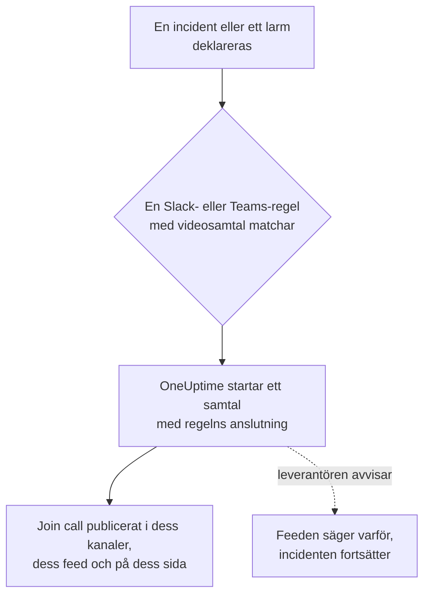

# Videosamtal

Ge varje incident och varje larm ett eget samtal. När en aviseringsregel för Slack eller Microsoft Teams utlöses för en ny incident eller ett nytt larm startar OneUptime ett eget möte (ett Zoom-möte, ett Google Meet, ett Microsoft Teams-möte eller huddlen i incidentens Slack-kanal) och publicerar en **Join call**-knapp överallt där incidentens uppdateringar hamnar. Responders ansluter med ett klick, och ingen behöver skapa ett möte klockan 3 på natten och skicka runt länken.

:::cards
- [Så fungerar det](#så-fungerar-det): En regel startar samtalet, och responders ansluter var de än är.
- [Anslut med ett klick](#anslut-med-ett-klick): Zoom, Google Meet eller Microsoft Teams, genom att logga in.
- [Leverantörer](#leverantörer): Din egen apps tjänsteidentitet, en fast möteslänk eller en Slack-huddle.
- [Starta ett samtal manuellt](#starta-ett-samtal-manuellt): Från en incidents eller ett larms sida.
- [Transkriptioner av samtal](#transkriptioner-av-samtal): Vad som sades i en incidents samtal, och rotorsaken som OneUptime AI läser i det.
:::

## Så fungerar det



:::steps
### Anslut en leverantör

Gå till **Projektinställningar** > **Arbetsyta** > **Video Calls** och anslut Zoom, Google Meet eller Microsoft Teams, eller lägg till en fast möteslänk. På OneUptime Cloud är det ett klick att ansluta Zoom, Google Meet eller Microsoft Teams: logga in och tillåt OneUptime att skapa möten (se [Anslut med ett klick](#anslut-med-ett-klick)). Slack-huddles behöver inget utöver projektets Slack-anslutning.

### Slå på det i en regel

Öppna en aviseringsregel för Slack eller Microsoft Teams för incidenter eller larm (**Incidenter** > **Arbetsyta** > **Slack**, till exempel). I regelns steg **Video Call** slår du på **Start a video call for the incident** och väljer var samtalet hålls.

### Delta med ett klick

När regeln utlöses startar OneUptime ett samtal för incidenten och publicerar det med en **Join call**-knapp i de kanaler som incidentens uppdateringar går till och i incidentens feed. Incidentens sida visar samtalet i kortet **Video Call** och en **Gå med i samtalet**-knapp i sidhuvudet.
:::

Regelns villkor avgör vilka incidenter som får ett samtal. För en brygga bara vid Sev1-incidenter ger du regeln ett villkor på **Allvarlighetsgrad**. Samtal startar för incidenter och larm som deklareras som pågående. En incident som skapas redan löst får inget samtal.

### Ett samtal per incident

Ett samtal startas en gång per incident för varje plats där ett samtal hålls. Regler som väljer samma anslutning delar ett samtal, och en regel startar aldrig ett andra samtal för en incident som redan har ett från den anslutningen. Regler som väljer olika platser startar var sitt samtal, till exempel ett Zoom-möte för responders och huddlen i incidentens Slack-kanal.

### När ett samtal inte kan starta

Att deklarera en incident väntar aldrig på en leverantör av videosamtal. Samtalet startas efter att incidenten har skapats, så en långsam eller felande leverantör fördröjer aldrig incidenten eller dess jourlarm.

Om leverantören avvisar (en hemlighet som har gått ut, en saknad behörighet, en borttagen värd) säger incidentens feed att regelns samtal inte kunde startas, med leverantörens skäl, så att responders vet att de ska starta ett från incidentens sida. Regelns körning visas i arbetsytans aviseringsloggar som **Starta videosamtal**, och anslutningens rad i **Projektinställningar** > **Arbetsyta** > **Video Calls** visar felet tills ett samtal startar igen.

### Privata incidenter

Ett möte får namn efter den incident det gäller, med dess nummer och titel, och dess beskrivning länkar tillbaka till incidenten. För en privat incident utelämnas titeln, eftersom alla som bjuds in till mötet kan läsa dess namn.

## Anslut med ett klick

På OneUptime Cloud tar det ett klick att ansluta Zoom, Google Meet eller Microsoft Teams, och inget behöver konfigureras hos leverantören:

:::steps
1. Gå till **Projektinställningar** > **Arbetsyta** > **Video Calls** och klicka på **Anslut** vid Zoom, Google Meet eller Microsoft Teams.
2. Klicka på **Continue to Zoom** (eller Google, eller Microsoft), logga in och tillåt OneUptime att skapa möten.
3. Du kommer tillbaka till sidan för videosamtal med anslutningen gjord. **Start a test meeting** kontrollerar den från början till slut; välj sedan anslutningen i en aviseringsregel för Slack eller Microsoft Teams.
:::

Varje möte skapas som det konto du loggar in med, som är värd för det. Logga in med ett delat konto, som incidents@example.com, i stället för ditt eget, så att samtal fortsätter att starta när personer slutar. Anslutningens rad visar vilket konto den är inloggad som.

| Leverantör | Logga in med | Vad OneUptime får göra |
| --- | --- | --- |
| Zoom | En Zoom-användare. Möten med en Basic-användare (gratis) som värd avslutas efter 40 minuter. | Skapa möten för den användaren (`meeting:write:meeting`) och läsa vem det är (`user:read:user`). För [transkriptioner av samtal](#transkriptioner-av-samtal): läsa transkriptionerna av molninspelningarna av användarens möten (`cloud_recording:read:list_recording_files`, `cloud_recording:read:meeting_transcript`). |
| Google Meet | Ett Google-konto som kan använda Google Meet. | Skapa Meet-utrymmen som det kontot (`meetings.space.created`) och läsa dess e-postadress. |
| Microsoft Teams | Ett arbets- eller skolkonto med Microsoft Teams. Personliga Microsoft-konton kan inte skapa Teams-möten. | Skapa onlinemöten som det kontot (den delegerade behörigheten `OnlineMeetings.ReadWrite`) och förbli inloggad (`offline_access`). För att [spela in och transkribera incidentsamtal](#spela-in-och-transkribera-varje-samtal): lägga mötena i kontots kalender (`Calendars.ReadWrite`) och läsa deras transkriptioner (`OnlineMeetingTranscript.Read.All`, som en administratör godkänner). |

En anslutning som har gjorts genom inloggning har fortfarande de inställningar som avgör vem som väntar: **Who can join** för Google Meet och **Who skips the lobby** för Microsoft Teams. Ändra dem med **Redigera** på anslutningens rad.

En Zoom-anslutning som loggades in innan OneUptime läste transkriptioner av samtal startar samtal som förut, men kan inte läsa deras transkriptioner förrän den loggas in igen: **Reconnect** på dess rad ber Zoom om behörigheterna för transkriptioner.

En Microsoft Teams-anslutning som loggades in medan inställningen **Spela in och transkribera incidentsamtal** var avstängd startar samtal som förut, utan inspelning. När inställningen är påslagen ber **Reconnect** på dess rad Microsoft om behörigheterna för kalender och transkriptioner också.

### Förbli inloggad

OneUptime sparar inloggningens uppdateringstoken, krypterad, och förnyar den minst en gång i veckan, så att den aldrig går ut av brist på användning, hur länge projektet än går utan en incident. Om inloggningen slutar fungera (kontot tog bort OneUptime, togs bort eller stängdes av, eller organisationens policy kräver att det loggar in igen) visar anslutningens rad **Fungerar inte** med skälet samma dag som OneUptime märker det, inte vid nästa incident. **Reconnect** på raden loggar in igen.

Anslutningar som är inloggade som samma konto delar en inloggning, i alla projekt: Zoom behåller bara en inloggning per konto, så att ansluta samma Zoom-användare igen ersätter den för alla.

### Anslut igen och ta bort

**Reconnect** på en anslutnings rad loggar in igen, som samma konto eller ett annat. Använd den efter att kontot har tagit bort OneUptime, eller för att flytta incidentmöten till ett annat konto.

Att ta bort en anslutning drar tillbaka OneUptimes åtkomst hos Zoom och Google så snart ingen annan anslutning använder inloggningen. För Microsoft tar du bort OneUptime under kontots **My Apps** (myapps.microsoft.com). Att ta bort OneUptime från ditt Zoom-konto i Zoom App Marketplace tar bort dess inloggning från alla anslutningar som är inloggade som det kontot, och de visar **Fungerar inte** tills de ansluts igen.

### Om Microsoft ber om en administratör

Vissa Microsoft 365-organisationer låter bara administratörer godkänna appar. Om Microsoft säger att du behöver godkännande från en administratör ber du en Microsoft 365-administratör att ansluta Microsoft Teams, eller att godkänna OneUptime i [Microsoft Entra-administrationscentret](https://entra.microsoft.com/) under **Enterprise applications** > **Admin consent requests**. Ett projekt som spelar in sina Teams-samtal behöver det här godkännandet i varje organisation, en gång: bara en administratör kan låta en app läsa mötestranskriptioner.

### Använd din egen app i stället

För att ansluta med en tjänsteidentitet i stället för en persons inloggning — en Zoom-app av typen Server-to-Server OAuth, ett Google-tjänstkonto med domänomfattande delegering eller en appregistrering i Microsoft Entra — klickar du på **Use your own Zoom app** (eller Google, eller Microsoft) i dialogrutan Anslut. [Leverantörer](#leverantörer) förklarar var och en. På en egenvärdad server utan konfigurerade enklicksappar öppnar **Anslut** det här formuläret direkt; se [Anslut med ett klick på en egenvärdad server](#anslut-med-ett-klick-på-en-egenvärdad-server) för att konfigurera dem.

## Starta ett samtal manuellt

Kortet **Video Call** på en incidents eller ett larms sida har **Start call** (eller **Start another** när det redan finns ett). Välj en av projektets anslutningar, huddlen i incidentens Slack-kanal, eller klistra in en egen möteslänk. Samtalet publiceras i incidentens kanaler och feed precis som ett som en regel startar.

**Ta bort** på kortet tar bort ett samtal från incidentens sida. Själva mötet tas inte bort, och alla med länken kan fortfarande ansluta till det.

Att starta och ta bort samtal kräver behörighet att arbeta med incidenter (eller larm): **Projektägare**, **Projektadministratör**, **Projektmedlem**, **Incidentadministratör** eller **Incidentmedlem**, eller **Create Incident Video Call** och **Delete Incident Video Call** i en anpassad roll. Alla som kan läsa incidenten ser dess samtal.

## Transkriptioner av samtal

Det de ansvariga säger i ett samtal, vad de har kontrollerat, vad de misstänker och vad de har beslutat, är den bästa redogörelsen för hur en incident hanterades, och det är borta när samtalet slutar. En incidents samtal behåller sin transkription, och OneUptime AI läser den för att hitta rotorsaken som samtalet pekar på. Inget av det den läser når incidenten förrän en ansvarig använder det.

:::steps
### Hämta transkriptionen efter samtalet

På incidentens kort **Video Call** läser **Hämta från Zoom**, **Hämta från Google Meet** eller **Hämta från Microsoft Teams** transkriptionen av ett möte som OneUptime startade där (för Microsoft Teams ett möte som den startade medan varje samtal spelas in och transkriberas). För alla andra samtal tar **Lägg till transkription** filen som mötesverktyget sparade (`.vtt`, `.srt` eller `.txt`, upp till 5 MB), eller den inklistrade transkriptionen. Om [varje samtal spelas in och transkriberas](#spela-in-och-transkribera-varje-samtal) hämtar OneUptime den själv så snart samtalet är slut.

### OneUptime AI läser den

Inom en minut eller två visar incidentens kort **OneUptime AI** **Föreslagen rotorsak**, markerad **Inte bekräftad**, med de rader i transkriptionen som den bygger på, citerade med tid och talare. Under den, ihopfällt, står resten av det samtalet sa: fynd, uppdelade i **Bekräftat i samtalet** och **Hypoteser**, sedan vad som provades, beslut, uppföljningar och öppna frågor. Det den läste publiceras också i incidentens flöde, och därifrån i incidentens Slack- och Microsoft Teams-kanaler.

### Använd den, eller avfärda den

**Använd som rotorsak** öppnar förslaget, med citat och allt, i rotorsakens redigerare. Ändra det du behöver och spara: Det blir incidentens rotorsak som din egen ändring, noterad i dess flöde. **Stäng** lägger förslaget åt sidan, och **Ångra** tar tillbaka det.
:::

OneUptime AI föreslår bara en orsak när samtalet nämner en, med raderna som säger det, och citerar de raderna som transkriptionen har dem. När samtalet inte redde ut orsaken säger kortet **Det sades inte tillräckligt i samtalet för att föreslå en rotorsak** i stället för att gissa.

### Spela in och transkribera varje samtal

Så att ingen behöver komma ihåg att spela in ett samtal eller hämta dess transkription slår du på **Spela in och transkribera incidentsamtal** i **Projektinställningar** > **Arbetsyta** > **Video Calls**. Medan inställningen är påslagen:

- För varje incidentmöte som OneUptime startar ber den Zoom att spela in mötet i molnet, Google Meet att transkribera det och Microsoft Teams att spela in och transkribera det automatiskt. Meddelandet som publicerar samtalet säger det innan någon ansluter.
- När samtalet är slut hämtar OneUptime transkriptionen själv, som **Hämta från Zoom** skulle göra, och OneUptime AI läser den. Fram till dess visar kortet **Video Call** att det väntar.
- Det OneUptime AI läste går till incidentens flöde och dess Slack- och Microsoft Teams-kanaler: den föreslagna rotorsaken, markerad som inte bekräftad, sedan vad som bekräftades, provades och beslutades, uppföljningarna och de öppna frågorna.
- Om incidenten löses innan transkriptionen har kommit väntar det automatiska utkastet till efteranalys på den, så att det tar med vad som sades i samtalet: upp till sex timmar medan leverantören tar fram transkriptionen, och en timme när det ännu inte finns något tecken på någon.

Inställningen är avstängd som standard, eftersom den spelar in människor: alla i de samtalen ser att de spelas in eller transkriberas, så kontrollera att din organisation tillåter det. Zoom sparar bara en transkription när kontot spelar in i molnet med ljudtranskription påslagen, och Google Meet bara i en Google Workspace-utgåva som har transkriptioner. Slack-huddles och möteslänkar spelas inte in, och inte heller samtal för larm: lägg till deras transkriptioner för hand.

Microsoft låter appar läsa transkriptioner bara av Teams-möten som finns i en kalender, så OneUptime lägger varje incidentmöte i organisatörens kalender och slår på automatisk inspelning och transkribering i mötets alternativ. För det behöver anslutningen ytterligare två Microsoft Graph-behörigheter, `Calendars.ReadWrite` och `OnlineMeetingTranscript.Read.All`: lägg till dem i din appregistrering (se [Microsoft Teams](#microsoft-teams)), eller klicka på **Reconnect** för en anslutning som har gjorts genom inloggning. Organisatörens Teams-mötesprincip måste tillåta molninspelning, transkribering och automatisk inspelning, och din organisation får inte ha stängt av appars åtkomst till transkriptioner. Ett samtal som OneUptime inte kan lägga i kalendern startar ändå, utan inspelning, och dess kort **Video Call** säger varför.

### Vad varje leverantör sparar

| Samtal | Hur det får sin transkription | Vad det behöver |
| --- | --- | --- |
| Zoom | **Hämta från Zoom** | Ett möte inspelat i molnet med ljudtranskription påslagen, eller med AI Companions mötessammanfattning påslagen. Anslutningen behöver scopen för transkriptioner (se [Zoom](#zoom)), och en som loggades in före dem behöver **Reconnect**. Zoom tar fram en transkription efter mötet, oftast inom dubbla mötestiden. |
| Google Meet | **Hämta från Google Meet** | Transkriptioner påslagna i samtalet, i en Google Workspace-utgåva som har dem. Inget annat att ställa in: OneUptime läser transkriptionerna av de möten den skapade. Google sparar en transkription som appar kan läsa i 30 dagar. |
| Microsoft Teams | **Hämta från Microsoft Teams** | Ett möte som OneUptime startade medan [varje samtal spelas in och transkriberas](#spela-in-och-transkribera-varje-samtal): Microsoft låter appar läsa transkriptioner bara av möten som finns i en kalender, och sparar ett möte i 60 dagar. För alla andra Teams-möten gäller **Lägg till transkription**: i Teams öppnar du mötets sammanfattning, sedan dess transkription, och laddar ned den som en `.vtt`-fil. |
| Möteslänk eller Slack-huddle | **Lägg till transkription** | Transkriptionen som mötesverktyget, eller huddlens anteckningar, sparar. |

### Vem får göra vad

Att hämta, lägga till, ersätta och ta bort en transkription, låta den läsas igen och avfärda ett förslag kräver behörighet att starta incidentens samtal: **Projektägare**, **Projektadministratör**, **Projektmedlem**, **Incidentadministratör** eller **Incidentmedlem**, eller **Create Incident Video Call** i en anpassad roll. **Använd som rotorsak** kräver behörighet att redigera incidentens rotorsak. Alla som kan läsa incidenten ser transkriptionerna av dess samtal och vad OneUptime AI läste i dem.

### Vad OneUptime AI läser

Att läsa en transkription är AI-arbete som en utredning: Det körs bara medan AI är påslaget för projektet, och räknas in i projektets AI-användning och dagliga gränser (se [Kostnadskontroll](/docs/ai/ai-sre#kostnadskontroll)). En lång transkription läses i delar. När AI är avstängt behålls transkriptionen, och kortet säger att den inte lästes. Att ta bort en transkription tar bort det OneUptime AI läste i den, och behåller incidentens rotorsak. Ett AI-utkast till efteranalys läser också vad som sades i incidentens samtal (se [Efteranalyser](/docs/incidents/postmortems)).

## Leverantörer

Det här avsnittet handlar om att ansluta en leverantör med din egen apps tjänsteidentitet: en Zoom-app av typen Server-to-Server OAuth, ett Google-tjänstkonto, en appregistrering i Microsoft Entra. En tjänsteidentitet är aldrig beroende av en person, så den fortsätter att fungera vem som än slutar. För att ansluta genom inloggning i stället, se [Anslut med ett klick](#anslut-med-ett-klick).

Autentiseringsuppgifter krypteras när de lagras och returneras aldrig av API:et. När du redigerar en anslutning behåller en autentiseringsuppgift som lämnas tom den sparade.

**Start test meeting** i anslutningsformuläret, och **Testa** på en anslutnings rad, skapar ett riktigt möte med anslutningens inställningar och visar dess länk. Det är den enda kontrollen som visar att autentiseringsuppgifterna, behörigheten hos leverantören och värden fungerar tillsammans. Inget publiceras någonstans.

Att ansluta en leverantör kräver **Projektägare**, **Projektadministratör** eller **Inställningsadministratör**, eller **Create Video Call Connection** och **Edit Video Call Connection** i en anpassad roll.

### Zoom

OneUptime skapar ett Zoom-möte för varje incident via en Zoom-app av typen **Server-to-Server OAuth**, med en licensierad Zoom-användare som du väljer som värd.

:::steps
1. I [Zoom App Marketplace](https://marketplace.zoom.us/) väljer du **Develop** > **Build App** och skapar en app av typen **Server-to-Server OAuth**. Att skapa en kräver en administratör för Zoom-kontot, eller en roll som tillåter Server-to-Server OAuth-appar.
2. På appens sida **Scopes** lägger du till **meeting:write:meeting:admin** (skapa ett möte för en användare). En app som skapades före de detaljerade scopen kan använda **meeting:write:admin** i stället. För att låta OneUptime läsa [transkriptioner av samtal](#transkriptioner-av-samtal) också lägger du till **cloud_recording:read:list_recording_files:admin** och **cloud_recording:read:meeting_transcript:admin** (eller **recording:read:admin** i en app som skapades före de detaljerade scopen).
3. Klicka på **Activate** för att aktivera appen, och kopiera sedan **Account ID**, **Client ID** och **Klienthemlighet** från dess sida **App Credentials** till anslutningsformuläret.
4. Ange **Meeting host**: e-postadressen till en licensierad Zoom-användare, helst ett tjänstkonto som incidents@example.com, så att möten fortsätter att fungera när personer slutar. Möten med en Basic-användare (gratis) som värd avslutas efter 40 minuter.
5. Responders ansluter utan att vänta på värden, eftersom värden är ett tjänstkonto som aldrig ansluter. Se till att inställningen **Waiting room** på ditt Zoom-konto inte är låst som påslagen, annars kommer ingen in.
:::

| Fält | Var du hittar det |
| --- | --- |
| Account ID | Appens sida **App Credentials** |
| Client ID | Appens sida **App Credentials** |
| Client secret | Appens sida **App Credentials** |
| Meeting host | E-postadressen till den licensierade Zoom-användare som är värd för varje möte |

### Google Meet

OneUptime skapar ett Google Meet för varje incident med Google Meet REST API, via ett Google Cloud-tjänstkonto som agerar som en Google Workspace-användare med domänomfattande delegering.

:::steps
1. I [Google Cloud-konsolen](https://console.cloud.google.com/) väljer eller skapar du ett projekt och aktiverar **Google Meet REST API** för det.
2. Under **IAM & Admin** > **Service accounts** skapar du ett tjänstkonto. Öppna det, gå till **Keys** > **Add key** > **Create new key**, välj **JSON** och klistra in den nedladdade filen i anslutningsformuläret som **Service account JSON key**.
3. I [Googles administratörskonsol](https://admin.google.com/) öppnar du **Security** > **Access and data control** > **API controls** > **Manage Domain Wide Delegation** och klickar på **Add new**. Ange tjänstkontots numeriska **Client ID** och scopet `https://www.googleapis.com/auth/meetings.space.created`.
4. Ange i **Create meetings as** den Google Workspace-användare som tjänstkontot agerar som: ett eget konto som incidents@example.com. Varje möte ägs av den här användaren.
:::

**Who can join** avgör vem som ansluter utan att fråga: med **People in your organization join directly, others ask to join** (standard) ber personer utanför din Google Workspace om att få ansluta, och någon i samtalet släpper in dem. Med **Anyone with the link joins directly** väntar ingen.

Domänomfattande delegering kan ta några minuter innan den fungerar. Om testet direkt efter att du har lagt till delegeringen rapporterar att Google inte lät tjänstkontot agera som användaren väntar du några minuter och testar igen.

### Microsoft Teams

OneUptime skapar ett Microsoft Teams-möte för varje incident med Microsoft Graph, via en appregistrering i Microsoft Entra som organiserar möten för en licensierad Teams-användares räkning.

:::steps
1. I [Microsoft Entra-administrationscentret](https://entra.microsoft.com/) öppnar du **App registrations** > **New registration** och registrerar en app med en enda klient. Kopiera dess **Directory (tenant) ID** och **Application (client) ID**.
2. Under **API permissions** lägger du till Microsoft Graph-behörigheten av typen **application** **OnlineMeetings.ReadWrite.All** (och, för att även [spela in och transkribera incidentsamtal](#spela-in-och-transkribera-varje-samtal), **Calendars.ReadWrite** och **OnlineMeetingTranscript.Read.All**) och klickar sedan på **Grant admin consent**.
3. Under **Certificates & secrets** skapar du en klienthemlighet och klistrar in dess **Value**, inte dess Secret ID, i anslutningsformuläret som **Klienthemlighet**.
4. Välj organisatören: en licensierad Teams-användare, helst ett tjänstkonto. Kopiera användarens **Object ID** från **Users** i Entra-administrationscentret till **Organizer object ID**.
5. Tillåt appen att skapa möten för organisatören med en åtkomstprincip för program. I Teams PowerShell kör du, efter `Connect-MicrosoftTeams`, de två kommandona nedan.
:::

```powershell
New-CsApplicationAccessPolicy -Identity OneUptime-Meetings -AppIds "<application-client-id>"
Grant-CsApplicationAccessPolicy -PolicyName OneUptime-Meetings -Identity "<organizer-object-id>"
```

Principen kan ta upp till 30 minuter att börja gälla. Tills dess rapporterar testet att appen inte får skapa möten för organisatören.

Samma princip låter appen läsa transkriptionerna av organisatörens möten. `Calendars.ReadWrite` låter en app ändra alla kalendrar i din organisation: för att begränsa den till organisatörens kalender beviljar du den med [RBAC för program i Exchange Online](https://learn.microsoft.com/exchange/permissions-exo/application-rbac), avgränsad till organisatören, i stället för under **API permissions**.

**Who skips the lobby** avgör vem som ansluter utan att vänta: med **People in your organization skip the lobby** (standard) väntar alla andra i lobbyn tills någon i mötet släpper in dem. Med **Everyone skips the lobby** väntar ingen.

### Möteslänk

En fast möteslänk är samma rum för varje incident: ett personligt Zoom-mötesrum, ett återkommande Microsoft Teams- eller Google Meet-möte, ett personligt Webex-rum eller ett Jitsi-rum. Inget skapas per incident, så det finns inget att godkänna.

:::steps
1. Skapa ett möte som aldrig går ut i det verktyg som ditt team redan använder.
2. Klistra in dess https-anslutningslänk i anslutningsformuläret som **Meeting link**.
:::

Varje incident och varje larm som startas med den här anslutningen delar rummet, så två samtidiga incidenter delar det också. Se till att mötet låter personer ansluta utan värden.

### Slack-huddles

En Slack-regel kan i stället starta huddlen i incidentens Slack-kanal. Det finns inget att ansluta: välj **Slack huddle** i regelns steg **Video Call**.

Huddlen hålls i den kanal som regeln skapar för incidenten eller, när regeln i stället publicerar i befintliga kanaler, i den första av dem. Regeln måste alltså skapa en kanal eller publicera i en befintlig. Knappen **Gå med i huddle** öppnar kanalens huddle i Slack. Den första respondern som öppnar den startar huddlen, och alla efter ansluter till den. Slack ger inte en app något sätt att starta en huddle, så ingen är i huddlen förrän någon öppnar den.

En Slack-huddle är bara för Slack-regler. En Microsoft Teams-regel startar sina samtal med en av projektets anslutningar för videosamtal.

## Använda API:et

Ett samtal är en post på incidenten (`IncidentVideoCall`) eller larmet (`AlertVideoCall`). Skapa en med incidentens `_id` och något av följande:

- `videoCallConnectionId`: starta ett nytt möte med den anslutningen.
- `provider` satt till `SlackHuddle`: huddlen i incidentens Slack-kanal.
- `joinUrl` (och eventuellt `title`): en egen möteslänk.

```json
{
  "data": {
    "projectId": "<project-id>",
    "incidentId": "<incident-id>",
    "videoCallConnectionId": "<connection-id>"
  }
}
```

`POST /api/video-call-connection/test` startar ett testmöte med en sparad anslutning (`{ "connectionId": "..." }`) eller med inställningar som inte har sparats än (`{ "provider": "Zoom", "config": { ... }, "secrets": { ... } }`), och returnerar dess `joinUrl`.

En anslutnings `authMethod` anger hur den loggar in: `OAuth` för en som har gjorts genom inloggning, `AppCredentials` för en med din egen apps autentiseringsuppgifter, och inget för en möteslänk. En anslutning som görs genom inloggning skapas bara genom inloggning, i instrumentpanelen. Via API:et kan du byta namn på den och ändra dess `config`, och dess `connectedAccount` anger vilket konto den är inloggad som.

## Anslut med ett klick på en egenvärdad server

OneUptime Cloud har egna Zoom-, Google- och Microsoft-appar för att ansluta med ett klick. En egenvärdad server erbjuder det för varje leverantör vars app du konfigurerar. Utan den öppnar **Anslut** formuläret för din egen app.

Skapa en OAuth-app per leverantör och registrera den här omdirigerings-URI:n på den, med din servers värd:

| Leverantör | Omdirigerings-URI | Miljövariabler | Helm-värden |
| --- | --- | --- | --- |
| Zoom | `https://<host>/api/video-call-oauth/zoom/callback` | `ZOOM_APP_CLIENT_ID`, `ZOOM_APP_CLIENT_SECRET`, `ZOOM_APP_WEBHOOK_SECRET_TOKEN` | `zoomApp.clientId`, `zoomApp.clientSecret`, `zoomApp.webhookSecretToken` |
| Google Meet | `https://<host>/api/video-call-oauth/google-meet/callback` | `GOOGLE_MEET_APP_CLIENT_ID`, `GOOGLE_MEET_APP_CLIENT_SECRET` | `googleMeetApp.clientId`, `googleMeetApp.clientSecret` |
| Microsoft Teams | `https://<host>/api/video-call-oauth/microsoft-teams/callback` | `MICROSOFT_TEAMS_MEETINGS_APP_CLIENT_ID`, `MICROSOFT_TEAMS_MEETINGS_APP_CLIENT_SECRET` | `microsoftTeamsMeetingsApp.clientId`, `microsoftTeamsMeetingsApp.clientSecret` |

- **Zoom**: i [Zoom App Marketplace](https://marketplace.zoom.us/) väljer du **Develop** > **Build App** och skapar en **General App**, som hanteras av användare. Under **Basic Information** lägger du till omdirigerings-URI:n som OAuth Redirect URL på både fliken **Development** och **Production** och i OAuth-tillåtelselistan, och på fliken **Production** anger du slutpunkts-URL:en för **Deauthorization Notification** som `https://<host>/api/video-call-oauth/zoom/events`. Under **Scopes** lägger du till `meeting:write:meeting` och `user:read:user`. För att låta den läsa [transkriptioner av samtal](#transkriptioner-av-samtal) lägger du också till `cloud_recording:read:list_recording_files` och `cloud_recording:read:meeting_transcript`. **Secret Token** under **Features** > **Access** är `ZOOM_APP_WEBHOOK_SECRET_TOKEN`. Autentiseringsuppgifterna för **Development** fungerar bara för användare av ditt eget Zoom-konto; de för **Production** fungerar för alla när Zoom har granskat och publicerat appen.
- **Google Meet**: i [Google Cloud-konsolen](https://console.cloud.google.com/) aktiverar du **Google Meet REST API**, konfigurerar OAuth-medgivandeskärmen (**Google Auth Platform**) med scopen `openid`, `email` och `https://www.googleapis.com/auth/meetings.space.created`, och skapar en OAuth-klient av typen **Web application** med omdirigerings-URI:n. Publicera appen i produktion: en app som lämnas i test förlorar sina inloggningar efter sju dagar. Google granskar appar som ber om Meet-scopet; tills det har skett ser personer en varning innan de loggar in.
- **Microsoft Teams**: i [Microsoft Entra-administrationscentret](https://entra.microsoft.com/) registrerar du en app för **Accounts in any organizational directory**, lägger till omdirigerings-URI:n som en **Web**-omdirigerings-URI, lägger till de delegerade Microsoft Graph-behörigheterna `openid`, `profile`, `email`, `offline_access` och `OnlineMeetings.ReadWrite` (och `Calendars.ReadWrite` och `OnlineMeetingTranscript.Read.All`, som ett projekt som [spelar in och transkriberar sina samtal](#spela-in-och-transkribera-varje-samtal) ber om), och skapar en klienthemlighet. Använd en egen registrering, inte Microsoft Teams-botens (`MICROSOFT_TEAMS_APP_CLIENT_ID`). Tills appen har en verifierad utgivare behöver de flesta organisationer en administratör som ger medgivande till den.

Klient-ID:na är offentliga: de skickas till instrumentpanelen så att den vet vilka leverantörer som ansluter med ett klick. Håll hemligheterna och webhookens hemliga token hemliga. Workern förnyar dagligen de inloggningar som står på tur, så den behöver samma värden som appen.

## Felsökning

:::details Inget samtal startades för en incident
Kontrollera att regeln matchade incidenten (**Testregel**), att dess steg **Video Call** är påslaget och att incidenten deklarerades som pågående: en incident som skapas redan löst får inget samtal. En regel som redan har startat ett samtal för incidenten med den anslutningen startar inget till.
:::

:::details Feeden säger att samtalet inte kunde startas
Leverantören avvisade, och feeden anger skälet. Starta under tiden ett samtal från incidentens sida. Kör sedan **Testa** på anslutningens rad: den visar samma skäl medan du rättar konfigurationen hos leverantören, till exempel en klienthemlighet som har gått ut eller en saknad behörighet.
:::

:::details En anslutning visar Fungerar inte
Dess inloggning slutade fungera: kontot tog bort OneUptime, togs bort eller stängdes av, eller måste logga in igen. Klicka på **Reconnect** på dess rad. Tills dess kan de samtal som den skulle starta inte starta.
:::

:::details Personer väntar i en lobby eller ett väntrum
Ändra **Who can join** (Google Meet) eller **Who skips the lobby** (Microsoft Teams) med **Redigera** på anslutningens rad. För Zoom ser du till att kontots inställning **Waiting room** inte är låst som påslagen.
:::

:::details Hämta från Zoom hittar ingen transkription
Zoom sparar bara en transkription av ett möte som spelats in i molnet med ljudtranskription påslagen, eller med AI Companions mötessammanfattning påslagen, och tar fram den efter att mötet har slutat. Kortet säger vilket: försök igen senare, eller slå på ett av dem för dina incidentmöten. Under tiden tar **Lägg till transkription** en transkription som du har sparat.
:::

:::details Kortet Video Call väntar fortfarande på en transkription
OneUptime frågar Zoom, Google Meet eller Microsoft Teams efter den med några minuters mellanrum när samtalet är slut, allt mer sällan ju äldre samtalet blir, i tre dagar efter att samtalet startade. Transkriptionen kommer några minuter efter att leverantören har tagit fram den, och Zoom behöver upp till ungefär dubbla samtalstiden. **Hämta från Zoom** frågar direkt. När leverantören inte sparar någon transkription säger kortet det: kontrollera att Zoom-kontot spelar in i molnet med ljudtranskription påslagen, att din Google Workspace-utgåva har transkriptioner, eller att Teams-organisatörens mötesprincip tillåter automatisk inspelning.
:::

:::details Ett Microsoft Teams-samtal spelades inte in
OneUptime kunde inte lägga mötet i organisatörens kalender, så den startade samtalet på vanligt sätt, utan inspelning, och kortet **Video Call** säger varför. Oftast saknar anslutningen `Calendars.ReadWrite` eller `OnlineMeetingTranscript.Read.All`: lägg till dem i appregistreringen och ge administratörsmedgivande, eller klicka på **Reconnect** för en anslutning som har gjorts genom inloggning. Samtal som startas efter det spelas in.
:::

:::details OneUptime AI kunde inte läsa en transkription
Kortet säger varför: AI är avstängt för projektet, projektet har nått en daglig AI-gräns, eller AI-leverantören nekade. När det är åtgärdat läser **Försök igen** på kortet den igen.
:::

## Nästa steg

:::cards
- [Slack](/docs/workspace-connections/slack): De regler som startar samtal, och de kanaler de publicerar i.
- [Microsoft Teams](/docs/workspace-connections/microsoft-teams): Samma regler och samtal i Microsoft Teams.
- [Microsoft Teams-integration](/docs/self-hosted/microsoft-teams-integration): Konfigurera Teams-boten på en egenvärdad server.
- [Deklarera en incident](/docs/incidents/declaring-incidents): Vad som händer när en incident börjar.
:::
