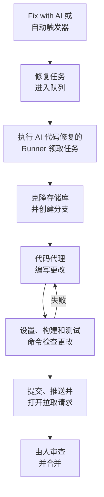

# 修复任务

修复任务是 OneUptime AI 在你的代码中编写的拉取请求。你可以从异常、追踪、服务或调查启动修复任务，也可以由 OneUptime 自行启动；[Runner](/docs/runbooks/agents) 会克隆存储库，在新分支上编写更改，构建并测试它，然后打开拉取请求。每个拉取请求都由人来审查和合并：Runner 只能推送分支和打开拉取请求，仅此而已。

:::cards
- [修复运行的过程](#修复运行的过程): 从一次点击到一个拉取请求，逐步说明。
- [修复任务从哪里启动](#修复任务从哪里启动): 启动修复任务的按钮，以及每个拉取请求做什么。
- [开始之前](#开始之前): 一个模型、一个已连接的存储库和一个 Runner。
- [修复失败时](#修复失败时): 出错、停滞或等待的运行会怎样。
:::

> [!TIP]
> 你也可以从 GitHub 启动。在 issue 或拉取请求中提及 OneUptime GitHub App，它就会在原处实现、修订或审查：请参阅 [GitHub App](/docs/ai/github-app)。这是同一个代理、同一个 Runner 和同样的预算，只有触发方式不同。

## 修复运行的过程



1. 你在未解决的异常上点击 **Fix with AI**，或者由其他按钮或触发器启动任务（请参阅 [修复任务从哪里启动](#修复任务从哪里启动)）。
2. 任务进入队列，一个开启了 **执行 AI 代码修复** 的空闲 Runner 会领取它。
3. Runner 获取任务的上下文。对于异常，就是它的类型、消息和堆栈跟踪。
4. 它把存储库克隆到自己的工作区并创建分支。异常修复的分支名为 `oneuptime-fix-exception-` 加上运行 id 的前几个字符。
5. 由项目的 LLM 提供商驱动的代码代理读取代码并编写更改。LLM 调用由 OneUptime 服务器发出，因此 Runner 从不持有你的提供商的 API 密钥，并且每次调用都会被计量并列在 AI 日志中。
6. 如果存储库有验证命令，Runner 会在提交任何内容之前构建并测试更改，并把失败交回代码代理修复（请参阅 [拉取请求之前的验证](#拉取请求之前的验证)）。
7. Runner 提交、推送分支、打开拉取请求，然后删除工作区。

启动任务的页面会实时显示其状态。每个任务都列在 **产品 → 代码 → 任务** 下：打开一个任务，可以查看它的 **概览**、**日志**（Runner 读取或写入的每个文件和运行的每条命令各占一行）和 **拉取请求**。

每次运行都受服务器强制执行的预算约束：最多 **40 次 LLM 调用** 和 **100,000 个输出令牌**。达到其中之一的运行会以迄今为止工作的摘要结束，而不是陷入循环。当项目设置了每日 AI 限制时，修复运行也计入这些限制。

## 修复任务从哪里启动

| 位置 | 点击 | 拉取请求的作用 |
| --- | --- | --- |
| 异常的 **AI Assistance** 页面 | **Fix with AI** | 修复异常背后的缺陷。 |
| 异常的 **AI Assistance** 页面 | **Generate Regression Test** | 添加一个测试，它会重现该异常，并在缺陷修复之前一直失败。 |
| 异常的 **AI Assistance** 页面 | **Improve Error Handling** | 针对预期内的错误，例如无效输入：从消息中去掉用户数据，更早地校验输入，并把错误标记为已处理，不改变行为。 |
| 事件或警报的 **AI Investigation** 卡片 | **Open Fix PR from this analysis** | 修复调查发布的根本原因（请参阅 [来自调查的自动代码修复](#来自调查的自动代码修复)）。 |
| 追踪 | **Fix performance with AI** | 修复在追踪中发现的慢模式，例如 N+1 查询或一个占主导的慢 span。 |
| 服务的 **日志** 页面 | **Improve Logging** | 在不改变行为的前提下，让服务的日志结构化、使用正确的严重级别，并与它的追踪关联。 |
| 服务的 **追踪** 页面 | **Improve Tracing** | 在不改变行为的前提下，在服务缺少追踪的地方添加 span 和属性。 |

要打开异常的 **AI Assistance** 页面，请在 **产品 → 可观测性 → 异常** 下打开该异常，然后在侧边菜单中选择 **AI Assistance**。已解决或已归档的异常需要先标记为未解决。

OneUptime AI 也会自行启动修复任务：来自发现代码更改的调查，来自因缺少遥测而没有结论的调查，以及来自关于异常和慢追踪的 AI Insights。每种都有自己的开关；请参阅 [自动代码修复](/docs/ai/ai-sre#自动代码修复)。

## 拉取请求之前的验证

代码存储库可以在其 **设置** 页面的 **代码存储库** 下设置最多三条验证命令：

| 命令 | 示例 | 运行时机 |
| --- | --- | --- |
| **Setup Command** | `npm ci` | 最先运行，用于安装依赖。 |
| **Build Command** | `npm run build` | 在设置之后。 |
| **Test Command** | `npm test` | 最后运行。 |

只要设置了其中任何一条，每次修复运行都会在打开拉取请求之前检查自己的更改：

1. 代码代理完成后，这些命令会在 Runner 上克隆的工作区中、存储库的根目录下按顺序运行。每条命令最多运行 15 分钟，并带有 `CI=true`，因此不会有任何东西等待输入；第一次失败就会停止这一轮。
2. 失败时，失败命令输出的末尾会作为修复任务交回同一个代码代理，并指示它修正自己的更改，而不是削弱或跳过测试，然后再次运行这些命令。它最多进行 **2** 次修复尝试。这些尝试共享运行的 LLM 预算，它们的改动与修复进入同一个提交。
3. 结果（通过、失败或跳过，跳过表示未设置命令）会写入拉取请求描述中的 Verification 部分，并记录在任务的拉取请求上。

仍未通过验证的更改不会被丢弃：拉取请求照样打开，并带有一个醒目的 "Verification failed" 部分，写明失败的命令，并以它的输出结尾。工作得以保留，由审查者决定。没有设置命令的存储库会被报告为已跳过，而不是暗示构建通过。

这些命令是你的团队编写的存储库设置，在你自己的 Runner 上运行：与运行手册的 Bash 步骤相同的信任模型。AI 从不编写或更改它们。

## 开始之前

修复任务需要三样东西。异常的 **AI Assistance** 页面会在提供启动之前检查这三样，并说明缺少什么。

| 内容 | OneUptime Cloud | 自托管 |
| --- | --- | --- |
| LLM 提供商 | 无需设置：没有自己提供商的项目使用全局提供商，费用从项目的 AI 额度中支付。在 **项目设置 → 人工智能 → LLM 提供商** 下添加的自有提供商优先。 | 在服务器上一次性设置 `GLOBAL_LLM_PROVIDER_*` 环境变量，或者为项目添加一个提供商。 |
| 通过 GitHub App 连接的存储库 | **产品 → 代码 → 任务**，然后是 **代码存储库** 和 **Connect with GitHub App**。如果该应用已经安装在 GitHub 账号上，请改为点击 **连接现有安装**：再次安装并不会连接它。需要 Growth 套餐。 | 相同，只要你的实例有 GitHub App（请参阅 [GitHub 集成](/docs/self-hosted/github-integration)）。 |
| 执行 AI 代码修复的 Runner | 无需运行任何东西：由 OneUptime 的共享 Runner 完成。 | Docker Compose 的 `runner` 服务，或 Helm chart 的 Runner（`runner.enabled`，默认开启），会自行注册并执行 AI 代码修复。 |

在自托管实例上，全局提供商是 `config.env`（Docker Compose）或你的 Helm values 中的一个配置块。对于自托管的 Ollama：

```bash
GLOBAL_LLM_PROVIDER_TYPE=Ollama
# An address the OneUptime server can reach, never localhost.
GLOBAL_LLM_PROVIDER_BASE_URL=http://ollama:11434
GLOBAL_LLM_PROVIDER_MODEL_NAME=llama3.1
# No GLOBAL_LLM_PROVIDER_API_KEY needed — Ollama is keyless.
```

任何受支持的提供商都可以使用：所有提供商和每个环境变量请参阅 [LLM 提供商](/docs/ai/llm-provider)。

你无需把存储库映射到服务。任务启动时，OneUptime 会把异常堆栈跟踪中的文件路径与你已连接的存储库进行匹配，从而找到存储库。如果没有匹配，它会退而使用与服务同名的存储库，再退而使用项目中唯一的存储库（当只有一个时）。**AI Assistance** 页面会显示它找到的存储库。

### 运行你自己的 Runner

要在其他地方运行 Runner，例如在靠近你的存储库的机器上：

:::steps
### 创建 Runner

在 **运行手册 → Runbook 代理** 下创建一个 Runner，然后点击它所在行的 **显示设置说明**。该命令中嵌有 Runner 的密钥，只有 Project Owner、Project Admin 或 Runbook Admin 可以读取。它看起来像这样：

```bash
docker run --name oneuptime-runner --restart unless-stopped \
  -e ONEUPTIME_RUNNER_ID=<runner-id> \
  -e ONEUPTIME_RUNNER_KEY=<runner-key> \
  -e ONEUPTIME_URL=<your-oneuptime-url> \
  -d oneuptime/runner:release
```

### 开启 AI 代码修复

在 Runner 上开启 **执行 AI 代码修复**。它默认关闭，Runner 会在下一次 heartbeat 时获取这一更改，大约一分钟之内；无需重启任何东西。

### 检查它是否已连接

一两分钟内，Runner 会在 **运行手册 → Runbook 代理** 页面上显示为已连接。如果没有，请查看容器的日志（`docker logs oneuptime-runner`），找出凭据或网络错误。
:::

任何运行容器的方式都可以（Docker Compose、Kubernetes 等），只要它有这些变量，并且能通过 HTTPS 访问你的 OneUptime 实例：

| 变量 | 含义 |
| --- | --- |
| `ONEUPTIME_RUNNER_ID` | Runner 的 id，来自仪表板。 |
| `ONEUPTIME_RUNNER_KEY` | Runner 的密钥。 |
| `ONEUPTIME_URL` | 你的 OneUptime 实例的地址（在 OneUptime Cloud 上为 `https://oneuptime.com`）。 |

> [!NOTE]
> 在 OneUptime 12 之前，AI 代码修复运行在单独的 AI Agent 组件上（`oneuptime/ai-agent` 镜像，使用 `AI_AGENT_*` 变量）。它已并入 Runner：如果你仍在运行它，[从 v11 升级到 v12 的指南](/docs/installation/upgrading) 说明了如何替换它。

## 来自调查的自动代码修复

当 [AI 调查](/docs/ai/ai-sre) 在事件或警报上发布根本原因分析，并且它审慎的分类建议修改代码时，调查卡片会提供 **Open Fix PR from this analysis**：一个以发布的分析为全部上下文的修复任务。当补救措施属于运维、仅涉及基础设施、来自外部、属于预期的拒绝、用户错误或没有结论时，该按钮会隐藏。只要开关 **当调查发现代码更改时打开修复拉取请求** 处于开启状态，符合条件的修复就无需点击即可进行。它属于修复功能：位于 **事件 → 人工智能 → 设置** 的 **自动修复新事件** 之下（以及 **警报 → 人工智能 → 设置** 的 **自动修复新警报** 之下），在开启修复时一同开启，并且只在修复开启时打开拉取请求。两者初始都是关闭的，新项目也是如此。

开关开启时，以一个可信、有证据、可由代码更改修复的根本原因结束的调查，会把按钮创建的同一个修复任务放入队列。这一决定是服务器检查的受约束分类，绝不是对分析文本的模式匹配：只有对代码修复的肯定判定才会打开拉取请求。缺少证据、补救措施在代码之外以及分类失败，最终都不会做任何事。

其他一切都与按钮相同：

- 拉取请求以可供审查的状态打开，根据发布的分析编写，并且需要一个通过 GitHub App 连接的存储库，以及一个开启了 **执行 AI 代码修复** 的 Runner。
- 它计入该信号的每日修复任务限制（**Daily Incident AI Fix Task Limit** 或 **Daily Alert AI Fix Task Limit**，位于其 AI 设置页面的 **更多设置** 下）以及存储库的未关闭拉取请求上限，前提是其中之一已设置。未设置时，两者都不会限制任何东西。
- 每个触发器都会先查找同一事件或警报已在队列中或正在运行的修复任务，因此一个自动触发器和一次点击通常只会变成一个任务，而不是两个拉取请求。这项检查是写入前的读取，而不是锁，所以恰好在同一时刻的两个触发器仍可能都通过。
- 运行由系统写入，不记在任何人名下，也不会自行合并任何内容。

## 修复失败时

:::details 运行出错
修复无法应用、无法访问存储库，或 LLM 调用失败。启动任务的页面会显示原因并提供重试。任务的 **日志** 页面有完整的运行日志。
:::

:::details Runner 在运行中途停止
heartbeat 沉默超过 12 分钟的运行会以错误结束。它永远不会自行重新进入队列，因为 Runner 可能已经推送了修复分支的一部分；请从你启动它的地方重新启动。
:::

:::details 没有 Runner 领取任务
如果没有任何开启 **执行 AI 代码修复** 的 Runner 已连接，等待超过 30 分钟的任务会失败，并提示检查 Runner，因此它永远不会一直显示为进行中。当 Runner 在线但繁忙时，队列中的任务会排队等待。
:::

## 隐私

你的存储库的克隆位于 Runner 容器内的工作区中，运行结束时无论成功与否都会被删除。Runner 从不持有你的 LLM 提供商的 API 密钥：OneUptime 服务器代它发出 LLM 调用。OneUptime 不保留你的存储库，也不会用你的代码进行训练。任务的日志会保留每个步骤输出的前 300 个字符，以便你检查 Runner 做了什么，其中可能包含代码片段。用你自己的 LLM 提供商（包括本地 Ollama）运行自托管的 Runner，你的代码就永远不会离开你的基础设施。

## 路线图

已计划，**目前尚不可用**：

- **GitLab 支持。** 存储库只能通过 GitHub App 连接。
- **修复中使用更多遥测。** 除了堆栈跟踪之外，把异常周围的追踪、日志和指标也提供给修复。

## 后续步骤

:::cards
- [GitHub App](/docs/ai/github-app): 直接在 GitHub 中请求更改、修订或审查。
- [AI SRE](/docs/ai/ai-sre): 修复任务可以把其分析变成拉取请求的调查。
- [Runbook 代理](/docs/runbooks/agents): 执行每次修复运行的 worker。
:::
