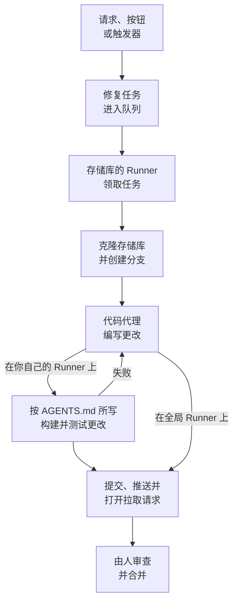

# 代码

代码是你请 OneUptime AI 在你的存储库中工作的地方，就像你请一个编程代理那样：修复 bug、编写测试、解释代码、做一处更改。它打开时显示你提出请求的输入框，在框中选择存储库和分支，下面是所有任务；任务的页面是一段你可以回复的对话。OneUptime 也会自行启动任务，来源包括异常、追踪和调查。[Runner](/docs/runbooks/agents) 会克隆存储库，在新分支上编写更改，构建并测试它，然后打开拉取请求。每个拉取请求都由人来审查和合并：Runner 只能推送分支和打开拉取请求，仅此而已。

:::cards
- [在存储库中请 AI 工作](#在存储库中请-ai-工作): 用你自己的话提出请求，并附上它需要的上下文。
- [任务的对话](#任务的对话): AI 做了什么、改了什么，以及你的回复。
- [修复运行的过程](#修复运行的过程): 从一次点击到一个拉取请求，逐步说明。
- [修复任务从哪里启动](#修复任务从哪里启动): OneUptime 启动的任务，以及每个拉取请求做什么。
- [修复中的生产遥测](#修复中的生产遥测): 修复在编写更改时会读取生产环境中的哪些内容。
- [拉取请求的生产审查](#拉取请求的生产审查): 生产环境对每个拉取请求所改代码的说明。
- [连接存储库](#连接存储库): GitHub、GitLab、Forgejo 或 Gitea，或任意 Git 服务器。
- [开始之前](#开始之前): 一个模型、一个已连接的存储库和一个 Runner。
- [修复失败时](#修复失败时): 出错、停滞或等待的运行会怎样。
:::

> [!TIP]
> 你也可以从 GitHub 启动。在 issue 或拉取请求中提及 OneUptime GitHub App，它就会在原处实现、修订或审查：请参阅 [GitHub App](/docs/ai/github-app)。这是同一个代理、同一个 Runner 和同样的预算，只有触发方式不同。

## 在存储库中请 AI 工作

:::steps
### 打开代码

打开 **产品 → 代码**。页面以 **要让 AI 做什么？** 开头，下面是你提出请求的输入框，再下面是所有任务，最新的在前。还没有存储库时，会改为提供 **连接 GitHub**，下面还有 GitLab、Forgejo 或 Gitea 以及任意 Git 服务器（请参阅 [连接存储库](#连接存储库)）。侧边菜单中的 **存储库** 列出 AI 可以在其中工作的存储库，OneUptime 已无法访问的存储库则收在 **未连接** 下。每个存储库的页面也有同样的输入框，用于该存储库。

### 选择存储库和分支

输入框从你上次选择的存储库开始。在它底部一行选择另一个存储库，并在旁边选择任务的起点分支：在你选择其他分支之前，是标有 **默认** 的存储库主分支。AI 从你选择的分支创建自己的分支，并向它打开拉取请求。

### 说出你想要什么

用你自己的话写下更改、bug 或问题。在还没有提出任何请求时，代码会在 **试试这样问** 下给出几个示例。

### 添加上下文

点击 **添加上下文**，把 AI 需要的东西交给它：存储库中的文件或文件夹、一条备注、一个链接，或项目中的一条记录。OneUptime 会在你发送请求时以你的权限读取每条记录，并保留交给 AI 的内容。

### 开始任务

点击 **开始任务**，或按 Enter。任务的页面会打开，AI 的工作会在发生时显示在那里。
:::

| 上下文 | AI 得到什么 |
| --- | --- |
| **文件或文件夹** | 存储库中的一个路径，AI 会先读取它。 |
| **备注** | 你粘贴的文本：错误、规范、某行日志。 |
| **链接** | 一个网址，作为参考。 |
| **事件** 或 **警报** | 它的状态、描述和根本原因，以你发送请求时为准。 |
| **异常** | 它的消息和堆栈跟踪。 |
| **监视器** | 它的类型、状态和描述。 |
| **跟踪** | 它的 span：名称、耗时和错误。 |
| **日志** | 包含你搜索内容的最新 20 行日志，时间范围可选最近一小时、一天或一周。 |
| **性能剖析** | 函数的时间在其服务的性能剖析中花在哪里：谁调用它、它调用什么，以及它最热的代码行。 |

一个请求最多带 10 项上下文。OneUptime 读取的内容中的令牌、密钥、密码和电子邮件地址会在 AI 看到之前被遮盖，和 OneUptime AI 读取你的数据的其他所有地方一样。

## 任务的对话

任务的页面是一段对话：先是请求的内容和添加的上下文，然后是 AI 的回合——它边做边显示的步骤（读取和编辑的文件、搜索的内容、运行的命令）、它的回复、它更改的文件及其 diff，以及拉取请求。页面顶部显示任务在哪里工作（它的存储库和起点分支）、更改了多少行、一个指向其拉取请求的按钮，以及任务的状态：

| 状态 | 含义 |
| --- | --- |
| **排队中** | 正在等待 Runner 领取。 |
| **处理中…** | AI 正在处理。**停止** 会停止它；它已推送的内容会留在分支上。 |
| **等待您处理** | AI 提了一个问题。请在下方的输入框中回答。 |
| **完成** | AI 已完成：它的回复，以及更改了代码时的拉取请求。 |
| **失败** | 这一回合无法完成，并说明了原因。**重试** 会再次提出同样的请求。 |
| **已停止** | 有人停止了它。**重试** 会再次提出同样的请求。 |

要继续，请在底部的输入框中书写，它会在对话滚动时保持可见：回答 AI、添加上下文或要求更改。每条回复都是同一任务的下一个回合：在拉取请求仍然打开时，它在同一分支上工作，并推送到同一个拉取请求。一个任务一次只进行一个回合，所以 AI 工作时输入框会等待。每个回合的 **日志** 是它所做之事的逐字记录。有多个回合的任务，可以用 **日志** 页面顶部的选择器在回合之间切换。

能读取存储库的人就能读取它的任务。请 AI 工作、回复和停止任务需要编辑该存储库的权限，查看更改的 diff 也一样：其他人只能看到哪些文件发生了更改。OneUptime 自行启动的任务（见下文）也在它们的存储库中，同样是你可以回复的对话。

## 修复运行的过程



1. 你在代码中点击 **开始任务**，或在未解决的异常上点击 **用 AI 修复**，或者由其他按钮或触发器启动任务（请参阅 [修复任务从哪里启动](#修复任务从哪里启动)）。
2. 任务在其存储库的队列中排队，由存储库工作所在的 Runner 领取：存储库选择的 Runner，没有选择时是项目的默认 Runner，再没有则是全局 Runner（参见 [选择存储库的 Runner](#选择存储库的-runner)）。
3. Runner 获取任务的上下文。对于请求，就是它的内容、添加的上下文和到目前为止的对话；对于异常，就是它的类型、消息和堆栈跟踪。
4. 它把存储库克隆到自己的工作区并创建分支。异常修复的分支名为 `oneuptime-fix-exception-` 加上运行 id 的前几个字符。请求从提出时选择的分支开始，其拉取请求也向该分支打开。回复则改为在任务已打开的拉取请求的分支上工作。
5. 由项目的 LLM 提供商驱动的代码代理读取代码并编写更改。LLM 调用由 OneUptime 服务器发出，因此 Runner 从不持有你的提供商的 API 密钥，并且每次调用都会被计量并列在 AI 日志中。异常、慢追踪或事件的修复在工作时还会读取生产环境：存储库对应服务的异常、追踪、日志和指标（请参阅 [修复中的生产遥测](#修复中的生产遥测)）。
6. 在你自己的 Runner 上，代码代理会在提交任何内容之前，按存储库的 `AGENTS.md` 所说的方式构建并测试它的更改，并修复失败的部分（请参阅 [拉取请求之前的验证](#拉取请求之前的验证)）。
7. Runner 提交、推送分支、打开拉取请求（对于请求，只在更改了代码时），然后删除工作区。

启动任务的页面会实时显示其状态。每个任务都列在 **产品 → 代码** 中它所在的存储库下：任务的页面就是它的对话，每个回合的 **日志** 中，Runner 读取或写入的每个文件和运行的每条命令各占一行。

每次运行都受服务器强制执行的预算约束：最多 **40 次 LLM 调用** 和 **100,000 个输出令牌**。运行中对生产遥测的查询也计入这 40 次调用。达到其中之一的运行会以迄今为止工作的摘要结束，而不是陷入循环。当项目设置了每日 AI 限制时，修复运行也计入这些限制。

## 修复任务从哪里启动

| 位置 | 点击 | 拉取请求的作用 |
| --- | --- | --- |
| 异常的 **AI Assistance** 页面 | **用 AI 修复** | 修复异常背后的缺陷。 |
| 异常的 **AI Assistance** 页面 | **Generate Regression Test** | 添加一个测试，它会重现该异常，并在缺陷修复之前一直失败。 |
| 异常的 **AI Assistance** 页面 | **改进错误处理** | 针对预期内的错误，例如无效输入：从消息中去掉用户数据，更早地校验输入，并把错误标记为已处理，不改变行为。 |
| 事件或警报的 **AI Investigation** 卡片 | **Open Fix PR from this analysis** | 修复调查发布的根本原因（请参阅 [来自调查的自动代码修复](#来自调查的自动代码修复)）。 |
| 值得修复的追踪 | **使用 AI 修复性能问题** | 修复按钮指出的慢模式，例如 N+1 查询或本可以并行运行的调用。 |
| 服务的 **日志** 页面 | **改进日志** | 在不改变行为的前提下，让服务的日志结构化、使用正确的严重级别，并与它的追踪关联。 |
| 服务的 **追踪** 页面 | **改进跟踪** | 在不改变行为的前提下，在服务缺少追踪的地方添加 span 和属性。 |
| **性能配置文件** 中的某个函数 | **用 AI 修复** | 以其性能剖析为依据，让函数用更少的时间或内存完成同样的工作。 |

这些按钮只出现在能够启动任务的地方。项目关闭 AI 时，它们都不会出现，异常的侧边菜单中也没有 **AI Assistance**。**改进日志** 和 **改进跟踪** 在连接代码仓库、且没有套餐限制、AI 积分用完或没有在线 Runner 等因素阻止 AI 在其中工作时出现，**使用 AI 修复性能问题** 只出现在值得修复的追踪上（参见 [跟踪浏览器](/docs/telemetry/traces-explorer)）。函数的 **用 AI 修复** 只会出现在应用自身的代码上：它占性能剖析时间或内存的 5% 以上，或者与对比的时间窗口相比占比增长了 3 个百分点以上（参见 [持续性能分析](/docs/telemetry/profiles)）。

要打开异常的 **AI Assistance** 页面，请在 **产品 → 可观测性 → 异常** 下打开该异常，然后在侧边菜单中选择 **AI Assistance**。已解决或已归档的异常需要先标记为未解决。

OneUptime AI 也会自行启动修复任务：来自发现代码更改的调查，来自因缺少遥测而没有结论的调查，以及来自关于异常和慢追踪的 AI Insights。每种都有自己的开关；请参阅 [自动代码修复](/docs/ai/ai-sre#自动代码修复)。

## 修复中的生产遥测

OneUptime 掌握着你的代码在生产环境中的实际表现，因此修复不必只凭一条堆栈跟踪来工作。代码代理在工作时，可以查询该存储库对应的服务的生产遥测：

| 读取的内容 | 用途 |
| --- | --- |
| **异常** | 在指定文件或某个函数中抛出的异常组：最近几天出现的频率、从哪个版本开始出现，以及最近一次出现的追踪。 |
| **追踪** | 某个端点或操作的延迟和错误概况，以及单个追踪的 span。 |
| **日志** | 服务的日志行，可按时间、严重级别、文本或追踪查询。 |
| **指标** | 服务上报的某个指标随时间的变化；不指定名称时，列出它上报的指标。 |
| **事件** | 影响过这些服务的事件，或者此存储库中某个 OneUptime 修复因之而打开的事件，附带它们的根本原因和事后分析。 |
| **部署** | 这些服务最近的部署和其他变更，每一项都附有 OneUptime 对它是否损害了所属服务的判定。 |

| 任务 | 它检查什么 |
| --- | --- |
| 异常上的 **用 AI 修复** | 它现在被抛出的频率、从哪个版本开始，相关日志，以及其中一次出现的追踪。 |
| **使用 AI 修复性能问题** | 该操作在其所有追踪中有多繁忙、有多慢，而不只是被分析的那一条追踪。当该操作已不再缓慢时，它不做任何更改。 |
| **Open Fix PR from this analysis**，以及从调查自动打开的修复 | 事件之前的部署、事件的错误、日志和慢操作，以及这个原因以前是否出现过。 |
| 来自 GitHub 的 `@oneuptime review` | 生产环境对更改的代码说明了什么（请参阅 [带生产上下文的审查](/docs/ai/github-app#带生产上下文的审查)）。 |

拉取请求的描述会写明代理查询了什么，以及查询结果显示了什么。其他任务，例如回归测试以及日志或跟踪改进，不会查询生产环境。

代理能读取什么，由 OneUptime 服务器根据任务本身决定：

- **只读。** 查询在 OneUptime 服务器上运行，从不在 Runner 上运行，Runner 不持有任何能读取遥测的凭据。查询所做的任何事都无法更改你的项目。
- **仅限本项目，且仅限此存储库对应的服务。** 你无需映射它们：它们是 OneUptime 认定与此存储库对应的服务，认定方式与它为修复查找存储库的方式相同——这些服务的异常堆栈跟踪经过该存储库的文件、服务与存储库同名，或者该存储库是项目中唯一的存储库。其他服务的遥测无法读取。
- **不读取私密事件**，并且令牌、密钥、密码和电子邮件地址会在代理看到结果之前被遮盖，和 OneUptime AI 读取你的数据的其他所有地方一样。
- **有上限。** 每次运行最多 **12** 次查询，每次查询都计入运行的 40 次调用。

当没有服务对应到该存储库时，任务会像以前一样在没有生产遥测的情况下运行。

## 拉取请求的生产审查

OneUptime 知道你的代码在生产环境中做了什么，因此它能用阅读 diff 的人看不到的信息来审查拉取请求。在代码中打开存储库的 **设置** 页面，在 **更多设置** 下开启 **根据生产环境审查拉取请求** 后，拥有写权限的人每打开或推送一个拉取请求，都会收到一条评论，说明生产环境对其所改代码的显示。每次推送时，这条评论都会原地更新，代码中存储库的 **生产审查** 页面会保存每次审查，并提供 **重新审查**。

| 读取的内容 | 关于拉取请求所改的代码 |
| --- | --- |
| **异常** | 过去 7 天在已更改的行、函数和文件中抛出的异常，新的和未处理的会被标出。 |
| **操作** | 过去一小时运行已更改代码的已追踪操作：它们的 span、错误和 p95。 |
| **热点函数** | 过去一小时在服务性能分析中占一定比例的已更改代码中的函数。 |
| **事件** | 过去 30 天服务中仍未解决的事件，或根本原因、事后分析提到已更改代码的事件。从不包含私密事件。 |
| **部署** | 过去 7 天服务中被 OneUptime 怀疑造成性能退化的部署。 |

当生产环境显示出问题时，OneUptime AI 会把它与 diff 一起阅读，并加上 **需要关注的问题**：几条简短要点，每条都基于事实。它只在项目开启 AI 时运行，每个拉取请求每天最多 10 次，每个存储库每天最多 100 次，并像所有 AI 调用一样计量；事实每次都会在不使用 AI 的情况下读取。当生产环境对更改没有任何显示时，OneUptime 不会发布任何内容。

- **只有汇总数据。** 评论只包含计数、耗时和代码名称：绝不包含异常消息、日志行、事件标题或个人数据。
- **公开存储库只得到链接。** 任何人都能阅读公开存储库的拉取请求，因此在那里评论只链接到 OneUptime 中的审查，只有项目成员才能打开。存储库 **设置** 页面中 **更多设置** 下的 **生产审查评论** 可以在所有存储库发布 **仅审查链接**，或选择 **即使是公开存储库也显示审查**。
- **外部贡献者无法发起审查。** 只有当拉取请求的作者以及向其推送的人都能写入存储库时，它才会被自动审查。其他人的拉取请求 - 外部贡献者、fork、机器人 - 会在拥有写权限的人评论 `@oneuptime production review`，或在代码中点击 **重新审查** 时被审查。
- **只读。** 审查不克隆任何内容，也不运行拉取请求中的任何内容。它的 diff 和标题对 OneUptime AI 来说是数据，绝不是指令：AI 没有任何工具，它写的内容会以文本形式放进评论。

对于 GitHub App 从现在起连接的存储库，此开关默认开启。在它出现之前连接的存储库会保持关闭，直到你开启它。

## 拉取请求之前的验证

存储库在根目录的 `AGENTS.md`（编码代理读取的文件）中说明如何构建和测试它。代码代理在更改任何内容之前，会从任务起始的分支读取存储库的 `AGENTS.md`（没有 `AGENTS.md` 时读取它的 `CLAUDE.md`），并按其中所说的方式工作。两者都没有时，它会从存储库的 `CONTRIBUTING.md`、README、包脚本、`Makefile` 或 CI 工作流中了解做法。无需在 OneUptime 中进行任何设置。

| AI 在哪里工作 | 它如何处理存储库的构建和测试 |
| --- | --- |
| 你的某个 Runner | 在拉取请求打开之前构建并测试它的更改，修复失败的部分后再次检查，并在摘要中说明运行了哪些检查。它运行的每条命令有 2 分钟，较慢的安装、构建或测试套件最多 10 分钟，环境中不含 Runner 自己的凭据。 |
| **全局 Runner** | 不运行任何命令：编写更改并打开拉取请求，由你的存储库自己的 CI 检查。 |

来自 fork 的拉取请求中的任何内容都不会被当作存储库的指令读取：修订会拒绝这样的拉取请求，审查则读取基础分支。

### 存储库上设置的命令

代码不再要求填写安装、构建和测试命令，但已有这些命令的存储库（之前设置的，或通过 API 或 Terraform 设置的）会保留它们。它们以只读方式显示在存储库 **设置** 页面 **更多设置** 下的 **构建和测试命令** 卡片上，**移除命令** 会移除全部三条。只要设置了其中任何一条，你自己的 Runner 上的每次修复运行都会在打开拉取请求之前也用它们检查自己的更改：

1. 代码代理完成后，这些命令会在 Runner 上克隆的工作区中、存储库的根目录下按顺序运行。每条命令最多运行 15 分钟，并带有 `CI=true`，因此不会有任何东西等待输入；第一次失败就会停止这一轮。
2. 失败时，失败命令输出的末尾会作为修复任务交回同一个代码代理，并指示它修正自己的更改，而不是削弱或跳过测试，然后再次运行这些命令。它最多进行 **2** 次修复尝试。这些尝试共享运行的 LLM 预算，它们的改动与修复进入同一个提交。
3. 结果（通过、失败或跳过，跳过表示未设置命令或使用全局 Runner）会写入拉取请求描述中的 Verification 部分，并记录在任务的拉取请求上。

仍未通过验证的更改不会被丢弃：拉取请求照样打开，并带有一个醒目的 "Verification failed" 部分，写明失败的命令，并以它的输出结尾。工作得以保留，由审查者决定。没有设置命令的存储库会被报告为已跳过，而不是暗示构建通过。

这些命令是你的团队编写的存储库设置，在你自己的 Runner 上运行：与运行手册的 Bash 步骤相同的信任模型。AI 从不编写或更改它们。OneUptime 为所有项目运行的全局 Runner 从不运行它们：在全局 Runner 上，修复会被写好并打开以供审查，验证报告为跳过，由你的存储库自己的 CI 检查这次更改。若要在拉取请求打开之前构建并测试修复，请运行 [你自己的 Runner](#运行你自己的-runner)。

## 修复合并之后

合并修复并不能修复任何问题，只有运行起来才算数。修复拉取请求合并后，OneUptime 会等待包含它的已记录部署（参见 [部署与变更](/docs/telemetry/change-events)），并在那次部署中观察修复的目标。Code 中任务的拉取请求会说明结果，异常的 **AI Assistance** 页面、事件的 AI 日志以及修复来源的 AI 洞察也会说明：

| 修复的对象 | 观察的内容 | 有效 | 无效 |
| --- | --- | --- | --- |
| 异常 | 异常是否再次发生 | **已在生产环境中修复** | **修复后仍在发生** |
| 慢追踪或延迟洞察 | 修复所指操作的 p99 | **在生产环境中变快** | **修复后仍然缓慢** |
| 事件或告警的根本原因 | 它的监控器是否再次触发 | **已在生产环境中修复** | **修复后再次发生** |
| 缺失的遥测、日志或追踪 | 修复新增的内容，以及服务的其余遥测 | **已在生产环境中上报** | **修复后遥测中断** |

在部署交付修复之前，修复显示为 **已合并，等待部署**，观察期间显示为 **已部署，正在生产环境中观察**。14 天内没有任何已记录部署包含的修复，或生产环境无法判断的修复，显示为 **未在生产环境中验证**。规则见 [自动代码修复](/docs/ai/ai-sre#自动代码修复)。回归测试、更好的错误处理、审查以及 Code 中的请求不会被观察：生产环境无法显示它们改变了什么。

## 连接存储库

在代码的侧边菜单中打开 **存储库**，然后点击 **连接存储库**：代码会询问你的代码在哪里，并以各自的方式连接每个位置。AI 在存储库中能做什么，取决于它所在的位置：

| 代码所在位置 | 连接方式 | AI 在那里做什么 |
| --- | --- | --- |
| **GitHub** | OneUptime GitHub App，安装在它选择的存储库上。 | 本页介绍的一切，以及来自 GitHub 的命令（请参阅 [GitHub App](/docs/ai/github-app)）和[生产审查](#拉取请求的生产审查)。 |
| **GitLab**，位于 GitLab.com 或你自己的 GitLab | 访问令牌：具有 `api` 和 `write_repository` 范围、且角色至少为 Developer 的个人、群组或项目令牌。 | 任务和修复，每次更改都放在合并请求中；分支选择；堆栈跟踪或性能剖析经过的代码；修复是否已合并，以及发布后生产环境显示了什么。 |
| **Forgejo 或 Gitea**，位于 Codeberg 或你自己的服务器 | 对存储库具有读写权限、对用户具有读取权限的访问令牌。 | 与 GitLab 相同，每次更改都放在拉取请求中。 |
| **任意 Git 服务器**，通过 HTTPS | 你克隆存储库所用的地址、用户名，以及能读取存储库并向其推送的密码或访问令牌。 | AI 克隆存储库，把每次更改推送到新分支，并在回复中说明是哪个分支：由你创建拉取请求。在 Bitbucket 和 Azure DevOps 上，它会链接到创建拉取请求的位置。 |

来自评论的命令和生产审查需要 GitHub App，因此目前仅适用于 GitHub 存储库，存储库的 **设置** 也会这样说明。

对于 GitLab、Forgejo 或 Gitea，输入服务器地址（已预先填好 GitLab.com 和 Codeberg）和令牌，然后选择要连接的存储库：列表只提供令牌可以推送的存储库，以后再连接更多存储库时也可以复用该令牌。OneUptime 在保存每个令牌之前都会先向其服务器验证，将其加密保存，并且不会再次显示。存储库的 **设置** 显示其服务器、账户和令牌的最后几个字符，并提供 **替换访问令牌**。当服务器拒绝已过期或被撤销的令牌时，其存储库会显示 **令牌被拒绝**，AI 也会停止在其中工作，直到替换令牌让使用它的每个存储库重新连接。在 GitLab 存储库中，设置和 GitLab 一样称为合并请求：**合并请求**、**AI 修复合并请求** 和 **最多打开的修复合并请求数**。

### 私有网络中的 Git 服务器

OneUptime Cloud 只访问互联网上的 Git 服务器，绝不访问私有、环回或链路本地地址。只有你的网络才能访问的服务器，请作为 **任意 Git 服务器** 连接：代码会说明它无法访问该服务器，点击 **仍然连接** 即可为你在该网络中的某个 Runner 连接它。在存储库的 **Runner** 卡片上选择该 Runner（请参阅 [选择存储库的 Runner](#选择存储库的-runner)）。全局 Runner 绝不会在其中工作，OneUptime 也不会在服务器上读取它的任何内容，因此分支选择只提供其主分支。自托管的 OneUptime 及其全局 Runner 可以访问其自身网络中的 Git 服务器。

## 开始之前

任务需要三样东西。代码的请求输入框和异常的 **AI Assistance** 页面会在提供启动之前检查这三样，并说明缺少什么。

| 内容 | OneUptime Cloud | 自托管 |
| --- | --- | --- |
| LLM 提供商 | 无需设置：没有自己提供商的项目使用全局提供商，费用从项目的 AI 额度中支付。在 **项目设置 → 人工智能 → LLM 提供商** 下添加的自有提供商优先。 | 在服务器上一次性设置 `GLOBAL_LLM_PROVIDER_*` 环境变量，或者为项目添加一个提供商。 |
| 通过 GitHub App 连接的存储库 | **产品 → 代码**，然后是 **连接 GitHub**。如果该应用已经安装在 GitHub 账号上，请改为点击 **连接现有安装**：再次安装并不会连接它。需要 Growth 套餐。 | 相同，只要你的实例有 GitHub App（请参阅 [GitHub 集成](/docs/self-hosted/github-integration)）。 |
| 或者 GitLab、Forgejo、Gitea 或任意 Git 服务器上的存储库 | 代码中的 **存储库**，然后是 **连接存储库**（请参阅 [连接存储库](#连接存储库)）。需要 Growth 套餐。 | 相同，无需设置 GitHub App。 |
| 执行 AI 代码修复的 Runner | 无需运行任何东西：没有选择 Runner 的存储库在项目的默认 Runner 上工作，没有默认 Runner 时在 OneUptime 的全局 Runner 上工作。 | Docker Compose 的 `runner` 服务，或 Helm chart 的 Runner（`runner.enabled`，默认开启），会自行注册，并在每个在全局 Runner 上工作的存储库中执行 AI 代码修复。 |

在自托管实例上，全局提供商是 `config.env`（Docker Compose）或你的 Helm values 中的一个配置块。对于自托管的 Ollama：

```bash
GLOBAL_LLM_PROVIDER_TYPE=Ollama
# An address the OneUptime server can reach, never localhost.
GLOBAL_LLM_PROVIDER_BASE_URL=http://ollama:11434
GLOBAL_LLM_PROVIDER_MODEL_NAME=llama3.1
# No GLOBAL_LLM_PROVIDER_API_KEY needed — Ollama is keyless.
```

任何受支持的提供商都可以使用：所有提供商和每个环境变量请参阅 [LLM 提供商](/docs/ai/llm-provider)。

你无需把存储库映射到服务。任务启动时，OneUptime 会把异常堆栈跟踪中的文件路径与你已连接的存储库进行匹配，从而找到存储库。如果没有匹配，它会退而使用与服务同名的存储库，再退而使用项目中唯一的存储库（当只有一个时）。**AI Assistance** 页面会显示它找到的存储库。

### 选择存储库的 Runner

每个存储库都会选择 AI 在其中工作所用的 Runner：在代码中它的 **设置** 页面上，展开 **更多设置**，点击 **Runner** 卡片上的 **编辑** 并选择一个。没有选择的存储库在项目的 [默认 Runner](/docs/runbooks/agents#项目默认-runner) 上工作，即标有 **项目默认** 的第一个选项，并在另一个 Runner 成为默认时随之转移。在没有默认 Runner 的项目中，它在 **全局 Runner** 上工作，它由 OneUptime 为所有项目运行。要在项目有默认 Runner 时让存储库留在 **全局 Runner** 上，请选择它。

| Runner | 它如何处理任务 |
| --- | --- |
| **全局 Runner** | 编写更改并打开拉取请求，但不构建也不测试它：由你的存储库自己的 CI 检查这次更改。 |
| 你的某个 Runner | 还会在你掌控的主机上，按存储库的 `AGENTS.md` 所说的方式构建并测试这次更改。 |

只有存储库工作所在的 Runner 才会收到它的任务和它的令牌。在 **运行手册 → Runbook 代理** 下关闭 **使用全局 Runner** 的项目中，每个存储库都需要项目自己的某个 Runner：存储库选择的 Runner，或项目的默认 Runner。Runner 的页面会列出在它上面工作的存储库。

### 运行你自己的 Runner

要在其他地方运行 Runner，例如在靠近你的存储库的机器上：

:::steps
### 创建 Runner

在 **运行手册 → Runbook 代理** 下创建一个 Runner，然后点击它所在行的 **显示设置说明**。该命令中嵌有 Runner 的密钥，只有 Project Owner、Project Admin 或 Runbook Admin 可以读取。它看起来像这样：

```bash
docker run --name oneuptime-runner --restart unless-stopped \
  -e ONEUPTIME_RUNNER_ID=<runner-id> \
  -e ONEUPTIME_RUNNER_KEY=<runner-key> \
  -e ONEUPTIME_URL=<your-oneuptime-url> \
  -d oneuptime/runner:release
```

### 为存储库选择它

在代码中存储库的 **设置** 页面上，展开 **更多设置**，点击 **Runner** 卡片上的 **编辑** 并选择该 Runner。Runner 会在下一次 heartbeat 时获取这一更改，大约一分钟之内；无需重启任何东西。

### 检查它是否已连接

一两分钟内，Runner 会在 **运行手册 → Runbook 代理** 页面上显示为已连接。如果没有，请查看容器的日志（`docker logs oneuptime-runner`），找出凭据或网络错误。
:::

任何运行容器的方式都可以（Docker Compose、Kubernetes 等），只要它有这些变量，并且能通过 HTTPS 访问你的 OneUptime 实例：

| 变量 | 含义 |
| --- | --- |
| `ONEUPTIME_RUNNER_ID` | Runner 的 id，来自仪表板。 |
| `ONEUPTIME_RUNNER_KEY` | Runner 的密钥。 |
| `ONEUPTIME_URL` | 你的 OneUptime 实例的地址（在 OneUptime Cloud 上为 `https://oneuptime.com`）。 |

> [!NOTE]
> 在 OneUptime 12 之前，AI 代码修复运行在单独的 AI Agent 组件上（`oneuptime/ai-agent` 镜像，使用 `AI_AGENT_*` 变量）。它已并入 Runner：如果你仍在运行它，[从 v11 升级到 v12 的指南](/docs/installation/upgrading) 说明了如何替换它。

## 来自调查的自动代码修复

当 [AI 调查](/docs/ai/ai-sre) 在事件或警报上发布根本原因分析，并且它审慎的分类建议修改代码时，调查卡片会提供 **Open Fix PR from this analysis**：一个以发布的分析为全部上下文的修复任务。当补救措施属于运维、仅涉及基础设施、来自外部、属于预期的拒绝、用户错误或没有结论时，该按钮会隐藏。只要 **事件 → 人工智能 → 设置** 的 **自动修复新事件** （以及 **警报 → 人工智能 → 设置** 的 **自动修复新警报**）处于开启状态，符合条件的修复就无需点击即可进行。修复初始是关闭的，新项目也是如此。没有 AI 规则时，每个符合条件的修复都会打开；有规则时，只为规则匹配的对象打开，前提是该规则开启了 **修复拉取请求** （新规则默认开启），并且只在它指定的代码存储库中打开。

修复开启时，以一个可信、有证据、可由代码更改修复的根本原因结束的调查，会把按钮创建的同一个修复任务放入队列。这一决定是服务器检查的受约束分类，绝不是对分析文本的模式匹配：只有对代码修复的肯定判定才会打开拉取请求。缺少证据、补救措施在代码之外以及分类失败，最终都不会做任何事。

其他一切都与按钮相同：

- 拉取请求以可供审查的状态打开，根据发布的分析编写，并且需要一个已连接的存储库（匹配的规则指定了存储库时，须是其中之一），以及一个在线、能在其中工作的 Runner：存储库选择的那个，或全局 Runner。
- 它计入该信号的每日修复任务限制（**Daily Incident AI Fix Task Limit** 或 **Daily Alert AI Fix Task Limit**，位于其 AI 设置页面的 **更多设置** 下）以及存储库的未关闭拉取请求上限，前提是其中之一已设置。未设置时，两者都不会限制任何东西。
- 每个触发器都会先查找同一事件或警报已在队列中或正在运行的修复任务，因此一个自动触发器和一次点击通常只会变成一个任务，而不是两个拉取请求。这项检查是写入前的读取，而不是锁，所以恰好在同一时刻的两个触发器仍可能都通过。
- 运行由系统写入，不记在任何人名下，也不会自行合并任何内容。

## 修复失败时

:::details 运行出错
修复无法应用、无法访问存储库或请求的起点分支，或 LLM 调用失败。任务的对话和启动任务的页面会显示原因并提供重试。该回合的 **日志** 有完整的运行日志。
:::

:::details Runner 在运行中途停止
heartbeat 沉默超过 12 分钟的运行会以错误结束。它永远不会自行重新进入队列，因为 Runner 可能已经推送了修复分支的一部分；请从你启动它的地方重新启动。代码代理运行的命令在运行期间会持续发送 heartbeat，因此耗时较长的构建或测试套件不会被当作已停止的 Runner。
:::

:::details 没有 Runner 领取任务
如果应领取任务的 Runner 没有连接（即存储库选择的 Runner，对没有选择的存储库而言是项目的默认 Runner，或者全局 Runner），等待超过 30 分钟的任务会失败，并提示是哪一个，因此它永远不会一直显示为进行中。当 Runner 在线但繁忙时，队列中的任务会排队等待。早于代码的 Runner 永远不会领取来自代码的请求：请把你自己运行的 Runner 与服务器一起更新。
:::

## 隐私

你的存储库的克隆位于 Runner 容器内的工作区中，运行结束时无论成功与否都会被删除。Runner 从不持有你的 LLM 提供商的 API 密钥：OneUptime 服务器代它发出 LLM 调用，生产遥测查询也由服务器运行。OneUptime 不保留你的存储库，也不会用你的代码进行训练。任务的日志会保留每个步骤输出的前 300 个字符，以便你检查 Runner 做了什么，其中可能包含代码片段。用你自己的 LLM 提供商（包括本地 Ollama）运行自托管的 Runner，你的代码就永远不会离开你的基础设施。

## 后续步骤

:::cards
- [GitHub App](/docs/ai/github-app): 直接在 GitHub 中请求更改、修订或审查。
- [AI SRE](/docs/ai/ai-sre): 修复任务可以把其分析变成拉取请求的调查。
- [Runbook 代理](/docs/runbooks/agents): 执行每次修复运行的 worker。
:::
