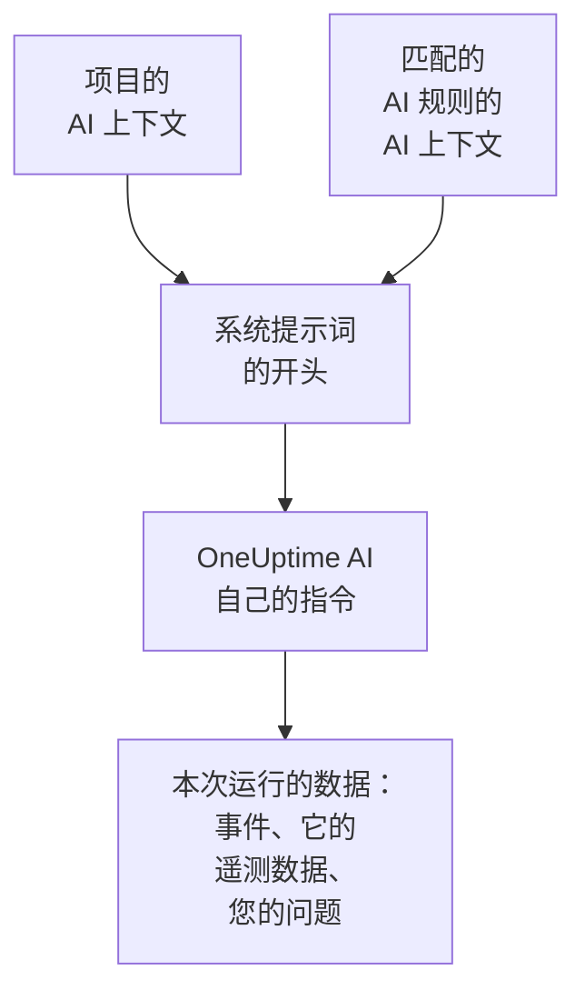

# AI 上下文

AI 上下文是您的团队为 OneUptime AI 写下的、关于您自己系统的说明：系统之间如何关联、每种症状归谁负责、日志在哪里，以及团队使用的术语。OneUptime AI 在每次调查、每次修复、每份事后分析草稿和每次询问 AI 对话中都会最先读取它，因此会从团队已经知道的内容出发。

:::cards
- [编写 AI 上下文](#编写-ai-上下文): 项目 AI 设置中的一张卡片。
- [AI 规则自己的说明](#ai-规则自己的说明): 关于一条规则所匹配内容的说明。
- [哪些功能读取它](#哪些功能读取它): 读取它的功能，以及不读取它的功能。
- [一次运行读取了什么](#一次运行读取了什么): 每次运行都会显示它收到的说明。
:::

## 工作原理

OneUptime AI 把 AI 上下文放在系统提示词的最开头，排在它自己的指令和本次运行的数据之前：先是项目的说明，然后是匹配的 AI 规则的说明。它把这些说明当作团队提供的背景知识来读。它们不是当前正在发生什么的证据，也绝不会改变 OneUptime AI 自己的规则。

由于这些说明排在最前面，而且每次运行都相同，它们属于提供商会缓存的提示词开头部分。对于 Anthropic，OneUptime 会把系统提示词标记为可缓存；OpenAI、Azure OpenAI 以及其他会缓存重复提示词开头的提供商会自动缓存。没有变化的说明再次读取时成本更低。

## 编写 AI 上下文

:::steps
### 打开 AI Features
打开 **项目设置 → 人工智能 → AI Features**。**AI 上下文** 卡片位于 **启用 AI** 下方。

### 编写说明
点击 **添加 AI 上下文**，已有说明时点击 **编辑**。用 Markdown 编写，或点击 **从大纲开始**，为每类说明各加一个标题。

### 保存
点击 **保存更改**。卡片会显示这些说明、它们的长度，以及模型大约会把它们读作多少个 token。
:::

写下您会告诉团队新成员的内容：

| 说明类型 | 示例 |
| --- | --- |
| 系统之间如何关联 | `checkout-api` 提供结账页面，并依赖 `payments-db`。 |
| 每种症状归谁负责 | 结账页面上的 502 归支付团队负责：先检查 `payments-db`。 |
| 日志在哪里 | 结账的日志在 Loki 中，位于 `app=checkout` 下。 |
| 团队使用的术语 | PSP 指我们的支付服务提供商。 |

> [!WARNING]
> 不要写入机密：任何能看到某次 AI 运行做了什么的人，都能读到这次运行收到的说明。

## AI 规则自己的说明

AI 规则可以有自己的说明，内容关于它所匹配的事件或警报：某个产品的服务、负责人、日志位置。把它们写在规则的 **更多字段** 中、**LLM 提供商** 之后的 **AI 上下文** 里。每次只运行其运行手册的规则不会向 OneUptime AI 提任何问题，因此没有需要编写的 AI 上下文。

- 调查会先读取项目的说明，再按规则名称的顺序，读取每条已启用、负责调查并与该事件或警报匹配的 AI 规则的说明。
- 修复会先读取项目的说明，再读取它自己所属规则的说明。
- 关于某个事件或警报的对话，读取的说明与它的调查相同。

## 哪些功能读取它

| 功能 | 读取的内容 |
| --- | --- |
| AI SRE 调查，以及新警报出现时的再次检查 | 项目的说明，以及匹配的 AI 规则的说明 |
| AI 规则启动的修复：其计划、命令和 MCP 服务器 | 项目的说明，以及该规则的说明 |
| 询问 AI，以及关于事件或警报的对话 | 项目的说明；对于事件或警报，还有匹配的 AI 规则的说明 |
| Slack 和 Microsoft Teams 中的回答 | 项目的说明 |
| 事件和事件集的事后分析草稿 | 项目的说明 |
| AI Insights 的分诊和安全案例的分诊 | 项目的说明 |

只是改写或评判所收到内容的调用不会读取它：备注和公开备注的草稿、通话摘要、调查的摘要、置信度和评分，以及对话的标题。人们自己编写的提示词也不会读取它，例如工作流中的 AI 步骤。

## 限制

| 对象 | 上限 |
| --- | --- |
| 项目的 AI 上下文 | 20,000 个字符 |
| 一条 AI 规则的 AI 上下文 | 5,000 个字符 |
| 一次运行读取的全部 AI 上下文 | 30,000 个字符 |

表单会在您输入时统计字符数，超过上限时拒绝保存，API 也是如此。一次运行先读取项目的说明，再按名称顺序读取每条匹配规则的说明。如果某条规则的说明会让这次运行超过 30,000 个字符，就会整条略过，运行的活动记录会说明这一点。

token 数是估算值：说明的 UTF-8 字节数除以 4，向上取整。每个模型统计 token 的方式不同，因此提供商的计数可能不同，非英语文本差别最大。

## 一次运行读取了什么

每次运行都会逐字记录它读取的说明。运行的活动记录会显示 **已读取项目的 AI 上下文**，或者它另外读取了多少条 AI 规则的说明，并附上大约的 token 数。**查看** 会按运行读取时的原样打开这些说明：先是项目的说明，再是每条规则名称下的说明，即使之后说明已被修改也是如此。如果某条规则的说明因运行的上限而被略过，会有一条警告说明这一点。

## 谁可以修改它

- **Project Owner** 和 **Project Admin** 可以修改项目的 AI 上下文。**Project Member**、**Viewer** 和 **Read Project** 可以读取它。
- AI 规则的说明是规则的一部分：能修改该规则的人，也能修改这些说明。
- 说明只会在它所属的项目中被读取：任何运行都不会读取其他项目的 AI 上下文。

通过 API 或 Terraform，项目的说明是项目的 `aiContext`，AI 规则的说明是该规则自己的 `aiContext`。

## 后续步骤

:::cards
- [AI SRE](/docs/ai/ai-sre): 让 OneUptime AI 调查每个新的事件和警报。
- [询问 AI](/docs/ai/ask-ai): 在对话中询问项目的数据。
- [LLM 提供商](/docs/ai/llm-provider): 选择读取这些说明的模型。
:::
