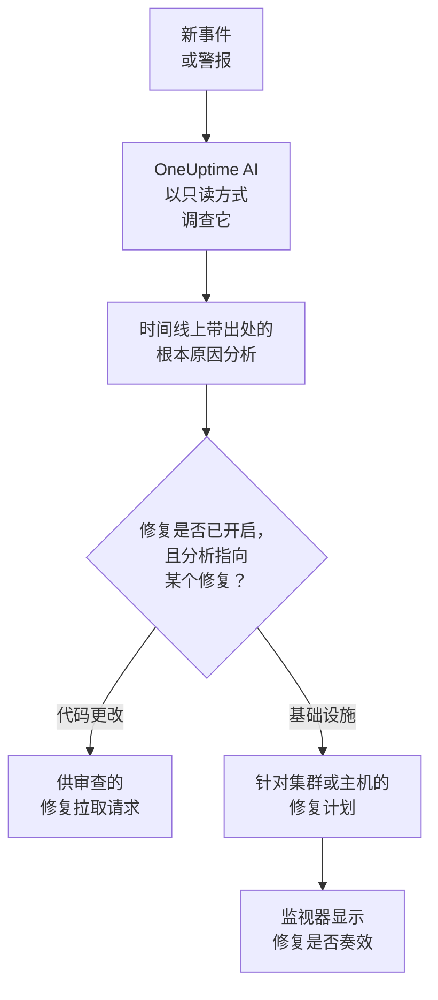
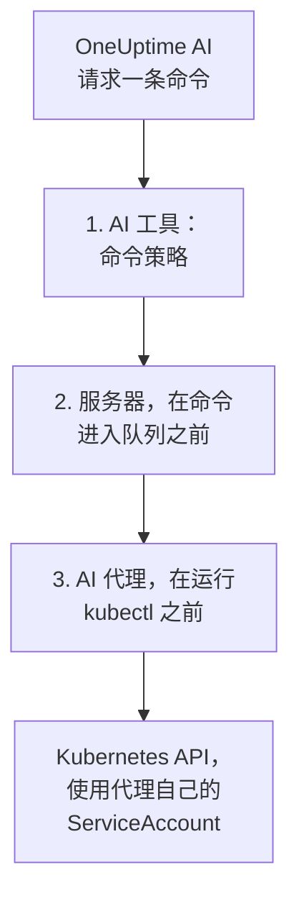

# AI SRE

OneUptime AI 是您的 AI 站点可靠性工程师。新事件或警报一经宣布，它就会立即开始工作，利用您自己的遥测数据（日志、指标、追踪、异常、监视器和最近的变更）进行调查，并在事件或警报的时间线上发布带出处的根本原因分析，通常在值班工程师读完呼叫之前就已完成。

分析中的每一项断言都带有出处，直接链接到支持它的确切数据，而调查本身是 **严格只读** 的：调查期间，OneUptime AI 永远无法更改您项目中的任何内容。

:::cards
- [工作原理](#工作原理): 从新事件到带出处的分析，在您允许时再到修复。
- [启用 AI 调查](#启用-ai-调查): 各个开关，以及它们需要什么。
- [集群访问——让 OneUptime AI 运行 kubectl](#集群访问让-oneuptime-ai-运行-kubectl): 在 Kubernetes 内部调查并修复。
- [成本控制](#成本控制): 针对事件、警报和整个项目的限制。
:::

## 工作原理

对于新事件或警报，OneUptime AI 会做三件事，每件事都有自己的开关：

- **调查** （默认开启）。它会读取您的遥测数据，以及运行 AI 代理的集群和主机，并发布带出处的根本原因分析。调查不会更改任何内容。
- **修复** （默认关闭）。修复开启时，有把握的分析会变成修复：针对代码更改的拉取请求，或针对集群或主机的命令计划，并按该集群或主机的 AI 代理所允许的方式运行。
- **学习。** AI Insights 页面会根据记录下来的一切，告诉您哪些问题反复出现。



找不到原因的分析会被安静地发布，不会呼叫任何人（参见 [静默模式](#静默模式)），没有原因就不会修复任何内容。

## 调查会发布什么

调查完成后，OneUptime AI 会发布包含以下部分的根本原因分析：

- **Summary** ——被呼叫的工程师能在五秒内读完的一两句话。
- **Most likely root cause** ——假设，只带有证据所支持的把握程度，每一项事实断言都附有出处。如果遥测数据不足，AI 会直接说明，并列出它检查过的内容，而不是猜测。
- **Evidence** ——支持或排除该假设的关键发现，每一项都附有出处。
- **Suggested next steps** ——给值班工程师的具体操作。

对于事件，分析会发布到事件动态 **和** 事件的内部备注（响应者协作的地方）。对于警报，分析会发布到警报动态。

调查运行期间，事件或警报页面会显示一个实时的 **AI Investigation** 面板，讲述每一步——运行了哪些工具、发现了什么、花了多长时间——让您可以看着它思考。如果调查失败，面板会显示失败原因，而不是一片空白。

调查会一直运行到完成为止：它 **没有时间限制**，也没有很小的查询预算，因此可以运行所需的每一条查询以及 kubectl 或基础设施命令。很长的命令输出（繁忙节点的 `kubectl describe node`、Pod 的日志）永远不会被截断——OneUptime AI 会一次读取一页。如果您想要硬性停止，请为每种信号类型设置 **调查时间限制** （参见下文的 **成本控制**）。

### 当日志里没有线索时

一次调查如果无法确定原因，并且在所有搜索中都没有找到任何日志行，就会在 **AI Investigation** 卡片上、在其报告下方说明原因，并给出下一步：

- **没有可读取的日志**：从事件或警报开始前一小时起，没有任何日志到达 OneUptime。**设置日志** 会打开日志的设置指南：将您服务的日志发送到 OneUptime，下次调查就能使用它们。
- **没有关于此事件的日志**（对于警报，为 **没有关于此警报的日志**）：日志到达了 OneUptime，但调查的任何一次搜索都没有找到与之相关的内容。**设置日志** 适用于相关服务尚未发送日志的情况，**查找未记录的失败** 会打开 **日志 → 人工智能**，它会找出您的代码未记录的失败，并通过拉取请求添加日志记录。

OneUptime 根据它所知道的信息做出判断，从不依据分析的文字：与[静默模式](#静默模式)相同的、经服务器验证的结论，调查自己的日志搜索，以及一次检查该时间段内是否有日志到达项目的读取。找到了原因或找到了日志行的调查不会显示此类内容。

## 调查读取哪些内容

调查从事件或警报本身，以及它所关联的基础设施开始：它的监视器所监视的主机、Docker 和 Podman 主机、Kubernetes 集群、数据库和服务。网站、API 或合成监视器监视的是您在 **监视器 → 概览 → 已关联资源** 中为它关联的对象，所以请把它关联到为其检查对象提供服务的主机，这样它的每个事件的调查都会从那里开始。在这一切之前，调查会先读取项目的 [AI 上下文](/docs/ai/ai-context)：您的团队为 OneUptime AI 写下的关于您自己系统的说明，以及匹配的 AI 规则的说明。

- 该基础设施上在事件发生前 30 分钟内触发的警报，或仍未解决的警报，按从新到旧排列，例如慢速网站背后那台主机的 CPU 过高警报。私有警报不会列出。
- 基础设施自身的指标，按照人们阅读它们的方式读取。`system.cpu.utilization` 和 `system.memory.utilization` 等主机指标按每个状态各报告一次，各状态加起来是 100%，因此对它们整体取一个平均值没有任何意义。OneUptime AI 逐个状态读取它们（忙碌的 CPU 是 user 加 system），并可按容器、按挂载点或按任何其他属性读取任何指标。
- Docker 或 Podman 主机的容器：按 CPU、内存或重启次数排在最前的容器，以及已停止上报数据的容器。已停止的容器不会发送零，而是什么都不发送，因此整台主机的数字会把它掩盖。
- 事件或警报发生前 2 小时内记录的变更（部署、Kubernetes 滚动更新、配置变更以及 OneUptime 执行的修复），以及其中哪些因其服务的遥测数据而成为可疑变更：即某个服务在变更之后立即明显变差。参见 [部署与变更](/docs/telemetry/change-events)。

**AI Investigation** 卡片上的调查活动会说明它读取了多少条未解决或最近的警报，以及是在哪些资源上。

### 新警报触发时再次检查

调查在事件宣布的那一刻开始，而需要几分钟指标的主机警报可能在那之后才触发。当事件发生后 30 分钟内、在调查读取之后，事件所关联的基础设施上触发了一条警报，且事件仍未解决时，OneUptime AI 会带着这条警报再检查一次该事件。新的分析以 **Checked again** 和引发此次检查的警报开头，它的活动也会这样说明。如果 AI 规则让 OneUptime AI 在调查该事件之前等待，这段时间改为从其调查结束时算起（参见 [调查前等待](#调查前等待)）。

每个事件最多发生一次，并遵循与新调查相同的开关和限制：**启用 AI**、_调查新事件_、AI 额度，以及每日限制和并发限制。无需开启任何设置。后续检查不会再次运行自动修复，自身也不会再被跟进，警报的调查也不会被再次检查。

## 与 OneUptime AI 讨论事件

**AI Investigation** 卡片以一段对话结尾——**Ask OneUptime AI**——能看到该事件或警报的所有人都共享这段对话。无论上方发生了什么，它都是同一张卡片：在报告下方您可以追问，而当没有运行自动调查（或调查在报告前停止）时，第一个建议是 **根本原因是什么？** ，它会让 OneUptime AI 按需进行调查。建议会随事件或警报的状态变化：确认之后不再建议确认，解决之后则会询问响应过程如何，以及怎样防止再次发生。

- **追问** ——"哪些 Pod 占用内存最多？"、"这开始之前刚刚改了什么？"、"还有别的受影响吗？"。OneUptime AI 会在其报告的基础上查询新数据（并在有访问权限的地方，对您有权查看的集群和资源运行只读的 kubectl 或基础设施命令），并为每一项断言注明出处。
- **让它执行操作** ——"确认此事件"、"发布一条状态更新，说明我们正在调查"、"呼叫数据库值班人员"、"提高严重程度"。它使用与询问 AI 相同的操作，并且始终 **以您自己的权限** 执行，因此它永远无法做到超出您能做的事。
- **选择它的执行方式** ——使用消息框中的开关，开关旁会说明所选模式的含义：_Auto-run_ （默认——对明确的请求立即执行）、_Ask to act_ （先显示一张审批卡片，事件中的任何人都可以批准或拒绝）或 _只读_。
- **一个共享的对话。** 每个问题都会显示提问者，所有人实时看到同一段对话，任何人都可以停止正在生成的回答。回答中的图表和表格会显示给提问的人；其他人看到的是带出处的回答。每个回答都会列出其 **来源** ，有自己页面的来源（日志、指标、监视器）会打开该页面。较长的对话会在最新消息处打开，上方有一个按钮（例如 **Show 6 earlier messages**）用于加载其余内容。

如果 OneUptime AI 因为 AI 对某个事件或警报处于关闭状态而既没有调查也没有修复它，卡片就会变成一行：**AI 调查已关闭** （在项目的 AI 仍关闭期间为 **此项目的 AI 已关闭** ，重新开启后为 **AI 调查当时已关闭** ）以及原因。原因可能是：项目的 AI 已关闭、创建时 _调查新事件_ （或警报对应的开关）已关闭、没有匹配的进行调查的 AI 规则，或其严重程度低于最低要求。它的箭头 **您可以做什么** 会展开需要开启的内容：可以更改的人会看到指向更改位置的链接，其他人会看到谁可以更改；更改只适用于新的事件和警报，不适用于此事件。在 AI 开启期间，这一行上的 **Ask OneUptime AI** 会打开对话，而已经有人开始的对话会自动显示在这一行下方。此时不会显示 **补救** 卡片：这一行会说明为什么没有修复任何内容。

## 启用 AI 调查

自主调查 **对新项目默认开启**。事后分析草稿和 AI Insights 也是如此。修复默认关闭，其中包含的拉取请求只在修复开启期间才会打开（参见 [自动代码修复](#自动代码修复)）。在此默认值之前创建的项目会保留其设置；请按第 3 步开启调查，或在任意 Kubernetes 集群的 **AI 代理** 页面上使用 **开启** （Project Owner 或 Project Admin）。要检查或更改它们：

:::steps
1. **配置 LLM 提供商。** 自托管安装使用自己的密钥（或使用本地 Ollama 完全离线运行）——参见 [LLM 提供商](/docs/ai/llm-provider)。OneUptime Cloud 用户可以使用预配置的全局提供商，按计量的 AI token 计费，因此项目需要 AI 积分：项目所有者或拥有 **Manage Billing** 权限的人在 **项目设置 → 人工智能 → AI 积分** 中添加积分，在那里 **自动充值** 可以防止积分用完。
2. **确保项目已启用 AI** （默认已启用）：**项目设置 → 人工智能 → AI Features** 中的 **启用 AI**。
3. **按信号类型选择** （新项目中两者都开启）：
   - 事件：**事件 → 人工智能 → 设置** ——开启 _调查新事件_。
   - 警报：**警报 → 人工智能 → 设置** ——开启 _调查新警报_。
:::

这些页面上的每种 AI 行为都是一个开关，一经切换就会保存；没有保存按钮。事件页面在 **OneUptime AI 会做什么** 下有三个：_调查新事件_、_自动修复新事件_ 和 _事件解决后起草事后分析_。警报页面有同样的开关，只是没有事后分析。_自动修复新事件_ （以及 _自动修复新警报_）在新项目中也以 **关闭** 状态开始：它会让 OneUptime AI 更改您的基础设施，因此由项目自己开启——参见 [哪些事件会被调查和修复](#哪些事件会被调查和修复)。它打开的拉取请求（对您代码的修复，以及调查所缺的遥测）属于它，由每条 AI 规则设置：没有规则时两者都会打开，规则可以在 **更多字段** 中关闭其中任意一个（参见 [自动代码修复](#自动代码修复)）。Project Owners 和 Project Admins 可以更改它们；对其他所有人，每个开关都处于锁定状态，并说明它需要什么权限。

这些页面只在两件事属实时才会说明。如果 **启用 AI** 已关闭，页面上的任何内容都不会运行，页面会在顶部说明这一点，并向可以更改它的人（Project Owners 以及拥有 Manage Billing 的任何人）显示启用 AI 开关本身；其他人会被告知谁可以更改。如果项目没有 OneUptime AI 可以使用的 LLM 提供商——完全没有，或者有提供商但没有设为默认——页面也会说明这一点，并附上指向 **项目设置 → 人工智能 → LLM 提供商** 的链接。在 OneUptime Cloud 上全局提供商也算数，因此那里不会显示任何内容。

事件和警报是分别配置的，因此您可以为每种信号类型设置各自的并发上限、每日 token 预算、修复任务预算和各自的规则。这些限制在您设置之前都不会生效——它们折叠在每个页面底部的 **更多设置** 下；参见下文的 **成本控制**。更改警报的 AI 设置不会更改对应的事件设置，反之亦然。

修复建立在调查之上：只要 **自动修复新事件** （或警报对应的开关）开启，有把握地识别出仓库代码更改的调查就会自动打开修复拉取请求——参见下文的 **自动代码修复**。

## 集群访问——让 OneUptime AI 运行 kubectl

默认情况下，调查只能使用您的代理发送的遥测数据。对于 Kubernetes 信号，这往往不够："Pod 卡在 Pending" 是一个调度问题，需要通过 describe Pod 并读取其事件来诊断，而不是看某个指标。**Kubernetes AI 代理** 让 OneUptime AI 正好可以这样做——如果您允许，还可以修复它发现的问题。

每个集群页面的侧边菜单中都有一个 **人工智能** 部分：

- **智能体** ——集群的 **AI 代理** 页面：代理是否已连接、AI 可以在集群上做什么，以及所有需要注意的事项，每一项都附有解决它的步骤。当 AI 只能使用 OneUptime 的数据进行调查时，事件的调查面板上也会出现相同的说明。
- **洞察** ——集群的 **AI 洞察** 页面：OneUptime AI 对集群的了解——什么反复出错、为什么，以及该怎么办（参见 [AI 在集群上了解到的情况](#ai-在集群上了解到的情况)）。
- **日志** ——集群的 **AI 日志** 页面：OneUptime AI 在集群上所做的一切，按时间倒序（参见 [AI 在集群上做过的一切](#ai-在集群上做过的一切)）。

集群的 **概览** 以一张汇总 AI 代理页面的 **AI 代理** 卡片结尾：代理是否已连接、**使用 kubectl 调查** 是否开启、修复如何运行（**关闭**、**请求批准**、**自动** 或 **跳过批准**）以及需要注意什么，并附有指向 AI 代理页面的链接，可以在那里更改这些设置。

### Kubernetes AI 代理——默认开启，只读

[OneUptime Kubernetes 代理](/docs/telemetry/kubernetes-agent) 的 chart 默认运行 Kubernetes AI 代理：一个小 Pod（`component=ai-agent`，镜像 `oneuptime/kubernetes-ai-agent`），带有一个 **只读** 的 ServiceAccount。它使用 chart 已在使用的 API 密钥连接，因此无需在仪表板中进行任何设置：一分钟内，集群的 AI 代理页面就会将其显示为 **已连接**，并且 **使用 kubectl 调查** 处于开启状态——除非有人已经在那里为集群选择了 AI 设置，这些设置会保持不变。

对于在 Kubernetes AI 代理出现之前安装的代理，请先刷新 chart 索引，然后再升级：

```bash
helm repo update
helm upgrade kubernetes-agent oneuptime/kubernetes-agent \
  --namespace oneuptime-agent --reset-then-reuse-values \
  --set aiAgent.enabled=true
```

`kubernetes-agent` 和 `oneuptime-agent` 是仪表板安装说明所使用的发布名称和命名空间；如果您用其他名称安装了代理，请使用您的名称（`helm list -A | grep kubernetes-agent` 会显示它们）。如果不运行 `helm repo update`，Helm 可能会解析到您安装时使用的 chart，该 chart 不认识 `aiAgent`，并以 `Additional property aiAgent is not allowed` 失败。在自托管的 OneUptime 上，请先升级 OneUptime，再升级 chart——参见 [升级代理](/docs/telemetry/kubernetes-agent#升级代理)。要在不运行 AI 代理的情况下运行 chart，请传入 `--set aiAgent.enabled=false`。

AI 代理页面上代理状态旁的 **⋯** 菜单中的 **测试连接** 会通过代理运行 `kubectl version` 和 `kubectl auth can-i --list` 并显示结果：它能访问什么，以及它被允许做什么。如果页面显示代理未连接，请使用 `kubectl logs -n oneuptime-agent -l component=ai-agent --tail=100` 读取它的日志。设置了 **固定的服务名称** 的密钥无法注册代理——请给 chart 一个没有该设置的密钥。当服务器拒绝注册时，日志会说明这一拒绝是否会自行解除（之前的代理 Pod 仍在上报，或旧的集群内 Runner 在升级期间仍在关闭），或者需要更改什么。同一菜单中的 **重置代理** 会在您确认后让服务器忘记代理的密钥；Pod 会在几分钟内自动重新连接。

Kubernetes AI 代理不是 Runner，也永远不会出现在 运行手册 → Runbook 代理 下。它只使用自己的 ServiceAccount，因此 OneUptime 永远不会向它提供凭据，它永远不会被用作运行手册的 Bash/SSH 主机，也永远不会被接受为 AI 规则的命令 Runner。

### AI 可以执行的操作——由代理设置

OneUptime AI 可以在集群上做什么，是在代理运行的地方——chart 中——用两个值设置的：

- `aiAgent.investigation` ——`true`：AI 在调查时可以在集群上运行只读 kubectl。`false`：它仍会调查，但使用 OneUptime 已有的数据。
- `aiAgent.fixes` ——AI 如何应用修复：`off`、`ask-for-approval`、`automatic` 或 `bypass-approval`（参见 [修复如何运作](#修复如何运作)）。除 `off` 之外的每个级别都会授予 AI 代理写入权限；使用 `off` 时它没有写入权限，并会自行拒绝每一次写入。

AI 代理在每次心跳时都会向 OneUptime 报告这两个值，OneUptime 会将它们应用到集群。集群 AI 代理页面上的 **AI 可以执行的操作** 会显示它们——**开启** 和修复级别，开启时显示为绿色——但无法在那里更改；**更改** 会显示每个选项以及设置它的确切 `helm upgrade`。代理设置这些值期间，在其他任何地方所做的更改——AI 代理页面、API 或 Terraform——都会被拒绝。

两个值都没有设置的发布会让代理使用其默认值（调查开启；修复关闭，或在使用旧的 `aiAgent.remediation.enabled=true` 时为 ask-for-approval）。OneUptime 只会将这些默认值应用到没有人在其 AI 代理页面上选择过 AI 设置的集群：在那里选择的设置会保持不变，页面会显示将它们迁移到 chart 的命令。AI 代理过旧、无法报告这些值的集群也是如此——用这两个值升级 chart 就会迁移它们。

### 让 AI 修复它发现的问题

在您用 `aiAgent.fixes` 开启之前，修复一直处于关闭状态，开启修复也会授予 AI 代理写入权限——最好只限于 AI 可以修复的命名空间，并关闭节点操作：

```bash
helm repo update
helm upgrade kubernetes-agent oneuptime/kubernetes-agent \
  --namespace oneuptime-agent --reset-then-reuse-values \
  --set aiAgent.enabled=true \
  --set aiAgent.investigation=true \
  --set aiAgent.fixes=ask-for-approval \
  --set "aiAgent.remediation.namespaces={web,api}" \
  --set aiAgent.remediation.nodeOperations=false
```

或者针对整个集群：

```bash
helm repo update
helm upgrade kubernetes-agent oneuptime/kubernetes-agent \
  --namespace oneuptime-agent --reset-then-reuse-values \
  --set aiAgent.enabled=true \
  --set aiAgent.investigation=true \
  --set aiAgent.fixes=ask-for-approval \
  --set-json 'aiAgent.remediation.namespaces=[]'
```

将 `{web,api}` 替换为 AI 可以修复的命名空间。列出的每个命名空间都必须已经存在：chart 会在每个命名空间中创建一个 RoleBinding，但从不创建命名空间，因此缺少一个就会让整个安装或升级（包括采集器）以 `namespaces "api" not found` 失败。请先创建它，或将其从列表中移除；删除命名空间之前，先将其从列表中移除。升级时省略该标志会保留发布中存储的列表，因此要回到整个集群，请像第二条命令那样传入 `--set-json 'aiAgent.remediation.namespaces=[]'` （Helm 3.10+）——而不是 `={}`，Helm 会把它读成一个空名称，chart 会拒绝。在 `--reuse-values` 下，`--set aiAgent.remediation.namespaces=null` 不会重置存储的列表：Helm 会保留存储的列表。`aiAgent.remediation.nodeOperations=false` 让修复远离节点；将其设为 `true` 可允许 AI 对节点执行 cordon、uncordon、drain 和 taint（对节点的 drain、taint 或 patch 仍需等待人工）。

如需更多自主性，请使用 `automatic` 或 `bypass-approval` 代替 `ask-for-approval`，使用 `--set aiAgent.fixes=off` 可再次关闭修复，这也会移除写入权限。修复还需要两个项目开关。**自动修复新事件** （在 **事件 → 人工智能 → 设置** 上）和 **自动修复新警报** （在 **警报 → 人工智能 → 设置** 上）默认关闭：在其中一个开启之前，不会修复该类别的任何新内容。**启用 AI** （**项目设置 → 人工智能 → AI Features**）除非有人关闭，否则处于开启状态；它会关闭项目的全部 AI，无论代理的配置如何。

### 集群的修复作用于哪些事件

只要 **自动修复新事件** 处于开启状态且没有设置任何 AI 规则，OneUptime AI 就会以集群 AI 代理页面设置的模式，修复与该集群关联的每个新事件——警报也同样适用 **自动修复新警报**。有规则时，它只修复与某条使用 OneUptime AI 修复的规则相匹配的事件（参见 [哪些事件会被调查和修复](#哪些事件会被调查和修复)）。与它没有关联的内容，它不会触碰——无论原因多么明显地出在集群中。事件或警报在以下情况下与集群关联：

- 引发它的遥测数据指明了该集群（针对集群数据的指标、日志或追踪监视器）；
- 它的监视器是该集群的 Kubernetes 监视器；
- 它的监视器在 **监视器 → 概览 → 已关联资源** 下与该集群关联——这是将网站、API 或合成监视器关联到为其检查对象提供服务的集群的方法；
- 询问 AI 在该集群的页面上宣布了它，或在被要求时将它关联到该集群；
- 有人在宣布时于 **其他受影响的资源** 下选择了该集群（选择一个已关联的监视器会自动把它加到那里）。

每个事件和警报都会在其 **补救** 卡片上说明它是否关联到某个集群，以及集群的修复做了什么；参见 [自动补救做了什么](#自动补救做了什么)。基础设施资源及其 AI 代理也是如此。

### 谁可以更改

当 Kubernetes AI 代理设置调查和修复时，由能够更改集群上 chart 值的人来更改它们；OneUptime 会拒绝在其他地方所做的更改。下面的规则适用于留在 OneUptime 中的内容——kubectl 允许列表以及与集群之前的集群内 Runner 的绑定——以及设置仍在 OneUptime 中的集群的调查和修复（参见 [AI 可以执行的操作——由代理设置](#ai-可以执行的操作由代理设置)）。

开启修复——从 **关闭** 切换到任何其他模式——以及放宽修复——切换到 **自动** 或 **跳过批准**、编写 kubectl 允许列表或绑定 Runner——需要 Project Owner、Project Admin 或 **Edit AI Rule** 权限，也就是可以创建无需询问直接修复的 AI 规则的那些人。**重置代理** 需要与开启修复相同的人员。收紧修复——**关闭**、改回 **请求批准**、清空允许列表或 Runner 绑定——任何可以编辑该集群的人都能执行，**测试连接** 以及批准 OneUptime AI 为该集群提出的修复也是如此。所有这些都需要编辑该集群本身的权限：限制于某些标签、或限制于您或您的团队拥有的集群的权限，只能作用于这些集群，而带标签的阻止条目会取消对带有这些标签的集群的操作。

### 调查可以运行什么

有访问权限时，调查会通过 AI 代理运行 **只读** 的 kubectl——`get`、`describe`、`logs`、`events`、`top`、`rollout status/history`、`auth can-i`——需要多少条命令就运行多少条，并像引用其他证据一样为每条命令注明出处。输出永远不会被截断：代理最多保留 1 MB，OneUptime AI 会一次一页地读取较长的输出。三项独立检查使其保持只读：为每条命令分级的策略、拒绝为调查将其他任何内容加入队列的服务器，以及在启动 kubectl 之前再次检查同一策略的 AI 代理。"只读——您的系统中没有任何内容被更改" 始终名副其实。



### 修复如何运作

AI 代理页面上的 **修复** 有四种设置（chart 的 `aiAgent.fixes`：`off`、`ask-for-approval`、`automatic`、`bypass-approval`）：

- **关闭** ——AI 只进行调查。
- **请求批准** ——在根本原因分析之后，OneUptime AI 会用 kubectl 进行诊断，并制定能解决该原因的最小 kubectl 计划，例如 `kubectl rollout restart deployment/web -n web`。计划会连同其理由、预期效果和回滚方案一起显示在事件上；由人一键批准后，OneUptime 会严格执行这些命令。如果监视器没有恢复，就会执行回滚，OneUptime AI 会参考这次失败的尝试再制定一个计划——同样需要批准——从而换一种方法，或说明人工应该查看什么。
- **自动** ——安全的更改会自动运行；风险较高的更改则从不自动运行。如果这一轮只找到了风险较高的修复，它会以提出这些修复供一键批准而结束。如果它还运行了安全的修复，风险较高的修复会保留在分析中，只有在验证表明安全修复没有让监视器恢复时，才会由后续一轮提出并请求批准。在 AI 代理页面上把某条风险较高的命令的形式加入允许列表，它也会自动运行。验证确认监视器已恢复后，自动模式还会解决该信号；它还有一个熔断器，限制每个集群每小时最多三次无人值守的修复：超过此数，或者在另一轮无人值守的 OneUptime AI 仍在更改或验证同一集群期间，这一轮会提出计划供批准，而不是直接执行。
- **跳过批准** ——AI 不会询问。策略允许的每一项更改，包括风险较高的更改，都会自动运行，验证失败后的后续一轮也是如此；验证确认恢复后，信号会自行解决。在任何模式下都需要人工的操作（见下文）仍然会等待人工。在以下情况下，一轮也会提出计划供批准，而不是执行它，并在事件上说明原因：
  - 每小时熔断器（每个集群每小时三次无人值守的修复）已触发，或无法检查；
  - 另一轮无人值守的 OneUptime AI 仍在更改同一集群，或仍在验证该集群上的某个修复——同一个监视器的警报和事件是常见情况——或者无法检查这一点；
  - 这是在某个回滚未完成的修复之后的后续一轮。

**先回滚。** 当 OneUptime 将集群上的某次 Kubernetes 滚动更新标记为该事件的可疑变更时（参见 [部署与变更](/docs/telemetry/change-events)），OneUptime AI 会在任何其他修复之前先尝试回滚它。OneUptime 根据记录下来的变更构建 `kubectl rollout undo`，绝不依据模型写出的内容；它会像集群所处模式下的任何安全更改一样，直接运行或等待批准。如果该 Deployment 在那次滚动更新之后又发生了变化，就不会提供这一回滚，因为那样撤销的将是后来的那次变更。

**由 Argo CD、Flux 或 Helm 声明的工作负载。** 许多集群在 git 中声明工作负载，并让 Argo CD 或 Flux 应用它，或者用 Helm 安装它们；对其中已声明内容所做的 kubectl 更改不会持久：当 Application 开启了 self-heal 时，Argo CD 会在几秒内将其改回（否则在下一次同步时），Flux 在下一次协调（reconciliation）时改回，Helm 发布则在下一次升级时改回。因此，在 OneUptime AI 运行或提议某项 kubectl 更改之前，OneUptime 会通过集群的 AI 代理，用只读 kubectl 读取该更改所针对的对象（若是 ReplicaSet，则读取其 Deployment）以及声明它的一方：Argo CD（`argocd.argoproj.io/tracking-id` 注解、`argocd.argoproj.io/instance` 标签或其字段管理器）、Flux（`kustomize.toolkit.fluxcd.io/*` 或 `helm.toolkit.fluxcd.io/*` 标签）或 Helm 发布（`meta.helm.sh/release-name` 注解或 `app.kubernetes.io/managed-by: Helm` 标签）。Argo CD 或 Flux 会改回的更改 —— `rollout undo`（包括先回滚）、`scale`（当 git 设定了副本数时）、`set image/env/resources`、`patch`、删除工作负载 —— 在任何模式下都不会自动运行，跳过批准和允许列表也不例外：它会作为**临时修复**被提议供一键批准，并且计划会指出持久的修复，即在 git 中做同样的更改（工作负载所依据的清单、Helm values 或 Kustomize overlay）。对于 git 没有声明的内容，例如 `rollout restart`、`rollout pause` 或新加的注解，Argo CD 和 Helm 不会去动，因此这类更改按集群的模式运行。Flux 的 Kustomization 会在下一次协调时连这些也移除，因此在那里暂停、标签或注解同样是临时修复。在 Flux 上，重启仍按模式运行：Flux 移除其注解时，Pod 会再重启一次，而不是撤销这次重启。删除一个出故障的 Pod 按模式运行，无论工作负载由谁声明：git 从不声明 Pod，它的 ReplicaSet 会替换它。Helm 发布只会在下一次升级时改回更改，因此在那里更改同样按集群的模式运行，而计划会说明它是临时的。

**验证会发现被改回的修复。** OneUptime 会在 kubectl 修复运行之前和之后立即读取它所更改的对象，并在验证窗口打开期间每隔几分钟再次读取。一项被发现回到旧值的修复（被 Argo CD、Flux、Helm 升级、某个 operator 或自动扩缩器改回）会立即导致验证失败，说明会指出是谁改回的，以及持久的更改应该在哪里做。它的回滚不会运行：集群已经撤销了它，再撤销可能会重新应用该修复。Argo CD 或 Flux 会改回的更改，会在其窗口结束时评判，而不是在监视器一恢复时就评判。重启不会留下需要监视的内容：它的 Pod 已被替换，之后它的注解无论发生什么都一样。

**安全的** 更改只涉及恰好一个具名对象：`rollout restart/undo/pause/resume`、`scale` （缩放到 0 以外的任何值）、删除一个具名 Pod、`cordon`/`uncordon`，以及对一个具名的 Pod、Deployment、StatefulSet、DaemonSet、ReplicaSet、Job 或 CronJob 使用普通键（不是 `*.kubernetes.io/…` 或 `*.k8s.io/…` 这样的保留键）执行 `label`/`annotate`。策略允许的其他一切都 **风险较高**：对不带名称的类型使用相同的动词（`rollout restart deployment`）、作用于多个对象、带选择器或带 `--all`；`scale` 到 0；删除 Job；`taint`；`drain`；`patch`；`set image/env/resources`；`create`；带 `--force` 删除；以及对任何其他类型或使用保留键添加标签或注解。

有些界限在 **每种** 模式下都成立，包括跳过批准，任何允许列表条目都无法改变它们：

- 在 **kube-system**、**kube-public** 或 **kube-node-lease** 中写入始终需要人工。自定义资源按其写入的命名空间来判断，即使其名称看起来像内置的集群级类型（`nodes.example.com`、`namespaces.example.com`）。
- 对节点执行 `drain`、`taint` 或 `patch` 始终需要人工。排空节点会驱逐每个命名空间中的 Pod——包括上述三个以及代理自己的命名空间——而 `NoExecute` 污点同样会驱逐它们，无论是由 `kubectl taint` 设置还是由对节点的 `patch` 设置。
- AI 代理从不更改其自身命名空间中的任何内容——在那里修复可能会把 Kubernetes 代理或 AI 代理本身缩容掉——也不会更改其 chart 允许写入的命名空间（`aiAgent.remediation.namespaces`）之外的任何内容，在其 chart 关闭了节点操作（`aiAgent.remediation.nodeOperations=false`）时也不会更改节点。OneUptime 从 AI 代理报告的信息中读取该范围，并在 OneUptime AI 提出此类修复时拒绝它，在有人批准时再次拒绝，因此它永远不会作为失败的修复到达 AI 代理；AI 代理也会在启动 `kubectl` 之前拒绝它。
- 破坏性命令（见下文）永远不会运行，即使有人批准也不会。

自动模式的允许列表是逐词与解析后的命令进行匹配的，而不是作为自由文本：`*` 只代表恰好一个词（一个镜像、一个名称），绝不代表额外的对象、标志或第二个 `-n`，并且命令使用的每个标志都必须在条目中写出。`kubectl set image deployment/web * -n web` 允许在 `web` 中为 `web` 使用新镜像，仅此而已。条目必须写出其动词——以及 `rollout`、`set` 或 `create` 的子命令——而不能用 `*` 代替，并且在可选的开头 `kubectl` 之后必须多于一个词；违反这些规则的条目，例如 `scale` 或 `kubectl *`，永远无法预先批准任何更改，保存时会被拒绝。

:::details 永远不会运行的命令，以及命令如何被解读
有些命令 **永远** 不会运行，无论处于何种模式，即使有人批准也不会。命令策略会拒绝它们，并且会执行三次——由服务器的工具、由服务器加入队列的关卡，以及由 AI 代理在启动 `kubectl` 之前：`exec`、`attach`、`cp`、`port-forward`、`proxy`、`debug`、`run`、`edit`、`apply`、`replace`、`diff`、kubectl 插件以及不在其列表中的任何其他动词，任何文件输入（`-f`、`-k`）或读取文件的输出格式（`-o jsonpath-file=`、`-o go-template-file=`、`-o custom-columns-file=`、`--template`，以及没有内联模板的单独 `-o jsonpath`/`go-template`/`custom-columns`），凭据、模拟身份（`--as`、`--as-group`、`--as-uid`、`--as-user-extra`）、集群选择、`--kuberc`、原始 API 和详细日志标志，使用 **任何** 动词操作的 Secret 对象——OneUptime AI 从不读取、更改、删除或创建 Secret，`create secret`、`create token` 和 `set env --resolve` 也随之被拒绝——任何授予 RBAC 的操作（`create role`、`create clusterrole`、`create rolebinding`、`create clusterrolebinding`、`set subject`），`certificate approve`，`set serviceaccount`，带 `--image` 的 `create deployment`、`create cronjob` 或 `create job`（`create job --from=cronjob/…` 仍属于风险较高的更改），`expose --overrides` 或 `--override-type`（覆盖可以让 kubectl 创建 Job、ClusterRoleBinding 或其他任何类型的对象，而不是 Service），不是 JSON 的 `patch` 正文（kubectl 会把它当作 YAML 读取，而 YAML 的标签可以写出任何检查都看不到的字段），更改 Pod 模板的 ServiceAccount、卷或安全设置的补丁（包括主机端口、用户命名空间退出选项 `hostUsers` 和运行时类 `runtimeClassName`），替换 Pod 模板的整个部分而不是在其中设置字段的补丁（strategic-merge 的 `$patch: replace`、设置整个 `containers` 列表的 merge patch，或替换或移除 Pod 规约的 JSON patch）——这会在不提及的情况下丢弃那些设置——通过 `--all` 或选择器而非名称选中的 Namespace 对象上的标签或注解，对 RBAC 对象、CustomResourceDefinitions、APIServices、准入 webhook 配置或准入策略的任何写入——`patch`、`label`、`annotate`、`set`——带 `--all-namespaces` 的写入、`delete --all`，以及删除命名空间、节点、卷、CRD 或集群角色。标志的解析方式与 kubectl 相同，因此被禁止的标志或类型无法躲在另一个后面：组合的短标志会逐个字母拆开（`-As` 会被识别），值可选的标志（`--cascade`、`--dry-run`、`--validate`）永远不会吞掉下一个词，并且除 `-n`/`--namespace`、`--request-timeout` 和 `--match-server-version` 之外的每个标志都必须位于动词之后（以及 `rollout`、`set`、`create`、`auth`、`cluster-info` 和 `top` 的子命令之后），因为 kubectl 会先选定命令再解析标志。AI 代理自带固定版本的 kubectl（v1.36.5）并关闭 kuberc，因此在策略检查之后，kuberc 文件无法再为命令添加默认值或别名。它为每条命令提供一个指向已挂载令牌文件的、用于其自身 ServiceAccount 的私有 kubeconfig，绝不提供令牌的副本。
:::

### AI 代理的 RBAC 限制什么、不限制什么

:::details chart 的 RBAC 授予了什么
chart 的 RBAC 是独立于策略的另一层，它限制的是 AI 代理可以 **在哪里** 写入，而不是写入可以做什么。只读访问（get/list/watch、Pod 日志）在整个集群范围内授予。`aiAgent.remediation.enabled` 会添加对 Deployments、StatefulSets、DaemonSets、ReplicaSets 及其 scale 子资源、Jobs、CronJobs、Pods 和 HPA 的 patch/update；对 Jobs 和 HPA 的 create；以及仅对 Pods 和 Jobs 的 delete。`aiAgent.remediation.nodeOperations`（默认开启）会在整个集群范围内添加对节点的 cordon、uncordon、taint 和 drain；将其设为 `false`，chart 就不会授予任何节点 RBAC，并告知 AI 代理（`ONEUPTIME_KUBECTL_ALLOW_NODE_OPERATIONS=false`），后者随后会在启动 kubectl 之前拒绝对节点的 cordon、uncordon、drain、taint 和 label/annotate/patch——并且由于 AI 代理会报告这个开关，OneUptime 在此类修复被提出或批准时就会拒绝它。它从不授予 Secrets、`exec`、`attach`、`port-forward`、ServiceAccount 令牌、模拟身份、CRD 或 RBAC 写入权限，因此删除任何其他类型，或给 Service、ConfigMap、Ingress、Namespace 或 PVC 添加标签，都会在 API 服务器上以 `Forbidden` 失败，即使有人批准了也是如此。这两层并不是彼此的副本：对 RBAC 来说，`apply`、`edit`、`replace`、带 `--all-namespaces` 的写入和 `delete --all` 都是普通的 patch、update 和 delete 调用，只有策略能阻止它们。
:::

:::warning 写入权限意味着什么
不过，请清楚这一写入权限意味着什么：**在一个命名空间中对工作负载、Pod 和 CronJobs 的 patch/update，以及对 Jobs 的 create，等同于以该命名空间中的任何 ServiceAccount 运行任何镜像并读取其 Secrets。** Pod 模板可以指定任何镜像、ServiceAccount 和 Secret 卷，而 RBAC 没有 "可以 patch 但不能改 Pod 模板" 这样的动词——没有规则提及 `exec` 或 Secrets 并不能改变这一点。这就是为什么策略拒绝更改 Pod 运行时使用的 ServiceAccount、安全设置、卷、命令或 Secret 连接方式（Pod 模板安全补丁、替换 Pod 规约或整个 `containers` 列表的补丁、`set serviceaccount`、`create … --image`、`expose --overrides`、非 JSON 的补丁正文），为什么受保护的命名空间始终需要人工，以及为什么会有 `aiAgent.remediation.namespaces`。策略 **不会** 拒绝更改镜像：`set image` 或对镜像字段的补丁是风险较高的更改——新镜像以工作负载自己的 ServiceAccount 运行，并带有其 Secrets——需要人工批准，除非集群跳过批准，或其允许列表指定了该命令。没有 `aiAgent.remediation.namespaces` 时，写入角色会绑定到整个集群——包括 kube-system、kube-public、kube-node-lease 和代理自己的命名空间，因为 RBAC 无法把命名空间排除在集群范围的绑定之外——在那里守住底线的是策略和 AI 代理，而不是 RBAC。有了它，chart 只会在您列出的命名空间中绑定该角色，OneUptime 会在提出或批准时拒绝其他任何地方的写入，AI 代理会在启动 kubectl 之前再次拒绝。
:::

### AI 在集群上了解到的情况

集群的 **AI 洞察** 页面（人工智能 → 洞察）会根据最近 30 天告诉您集群中值得了解的内容——不是 AI 做了什么的记录，而是它发现了什么：

- **OneUptime AI 的发现** ——最重要的几件事，最重要的排在最前，每件都附有其背后的事件和警报以及一个下一步：
  - 反复出现的问题：出现频率（它引发的每个事件和警报都计入，无论是否经过调查）以及在全部问题中所占的比例，是本周新出现的还是正在恶化，它通常开始的时间段（按您自己的时区），它影响的集群部分，最新调查发现了什么，以及其报告建议的第一步；
  - 没有解决其问题的修复，以及等待您批准的修复；
  - 在通知任何人之前发现的风险：关于集群自身遥测数据的、严重程度为 High 或 Medium 的未关闭 [洞察](#洞察主动检测)；
  - 多个不同问题背后的节点、Pod、命名空间或工作负载，链接到它在集群中的页面；
  - AI 自行修复了什么以及修复是否持续有效，并且——当您的团队批准了 AI 提出的每一项修复时——AI 可以自行应用此类修复；
  - 一个曾反复出现、在某次修复后停止的问题。

  如果没有值得注意的内容，页面会如实说明。
- **其他问题** ——AI 查看过的其他所有内容，按引发它们的来源分组（一个监视器就是一个问题，无论它为多少个 Pod 或节点触发），最频繁的排在最前：出现频率、影响了哪些命名空间、工作负载、Pod 或节点、最新调查的发现和建议、AI 提出的修复结果如何，以及您的团队和评分对这些发现的评价。出现不止一次的问题会被标记为 **周期性**、**本周新增** 或 **正在恶化**。
- **问题发生的位置** ——出现最多的集群部分，以及涉及了多少个不同的问题。
- **在通知任何人之前发现** ——检测器针对集群自身遥测数据记录的其他未关闭洞察。
- **OneUptime AI 在此做了什么** ——脚注：有多少次调查、修复和命令，其中有多少失败，每天的调查次数，AI 提出的修复最终如何，已应用的修复是否解决了问题，以及 AI 自身工作中出了什么问题（失败的调查、代理从未领取的命令、被您的团队驳回的发现），每一项都附有查看位置。

如果项目的 **启用 AI** 已关闭，或没有 OneUptime AI 可以使用的 LLM 提供商，页面会在顶部说明这一点：不会调查任何新内容，因此也不会出现任何新内容。

页面上的一切都来自 OneUptime 已经记录的内容——事件和警报、对它们的调查及结论、对这些结论的评判、修复和命令——构建页面时不会调用任何模型：属于 AI 自己的话（某个发现、某个建议的步骤）是由发现它们的调查写下的，并作为该调查的话显示。任何能看到集群的人都能看到该页面，页面只会列出此人有权阅读的事件和警报。

### AI 在集群上做过的一切

集群的 **AI 日志** 页面（人工智能 → 日志）记录了 OneUptime AI 在那里做过的一切，按时间倒序：每次调查及其事件或警报和摘要，它提出或运行的每项修复及其状态，以及每条 kubectl 命令——无论是调查还是修复——及其命令内容、状态和运行时间。调查的摘要是其 TL;DR，如果无法写出 TL;DR，则是其报告开头的摘要。此页面过去叫作 AI Insights；其旧地址的书签现在会打开 AI Insights 页面，该页面会链接到这里。

### 通过之前的集群内 Runner

使用较早的 chart（`aiAccess.enabled=true`）设置的集群，在 chart 升级之前会通过之前的集群内 Runner 访问 OneUptime AI。升级会用 Kubernetes AI 代理替换该 Runner 并沿用其设置——参见 [升级代理](/docs/telemetry/kubernetes-agent#升级代理)。

集群外的 Runner 不再能访问该集群：它过去是凭借 Kubernetes Runbook 凭据访问的，而 Runbook 凭据已被移除。未运行 Kubernetes 代理 chart 的集群，安装该 chart 即可让 OneUptime AI 运行 kubectl：chart 中的 Kubernetes AI 代理就是入口。

## 基础设施访问——Docker、Podman、Swarm、Proxmox、VMware、Ceph、数据库和主机

您的其他基础设施也有同样的访问方式。资源 AI 代理（镜像 `oneuptime/resource-ai-agent`）运行在 Docker 或 Podman 主机、Docker Swarm 集群、Proxmox 集群、VMware vCenter、Ceph 集群或数据库服务器的采集器旁边——或单独运行在 Linux 主机上——让 OneUptime AI 在调查时于那里运行只读命令（`docker logs`、`pvesh get`、`govc vm.info`、`ceph health detail`、一组固定的数据库诊断、`systemctl status`、`journalctl` 等），并且只有在您使用 `ONEUPTIME_AI_ALLOW_WRITES=true` 和一个修复级别（`ONEUPTIME_AI_FIXES`）启动代理时，才会以与 Kubernetes 集群相同的四种模式和相同的三项检查应用修复。与集群一样，AI 在此类资源上可以做什么是在其代理运行的地方设置的（`ONEUPTIME_AI_INVESTIGATION`、`ONEUPTIME_AI_FIXES`），并在其 AI 代理页面上以只读方式显示。每个此类资源都有相同的 **AI 代理**、**洞察** 和 **日志** 页面。云账户（AWS 账户、Azure 订阅或 Google Cloud 项目）无需代理即可接受调查，因为 OneUptime 会通过其只读连接实时读取它；它的修复则来自云 AI 代理，只需在账户页面上运行一条命令，即可在该账户中启动这个代理。有关如何安装它们、每种代理可以运行什么以及其安全模型，请参见 [基础设施 AI 代理](/docs/ai/infrastructure-ai-agents)。

## 静默模式

无法确定原因的调查会在时间线上发布其分析，**而不** 通知您的 Slack/Teams 工作区或值班人员。没有答案的结果永远不应该呼叫任何人——有人查看时分析就在那里，但没有人会因为"无定论"而被叫醒。有把握的分析会照常通知工作区。

分析是否算作有把握，由经服务器验证的信号决定，而不是由分析文本的内容决定：没有收集到任何证据（没有成功的遥测查询，也没有出处）的调查始终被视为无定论，否则会由另一项受约束的检查对分析进行分类。如果这项检查本身失败，OneUptime AI 会倾向于发出通知——静默模式在失败时会变得更响亮，而绝不会沉默。

## 自动代码修复

建议更改仓库代码的有把握的分析可以比发出通知更进一步：它会打开修复。修复拉取请求是修复的一部分：它们只在 **自动修复新事件** （位于 **事件 → 人工智能 → 设置**）或 **自动修复新警报** （位于 **警报 → 人工智能 → 设置**）开启期间才会打开，而修复以 **关闭** 状态开始，新项目也是如此。没有 AI 规则时，每个符合条件的调查都会打开它们；有规则时，每条规则为其匹配的对象决定，依据的是 **更多字段** 中的 **修复拉取请求**，新规则默认开启。在项目拥有已连接的仓库和具备代码修复能力的 Runner 之前，不会打开任何内容。符合条件的调查会自动将与调查面板上 **Open Fix PR from this analysis** 按钮相同的修复任务加入队列：一个 AI 代理任务，把发布的分析变成可供审查的拉取请求。该按钮使用相同的建议，对于补救措施属于运维操作、仅涉及基础设施、外部问题、预期的拒绝、用户错误或无定论的分析，该按钮会隐藏。

规则 **更多字段** 中紧挨着的 **遥测拉取请求**，新规则也默认开启，适用于因所需的日志、追踪或指标缺失而以无定论结束的调查：OneUptime AI 会打开一个拉取请求，在相关代码路径中添加这些插桩，供您的团队审查。它们需要已连接的仓库（请参阅 [连接存储库](/docs/ai/ai-agent#连接存储库)），同样只在修复开启期间才会打开。

在您的团队合并之前，拉取请求不会改变任何东西，但修复所做的不只是打开拉取请求。要在 OneUptime AI 不更改您的集群或主机的情况下获得拉取请求，请开启修复，在每个 Kubernetes 集群和主机的 **AI 代理** 页面上保持 **修复** 关闭（关闭是它们的默认值），并且不要添加任何 AI 规则：修复开启且没有规则时，OneUptime AI 只在 AI 代理页面允许的地方进行修复。设置了规则后，拉取请求只会为规则匹配的事件（或警报）打开，前提是匹配的规则开启了该拉取请求，并且只在匹配的规则所指定的代码存储库中打开；未指定任何存储库的匹配规则允许所有已连接的存储库。

通过 API 或 Terraform，修复是项目的 `enableAutomaticIncidentRemediation`（警报对应 `enableAutomaticAlertRemediation`），每条 AI 规则都有 `openCodeFixPullRequests` 和 `openTelemetryPullRequests`（除非您设置，否则都为 `true`）以及 `codeRepositories`（为空表示所有已连接的存储库）。以前保存这两种拉取请求的项目字段已经不存在；参见 [升级说明](/docs/installation/upgrading#拉取请求开关已移到自动补救规则中)。

决定把握程度的同一种受约束、经服务器验证的分类，也决定仓库更改是否合适。只有被肯定地归类为代码修复时，才会提供或自动打开拉取请求。没有收集到经服务器验证的证据、建议非代码补救措施或分类失败的调查，永远不会打开拉取请求——创建 PR 的失败方向始终是什么也不做。其他一切都与手动按钮相同：拉取请求以可供审查的状态打开，需要已连接的仓库和具备代码修复能力的 Runner，在设置了相应限制时计入该信号类型的每日修复任务限制和仓库的未关闭 PR 上限，并且每个事件或警报同时最多只能有一个活动的修复任务。调查本身保持只读——修复作为一个单独的、完整记录日志的代理任务运行。有关修复拉取请求的工作方式，包括每个拉取请求打开之前运行的构建和测试验证，请参见 [代码](/docs/ai/ai-agent)。

**已在生产环境中验证。** 合并修复并不能修复异常，运行修复才能。某个异常的 AI 修复合并后，OneUptime 会等待该异常所属服务的一次包含该修复提交的已记录部署（参见 [部署与变更](/docs/telemetry/change-events)），然后在这次部署中观察该异常。如果异常再次发生，该修复会被标记为 **修复后仍在发生**，异常也会重新打开。如果异常至少一天没有再出现，并且这段时间足够长，按修复前一周的发生频率它本应至少发生 3 次，该修复就会被标记为 **已在生产环境中修复**，异常也会被解决。14 天内没有任何已记录部署包含的修复，或者罕见到连 7 天不出现也说明不了什么的异常，会被标记为 **未在生产环境中验证**。该异常的修复任务会显示属于哪一种。

**其他修复按它们修复的内容来判定。** 慢追踪或延迟洞察的修复、调查找到的根本原因的修复，以及遥测改进，都会等待同一次部署，然后按它们的用途来判定：

- **慢操作** —— 在修复以至少 100 个 span 运行一天后，把已部署修复中的 p99 与合并前一周相比；服务的遥测报告了部署版本时，就按该版本读取。至少快五分之一即为 **在生产环境中变快**，请求修复的延迟洞察随之解决；完全没有变快即为 **修复后仍然缓慢**，该洞察会再次需要关注。
- **事件或告警的根本原因** —— 触发它的监控器。部署后该监控器触发的任何事件或告警都是 **修复后再次发生**，并记在两者的动态中；安静一天，且时间长到按修复前 30 天的频率本应触发 3 次，即为 **已在生产环境中修复**，并记在被调查事件的动态中。只要它的某个事件仍未关闭，监控器就不会触发新的事件，所以这段时间不计入。
- **缺失的遥测、日志或追踪** —— 修复的变更新增、而合并前一周没有的内容：span 的名称、属性的键、日志的消息。只要其中任何一项从已部署的修复到达，或者原本不发送 span 或日志的服务开始发送，并且修复已运行一天，即为 **已在生产环境中上报**；原本稳定发送 span 或日志的服务在部署后一条也不再发送，即为 **修复后遥测中断**。

在部署后 7 天内（事件根本原因为 14 天内）无法判断的修复即为 **未在生产环境中验证**。Code 会显示每个修复拉取请求的结论，事件的 AI 日志和请求修复的洞察也会显示。

## 哪些事件会被调查和修复

每种信号类型的 AI 设置页面上有两个开关，决定 OneUptime AI 会自行如何处理新事件：_调查新事件_ （默认开启）和 _自动修复新事件_ （默认关闭）；警报有自己的一对开关。折叠在同一页面 **更多设置** 下的 **AI 规则** 会同时缩小这两者的范围：OneUptime AI 处理哪些新事件，以及对每个事件做什么。大多数项目都不需要规则。

- 没有规则时，OneUptime AI 会立即调查每个新事件，并在 _自动修复新事件_ 开启期间，以每个集群或主机的 AI 代理页面所设置的模式，修复与其关联的 Kubernetes 集群和主机上的每个新事件，并可以挑选项目中合适的运行手册，提交给您批准。
- 有规则时，OneUptime AI 只调查至少与一条已启用规则匹配的事件，并且只修复与某条会修复的规则匹配的事件，每个都按其匹配规则的要求处理。其他事件会说明这一点：规则之外的事件在其 **AI Investigation** 卡片上说明（**This incident was outside the AI rules that investigate at creation**），您仍然可以向 OneUptime AI 询问它；只与不修复的规则匹配的事件在其 **补救** 卡片上说明。无法读取的规则永远不会阻止调查：事件会像没有规则一样被调查。当所有已启用的规则都设为 **不修复** 时，不会修复任何问题，_自动修复新事件_ 的开关下方会说明这一点。

一条 AI 规则提出三个问题，每一步一个：

1. **匹配** ——它匹配哪些事件：新规则默认的 **所有事件**，或按监视器、严重程度、标签、监视器标签、标题和描述筛选的 **仅符合条件的事件**，与项目中其他事件和警报规则的条件相同。
2. **调查** ——OneUptime AI 何时调查与规则匹配的对象：**立即**，或 **仅在等待后仍未解决时**（参见 [调查前等待](#调查前等待)）。
3. **修复** ——调查之后 OneUptime AI 做什么。**不修复**：它发布所发现的内容，不做任何更改。**修复前先询问**：在有人一键批准修复之前，什么都不会运行。**无需询问直接修复**：只要 AI 代理的设置允许，OneUptime AI 就会立即修复——设为请求批准的集群或主机仍然会询问——并启动您选择的运行手册。新规则会在修复前先询问。

没有调查就没有修复，因此在仪表板中创建的每条规则都会调查。在两种规则合二为一之前是自动补救规则的规则，或 API 或 Terraform 客户端在未说明的情况下创建的规则，可能只修复：它的 **调查与修复** 列显示 **不调查**，它的 **调查** 步骤也会说明，而 **也进行调查** 会让它成为与其他规则一样的规则。这样的规则从不决定调查哪些事件：当另一条规则调查时，或当没有任何已启用的规则进行调查时，OneUptime AI 会调查它匹配的对象。既不调查也不修复的规则会被拒绝。

OneUptime AI 通过事件所影响的集群或主机上的 AI 代理进行修复，如果有合适的运行手册，也会使用项目中的该运行手册，修复是对您代码的更改时还会使用拉取请求。大多数规则从不更改的设置折叠在 **更多字段** 下，位于规则最后一步的末尾；运行手册、Runner 和两种拉取请求只适用于会修复的规则：

- **代码存储库** ——OneUptime AI 调查和修复时可以读取、并可在其中打开拉取请求的存储库。如果不选（**所有已连接的存储库**），它可以使用连接到项目的所有存储库。
- **MCP 服务器** ——OneUptime AI 可以为该规则使用的[外部 MCP 服务器](/docs/ai/external-mcp-servers)：调查时只用它们的只读工具，修复时也用其他工具。如果不选（**所有 MCP 服务器**），它可以使用项目中所有已开启的服务器，通过它们做出的每项更改都要等待批准；选择其中一些，可让它只使用这些服务器，并让无需询问直接修复的规则自行做出它们的更改。
- **LLM 提供商** ——OneUptime AI 为该规则使用的 LLM 提供商：调查，以及它挑选的运行手册、它编写的命令、它通过 MCP 服务器进行的修复、它的拉取请求，以及 AI 代理在集群或主机上的工作。不选择时，使用项目的默认提供商，否则使用全局提供商（参见 [规则使用哪个 LLM 提供商](#规则使用哪个-llm-提供商)）。只修复且设置为 **每次都运行** 的规则不使用 AI，因此没有提供商。
- **运行手册** ——OneUptime AI 可以为该规则运行的运行手册。如果一个都不选（**任意运行手册**），它可以挑选项目中任何已启用的运行手册；选择一些后，它只会运行这些。从全部运行手册中挑选的运行手册总是会提交批准。从规则自己的运行手册中挑选的运行手册，对于无需询问直接修复的规则会立即启动——除非另一条匹配的规则先询问、AI 代理已经在集群或主机上修复该事件，或者该规则已经启动了一小时内可启动的最多运行手册。
- **每次都运行** ——规则会为其匹配的每个事件启动它指定的每个运行手册，每次都以相同方式执行，而不是由 OneUptime AI 决定。规则指定运行手册后才会显示。
- **Runner** ——OneUptime AI 为该规则运行 Bash 命令的位置。列表显示您自己的 Runner 和 **全局 Runner**：新规则以排在最前的项目默认 Runner 开始，项目没有默认 Runner 时以 **全局 Runner** 开始。全局 Runner 由所有项目共享，从不运行 shell，因此在 **全局 Runner** 上，OneUptime AI 不会为该规则运行自有的 Bash 命令；请选择您的某个 Runner，让它在您的网络内运行这些命令。在不使用全局 Runner 的项目中，或在不运行全局 Runner 的服务器上，该字段改为显示 **无 Runner**。受影响的 Kubernetes 集群或主机上的命令无论规则选择什么，始终通过其 AI 代理运行。选择您的某个 Runner，才能让 OneUptime AI 在其上运行命令：Runner 本身没有为此设置的开关。
- **修复拉取请求** 和 **遥测拉取请求** ——OneUptime AI 是否为规则匹配的事件打开修复拉取请求，或补充缺失遥测的拉取请求（参见 [自动代码修复](#自动代码修复)）。新规则中两者都默认开启。

当多条规则匹配时，每条都会运行：OneUptime AI 在它们最短的等待之后调查事件一次，并修复一次，每条每次都运行其运行手册的规则会运行这些运行手册。如果任何使用 OneUptime AI 修复的匹配规则要求修复前先询问，该事件的每个 OneUptime AI 修复都会先询问，其在 **补救** 卡片上的那一行会写明该规则。不修复的匹配规则不会给修复增加任何内容。

在规则简化之前保存的规则会继续做它原来做的事。让 AI 在 Runner 上编写命令或选择项目某个运行手册的规则，会显示为 **OneUptime AI：Runner 上的命令** 或 **OneUptime AI：选择运行手册**，并继续这样做；它不会开启集群和主机的修复，也不会让它们询问。它的其他设置（命令允许列表、命令 Runner、验证时间窗口）会保留，并通过 API 或 Terraform 设置。 编辑时会显示它的作用，**像新规则一样修复** 会让它像新规则一样修复，在您另行选择之前会先询问。

通过 API，AI 规则是位于 `/api/auto-remediation-rule` 的 `AutoRemediationRule`：沿用自动补救规则原有的路由、权限和 ID。`investigates` 和 `fixes` 表示它做什么（不设置时为 `false` 和 `true`，因此旧客户端仍会创建只修复的规则），`onlyIfOpenAfterMinutes` 是它的等待时间。在 Terraform 中它是 `oneuptime_ai_rule`；`oneuptime_auto_remediation_rule` 仍然可用，但已弃用。调查规则自己的路由和 Terraform 资源已不复存在：参见 [升级说明](/docs/installation/upgrading#调查规则和自动补救规则现在是-ai-规则)。

**Runner 上的命令。** OneUptime AI 为选择了 **Runner** 的规则、或为保存为在 Runner 上编写命令的规则所编写的命令，是在该 Runner 自身主机上运行的 Bash 命令，可以访问该主机能访问的内容。OneUptime AI 不再编写 SSH 命令：这类命令过去凭借 Runbook 凭据访问其他主机，而 Runbook 凭据已被移除，因此仍包含此类命令的已保存计划不会被批准，也永远不会运行。kubectl 命令通过集群的 Kubernetes AI 代理或其之前的集群内 Runner，以其自身的 ServiceAccount 运行（参见 [集群访问](#集群访问让-oneuptime-ai-运行-kubectl)）。

### 规则使用哪个 LLM 提供商

每条 OneUptime AI 规则——AI 规则和事后分析规则——都可以在规则的 **更多字段** 中选择 OneUptime AI 为该规则所启动的工作使用的 **LLM 提供商**：项目自己的某个提供商，或某个全局提供商。大多数规则都不选择。规则启动的工作按以下顺序使用提供商：

1. 规则选择的提供商；
2. 没有时，使用项目的默认提供商，即在 **项目设置 → 人工智能 → LLM 提供商** 中设为默认的提供商；
3. 也没有默认提供商时，使用全局提供商。

空字段会显示它所代表的提供商名称；有多个提供商可选时，规则折叠起来的 **更多字段** 行也会显示。

- **规则启动的一切。** AI 规则的提供商负责撰写调查、新警报打开时的再次检查，以及事件解决时的评分；**立即调查**，以及请 OneUptime AI 开始调查，也使用它。对于会修复的规则，它还负责制定规则的修复并打开其拉取请求，修复的后续一轮使用前一轮的提供商。事后分析规则的提供商负责撰写草稿并挑选其模板。
- **多条规则。** 多条会调查的规则匹配时，由按名称排序后第一条选择了提供商的规则决定。多条会修复的规则匹配时，每条规则用自己的提供商制定自己的修复，而它们共享的部分——AI 代理在集群或主机上的工作，以及拉取请求——使用按名称排序后第一条选择了提供商的规则的提供商。未选择提供商的匹配规则永远不会掩盖其他规则的选择。对于事后分析，决定模板的规则也决定提供商。
- **不再能使用的提供商。** 删除提供商会将其从所有选择了它的规则中移除。在此之前排队的工作，以及项目不再能使用的提供商，会回退到项目的默认提供商，否则回退到全局提供商。用 AI 额度付费的全局提供商，在额度用完或被项目的每日 AI 支出限额阻止时，只会回退到项目自己的默认提供商；项目没有自己的默认提供商时，工作会停止。
- **运行会说明使用了哪个。** 规则选择了提供商的运行，会在其活动中说明使用了哪个提供商，或改用了哪个提供商以及原因。事后分析草稿会在事件的动态中说明。
- **谁可以选择。** 选择提供商需要读取项目 LLM 提供商的权限。能编辑规则但不能读取任何提供商的自定义角色无法选择提供商，它所做的编辑会保留规则已选择的提供商。

通过 API 或 Terraform，每条规则的提供商是其 `llmProviderId`，不选择时为空；AI 运行会把其规则选择的提供商记录在自己的 `llmProviderId` 中。

### 调查前等待

许多事件几分钟内就结束了：一个时好时坏的检查，一次自行恢复的部署。AI 规则可以让 OneUptime AI 在调查与其匹配的事件之前先等待，并且只调查等待结束时仍未解决的事件。在 **何时调查** 下，每条规则从两项中选一项：

- **立即** ——事件一经宣布，OneUptime AI 就开始调查。新规则从这一项开始，规则能够等待之前保存的每条规则也保持这一项。
- **仅在等待后仍未解决时** ——OneUptime AI 等待规则的 **等待时间（分钟）**，从 1 到 1440（一天），从事件宣布时算起。在等待期间解决的事件不会被调查，其 **AI Investigation** 卡片会说明原因：**Resolved before the investigation started**。在 API 和 Terraform 中，等待时间是规则的 `onlyIfOpenAfterMinutes` 字段；为空表示不等待。

事件等待期间，其 **AI Investigation** 卡片会显示 **正在等待**，以及事件仍未解决时 OneUptime AI 调查它的时间；规则表的 **调查与修复** 列会说明每条规则何时调查。可以编辑该事件的人可以用卡片上的 **立即调查** 提前开始调查，或者让 OneUptime AI 开始调查。只要 AI 已开启、有 LLM 提供商和 AI 积分，并且没有达到任何限制，无论规则、严重程度下限或冷却时间如何，调查都会立即开始。

- **多条规则。** 多条已启用的规则匹配时，由最短的等待时间决定；如果匹配的规则中有立即调查的，就立即调查。
- **等待期间的变更。** 事件在等待期间，如果其严重程度、标签、监视器、标题或描述发生变化，等待时间会随之按当时匹配的规则调整：如果新的严重程度所对应的规则等待更短或不等待，等待会提前结束。
- **等待结束时。** 事件会像新事件一样接受检查：各个开关、规则、严重程度下限、冷却时间和各项限制。如果它现在匹配的规则等待更久，它会继续等到那时。如果它不再匹配任何规则，或者被其他原因拦下，就不会被调查，其卡片会说明原因，并标注 **等待结束时记录的决定**。
- **修复不会等待。** 自动补救在事件宣布时就开始，与没有调查加入队列时一样；等待之后的调查也绝不会再次启动它（参见 [自动补救会等待分析](#自动补救会等待分析)）。
- **之后的新警报。** 后续检查从调查结束时起算 30 分钟，而不是从事件宣布时起算（参见 [新警报触发时再次检查](#新警报触发时再次检查)）。

警报的工作方式相同，在 **警报 → 人工智能 → 设置** 中设置，从警报创建时算起。

## 自动补救会等待分析

当项目自动修复新事件或警报时（**自动修复新事件** 和 **自动修复新警报**，以及 **事件 → 人工智能 → 设置** 和 **警报 → 人工智能 → 设置** 上 **更多设置** 下的 AI 规则），修复会等待调查——**先做根本原因分析**：

- 当新事件或警报 **将 AI 调查加入队列** 时，该事件或警报的自动补救会推迟到调查 **结束** 为止——任何最终结果都算：分析已发布、运行在重试后出错、在队列中过期，或变得过时。只有这时AI 规则才会运行，因此补救规划器始终以已发布的根本原因分析作为输入，而不是与它赛跑。
- 当 **没有调查加入队列** 时（调查已关闭，或者您设置的严重程度下限、冷却时间或预算跳过了它），补救会在事件或警报创建时立即触发，与以前完全相同。自动补救从不依赖 AI 调查通道是否启用。
- 当 AI 规则让 OneUptime AI **在调查前等待** 时（参见 [调查前等待](#调查前等待)），补救不会跟着等待：它在事件或警报创建时触发，与没有调查加入队列时一样。
- **创建时就已解决** 的事件或警报既不会被调查，也不会被补救：它在被记录之前就已经结束了。它的 **AI Investigation** 卡片会说明这一点，您仍然可以向 OneUptime AI 询问它。参见 [以已确认或已解决状态宣布](/docs/incidents/declaring-incidents#声明时即已确认或已解决)。

失败、过期或变得过时的调查仍会放行补救——推迟只是让补救等到结果明确为止；它从不取消补救。

补救等待期间，事件或警报的 **补救** 卡片会说明这一点，并在调查结束后显示发生了什么。

自动补救依赖两个开关。**自动修复新事件** （或警报对应的开关）在项目开启之前处于关闭状态：关闭时，不会修复任何新事件（或警报）。还有 **启用 AI** （**项目设置 → 人工智能 → AI Features**），项目的 AI 总开关：关闭时，不会运行任何 AI 规则——即使是不借助 AI 启动运行手册的规则也不会——也不会修复任何集群或资源。

## 自动补救做了什么

每个事件和警报都有一张 **补救** 卡片，说明自动补救对它做了什么——包括什么都没做的情况。每次引擎评估事件或警报时，都会为每种可能的修复方式记录一行：

- **与其关联的每个 Kubernetes 集群** ——OneUptime AI 启动了修复（以及它是请求批准还是自动运行）；集群上的修复已关闭；修复已开启但被阻止，附有原因以及集群 AI 代理页面给出的下一步；集群已有针对它的修复；或者修复无法启动。
- **与其关联的每个基础设施资源** ——同上，以及事件能获得的唯一一次 AI 修复给了另一个关联资源。
- **AI 规则** ——设置了规则时，没有一条匹配（以及检查了多少条），或只有不修复的规则匹配，因此没有修复任何内容；或者每条匹配规则做了什么：让 OneUptime AI 修复事件（是否先询问）、提出或启动了运行手册、让 AI 编写命令或选择运行手册，或者没能做到以及原因。
- **项目** ——**自动修复新事件** （或警报对应的开关）已关闭；**启用 AI** 已关闭，因此什么都不会运行；事件已获得它所能获得的最多修复；或者评估因错误而停止。

当事件根本没有关联到任何集群或基础设施资源时，卡片会用一行说明这一点——这是没有修复任何内容的最常见原因——并说明该怎么做：在 **受影响的资源** 中添加它所涉及的主机、集群或数据库，只要事件仍未关闭，OneUptime AI 就会像对待新事件一样再试一次。有监视器的事件还会附有指向其每个监视器的链接，您可以在那里把监视器关联到它们所监视的对象，这样它们引发的下一个事件就会被关联。每一行都链接到可以更改它的地方：集群或资源的 AI 代理页面、事件（或警报）的 AI 设置（其修复开关和规则所在之处）、**启用 AI** 或 LLM 提供商。在开始记录这些内容之前创建的事件和警报，只有在有内容被提出时才会显示该卡片。当某个事件的 AI 完全关闭时，**AI Investigation** 卡片的那一行会说明为什么没有修复任何内容，并且不会显示 **补救** 卡片。

## OneUptime AI 先响应

事件或告警的值班规则可以让 OneUptime AI 先接手呼叫。在 **更多字段** 中，将 **此规则应在何时呼叫？** 设为 **在 OneUptime AI 尝试之后** 。当 OneUptime AI 可以修复匹配的事件或告警所涉及的问题时，规则的策略会在 AI 调查、修复并检查修复期间等待，最长为 **最多等待 OneUptime AI（分钟）** 中设置的时间：默认 10 分钟，范围 1 到 30。如果 AI 的修复得到验证，OneUptime AI 会解决该记录，不会呼叫任何人。

在以下情况下，规则会立即呼叫，并在记录的动态中说明原因：记录由人创建；记录具有项目的最高严重性；记录之前的 5 分钟内有 3 个或更多其他告警和事件被打开；项目的套餐低于 Growth（在那里没有人能看到被暂缓的呼叫）；OneUptime AI 不能调查或自动修复它；没有关联的监控器；或者没有关联的 Kubernetes 集群或资源拥有设为 **自动** 或 **跳过批准** 的 AI 代理。

在 AI 暂缓呼叫期间， **AI Investigation** 卡片会显示呼叫何时开始，想立即让人处理的人可以按 **立即呼叫** ；没有通过值班策略呼叫权限的人会看到它已锁定，并附有原因。OneUptime 每分钟检查 AI 暂缓的每个呼叫，并在以下情况下立即开始呼叫，同时说明原因：

- 调查没有开始、在等待 AI 规则，或者没有完成；
- AI 找不到可以自行运行的修复，或者其修复需要人的批准；
- AI 的修复没有让监控器恢复；
- 有人按下 **立即呼叫** 、记录达到最高严重性，或者许多记录同时打开；
- AI 或自动修复被关闭，或者规则不再让 AI 先响应。

策略的执行日志会说明每次暂缓如何结束。通过 API 或 Terraform，规则的 `whenToPage` 为 `After OneUptime AI`，其 `aiHoldTimeInMinutes` 为暂缓时间。

## OneUptime AI 了解到什么，以及它做过的一切

事件和警报侧边菜单的 **人工智能** 部分会打开两个页面，回顾 OneUptime AI 为该信号类型做了什么。两者都不会更改任何内容：都只显示已记录的内容，并且只针对您有权查看的事件（或警报）。

- **洞察** （**事件 → 人工智能 → 洞察**、**警报 → 人工智能 → 洞察**）——与集群相同的 AI Insights 页面（参见 [AI 在集群上了解到的情况](#ai-在集群上了解到的情况)），涵盖最近 30 天的事件（或警报），在服务器上根据已记录的内容得出：
  - **OneUptime AI 的发现** ——最重要的几件事，每件都附有其背后的事件和一个下一步：反复出现的事件（出现频率及其在全部中所占的比例、是本周新出现的还是正在恶化、通常何时开始、引发它的监视器、AI 发现了什么以及它建议的步骤）、没有帮助或正在等待批准的修复、AI 没有查看的事件及其原因（为有权更改的人附上通往决定此事的设置的路径）、多个不同问题背后的服务或监视器、AI 自行修复了什么，以及——当您的团队批准了 AI 提出的每一项修复时——让 AI 自行应用此类修复的方法。
  - **其他问题** ——AI 查看过的其余内容，按引发它们的监视器分组（没有监视器时按标题），最频繁的排在最前：出现频率、背后的监视器、影响了哪些主机、Pod 或其他部分、最新调查的发现和建议、AI 提出的修复结果如何，以及您的团队和自动评分对这些发现的看法。
  - **反复失败的监视器** 和 **反复失败的服务** ——30 天内引发事件最多的监视器，以及受事件影响最多的服务，无论是否经过调查。
  - **OneUptime AI 在此做了什么** ——脚注：有多少次调查，以及 30 天内创建的事件中 AI 调查了多少，修复和命令及其中失败的数量，每天的调查次数，修复和修复拉取请求的最终结果，以及 AI 为什么没有调查其他事件，并附有通往决定此事的 AI 设置的路径。

  查看修复数量需要读取自动补救建议的权限；没有该权限时，这些数字会被省略，而不是显示为零。
- **日志** （**事件 → 人工智能 → 日志**、**警报 → 人工智能 → 日志**）——每次调查、修复、修复拉取请求和命令，按时间倒序，每项都链接到其事件或警报。调查的摘要是其 TL;DR，如果无法写出 TL;DR，则是其报告开头的摘要。可以按某一类筛选，并使用 **加载更早的条目** 向前翻页。查看命令需要读取 Runner 作业的权限，查看修复需要读取自动补救建议的权限；页面会说明它为您的角色省略了哪些类别。

AI 设置和 AI 规则以前位于 `…/settings/ai` 和 `…/settings/auto-remediation-rules`，之后规则位于 `…/ai/auto-remediation-rules`；这些地址仍然可用，会打开 **人工智能 → 设置**，规则现在位于其中的 **更多设置** 下。

## 成本控制

下面的每项限制都是可选的，在您设置之前都不会生效：开启自动调查时，每个新事件和警报都会被调查，无论其严重程度如何，并且没有任何东西限制运行的调查或修复任务的数量。警报的数量可能远多于事件，因此当您需要一个上限时，就应该使用这些控制项。

它们折叠在每种信号类型 AI 设置页面底部的 **更多设置** 下，与 AI 规则放在一起（参见 [哪些事件会被调查和修复](#哪些事件会被调查和修复)），事件页面上还有事后分析规则（参见 [自动事后分析](#自动事后分析)），位于 **事件 → 人工智能 → 设置** 和 **警报 → 人工智能 → 设置**，分为三个各自在一个页面上编辑的部分：**调查哪些事件** （或警报：严重程度下限和冷却时间）、**调查限制** （并发上限和时间限制）以及 **每日限制** （token 和修复任务限制）。折叠时，**更多设置** 会列出其规则表和三个部分，并说明默认值的作用——每个事件（或警报）都会被调查，无论其严重程度如何，修复开启期间每个都会被修复，每个已解决的事件都会获得一份事后分析草稿，没有任何东西限制 OneUptime AI 的工作量——一旦设置了某条规则或某项限制，就会显示包含它的表格或部分。展开后它是一张卡片：每个表格和每组限制都是其中的一个部分，各有自己的标题和 **编辑** 或 **创建** 按钮，并用分隔线与下一部分隔开。

| 控制项 | 行为 |
| --- | --- |
| 严重程度下限 | 只调查达到或高于最低严重程度的事件或警报。未设置（默认）表示 **所有严重程度**。 |
| 重新调查冷却时间 | 来自某个在冷却时间内已被调查过的监视器的重复事件或警报不会再次被调查——沿用第一次的分析。未设置（默认）或 0 表示 **没有冷却时间**：每个事件和警报都会被调查。最长 1440 分钟（一天）。 |
| 并发上限 | 此信号类型同时运行的调查数量。事件和警报有各自独立的池。未设置（默认）表示 **没有限制**：每个调查都会立即开始。您设置的上限至少为 1，没有最大值；只有这时排队的调查才会等待空位，并在 30 分钟后过期。 |
| 调查时间限制 | 可选。调查在这么多分钟后停止，并报告它发现的内容。未设置（默认）表示 **没有时间限制** ——调查会一直运行到完成，只有 100 次 LLM 调用和 300 次工具调用的失控保护。完成的调查还会额外花费一次很小的把握程度分类调用（最多 20 个输出 token），该调用会被计量并计入每日 token 限制。 |
| 每日 token 限制 | 与此信号类型关联的自主 AI 工作（包括调查、补救和后续修复任务）每个 UTC 日的可选最大 token 数。事件和警报的用量分别计算。达到某项限制时，只有该信号类型的 AI 工作会暂停到第二天——交互式 AI 聊天永远不会被阻止。未设置（默认）表示 **没有限制**；设置 **0** 可暂停该通道。 |
| 每日修复任务限制 | 每个 UTC 日创建的、与事件或警报关联的修复任务的最大数量。每种信号类型都有自己的限制。未设置（默认）表示 **没有限制**；设置 0 可暂停该通道的修复任务。 |

事件和警报之外的 AI 工作——洞察分诊，以及针对异常、洞察和性能退化的修复任务——没有自己的设置，表中的任何限制也都不适用；只有项目自身的每日限制（见下文）适用于它。它的拉取请求会计入仓库的 **打开的修复拉取请求上限**（仓库 **设置** 页面 **更多设置** 下）：在你选择 **设置上限** 之前，**AI 修复拉取请求** 为 **无限制**；选择 **无** 会阻止该仓库上的 AI 修复拉取请求。

### 如何计算 token

本页上的每个 token 限制都按调用的 token 所花的成本来计算，AI 日志以及 OneUptime Cloud 上的 AI 积分也是如此。模型新读取的 token，以及它写出的每个 token，都按一个计算。一次调查或一个询问 AI 的回答由多次调用组成，每次调用都会重新发送整个对话：提供商会从它的提示缓存中提供它已经见过的部分，价格只是原价的一小部分。从该缓存读取或写入缓存的 token，按调用所用模型相对新 token 收取的价格计算：在 Claude 和 OpenAI 当前的模型上，读取的 token 按十分之一个 token 计算（在 Claude Opus 5.5 和 Sonnet 5.5 上按二十分之一，在 gpt-4o 上按一半），写入 Anthropic 缓存或 GPT-5.6 起写入 OpenAI 缓存的 token 按 1.25 个计算。OneUptime 不知道其缓存价格的模型，读取的 token 按十分之一个 token 计算，写入的 token 按 1.25 个计算。

AI 日志（**项目设置 → 人工智能 → AI 日志**）列出每次调用及其计入的 token，并在下方显示它总共使用了多少 token，以及其中有多少来自缓存或写入了缓存。对于 Anthropic（包括 Microsoft Foundry 中的 Claude），OneUptime 会将系统提示、工具和对话标记为可缓存，因此调查的每次调用都会从缓存中读取最新工具结果之前的全部内容。OpenAI 和 Azure OpenAI 会自行缓存重复的提示。

### 项目自身的每日限制

在表中所有限制之上，项目可以限制 OneUptime AI 一天的用量，无论它在做什么：询问 AI、调查、事后分析草稿、修复拉取请求、洞察分诊、工作流、运行手册，以及 Slack 或 Microsoft Teams 中的提问都一样。这些限制位于 **项目设置 → 人工智能 → AI Features**，折叠在 **更多设置** 下的 **每日限制** 部分：

- **每日 AI Token 限制**：项目的 AI 每天通过任何 LLM 提供商可以使用的最多 token 数。
- **每日 AI 支出限制 (USD)** ，在 OneUptime Cloud 上：项目的 AI 每天可以花费的最多 AI 积分，以整美元计。只有计入项目 AI 积分的 AI 才算数，因此它永远不会停止在项目自己的 LLM 提供商上运行的 AI。自托管安装不对 AI 计费，因此不提供此项。

未设置（默认）表示 **没有限制**。限制是至少为 1 的整数；要关闭 AI，请使用 **启用 AI**。一天指一个 UTC 日，与事件和警报的限制相同：用量从 UTC 午夜开始计算，并在下一个 UTC 午夜重新计数。折叠时，该部分会说明适用的限制以及 AI 今天的用量，例如"每天最多 200,000 个 token。今天已用：45,210 个 token。"只有项目所有者或拥有 **Manage Billing** 的人可以更改这些限制：也就是可以关闭 AI 的那些人。

一旦达到限制，新的 AI 工作会停止到 UTC 午夜。已在运行的调用会完成，之后的每次调用都会被拒绝，并附上一句话，说明达到了哪项限制、用了多少，以及谁可以在哪里更改："A project owner or someone with Manage Billing can raise or remove the limit in Project Settings → AI → AI Features → More settings." 询问 AI、**Generate with AI** 按钮、工作流、运行手册步骤，以及 Slack 和 Microsoft Teams 都会用这句话回答，每次被拒绝的调用都会以 **Budget Exceeded** 状态列在 AI 日志（**项目设置 → 人工智能 → AI 日志**）中。自动调查、事后分析草稿和洞察分诊根本不会启动。在此期间创建的事件或警报会在其 AI 调查卡片中说明这一点，并为可以更改限制的人附上指向限制的链接。事件和警报的每日 token 限制在项目自身的限制之下仍然适用：AI 会在先达到的那一项限制处停止。

#### 达到限制时

**项目所有者会收到电子邮件。** 在一个 UTC 日内某项限制第一次让 OneUptime AI 停止时，每位项目所有者都会收到一封电子邮件：哪项限制、项目今天用了多少、何时重置，以及指向 **项目设置 → 人工智能 → AI Features** 的链接，他们可以在那里提高或移除该限制。每项限制每天只发一次：token 限制和支出限制各自发送，当天不会再发送更多，无论有多少调用被拒绝。这与所有者收到的计费邮件是同一种邮件，也会像那些邮件一样显示在项目的电子邮件日志中。

**被跳过的事件和警报会在重置后被调查。** 因为达到限制而没有被调查的事件或警报，会在限制不再阻止 AI 时被调查：UTC 午夜之后，或者所有者提高或移除限制后立即进行。前提是它仍处于未解决状态且创建不到一天，并且只调查一次。适用当时的设置，就像对待新事件或警报一样：在启用 AI 或自动调查关闭、没有 LLM 提供商或 AI 积分，或者达到事件或警报的每日 token 限制期间，它会继续等待；严重程度下限和冷却时间仍可能跳过它，此时它的卡片会说明原因。在此期间已解决的记录，或在此期间有人请 OneUptime AI 调查过的记录，不会再次被调查。每五分钟会取出几条，最新的优先，并且只在项目的调查队列中没有其他内容等待时进行，因此新的事件和警报优先；如果再次达到限制，其余的会等待下一次重置。

### AI 积分用完时

在 OneUptime Cloud 上，使用全局提供商的 OneUptime AI 由项目的 AI 积分支付，位于 **项目设置 → 人工智能 → AI 积分**。积分用完时会发生什么，取决于同一页面上的 **自动充值**：

- **自动充值开启**：第一个发现积分已用完的 AI 调用会添加自动充值所设定的金额，从项目的卡片扣款，然后运行。在同一时刻到达的调用只会扣款一次。在积分低于其阈值时开启自动充值，会立即添加积分，就像短信和通话余额的自动充值那样。
- **自动充值关闭**：OneUptime AI 停止。每次 AI 调用都会被拒绝，并说明谁可以在哪里添加积分："A project owner or someone with Manage Billing can add AI credits in Project Settings → AI → AI Credits." 每次被拒绝的调用都会以 **Insufficient Balance** 状态列在 AI 日志（**项目设置 → 人工智能 → AI 日志**）中。自动调查和事后分析草稿不会启动，AI 代理页面和代码会显示项目的 AI 积分已用完。
- **自动充值无法从卡片扣款** （没有付款方式，或卡片被拒绝）：OneUptime AI 以同样的方式停止，所有者会收到说明充值失败的电子邮件。自动充值会在一小时后再次尝试扣款。手动添加积分或再次保存自动充值会立即重试。在此之前，**AI 积分** 会在顶部向打开它的每个人说明这一点：会请项目所有者或拥有 **Manage Billing** 的人检查付款方式或添加积分，其他人则会被告知谁可以处理。

**项目所有者会收到电子邮件** ，在 OneUptime AI 第一次因积分不足而停止时：当花掉最后积分的调用完成时，或者当某次 AI 调用被拒绝或某次调查被跳过时。邮件会说明该怎么做，并链接到 **AI 积分**。每次积分用完时发送一次；添加积分后，下一次用完时会再发送一封。

## 信任与安全

- **始终只读。** 自主调查使用一组精选的只读工具运行（指标、日志、追踪、异常和变更查询——包括 `baseline_anomaly`，它会根据学习到的每周各时段正常范围来判断指标）。AI 无法在调查中确认、解决、呼叫或修改任何内容。
- **出处在服务器端生成** ，来源于实际执行过的工具调用——模型无法为它从未读取过的数据捏造出处。
- **完整的审计跟踪。** 每次调查都会作为一次 AI 运行记录下来，并带有有序的事件轨迹（每次 LLM 调用和工具调用），每次 LLM 调用都会在 AI 日志页面（**项目设置 → 人工智能 → AI 日志**）中连同 token 数和成本一起计量。
- **机密会被遮盖** ，在向 LLM 发送任何内容之前从工具结果中移除（令牌、凭据、密钥模式）。
- **图片不在模型读取的内容之内。** 嵌入在事件或警报文本中的图片——描述中合成监视器的截图、粘贴到备注中的图片——是数百 KB 的 base64，模型无法读取，而且每次调用都会为其计费。它会被替换为一条简短的说明，例如 `[image omitted: JPEG, 340 KB]`，调查的活动记录会说明省略了什么。超过 4,000 个字符的描述、根本原因或备注也会以同样的方式截断，并以一条说明缺失多少内容的备注结尾（起草的事后分析或备注中为 16,000 个字符）。人们仍然能看到每张图片：改变的只是模型读取的内容。
- **自托管 = 零第三方数据外流。** 使用您自己的 LLM 提供商（包括本地 Ollama），遥测数据永远不会离开您的基础设施。
- **它写的内容不会触发任何操作。** OneUptime AI 根据您的遥测数据撰写内容，而遥测数据中可能带有试图操纵它的文本。无论它的 Markdown 去往何处——动态中的报告和内部备注、起草的事后分析、它撰写的备注、状态更新和事件描述，以及它在 Slack 和 Microsoft Teams 中的回答——都会保留标题、列表、表格和代码，但其中像 `<!channel>` 这样的 Slack 提及不会通知任何人，图片会显示为链接，链接会按原样显示其文字和地址（裸地址仍是一个显示其去向的链接），HTML 标签会显示为文本。

## 自动事后分析

除调查之外，OneUptime AI 还可以在事件解决时自动起草事后分析。它有自己的开关——事件 AI 设置页面（**事件 → 人工智能 → 设置**）上的 **事件解决后起草事后分析** ——因此您可以只调查不起草，或只起草不调查。它 **对新项目默认开启**；在此默认值之前创建的项目会保留其设置。草稿永远不会覆盖现有的事后分析备注，也不会写入已开启 **在状态页上发布** 的事后分析：在那里它会未经审查就出现在状态页上，订阅者也会收到通知。它使用项目的 LLM 提供商撰写，或使用匹配的事后分析规则所选择的提供商撰写（参见 [规则使用哪个 LLM 提供商](#规则使用哪个-llm-提供商)），并显示在事件的事后分析选项卡中供人工审查。

同一页面 **更多设置** 下折叠的 **事后分析规则** 决定哪些已解决的事件获得草稿，以及草稿可以遵循哪些事后分析模板。没有规则时，每个已解决的事件都会获得一份按 OneUptime AI 标准大纲起草的草稿。有规则时，从列表顶部开始，第一条与事件匹配的已启用规则做出决定；没有任何规则匹配的事件不会获得草稿，在规则无法读取期间，任何事件都不会获得草稿。请参阅 [选择哪些事件获得草稿及其模板](/docs/incidents/postmortems#选择哪些事件获得草稿及其模板)。

## 洞察——主动检测

调查是对事件和警报的响应。**AI 洞察** 会在任何人被呼叫之前留意问题：每 15 分钟，确定性检测器会扫描您的遥测数据，寻找（尚未）触发监视器的问题。**监视循环中没有 AI** ——检测器是带固定阈值的统计检查，因此该功能始终运行的部分不消耗任何 token，也不会凭空捏造发现。阈值刻意设得保守：一条洞察意味着确实有东西发生了变化，而不是某个数字抖了一下。

检测器关注的内容：

| 检测器 | 触发条件 | 严重程度 |
| ------------------------- | ------------------------------------------------------------------------------------------------------------------------------------------------------------------------------------------------------------------------------------------------------------------------------------------ | ------------------------------------------------------------------------------------------------------- |
| 新异常 | 过去 24 小时内首次出现的异常已经发生了 3+ 次 | Medium；达到 50+ 次时为 High |
| 异常激增 | 一个已知异常在过去一小时内跃升到 10+ 次，达到其正常每小时速率的 5×+——包括长期沉寂后再次出现的异常 | Medium；达到 10× 时为 High |
| 错误日志激增 | 整个项目的 Error/Fatal 日志量在过去一小时内达到 100+，为前一天每小时平均值的 3×+；洞察会指出贡献最多的服务 | Medium；达到 10× 时为 High |
| 追踪延迟退化 | 某个服务过去一小时的 p99 延迟至少为 1 秒，且为其前 24 小时 p99 的 2×+，并且流量足以说明问题。检测器会深入分析一个有代表性的慢追踪，并把发现的内容——N+1 查询模式、占主导的慢 span——作为证据记录在洞察上 | Medium；达到 4× 时为 High |
| 指标漂移 | 某个指标本周的平均值与上周同一指标相比变动了 50%+ | 始终为 Low——漂移的方向无法说明变化是好是坏，因此漂移永远不会被自动修复 |
| 部署退化 | 某个服务在一次已记录的部署之后 30 分钟内的表现，比部署之前 30 分钟明显变差，所依据的阈值与调查把变更认定为可疑变更时所用的阈值相同（参见 [部署与变更](/docs/telemetry/change-events)）。洞察会指出这次部署：它的版本、它的提交，以及发生了变化的信号 | Medium；有两个信号发生变化或十分之一的 span 失败时为 High |

每个发现都会成为一个安静收件箱中的 **洞察** ——仪表板中的 **产品 → AI → Insights**。收件箱首先显示最该先看的内容：最重要的未关闭发现（最严重、最近出现的）及其分诊结论，在某个服务特别突出时，显示大多数未关闭发现背后的服务，以及本周新增了多少。洞察 **从不呼叫任何人，也从不打开事件**；它们会一直等到有人查看。反复出现的发现会刷新其现有洞察（最后出现时间、出现次数），而不是堆积重复项，您关闭的发现会在 7 天内不出现在您的收件箱中，每次扫描每个项目最多记录 10 条新洞察。

配置了 LLM 提供商时，每条新洞察还会得到一次 **分诊分析** ：一次只读、带出处的 AI 调查——与自主调查相同的引擎、相同的审计跟踪和相同的单次运行预算——评估可能的根本原因、影响范围，以及值得采取的那一个下一步行动。洞察分诊不附属于任何事件或警报，因此它永远不会消耗事件或警报的 token 预算。结果会保存在洞察页面上。没有提供商时，您仍然会得到洞察；只是跳过了 AI 分诊。

此外，OneUptime AI 还可以为证据最充分的洞察类型打开 **修复拉取请求** ：新出现和激增的异常（通过现有的异常修复流水线）以及追踪延迟退化（基于记录在洞察上的 span 证据）。错误日志激增、指标漂移和部署退化永远不会被自动修复。每个自动修复 PR 都以可供审查的状态打开，并且需要人工审查——不存在自动合并。事件和警报之外的 AI 工作没有每日修复任务限制，因此这些拉取请求遇到的唯一上限是仓库的未关闭 PR 上限（如果您设置了的话）。当“异常”自己的 AI 部分开启时，新出现和激增的异常改由那里按其 AI 规则调查和修复：参见 [异常跟踪](/docs/telemetry/exceptions#用-ai-查找并修复新出现和激增的异常)。

这三项设置都 **对新项目默认开启** （在此默认值之前创建的项目会保留其设置），位于 **产品 → AI → Insights → 设置**。每一项都是一个开关，一经切换就会保存：

1. **监视遥测中的问题** ——开启监视循环、收件箱和分诊。
2. **当洞察指向你的代码时打开修复拉取请求** ——为符合条件的洞察开启修复任务的创建。这需要与手动"Fix with AI"流程相同的设置：已连接的仓库和一个 LLM 提供商。
3. **归档预期内的异常** ——被分诊归类为预期拒绝的异常组（被拒绝的登录、套餐限制、触发有意设置的校验的扫描器）会被归档，因此它们不再显示为未解决。用户错误和基础设施状况永远不会被归档，您可以从 **已归档** 选项卡中恢复已归档的组。

**启用 AI** 关闭时，洞察仍会被发现（检测器不使用 AI），但不会进行分诊、归档或修复；设置页面会在顶部说明这一点。没有 OneUptime AI 可以使用的 LLM 提供商时，它会说明洞察不会被分诊。

每条洞察都有 **确认** 和 **关闭** 按钮——即使您不对该发现采取行动，也请使用它们。您的确认/关闭投票用于衡量每个检测器的精确度，而这一衡量出的精确度决定了随着时间推移哪些洞察类型值得更多的自动化。关闭还会让同一发现在接下来的 7 天内不出现在您的收件箱中。

## 要求与限制

- 必须配置 LLM 提供商（项目专用的，或云端的全局提供商）。
- 调查只会在 **新创建的** 事件和警报上触发——开启开关不会调查历史信号。
- `baseline_anomaly` 检查需要大约两周的指标历史，其每周各时段基线才会可靠；在此之前，它会报告"insufficient baseline data"，而不是猜测。
- 在使用全局提供商的 OneUptime Cloud 上，调查会消耗计量的 AI token（参见 **项目设置 → 人工智能 → AI 积分**）。如需不计量的用量，请使用您自己的提供商密钥，或者用每日 AI 支出限制（项目设置 → 人工智能 → AI Features → 更多设置）限制 AI 每天可以花费的金额。

## 故障排除

:::details 某个事件没有被调查
它的 **AI Investigation** 卡片会说明原因：项目的 AI 已关闭、没有 LLM 提供商或 AI 积分、达到了某项限制、事件不在 AI 规则范围内或低于严重程度下限、其监视器在冷却时间内已被调查过、它创建时就已解决，或者它在 AI 规则的等待期间已解决。在规则让 OneUptime AI 等待期间，卡片会改为说明它何时调查。请在卡片上让 OneUptime AI 立即调查它。如果该事件的 AI 已关闭且也没有修复任何内容，卡片就只有一行：在上面打开 **您可以做什么** 即可看到需要开启的内容。
:::

:::details 分析说它找不到原因
调查找到的证据太少：它会说明自己检查了什么。请确保服务发送了原因会体现在其中的日志、追踪或指标，并为集群或主机配置一个 AI 代理，让 OneUptime AI 能够查看其内部。修复开启期间，OneUptime AI 会打开一个补充所缺内容的拉取请求，除非匹配的 AI 规则关闭了 **遥测拉取请求**。
:::

:::details 没有修复任何内容
事件的 **补救** 卡片为每种本可以修复它的方式都列有一行，并附有未修复的原因以及指向可以更改此项的位置的链接：修复已关闭、没有集群或主机关联到该事件、AI 代理页面上的修复已关闭，或者没有匹配的 AI 规则。当该事件的 AI 完全关闭时，会改由 **AI Investigation** 卡片的那一行说明。
:::

:::details OneUptime AI 今天停止了工作
某项每日限制或 AI 积分已用完。拒绝信息会说明是哪一项以及谁可以更改；参见 [成本控制](#成本控制)。
:::

## 后续步骤

:::cards
- [基础设施 AI 代理](/docs/ai/infrastructure-ai-agents): 让 OneUptime AI 查看 Docker、Proxmox、VMware、Ceph、数据库和主机的内部。
- [代码](/docs/ai/ai-agent): 修复拉取请求是如何编写和检查的。
- [询问 AI](/docs/ai/ask-ai): 在任何页面询问项目中的任何内容。
:::
