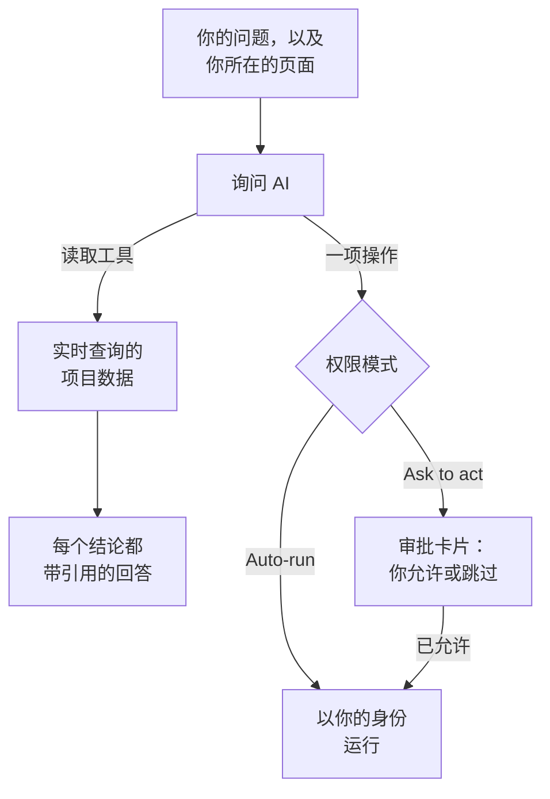

# 询问 AI

询问 AI 是 OneUptime 针对你项目数据的聊天。你可以问它日志、追踪、指标、异常、事件、警报、监视器、值班、状态页面、SLO、运行手册或工作流：它会实时查询你的项目，为每个结论附上引用，并在你允许时代你操作。

:::cards
- [打开询问 AI](#打开询问-ai): 从页头、键盘、图表或产品菜单打开。
- [它能看到什么](#它能看到什么): 它为回答你而读取的数据。
- [操作与权限模式](#操作与权限模式): 决定它是否可以操作，以及何时先征求同意。
- [操作以你的身份执行](#操作以你的身份执行): 用你的权限，每次更改都记在你的名下。
:::

## 询问 AI 如何回答

询问 AI 只根据其工具返回的结果作答：它对你的项目执行查询，而不是凭记忆回答。回答中的每个事实都带有引用标签，显示背后的查询并打开它读取的数据。当你让它更改某些内容时，由会话的权限模式决定它是否先征求你的同意。在你提问之前，它会先读取项目的 [AI 上下文](/docs/ai/ai-context)：你的团队为 OneUptime AI 写下的关于你们自己系统的说明。

在 **只读** 模式下，模型永远不会得到任何操作，因此会话只会读取。

## 打开询问 AI

| 位置 | 方法 |
| --- | --- |
| 任何页面 | 点击页头中的 **询问 AI**，或按 `Ctrl` + `I`（Mac 上为 `Cmd` + `I`）。当你在文本框或编辑器中输入时，这组按键仍是编辑器的斜体快捷键。 |
| 命令面板 | 按 `Ctrl` + `K`（Mac 上为 `Cmd` + `K`），然后选择 **询问 AI**。 |
| 日志中的错误模式，或图表的发现 | 点击 **用 AI 解释**：询问 AI 会打开，并把证据填成一个你可以在发送前编辑的问题。 |
| 产品菜单 | 打开 **产品 → AI → Chat**。询问 AI 会在你所在的页面之上打开。每个会话都有自己的地址，你可以把它加入书签，以后再回来。 |

询问 AI 会在屏幕中央、你所在的页面之上打开，在手机上则占满整个屏幕。按 `Esc` 或点击它旁边，即可回到页面。会话会停留在你离开时的样子：再次打开询问 AI 即可继续。如果你在它还在回答时关闭它，角落里的提醒会告诉你回答何时就绪，点击即可打开。

在事件或警报上，**AI Investigation** 卡片有一个自己的会话 **Ask OneUptime AI**，所有能看到该事件或警报的人共享这个会话：请参阅 [就事件与 OneUptime AI 对话](/docs/ai/ai-sre#与-oneuptime-ai-讨论事件)。

## 它能看到什么

询问 AI 以你自己的权限读取你的项目，所以它只能看到你有权看到的内容，不会更多。

| 领域 | 询问 AI 读取的内容 |
| --- | --- |
| 遥测 | 日志搜索和直方图、追踪聚合和 Span 树、指标、异常、安全事件、真实用户监控和 Web Vitals、最近的变更，以及基于已学习基线的异常检查。 |
| 基础设施 | 主机、Docker、Podman、Kubernetes、Docker Swarm、Proxmox、VMware vCenter、Ceph、存储阵列、无服务器函数、云环境、IoT 设备群和网络设备：清单中有什么、它们上报的连接状态、指标趋势、按严重程度统计的日志数量，以及追踪操作的摘要。一次查询既涵盖指明某个服务的遥测，也涵盖指明某个基础设施资源的遥测。 |
| 事件响应 | 事件和警报，可按状态筛选（"现在有什么处于活动状态？"），它们的活动时间线（状态变更、内部和公开备注、动态）及所有者，以及在过往事件中搜索，以复用当时的解决方法。 |
| 值班 | 现在谁在值班、策略和升级链，以及最近的呼叫是否已送达并被确认。 |
| AI 自己的工作 | AI SRE 调查和 AI Insights 的结果，这样"AI 发现了什么？"会根据已发布的分析来回答，而不是重新推导。 |
| 平台 | 监视器（可按状态筛选）、计划维护、状态页面及其公告、SLO、运行手册、工作流运行、探针健康状况、团队，以及已连接仓库中的代码。 |

## 页面上下文

询问 AI 知道你是从哪个页面打开它的。在事件页面上，"为什么会发生这种情况？"指的就是这个事件：输入区会显示一个带有页面主题的标签，它建议的问题也是这个页面的。移除标签即可询问整个项目，也可以用同样的方式把它加回来。在其他页面打开询问 AI，上下文会随你而动。会话还会在服务器上记住它最初的主题，因此几天后的追问仍能正确理解"这个事件"。

在事件、警报、监视器或计划维护事件上，建议的问题还会跟随该记录所处的状态，每次打开询问 AI 时都会读取。已解决的事件会问响应过程如何以及怎样防止再次发生，已解决的警报会问它是否是真实问题以及类似警报触发得有多频繁，未正常运行的监视器会问原因。尚未开始的维护事件会问它的监视器在开始前是否正常，已结束的会问它们是否已恢复正常。

基础设施列表和资源页面会为你正在查看的资源类型推荐问题。打开一个 Kubernetes 集群并问"过去 24 小时有哪些指标发生了变化？"，或打开一个 Docker 主机并问"总结过去六小时的日志严重程度和追踪错误。"证据链接会带你回到资源页面。读取遵守你对项目、资源和遥测的权限，包括所有者和标签方面的限制。

在子对象页面上，上下文还会记录你选择的 Pod、容器、VM、进程或其他子对象。基础设施工具读取的是父资源的遥测；它们无法仅凭名称测量某个子对象。询问 AI 会说明这一点，也不会猜测页面没有给出的 Kubernetes 命名空间。连接状态并不等于工作负载的健康状况，缺少遥测也不代表资源是健康的。

## 在你的基础设施上运行命令

在 AI 代理已连接的资源页面上打开时（主机、Docker 或 Podman 主机、Docker Swarm 集群、Proxmox 集群、VMware vCenter、Ceph 集群、数据库服务器或 Kubernetes 集群），询问 AI 会在你提出请求时通过该代理在资源上运行命令，例如“在这台主机上运行 `uptime`”或“显示 `journalctl -u nginx` 的最后 100 行”。它用返回的内容作答，并像其他证据一样附上引用。在事件或警报上打开时，它可以触及与之关联的资源。

- 它只运行 AI 调查在该类资源上可以运行的只读命令（请参阅[基础设施 AI 代理](/docs/ai/infrastructure-ai-agents)），每次回答通过每类代理最多 30 条，在任何权限模式下都先由 OneUptime 检查，再由代理检查一次。通过代理进行的更改（例如重启服务）绝不会从询问 AI 运行：它会改为给出确切的命令；代理只在 OneUptime AI 处理事件或警报时进行更改，并遵循该资源自己的修复设置。询问 AI 自己的操作（例如运行某个运行手册）遵循下文所述的会话权限模式。
- 它只触及你有权查看的资源，并且只在该资源的 AI 调查处于开启状态时。
- 当它无法在那里运行命令时（没有已连接的代理、代理离线，或该资源的 AI 调查已关闭），它会说明这一点以及需要更改什么，并改为根据你的项目数据作答。

## 操作与权限模式

每个会话都有一个权限模式，你可以在输入区、在输入框旁边选择：

| 模式 | 会发生什么 |
| --- | --- |
| **执行前询问** | 默认模式。询问 AI 会在审批卡片上提出每项操作，在你为其选择 **允许** 或 **跳过**，或者选择 **全部拒绝** 之前，什么都不会运行。 |
| **自动执行** | 模型一提出操作就会运行，但仍限于你的角色允许的范围。请谨慎使用。 |
| **只读** | 模型完全得不到任何操作：询问 AI 只能读取。 |

当模式允许时，询问 AI 可以做的事情：

- 创建事件或警报，确认或解决事件和警报，以及更改事件的严重程度。
- 将事件或警报关联到它所涉及的基础设施和服务。在资源页面（例如主机页面）上创建的事件或警报会关联到该资源，审批卡片会列出每个操作关联的对象。OneUptime AI 会调查并修复事件或警报所关联的对象。
- 在事件或警报上发布内部备注。内部备注永远不会显示在状态页面上。
- 在事件上发布公开的状态更新。这是一项单独的操作，因为它会通知状态页面的订阅者。
- 呼叫某个值班策略、运行某个运行手册，或为事件或警报启动 AI 调查。
- 提议代码更改：向 GitHub、GitLab、Forgejo 或 Gitea 上仓库的新分支提交，并打开一个 pull request（在 GitLab 上是合并请求）。它从不写入默认分支或受保护的分支，因此更改仍由人来合并。

当用户受到影响时，请让它创建事件；当某件事需要团队先关注时，例如主机内存持续升高，请让它创建警报。两者都只创建一次，不会监视任何内容：若要在每次主机内存超过 75% 时收到警报，请基于内存模板创建一个[主机监控](/docs/monitor/host-monitor#现成的警报模板)，并将阈值设为 75%。询问 AI 无法创建监视器。被要求创建时，它会如实说明，检查当前值，并在已经超过时提议创建一个警报。

## 操作以你的身份执行

询问 AI 执行的每项操作都以你的身份进行：它做出与仪表板对同一操作相同的更改，使用你在项目中的权限，并且更改记在你的名下。在聊天中确认一个事件，会产生与事件状态面板相同的状态变更，因此事件的时间线和动态会显示是你更改了它的状态。从聊天发出的呼叫会显示你是触发者。

- **每项操作需要什么。** 即仪表板对同一更改要求的权限。创建事件或警报需要创建它们的权限：可以创建它们的角色，或自定义角色中的 **Create Incident** 或 **Create Alert**。确认或解决事件需要更改其状态的权限：**项目所有者**、**项目管理员**、**项目成员**、**事件管理员** 和 **事件成员**，或自定义角色中的 **Create Incident State Timeline**；警报需要针对警报的相同权限（**Create Alert State Timeline**）。呼叫值班策略需要执行它的权限（**Create On-Call Duty Policy Execution Log**），运行运行手册需要启动运行手册执行的权限：可运行运行手册的角色（仅限其标签覆盖到的运行手册），或自定义角色中的 **Create Runbook Execution**，它覆盖项目中的所有运行手册。更改事件的严重程度、为事件或警报启动 AI 调查，以及向已连接仓库写入代码，需要更改该事件、警报或仓库的权限。你无权执行的操作会被拒绝，AI 会告诉你需要哪项权限。如果你拥有该权限，但你所在的某个团队阻止了它，AI 会告诉你这一点：对某些标签的阻止会使询问 AI 对所有记录拒绝该操作，而不仅是带有这些标签的记录。
- **哪些记录。** 即你有权更改的记录，与 OneUptime 其他地方一致：如果你的角色仅限于某些标签或你拥有的记录，对任何其他记录的操作都不会产生更改。只有当你启动运行手册执行的权限覆盖到某个运行手册时，它才会运行。在 OneUptime Cloud 上，项目套餐不包含的操作会被拒绝，并说明所需的套餐。
- **当操作被拒绝时。** 不会有任何更改，AI 会明确告诉你操作没有执行以及原因，而不是再试一次。
- **Slack、Microsoft Teams 和 AI 调查。** AI 在 Slack 和 Microsoft Teams 中的回答，以及自主 AI 调查，都只读取：它们不执行上述任何操作。要从 Slack 或 Microsoft Teams 操作，请使用 OneUptime 消息上的按钮，它们同样以你的身份执行（请参阅 [Slack](/docs/workspace-connections/slack#从-slack-处理事件警报和活动) 和 [Microsoft Teams](/docs/workspace-connections/microsoft-teams#从-microsoft-teams-处理事件警报和活动)）。

## 引导会话

- **停止它。** 询问 AI 工作时，发送按钮会变成停止按钮。你可以随时停止运行，并立即改问其他问题。
- **跟进它的工作。** 回答时，一行文字会说明它当前在做什么，例如搜索日志。点击旁边的步骤数即可查看每个步骤。
- **选择模型。** 当你的项目可以使用多个 LLM 提供商时，输入区的提供商选择器会列出你项目的 LLM 提供商和全局提供商，并标出默认的那个。新会话使用默认提供商。
- **为回答打分。** **回答很好** 和 **回答不佳** 会与消息一起保存，以便长期衡量回答质量。
- **查看费用。** 每个回答下方的来源可以展开为它执行的查询，最新回答的来源还会显示它执行的查询数量、token 数和费用。回答中的每个引用标签都可打开其背后的数据。
- **保留副本。** **下载对话** 可通过 **下载为 Markdown** 保存会话（便于阅读或粘贴到工单），或通过 **下载为 PDF** 保存（便于交给他人）。
- **从上次停下的地方继续。** 询问 AI 页头中的 **所有对话** 按从新到旧列出你的会话，可以再次打开或删除。新会话的开始界面会显示最近的三个。

## 要求

- **一个 LLM 提供商。** 询问 AI 使用项目的默认 LLM 提供商（请参阅 [LLM 提供商](/docs/ai/llm-provider)）。在 OneUptime Cloud 上，它开箱即可使用全局提供商，费用从项目的 AI 额度中支付；自托管安装需要配置一个提供商，或配置全局提供商的环境变量。回答的质量取决于模型：没有可靠工具调用能力的小型自托管模型回答得很差。
- **OneUptime Cloud 上的 Growth 套餐。** 套餐较低的项目会看到 AI 不包含在其套餐中的提示，并附有指向 **项目设置 → 账单和发票 → 账单** 的链接。
- **为项目开启 AI。** **项目设置 → 人工智能 → AI Features** 上的 **启用 AI** 会关闭项目的所有 AI 功能，包括询问 AI。除非有人关闭，否则它处于开启状态。

当项目设置了自己的每日 AI 限额时，询问 AI 也计入其中（项目设置 → 人工智能 → AI Features → 更多设置）：一旦达到某个限额，询问 AI 会显示一句话，说明达到了哪个限额、OneUptime AI 将在 UTC 午夜重新开始，以及谁可以提高或取消该限额。每天首次达到限额时，项目所有者会收到一封电子邮件。事件和警报的每日限额从不会停止询问 AI。请参阅 [项目自己的每日限额](/docs/ai/ai-sre#项目自身的每日限制)。

## 故障排除

:::details 询问 AI 提示 AI 不可用
询问 AI 会在你输入之前说明原因：项目套餐不包含 AI、**启用 AI** 已关闭，或项目没有 LLM 提供商。每条提示都会链接到可更改它的页面。
:::

:::details 某项操作被拒绝
询问 AI 会说明该操作需要哪项权限，或是哪个团队阻止了它。请有权进行更改的人来操作，或请项目所有者为你的角色授予该权限。没有任何更改。
:::

:::details 回答含糊，或从不使用数据
检查提供商背后的模型。询问 AI 需要能可靠调用工具的模型；小型本地模型常常一个查询都不执行就作答。请参阅 [LLM 提供商](/docs/ai/llm-provider)。
:::

## 后续步骤

:::cards
- [AI SRE](/docs/ai/ai-sre): 让 OneUptime AI 调查每个新的事件和警报。
- [LLM 提供商](/docs/ai/llm-provider): 选择询问 AI 和其他 AI 功能使用的模型。
- [MCP 服务器](/docs/ai/mcp-server): 改为从 Claude、Cursor 或 VS Code 询问 OneUptime。
:::
