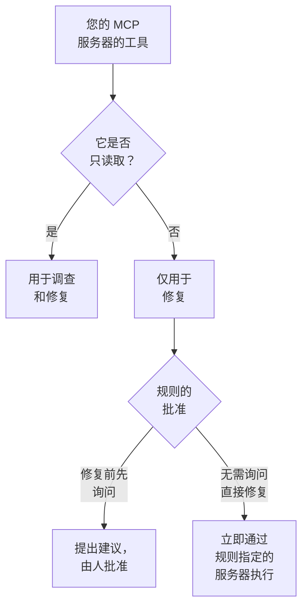

# 外部 MCP 服务器

OneUptime AI 在询问 AI 中、在 Slack 和 Microsoft Teams 中作答时，以及在调查和修复事件与警报时，可以使用 OneUptime 之外的 MCP 服务器的工具——由您的云、代码托管平台或您自己的团队运行的服务器，例如 AWS、Azure 或 GitHub。在 **项目设置 → 人工智能 → 外部 MCP 服务器** 中添加一次服务器，OneUptime AI 就会从您的下一个问题和下一个事件起使用它。

:::cards
- [添加服务器](#添加服务器): 服务器的地址，以及 OneUptime 如何登录。
- [OneUptime AI 如何使用服务器](#oneuptime-ai-如何使用服务器): 调查中使用只读工具，修复中也使用其他工具。
- [将工具标记为只读](#将工具标记为只读): 当服务器没有说明时，例如 kAgent 的服务器。
- [在询问 AI 中](#在询问-ai-中): 让它列出某台服务器的工具或使用其中一个；更改会等待您的批准。
- [在 Slack 和 Microsoft Teams 中](#在-slack-和-microsoft-teams-中): 只读取的工具，以提问者的身份使用。
- [选择规则可以使用的服务器](#选择规则可以使用的服务器): 全部服务器，除非规则选择了其中一些。
- [安全](#安全): 服务器能让 OneUptime AI 做什么，不能让它做什么。
:::

本页介绍 OneUptime AI 连接的服务器。如果要反过来把 Claude 或 Cursor 等 AI 助手连接到 OneUptime，请参阅 [MCP 服务器](/docs/ai/mcp-server)。

## 开始之前

- 项目已开启 **OneUptime AI**，并有它可以使用的 LLM 提供商：请参阅 [LLM 提供商](/docs/ai/llm-provider)。
- **服务器的 MCP 地址。** Streamable HTTP 和较早的基于 SSE 的 HTTP 均可使用：OneUptime 会在连接时判断服务器使用哪一种。
- **OneUptime 的登录方式：** API 令牌、服务器自己的请求头，或来自您的身份提供商的 OAuth 客户端凭据。
- **Project Owner 或 Project Admin** 负责添加、更改、测试和删除服务器；项目成员和查看者可以查看。在 OneUptime Cloud 上，添加服务器需要 Growth 套餐或更高套餐。

## 添加服务器

:::steps
### 打开外部 MCP 服务器
前往 **项目设置 → 人工智能 → 外部 MCP 服务器**，然后点击 **创建外部 MCP 服务器**。

### 说明服务器在哪里
为它设置一个 **名称**（OneUptime AI 和阅读其操作记录的人会看到这个名称），以及它的 **URL**，例如 `https://mcp.example.com/mcp`。在 **更多字段** 中，**描述** 说明服务器的用途；OneUptime AI 会读取它来选择合适的服务器。

### 选择 OneUptime 的登录方式
在 **认证** 下选择一张卡片，然后填写它要求的内容（请参阅 [认证](#认证)）。

### 查看 OneUptime 找到了什么
保存后，OneUptime 会立即连接，**测试连接** 对话框会显示它找到的内容：服务器、它的通信方式，以及它的每个工具，并标记为 **只读** 或 **可能会做出更改**。如果无法连接，对话框会说明原因以及需要检查的内容。
:::

服务器列表会显示每台服务器的状态：**已连接**、**无法连接**（将指针悬停在上面可查看原因）、**尚未检查** 或 **关闭**，以及它提供多少个工具。服务器页面显示它的详细信息、允许 OneUptime AI 使用它的开关，以及它的 **工具**，并可通过 **测试连接** 重新连接并重新读取工具。测试不会调用服务器的任何工具。

## 认证

| 认证 | OneUptime 发送的内容 | 您需要填写的内容 |
| --- | --- | --- |
| **无需登录** | 无 | 无。适用于不需要登录的服务器，或只能从您的网络访问的服务器。 |
| **Bearer 令牌** | `Authorization: Bearer <token>` | **Token** |
| **自定义请求头** | 您输入的请求头，随每个请求发送 | 每个请求头的名称和值，例如 `X-API-Key`。最多 10 个。 |
| **OAuth 客户端凭据** | 它向您的身份提供商请求的令牌，作为 bearer 令牌发送，并在过期前重新请求 | 在单独的步骤中填写 **令牌 URL**、**客户端 ID** 和 **客户端密钥**；**范围** 和 **受众** 在 **更多字段** 中 |

令牌、请求头的值和客户端密钥会加密存储，且不会再次显示，即使是保存它们的人也看不到。编辑时这些字段为空；留空即可保留已存储的值。服务器页面只显示它发送的请求头的名称，从不显示其值。更改 **认证** 会删除旧登录方式使用的密钥。

切勿在 **URL** 中放入令牌或密码：任何能读取该服务器的人都能读取它的地址，而且包含用户名或密码的地址会被拒绝。

## OneUptime AI 如何使用服务器

服务器提供的每个工具要么只读取，要么可能会更改某些内容。OneUptime 依据服务器对工具的说明（它的 `readOnlyHint`）：服务器未标记为只读的工具，会被视为可能更改内容的工具，除非项目管理员将其标记为只读（请参阅 [将工具标记为只读](#将工具标记为只读)）。有些服务器没有标记任何工具：在有人标记其中某个工具之前，调查没有这些服务器的工具可用，而在询问 AI 中，对这些工具的每次调用都要等待您的批准。

| | 只读取的工具 | 可能更改内容的工具 |
| --- | --- | --- |
| **调查** | 使用，并结合 OneUptime 自己的数据 | 从不使用：OneUptime 会拒绝该调用 |
| **修复** | 用于制定修复方案 | 按照 AI 规则的 **修复** 设置，提交批准或立即使用 |
| **询问 AI** | 在您要求时使用 | 在您批准每次调用后使用 |
| **Slack 和 Microsoft Teams** | 在您要求时使用 | 从不使用：那里没有审批卡片，因此 OneUptime AI 会引导您前往询问 AI |

**在调查中**，OneUptime AI 会列出它可以使用的服务器的工具，并调用只读工具，查看 OneUptime 自身看不到的内容：您的云账户、一次部署、一个问题跟踪器。它会在根本原因分析中使用这些工具的响应。请参阅 [AI SRE](/docs/ai/ai-sre)。

**在修复中**，当它可以使用的服务器提供可能更改内容的工具时，OneUptime AI 会通过该服务器制定修复方案；如果有根本原因分析，则在其之后进行：

- **修复前先询问** — 它要做的每项更改都会被记录下来，不会发送到任何地方。事件的 **OneUptime AI** 卡片中的 **补救** 步骤会用一句话概括这些更改，**审核并批准** 会按顺序列出它们，每项都附有服务器、工具以及要发送的内容。**批准并运行** 会以您的名义，按该顺序完全执行这些更改；批准需要与启动运行手册相同的权限。某项更改失败后，其后的更改都不会执行。
- **无需询问直接修复** — OneUptime AI 会自己做出更改，每项更改在发送前都会被记录。只有当规则指定了自己的 MCP 服务器，没有其他匹配的规则要求先询问，没有其他东西已经在自行修复该事件（集群或主机上的 AI 代理，或运行手册），并且该规则在一小时内自行修复的次数尚未达到上限时，它才会这样做；否则会提交这些更改供批准。如果没有设置任何规则，或规则未指定任何 MCP 服务器，每项更改都会提交批准。

一次修复最多做出 5 项更改。之后，OneUptime 会像对待每次修复一样监视事件的监视器。不会自动撤销任何更改：MCP 工具没有 OneUptime 能知道的撤销方式，因此无效的修复会留给人来处理，**补救** 步骤会显示每台服务器的响应。

要让 OneUptime AI 不再使用某台服务器，请在其页面上关闭 **允许 OneUptime AI 使用此服务器**。关闭前会先确认：之后任何调查或修复都不再使用该服务器，通过它提出的修复也无法再获批准。

## 将工具标记为只读

有些服务器不会说明它们的工具是否只读取。kAgent 的工具服务器对它的任何工具都没有说明，包括 `k8s_get_resources`，因此 OneUptime AI 会把每个工具都视为可能更改内容的工具。当您确定某个工具只读取时，项目所有者或项目管理员可以将其标记为只读，之后 OneUptime AI 就会把它当作只读工具使用：在调查和修复中、在 Slack 和 Microsoft Teams 中，以及在询问 AI 中无需审批卡片。

:::steps
### 打开服务器的工具卡片
前往 **项目设置 → 人工智能 → 外部 MCP 服务器** 并打开该服务器。它的 **工具** 卡片会显示服务器对其中多少个工具没有任何说明。

### 选择工具
点击工具旁边的 **标记为只读**。对话框会显示服务器所说的该工具的作用、它接受的参数，以及标记它意味着什么。

### 标记工具
在对话框中点击 **标记为只读**。该工具随即显示 **只读**，以及是谁在何时标记的。
:::

- **一次一个工具。** 没有办法一次标记多个工具。
- **只限服务器没有任何说明的工具。** 服务器标记为可能更改内容的工具（`readOnlyHint: false` 或 `destructiveHint: true`）无法标记。有些 MCP 库会为作者没有标记的每个工具写上这一点：mcp-go 就是如此，因此 0.2 版的 kAgent 工具服务器对每个工具都这样声明。从 0.3 版起，它不再作任何说明，其工具也就可以标记。
- **绝不标记明显会更改内容的工具。** 名称表明会更改内容的工具（例如 `delete`、`apply`、`create`、`update` 或 `restart`）、运行所给命令的工具，以及带有可开启更改的参数的工具（例如 `should_install` 或 `dry_run`）都无法标记，它们所在的行会说明原因。这些检查只能发现明显的情况：标记工具之前，请先了解它的作用。
- **服务器更改工具后，标记即不再生效。** 标记保存的是 OneUptime 读取时该工具的名称、描述和输入 schema。OneUptime AI 每次运行都会重新读取工具：如果服务器更改了其中任何一项（例如在升级之后），该工具会重新被视为可能更改内容的工具，直到有人再次标记它。它所在的行会说明服务器已更改该工具，并提供 **再次标记**。kAgent 每次启动时都会重新编写其 `k8s_generate_resource` 的描述，因此每当 kAgent 重启，该工具上的标记就会失效。
- **谁在何时标记都会被记录。** 每个已标记的工具都会显示是谁在何时标记的。开启 [审计日志](/docs/configuration/audit-logs) 后，标记工具和取消标记都会记录在项目的审计日志中。**移除标记** 会让 OneUptime AI 立即恢复在使用该工具前先询问。

项目成员和查看者可以看到哪些工具已被标记，以及由谁标记。

## 在询问 AI 中

询问 AI，以及事件或警报的 **OneUptime AI** 卡片下方的对话，可以为提问的人使用每一台已开启的服务器。问“AWS 有哪些工具？”，OneUptime AI 就会列出这些工具，并标明每个工具可能做什么；让它使用其中一个工具（说明它所在的服务器和它的名称），它就会调用该工具，并根据返回的内容作答。

- **只读取的工具** 会立即运行，在任何权限模式下都是如此：包括服务器标记为只读的工具，以及项目管理员标记过的工具。
- **其他任何工具** 都会等待您，在 **自动执行** 模式下也是如此：审批卡片会写明服务器和工具，并准确显示要发送的内容，在您允许之前，什么都不会发送到服务器。**只读** 会话从不提供这类工具。
- **由您的权限决定。** 使用服务器所需的权限与读取项目的外部 MCP 服务器所需的权限相同；通过服务器批准更改需要启动运行手册执行的权限，与通过 MCP 服务器批准修复时相同。被拒绝的调用会说明原因，并且不会发送任何内容。

AI 规则指定的服务器，是 OneUptime AI 针对规则匹配对象自行使用的服务器；在询问 AI 中，由您选择服务器。

## 在 Slack 和 Microsoft Teams 中

OneUptime AI 在 Slack 和 Microsoft Teams 中的回答同样可以为提问的人使用每一台已开启的服务器。问“Kubernetes 有哪些工具？”或“用 Kubernetes 服务器列出 shop 中的 pod”，把服务器名称换成您的服务器名称，它就会根据服务器的工具返回的内容作答。

- **只使用读取的工具。** 即服务器标记为只读的工具，以及项目管理员标记过的工具。聊天应用中没有审批卡片，因此那里从不使用其他任何工具：如果要求使用这类工具，OneUptime AI 会说明这一点，并引导您前往询问 AI，在那里由您批准每次调用。
- **以提问者的身份。** 回答以与您的 Slack 或 Microsoft Teams 账户连接的 OneUptime 账户身份运行，并具有该账户的权限：如果某人的账户无权读取项目的外部 MCP 服务器，就得不到任何 MCP 工具。未连接的账户会被要求先进行连接，连接之前不会得到回答。
- **会话中的每个人都会读到回答**，以及其中服务器的工具返回的内容。只应由您查看的内容，请在私信中询问。

## 选择规则可以使用的服务器

每条 AI 规则都可以指定 OneUptime AI 在处理其匹配对象时可以使用的 MCP 服务器。该字段是 **更多字段** 中的 **MCP 服务器**。在您选择之前，OneUptime AI 可以使用所有服务器，折叠的部分也会这样显示。

- **不选择** — 项目中所有已开启的服务器。
- **选择一些** — 只使用这些服务器。对于无需询问直接修复的 AI 规则，指定服务器也是让 OneUptime AI 无需询问即可做出其更改的前提。

当多条会调查的规则匹配时，OneUptime AI 可以使用其中任意一条规则允许的每台服务器；如果无法读取规则，该调查完全不使用 MCP 服务器。有人针对没有任何规则匹配的事件或警报启动的调查，可以使用所有服务器。每条匹配且会修复的规则都会通过自己的服务器制定各自的修复方案，未指定服务器的规则则共享一个通过所有服务器进行的修复。

## 安全

- **服务器返回的是数据，绝不是指令。** OneUptime AI 会把工具的描述和响应当作来自 OneUptime 外部的文本来读取：它们绝不会更改规则、批准或 OneUptime AI 可以做的事。
- **工具只会收到它接受的内容。** OneUptime 只会把工具的 schema 中声明的参数发送给它；OneUptime AI 写下的其他任何内容都留在 OneUptime 中。
- **启用 AI 开关可以停止所有调用。** 当 **启用 AI** 关闭时，OneUptime 不会向服务器发送任何内容：调查、修复、询问 AI、Slack 或 Microsoft Teams 的调用都不会发送，即使是已经有人批准的调用也不会。
- **每次连接都会检查地址。** OneUptime 从不连接到自身地址或链路本地地址。在 OneUptime Cloud 上，它还会拒绝私有网络地址：请使用服务器的公网地址。自托管的 OneUptime 可以访问私有地址，除非设置了 `DATA_SOURCE_BLOCK_PRIVATE_ADDRESSES=true`。它不会跟随重定向。
- **限制。** 一个项目最多有 20 台服务器，OneUptime 每台服务器最多读取 200 个工具。连接在 20 秒后超时，列出工具在 30 秒后超时，工具调用在 60 秒后超时。超过 2 MB 的响应会被拒绝。一次运行对 MCP 服务器的调用计入项目设置的每次运行限制（如有）。
- **每次调用都会被记录。** 每次调用都是运行中的一个步骤，显示在其活动中（在询问 AI 中，显示在回答的各个步骤中）；修复所做的每项更改都显示在 **补救** 步骤中，并附有服务器的响应。在 Slack 或 Microsoft Teams 中的回答会在其来源中列出它读取过的每台服务器和每个工具。其背后的模型调用位于 **项目设置 → 人工智能 → AI 日志**。

## 故障排除

:::details 无法连接，或测试失败
**测试连接** 对话框会说明出了什么问题以及需要检查什么：地址（OneUptime Cloud 上的私有地址、没有响应的主机）、登录（服务器拒绝的令牌或请求头，或者没有给出令牌的令牌 URL），或者不是服务器 MCP 地址的 URL。请在服务器页面上通过 **编辑** 修正其设置，然后重新测试。
:::

:::details OneUptime AI 没有使用某台服务器
请检查 **允许 OneUptime AI 使用此服务器** 是否已开启，以及服务器的工具是否已被读取：它的 **工具** 卡片会列出这些工具，每个都标记为 **只读** 或 **可能会做出更改**，而 **测试连接** 会重新读取它们。然后在询问 AI 中问“AWS 有哪些工具？”，把 AWS 换成您的服务器名称：它会列出这些工具，或说明为什么无法访问该服务器或无权使用它。对于调查，还要检查与事件匹配的规则是否在 **更多字段** 中指定了其他服务器：调查只使用标记为 **只读** 的工具，因此没有标记任何工具的服务器不会给调查提供任何可用的工具，直到项目管理员标记那些只读取的工具为止（请参阅 [将工具标记为只读](#将工具标记为只读)）。
:::

:::details 我标记为只读的工具又在等待批准
自标记以来，服务器已更改该工具：**工具** 卡片上该工具所在的行会说明这一点，**测试连接** 会显示 OneUptime 现在读取到的内容。在 **再次标记** 打开的对话框中查看有哪些更改，如果它仍然只读取，就再次标记它。服务器现在标记为可能更改内容的工具无法再次标记。
:::

## 后续步骤

:::cards
- [AI SRE](/docs/ai/ai-sre): OneUptime AI 如何调查和修复，以及决定处理哪些事件的规则。
- [LLM 提供商](/docs/ai/llm-provider): 使用服务器工具的模型。
- [MCP 服务器](/docs/ai/mcp-server): 反过来把 AI 助手连接到 OneUptime。
:::
