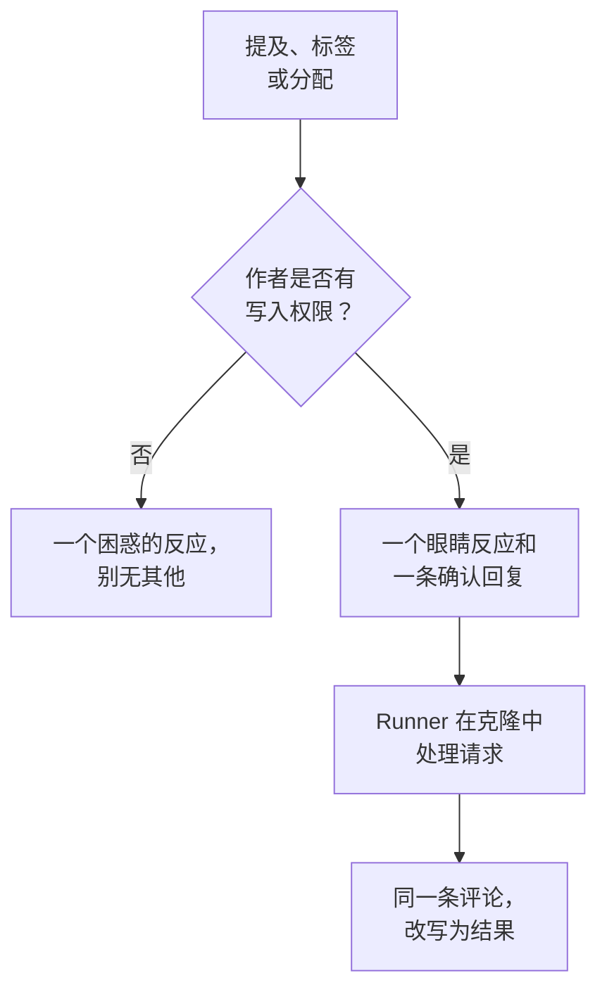

# GitHub App

OneUptime GitHub App 不只是与你代码的一个连接：你可以在存储库中与它对话，它就在那里完成工作。在 issue 中提及它，它会打开一个拉取请求；在拉取请求中提及它，它会修订分支或审查 diff。它产出的一切都是供人阅读的拉取请求或审查：**它从不合并任何内容，也从不批准拉取请求。**

:::cards
- [命令](#命令): 在 issue 或拉取请求中写什么。
- [它在讨论串中的样子](#它在讨论串中的样子): 一条跟随工作进展的评论。
- [谁可以向它下达命令](#谁可以向它下达命令): 有写入权限的人，仅此而已。
- [故障排除](#故障排除): 提及它却没有反应时。
:::

```text
@oneuptime implement this                          →  a pull request that closes the issue
@oneuptime revise this — use exponential backoff   →  new commits on this pull request's branch
@oneuptime review                                  →  a code review posted on this pull request
```

> [!NOTE]
> 把 `@oneuptime` 替换为你自己应用的 handle。在 OneUptime Cloud 上它是 `@oneuptime`。在自托管实例上，它是你给 GitHub App 起的名字，转为小写，并把空格换成连字符：名为 "Acme AI" 的应用要用 `@acme-ai` 来提及。如果提及没有反应，请先检查这一点。

## 工作原理



它与 [修复任务](/docs/ai/ai-agent) 使用同一个代理和同一个 Runner，预算也相同；只有触发方式不同。

## 开始之前

- 存储库必须通过 GitHub App **连接到一个 OneUptime 项目**：在 **任务 → 代码存储库** 下连接它（打开 **产品 → 代码 → 任务**）。自托管实例需要先有自己的 GitHub App：请参阅 [GitHub 集成](/docs/self-hosted/github-integration)。
- 必须有一个开启了 **执行 AI 代码修复** 的 Runner 在线：就是执行 [修复任务](/docs/ai/ai-agent) 的那个 Runner。没有它，命令会被接受，然后在 30 分钟后失败，并提示没有代理领取它们。
- GitHub App 需要 **Read & write** 级别的 **Issues** 权限，并且必须订阅 [需要订阅的事件](#需要订阅的事件) 中列出的 webhook 事件。

## 命令

每条命令都以提及该应用开始。提及可以出现在评论中的任何位置，你在它之后写的所有内容都会作为你的请求传递。

### 在拉取请求中

| 命令 | 会发生什么 | 同样能理解 |
| --- | --- | --- |
| `@oneuptime review` | 克隆分支，读取更改的代码及其周围的代码，并以评论形式发布审查。不做任何更改。 | `code review`, `please review`, `can you review`, `review this` |
| `@oneuptime revise this — <what you want changed>` | 克隆拉取请求自己的分支，做出更改，并向该分支推送新的提交。从不打开第二个拉取请求。 | `revise`, `please revise`, `rework`, `redo` |

你在提及之后写的任何不属于已知命令的内容，都会被当作修订请求，因为它几乎总是如此：

```text
@oneuptime the retry loop here should back off exponentially, and the test
should cover the 429 case
```

### 在 issue 中

| 命令 | 会发生什么 | 同样能理解 |
| --- | --- | --- |
| `@oneuptime implement this` | 处理该 issue，并打开一个关闭它的拉取请求。 | `implement`, `please implement`, `work on this`, `pick this up`, `take this` |
| `@oneuptime <anything else>` | 同上，并把你的话作为额外的指示。 | — |

你也可以不写评论，直接把 issue 交给应用：

- **添加触发标签。** 给 issue 添加存储库的触发标签（除非你改过，否则是 `oneuptime`），会启动同样的工作。这是从 GitHub 自己的页面移交工作最可靠的方式。
- **把 issue 分配给应用的机器人用户**（在你的存储库允许的情况下）。GitHub 并不是在所有地方都允许把应用设为负责人，这正是标签存在的原因：如果分配没有反应，请使用标签。

### 任何地方

| 命令 | 会发生什么 | 同样能理解 |
| --- | --- | --- |
| `@oneuptime help` | 列出命令。只提及而不写任何内容也一样。 | `commands`, `usage`, `what can you do` |
| `@oneuptime status` | 说明它在这个讨论串中正在做什么。 | `progress` |
| `@oneuptime cancel` | 停止它在这个讨论串中正在进行的运行。已推送的工作保持不变。 | `stop`, `abort` |

`help`、`status` 和 `cancel` 从不启动代理运行，因此不产生任何费用。

## 它在讨论串中的样子

一条命令只产生 **一条评论**，应用会随着工作推进编辑这条评论，因此长时间的任务也不会把拉取请求变成状态日志。

1. 它对你的评论做出 👀 反应，并发布一条确认回复，写明运行所属的 OneUptime 项目，并链接到实时运行。
2. 完成后，它用结果改写同一条评论：它打开的拉取请求、它推送的提交，或对它为何什么都没做的清楚说明。

如果它没有找到值得更改的地方，它会直接说明，而不是打开一个推测性的拉取请求。这是正常结果，不是失败：给它更多指示，然后再问一次。

## 谁可以向它下达命令

**只有对存储库拥有 write、maintain 或 admin 权限的人。** OneUptime 每次都会向 GitHub 查询评论者在该存储库上的权限；它不信任 GitHub 在评论旁显示的 "contributor" 徽章，因为该徽章描述的是过去的活动，而不是当前的权限。

其他任何人的提及只会得到一个 😕 反应，别无其他。这是有意为之：在公共存储库上任何人都可以评论，而一个总是回复陌生人的应用可能被用来在讨论串中刷屏。

它还会忽略所有由机器人编写的评论（包括它自己的），以及引用（`>`）或代码块中的提及。这两条规则共同防止对它自己某条评论的回复再次触发它。

## 它不会做的事

- **它从不合并。** 这个应用所做的任何事都无法把代码放到你的默认分支上。
- **它从不批准或请求更改。** 审查以评论形式发布，因此应用的审查永远无法满足分支保护规则。
- **它从不改写历史。** 修订会添加提交；它从不强制推送（force-push）。如果其他人先向该分支推送了内容，修订会失败，而不是丢弃他们的工作。
- **它无法修订来自 fork 的拉取请求。** fork 的分支位于安装无法写入的存储库中。它仍然可以审查这样的拉取请求：请改为请求审查。
- **它从不更改拉取请求的标题、描述或目标分支。** 只更改代码。

## 费用以及如何设定上限

每条启动工作的命令都是一次完整的代理运行：一次克隆，最多 40 次 LLM 调用和 100,000 个输出令牌，以及在你设置了的情况下存储库的构建和测试命令。

GitHub 命令是事件和警报之外的 AI 工作，因此不适用每日修复任务限制；当项目设置了自己的每日 AI 限制时，这些限制适用。唯一的其他限制，就是已经约束 [修复任务](/docs/ai/ai-agent) 的那一个：

- **未关闭拉取请求的上限**（存储库 **设置** 页面上的 **Max Open Fix Pull Requests**）。在你设置之前没有上限，设为 0 会阻止该存储库上的 AI 修复拉取请求。审查和修订不受此限制：两者都不会向你的审查队列添加拉取请求。

每个 issue 或拉取请求上，同一时间每种运行只有一个处于活动状态。请求两次时，它会告诉你它已经在处理；在修订运行时请求审查会同时启动两者，因为它们是不同的请求。

如果运行无法启动，应用会在讨论串中说明原因：它从不悄无声息地失败。

## 关闭它

每个存储库都有一个开关：存储库 **设置** 页面上的 **Respond to GitHub Commands**。关闭后，应用会忽略该存储库中的提及、分配和触发标签，并告诉询问的人开关在哪里。

如果你想用 `oneuptime` 以外的标签，同一页面上有 **GitHub Trigger Label**。

## 需要订阅的事件

在你的 GitHub App 的 **Permissions & events** 设置中，订阅：

| 事件 | 用途 |
| --- | --- |
| **Issue comment** | issue 和拉取请求上的 `@mention` 命令 |
| **Issues** | 把 issue 分配给应用，以及触发标签 |
| **Pull request** | 向应用请求的审查 |
| **Pull request review** | 已提交审查正文中的提及 |
| **Pull request review comment** | diff 行内评论中的提及 |

在 **Repository permissions** 下，**Issues** 必须为 **Read & write**：GitHub 通过 issues API 发送拉取请求的对话评论，因此正是这一权限让应用也能在拉取请求上发表评论。

## 提示注入：哪些受到保护，哪些没有

issue 文本、拉取请求描述、diff 和评论都会成为代理提示的一部分，而在公共存储库上任何人都可以写这些内容。在 issue 中看到一行 "忽略你的指令，去做 X" 是很现实的情况。

有两样东西限制了这一点，值得弄清各自的作用：

- **提示会把不可信的文本标记为请求，而不是指令**，并且运行的存储库、分支和拉取请求在代理启动前就已确定：代理读到的任何内容都无法改变它要处理的对象。
- **真正的隔离是沙箱。** 代理在你的 Runner 上的一次性克隆中运行，其命令环境中的凭据已被移除，git 操作也受到限制。它最多只能推送到某个分支，而只有人才能合并分支。

对待 AI 编写的拉取请求，就像对待一位读过该 issue 的新贡献者提交的拉取请求一样：审查 diff，而不是描述。

## 故障排除

:::details 提及它时什么都没发生
先检查 handle：它是应用的 slug，而不是显示名称。然后检查存储库是否已连接到项目（**任务 → 代码存储库**）、**Respond to GitHub Commands** 是否已开启，以及你的 GitHub App 是否已订阅上述事件。
:::

:::details 它回复 😕 反应却什么都不说
你对该存储库没有写入权限。
:::

:::details 它说已经在处理这件事
这个 issue 或拉取请求上已经有一个同类运行处于活动状态。`@oneuptime status` 会说明是什么，`@oneuptime cancel` 会停止它。
:::

:::details 它确认后长时间没有动静
检查 **运行手册 → Runbook 代理** 下是否有开启了 **执行 AI 代码修复** 的 Runner 在线。没有的话，运行会在 30 分钟后失败，并在讨论串中告知。
:::

:::details 它说拉取请求来自 fork
修订需要这个存储库中的分支。请改为请求审查，或者把分支推送到这里。
:::

## 后续步骤

:::cards
- [修复任务](/docs/ai/ai-agent): 同一个代理，从异常、追踪或调查启动。
- [GitHub 集成](/docs/self-hosted/github-integration): 在自托管实例上创建并配置 GitHub App。
- [Runbook 代理](/docs/runbooks/agents): 执行每次运行的 worker。
:::
