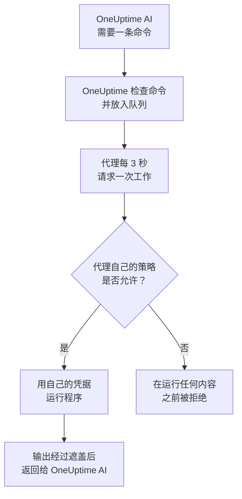

# 基础设施 AI 代理

OneUptime AI 在调查事件或警报时，能看到的不只是您的遥测数据。安装在您某个资源旁边的小型代理——Docker 或 Podman 主机、Docker Swarm 集群、Proxmox 集群、VMware vCenter、Ceph 集群、数据库服务器或 Linux 主机——会运行 OneUptime AI 请求的只读命令，例如 `docker logs --tail 200 web`、`pvesh get /cluster/status`、`ceph health detail`、`db long-queries --min-seconds 30` 或 `journalctl -u nginx -n 200 --no-pager`，并把输出发回，因此根本原因分析会引用资源本身给出的信息。如果您允许，同一个代理还会应用修复——重启容器、启动虚拟机、把 OSD 重新标记为 in——每项修复都由命令策略划入某个级别，并且除非您另作选择，都要先由人批准。

这些代理就是 **资源 AI 代理**。每个资源的仪表板页面都有一个 **人工智能** 部分，包含三个页面：

- **洞察** ——OneUptime AI 在过去 30 天里对该资源的了解：反复出现的问题及其原因（附带 AI 的发现和建议的步骤）、导致其中大部分问题的资源部分、没有起作用或正在等待批准的修复、AI 自行修复的内容，以及在任何人被呼叫之前发现的风险，并以脚注说明 AI 自己在那里做了什么。它的工作方式与集群的页面相同，参见 [AI 在集群上了解到的情况](/docs/ai/ai-sre#ai-在集群上了解到的情况)。
- **日志** ——OneUptime AI 在该资源上做过的所有事情，按从新到旧排列：每次调查及其事件或警报和摘要、它提出或运行的每项修复，以及它通过代理发送的每条命令。（此页面以前叫作“洞察”。）
- **AI 代理** ——代理是否已连接、AI 可以在该资源上做什么（调查，以及修复的运行方式）、需要关注的任何事项及其解决步骤，以及代理状态旁边 **⋯** 菜单中的 **测试连接** 和 **重置代理**。

资源的 **概览** 末尾有一张 **AI 代理** 卡片，汇总 AI 代理页面的内容：代理是否已连接、调查是否开启、修复如何运行（**关闭**、**请求批准**、**自动** 或 **跳过批准**）以及需要关注的事项，并附有指向 AI 代理页面的链接，可在那里更改这些设置。

:::cards
- [支持的资源](#支持的资源): 八种资源，一个镜像。
- [安装 AI 代理](#安装-ai-代理): 在您已经运行的采集器旁边，或在 Linux 主机上。
- [修复的工作方式](#修复的工作方式): 什么可以自行运行，什么需要等待人，什么永远不会运行。
- [安全模型](#安全模型): 每条命令都有三重检查，且不会从 OneUptime 获得任何凭据。
:::

## 工作原理

代理从不等待来自 OneUptime 的连接：它主动连接 OneUptime、请求工作，并且只用自己已有的凭据运行它自己那份命令策略副本所允许的内容。



## 与 Kubernetes AI 代理的关系

Kubernetes 集群有自己的代理，即 Kubernetes AI 代理，由 Kubernetes 代理的 Helm chart 安装，参见 [集群访问——让 OneUptime AI 运行 kubectl](/docs/ai/ai-sre#集群访问让-oneuptime-ai-运行-kubectl)。本页的任何内容都不会改变它。资源 AI 代理遵循相同的设计：

- **相同的级别和模式。** 每条命令都是 **Read**、**SafeWrite**、**RiskyWrite** 或 **Denied**，修复则是 **关闭**、**请求批准**、**自动** 或 **跳过批准**，含义与集群上相同。
- **相同的三重检查。** 同一份命令策略由 OneUptime 的 AI 工具执行，在 OneUptime 将命令放入队列时再执行一次，并在代理运行任何内容之前再由代理执行一次。
- **相同的凭据规则。** 代理只使用其自身环境和挂载提供给它的内容。OneUptime 从不向它发送凭据。
- **相同的默认值。** AI 调查默认开启：资源与集群一样，以调查开启、修复关闭的状态开始，因此代理一连接，OneUptime AI 就会借助它进行调查，并且在有人允许修复之前不会更改任何内容（参见 [连接到 OneUptime](#连接到-oneuptime)）。

不同之处：

- **所有资源共用一个镜像。** `oneuptime/resource-ai-agent` 服务全部八种资源，`ONEUPTIME_AI_AGENT_RESOURCE_TYPE` 指明代理服务的是哪一种。它作为资源采集器旁边的又一个容器运行，而不是来自 Helm chart。
- **写入权限是一个环境变量。** 只有代理上设置了 `ONEUPTIME_AI_ALLOW_WRITES=true`，它才能应用修复，而 `ONEUPTIME_AI_WRITE_TARGETS` 限制修复可以触及哪些容器、服务、虚拟机、OSD、会话或单元。在集群上，这由 chart 的 RBAC 和 `aiAgent.remediation.namespaces` 负责。

与 Kubernetes AI 代理一样，资源 AI 代理不是 Runner。它从不出现在 运行手册 → Runbook 代理 下，也从不被用作运行手册的 Bash 或 SSH 主机。

## 支持的资源

| 资源 | `ONEUPTIME_AI_AGENT_RESOURCE_TYPE` | 代理 | 注册时使用的名称（采集器的变量） | 运行的程序 | 访问资源的方式 |
| -------------------- | ---------------------------------- | --------------------- | ----------------------------------------------------------------------------------------------- | -------------------------------------------------------------------------------------------------------------------------------------------------- | -------------------------------------------------------------------------- |
| Docker 主机 | `docker` | Docker AI 代理 | `DOCKER_HOST_NAME` | `docker` | Docker 套接字，`/var/run/docker.sock` |
| Podman 主机 | `podman` | Podman AI 代理 | `PODMAN_HOST_NAME` | `docker`，通过 Podman 的 Docker 兼容 API | Podman 套接字，`/run/podman/podman.sock` |
| Docker Swarm 集群 | `docker-swarm`（或 `swarm`） | Docker Swarm AI 代理 | `DOCKER_SWARM_CLUSTER_NAME` | `docker` | 管理节点的 Docker 套接字 |
| Proxmox 集群 | `proxmox` | Proxmox AI 代理 | `PROXMOX_CLUSTER_NAME` | 发送到 Proxmox VE API 的 `pvesh` 命令（代理中没有 `pvesh` 二进制文件） | `https://PVE_HOST:8006/api2/json`，使用 Proxmox API 令牌 |
| VMware vCenter | `vmware`（或 `vcenter`） | VMware AI 代理 | `VMWARE_VCENTER_NAME` | `govc` | vCenter 的 API，使用 vSphere 用户 |
| Ceph 集群 | `ceph` | Ceph AI 代理 | `CEPH_CLUSTER_NAME` | `ceph` | 监视器，使用 `ceph.conf` 和代理专用客户端的密钥环 |
| 数据库服务器 | `database`（或 `db`） | 数据库 AI 代理 | `DATABASE_SERVER_ID`，或 `DATABASE_SYSTEM` + `DATABASE_SERVER_ADDRESS` + `DATABASE_SERVER_PORT` | `db`——固定诊断目录中的一项操作，从不执行 SQL | 数据库自己的驱动程序，使用数据库登录名 |
| 主机 | `host` | 主机 AI 代理 | `HOST_NAME`（为空时使用主机自己的主机名） | `systemctl`、`journalctl`、`df`、`free`、`uptime`、`ps`、`ss`、`ip`、`dmesg`、`lsblk`、`cat`、`top`、`uname`、`hostnamectl`、`timedatectl`、`kill` | 从特权容器通过 `nsenter` 进入主机的命名空间 |

数据库服务器：数据库 AI 代理提供针对 PostgreSQL、MySQL（以及 MariaDB 和 Percona Server）、Redis（以及 Valkey、KeyDB 和 Dragonfly）和 MongoDB 的诊断。对于任何其他引擎，它不运行任何内容，并在数据库的 AI 代理页面上说明这一点。

AI 代理页面上代理状态旁边 **⋯** 菜单中的 **测试连接** 会通过代理运行以下只读命令，并在代理的卡片中显示它们的输出：

| 资源 | 测试连接运行的命令 |
| -------------------- | ---------------------------------------------------- |
| Docker 主机 | `docker version`、`docker info` |
| Podman 主机 | `docker version`、`docker info` |
| Docker Swarm 集群 | `docker version`、`docker node ls` |
| Proxmox 集群 | `pvesh get /version`、`pvesh get /cluster/status` |
| VMware vCenter | `govc about` |
| Ceph 集群 | `ceph health`、`ceph versions` |
| 数据库服务器 | `db ping`、`db version` |
| 主机 | `uptime`、`systemctl list-units --failed --no-pager` |

在 Docker Swarm 的工作节点上，`docker node ls` 会失败：Docker Swarm AI 代理必须在管理节点上运行。在工作节点上启动的代理在其节点成为管理节点之前不会注册到集群，而 Docker Swarm 安装程序会在不是管理节点的节点上省略它。

## 安装 AI 代理

所有资源 AI 代理都是同一个镜像 `oneuptime/resource-ai-agent:release`。它不需要在仪表板中做任何设置：一旦运行，它就会向 OneUptime 注册，并在一分钟内出现在资源的 AI 代理页面上。

### 在采集器旁边

对于 Docker、Podman、Docker Swarm、Proxmox、VMware、Ceph 和数据库服务器，代理运行在您已用于该资源的采集器旁边，并共享其 `.env`：它已经有 `ONEUPTIME_URL`、摄取密钥和资源名称。每个采集器的 `docker-compose.yml` 都把代理作为又一个服务一并提供，其 `install.sh` 会启动它。

| 资源 | 采集器 | AI 代理服务（及容器） | 设置位置 |
| -------------------- | ----------------------------------------------------------- | --------------------------------- | ------------------------------------------------------------------------------------- |
| Docker 主机 | [Docker 代理](/docs/telemetry/docker-host#ai-代理) | `oneuptime-docker-ai-agent` | `agents/DockerAgent/docker-compose.yml`；`install.sh` 将其作为第二个容器启动 |
| Podman 主机 | [Podman 代理](/docs/telemetry/podman-host#ai-代理) | `oneuptime-podman-ai-agent` | `agents/PodmanAgent/docker-compose.yml`；`install.sh` 将其作为第二个容器启动 |
| Docker Swarm 集群 | [Docker Swarm 代理](/docs/telemetry/docker-swarm#ai-代理) | `oneuptime-docker-swarm-ai-agent` | `agents/DockerSwarmAgent/docker-compose.yml`，在管理节点上 |
| Proxmox 集群 | [Proxmox 代理](/docs/telemetry/proxmox#ai-代理) | `oneuptime-proxmox-ai-agent` | `agents/ProxmoxAgent/docker-compose.yml` |
| VMware vCenter | [VMware 代理](/docs/telemetry/vmware#ai-代理) | `oneuptime-vmware-ai-agent` | `agents/VMwareAgent/docker-compose.yml` |
| Ceph 集群 | [Ceph 代理](/docs/telemetry/ceph#ai-代理) | `oneuptime-ceph-ai-agent` | `agents/CephAgent/docker-compose.yml`，代理专用的 Ceph 客户端位于 `./ceph` |
| 数据库服务器 | [数据库代理](/docs/telemetry/databases#ai-代理) | `oneuptime-database-ai-agent` | `agents/DatabaseAgent/docker-compose.yml` |

在 AI 代理出现之前安装的采集器还不会运行它。重新运行其 `install.sh`：现在它也会启动 AI 代理（Proxmox、VMware、Ceph、数据库和 Docker Swarm 的安装程序会下载当前的 `docker-compose.yml`，其中包含 AI 代理服务）。如果您自己管理这些文件，请把采集器 `docker-compose.yml` 中的该服务添加到您自己的文件中，然后运行 `docker compose up -d`。资源的 AI 代理页面会显示该资源对应的确切服务，并已填好其名称。

不使用安装程序时，Docker AI 代理只需一条 `docker run`：

```bash
docker run -d \
  --name oneuptime-docker-ai-agent \
  --user 0:0 \
  --restart unless-stopped \
  --read-only --tmpfs /tmp \
  -v /var/run/docker.sock:/var/run/docker.sock:ro \
  -e ONEUPTIME_URL="https://oneuptime.com" \
  -e ONEUPTIME_SERVICE_TOKEN="YOUR_TELEMETRY_INGESTION_TOKEN" \
  -e ONEUPTIME_AI_AGENT_RESOURCE_TYPE=docker \
  -e DOCKER_HOST_NAME="my-docker-host" \
  oneuptime/resource-ai-agent:release
```

`DOCKER_HOST_NAME` 必须是 Docker 代理上报的名称。Docker 和 Podman 安装程序接受 `--no-ai-agent`（或 `ONEUPTIME_INSTALL_AI_AGENT=false`）来省略 AI 代理，Docker Swarm 安装程序也一样。以后要在不运行它的情况下运行采集器，请从 `docker-compose.yml` 中删除其 AI 代理服务，或用 `docker rm -f` 删除其容器。

### 主机 AI 代理

通过 [主机 OpenTelemetry Collector](/docs/telemetry/host-otel-collector) 上报的 Linux 主机旁边没有可以依附的 OneUptime 容器，因此主机 AI 代理自带安装程序（`agents/HostAIAgent`）：

```bash
curl -fsSL https://raw.githubusercontent.com/OneUptime/oneuptime/master/agents/HostAIAgent/install.sh -o install.sh
sudo bash install.sh
```

它会询问您的 OneUptime URL、项目的遥测摄取密钥和主机名称，写入 `/opt/oneuptime-host-ai-agent/.env` 和 `docker-compose.yml`，并启动容器 `oneuptime-host-ai-agent`。如需改为在 systemd 单元 `oneuptime-host-ai-agent` 下运行，请添加 `--systemd`。它需要带 Compose 插件的 Docker（系统引擎，而不是 rootless Docker）；rootful Podman 也可以运行同一个容器。

主机 AI 代理运行的是 **主机自己的** 程序：每条命令都以 `nsenter --target 1 --mount --uts --ipc --net --pid -- PROGRAM ARGS` 的形式运行，进入主机 init 进程的命名空间。这需要 `pid: host`、`privileged: true` 和 root，参见 [Docker 套接字和主机 AI 代理等同于主机上的 root](#docker-套接字和主机-ai-代理等同于主机上的-root)。将 `HOST_NAME` 留空即可使用机器的主机名，除非您更改过，否则这就是采集器上报的 `host.name`；否则请将其设置为 **主机** 下显示的名称。

### 连接到 OneUptime

代理使用 **与采集器上报的相同标识** 进行注册——`DOCKER_HOST_NAME`、`PROXMOX_CLUSTER_NAME`、`CEPH_CLUSTER_NAME`……（可用 `ONEUPTIME_AI_AGENT_RESOURCE_NAME` 覆盖）——因此它服务的正是采集器遥测数据所创建的资源。如果 OneUptime 中还没有该名称的资源，注册会创建它，所以与采集器不同的名称会让您得到第二个空资源，而不是一个错误。数据库在设置了 `DATABASE_SERVER_ID` 时按它注册，否则按其引擎、地址和端口注册；不是本项目数据库的 `DATABASE_SERVER_ID` 会被拒绝。

如果采集器仍在使用默认名称（`docker-host`、`podman-host`、`docker-swarm`、`proxmox-cluster`、`vmware-vcenter`、`ceph`），那么使用该默认值安装的每个资源都会上报到 OneUptime 中的同一个资源，发给它的命令可能会到达其中任何一个。代理会在日志中对此发出警告；请在采集器和代理上为每个资源设置唯一的名称。

它使用项目的遥测摄取密钥进行身份验证——`ONEUPTIME_API_KEY`、`ONEUPTIME_TELEMETRY_INGESTION_KEY` 和 `ONEUPTIME_SERVICE_TOKEN` 中第一个已设置的值，采集器已经设置了它们——并获得自己的密钥。它的所有调用都是发往 `<ONEUPTIME_URL>/resource-ai-agent-ingest/…` 的 HTTPS `POST`：它在启动时注册一次，每 30 秒发送一次心跳（在最后一次心跳后的 5 分钟内都算在线），每 3 秒请求一次工作，并在停止时注销。当第一个代理在线时，具有相同标识的第二个代理会被拒绝：正常停止的容器会注销，因此替代它的代理会立即被接纳，而在崩溃或被 kill 之后，从第一次被拒绝起，旧代理只要 40 秒内没有发送任何请求，替代者就会接替它。如果 10 分钟后仍被拒绝，说明另一个正在运行的代理在使用相同的标识：代理会记录一条说明此情况的错误，并改为每 5 分钟才请求一次，直到您为每个资源设置各自的名称或停止另一个代理。一个项目最多容纳 250 个资源 AI 代理，每小时最多注册 30 个新代理。达到 250 个后，7 天内没有消息的代理会被删除，为新代理腾出位置（资源会保留其 AI 设置，这样的代理回来后只需重新注册）。

**调查** 对每个资源从一开始就是开启的，因此代理一连接，OneUptime AI 就会借助它进行调查。除此之外，AI 可以在资源上做什么由代理自己的设置决定（参见 [AI 可以做什么，由代理设置](#ai-可以做什么由代理设置)）。两个设置都没有指定的代理会使用其默认值：它为自己的资源开启 **调查**，如果允许写入（`ONEUPTIME_AI_ALLOW_WRITES=true`），则将 **修复** 设为 **请求批准**，否则设为 **关闭**。这些默认值只适用于没有人在 AI 代理页面上选择过 AI 设置的资源：有人在那里保存的设置会保持不变，直到代理的配置指定它们，所以有人关闭了 **调查** 开关的资源会保持关闭。早于这些设置的代理不会上报其中任何一个，而是像以前一样由 AI 代理页面设置。

AI 代理页面同一个 **⋯** 菜单中的 **重置代理** 会在您确认后让 OneUptime 忘记代理的密钥；持有该密钥的任何对象都会被拒之门外，真正的代理会在几分钟内重新注册。代理需要与其镜像版本相同或更新的 OneUptime 服务器。

### AI 可以做什么，由代理设置

调查和修复在代理运行的地方设置——在它与采集器共享的 `.env` 中，或在其容器的环境中——OneUptime 会遵循这些设置：

| 变量 | 默认值 | 作用 |
| ---------------------------- | ------- | ----------------------------------------------------------------------------------------------------------------------------------------------------------------------------------------------------------------------------------------------------- |
| `ONEUPTIME_AI_INVESTIGATION` | 空 | `true` 让 AI 在调查时运行下面的只读命令；`false` 让它只使用 OneUptime 已有的数据。为空：开启。 |
| `ONEUPTIME_AI_FIXES` | 空 | AI 应用修复的方式：`off`、`ask-for-approval`、`automatic` 或 `bypass-approval`（参见 [修复模式](#修复模式)）。除 `off` 以外的任何模式还需要 `ONEUPTIME_AI_ALLOW_WRITES=true`，而 `off` 即使设置了它也会让代理保持只读。为空：代理允许写入时为 `ask-for-approval`，否则为 `off`。 |

例如，要让 AI 应用修复并由人批准每一项：

```bash
ONEUPTIME_AI_INVESTIGATION=true
ONEUPTIME_AI_FIXES=ask-for-approval
ONEUPTIME_AI_ALLOW_WRITES=true
```

然后重启代理（`docker compose up -d`，或者对于 Docker 或 Podman 主机，在设置好这些值后重新运行采集器的 `install.sh`）。代理在注册时和每次心跳时都会上报这两个设置，OneUptime 会立即将它们应用到资源上。随后，资源的 AI 代理页面会以只读方式显示它们：**更改** 不会保存任何内容，而是显示您所选选项对应的这些行；在代理设置它们期间，OneUptime 会拒绝在其他任何地方——API、Terraform、主管理员——所做的更改。命令允许列表仍保留在页面上。代理无法读取的值会让该设置保持关闭，代理会在日志中记录是哪一个。

## 调查可以运行什么

调查只会运行 **Read** 命令：它们只查看资源，不做任何更改。OneUptime AI 会看到与事件或警报关联（通过其监视器和遥测，每个信号最多 10 个）、AI 代理已连接且 **调查** 开关已开启的资源，并运行调查所需的任意数量的命令（每次调查最多 200 条，以防失控循环），每条命令都像其他证据一样被引用。每条命令都是带参数的一个程序——从不通过 shell，因此管道、重定向、`;`、`&&`、`$(…)` 和 `sudo` 都会被拒绝，并附带说明原因的消息。一条命令默认有 30 秒，最多 2 分钟，其输出在代理上限制为 1024 KB。这些输出在交给 OneUptime AI 之前不会被截断：较长的输出会逐页显示——先显示前 40,000 个字符，其余的按需显示。如果代理没有领取某条命令，OneUptime AI 会在本次调查的剩余时间内停止向该资源发送命令。

每种资源可以读取的内容如下。这与 AI 自己获得的列表相同；不在列表上的一切都会被拒绝。

### Docker 和 Podman 主机

- 容器：`docker ps -a`（也可用 `-q`、`-n`、`-l`、`-s`、`--no-trunc`、`--filter`、`--format json`）、`docker container inspect web`、`docker inspect --type container web`、`docker top web`、`docker port web`、`docker diff web`。inspect 输出中的环境变量值会被遮盖后返回。
- 日志和活动：`docker logs --tail 200 web` 或 `docker logs --since 30m web`——必须提供最多 2000 的 `--tail` 或一个 `--since`（没有 `--tail` 时，`--since` 必须是最多 24h 的时长），且从不允许 `-f`；`docker stats --no-stream`；`docker events --since 30m --until 0s`（两个边界都必须提供，`--until` 以时长表示，因此时间窗口总是在过去结束）。
- 引擎：`docker info`、`docker version`、`docker system df`（`-v` 只能以表格形式：`-v --format json` 会打印每个构建步骤的命令行）、`docker images`、`docker image inspect nginx:1.27`、`docker network ls`、`docker network inspect bridge`、`docker volume ls`、`docker volume inspect data`。
- 只允许 `--format json`（列表可用 `table`），从不使用 Go 模板，也不使用 docker 的任何全局标志（`-H`、`--context`、`--config`……）：它们会让 CLI 指向另一个引擎。

Podman 主机通过 Podman 的 Docker 兼容 API 运行相同的 `docker` CLI 和相同的策略。

### Docker Swarm 集群

- 节点：`docker node ls`、`docker node ps node-1`、`docker node inspect node-1 --pretty`。
- 服务：`docker service ls`、`docker service ps web --no-trunc`、`docker service inspect web --pretty`（环境变量值会被遮盖后返回）、`docker service logs --tail 200 web`（必须提供最多 2000 的 `--tail` 或一个 `--since`——单独使用时为最多 24h 的时长——从不允许 `-f`）。
- 栈：`docker stack ls`、`docker stack ps shop`、`docker stack services shop`。
- 管理节点自己的引擎：`docker ps -a`、`docker container inspect web`、`docker logs --tail 200 web`、`docker stats --no-stream`、`docker info`、`docker version`、`docker network ls`，以及 Docker 主机的其余读取命令。

### Proxmox 集群

代理中没有 `pvesh`。命令按 `pvesh` 的语法编写——`get`（或 `ls`）加 API 路径，选项写成 `--name value`——代理会将其转换为恰好一次使用自身令牌的、发往 Proxmox VE API 的 `GET`。`--output-format json|json-pretty|text` 用于选择输出格式；不接受查询字符串，写入操作必须指明其节点（从不允许 `localhost`）。

- 集群：`pvesh get /version`、`pvesh get /cluster/status`、`pvesh get /cluster/resources --type vm`、`pvesh get /cluster/ha/status/current`、`pvesh get /cluster/log --max 50`、`pvesh get /cluster/tasks`、`pvesh get /nodes`，以及复制、备份、池和存储列表。
- 节点：`pvesh get /nodes/pve1/status`、`pvesh get /nodes/pve1/services`、`pvesh get /nodes/pve1/storage`、`pvesh get /nodes/pve1/disks/list`、`pvesh get /nodes/pve1/rrddata --timeframe hour`，以及该节点的网络、复制、APT 更新和 Ceph 状态。
- 任务和日志：`pvesh get /nodes/pve1/tasks --errors 1 --limit 20`、任务的状态和日志、`pvesh get /nodes/pve1/syslog --limit 200`、`pvesh get /nodes/pve1/journal --lastentries 200`。
- 客户机（虚拟机用 `qemu`，容器用 `lxc`）：`pvesh get /nodes/pve1/qemu`、`pvesh get /nodes/pve1/lxc`、`pvesh get /nodes/pve1/qemu/101/status/current`、`pvesh get /nodes/pve1/qemu/101/config`（cloud-init 密码等机密会被遮盖后返回）、待处理的更改、快照、`pvesh get /nodes/pve1/qemu/101/rrddata --timeframe hour`，以及 QEMU 客户机代理信息，例如 `pvesh get /nodes/pve1/qemu/101/agent/get-fsinfo`。
- 从不允许：`/access` 下的任何内容（用户、API 令牌、ACL）、控制台（`vncproxy`、`termproxy`、`spiceproxy`）、QEMU 监视器、客户机代理的 exec 和文件调用。

### VMware vCenter

先写命令，再写其标志，最后写名称或清单路径（govc 会忽略写在参数之后的标志）；`-dc DATACENTER` 用于选择数据中心。

- `govc about`、`govc datacenter.info`、`govc ls /DC/vm`、`govc find . -type m -runtime.powerState poweredOff`——vCenter 的版本和清单（`find` 只按名称、类型、健康状况和运行时属性过滤；`ls -json` 会被拒绝，因为它会加载所列每个对象的全部属性）。
- `govc vm.info web-01`、`govc host.info esx-01`、`govc datastore.info datastore1`、`govc pool.info /DC/host/cluster1/Resources`——电源状态、主机、客户机操作系统、IP 地址、VMware Tools、容量。`vm.info` 只能输出文本：`-json` 和 `-e` 会被拒绝，因为它们会打印虚拟机的 `extraConfig`，cloud-init 数据和密码就存放在那里。
- `govc events -n 50 /DC/vm/web-01`、`govc tasks -n 50`——最近的事件和任务（最多 500，从不允许 `-f`）。
- `govc metric.sample -n 12 /DC/vm/web-01 cpu.usage.average`、`govc metric.ls /DC/vm/web-01`、`govc object.collect -s /DC/vm/web-01 runtime.powerState`（仅限运行时和健康属性）、`govc host.service.ls -host esx-01`、`govc host.date.info -host esx-01`、`govc tags.ls`。
- 从不允许：连接、凭据、TLS 和调试标志（`-u`、`-k`、`-cert`、`-debug`、`-dump`……）、客户机操作（`guest.*`）、数据存储文件访问、`esxcli`、`env`，以及所有未列出的命令。

### Ceph 集群

- 集群：`ceph status`（或 `ceph -s`）、`ceph health detail`、`ceph df detail`、`ceph versions`、`ceph progress`、`ceph quorum_status`、`ceph log last 100`。
- OSD：`ceph osd tree`、`ceph osd df`、`ceph osd perf`、`ceph osd stat`、`ceph osd dump`、`ceph osd blocked-by`、`ceph osd find 3`、`ceph osd metadata 3`、`ceph osd ok-to-stop 3`、`ceph osd safe-to-destroy 3`。
- 池和归置组：`ceph osd pool ls detail`、`ceph osd pool stats`、`ceph osd pool get rbd size`、`ceph pg stat`、`ceph pg dump_stuck`、`ceph pg 1.2f query`、`ceph pg ls-by-osd 3`。
- 守护进程、崩溃和 cephadm：`ceph mon stat`、`ceph mgr services`、`ceph mgr module ls`、`ceph fs status`、`ceph mds stat`、`ceph balancer status`、`ceph crash ls`、`ceph crash stat`、`ceph orch ps`、`ceph orch ls`、`ceph orch host ls`、`ceph orch device ls`。
- 添加 `--format json`（或 `-f json`、`json-pretty`、`plain`）可获得结构化输出。不接受其他任何选项——从不允许 `-c`、`--keyring`、`--id`、`--admin-daemon`、`-i`、`-o` 或 `-w`——并且 `auth`、`config-key`、`config`、`tell` 和 `daemon` 从不运行。

### 数据库服务器

`db` 不是一个程序：它指的是固定诊断目录中的一项操作，代理通过数据库自己的驱动程序在只读会话中运行它，并为每条语句设定时间限制。OneUptime AI 从不编写 SQL、Redis 命令或 MongoDB shell 代码。标志只有长格式（`--limit 20` 或 `--limit=20`）。

- `db ping`、`db version`——服务器是否响应、其版本和运行时间。
- `db sessions --limit 20`（也可用 `--state active`、`--user`、`--database`；`db current-ops` 与之相同）——会话以及每个会话正在运行的内容。
- `db long-queries --min-seconds 30`、`db blocking`、`db locks`——慢语句，以及谁在等待锁、谁持有锁。
- `db replication`、`db connections`、`db database-sizes`、`db table-sizes --limit 20`、`db top-statements --limit 10`——复制延迟、相对于上限的连接数、空间和时间花在了哪里。
- `db settings work_mem`（或全部设置）——从不读取 `requirepass` 之类的凭据设置。
- 引擎报告：`db slowlog`、`db info memory`、`db innodb-status`、`db memory`、`db keyspace`。

输出中的查询文本会被规范化——每个字符串和数字字面量都会变成 `?`——因此语句中您客户的数据永远不会到达 OneUptime。

### 主机

- 服务：`systemctl status nginx --no-pager -n 50`、`systemctl is-active nginx`、`systemctl list-units --failed --no-pager`、`systemctl list-timers --all`、`systemctl show nginx -p ActiveState,SubState,Result,NRestarts`（`-p` 是必需的，并且只允许单元状态属性——从不允许 `Environment`，也从不允许单元文件）。
- 日志：`journalctl -u nginx -n 200 --no-pager`——每次读取都需要 `-n`（最多 2000）或 `--since`，从不允许 `-f`；也可用 `-p err`、`-k`、`-b`、`--until`、`-g`、`-t`、`-o short-iso|json`；`journalctl --list-boots`、`journalctl --disk-usage`。
- 资源：`uptime`、`free -m`、`df -h`、`df -i`、`lsblk -f`、`uname -a`、`hostnamectl`、`timedatectl`、`dmesg -T --level=err,warn`。
- 进程：`ps aux --sort=-%cpu`、`top -b -n 1 -o %MEM`。命令行上的密码会被遮盖后返回。
- 网络：`ss -tulpn`、`ss -s`、`ip -br addr`、`ip route`、`ip route get 1.1.1.1`。
- 内核计数器：`cat /proc/loadavg`、`cat /proc/meminfo`、`cat /proc/pressure/memory`、`cat /etc/os-release`——`cat` 只读取一小份 `/proc` 文件列表和 `/etc/os-release`，不读取其他任何内容。
- 每条命令一个程序，按名称指定且不带路径：从不使用 shell、`sudo` 或任何其他程序。

## 修复的工作方式

在您开启之前，修复一直是关闭的，开启需要代理上的两项设置：将 `ONEUPTIME_AI_FIXES` 设为 `off` 以外的模式（参见 [AI 可以做什么，由代理设置](#ai-可以做什么由代理设置)），以及 `ONEUPTIME_AI_ALLOW_WRITES=true`（参见 [代理上的写入权限](#代理上的写入权限)）。只有其中一项不会改变任何东西。早于 `ONEUPTIME_AI_FIXES` 的代理会改为从资源的 AI 代理页面获取 **修复**。修复还需要为项目启用 AI（项目设置 → 人工智能 → AI Features 下的 **启用 AI**），除非有人关闭了它，否则它是启用的。

### 修复模式

修复具有与 Kubernetes 集群上相同的四种模式——`ONEUPTIME_AI_FIXES` 将它们写作 `off`、`ask-for-approval`、`automatic` 和 `bypass-approval`：

- **关闭** ——AI 只进行调查。
- **请求批准** ——在根本原因分析之后，OneUptime AI 会用读取命令进行诊断，并制定能解决该原因的最小计划，例如 `docker restart web`。计划会连同其理由、预期效果和回滚方案显示在事件或警报上；有人一键批准后，OneUptime 会严格运行这些命令。
- **自动** ——安全的更改（**SafeWrite**）会自行运行；风险较高的更改（**RiskyWrite**）会被提出以供批准，除非资源的命令允许列表写明了它的确切形式。
- **跳过批准** ——策略允许的每项更改，包括风险较高的更改，都会自行运行。始终需要人的更改仍会等待人。

修复运行后，OneUptime 会观察事件或警报的监视器。如果它们没有恢复，计划的回滚就会运行，OneUptime AI 会参考失败的尝试再制定一个计划——每个事件或警报最多两轮。在 **自动** 模式下，第二轮会请求批准；在 **跳过批准** 模式下，它同样会自行运行。无人值守的修复设有每个资源每小时三次的熔断：超过这个次数，或者在 OneUptime AI 的另一轮无人值守修复仍在更改或验证同一资源时，本轮会提出其计划以供批准，而不是直接运行。

一个事件或警报只会获得一条 AI 修复通道。当它关联到已开启修复的 Kubernetes 集群时，运行的是该集群的修复轮次，而不是任何资源的轮次。否则，第一个已开启修复且代理就绪的关联资源会获得该轮次，顺序为：Docker 主机、Podman 主机、Docker Swarm 集群、Proxmox 集群、VMware vCenter、Ceph 集群、数据库服务器、主机。该轮次只会更改这一个资源。

### 安全、风险较高和从不允许

| 级别 | 含义 | 何时运行 |
| -------------- | ------------------------------------------------------------------------------------------------------------------------------------- | ------------------------------------------------------------------------------------------------------------ |
| **Read** | 查看资源，不做任何更改 | 在调查和修复轮次中，始终运行 |
| **SafeWrite** | 对恰好一个具名对象的可逆更改：重启一个容器、启动一台虚拟机、把一个 OSD 标记为 in、重启一个单元 | 在 **自动** 和 **跳过批准** 中自行运行；在 **请求批准** 中批准后运行 |
| **RiskyWrite** | 可能让某些东西停摆或改变正在运行内容的更改：停止、kill、关机、缩容到零、新镜像、同时操作多个对象 | 在 **跳过批准** 中自行运行，或在 **自动** 中当允许列表写明它时自行运行；否则批准后运行 |
| **Denied** | 其他一切——尤其是任何会运行代码、删除数据、读取凭据或策略不认识的内容 | 从不运行，即使有人批准也不运行 |

有些风险较高的更改在包括跳过批准在内的每种模式下都 **始终需要人**，任何允许列表条目都改变不了这一点——它们在下面的表格中有相应标注。

### Docker 和 Podman 主机上的修复

| | 命令 |
| ------------------- | ----------------------------------------------------------------------------------------------------------------------------------------------------------------------------------------------------------------------------------------------------------------------------------------------------- |
| **安全** | `docker restart web`（可以带 `-t 30`）、`docker start web`、`docker unpause web`——一个容器 |
| **风险较高** | `docker stop web`、`docker kill -s TERM web`（TERM、INT、HUP、QUIT、USR1、USR2 或 KILL）、`docker pause web`、`docker update --memory 1g web`（也包括 `--memory-swap`、`--memory-reservation`、`--cpus`、`--cpu-shares`、`--restart`、`--pids-limit`），以及 `docker restart web api`（多个容器） |
| **始终需要人** | — |
| **从不允许** | `docker exec web sh`、`docker run nginx`、`docker rm web`、`docker system prune`、`docker cp web:/etc/passwd .`、`docker compose up -d`、create、build、pull、push、login、commit、save、load、网络和卷的更改、swarm 命令，以及任何其他 `update` 标志 |

### Docker Swarm 集群上的修复

| | 命令 |
| ------------------- | --------------------------------------------------------------------------------------------------------------------------------------------------------------------------------------------------------------------------------------------------------------------------------------------------------------------------------------- |
| **安全** | `docker service update --force web`（滚动重启）、`docker service rollback web`、`docker service scale web=3`（扩缩到 1 或更多）——一个服务 |
| **风险较高** | `docker service scale web=0`、`docker service update --image nginx:1.27 web`、`docker service update --replicas 5 web`、`docker service update --limit-memory 1g web`（也包括 CPU 限制、预留和更新策略）、`docker node update --availability active node-1` |
| **始终需要人** | `docker node update --availability drain node-1`、`docker node update --availability pause node-1` |
| **从不允许** | `docker service rm web`、`docker stack deploy -c stack.yml shop`、`docker secret ls`、`docker node rm node-1`、`docker service update --env-add A=b web`（环境、挂载、机密、网络、端口、用户）、配置、节点提升和标签，以及 `docker restart web`——在管理节点上更改一个容器不算 Swarm 修复 |

就在更改运行之前，Docker、Podman 和 Docker Swarm AI 代理会在引擎中查找其目标，如果目标使更改超出其级别所述的范围，就会拒绝它：停止或 kill 一个用 `--rm` 启动的容器（docker 会删除它及其匿名卷）、启动一个由 `docker compose run` 创建的已停止一次性容器（其任务会再次运行），以及对 Swarm 作业服务（`replicated-job` 或 `global-job`：每次都会重新运行作业）的任何更新、扩缩或回滚。无论是谁批准的，这样的更改都会留给人处理。

### Proxmox 集群上的修复

修复是 `create` 加一个 API 路径——发往 Proxmox VE API 的一次 `POST`。`{type}` 对虚拟机是 `qemu`，对容器是 `lxc`。代理会跟踪修复启动的任务直到其停止，因此启动失败的客户机会作为失败的修复上报，并附带任务的日志。

| | 命令 |
| ------------------- | -------------------------------------------------------------------------------------------------------------------------------------------------------------------------------------------------------------------------------------------------------------------------------------------------------------------------------------------------------------------------------------------------------------------------------------------------------------------------------------------------------------------------- |
| **安全** | `pvesh create /nodes/pve1/qemu/101/status/start`、`pvesh create /nodes/pve1/lxc/102/status/start`、`pvesh create /nodes/pve1/qemu/101/status/resume`、`pvesh create /nodes/pve1/qemu/101/status/reboot`——一个客户机 |
| **风险较高** | `pvesh create /nodes/pve1/qemu/101/status/shutdown`、`pvesh create /nodes/pve1/qemu/101/status/stop`、`pvesh create /nodes/pve1/qemu/101/status/suspend`、`pvesh create /nodes/pve1/qemu/101/status/reset`，以及 `pvesh create /nodes/pve1/services/pveproxy/restart`（启动、重启或重新加载 pveproxy、pvedaemon、pvestatd、pve-ha-lrm、pve-ha-crm、spiceproxy、pvescheduler、pve-firewall、chrony、cron 或 postfix） |
| **始终需要人** | `pvesh create /nodes/pve1/qemu/101/migrate --target pve2`、`pvesh create /nodes/pve1/services/corosync/restart`（以及启动、重启或重新加载 `pve-cluster`） |
| **从不允许** | `pvesh set /nodes/pve1/qemu/101/config --memory 4096`（任何配置更改）、`pvesh delete /nodes/pve1/qemu/101`、`pvesh create /nodes/pve1/services/pveproxy/stop`（停止节点服务）、`pvesh create /nodes/pve1/status --command reboot`（节点重启或关机）、`pvesh create /nodes/pve1/stopall`、`pvesh create /nodes/pve1/qemu/101/snapshot --snapname before`、`pvesh get /access/users`、`pvesh create /nodes/pve1/qemu/101/vncproxy`、`pvesh create /nodes/pve1/qemu/101/agent/exec --command ls` |

### VMware vCenter 上的修复

每台虚拟机都要准确指定——最好使用其完整的清单路径，因为 govc 会把单纯的名称应用到任何文件夹中所有同名的虚拟机——而每台 ESXi 主机只按名称指定，因为路径可能指代整个集群。不允许通配符和托管对象引用（`vm-42`），并且标志要放在名称之前。

| | 命令 |
| ------------------- | -------------------------------------------------------------------------------------------------------------------------------------------------------------------------------------------------------------------------------------------------------------------------------------------------------------------------------------------------------------- |
| **安全** | `govc vm.power -on /DC/vm/web-01`、`govc vm.power -r /DC/vm/web-01`（通过 VMware Tools 正常重启客户机）——一台按清单路径指定的虚拟机 |
| **风险较高** | `govc vm.power -s web-01`（关闭客户机）、`govc vm.power -off web-01`、`govc vm.power -reset web-01`、`govc vm.power -suspend web-01`（`-force` 只能与 `-off` 或 `-reset` 一起使用）、`govc vm.power -on web-01 web-02`（多台虚拟机）、`govc vm.power -on web-01`（单纯的名称：所有名为 web-01 的虚拟机）、`govc host.maintenance.exit esx-01` |
| **始终需要人** | `govc vm.migrate -host esx-02 web-01`、`govc host.maintenance.enter esx-01` |
| **从不允许** | `govc vm.destroy web-01`（以及 create、clone、change、register）、`govc snapshot.create -vm web-01 before`、`govc guest.run -vm web-01 ls`、`govc vm.info -e web-01`、`govc env`、`govc host.esxcli -host esx-01 system version get`、设备和磁盘、数据存储文件访问、主机的添加、移除、重启和关机、权限、角色、会话和许可证 |

### Ceph 集群上的修复

每项修复都指定一个 OSD（`3` 或 `osd.3`）、PG（`1.2f`）、守护进程（按 `ceph orch ps` 列出的形式）、服务或崩溃报告。

| | 命令 |
| ------------------- | -------------------------------------------------------------------------------------------------------------------------------------------------------------------------------------------------------------------------------------------------------------------------------------------------------------------------------------------- |
| **安全** | `ceph osd in 3`、`ceph osd unset noout`（也包括 norebalance、nobackfill、norecover、noscrub、nodeep-scrub、pause）、`ceph orch daemon restart osd.3`、`ceph pg scrub 1.2f`、`ceph pg deep-scrub 1.2f`，以及归档一份崩溃报告 |
| **风险较高** | `ceph osd out 3`、`ceph osd down 3`、`ceph osd set noout`、`ceph osd reweight 3 0.8`、`ceph pg repair 1.2f`、`ceph mgr fail`、`ceph orch daemon stop osd.3`、`ceph orch restart rgw.default`、`ceph crash archive-all`、`ceph balancer on` |
| **始终需要人** | `ceph osd set pause`（它会停止所有客户端 I/O）、`ceph osd pool set rbd size 3`（以及 `min_size`） |
| **从不允许** | `ceph osd purge 3`（以及 destroy、rm、lost、CRUSH 更改）、`ceph osd pool delete rbd`（以及创建、重命名或任何其他池设置）、`ceph auth ls`、`ceph config-key ls`、`ceph tell osd.3 injectargs --debug-osd 20`、`ceph --id admin status`、`config`、`daemon`、fs 和 mon 更改、`mgr module enable`、`orch apply`、`crash rm` |

### 数据库服务器上的修复

下面的 `12345` 是 `db sessions` 打印出的会话 ID：PostgreSQL 的 pid、MySQL 的 processlist ID、Redis 的客户端 ID 或 MongoDB 的 opid。代理会先查找该会话，并且从不触碰自己的连接、服务器或复制线程，也不触碰不存在的会话。

| | 命令 |
| ------------------- | ----------------------------------------------------------------------------------------------------------------------------------------------------------------------------------------------------- |
| **安全** | `db cancel-query 12345`——取消某个会话正在运行的语句；会话保持连接（PostgreSQL、MySQL/MariaDB、MongoDB） |
| **风险较高** | `db terminate-session 12345`——断开一个会话并回滚其未提交的事务（PostgreSQL、MySQL/MariaDB、Redis） |
| **始终需要人** | — |
| **从不允许** | `db query "SELECT 1"`、`db sql DROP TABLE users`——不执行 SQL，不更改设置（`ALTER SYSTEM`、`SET GLOBAL`、`CONFIG SET`），不执行 `FLUSHALL`，不执行 `SHUTDOWN`，不更改架构、数据、用户或复制 |

### 主机上的修复

单元按全名指定：`systemctl restart nginx` 会重启 `nginx.service`。

| | 命令 |
| ------------------- | -------------------------------------------------------------------------------------------------------------------------------------------------------------------------------------------------------------------------------------------------------------------------------------------------------------------------------------------------------------------- |
| **安全** | `systemctl restart nginx`、`systemctl start nginx`、`systemctl reload nginx`、`systemctl reset-failed nginx`（也包括 `try-restart` 和 `reload-or-restart`）——一个 service、socket、timer 或 path 单元 |
| **风险较高** | `systemctl stop nginx`、`systemctl restart nginx php-fpm`（多个单元）、`journalctl --vacuum-size=500M`（也包括 `--vacuum-time`、`--vacuum-files`），以及不指定单元的 `systemctl reset-failed` |
| **始终需要人** | `systemctl restart sshd` 以及对受保护单元（ssh、`systemd-*`、udev、dbus、polkit、NetworkManager、networking、getty 和 autovt、docker、containerd、podman、kubelet、防火墙、`user@`，以及 `apt-daily-upgrade` 和 `unattended-upgrades` 等软件包升级单元）的任何其他更改、`systemctl restart docker`、`systemctl restart local-fs.target`（任何 `.target`、`.mount`、`.automount` 或 `.swap` 单元）、`kill -TERM 4242`（向进程发送信号） |
| **从不允许** | `systemctl enable nginx`（以及 disable、mask、edit）、`systemctl daemon-reload`、`systemctl reboot`（以及 poweroff、halt、suspend、rescue 和 `reboot.target`、`runlevel6.target` 等相应单元）、`systemctl start debug-shell`（无需密码的 root shell）、`systemctl cat nginx`、`systemctl show nginx -p Environment`、`journalctl -f -u nginx`、`ip link set eth0 down`、`kill -9 1`、`cat /etc/shadow`、`bash -c uptime`、`sudo systemctl restart nginx`、`dmesg --clear`、`ss -K` |

### 命令允许列表

在 **自动** 模式下，AI 代理页面上资源的 **命令允许列表** 可以让您指定的风险较高的命令无需批准即可运行。它按词与命令逐一匹配，而不是作为文本匹配：

- `*` 恰好代表 **一个完整的词**——一个名称、一个 ID、一个值——从不代表词的一部分，也从不代表额外的词或标志。`docker update --memory * web` 允许为 `web` 设置任意内存上限；`docker stop web-*` 不匹配任何内容，因为 `*` 从不代表词的一部分。
- 命令中的每个词都必须出现在条目中，包括标志，并且条目在程序之后至少要有两个词。`*` 不能代表动词：`docker *` 和 `docker * web` 在保存时会被拒绝。
- 永远无法预先批准任何更改的条目会被拒绝：只读命令（读取从不需要批准）、策略拒绝的命令，或针对另一种资源的命令。一个列表最多包含 50 个条目，每个条目最多 500 个字符。
- 在目标位置使用 `*` 的条目——`docker stop *` 会预先批准停止 **所有** 容器——会在保存前要求您确认。
- Proxmox 路径是一个词，因此不能包含 `*`：请为每个客户机写一个条目，例如 `pvesh create /nodes/pve1/qemu/100/status/shutdown`。
- 允许列表中的任何内容都不能凌驾于始终需要人的更改或策略拒绝的命令之上。

每种资源的一个有效条目：`docker stop web`（Docker 和 Podman）、`docker service update --image nginx:1.27 web`（Docker Swarm）、`pvesh create /nodes/pve1/qemu/100/status/shutdown`（Proxmox）、`govc vm.power -off web-01`（VMware）、`ceph osd out 3`（Ceph）、`db terminate-session 12345`（数据库）、`systemctl stop nginx`（主机）。

### 谁可以更改它

当代理设置调查和修复时，无论您是谁，都要在代理运行的地方更改它们，下面的内容只适用于命令允许列表。对于早于这些设置、把它们交给 AI 代理页面的代理：开启修复——从 **关闭** 的任何改变，包括改为 **请求批准**——以及放宽修复——切换到 **自动** 或 **跳过批准**，或添加允许列表条目——需要 Project Owner、Project Admin 或 **Edit AI Rule** 权限，也就是可以创建无需询问直接修复的 AI 规则的那些人。**重置代理** 也需要同样的人。收紧——**关闭**、自主程度更低的模式、删除允许列表条目——以及 **调查** 开关对任何可以编辑该资源的人开放，**测试连接** 以及批准 OneUptime AI 为该资源提出的修复也一样。所有这些都需要编辑该资源本身的权限：限制于某些标签、或限制于您或您的团队拥有的资源的权限，只能作用于这些资源，而带标签的阻止条目会取消对带有这些标签的资源的操作。

## 代理上的写入权限

无论 AI 代理页面显示什么，除非代理是带写入权限启动的，否则代理本身会拒绝每一项更改。这由它的环境决定：

| 变量 | 默认值 | 作用 |
| -------------------------------- | ------- | -------------------------------------------------------------------------------------------------------------------------------------------------------------------------------------------------------------------------------------------------- |
| `ONEUPTIME_AI_ALLOW_WRITES` | `false` | 只有 `true` 才允许代理运行更改。其他任何值——未设置、`false`、拼写错误、`yes`——都会让它保持只读，对于既不是 `true` 也不是 `false` 的值，代理会记录一条警告。 |
| `ONEUPTIME_AI_WRITE_TARGETS` | 空 | 以逗号分隔的 glob，表示更改可以触及的目标；`*` 匹配任意字符序列，匹配区分大小写。为空表示除受保护目标外的任何目标。设置后，未写明目标的更改会被拒绝。 |
| `ONEUPTIME_AI_PROTECTED_TARGETS` | 空 | 以逗号分隔的 glob，表示 OneUptime AI 绝不能更改的目标，是对代理自行保护的目标的补充。比较时不区分大小写。 |

请在代理与采集器共享的 `.env` 中（或在其容器的环境中）设置它们，并用 `docker compose up -d` 重启代理。超过 64 个条目的列表，或含有超过 256 个字符的条目的列表，会让代理保持只读，直到问题被修正。

代理会在每次心跳时向 OneUptime 上报这些设置，因此当 OneUptime AI 提出超出这些范围的修复时，OneUptime 就已拒绝它，有人批准时还会再拒绝一次——它永远不会以失败修复的形式到达代理。代理在运行任何内容之前也会拒绝它。

### 各资源的写入目标

| 资源 | `ONEUPTIME_AI_WRITE_TARGETS` 所看到的更改目标 | 示例 |
| ----------------------- | ---------------------------------------------------------------------------------------------------------------------------------------------------------------------------------------------------- | ----------------------- |
| Docker 和 Podman 主机 | 命令中写出的容器名称或 ID | `web-*,api-*` |
| Docker Swarm 集群 | 服务名称（`web`，而不是 `web=3`）和节点名称 | `web_*,api_*` |
| Proxmox 集群 | 客户机的 VMID（`101`）；节点服务写作 `<node>/<service>`（`pve1/pveproxy`） | `100,101,pve1/pveproxy` |
| VMware vCenter | 与命令中写法完全一致的虚拟机和主机名称或清单路径——如果使用路径，请把两种形式都列出 | `web-*,/DC/vm/web/*` |
| Ceph 集群 | `osd.3`（无论命令写的是 `3` 还是 `osd.3`）、池名称、PG ID、守护进程名称、服务名称、`mgr.NAME`、`crash/ID`，以及用于 `ceph osd set noout` 这类集群范围更改的 `cluster` | `osd.*,cluster` |
| 数据库服务器 | `session:<id>` | `session:*` |
| 主机 | 完整的单元名称（`nginx.service`）、表示进程的 `pid:<pid>`、表示日志清理的 `journal` | `nginx.service,app-*` |

### 代理自行保护的内容

无论 `ONEUPTIME_AI_WRITE_TARGETS` 怎么写，OneUptime AI 都绝不会更改代理本身或代理运行所在的环境：

- **Docker、Podman 和 Docker Swarm：** 代理自己的容器（按名称和 ID）及其 Swarm 服务，以及 OneUptime 的 Docker、Podman 和 Docker Swarm 代理的容器——采集器、Swarm 清单轮询器及其 AI 代理。在代理找到自己的容器之前，它会拒绝每一项更改。
- **VMware vCenter：** 以 `VCENTER_ENDPOINT` 中的主机命名的虚拟机（及其短名称）——通常就是 vCenter 设备本身——无论命令用哪个清单路径指定它。代理只通过这个名称识别该设备：当 `VCENTER_ENDPOINT` 是 IP 地址时（此时代理会在启动时发出警告），或者设备的虚拟机使用了其他名称时，请把那台虚拟机加入 `ONEUPTIME_AI_PROTECTED_TARGETS`。
- **数据库服务器：** 代理自己的会话。
- **主机：** 每个 OneUptime 单元（`oneuptime-*`，包括主机 AI 代理自己的单元）、OpenTelemetry 采集器（`otelcol-contrib.service`、`otelcol.service`）、代理运行所在的 Docker 引擎（`docker.service`、`docker.socket`、`containerd.service`），以及代理自己的进程和其上层进程。
- **Proxmox：** 代理无法判断自己运行在哪个客户机中。如果它运行在同一集群的虚拟机或容器中，请把该 VMID 加入 `ONEUPTIME_AI_PROTECTED_TARGETS`；对 VMware 上代理所在的虚拟机也这样做。

## 凭据与最小权限

代理只使用其自身环境和挂载中的凭据——大多是采集器的凭据，来自同一个 `.env`。携带凭据的作业会被拒绝：OneUptime 从不发送凭据。无论命令策略允许什么，资源本身只允许代理做该凭据被允许的事，因此凭据是不可逾越的上限。请为调查提供只读身份，为修复提供另一个仅具有所需权限的身份。

| 资源 | 代理使用的内容 | 用于调查 | 用于修复 |
| ---------------------------- | --------------------------------------------------------------------------------------------------------------------------------------------------------------------------------------------------------------------------------------- | --------------------------------------------------------------------- | ---------------------------------------------------------------------------------------------------------------------------------------------------------------------------------------------------------------------------- |
| Docker、Podman、Docker Swarm | 挂载到容器中的引擎套接字（`DOCKER_HOST` 可覆盖其位置） | 不存在只读套接字：请不要设置 `ONEUPTIME_AI_ALLOW_WRITES` | 用 `ONEUPTIME_AI_WRITE_TARGETS` 指定 AI 可以更改的容器或服务 |
| Proxmox 集群 | `PVE_API_TOKEN_ID` / `PVE_API_TOKEN_SECRET`（采集器的令牌），或设置时使用 `ONEUPTIME_AI_PVE_API_TOKEN_ID` / `ONEUPTIME_AI_PVE_API_TOKEN_SECRET`；`PVE_HOST`、`PVE_PORT`、`PVE_VERIFY_SSL`、`PVE_CA_FILE` | 采集器的 `PVEAuditor` 令牌 | 代理专用的令牌，在 `/vms` 上（最好是在某个池或单独的 VMID 上）具有 `VM.PowerMgmt`（例如 `PVEVMUser` 角色）；只有允许 AI 重启节点服务时，才在节点上授予 `Sys.Modify` |
| VMware vCenter | `VCENTER_USERNAME` / `VCENTER_PASSWORD`（采集器的用户），或设置时使用 `ONEUPTIME_AI_VCENTER_USERNAME` / `ONEUPTIME_AI_VCENTER_PASSWORD`；`VCENTER_ENDPOINT`、`VCENTER_INSECURE_SKIP_VERIFY`、`VCENTER_CA_FILE`、`GOVC_DATACENTER` | 采集器的 **Read-Only** 用户 | 代理专用的用户，具有 `VirtualMachine.Interact.PowerOn`、`PowerOff`、`Reset` 和 `Suspend`，且只授予在 AI 可以修复的文件夹上；只有需要那些修复时，才授予 `Host.Config.Maintenance` 和迁移权限 |
| Ceph 集群 | 其专用客户端 `client.oneuptime-ai` 的密钥环和一个最小的 `ceph.conf`，挂载在 `/etc/ceph`（`CEPH_CLIENT_ID`、`CEPH_CONF`、`CEPH_KEYRING`） | `mon 'allow r' mgr 'allow r' osd 'allow r'`——从不使用管理员密钥环 | 读取 caps 加上恰好对应所需修复的 `allow command` 条目（Ceph 代理的 README 中列出了它们） |
| 数据库服务器 | `DATABASE_USERNAME` / `DATABASE_PASSWORD`（采集器的登录名），或设置时使用 `ONEUPTIME_AI_DATABASE_USERNAME` / `ONEUPTIME_AI_DATABASE_PASSWORD`；`DATABASE_ENDPOINT` 和 TLS 设置 | 采集器的监控登录名（在 PostgreSQL 上为 `pg_monitor`） | 代理专用、可以向其他会话发送信号的登录名：`pg_signal_backend`（PostgreSQL）、`CONNECTION_ADMIN`（MySQL 8）、`+client\|kill`（Redis ACL）、`killop` 操作（MongoDB） |
| 主机 | 无：它在主机的命名空间中以 root 身份特权运行 | 不要设置 `ONEUPTIME_AI_ALLOW_WRITES` | 用 `ONEUPTIME_AI_WRITE_TARGETS` 指定 AI 可以更改的单元 |

各采集器的 README 中有确切的命令：用于 Proxmox 修复令牌的 `pveum` 命令（[ProxmoxAgent](https://github.com/OneUptime/oneuptime/tree/master/agents/ProxmoxAgent)）、vSphere 修复角色（[VMwareAgent](https://github.com/OneUptime/oneuptime/tree/master/agents/VMwareAgent)）、Ceph 的读取和修复 caps（[CephAgent](https://github.com/OneUptime/oneuptime/tree/master/agents/CephAgent)），以及各引擎的数据库授权（[DatabaseAgent](https://github.com/OneUptime/oneuptime/tree/master/agents/DatabaseAgent)）。

## 安全模型

### 三个执行点

每条命令都是一个参数列表，从不是 shell 命令行，同一份命令策略——OneUptime 中一份，代理中一份逐字节相同的副本——在三个点上决定其级别：

1. **OneUptime AI 的工具。** 调查工具拒绝 Read 以外的一切；修复工具拒绝 Denied 命令，应用模式、允许列表和代理上报的写入权限，并把需要人的更改送去批准。
2. **OneUptime 将其放入队列时。** 每条命令都会再次检查：Denied 命令会被拒绝，调查只能将 Read 命令放入队列，资源必须属于本项目且其代理在线，调查或修复开关必须开启，作业不能携带任何凭据，更改必须符合代理上报的写入权限。一个项目每小时最多可以将 240 条调查命令和 30 条修复命令放入队列。
3. **在代理上，任何内容运行之前。** 代理会拒绝以下内容：不是针对其自身资源（注册时使用的标识及其 OneUptime ID）的 AI 命令的作业、其资源不运行的程序、其自身策略拒绝或判定为高于 OneUptime 发送的级别的命令、调查中 Read 以外的任何内容，以及在 `ONEUPTIME_AI_ALLOW_WRITES` 不为 `true` 时或超出其写入目标的更改。

### 命令如何运行

- 一个程序，以参数列表的形式运行，从不通过 shell：管道、重定向、`;`、`&&` 和 `$(…)` 在任何内容运行之前就会被拒绝，`sudo` 也一样。
- 为这一条命令构建的环境：代理自己的任何东西——无论是其摄取密钥还是代理服务器设置——都不会传给程序，并且 `docker`、`govc` 和 `ceph` 会为这一条命令获得 `/tmp` 下一个私有的空主目录。`docker` CLI 会获得一个空的私有 `DOCKER_CONFIG`，因此任何上下文或凭据助手都无法改变它的指向；`govc` 通过环境获得凭据，从不通过命令行；`ceph` 获得代理自己的 `--conf`、`--keyring` 和 `--id`，命令不能选择其他值。
- 时间限制（最多 2 分钟），超时后程序会被终止；输出上限为 50 KB。
- 输出中的机密——`docker inspect` 中的环境变量值、Proxmox cloud-init 密码，以及日志和命令行中的密钥、令牌和密码——会在输出离开代理之前在代理上遮盖，并在存储或展示给模型之前由 OneUptime 再次遮盖。
- 容器以只读根文件系统运行。Proxmox、VMware、Ceph 和数据库 AI 代理以 UID 1000 运行，不具备任何 capability。

### Docker 套接字和主机 AI 代理等同于主机上的 root

请清楚了解其中两个代理掌握着什么：

- **Docker 和 Podman 套接字等同于主机上的 root。** 任何能与它通信的人都可以启动一个挂载主机文件系统的特权容器。以只读方式（`:ro`）挂载并不会改变这一点：进程仍然可以连接只读挂载上的套接字，每个 API 调用都会通过。在 Docker Swarm 管理节点上，套接字控制着整个 swarm。Docker、Podman 和 Docker Swarm AI 代理以 root 身份运行，因为套接字归 root 所有。
- **主机 AI 代理等同于主机上的 root。** 它在主机的 pid 命名空间中以 root 身份特权运行，并为每条命令进入主机的命名空间。

这两者都没有更细粒度的凭据，因此对这四种代理来说，上限是命令策略、`ONEUPTIME_AI_ALLOW_WRITES` 和 `ONEUPTIME_AI_WRITE_TARGETS`——而不是账户。策略从不运行 `exec`、`run`、`rm`、`prune`、shell 或其列表之外的程序，代理也从不更改自己或其采集器。如果这超出了您愿意给予的信任，请不要设置 `ONEUPTIME_AI_ALLOW_WRITES`（调查仍然有效），或者不要在该主机上运行代理。

### OneUptime 从不发送的内容

OneUptime 发给代理的只有一条命令——程序、其参数及其级别——别无其他。它从不发送密码、令牌、密钥或连接设置；携带这类内容的作业会在放入队列时、在代理领取时以及由代理本身拒绝。代理自己的密钥在注册时生成，只存储其哈希值。OneUptime 的 API 只向可以读取其资源的人显示代理。

## 故障排除

### 日志和状态

先查看代理的日志，再查看其状态。每个代理都在端口 `3877` 上应答（Kubernetes AI 代理使用 3876，因此两者可以在同一台机器上运行），只监听自己网络的 `127.0.0.1`（设置 `ONEUPTIME_AI_AGENT_HEALTH_HOST=0.0.0.0` 可在所有接口上提供服务，以便发布端口），提供 `/status/live`、`/status/ready`（两者都不等待 OneUptime）和 `/status`——显示它是否已注册、它服务的资源、它最后一次心跳和错误、它能否访问资源以及不能访问的原因，以及您的 OneUptime 对它来说是否太旧：

```bash
docker logs --tail 100 oneuptime-docker-ai-agent
docker exec oneuptime-docker-ai-agent wget -qO- http://127.0.0.1:3877/status
```

请使用您资源的容器名称：`oneuptime-docker-ai-agent`、`oneuptime-podman-ai-agent`（用 `podman` 代替 `docker`）、`oneuptime-docker-swarm-ai-agent`、`oneuptime-proxmox-ai-agent`、`oneuptime-vmware-ai-agent`、`oneuptime-ceph-ai-agent`、`oneuptime-host-ai-agent`。数据库代理的服务没有固定的容器名称，因此请在 `/opt/oneuptime-database-agent` 中使用 `docker compose logs --tail=100 oneuptime-database-ai-agent` 和 `docker compose exec oneuptime-database-ai-agent wget -qO- http://127.0.0.1:3877/status`。主机 AI 代理使用主机的网络，因此 `curl -s http://127.0.0.1:3877/status` 可以直接在主机上运行。

缺少某项设置不会让代理崩溃：它会保持运行且状态健康，在日志和 `/status` 中说明缺少什么，并且不做其他任何事，因此容器永远不会循环重启。

### 常见错误

| 您看到的内容 | 处理方法 |
| ------------------------------------------------------------------------------------- | --------------------------------------------------------------------------------------------------------------------------------------------------------------------------- |
| `ONEUPTIME_AI_AGENT_RESOURCE_TYPE is not set`（或其他必需设置） | 在代理与采集器共享的 `.env` 中设置它，然后运行 `docker compose up -d`。 |
| `This OneUptime server does not have the resource AI agent API` | 升级 OneUptime，或运行与您的服务器匹配的代理镜像版本。代理每 5 分钟会再检查一次。 |
| `OneUptime refused the agent's API key` | 使用项目中未固定的遥测摄取密钥。 |
| `OneUptime refused the registration: …` | 阅读这一行的其余部分：未知的资源类型、为空或过长的标识、另一个项目的 `DATABASE_SERVER_ID`，或项目的代理数量上限。 |
| `Waiting for this …'s previous AI agent to go offline` | 旧容器没有注销（崩溃或被 kill），因此旧代理 40 秒内没有发送任何请求后，新代理就会接替它。如果持续更久：说明另一个代理正在使用这个标识。 |
| 提示名称是采集器默认值的警告 | 在采集器和代理上为资源设置唯一的名称。 |
| `The agent cannot reach this … right now` | 检查消息中指出的套接字挂载、地址、凭据或密钥环。AI 代理页面会显示同样的原因。 |
| `Refused by the …: … this agent is read-only` | 设置 `ONEUPTIME_AI_ALLOW_WRITES=true`，并将 `ONEUPTIME_AI_FIXES` 设为 `off` 以外的模式，然后重启代理。 |
| `ONEUPTIME_AI_FIXES="…" is not one of …, so AI fixes stay off` | 使用 `off`、`ask-for-approval`、`automatic` 或 `bypass-approval`（`ONEUPTIME_AI_INVESTIGATION` 使用 `true` 或 `false`）；在此之前，该设置保持关闭。 |
| `ONEUPTIME_AI_FIXES=…, but … is not "true": the agent stays read-only` | 同时设置 `ONEUPTIME_AI_ALLOW_WRITES=true`，或设置 `ONEUPTIME_AI_FIXES=off`。 |
| 保存被拒绝，因为 OneUptime AI 可以做什么由代理设置 | 调查和修复由代理设置：请在代理运行的地方更改它们。AI 代理页面上的 **更改** 会显示每个选项对应的行。 |
| 修复因 `outside the targets` 或因代理保护了某个目标（`protects`）而被拒绝 | 调整 `ONEUPTIME_AI_WRITE_TARGETS` 或 `ONEUPTIME_AI_PROTECTED_TARGETS`，或把该更改留给人处理。 |
| `OneUptime sent … as …, but this agent's policy reads it as …` | 代理和 OneUptime 运行的版本不同：请运行与您的服务器匹配的代理镜像版本。 |
| `pipes and redirects are not supported; run one command` | 这是预期行为：命令从不通过 shell 运行。该拒绝会告诉 OneUptime AI 一次运行一条命令。 |
| `Killed (timeout …)` | 资源没有及时应答；如果完全没有输出，说明代理无法访问它——请检查两者之间的网络。 |
| Proxmox、vCenter、Ceph 或数据库报出缺少某项权限、角色或 cap 的错误 | 凭据是不可逾越的上限：授予消息中指出的内容（参见 [凭据与最小权限](#凭据与最小权限)），或把该更改留给人处理。 |

[Proxmox](https://github.com/OneUptime/oneuptime/tree/master/agents/ProxmoxAgent)、[VMware](https://github.com/OneUptime/oneuptime/tree/master/agents/VMwareAgent)、[Ceph](https://github.com/OneUptime/oneuptime/tree/master/agents/CephAgent) 和 [数据库](https://github.com/OneUptime/oneuptime/tree/master/agents/DatabaseAgent) 代理的 README，以及 [主机 AI 代理](https://github.com/OneUptime/oneuptime/tree/master/agents/HostAIAgent) 的 README，都有针对其自身连接错误的故障排除表。

## 不涵盖的内容

Kubernetes 集群使用 Kubernetes AI 代理。无服务器函数和其他云资源、IoT 设备群和网络设备没有 AI 代理：对它们执行操作需要云或设备凭据，而 OneUptime AI 只通过您运行的 Runner 使用这些凭据。

## 后续步骤

:::cards
- [AI SRE](/docs/ai/ai-sre): OneUptime AI 如何处理事件，以及修复如何决定。
- [Docker 代理](/docs/telemetry/docker-host): 安装 Docker AI 代理在其旁边运行的采集器。
- [主机 OpenTelemetry Collector](/docs/telemetry/host-otel-collector): 让 Linux 主机上报数据，然后添加主机 AI 代理。
:::
