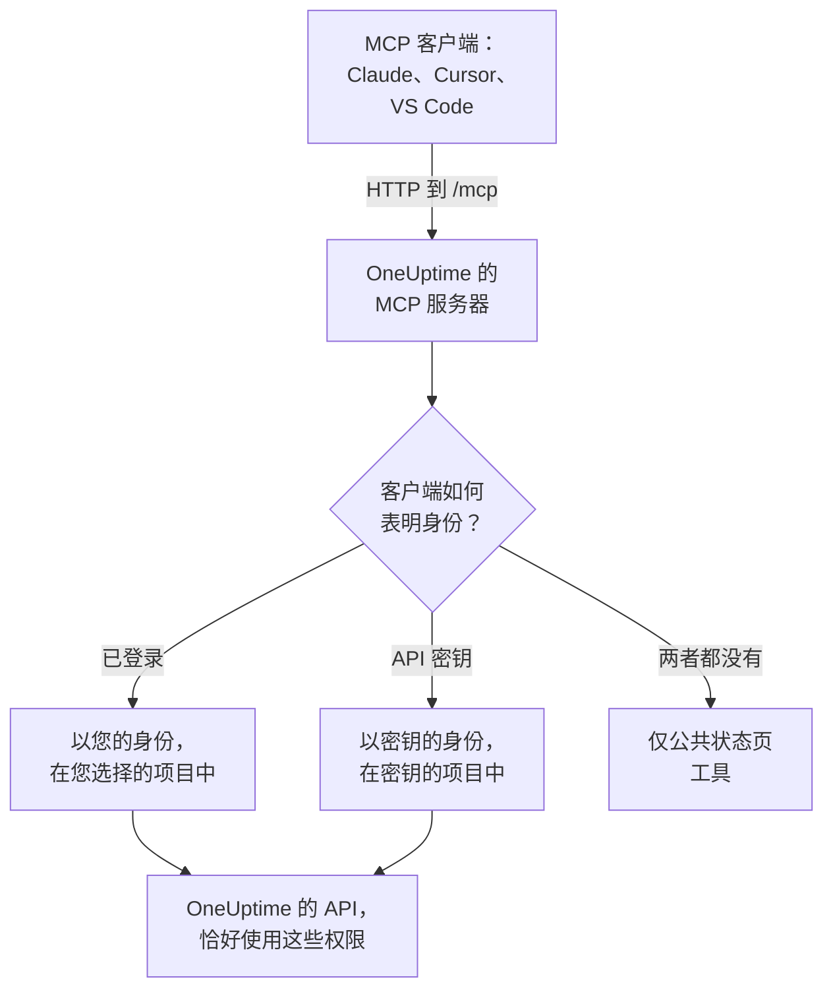

# MCP 服务器

OneUptime MCP 服务器让 AI 助手可以直接操作您的 OneUptime 项目。连接 Claude、Cursor、带 GitHub Copilot 的 VS Code 或任何其他 Model Context Protocol（MCP）客户端，然后让它调查事件、查询日志和追踪、确认警报或设置监视器：它会以您的权限或 API 密钥的权限调用 OneUptime 的工具。

:::cards
- [连接客户端](#连接客户端): 把服务器的地址交给客户端并登录。
- [使用 OneUptime 登录](#使用-oneuptime-登录): 已连接的客户端可以做什么，以及如何断开它。
- [获取 API 密钥](#获取-api-密钥): 适用于无人值守运行的代理。
- [故障排除](#故障排除): 登录、权限和连接问题。
:::

本页介绍连接到 OneUptime 的 AI 助手。如果要反过来让 OneUptime AI 使用其他 MCP 服务器（例如 AWS 或 GitHub 的）的工具，请参阅 [外部 MCP 服务器](/docs/ai/external-mcp-servers)。

## 工作原理

MCP 服务器是每个 OneUptime 实例的一部分，位于与仪表板相同地址的 `/mcp`，使用 streamable HTTP 传输。无需安装任何东西。

- **OneUptime Cloud**: `https://oneuptime.com/mcp`
- **自托管**: `https://your-oneuptime-domain.com/mcp`



服务器是无状态的：它不发放会话 ID，每个请求都是独立的，因此它可以在负载均衡器后面运行，也可以运行多个副本。

## 工具涵盖的内容

- **监视器**：创建和配置监视器，检查其状态并查看其历史。
- **事件响应**：创建、确认和解决事件，添加内部或公开备注，并跟进直到解决。
- **警报**：确认和解决警报，添加备注，管理警报状态和严重程度。
- **团队和值班**：管理团队和值班策略。
- **状态页**：管理状态页并发布公告。
- **计划维护**：创建和管理维护事件。
- **遥测**：查询日志、指标、追踪、异常、监视器日志、安全事件等，只读。

有针对 32 种记录的创建、获取、列出、更新、删除和计数工具，有针对 9 种遥测的列出和计数工具，还有专为事件响应打造的工具。只读工具带有 `readOnlyHint`，每个会更改内容的工具都带有 `destructiveHint`，只有公共状态页工具带有 `openWorldHint`，因此客户端可以自行执行只读调用，并在做出任何更改之前询问您。失败的工具调用会作为工具结果（`isError: true`）返回，其中包含 `statusCode`、详细信息和建议，而不是作为 MCP 协议错误返回，因此代理可以读取失败原因并自行纠正。

## 开始之前

- 一个 OneUptime 实例：OneUptime Cloud 或自托管。
- 一个 MCP 客户端，例如 Claude Code、Claude、带 GitHub Copilot 的 VS Code 或 Cursor。
- 用于登录的 OneUptime 账户，或者供无人值守运行的代理使用的 OneUptime API 密钥。公共状态页工具两者都不需要。
- 在 OneUptime Cloud 上，需要 Growth 或更高的套餐：连接 MCP 客户端与 API 密钥在相同的套餐中提供。

## 连接客户端

只把服务器的地址交给客户端，其他什么都不用。客户端第一次需要您的数据时，会在浏览器中打开 OneUptime 让您登录（参见 [使用 OneUptime 登录](#使用-oneuptime-登录)）。在自托管实例上，请用 `https://your-oneuptime-domain.com/mcp` 代替 `https://oneuptime.com/mcp`。

:::tabs
@tab Claude Code
```bash
claude mcp add --transport http oneuptime https://oneuptime.com/mcp
```
然后在 Claude Code 中运行 `/mcp`，选择 **oneuptime** 进行登录。
@tab Claude
在 Claude 中，打开 **Customize → Connectors**，选择 **Add custom connector**，然后输入 `https://oneuptime.com/mcp`。Claude 第一次需要您的数据时，会请您登录 OneUptime。
@tab VS Code
把以下内容添加到您的 MCP 配置中（配置的位置参见 [带 GitHub Copilot 的 VS Code](#带-github-copilot-的-vs-code)）。启动服务器时，VS Code 会打开 OneUptime 让您登录：
```json
{
  "servers": {
    "oneuptime": {
      "type": "http",
      "url": "https://oneuptime.com/mcp"
    }
  }
}
```
@tab Cursor
```json
{
  "mcpServers": {
    "oneuptime": {
      "url": "https://oneuptime.com/mcp"
    }
  }
}
```
:::

任何其他支持 MCP 授权的客户端都以相同方式工作：把地址交给它，它会自己发现其余的一切。协议请参见 [登录（OAuth 2.1）](#登录oauth-21)。

仪表板中也有这些步骤，并已填好您实例的地址：**项目设置 → 人工智能 → MCP 服务器**。此外，在任何资源（监视器、事件、状态页等）中，展开其侧边菜单中的 **开发者** 并选择 **AI 助手**：该页面还会建议包含该资源及其 ID 的提示词，让助手能立即找到它。对于 MCP 服务器还没有工具的资源（例如工作流），该页面会展示能运行命令的助手如何改用 REST API 来处理它。

## 使用 OneUptime 登录

最简单的连接方式是只把服务器的地址交给您的 MCP 客户端。客户端第一次需要您的数据时，会在浏览器中打开一个 OneUptime 页面：

:::steps
1. 如果尚未登录，请登录 OneUptime。
2. 选择客户端要在其中工作的项目。
3. 选择 **读取和写入** 或 **只读**。
4. 点击 **授权**。
:::

之后客户端在该项目中以您的身份操作。没有需要创建、复制或轮换的 API 密钥，也不会在配置文件中存储任何机密。

已连接的客户端可以做什么：

- **它拥有您的权限，绝不会更多。** 您的团队允许您在项目中做的事，就是客户端能做的事。如果您的角色发生变化或您离开项目，从客户端的下一个请求起就会生效。离开项目也会断开客户端：其授权会被删除，如果您重新加入项目，需要重新连接它。
- **只读就是只读。** 授权为只读的客户端可以使用 `get_`、`list_` 和 `count_` 工具。创建、更新、删除、确认或解决的工具会被 MCP 服务器及其背后的 OneUptime API 拒绝。您永远无法给客户端超出其请求的访问权限。
- **它只用于一个项目。** 要使用另一个项目，请重新连接客户端并选择那个项目。
- **它只能通过 MCP 服务器工作。** 客户端的访问令牌只被 MCP 端点接受，其他任何地方都不接受。它不能用来直接调用 OneUptime REST API。
- **实例管理员也没有特殊待遇。** 由主管理员连接的客户端只拥有此人的团队在该项目中授予的权限，而不是整个实例的访问权限。

### 管理已连接的客户端

通过登录连接的每个客户端都列在 **项目设置 → 人工智能 → MCP 服务器** 的 **已连接的 MCP 客户端** 下，并显示是谁连接的、可以做什么以及上次使用的时间。您能看到自己连接的客户端；项目所有者和管理员能看到所有人的客户端。

点击 **断开连接** 可让客户端退出登录。它会立即停止工作。

只要客户端一直在使用，它就保持连接。30 天未使用的客户端必须重新登录。

### 控制谁可以连接客户端

默认情况下，每个项目成员都可以连接 MCP 客户端。要阻止某个团队的成员这样做，请打开该团队的 **权限** 页面，打开底部的 **更多设置**，然后在 **阻止权限** 下添加 **Authorize MCP Client** 权限。这些成员已经连接的客户端会立即停止工作。

如果项目要求单点登录，请在授权客户端之前先在浏览器中使用 SSO 登录项目。客户端的连接只在该 SSO 登录有效期间持续；当它过期，或者您登录时使用的 SSO 提供商被关闭或删除时，请重新连接客户端。

在 OneUptime Cloud 上，连接 MCP 客户端与 API 密钥在相同的套餐中提供（Growth 及以上）。

在 Enterprise Edition 中，已连接的客户端所做的每项更改都会以连接者的名义记录在审计日志中，并附上客户端的名称。使用 API 密钥所做的更改会显示密钥的名称。

## 获取 API 密钥

对于无人值守运行的代理（例如计划任务或 CI 流水线），没有人能去登录，这时请使用 API 密钥。

:::steps
### 创建密钥

转到 **项目设置 → 高级 → API 密钥**，然后点击 **创建API 密钥**。给它起一个名称，例如 "MCP Server"。

### 选择它可以做什么

在 **访问** 下，为只读取的代理选择 **查看者**，为还要创建、更新和删除的代理选择 **项目管理员**（参见 [API 密钥权限](#api-密钥权限)）。

### 复制密钥

点击 **创建API 密钥**：密钥的页面会打开。从那里复制密钥。
:::

API 密钥属于一个项目：MCP 服务器从密钥中获取项目，因此创建工具从不需要 `projectId` 参数。

> [!WARNING]
> 永远不要把主密钥交给 AI 代理。OneUptime 主 API 密钥也会在这个请求头中被接受，并授予整个实例的管理员访问权限。请始终使用只具备代理所需最少权限的项目 API 密钥：对于所有 `get_`、`list_` 和 `count_` 工具，只读密钥就足够了。

## 使用 API 密钥连接

在 `x-api-key` 请求头中发送密钥。携带 API 密钥的请求永远不会被要求登录。在自托管实例上，请用您自己的域名代替 `oneuptime.com`。

:::tabs
@tab Claude Code
```bash
claude mcp add --transport http oneuptime https://oneuptime.com/mcp --header "x-api-key: your-api-key-here"
```
@tab Claude Desktop
把以下内容添加到 `claude_desktop_config.json`，它在 macOS 上位于 `~/Library/Application Support/Claude/`，在 Windows 上位于 `%APPDATA%\Claude\`，在 Linux 上位于 `~/.config/Claude/`：
```json
{
  "mcpServers": {
    "oneuptime": {
      "transport": "streamable-http",
      "url": "https://oneuptime.com/mcp",
      "headers": {
        "x-api-key": "your-api-key-here"
      }
    }
  }
}
```
@tab VS Code
带有 `"password": true` 的输入变量会在服务器启动时询问密钥，而不是以明文保存它：
```json
{
  "servers": {
    "oneuptime": {
      "type": "http",
      "url": "https://oneuptime.com/mcp",
      "headers": {
        "x-api-key": "${input:oneuptime-api-key}"
      }
    }
  },
  "inputs": [
    {
      "type": "promptString",
      "id": "oneuptime-api-key",
      "description": "OneUptime API Key",
      "password": true
    }
  ]
}
```
@tab Cursor
```json
{
  "mcpServers": {
    "oneuptime": {
      "url": "https://oneuptime.com/mcp",
      "headers": {
        "x-api-key": "your-api-key-here"
      }
    }
  }
}
```
:::

## 带 GitHub Copilot 的 VS Code

VS Code 1.99 及更高版本在 GitHub Copilot Chat 中原生支持 MCP 服务器。

:::steps
### 检查所需条件

VS Code 1.99 或更高版本，已安装并登录 GitHub Copilot 扩展，并已开启 GitHub Copilot Chat。

### 打开 MCP 配置

按 `Ctrl+Shift+P`（macOS 上为 `Cmd+Shift+P`），输入 "MCP: Open User Configuration" 并按 Enter。它会打开或创建 `mcp.json` 文件。如果只用于一个工作区，请改为在其中创建 `.vscode/mcp.json`。

### 添加 OneUptime

粘贴上面的 VS Code 配置：不带密钥用于登录的那个，或者带 API 密钥的那个。

### 启动服务器

按 `Ctrl+Shift+P`（macOS 上为 `Cmd+Shift+P`），输入 "MCP: List Servers"，然后选择 **oneuptime** 启动它。VS Code 第一次会询问您是否信任该服务器，然后请您登录或输入 API 密钥。

### 询问 Copilot

以代理模式打开 GitHub Copilot Chat 并提问，例如"我在 OneUptime 中有哪些监视器？"、"给我看看最近的事件"或"为 https://example.com 创建一个新的监视器"。
:::

## 身份验证

MCP 服务器有三种工作方式。

### 公共工具（无需身份验证）

无需 API 密钥或登录，客户端就可以使用公共工具：

- **`oneuptime_help`**：关于 OneUptime MCP 工具的帮助和指导
- **`oneuptime_list_resources`**：资源以及每种资源可以做什么
- **`get_public_status_page_overview`**：公共状态页的概览
- **`get_public_status_page_incidents`**：公共状态页的事件
- **`get_public_status_page_scheduled_maintenance`**：它的计划维护事件
- **`get_public_status_page_announcements`**：它的公告

公共状态页工具接受状态页的 ID（UUID）或其域名。如果只使用这些工具，请只用地址连接，不带任何凭据：

```json
{
  "mcpServers": {
    "oneuptime": {
      "transport": "streamable-http",
      "url": "https://oneuptime.com/mcp"
    }
  }
}
```

状态页的所有者可以为该页面关闭 MCP 访问：在状态页侧边菜单的 **人工智能** 部分中打开 **MCP**，然后关闭 **启用 MCP 服务器**。开关一经切换就会保存。MCP 访问默认开启。关闭期间，四个 `get_public_status_page_*` 工具会对该状态页返回错误；状态页网站、其 RSS 源和公共 JSON API 不受影响，需要登录的状态页工具（`get_status_page`、`list_status_pages` 等）在该页面所属的项目中仍然可用。

### 登录（OAuth 2.1）

其他所有工具都需要知道是谁在调用。不发送凭据就调用其中某个工具的客户端，会收到 `401 Unauthorized`，并带有一个指向服务器受保护资源元数据的 `WWW-Authenticate` 头。这就是 MCP 客户端据以让您登录的信号；`initialize`、`tools/list` 和公共工具从不要求登录。

服务器实现了 [MCP 授权规范](https://modelcontextprotocol.io/specification/latest/basic/authorization)：

- **流程**：带 PKCE（仅 `S256`）的 OAuth 2.1 授权码。访问令牌以 `Authorization: Bearer` 发送。
- **发现**：受保护资源元数据（RFC 9728）和授权服务器元数据（RFC 8414）。颁发者和资源都是 `https://<host>/mcp`。
- **客户端身份**：Client ID Metadata Document（客户端 ID 是服务器获取的 `https` URL），或动态客户端注册（RFC 7591）。无需管理员注册任何客户端。
- **范围**：`get_`、`list_` 和 `count_` 工具使用 `mcp:read`；`mcp:write` 加上所有会更改内容的工具，并包含 `mcp:read`。只读令牌调用写入工具时会收到 `403`，并带有 `error="insufficient_scope"`。
- **令牌有效期**：访问令牌的有效期为一小时。刷新令牌的有效期为 30 天，每次使用时都会被替换；使用已被替换的刷新令牌会结束连接。
- **资源指示符**（RFC 8707）：令牌是为 `https://<host>/mcp` 签发的，其他任何地方都不接受。
- **撤销**（RFC 7009）：撤销任一令牌都会结束连接。

### API 密钥

无人值守运行的代理会在以下请求头之一中发送 OneUptime API 密钥：

- `x-api-key`：您的 OneUptime API 密钥
- `Authorization`：带有您 API 密钥的 bearer 令牌（例如 `Bearer your-api-key-here`）

`Bearer` 方案不区分大小写。携带 API 密钥的请求永远不会被要求登录。

在 OneUptime Cloud 上，只有当项目处于 **Growth** 或更高套餐时，API 密钥才能使用。低于该套餐时，所有需要密钥的工具都会返回 `402`，并附上指明套餐的消息，同时告诉代理不要重试。不会删除任何内容：项目回到 Growth 后，密钥会原样恢复可用，无需重新连接任何东西。通过登录连接的客户端以人的身份操作，因此会继续工作（[低于套餐时的 API 密钥和 SCIM](/docs/api-reference/api-reference#低于其套餐时的-api-密钥和-scim)）。

## 可用端点

| 端点 | 方法 | 说明 |
| --- | --- | --- |
| `/mcp` | POST | 用于工具调用和其他操作的 JSON-RPC 请求 |
| `/mcp` | GET | 不带 SSE `Accept` 头时：服务器的简短 JSON 说明。带有时：`405`，因为无状态服务器不提供独立的 SSE 流（遵循规范的客户端没有它也会继续） |
| `/mcp` | DELETE | 不执行任何操作：服务器是无状态的，因此没有要结束的会话 |
| `/mcp/health` | GET | 健康检查 |
| `/mcp/tools` | GET | 工具列表，以普通 REST 提供 |

登录的 MCP 客户端还会使用下面的 OAuth 端点。客户端会自行找到它们；这里列出它们，是为了编写客户端或设置代理服务器的人。

| 端点 | 方法 | 说明 |
| --- | --- | --- |
| `/mcp/.well-known/oauth-protected-resource` | GET | 受保护资源元数据（RFC 9728）。也位于 `/.well-known/oauth-protected-resource/mcp` |
| `/.well-known/oauth-authorization-server/mcp` | GET | 授权服务器元数据（RFC 8414）。也位于 `/mcp/.well-known/oauth-authorization-server` |
| `/mcp/oauth/authorize` | GET | 授权端点：客户端把您的浏览器发送到这里进行登录 |
| `/mcp/oauth/token` | POST | 令牌端点：交换授权码或刷新令牌 |
| `/mcp/oauth/register` | POST | 动态客户端注册（RFC 7591） |
| `/mcp/oauth/revoke` | POST | 令牌撤销（RFC 7009） |

要检查服务器是否在运行并列出其工具：

```bash
curl https://oneuptime.com/mcp/health
curl https://oneuptime.com/mcp/tools
```

## 用于事件响应的工具

除了每种记录的工具之外，服务器还有专为响应事件和警报而打造的工具：

- **`acknowledge_incident`** / **`resolve_incident`**：把事件移到项目的 Acknowledged 或 Resolved 状态，与仪表板的按钮作用相同
- **`acknowledge_alert`** / **`resolve_alert`**：对警报执行同样的操作
- **`add_incident_note`**：使用 `visibility: "internal"`（仅团队可见，默认）或 `visibility: "public"`（发布到状态页）为事件添加备注。支持 Markdown
- **`add_alert_note`**：为警报添加内部备注

典型的流程：`list_incidents` → `acknowledge_incident` → 用 `list_logs` 调查 → `add_incident_note`（公开） → `resolve_incident`。

**`oneuptime_whoami`** 工具返回您的凭据所属的项目（其 ID 和名称）。对于已登录的客户端，它还会说明以谁的身份登录以及是否可以进行更改。这是代理了解自身处境的理想首次调用，并且由于创建工具会从凭据中获取 `projectId`，代理永远不必传递项目 ID。

## 查询遥测

日志、指标、追踪（span）、异常、监视器日志和其他种类的遥测以只读的 `list_` 和 `count_` 工具提供（`list_logs`、`list_metrics`、`list_spans`、`list_exception_instances`、`list_monitor_logs` 及其对应的 `count_` 工具）。遥测通过 OpenTelemetry 传入，因此没有创建工具。

查询遥测时请始终指定时间范围。查询字段接受一个值或一个运算符对象：

```json
{
  "query": {
    "time": { "_type": "GreaterThan", "value": "2026-07-04T00:00:00.000Z" }
  },
  "sort": { "time": "DESC" },
  "limit": 50
}
```

运算符有 `EqualTo`、`NotEqual`、`IsNull`、`NotNull`、`EqualToOrNull`、`GreaterThan`、`LessThan`、`GreaterThanOrEqual`、`LessThanOrEqual`、`InBetween`、`Search` 和 `Includes`。排序值为 `"ASC"` 或 `"DESC"`。

## 字段选择和分页

`get_` 和 `list_` 工具接受一个可选的字段名数组 `select`。默认情况下，除较重的字段（JSON、很长的文本和 HTML 列）外，所有可读字段都会返回，较重的字段必须在 `select` 中请求。

列表工具使用 `limit`（默认 10，最多 100）和 `skip` 分页，每个列表回答都会准确说明它返回了什么：

```json
{
  "returnedCount": 10,
  "totalCount": 42,
  "skip": 0,
  "limit": 10,
  "hasMore": true,
  "data": ["..."]
}
```

## 使用示例

### 日常问题

```text
"What's the current status of all my monitors?"
"Show me incidents from the last 24 hours"
"List the teams in this project"
"Show me our on-call policies"
```

### 监视器和事件

```text
"Create a new website monitor for https://example.com that checks every 5 minutes"
"Set up an API monitor for https://api.example.com/health with a 30-second timeout"
"Disable the monitor for staging.example.com while we're doing maintenance"
"Create a high-priority incident for the database outage affecting user authentication"
"Add a note to incident #123 saying 'Database connection restored, monitoring for stability'"
"Mark incident #456 as resolved"
```

### 状态页

```text
"Update our status page to show 'Investigating Payment Issues' for the payment service"
"Create a status page announcement about scheduled maintenance this weekend"
```

### 公共状态页查询（无需 API 密钥）

这些示例无需凭据，只用公共状态页工具即可运行：

```text
"What's the current status of status.example.com?"
"Show me recent incidents from the OneUptime status page"
"Are there any scheduled maintenance events on status.acme.com?"
"Get the latest announcements from my public status page with ID abc123-..."
```

### 一次完成多个步骤

```text
"Create a scheduled maintenance window for Saturday 2-4 AM, disable all monitors for api.example.com during that time, and update the status page"
"Show me all monitors that have been down in the last hour, create incidents for any that don't already have one"
```

## API 密钥权限

| 代理要做什么 | 在 **访问** 下选择 |
| --- | --- |
| 只读取 | **查看者**，或在密钥的页面上添加读取权限 |
| 还要创建、更新和删除 | **项目管理员**，或在密钥的页面上添加 Project Admin 角色 |

只给每个密钥所需的最少权限，定期轮换密钥，为每个环境使用单独的密钥，并在 OneUptime 中关注每个密钥的操作。

## 自托管配置

在自托管实例上，登录开箱即用。有两个设置可以改变它：

| 环境变量 | Helm 值 | 作用 |
| --- | --- | --- |
| `DISABLE_MCP_OAUTH` | `mcpOAuth.disabled` | 设为 `true` 可关闭登录。OAuth 端点不再提供服务，MCP 服务器只接受 API 密钥。不会删除任何内容；重新开启后，已连接的客户端会恢复工作。 |
| `DISABLE_MCP_OAUTH_CLIENT_ID_METADATA_DOCUMENTS` | `mcpOAuth.disableClientIdMetadataDocuments` | 在无法访问互联网的实例上设为 `true`。客户端可以用一个由 OneUptime 获取的 URL 来标识自己；设置此项后，客户端会改为直接向您的实例注册，这不需要任何出站请求。 |

如果您在 OneUptime 前面运行自己的反向代理，请把 `/.well-known/oauth-protected-resource` 和 `/.well-known/oauth-authorization-server`（以及它们下面的所有内容）连同 `/mcp` 一起转发给 OneUptime。随附的 ingress 已经这样做了。

服务器根据 `HOST` 和 `HTTP_PROTOCOL` 设置构建每个 OAuth URL，因此它们必须与人们访问您实例所用的地址一致。

## 故障排除

### 登录问题

- **客户端从不要求我登录**：客户端可能不支持 MCP 授权，或者它配置了一个优先生效的 API 密钥请求头。删除该请求头即可改为登录。
- **我的项目在授权页面上显示为灰色**：页面会在项目名称旁说明原因：项目的套餐不包括连接 MCP 客户端；项目要求 SSO，而此浏览器尚未用 SSO 登录该项目；或者您的团队被阻止连接客户端。
- **工具被以 "read-only" 拒绝**：客户端被授权为只读。请重新连接并选择 **读取和写入**。
- **客户端停止工作**：它被断开了、30 天未使用、您被移出了项目，或者项目的 SSO 登录已过期或其提供商被关闭。请重新连接。
- **自托管 - 客户端说找不到授权服务器**：检查 `HOST` 和 `HTTP_PROTOCOL` 是否与您的公共地址一致，以及您的代理服务器是否转发了 `/.well-known/oauth-*` 路径。

### 权限错误

API 密钥（对于已登录的客户端，则是您自己的账户）需要正确的权限：列出记录需要读取权限，创建和更新记录需要写入权限，删除记录需要删除权限。

### 连接问题

检查 OneUptime 地址是否正确且可以访问、API 密钥是否有效，以及健康检查端点是否有响应（参见 [可用端点](#可用端点)）。

### 无效的 API 密钥

- 在 OneUptime 设置中检查 API 密钥，确保没有多余的空格或字符
- 检查密钥是否已过期
- 在 OneUptime Cloud 上，如果返回的 `402` 说 API 密钥需要 Growth 套餐，说明项目低于该套餐：在 **项目设置 → 账单和发票 → 账单** 中升级项目，同一个密钥就会恢复可用

### 会话错误

MCP 服务器是无状态的：它既不发放也不跟踪会话 ID，因此每个请求在任何副本上都能工作。发送来自旧版服务器的 `mcp-session-id` 请求头的客户端可以省略它；它会被忽略。请更新期望服务器返回会话 ID 的旧客户端配置。

## 可用资源

| 领域 | 带有创建、获取、列出、更新、删除和计数工具的记录 |
| --- | --- |
| 监控 | Monitor, Monitor Status, Monitor Status Event |
| 事件 | Incident, Incident State, Incident Severity, Incident State Timeline, Incident Public Note, Incident Internal Note, Incident Alert, Postmortem Status |
| 警报 | Alert, Alert State, Alert Severity, Alert State Timeline, Alert Internal Note |
| 状态页 | Status Page, Status Page Announcement |
| 计划维护 | Scheduled Maintenance Event, Scheduled Maintenance State, Scheduled Maintenance State Timeline |
| 团队和值班 | Team, On-Call Policy |
| 标签 | Label |
| 安全 | Security Case, Security Case Evidence, Security Case Note, Security Case Priority, Security Case Status, Security Case Task, Security Detection, Security Playbook |

| 领域 | 只有列出和计数工具的遥测 |
| --- | --- |
| 可观测性 | Log, Metric, Span, Exception Instance, Monitor Log |
| 安全 | Security Event, Threat Intel Indicator |
| 变更和成本 | Change Event, Kubernetes Cost Allocation |

工具以蛇形命名法命名：`create_incident`、`get_incident`、`list_incidents`、`update_incident`、`delete_incident` 和 `count_incidents`，遥测则为 `list_logs` 和 `count_spans`。

## 后续步骤

:::cards
- [询问 AI](/docs/ai/ask-ai): 改为在 OneUptime 内部询问您的项目。
- [OneUptime API 参考](/docs/api-reference/api-reference): 每个工具背后的 REST API。
- [权限](/docs/permissions/index): 角色、团队或 API 密钥可以做什么。
:::
