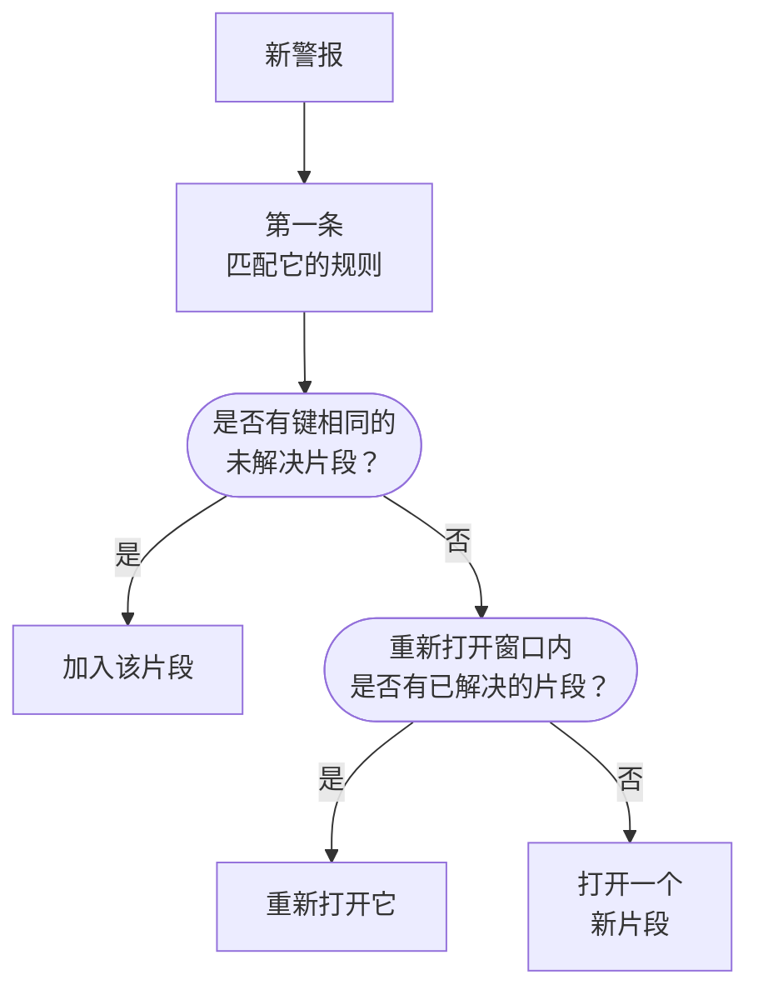
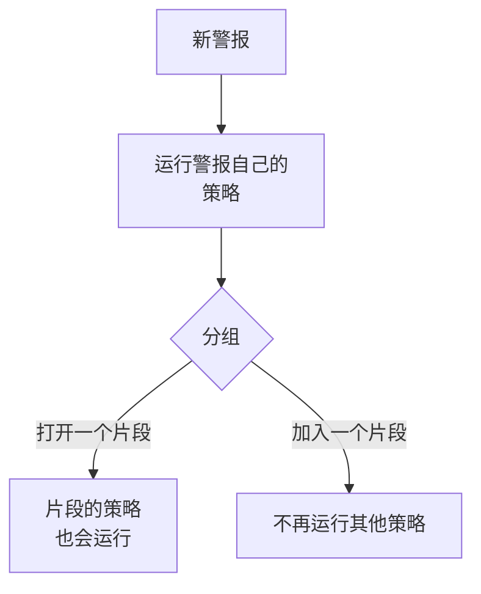

# 警报片段与分组规则

当数据库宕机时，二十个监视器可能在几分钟内触发二十个警报。片段把它们放进同一条记录，由你的团队一起确认和解决，而分组规则决定哪些警报属于它。本页介绍分组如何工作、如何设置规则，以及片段打开之后的行为。

:::cards
- [分组如何工作](#分组如何工作): 规则、分组键和时间窗口。
- [创建分组规则](#创建分组规则): 一键从模板创建，或创建你自己的规则。
- [片段的行为](#片段的行为): 它的严重级别、状态以及何时解决。
- [片段会呼叫谁](#片段会呼叫谁): 规则的值班策略，以及警报自己的策略。
:::

## 分组如何工作

每个新警报都会运行一次分组，就在其值班策略运行之后。系统按从上到下的顺序，用你已启用的分组规则检查该警报，第一个匹配它的规则决定它的片段。没有任何规则匹配的警报会保持独立。

- **规则的条件** 决定它适用于哪些警报。没有条件的规则适用于每个新警报。
- **分组键** 决定哪些警报共享一个片段：监视器相同、严重级别相同、标题相同，或在规则所依据的任意组合上相同的警报。不按任何内容分组的规则，会把它匹配的每个警报都放进同一个片段。
- **时间窗口** 决定片段持续接收警报的时长。开启时，只有在片段最后一个警报之后的窗口内到达的警报才会加入。关闭时，匹配的警报会一直加入，直到片段被解决。

分组发生在警报创建时。你今天添加的规则只会对此后创建的警报分组；它不会重新分组已经存在的警报。

> [!NOTE]
> 创建时即已确认的警报可以加入已打开的片段，但绝不会打开新片段；创建时即已解决的警报则完全不会被分组。参见 [创建时即已确认或已解决](/docs/alerts/index#创建时即已确认或已解决)。

## 创建分组规则

前往 **警报 → 规则 → 分组规则**。侧边菜单中的 **规则** 部分起初是折叠的，因此请先展开它。

### 从模板开始

没有分组规则的项目会看到四条现成的规则，而不是一个空列表；有了规则之后，卡片上的 **从模板创建** 会打开它们。**添加规则** 只需一次点击就会保存一条规则：已启用、位于列表末尾，并适用于每个新警报。之后可以像编辑其他规则一样编辑它。

| 模板                                          | 分组方式                                                                      | 时间窗口    |
| --------------------------------------------- | ----------------------------------------------------------------------------- | ----------- |
| **将同一监视器的警报分组**                    | 每个监视器一个片段                                                            | 30 分钟     |
| **将同时发生的警报分组**                      | 一个共享片段，无论来自哪个监视器                                              | 10 分钟     |
| **按严重程度对警报分组**                      | 每个严重级别一个片段                                                          | 30 分钟     |
| **将重复出现的同一警报分组**                  | 每个警报标题一个片段，忽略数字和大小写                                        | 1 小时      |

### 创建你自己的规则

:::steps
#### 回答如何分组

点击模板下方的 **创建自定义规则**，或在已有规则时点击卡片上的 **创建警报分组规则**。在 **分组** 步骤中，**警报分组依据** 只问一个问题：**监视器**、**全部归在一起**、**严重程度**、**标题** 或 **自定义**。在你输入自己的名称之前，**名称** 会跟随你的回答。

#### 设置时间窗口

**仅对相近时间内到达的警报分组** 默认开启，窗口为 30 分钟。修改分钟数，或将其关闭，让一个片段一直保持打开，直到它被解决。

#### 组合字段（用于自定义）

**自定义** 会添加一个 **分组依据** 步骤，其中有五个开关：**按监视器分组**、**按警报严重程度分组**、**按警报标题分组**、**按警报标签分组** 和 **按监视器标签分组**。标签按其确切的集合分组。

#### 缩小范围

在 **哪些警报** 中，新规则默认的 **所有警报** 会对每个新警报分组。要缩小范围，请选择 **仅符合条件的警报** 并添加关于监视器、严重级别、标签、标题和描述的条件。然后点击 **创建警报分组规则**。
:::

规则能做的其他所有事情，都折叠在 **分组** 步骤末尾的 **更多字段** 下，分为三组。折叠时，其标题会说明它包含什么，并显示规则用到的每项设置的取值，因此编辑规则时永远不会隐藏它的作用。

| 组                        | 设置                                                                                                       |
| ------------------------- | ---------------------------------------------------------------------------------------------------------- |
| **值班与归属**            | 规则打开片段时要运行的 **值班策略**，以及 **片段所有者**。                                                 |
| **片段生命周期**          | **重新打开最近解决的片段**、**解决片段前先等待** 和 **解决无新动态的片段**，每一项都是带分钟数的开关。     |
| **详情**                  | 规则的 **描述**、**片段标题模板**、**片段描述模板** 和 **片段标签**。                                      |

规则按从上到下的顺序检查，第一个匹配的胜出：拖动规则即可改变它的位置。把具体的规则放在宽泛的规则之上。列表的 **分组** 列用一句话说明每条规则的作用，例如“每个监视器一个片段”。

## 片段标题

没有模板时，片段以其第一个警报的监视器命名；如果该警报没有监视器，则以警报标题的前 50 个字符命名。使用 **片段标题模板** 或 **片段描述模板** 时，会填入以下变量。在任一字段中输入 `{{` 即可选择一个变量。

| 变量                   | 填入内容                                                                                        |
| ---------------------- | ----------------------------------------------------------------------------------------------- |
| `{{alertTitle}}`       | 第一个警报的标题。                                                                              |
| `{{alertDescription}}` | 第一个警报的描述。                                                                              |
| `{{alertSeverity}}`    | 第一个警报的严重级别。                                                                          |
| `{{monitorName}}`      | 第一个警报的监视器名称。                                                                        |
| `{{alertCount}}`       | 片段包含的警报数量，在警报加入或离开时重新写入。                                                |

第一个警报没有值的变量，或不在此列表中的变量，都会被省略。当第一个警报是私密的时，`{{alertTitle}}` 和 `{{alertDescription}}` 会显示为“Private alert”，因为片段不是私密的。

## 片段的行为

片段经历的是你的警报状态，也就是警报使用的同一个列表，并且有自己的所有者、备注、根本原因和补救备注。

- **它的严重级别随其警报升高。** 它以第一个警报的严重级别开始，并在任何更严重的警报加入时采用该警报的严重级别；“更严重”指在 **警报 → 设置 → 警报严重性** 中的位置更高。
- **它的状态会带动其中的警报。** 确认或解决片段，或把它移到你自己的状态，其中的每个警报也会随之移动，已经处于或越过该状态的警报除外。
- **它会自行解决**，只要其中的每个警报都已解决。**解决片段前先等待** 会先让它再保持打开这么多分钟，以防有警报再次出现。
- **它可以重新打开。** 开启 **重新打开最近解决的片段** 后，在片段解决后的这些分钟内到达的匹配警报会重新打开它，而不是打开另一个片段。这是沿状态列表向上的唯一一次移动，而且它不会重新打开片段中的警报。

> [!WARNING]
> **解决无新动态的片段** 会在你设置的分钟数内没有新警报加入时解决片段，并且还会解决其中仍处于打开状态的每个警报。只把它用于你确定不需要任何响应的噪音。

## 片段会呼叫谁

警报自己的值班策略会在它创建时运行，早于分组，无论它是否加入片段。片段还会添加自己的策略：

- **新片段** 会运行规则的 **值班策略**，以及 **警报 → 规则 → 值班规则** 中 **Episode Rules** 选项卡上任何匹配规则的策略。
- **加入已打开片段的警报** 只运行它自己的策略。片段的策略不会再次运行。
- **应答片段的呼叫** 会确认该片段，并随之确认其中的每个警报。

> [!TIP]
> 要按问题而不是按警报只呼叫一次，请把值班策略放在分组规则上，而不要放在警报上：不放在监视器的条件中，不放在创建表单中，也不放在警报的值班规则中。

片段的所有者也会收到通知：**警报片段已创建**、**警报片段状态已更改** 和 **警报已添加到警报片段** 默认通过电子邮件开启，位于 **用户设置 → 通知设置** 的 **警报** 选项卡上。规则的 **片段所有者** 会成为它打开的每个片段的所有者，并像其他所有者一样收到通知。

## 手动创建片段

:::steps
### 打开表单

前往 **警报 → 所有片段** 并点击 **创建片段**。**创建新警报片段** 表单随即打开。

### 描述片段

在 **片段详情** 中填写 **标题**，并按需选择一个 **警报严重性** 和填写 **描述**。**初始状态** 和 **标签** 位于 **更多字段** 下。

### 选择呼叫谁以及由谁负责

在 **值班和所有者** 中，选择创建片段时要运行的 **值班策略**，以及它的 **所有者**。然后点击 **创建片段**。

你所属的每个团队在 **所有者** 下方都只需点击一下即可添加，摘要会列出将添加更多所有者的所有者规则。

### 添加警报

打开片段的 **成员警报** 页面，点击 **添加警报**，一次勾选属于它的所有警报，需要几个就选几个。若想从警报出发，可在 **警报** 列表中选择它们，然后在 **批量操作** 中选择 **添加到新片段**（参见[片段](/docs/incidents/episodes)）。
:::

你创建的片段没有分组规则，因此列表中其 **分组规则** 显示为 **手动**，也不会对它应用任何生命周期设置。当其中的每个警报都解决后，它仍会自行解决。

## 片段各页面显示的内容

| 侧边菜单部分      | 页面                                                               |
| ----------------- | ------------------------------------------------------------------ |
| **概览** | **概览**、**状态时间线** |
| **调查** | **描述**、**根本原因**、**补救备注** |
| **团队** | **所有者** |
| **警报** | **成员警报** |
| **备注** | **私人备注** |
| **开发者** | **Terraform**、**API**、**AI 助手** |
| **高级** | **审计日志**、**删除片段** |

**开发者** 和 **高级** 起初是折叠的。**概览** 的页眉列出片段的 **所有者**（团队在前），第一个图块 **已创建** 显示片段的创建时间——由分组规则开启的片段显示 **自动**。**事件经过** 卡片位于页面最上方——片段的描述和 **根本原因**——接着是 **Alerts in this episode** 和 **片段动态**，旁边是 **片段详情** 卡片：其编号、状态、严重级别、警报数量、分组规则和值班策略。其页眉有 **确认** 和 **解决**，**⋯** 菜单中还有 **将片段移至**。

**警报 → 活动片段** 列出尚未解决的片段，旁边的徽标统计它们的数量。

## 故障排除

:::details 新警报没有加入我预期的片段
请按顺序检查：规则已启用；它上方没有其他规则先匹配了该警报；警报符合规则的条件；它与片段中的警报具有相同的分组键，例如相同的监视器；并且在时间窗口开启时，它是在片段最后一个警报之后的窗口内到达的。创建时即已确认的警报绝不会打开片段，创建时即已解决的警报绝不会被分组。
:::

:::details 同一个问题我们被呼叫了两次
警报自己的值班策略运行了，新片段的策略也运行了。把策略保留在分组规则上，并从警报的条件、表单或值班规则中移除它们。
:::

:::details 片段自行解决了
其中的每个警报都已解决，因此片段在等待时间结束后解决了。开启 **解决无新动态的片段** 时，它也会解决在这么长时间内没有新警报加入的片段。
:::

## 后续步骤

:::cards
- [警报规则与设置](/docs/alerts/settings): 作用于新警报和片段的其他规则。
- [警报状态与严重级别](/docs/alerts/states-and-severities): 片段经历的各个状态。
- [升级规则](/docs/on-call/escalation-rules): 片段运行的策略如何呼叫人员。
- [事件设置与自动化](/docs/incidents/settings): 事件的分组规则。
:::
