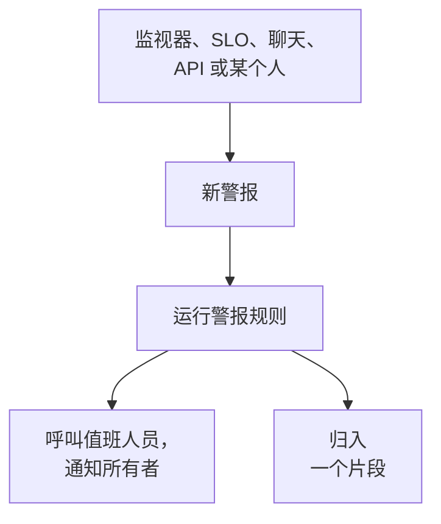

# 警报概览

警报会在用户注意到之前，让你的团队知道一个需要调查的问题：磁盘快要写满、证书即将过期、错误率在悄悄上升。它可以呼叫值班人员并通知其所有者，但从不显示在状态页上，也从不通知你的订阅者。本页介绍警报从何而来、它们在仪表板中的位置，以及你的团队如何处理它们。

:::cards
- [警报与事件](#警报与事件): 一个问题应该属于哪一种，以及两者如何关联。
- [警报从何而来](#警报从何而来): 监视器、SLO、聊天、API，或手动创建。
- [手动创建警报](#手动创建警报): 在仪表板中完成两个步骤。
- [响应警报](#响应警报): 确认它、解决它，或声明事件。
:::

## 工作原理

大多数警报由条件匹配的监视器触发。有些来自正在消耗错误预算的 SLO、一条安全规则、从 Slack 或 Microsoft Teams 发出的呼叫，或者某个人。无论以哪种方式到达，警报都是同一种记录，并运行同样的规则。

- **规则塑造它。** 隐私、所有者、标签和值班规则会在警报创建的那一刻运行，Runbook 规则则会启动匹配的流程。参见 [警报规则与设置](/docs/alerts/settings)。
- **值班策略呼叫人员。** 警报指定的策略，加上其值班规则添加的策略，会持续呼叫各自的人员，直到有人确认该警报。
- **片段归并噪音。** 分组规则把相关的警报放进同一个片段，这样一次故障产生的二十个警报就只是一件要处理的事。参见 [警报片段与分组规则](/docs/alerts/episodes)。

## 警报与事件

两者都记录问题，也都可以呼叫值班人员。不同之处在于问题影响的是谁。

|                              | 警报                                                   | 事件                                              |
| ---------------------------- | ------------------------------------------------------ | ------------------------------------------------- |
| **是什么**                   | 在用户受到影响之前，需要你的团队调查的问题             | 影响你的用户的问题，例如故障                      |
| **在状态页上**               | 从不显示                                               | 可以显示，并通知订阅者                            |
| **备注**                     | 私密备注，仅限你的团队                                 | 面向客户的公开备注，以及私密备注                  |
| **起始状态**                 | **已识别**、**已确认**、**已解决**                 | **已识别**、**已确认**、**已解决**            |
| **起始严重级别**             | **高**、**低**                                      | Critical Incident、Major Incident、Minor Incident |
| **新项目中的编号**           | `ALT-42`，片段为 `AE-42`                               | `INC-42`，片段为 `IE-42`                          |

当你的团队应该在外部任何人注意到之前查看时，就触发警报；当用户受到影响时，就声明事件。如果一个警报原来是某次故障的一部分，可以从它声明事件，或把它关联到解释它的事件：参见 [关联的告警](/docs/incidents/linked-alerts)。

## 警报从何而来

- **监视器的条件。** 在某个条件的 **操作** 下，打开 **当过滤器匹配时，创建警报。** 并填写它创建的警报：**警报标题** 和 **严重程度**，然后是各自折叠的 **描述**、**所有权和标签**、**值班** 和 **更多字段**，最后这一项包含 **自动解决警报**、**私密警报** 和 **补救备注**。一个条件同一时间只保留一个未解决的警报，在按字段分组的监视器上则是每个序列一个；**自动解决警报** 会在条件不再匹配时解决它。参见 [创建监视器](/docs/monitor/create-monitor) 和 [事件与告警模板](/docs/monitor/incident-alert-templating)。
- **手动。** 在警报列表中，或在监视器、主机、网络设备或其他资源的 **警报** 选项卡上点击 **创建警报**，后者会为你选好该资源。参见 [手动创建警报](#手动创建警报)。
- **SLO 的消耗率。** 当 SLO 过快地花掉其错误预算时，消耗率规则可以创建警报。参见 [消耗率警报与事件](/docs/slo/burn-rate-alerts)。
- **网络站点和安全事件。** 设置为在不健康时发出警报的网络站点，会在其汇总状态不再正常运行时打开一个警报；你的安全检测规则也会打开警报。参见 [网络站点(健康汇总与正常运行时间)](/docs/monitor/network-sites) 和 [安全事件(SIEM)](/docs/telemetry/security-events)。
- **呼叫。** Slack 或 Microsoft Teams 中的 `/oneuptime page` 会打开一个以你的消息为标题的警报，并呼叫你点名的人。工作流的呼叫块会用你提供的标题和消息做同样的事。参见 [从 Slack 呼叫他人](/docs/workspace-connections/slack#从-slack-呼叫他人) 和 [Paging](/docs/workflows/components#paging)。
- **API、Terraform 和工作流。** 警报是一种普通资源：`/api/alert`、Terraform 资源 `oneuptime_alert`，以及工作流的 **Create One Alert** 步骤。

## 警报在仪表板中的位置

从顶部栏的 **产品** 菜单中打开 **警报**。警报列表位于 `/dashboard/{projectId}/alerts`，它的侧边菜单包含与警报有关的一切：

| 部分           | 你在那里做什么                                                                                                            |
| -------------- | ------------------------------------------------------------------------------------------------------------------------- |
| **警报**       | **所有警报** 和 **活动警报**，后者的红色徽标统计尚未解决的警报。                                                          |
| **片段** | **所有片段** 和 **活动片段**：把相关警报归为一个要处理的问题。 |
| **人工智能**   | **洞察**、**日志** 和 **设置**：OneUptime AI 从你的警报中学到了什么、它做过的一切，以及它被允许做什么。                    |
| **工作区**     | **Slack** 和 **Microsoft Teams**，取决于项目连接了哪一个；两者都未连接时则为 **连接 Slack 或 Teams**。                     |
| **规则**       | **分组规则**、**值班规则**、**所有者规则**、**Runbook 规则**、**隐私规则**、**标签规则**、**Reminder Rules**。             |
| **设置**       | **警报状态**、**警报严重性**、**备注模板**、**自定义字段**、**测量**、**片段成员资格**、**编号规则**。                                       |

**警报** 和 **片段** 是展开的；**人工智能**、**工作区**、**规则**、**设置** 和 **开发者** 起初是折叠的，当你位于某个部分的页面上时，该部分会自动展开。警报的配置位于这里，而不是 **项目设置** 中。

列表显示 **警报编号**、**标题**、**状态**、**严重程度**、**受影响的资源**（警报的监视器排在最前）、**已创建**、**持续时间**、**标签** 和 **所有者**。选中多个警报即可一次处理它们：**确认**、**解决**、**更改状态**、**更改严重程度**、**分配给我**、**添加所有者**、**移除所有者**、**添加标签**、**移除标签**、**关联到事件**、**声明事件**，或删除它们。

每个警报行末的 **⋯** 菜单可对该警报单独执行同样的操作：在警报还能进入下一步时提供 **确认** 和 **解决**，以及 **更改状态**、**更改严重程度**、在你成为所有者之前的 **分配给我**，和把它交给别人的 **添加所有者**。

## 手动创建警报

:::steps
### 打开表单

前往 **警报 → 所有警报** 并点击 **创建警报**。**创建新警报** 表单会在第一步 **警报详情** 打开。

### 描述警报

填写 **标题** 并选择一个 **警报严重性**；两者都是必填项。如果有帮助，再添加 **描述**。在折叠的 **更多字段** 下，你可以选择 **初始状态**、添加 **标签**，或将其设为 **私密警报**。**所有者** 也在那里：无论如何你都会成为你所创建警报的所有者，并且你所属的每个团队在选择器下方都只需点击一下即可添加。负责管理整个安装的主管理员是唯一的例外：不会成为其所创建内容的所有者。

### 选择它影响什么以及呼叫谁

点击 **下一步** 进入 **资源和值班**。选择它所涉及的 **监视器** 以及任何 **其他受影响的资源**，例如主机、网络设备、Kubernetes 集群或服务。在 **值班策略** 中，选择创建警报时要运行的策略。

### 创建它

点击 **下一步** 查看摘要，然后点击 **创建警报**。警报自己的页面会打开，规则随即开始运行。在摘要中，**所有者** 行会列出每条将添加某人的所有者规则，以及添加谁：请参阅 [谁将成为所有者](/docs/incidents/declaring-incidents#谁将成为所有者)。
:::

将 **初始状态** 留空时，警报会从每个新警报的起点开始：你的创建状态，在新项目中为 **已识别**。选择更靠后的状态，记录的就是一个已经有人在处理或已经结束的警报；参见 [创建时即已确认或已解决](#创建时即已确认或已解决)。

## 创建警报时会发生什么

警报创建的那一刻，OneUptime 会按以下顺序完成这些步骤：

1. **它获得一个编号和一个状态。** 警报编号来自每个项目各自的计数器，并带上你的前缀显示（`ALT-42`）。除非表单、API 或工作流选择了其他状态，警报都从你的创建状态开始。
2. **隐私规则最先运行**，因此之后的一切都知道该警报是否为私密。
3. **信息流和你的聊天工具会得知此事。** 一条 **警报已创建** 条目会写入 **警报 信息流**，你的 Slack 和 Microsoft Teams 规则指定的频道会收到通知；规则还可以为该警报创建一个频道。
4. **添加所有者和标签**：先是监视器的条件或请求指定的，然后是匹配的所有者规则和标签规则添加的。
5. **值班规则添加其策略**，然后 Runbook 规则启动匹配的 Runbook。
6. **值班策略运行。** 警报上的每个策略都会并行呼叫各自的人员；其中一个失败不会阻止其他策略。
7. **分组规则把它放进一个片段**，前提是有规则匹配。参见 [警报片段与分组规则](/docs/alerts/episodes)。
8. **安排提醒**，前提是有提醒规则匹配；当 **警报 → 人工智能 → 设置** 中的 **调查新警报** 开启时，**OneUptime AI** 会调查该警报，当 **自动修复新警报** 开启时还会修复它。参见 [AI SRE](/docs/ai/ai-sre)。

后台作业会在一分钟内通知警报的所有者，**On Create Alert** 工作流触发器则会启动所有基于它构建的工作流。

### 创建时即已确认或已解决

以较后状态开始的警报，记录的是一个已经有人在处理的问题，因此不会被当作新的紧急情况：

- **处于或越过你的已确认状态时**，不会运行任何值班策略。警报保留其策略，其信息流会用一行说明为什么没有呼叫任何人。它可以加入一个已打开的片段，但绝不会打开新片段，因为那样会通过片段的策略进行呼叫。
- **处于或越过你的已解决状态时**，警报已经结束：它不会被分组到片段中，不会有 Runbook 或自动修复作用于它，OneUptime AI 不会调查它，也不会为它创建 Slack 或 Microsoft Teams 频道。

无论哪种情况，它的规则、所有者、信息流和第一个状态都照常发生。事件遵循同样的规则：参见 [声明时即已确认或已解决](/docs/incidents/declaring-incidents#声明时即已确认或已解决)。

## 响应警报

打开警报。它的页眉显示其状态、严重级别、持续时长、所有者，以及它所属的监视器和片段，并提供下一步所需的按钮：

- **确认** 表示有人在处理它。它会阻止警报的值班策略呼叫下一级。
- **解决** 会关闭它。警报离开 **活动警报**，其提醒也会停止。
- 旁边 **⋯** 菜单中的 **将状态更改为** 会把它移到你自己的状态，例如“调查中”。
- **声明事件** 会在问题原来影响到用户时，打开一个根据该警报预先填写的新事件。参见 [关联的告警](/docs/incidents/linked-alerts)。

切换到另一个状态时会要求你确认，并可在折叠的 **添加私密备注** 下附上一条可选的私密备注。每个状态的作用见 [警报状态与严重级别](/docs/alerts/states-and-severities)。

处理过程中，把你了解到的情况记为 **私人备注**，填写其 **根本原因** 和 **补救** 页面，并添加 **所有者**。**警报 信息流** 的 **操作** 菜单还可以用 **Execute Runbook** 运行 Runbook，或用 **执行值班策略** 呼叫更多人员。

## 警报各页面显示的内容

| 侧边菜单部分      | 页面                                                                                                           |
| ----------------- | -------------------------------------------------------------------------------------------------------------- |
| **概览** | **概览** 和 **状态时间线** |
| **调查** | **描述**、**根本原因**、**补救**、**运行手册**、**已关联事件** |
| **团队** | **值班执行** 和 **所有者**：该警报呼叫了谁，以及谁拥有它 |
| **通知**          | **通知日志** 和 **AI 日志**：关于该警报发送的每条消息，以及 AI 为它做的一切                                    |
| **备注**      | **私人备注**                                                                                                   |
| **开发者**        | **Terraform**、**API** 和 **AI 助手**：通过代码管理该警报                                                      |
| **高级** | **自定义字段**、**设置**、**审计日志**、**删除警报** |

**概览**、**调查**、**团队** 和 **备注** 是展开的；其他部分在你点击之前都是折叠的。

- **概览** —— 页眉在警报的监视器和片段旁列出警报的 **所有者**（团队在前）。三个图块中，**已创建** 显示警报的创建时间和来源，另外两个显示警报经过多久被确认和解决；持续时长是页眉中的第一项。**事件经过** 卡片位于页面最上方——警报的描述和 **根本原因**——接着是 **OneUptime AI** 卡片，底部有 **Ask OneUptime AI**，**警报 信息流** 记录了该警报发生的一切。旁边是 **受影响的资源** 卡片、**警报详情** 卡片和该警报的测量值。
- **状态时间线** —— 警报经历过的每个状态、何时进入以及持续多久。参见 [状态时间线](/docs/alerts/states-and-severities#状态时间线)。
- **已关联事件** —— 此警报所属的事件，并提供 **关联事件** 和 **声明事件**。
- **设置** —— **谁可以查看此警报**，带有 **私密警报** 开关；以及 **提醒**，带有 **发送提醒**。每个开关都会在你切换的那一刻保存。

## 私密警报

私密警报只有其所有者（即所有者用户和其所有者团队的成员）以及项目的管理员和所有者可以看到。项目中的其他人都无法打开它。

在创建表单或监视器条件的 **更多字段** 下使用 **私密警报**，通过 **警报 → 规则 → 隐私规则**，或之后在其 **设置** 页面上，都可以将警报设为私密；该页面会在隐藏警报之前询问 **要将此警报设为私密吗？** 如果你不属于这些人，你自己也会失去对它的访问权限。

由私密警报打开的片段不是私密的，因此它从不显示该警报的标题或描述：在其标题或描述本应包含这些内容的地方，会显示“Private alert”。

## 谁会收到警报的通知

- **值班人员。** 警报的值班策略会呼叫各自的人员，每个人都按照自己在 **用户设置 → 值班规则** 的 **警报** 选项卡上设置的方式接收呼叫。应答呼叫即确认该警报，呼叫随即停止。
- **其所有者。** 通过电子邮件，除非他们在 **用户设置 → 通知设置** 的 **警报** 选项卡上选择了其他渠道：**警报已创建**、**警报状态已更改** 和 **Alert reminder** 默认开启，**警报备注已发布** 和 **已添加为警报所有者** 在有人开启之前保持关闭。没有所有者的警报会改为通知项目的所有者。
- **你的聊天工具。** **警报 → 工作区** 包含将警报和片段发布到频道的 Slack 和 Microsoft Teams 规则。参见 [Slack](/docs/workspace-connections/slack) 和 [Microsoft Teams](/docs/workspace-connections/microsoft-teams)。

## 故障排除

:::details 新警报没有呼叫任何人
打开警报的 **值班执行** 页面。如果它是空的，说明该警报没有值班策略：表单和监视器的条件中都没有选择，也没有值班规则与之匹配。如果警报创建时即已确认或已解决，其信息流会说明没有呼叫任何人以及原因。
:::

:::details 监视器一直失败，却没有出现新警报
一个条件同一时间只保留一个未解决的警报。在该警报解决之前，监视器不会为同一条件添加新的警报。解决它，或开启 **自动解决警报**，让监视器在条件不再匹配时解决它。
:::

:::details 同事能打开一个我找不到的警报
该警报很可能是私密的。请项目管理员把你添加为所有者，或在该警报的 **设置** 页面上关闭 **私密警报**。
:::

## 后续步骤

:::cards
- [警报状态与严重级别](/docs/alerts/states-and-severities): 确认和解决的作用，以及如何添加自己的状态。
- [警报片段与分组规则](/docs/alerts/episodes): 把大量警报变成一件要处理的事。
- [警报规则与设置](/docs/alerts/settings): 自动呼叫、分配所有者、添加标签和提醒。
- [关联的告警](/docs/incidents/linked-alerts): 把警报关联到解释它们的事件。
:::
